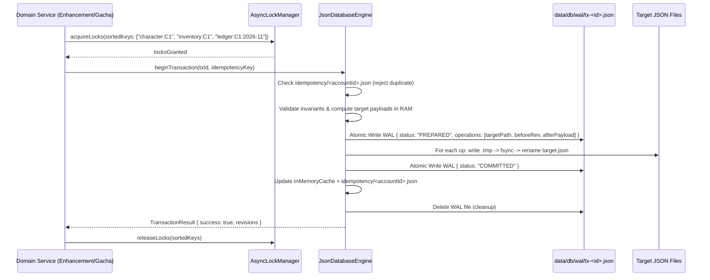
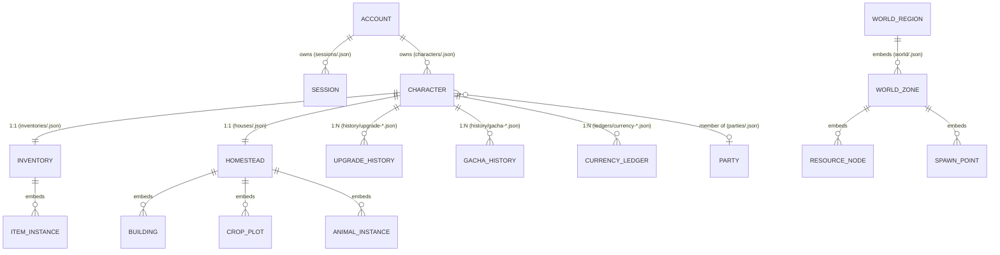

# Database Architecture Design — 100% JSON-Only Local Database Engine

**Trạng thái**: Design Baseline v2.0 (Cập nhật theo Hiến pháp v2.0.0 — JSON Primary DB + Local Docker Redis & MinIO)  
**Cập nhật lần cuối**: 2026-11-19  
**Ràng buộc Hiến pháp**: Nguyên tắc I (*JSON-Only Primary Persistent Database + Self-Hosted Local Docker Redis & MinIO — NON-NEGOTIABLE*), [ADR-001](./architecture-decisions/ADR-001-json-only-local-database.md), [ADR-007](./architecture-decisions/ADR-007-local-docker-redis-minio-and-glitch-free-2d-pipeline.md)

---

## 1. Tuyên bố Kiến trúc Lưu trữ (Storage Mandate)

**Eldoria: Forgotten Wilds** sử dụng **100% hệ thống tệp JSON cục bộ (`data/db/**/*.json`)** làm **cơ sở dữ liệu bền vững chính duy nhất** thông qua module nội bộ trong NestJS gọi là **`JsonDatabaseEngine`**.

- **KHÔNG sử dụng**: PostgreSQL, MySQL, MariaDB, MongoDB, SQLite, LevelDB, TypeORM, Prisma hay bất kỳ dịch vụ đám mây bên thứ ba nào (AWS S3 Cloud, Cloudflare R2, Firebase, Supabase, Auth0, Redis Cloud).
- **Bốn nguồn lưu trữ phân tách rạch ròi 100% cục bộ (Local Docker Compose)**:
  1. **Read-Only Game Content Catalog (`game-data/*.json`)**: 12 tệp dữ liệu tĩnh định nghĩa nhân vật, kỹ năng, quái, boss, vật phẩm, công thức, cây trồng, động vật, công trình, nhiệm vụ, loot table và banner gacha. Nạp toàn bộ vào RAM một lần khi khởi động và kiểm tra bằng JSON Schema validator.
  2. **Read/Write Primary Persistent Player & World Database (`data/db/**/*.json`)**: Toàn bộ trạng thái bền vững của người chơi, tài khoản, phiên gốc, kho đồ, nhà cửa, nông trại, sổ cái tiền tệ (phân mảnh per-character), lịch sử giao dịch và nhật ký kiểm toán.
  3. **Ephemeral Runtime Cache (`Local Docker Redis — redis:7-alpine`)**: CHỈ lưu trạng thái tạm thời có thể tái tạo 100% (hot session cache, online presence, party invites TTL 60s, rate-limit trượt, zone pub/sub). Mất/restart Redis tuyệt đối không làm mất dữ liệu trong `data/db/**/*.json`.
  4. **Local Object Asset & Backup Storage (`Local Docker MinIO — S3-compatible`)**: Bucket `eldoria-assets` (sprite atlases, tilesets, maps, audio) và bucket riêng tư `eldoria-backups` (bản sao lưu nén xoay vòng của `data/db/` song song với `data/backups/`).

---

## 2. Cấu trúc Phân vùng Thư mục `data/db/` (Aggregate-Sharded Layout)

Để tránh lỗi cổ chai của một tệp JSON đơn lẻ khổng lồ, cơ sở dữ liệu được phân mảnh theo từng Aggregate và theo thời gian:

```text
data/
├── db/
│   ├── meta/
│   │   ├── schema-manifest.json          # Phiên bản schema, lịch sử migration JSON, checksum chuẩn
│   │   └── id-sequences.json             # Bộ đếm sequence nội bộ (nếu cần), dự phòng UUIDv7
│   ├── indexes/                          # Chỉ mục phụ (Secondary Indexes) nạp RAM khi boot
│   │   ├── accounts-by-email.json        # { "<normalizedEmail>": "<accountId>" }
│   │   ├── accounts-by-username.json     # { "<normalizedUsername>": "<accountId>" }
│   │   ├── characters-by-account.json    # { "<accountId>": ["<charId1>", ...] }
│   │   ├── characters-by-name.json       # { "<normalizedCharName>": "<characterId>" }
│   │   ├── sessions-by-token-hash.json   # { "<sha256TokenHash>": "<sessionId>" }
│   │   └── idempotency/                  # Bộ lọc chống trùng giao dịch tách theo tài khoản (TTL 24h)
│   │       └── <accountId>.json          # { "<action>:<key>": IdempotencyRecord } — tránh khóa toàn cục
│   ├── accounts/
│   │   └── <accountId>.json              # Entity: Account (auth hash, roles, ban status)
│   ├── sessions/
│   │   └── <sessionId>.json              # Entity: Session (tokenHash, expiresAt, revoked)
│   ├── characters/
│   │   └── <characterId>.json            # Entity: Character + CharacterStat + CharacterSkill + Equipment + PlayerPosition + Quest + GachaPity
│   ├── inventories/
│   │   └── <characterId>.json            # Entity: Inventory + ItemInstance[] (tách riêng để khóa độc lập khi giao dịch/loot)
│   ├── houses/
│   │   └── <characterId>.json            # Entity: Homestead + Building[] + Crop[] + Animal[]
│   ├── world/
│   │   └── <regionId>.json               # Entity: WorldRegion + WorldZone[] + ResourceNode[] + SpawnPoint[] + BossRespawnState
│   ├── parties/
│   │   └── <partyId>.json                # Entity: Party (active persistent snapshot)
│   ├── ledgers/
│   │   └── currency-ledger-<characterId>-<YYYY-MM>.json # Entity: CurrencyLedger[] (phân mảnh theo nhân vật + tháng, loại bỏ cổ chai khóa toàn cục)
│   ├── history/
│   │   ├── upgrade-history-<characterId>.json # Entity: UpgradeHistory[]
│   │   └── gacha-history-<characterId>.json   # Entity: GachaHistory[]
│   ├── audit/
│   │   └── security-audit-<YYYY-MM-DD>.json   # Entity: SecurityAuditEvent[] (append-only theo ngày)
│   └── wal/
│       └── tx-<txId>.json                # Write-Ahead Log cho giao dịch đa tệp nguyên tử
└── backups/
    └── <YYYYMMDD-HHMMSS>/                # Bản sao lưu toàn bộ data/db/ xoay vòng cục bộ
```

### Lý do Tách Aggregate như trên
- **Tách `characters/<id>.json` khỏi `inventories/<id>.json` và `houses/<id>.json`**: Cho phép luồng lưu vị trí định kỳ (30s) ghi vào `characters/<id>.json` mà không cần đọc/ghi lại toàn bộ danh sách vật phẩm hay 60 ô cây trồng, đồng thời thu hẹp phạm vi khóa khi quay Gacha hay cường hóa vũ khí.
- **Tách `ledgers/` theo `<characterId>-<YYYY-MM>` và `idempotency/` theo `<accountId>`**: Loại bỏ hoàn toàn cổ chai khóa ghi toàn cục (global write mutex) khi 50–100+ người chơi đồng thời giao dịch, đồng thời ngăn tệp nhật ký phình to vô hạn sau nhiều tháng vận hành và cho phép tổng hợp kiểm toán/nén lưu trữ cục bộ theo kỳ dễ dàng.

---

## 3. Phân biệt Dữ liệu Bền vững (Persistent JSON) và Trạng thái Tạm thời (Ephemeral RAM)

| Hạng mục dữ liệu | Tầng lưu trữ | Tần suất cập nhật | Chính sách ghi đĩa JSON |
| :--- | :---: | :---: | :--- |
| Account, Session, Ban/Role | **Persistent JSON** | Khi đăng ký/đăng nhập/đổi mật khẩu | **Immediate Atomic Write** |
| Inventory, ItemInstance, Equipment, Currency | **Persistent JSON** | Khi nhặt đồ, rèn, cường hóa +1..+10, chế tạo, quay Gacha | **Immediate Multi-File WAL + Atomic Write** |
| UpgradeHistory, GachaHistory, CurrencyLedger | **Persistent JSON** | Gắn chung giao dịch với Inventory/Currency | **Immediate WAL + Atomic Append** |
| Building, Crop, Animal | **Persistent JSON** | Khi đặt/nâng cấp công trình, trồng/tưới/thu hoạch, cho ăn | **Immediate Atomic Write** (offline growth tính theo `serverTimestamp`) |
| Character Level, Stats, Skills, Quests, Pity | **Persistent JSON** | Khi lên cấp, học skill, xong quest, quay Gacha | **Immediate Atomic Write** (EXP quái lẻ flush theo dirty 30s) |
| PlayerPosition, Current HP/MP/Stamina | **Ephemeral RAM** + Dirty Checkpoint | 20 Hz trong RAM | **KHÔNG ghi theo tick**; flush nền mỗi **30 giây** nếu dirty + flush ngay khi chuyển zone/disconnect/shutdown |
| Monster AI State, Threat Table, Projectiles, Active Hitboxes, Cooldown Timers, Dropped Ground Loot | **Ephemeral RAM Only** | 20 Hz trong RAM | **Không lưu đĩa** (quái respawn theo `SpawnPoint`; ground loot chưa nhặt hết hạn sau 120s) |
| Chat Messages (Zone/Party), Online Presence, Party Invites | **Ephemeral RAM Only** (Audit log nếu vi phạm) | Realtime | **Không lưu đĩa** (chỉ giữ ring-buffer 50 tin gần nhất trong RAM zone) |

---

## 4. Kiến trúc `JsonDatabaseEngine` — Bảo đảm Nguyên tử, Đồng thời & Khôi phục

### 4.1 Chuẩn Envelope Bắt buộc cho Mọi Tệp JSON Persistent
Mọi tệp trong `data/db/` đều được bọc trong một vỏ chuẩn thống nhất:

```json
{
  "$schemaVersion": "1.0.0",
  "entityType": "InventoryAggregate",
  "entityId": "chr_01J9X7K2M4...",
  "revision": 42,
  "updatedAt": "2026-11-19T15:10:00.000Z",
  "checksumSha256": "e3b0c44298fc1c149afbf4c8996fb92427ae41e4649b934ca495991b7852b855",
  "data": { }
}
```

- **`revision`**: Số nguyên tăng đơn điệu (`revision + 1` mỗi lần ghi). Chống ghi đè sai thứ tự (Optimistic Concurrency Control).
- **`checksumSha256`**: Hash SHA-256 của chuỗi JSON canonical của trường `data`. Khi đọc từ đĩa, engine kiểm tra checksum; nếu phát hiện tệp bị hỏng (corruption) hoặc bị sửa tay trái phép, engine từ chối nạp, phát cảnh báo `CRITICAL` và hỗ trợ khôi phục từ `wal/` hoặc `data/backups/`.

### 4.2 Quy trình Ghi Đơn Tệp Nguyên tử (Single-File Atomic Write)
1. Validate payload đối chiếu JSON Schema (Zod/Ajv).
2. Tăng `revision`, cập nhật `updatedAt` (server UTC ISO-8601), tính `checksumSha256`.
3. Ghi dữ liệu ra tệp tạm cùng thư mục: `<target>.json.tmp.<txId>`.
4. Gọi `fileHandle.sync()` (`fsync`) để ép hệ điều hành đẩy bộ đệm xuống ổ đĩa.
5. Đóng `fileHandle` và gọi `fs.rename(<target>.json.tmp.<txId>, <target>.json)` — thao tác đổi tên nguyên tử trên cùng phân vùng ổ đĩa.
6. Cập nhật bản sao nóng trong `InMemoryAggregateCache`.

### 4.3 Quy trình Giao dịch Đa Tệp Nguyên tử (Multi-File WAL Two-Phase Commit)
Áp dụng bắt buộc cho: **Cường hóa vũ khí +1..+10**, **Quay Gacha**, **Chế tạo / Luyện kim**, **Xây dựng / Nâng cấp công trình**, **Nhận thưởng Quest/Boss**, **Tạo tài khoản / nhân vật** (cập nhật cả entity + index).



### 4.4 Cơ chế Khôi phục Sau Sự cố Khi Khởi động (Boot Crash Recovery)
Mỗi khi NestJS khởi động, **trước khi** mở cổng HTTP/WebSocket:
1. Quét toàn bộ tệp `*.tmp.*` mồ côi trong `data/db/` và xóa bỏ (do ghi dang dở trước khi rename).
2. Quét toàn bộ tệp `data/db/wal/tx-*.json` theo thứ tự timestamp tăng dần:
   - Nếu `status === "PREPARED"`: Kiểm tra `checksumSha256` của chính tệp WAL trước. Nếu WAL hợp lệ, thực hiện **Roll-Forward Lũy đẳng (Idempotent Replay)** cho từng mục trong `operations[]`: nếu tệp đích trên đĩa đã có `currentRevision >= op.afterEnvelope.revision` thì **bỏ qua an toàn (skip)**; ngược lại áp dụng atomic write (`tmp → fsync → rename`) từ `afterEnvelope`, cập nhật chỉ mục, sau đó xóa WAL. *(Nếu WAL bị cắt cụt / sai checksum WAL do sập nguồn giữa chừng lúc ghi WAL → xóa WAL hỏng, giữ nguyên trạng thái nhất quán cũ trên đĩa).*
   - Nếu `status === "COMMITTED"`: Chỉ cần xóa tệp WAL dọn dẹp.
3. Kiểm tra tính đồng bộ giữa `indexes/*.json` và các thư mục `accounts/`, `characters/`: nếu phát hiện index lệch hoặc thiếu (sau sự cố nặng), chạy `IndexRebuilder` quét tệp gốc tái tạo toàn bộ `indexes/*.json` tự động.

### 4.5 Kiểm soát Đồng thời & Chống Deadlock (Concurrency Control)
- **`AsyncLockManager`**: Mỗi tài nguyên có khóa dạng `<collection>:<id>` (ví dụ `character:chr_01`, `inventory:chr_01`, `house:chr_01`, `index:characters-by-name`).
- **Quy tắc Sắp xếp Khóa (Canonical Lock Ordering)**: Mọi giao dịch cần từ 2 khóa trở lên PHẢI yêu cầu khóa theo thứ tự bảng chữ cái (lexicographical order). Điều này loại bỏ toán học nguy cơ vòng chờ (deadlock).
- **Lock Timeout**: Thời gian chờ khóa tối đa `3000 ms`; vượt ngưỡng trả về lỗi tạm thời `ERR_CONCURRENT_LOCK_TIMEOUT` để client hiển thị thông báo thử lại an toàn.
- **Idempotency Guard**: Mọi request ghi quan trọng (Gacha, Enhance, Craft, Build, Loot Pickup) bắt buộc gửi `idempotencyKey` (UUIDv4 sinh trên client cho mỗi hành động bấm nút). Nếu server nhận trùng key trong cửa sổ 24 giờ, trả về kết quả đã lưu mà không trừ tiền/nguyên liệu lần hai.

---

## 5. Mô hình Quan hệ Thực thể Logic (Logical ERD cho JSON Collections)

Mặc dù lưu dưới dạng JSON (không dùng khóa ngoại SQL), tầng `JsonDatabaseEngine` thực thi **Referential Integrity** bằng logic domain và schema validator:



---

## 6. Ràng buộc Tính duy nhất, Chỉ mục & Chuyển đổi Phiên bản (Schema Migration & Seeding)

### 6.1 Ràng buộc Duy nhất (Unique Constraints via In-Memory + JSON Indexes)
| Ràng buộc | Tệp Chỉ mục JSON | Quy tắc chuẩn hóa |
| :--- | :--- | :--- |
| Email tài khoản duy nhất | `indexes/accounts-by-email.json` | `trim().toLowerCase()` |
| Username tài khoản duy nhất | `indexes/accounts-by-username.json` | `trim().toLowerCase()`, `[a-z0-9_]{3,24}` |
| Tên nhân vật duy nhất | `indexes/characters-by-name.json` | `trim().toLowerCase()`, 3–20 ký tự |
| `instanceId` vật phẩm duy nhất toàn cục | UUIDv7 sinh tại server | Không bao giờ tái sử dụng |
| `idempotencyKey` duy nhất trong 24h | `indexes/idempotency/<accountId>.json` | Khóa `<action>:<key>` phân mảnh theo tài khoản |

### 6.2 Chiến lược Migration Schema JSON (`JsonMigrationRunner`)
- Mỗi bản ghi mang `$schemaVersion` (SemVer, khởi đầu `"1.0.0"`).
- Khi nâng cấp phiên bản server (ví dụ lên `"1.1.0"`):
  1. Tự động tạo bản backup toàn bộ `data/db/` vào `data/backups/pre-migrate-v1.1.0-<ts>/`.
  2. Chạy migration scripts theo thứ tự trong `tools/migrations/` (hoặc lazy-upgrade khi đọc + background batch migration) cập nhật từng tệp JSON qua atomic write.
  3. Ghi kết quả vào `data/db/meta/schema-manifest.json`.
- **Chiến lược Seed dữ liệu (`JsonSeeder`)**: Khi `data/db/` còn trống ở lần chạy đầu, seeder tự khởi tạo `meta/schema-manifest.json`, các tệp `indexes/*.json` rỗng và khởi tạo trạng thái thế giới ban đầu `world/reg_greenhaven_village.json`, `world/reg_whispering_forest.json` từ định nghĩa bản đồ và `game-data/*.json`.

### 6.3 Chiến lược Sao lưu Cục bộ (Zero Third-Party Backup Rotation)
- **Tự động mỗi 6 giờ** (và trước mọi migration): `LocalBackupService` tạo bản chụp nhất quán (pause checkpoint flusher tạm thời trong vài trăm mili-giây hoặc copy từng tệp sau khi lấy read-lock) sang `data/backups/<YYYYMMDD-HHMMSS>/`.
- **Chính sách xoay vòng**: Giữ 4 bản gần nhất theo chu kỳ 6 giờ + 7 bản cuối ngày gần nhất; tự động xóa bản cũ hơn trong thư mục `data/backups/` (không bao giờ xóa `data/db/`).

---

## 7. Đánh giá Trung thực Giới hạn Hiệu năng & Tải của JSON Database (`proposed / unverified`)

*Theo Nguyên tắc VIII, toàn bộ số liệu dưới đây là ước tính thiết kế (`proposed / unverified`), bắt buộc đo kiểm thực tế trong kế hoạch `docs/testing/performance-test-plan.md`.*

| Mốc tải đồng thời (CCU) | Ước tính tần suất ghi JSON/giây (critical + checkpoint) | Dự báo độ trễ p95 trên NVMe SSD | Điểm nghẽn tiềm ẩn & Biện pháp giảm thiểu |
| :---: | :---: | :---: | :--- |
| **20 CCU** | ~2–5 ops/s | < 5 ms (`proposed`) | Dư dả tuyệt đối; không có tranh chấp khóa |
| **50 CCU (Mục tiêu MVP)** | ~6–15 ops/s | < 12 ms (`proposed`) | Cân bằng tốt; ledger và idempotency đã phân mảnh theo từng nhân vật/tài khoản nên không có tranh chấp khóa toàn cục |
| **100 CCU** | ~15–35 ops/s | < 20 ms (`proposed`) | Theo dõi kích thước `security-audit-YYYY-MM-DD.json` và hàng đợi `fsync` đĩa cục bộ; giữ tỷ lệ dirty flush phân bổ đều |
| **500 CCU (Stress Ceiling)** | ~80–180 ops/s | 40–120 ms (`unverified`, rủi ro cao) | Giới hạn `fsync` của hệ điều hành NTFS/ext4 và độ lớn index JSON → cần batch WAL group-commit (gom 10–20ms một lần `fsync`) và chia shard theo Region |

> **Cảnh báo thiết kế quan trọng**: Hệ thống **KHÔNG** tuyên bố đạt chuẩn MMO-scale hàng nghìn người chơi trên một tiến trình JSON đơn nút. Mọi mở rộng vượt 100–500 CCU phải dựa trên kết quả đo load test thực tế tại `performance-test-plan.md`.
