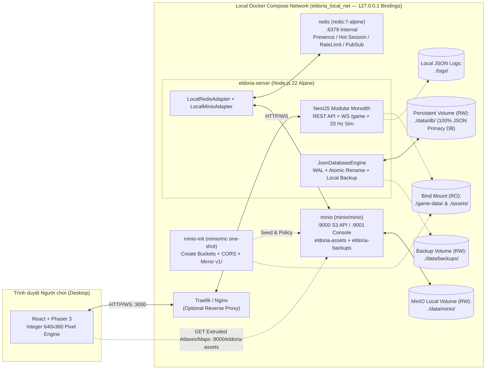

# Deployment & Operations Design — 100% Local Self-Hosted Docker Stack (JSON DB + Local Redis + Local MinIO)

**Trạng thái**: Design Baseline v2.0 (Cập nhật theo Hiến pháp v2.0.0 & `ADR-007`)  
**Cập nhật lần cuối**: 2026-11-19  
**Ràng buộc Hiến pháp**: Nguyên tắc I (*JSON-Only Primary Persistent Database + Self-Hosted Local Docker Redis & MinIO — Zero External Cloud/Third-Party Services*)

---

## 1. Triết lý Triển khai

Kiến trúc triển khai chạy **100% tự vận hành cục bộ trong Local Docker Compose** trên máy cá nhân (Local Dev/LAN) hoặc một máy chủ Linux/Windows VPS độc lập:
- **Primary Database**: 100% tệp JSON cục bộ gắn bind-mount `./data/db:/app/data/db` (KHÔNG có container PostgreSQL/MySQL/MongoDB/SQLite).
- **Local Runtime Cache**: Container **`redis:7-alpine`** chạy nội bộ Docker (chỉ chứa cache phiên nóng, online presence, rate-limit, pub/sub — có thể xóa trắng bất kỳ lúc nào mà không mất dữ liệu JSON).
- **Local Object Storage (S3-Compatible)**: Container **`minio/minio`** + sidecar **`minio-init`** (`minio/mc`) gắn volume `./data/minio:/data` để phục vụ kho hoạt ảnh 2D pixel art (`eldoria-assets`) và lưu bản sao lưu JSON (`eldoria-backups`).
- **0% Dịch vụ Đám mây Bên thứ ba**: Không AWS S3 Cloud, không Redis Cloud, không Firebase/Auth0/CDN ngoài.

---

## 2. Sơ đồ Topology Triển khai (Local Docker Compose)

---

## 3. Cấu hình Môi trường (Local Docker Compose Chuẩn & Dev Fallback)

### 3.1 Cấu hình Docker Compose Cục bộ Chuẩn (Khuyến nghị — 4 Container Nội bộ)
1. **`redis` (`redis:7-alpine`)**:
   - Port bind nội bộ `127.0.0.1:6379`, giới hạn `maxmemory 256mb`, policy `allkeys-lru` cho cache keyspace, healthcheck `redis-cli ping`.
2. **`minio` (`minio/minio`)**:
   - Port bind nội bộ `127.0.0.1:9000` (S3 API) và `127.0.0.1:9001` (Web Console quản trị cục bộ), gắn volume `./data/minio:/data`, healthcheck `/minio/health/live`.
3. **`minio-init` (`minio/mc`, one-shot container)**:
   - Chờ `minio` healthy → tự tạo bucket `eldoria-assets` (`anonymous set download` + cấu hình CORS `localhost`/`LAN`), tạo bucket riêng tư `eldoria-backups`, và đồng bộ thư mục `./assets/` lên prefix `v1/` kèm xác minh `manifest.json`.
4. **`eldoria-server` (Node.js 22 Alpine, user non-root `node`)**:
   - Chờ `redis` healthy + `minio-init` hoàn tất thành công → khởi chạy NestJS (phục vụ REST `/api/v1`, WebSocket `/game`, vòng lặp 20 Hz và `JsonDatabaseEngine` gắn `./data/db:/app/data/db` + `./data/backups:/app/data/backups`).
5. **`traefik` (tùy chọn khi public LAN/HTTPS)**: Reverse proxy cục bộ cấp TLS và nén Brotli.

### 3.2 Biến Môi trường Chuẩn (`.env.example` — Không commit secret thật)
- `NODE_ENV=development|production` · `PORT=3000` · `JWT_ACCESS_SECRET=<random-64-hex>`
- `DATA_DB_DIR=/app/data/db` · `DATA_BACKUP_DIR=/app/data/backups` · `GAME_DATA_DIR=/app/game-data` · `ASSETS_DIR=/app/assets`
- `REDIS_ENABLED=true` · `REDIS_URL=redis://redis:6379` · `REDIS_KEY_PREFIX=eldoria:`
- `ASSET_STORAGE_MODE=minio` (`minio | local_fs` cho unit test nhẹ không cần Docker)
- `MINIO_ENDPOINT=http://minio:9000` · `MINIO_PUBLIC_URL=http://localhost:9000` · `MINIO_BUCKET_ASSETS=eldoria-assets` · `MINIO_BUCKET_BACKUPS=eldoria-backups`
- `SIM_TICK_HZ=20` · `SNAPSHOT_HZ=10` · `DIRTY_FLUSH_INTERVAL_MS=30000` · `BACKUP_INTERVAL_HOURS=6`

---

## 4. Vận hành, Sao lưu & Khôi phục Dữ liệu JSON (`data/db/`)

### 4.1 Quy trình Backup Tự động (Local Rotating Snapshots)
- Chu kỳ mặc định: mỗi **6 giờ** + 1 bản chụp trước khi chạy bất kỳ Schema Migration nào.
- Thư mục đích: `data/backups/YYYYMMDD-HHMMSS/` kèm tệp `backup-manifest.json` ghi số lượng tệp, tổng dung lượng và `sha256` tổng thể.
- Chính sách giữ bản lưu: 4 bản 6-giờ gần nhất + 7 bản cuối ngày gần nhất. Khuyến nghị quản trị viên copy định kỳ thư mục `data/backups/` sang ổ đĩa vật lý dự phòng khác (off-machine copy) bằng `rsync`/`robocopy` nội bộ.

### 4.2 Quy trình Khôi phục Thảm họa (Disaster Recovery Runbook)
1. Dừng tiến trình `eldoria-server` sạch sẽ.
2. Đổi tên `data/db` bị sự cố thành `data/db.corrupted.<timestamp>` (TUYỆT ĐỐI không xóa ngay để phục vụ điều tra).
3. Copy bản chụp sạch gần nhất từ `data/backups/<YYYYMMDD-HHMMSS>/` vào `data/db/`.
4. Chạy công cụ kiểm tra toàn vẹn cục bộ (`verify-json-db` script) xác nhận 100% checksum và index hợp lệ.
5. Khởi động lại `eldoria-server` và xác minh endpoint `/api/v1/health`.

---

## 5. Giám sát Cục bộ (Local Observability — Không dùng SaaS ngoài)

- **Structured JSON Logs (`logs/server-YYYY-MM-DD.jsonl`)**: Ghi log định dạng JSON phân cấp (`INFO`, `WARN`, `ERROR`, `SECURITY`), xoay vòng tệp hàng ngày tối đa 14 ngày.
- **Metrics Endpoint nội bộ (`/internal/metrics`, chỉ bind `127.0.0.1`)**:
  - `sim_tick_duration_ms` (p50, p95, p99)
  - `active_ws_connections`, `players_per_zone`, `active_dungeon_instances`
  - `json_db_write_latency_ms`, `json_db_lock_wait_ms`, `wal_pending_count`, `dirty_flush_batch_size`
  - `process_heap_used_mb`, `event_loop_lag_ms`
- **Cảnh báo ngưỡng vận hành (`proposed`)**:
  - Cảnh báo `WARN` khi `sim_tick_duration_p99 > 30 ms` hoặc `json_db_write_p95 > 25 ms` hoặc dung lượng ổ đĩa trống `< 15%`.
  - Cảnh báo `CRITICAL` khi phát hiện lỗi checksum tệp JSON hoặc không thể ghi WAL (tự động chuyển sang chế độ chỉ đọc an toàn `SAFE_READ_ONLY` để bảo vệ dữ liệu không bị mất).
