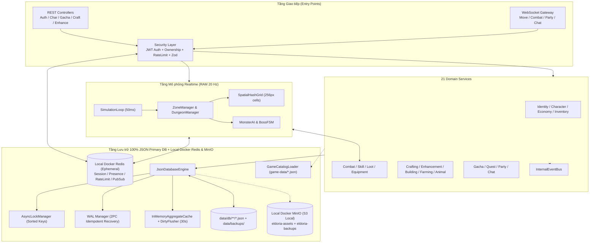
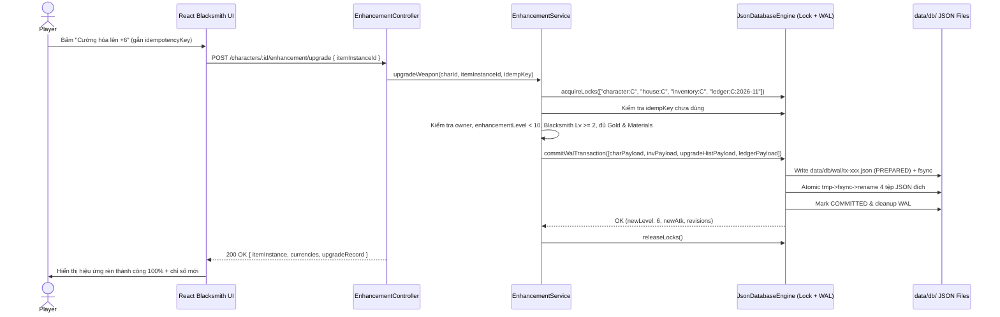
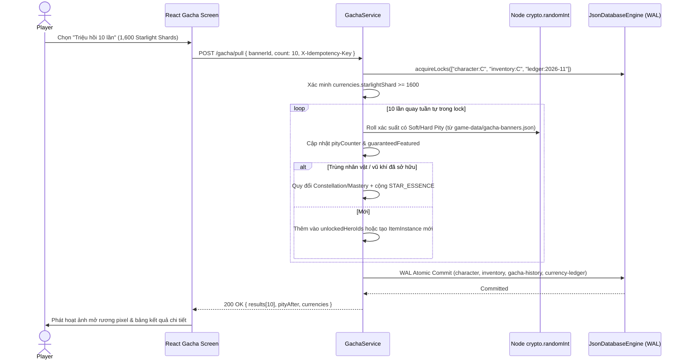
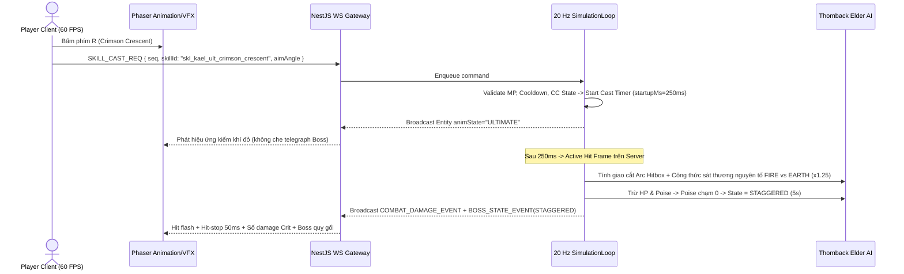
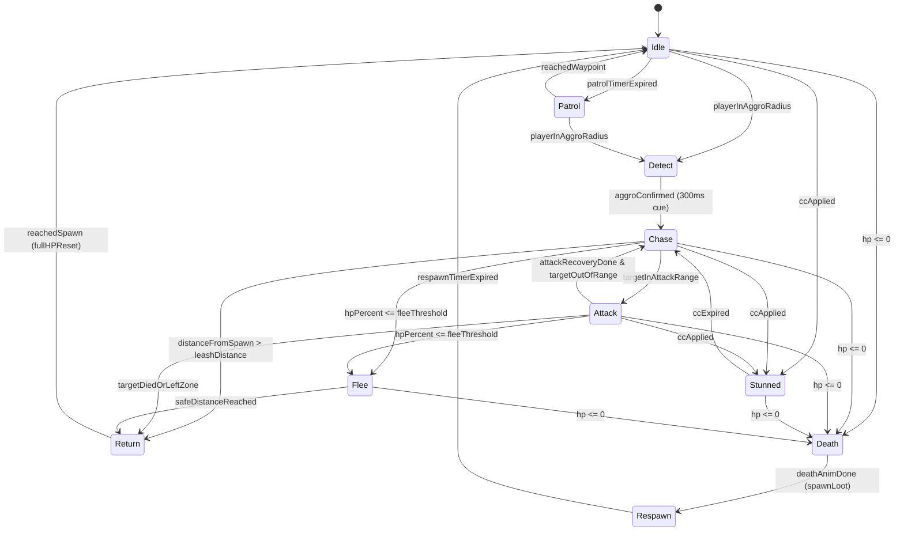
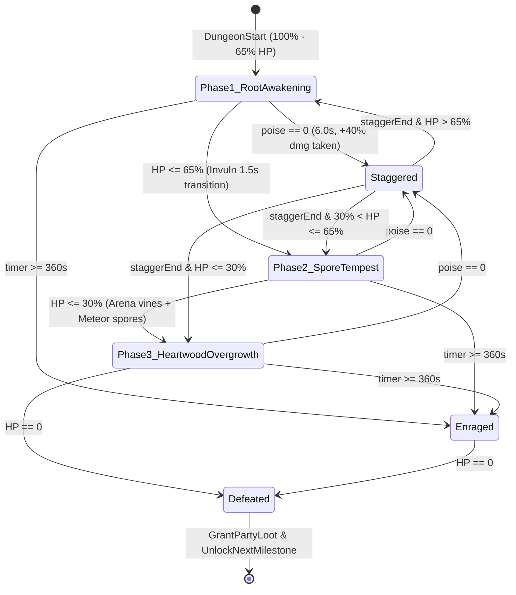
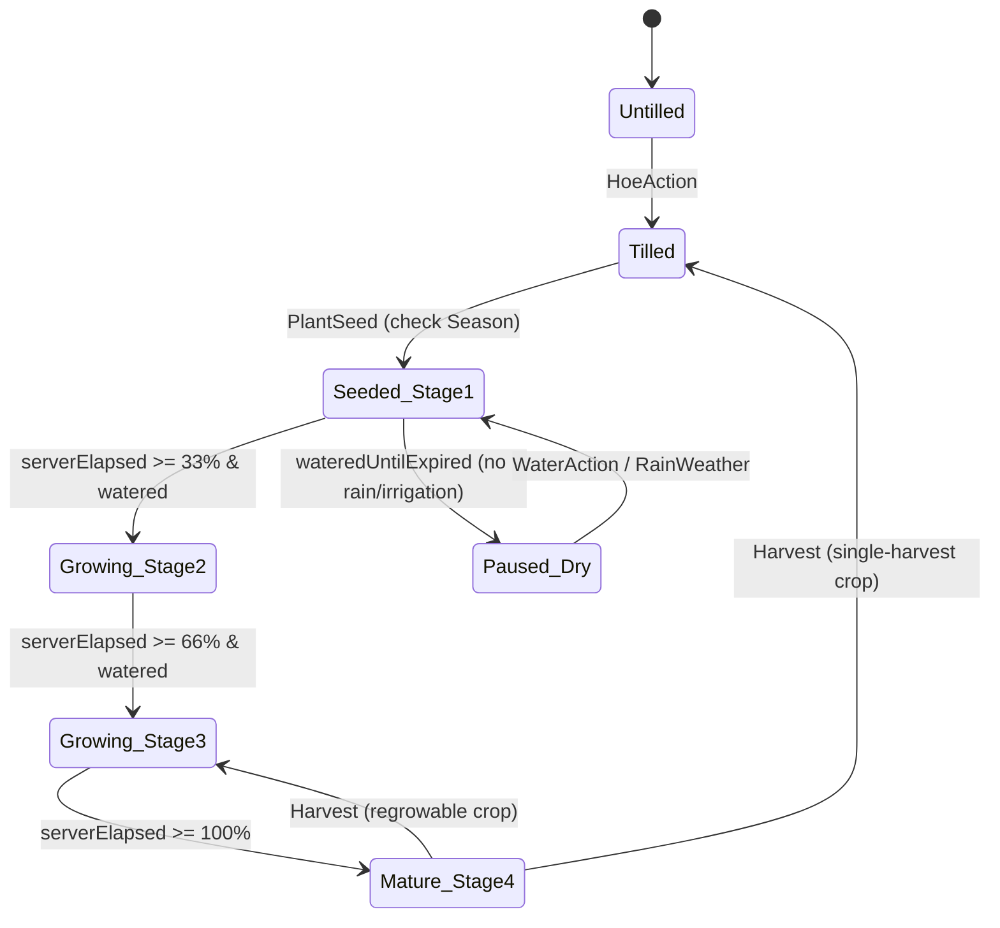

# Architecture Diagrams Collection — Eldoria: Forgotten Wilds

**Trạng thái**: Design Baseline v1.0  
**Cập nhật lần cuối**: 2026-11-19  
**Bao gồm**: C4 Component Diagram, Sequence Diagrams (Combat, Gacha, Weapon Enhancement, Reconnect), State Machine Diagrams (Player, Monster AI, Boss Multi-Phase, Building/Crop), Deployment Diagram.

---

## 1. C4 Component Diagram — NestJS Modular Monolith & `JsonDatabaseEngine`

---

## 2. Sequence Diagram — Cường hóa Vũ khí `+0 → +10` Nguyên tử trên JSON DB

---

## 3. Sequence Diagram — Quay Gacha Công bằng (10x Pull + Pity + Duplicate Conversion)

---

## 4. Sequence Diagram — Chiến đấu Action Combat & Xác thực Hitbox trên Server

---

## 5. State Machine Diagrams

### 5.1 Monster AI State Machine (10 Trạng thái chuẩn Mục 15)

### 5.2 Boss Multi-Phase State Machine (`boss_thornback_elder` — Khớp `game-data/bosses.json`)

### 5.3 Crop & Offline Server-Time State Machine

