# Realtime Game Server Architecture — 20 Hz Simulation Loop & World Partitioning

**Trạng thái**: Design Baseline v1.0  
**Cập nhật lần cuối**: 2026-11-19  
**Tham chiếu**: [ADR-002](./architecture-decisions/ADR-002-modular-monolith-and-20hz-loop.md), [ADR-003](./architecture-decisions/ADR-003-server-authoritative-combat-and-sync.md), [ADR-006](./architecture-decisions/ADR-006-in-process-world-partitioning.md)

---

## 1. Phân tách Tốc độ Mô phỏng (20 Hz) và Tốc độ Render (60 FPS)

| Đặc tính | Server Simulation (`apps/game-server`) | Snapshot Broadcast | Client Rendering (`apps/client`) |
| :--- | :---: | :---: | :---: |
| **Tần suất mục tiêu** | **20 Hz** (`dt = 50 ms`) (`proposed`) | **10 Hz** (`100 ms`, cấu hình độc lập) (`proposed`) | **60 FPS** (`16.67 ms`) (`proposed`) |
| **Vai trò** | Tính vật lý di chuyển, va chạm, hitbox, AI quái, Boss phase, regen, buff/debuff | Gom thay đổi (delta) theo interest management và gửi qua WebSocket | Vẽ tilemap pixel 2.5D, nội suy (interpolation), dự đoán cục bộ (prediction), VFX, animation |
| **Lý do tách biệt** | Giữ CPU ổn định cho nhiều Zone trong 1 tiến trình Node.js và giảm rác GC | Giảm 50% băng thông WebSocket so với broadcast 20 Hz mà vẫn mượt nhờ buffer 100 ms | Đảm bảo hình ảnh và phản hồi bàn phím/chuột mượt trên màn hình 60Hz+ |

---

## 2. Cấu trúc Vòng lặp Server 20 Hz (`SimulationLoop`)

Mỗi `ZoneInstance` (Open-World Zone, Homestead Instance đang hoạt động, hoặc Dungeon Instance) thực hiện đúng 8 pha tuần tự trong mỗi tick `50 ms`:

```mermaid
flowchart LR
    T1["1. Drain Input Queue<br/>(Move, Attack, Skill, Dodge)"] --> T2["2. Movement & Collision<br/>(Tiled Grid + Speed Cap)"]
    T2 --> T3["3. Update SpatialHashGrid<br/>(256x256 px Cells)"]
    T3 --> T4["4. Combat & Skill Timers<br/>(Startup->Active->Recovery + Hitbox)"]
    T4 --> T5["5. Status Effects & Regen<br/>(DoT, Buff, Stun, MP/Stamina)"]
    T5 --> T6["6. Monster AI & Boss FSM<br/>(Aggro, Leash, Telegraph, Phases)"]
    T6 --> T7["7. World & Loot Timers<br/>(Respawn, Ground Loot Expiry)"]
    T7 --> T8["8. Broadcast & Dirty Mark<br/>(10 Hz Delta Snapshot + RAM Dirty Flag)"]
```

### Quy tắc An toàn Vòng lặp
- **Drift Compensation**: Sử dụng đồng hồ đơn điệu `process.hrtime.bigint()` tính phần dư tích lũy (`accumulator`); giới hạn tối đa `maxCatchUpTicks = 2` mỗi chu kỳ để tránh "vòng xoáy tử thần" (spiral of death) khi hệ điều hành có spike CPU.
- **Tick Budget Monitoring**: Đo thời lượng mỗi tick; nếu `tickDurationMs > 35 ms` trong 10 tick liên tiếp → ghi log cảnh báo `SIM_TICK_OVERLOAD` kèm `zoneId`, `entityCount`, `playerCount`.
- **Tuyệt đối không I/O đĩa trong Tick**: Mọi sự kiện cần lưu JSON (chết/hồi sinh, nhặt đồ, hạ Boss, lên cấp) được đẩy vào hàng đợi bất đồng bộ của `JsonDatabaseEngine`; tọa độ chỉ gán cờ `dirtyPosition = true` để `CheckpointFlusher` ghi mỗi `30 giây`.

---

## 3. Vòng đời Thực thể (Entity Lifecycle)

| Loại Thực thể | Khởi tạo (Spawn) | Hoạt động (Active) | Hủy / Dọn dẹp (Despawn) |
| :--- | :--- | :--- | :--- |
| **PlayerEntity** | Sau `WS_AUTH_OK` & nạp `characters/<id>.json` + `inventories/<id>.json` vào RAM | Nhận input, đồng bộ snapshot, tương tác thế giới | Sau disconnect (+ `5s` Combat Logout Grace nếu đang trong combat) → flush JSON → giải phóng khỏi Zone |
| **MonsterEntity** | Từ `SpawnPoint` khi Zone khởi tạo hoặc hết `respawnSeconds` | Chạy FSM 10 trạng thái (`Idle..Death`) | Khi HP = 0 → phát `MonsterKilledEvent` → tạo `GroundLoot` → chờ `respawnSeconds` rồi reset |
| **BossEntity** | Khi `DungeonInstance` mở hoặc hết `worldRespawnMinutes` | Chạy Multi-phase FSM + Poise/Stagger + Enrage timer | Khi HP = 0 → cấp thưởng công bằng theo Party/Eligibility → đánh dấu Dungeon Cleared |
| **ProjectileEntity** | Tại đúng `projectileSpawnFrame` của `SkillExecutor` trên server | Di chuyển theo vector tốc độ, kiểm tra va chạm tường/mục tiêu mỗi tick | Khi trúng mục tiêu (đủ pierce), chạm tường hoặc hết `rangePx / speed` |
| **GroundLootEntity** | Sau khi `LootService` roll `loot-tables.json` | Chờ `LOOT_PICKUP_REQ` từ `eligibleCharacterIds` | Khi được nhặt (xóa nguyên tử trước khi ghi inventory) hoặc hết `120 giây` TTL |

---

## 4. Interest Management theo Spatial Hash Grid

- Mỗi Zone chia thành các ô vuông `256 × 256 px` (`8 × 8` tiles).
- Khi thực thể di chuyển qua biên ô, cập nhật cặp khóa `cellKey = "${cx}:${cy}"` trong `O(1)`.
- Ở mỗi chu kỳ broadcast `10 Hz`:
  - Với mỗi người chơi ở ô `(cx, cy)`, thu thập danh sách thực thể trong cụm `5 × 5` ô xung quanh (`cx-2..cx+2`, `cy-2..cy+2` → vùng quan sát `1280 × 1280 px`, dư đệm cho viewport `640 × 360 px`).
  - So sánh với tập `lastVisibleEntityIds` của socket đó để sinh gói **Delta Snapshot**:
    - `entered[]`: đầy đủ dữ liệu khởi tạo của thực thể mới lọt vào tầm nhìn.
    - `updated[]`: chỉ các trường thay đổi (`id`, `x`, `y`, `facing`, `animState`, `hp` nếu đổi) — giảm 60–80% kích thước JSON so với full snapshot.
    - `left[]`: chỉ mảng ID các thực thể vừa rời tầm nhìn hoặc despawn.

---

## 5. Xử lý Lộ trình Tải & Mở rộng (Capacity Roadmap — `proposed / unverified`)

| Mốc CCU | Cấu hình dự kiến (`proposed`) | Phân bố Zone giả định | Phương án kiểm chứng |
| :---: | :--- | :--- | :--- |
| **20 CCU** | 1 tiến trình NestJS (2 vCPU, 2 GB RAM, SSD) | 1 Village + 1 Forest + 2 Dungeons | Load test bot WebSocket 30 phút (kịch bản hỗn hợp di chuyển + đánh quái + chế tạo) |
| **50 CCU (Mục tiêu MVP)** | 1 tiến trình NestJS (4 vCPU, 4 GB RAM, NVMe SSD) | 1 Village + 1 Forest + 5 Dungeons + 10 Homesteads | Đo p99 tick < 25 ms, JSON WAL commit p95 < 15 ms, không rò rỉ RAM |
| **100 CCU** | 1 tiến trình NestJS (4 vCPU, 8 GB RAM, NVMe SSD) | 2 Regions + 12 Dungeons + 25 Homesteads | Kiểm chứng giới hạn Spatial Grid + chia nhỏ file ledger JSON theo ngày nếu cần |
| **500 CCU (Stress Ceiling)** | 1 tiến trình chính (8 vCPU, 16 GB RAM, NVMe) hoặc phân kênh (Channel 1..N cùng đọc/ghi có điều phối) | Toàn bộ 8 Regions giả lập | Xác định điểm gãy thực tế của single-node JSON `fsync` để làm cơ sở thiết kế Sharding ở M5 |
