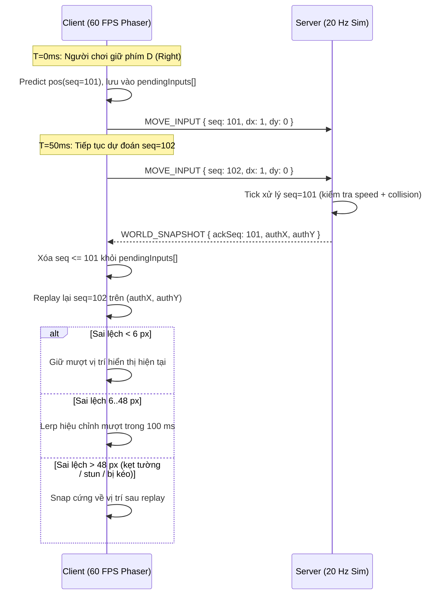

# Network Protocol, Prediction, Reconciliation & Resilience

**Trạng thái**: Design Baseline v1.0  
**Cập nhật lần cuối**: 2026-11-19  
**Tham chiếu**: [ADR-003](./architecture-decisions/ADR-003-server-authoritative-combat-and-sync.md), [`websocket-contracts.md`](./websocket-contracts.md)

---

## 1. Giao thức Truyền tải & Vỏ Gói tin (Transport & Envelope)

- **Giao thức**: WebSocket (`WSS` trên production / `WS` trên localhost) với khung JSON UTF-8 chuẩn, tương thích trực tiếp TypeScript monorepo (`packages/shared`).
- **Phiên bản giao thức**: Mọi kết nối bắt tay (handshake) kiểm tra `protocolVersion: "1.0"`. Nếu client cũ hơn ngưỡng tương thích tối thiểu, server từ chối lịch sự với mã `ERR_PROTOCOL_OUTDATED` để nhắc tải lại trình duyệt.
- **Vỏ gói tin thống nhất**:
  ```json
  {
    "v": 1,
    "type": "MOVE_INPUT",
    "seq": 1482,
    "ts": 1795104200150,
    "payload": { }
  }
  ```

---

## 2. Cơ chế Đồng bộ Thời gian, Sequence & Input Acknowledgment

1. **Clock Sync (Ping/Pong Heartbeat)**:
   - Mỗi `5 giây`, client gửi `PING { clientTs }` → server trả ngay `PONG { clientTs, serverTs, serverTick }`.
   - Client tính `rttMs = now - clientTs` và độ lệch đồng hồ `clockOffsetMs = serverTs - (clientTs + rttMs / 2)` (lọc trung vị 5 mẫu gần nhất) để đồng bộ đồng hồ đếm ngược Boss Telegraph, Cooldown và hiệu ứng ngày/đêm.
2. **Sequence Number (`seq`)**:
   - Mỗi gói input từ client mang `seq` tăng đơn điệu (`1, 2, 3...`).
   - Server trả lại `lastProcessedSeq` trong mỗi `WORLD_SNAPSHOT` dành riêng cho người chơi đó để client biết những input nào đã được xác nhận và loại bỏ chúng khỏi bộ đệm dự đoán (`pendingInputs[]`).

---

## 3. Client-Side Prediction & Server Reconciliation (Chi tiết Thuật toán)



---

## 4. Xử lý Độ trễ (Latency), Jitter, Mất gói (Packet Loss) & Ngắt kết nối

| Tình huống mạng | Hành vi dự kiến của Client & Server |
| :--- | :--- |
| **Latency ổn định (30–120 ms)** | Prediction che giấu độ trễ di chuyển; Entity Interpolation `100 ms` giữ chuyển động người chơi khác & quái mượt mà; Boss Telegraph hiển thị theo `serverTs` đủ dài (`800–1500 ms`) để người chơi ping 120 ms vẫn kịp dodge. |
| **Latency cao (150–300 ms)** | HUD hiển thị biểu tượng ping vàng; tăng tự động bộ đệm interpolation lên `150 ms` để tránh giật hình; server nới nhẹ cửa sổ chấp nhận độ trễ input hướng (không bao giờ nới giới hạn tốc độ hay hitbox). |
| **Jitter / Đảo thứ tự gói** | Server bỏ qua các gói `MOVE_INPUT` có `seq <= lastProcessedSeq`; nếu client mất vài gói snapshot, gói `WORLD_SNAPSHOT` kế tiếp chứa cờ `deltaBaseTick` — nếu client thấy bị khuyết `deltaBaseTick`, gửi `SNAPSHOT_RESYNC_REQ` để nhận ngay 1 Full Snapshot. |
| **Mất gói trên lệnh quan trọng** | Các lệnh kinh tế/chiến đấu quan trọng (`SKILL_CAST_REQ`, `LOOT_PICKUP_REQ`, `CRAFT_REQ`, `ENHANCE_REQ`, `BUILDING_PLACE_REQ`) yêu cầu gói phản hồi `*_ACK` có `requestId` / `idempotencyKey`. Client chờ tối đa `3s` trước khi cho phép gửi lại cùng `idempotencyKey` (an toàn 100%, không thực thi 2 lần). |
| **Ngắt kết nối (Disconnect) & Reconnect** | Server giữ trạng thái nhân vật trong `5s` nếu đang trong combat (chống Alt+F4 né chết), giữ chỗ trong `Party` và `DungeonInstance` suốt **`120 giây`**. Khi client kết nối lại trong 120 giây với `SESSION_RESUME`, server đưa nhân vật quay lại đúng Zone/Dungeon (nếu instance còn sống) hoặc điểm hồi sinh an toàn gần nhất và gửi toàn bộ trạng thái mới nhất từ RAM/JSON. |
| **Concurrent Requests** | Mọi hành động ghi đồng thời từ cùng nhân vật được tuần tự hóa qua `AsyncLockManager` và lọc bằng `idempotencyKey`; nếu hàng đợi vượt 3 lệnh song song sẽ trả ngay `429 / ERR_REQUEST_IN_FLIGHT`. |

---

## 5. Tối ưu Băng thông & Delta Compression

- **Mã hóa số thực gọn**: Tọa độ `x, y` làm tròn nguyên pixel (`integer`), góc `aimAngle` làm tròn 2 chữ số thập phân (`radians`), rút ngắn tên trường trong gói `WORLD_SNAPSHOT` nóng nếu cần hoặc giữ khóa ngắn rõ ràng (`id`, `x`, `y`, `f`, `st`, `hp`, `mhp`).
- **Tách kênh tần suất cao và thấp**:
  - Kênh nóng (`10 Hz`): Chỉ gửi chuyển động, hướng, trạng thái animation, HP/Poise thay đổi.
  - Kênh sự kiện (Event-driven): `COMBAT_DAMAGE_EVENT`, `LOOT_SPAWNED`, `CHAT_MESSAGE`, `INVENTORY_PATCH`, `QUEST_PROGRESS` chỉ phát khi thực sự xảy ra.
- **Ước tính băng thông (`proposed / unverified`)**: Với mật độ 20 thực thể trong vùng quan sát `5x5` ô, một gói delta snapshot trung bình `~0.8 – 1.5 KB` ở `10 Hz` ≈ `8 – 15 KB/s` mỗi client (hoàn toàn nhẹ cho kết nối internet gia đình).
