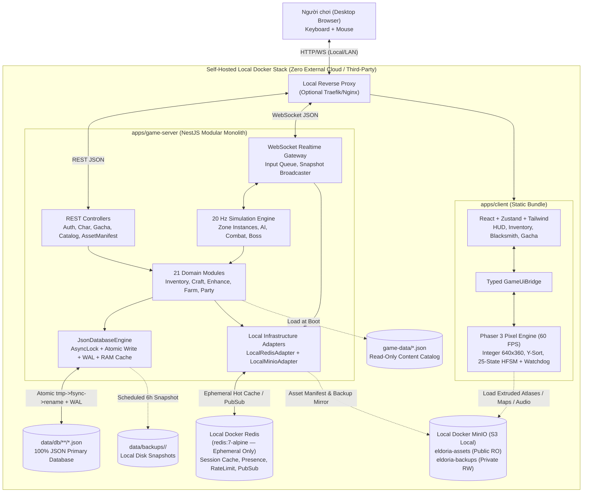

# System Architecture Overview — Eldoria: Forgotten Wilds

**Trạng thái**: Design Baseline v2.0 (Cập nhật theo Hiến pháp v2.0.0 — Local Docker Redis + MinIO)  
**Cập nhật lần cuối**: 2026-11-19  
**Tham chiếu**: [Constitution v2.0.0](../../.specify/memory/constitution.md), [ADR-001](./architecture-decisions/ADR-001-json-only-local-database.md), [ADR-002](./architecture-decisions/ADR-002-modular-monolith-and-20hz-loop.md), [ADR-007](./architecture-decisions/ADR-007-local-docker-redis-minio-and-glitch-free-2d-pipeline.md)

---

## 1. Tổng quan Kiến trúc Hệ thống

**Eldoria: Forgotten Wilds** được thiết kế theo mô hình **Server-Authoritative Modular Monolith** tự chủ hoàn toàn trong **Local Docker Compose** (Zero External Cloud/Third-Party Services), vận hành trên **JSON-Only Local Primary Persistent Database (`data/db/**/*.json`)** kết hợp **Local Docker Redis** (bộ nhớ đệm runtime tạm thời) và **Local Docker MinIO S3-compatible** (kho phân phát tài nguyên 2D pixel art & sao lưu cục bộ):

1. **Client Tier (`apps/client`)**: Ứng dụng web React + Vite + TypeScript nhúng **Phaser 3** (render 2D/2.5D pixel-perfect 60 FPS, `640×360` integer scaling, 25-state HFSM + Anti-Stuck Watchdog) và **React + Zustand + Tailwind CSS** (UI RPG hướng sự kiện).
2. **Game Server Tier (`apps/game-server`)**: Tiến trình **NestJS** chứa REST API (xác thực, tạo nhân vật, lịch sử, gacha, truy vấn catalog/asset manifest) và **Realtime Simulation Engine (20 Hz)** qua WebSocket (`Socket.IO` / `ws` adapter).
3. **3-Tier Local Persistence, Runtime Cache & Object Asset Tier (100% Self-Hosted Local Docker)**:
   - **Read-Only Game Catalog (`game-data/*.json`)**: 12 tệp cấu hình cân bằng chuẩn.
   - **Primary Persistent JSON Database (`data/db/**/*.json`)**: Nguồn chân lý bền vững duy nhất, quản lý bởi `JsonDatabaseEngine` với `AsyncLockManager`, Atomic Write (`tmp -> fsync -> rename`), JSON WAL 2PC và sao lưu cục bộ (`data/backups/`).
   - **Local Docker Redis (`redis:7-alpine`)**: Trạng thái runtime tạm thời có thể tái tạo (hot session cache, online presence, party invites TTL `60s`, sliding-window rate limit, zone pub/sub) với cơ chế fallback về RAM nếu restart.
   - **Local Docker MinIO (`minio/minio`, S3 API cục bộ)**: Bucket `eldoria-assets` (sprite sheets, texture atlases `extrude:1px/padding:2px`, Tiled maps `.tmj`, SFX/BGM, local fonts, `manifest.json`) và bucket riêng tư `eldoria-backups` (bản chụp xoay vòng nén của `data/db/`).

---

## 2. Sơ đồ C4 — Context & Container



---

## 3. Cấu trúc Monorepo Chuẩn

```text
eldoria/
├── apps/
│   ├── client/                   # React + Vite + TypeScript + Phaser 3 + Zustand + Tailwind
│   └── game-server/              # NestJS Modular Monolith + 20 Hz Simulation + JsonDatabaseEngine
├── packages/
│   ├── shared/                   # Shared TS types, WebSocket/REST DTOs, Combat math, Collision math, Enums
│   └── game-config/              # JSON Schema validators (Zod/Ajv) & typed loaders cho game-data/*.json
├── game-data/                    # Single Source of Truth (12 canonical JSON catalog files)
├── data/                         # Runtime local JSON database (KHÔNG commit vào Git)
│   ├── db/                       # Persistent JSON aggregates, indexes, WAL, ledgers, audit
│   └── backups/                  # Rotating local JSON snapshots
├── assets/                       # Local static game assets (atlases, sprites, maps, audio, local fonts)
├── docs/                         # Toàn bộ hồ sơ thiết kế game, art, UI/UX, architecture, balancing, QA
├── specs/                        # Spec Kit 12 feature directories (001..012)
└── tools/
    └── design-validation/        # Script kiểm chứng JSON catalog, mô phỏng cân bằng & audit tài liệu
```

---

## 4. Ranh giới Phụ thuộc & Quy tắc Kiến trúc (Architectural Invariants)

1. **`packages/shared` là thuần túy (Pure TypeScript, Zero Runtime IO)**: Chứa công thức tính sát thương/chỉ số, hàm tính va chạm tilemap, định nghĩa enum và hợp đồng gói tin. Cả client (dự đoán hiển thị) và server (tính toán chuẩn) cùng import để loại bỏ lệch logic.
2. **Phụ thuộc một chiều (Acyclic Dependency Direction)**:
   - `apps/client` → `packages/shared`, `packages/game-config` (chỉ đọc catalog công khai, KHÔNG truy cập `data/db/`).
   - `apps/game-server` → `packages/shared`, `packages/game-config`, `JsonDatabaseEngine`.
   - CẤM circular dependency giữa các NestJS module; sử dụng `InternalEventBus` (ví dụ `MonsterKilledEvent` → `QuestModule` & `LootModule` lắng nghe) để ngắt vòng lặp phụ thuộc.
3. **Không chặn Event Loop Node.js**: Mọi thao tác đọc/ghi đĩa của `JsonDatabaseEngine` đều dùng `fs.promises` bất đồng bộ (ngoại trừ bước phục hồi WAL lúc boot trước khi nhận traffic); băm mật khẩu `crypto.scrypt` chạy trên threadpool bất đồng bộ.
4. **Không có bất kỳ lời gọi mạng ra Internet nào (Air-Gapped Friendly)**: Toàn bộ hệ thống hoạt động trọn vẹn trong mạng cục bộ (localhost / LAN) hoặc VPS tự vận hành mà không cần kết nối dịch vụ bên thứ ba.

---

## 5. Tài liệu Kiến trúc Liên quan

- [Frontend Architecture (Phaser + React + Zustand)](./frontend-architecture.md)
- [Backend Modular Monolith Architecture (21 NestJS Modules)](./backend-architecture.md)
- [Realtime Game Server Architecture (20 Hz Loop & Interest Management)](./game-server-architecture.md)
- [Network Protocol & Reconciliation](./network-protocol.md)
- [Database Design (100% JSON Local Engine)](./database-design.md)
- [Data Dictionary (26 Entities)](./data-dictionary.md)
- [Security Architecture](./security-design.md) & [Anti-Cheat Design](./anti-cheat-design.md)
- [REST API Contracts](./api-contracts.md) & [WebSocket Contracts](./websocket-contracts.md)
- [Deployment Design (Self-Hosted)](./deployment-design.md)
- [Architecture Diagrams Collection](./diagrams/architecture-diagrams.md)
