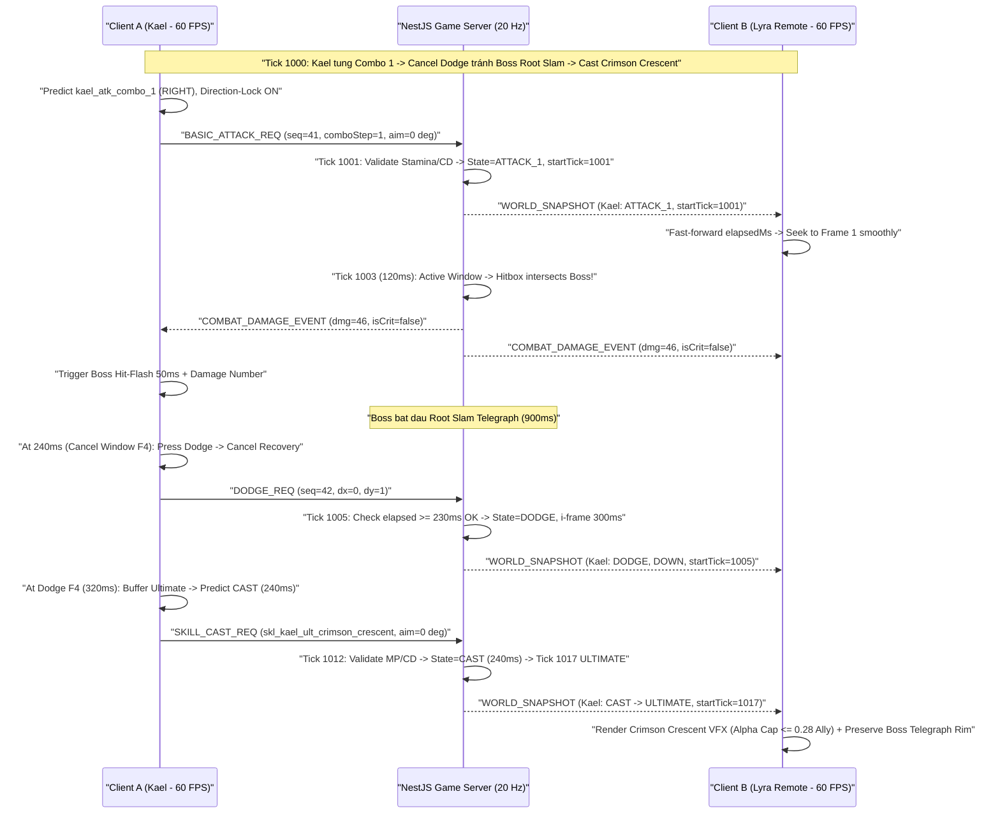

# Animation State Machine & Multiplayer Synchronization — Eldoria: Forgotten Wilds

**Trạng thái**: Design Baseline v1.0  
**Chế độ**: `DESIGN_AND_PLANNING_ONLY`  
**Cập nhật lần cuối**: 2026-11-19  
**Tài liệu liên kết**: [Animation Standard](./animation-standard.md), [Frontend Architecture](../architecture/frontend-architecture.md), [WebSocket Contracts](../architecture/websocket-contracts.md), [Constitution — Nguyên tắc II & IV](../../.specify/memory/constitution.md)

---

## 1. Kiến trúc State Machine Phân tầng (HFSM Overview)

Để giữ hành vi nhân vật sắc nét như game hành động offline nhưng vẫn đồng bộ chính xác trong môi trường online 20 Hz, `AnimationController.ts` trên Client Phaser triển khai **Hierarchical Finite State Machine (HFSM)** gồm 6 cụm siêu trạng thái (Super-States):

1. **`LIFECYCLE`** (`DEATH`, `RESPAWN`) — Quyền ưu tiên tuyệt đối.
2. **`CROWD_CONTROL`** (`STUN`, `KNOCKBACK`) — Cưỡng chế từ server, khóa mọi hành động chủ động.
3. **`COMBAT_COMMITTED`** (`ULTIMATE`, `DODGE`, `DASH`, `SKILL`, `CAST`, `ATTACK`, `ATTACK_COMBO`) — Có khóa hướng (`Direction-Lock`) và cửa sổ hủy (`Cancel Window`).
4. **`DEFENSE_REACTION`** (`BLOCK`, `HIT`) — Phòng thủ chủ động và khựng trúng đòn nhẹ.
5. **`LIFE_SIM`** (`MINING`, `WOODCUTTING`, `FARMING`, `FISHING`, `CRAFTING`, `BUILDING`, `INTERACT`) — Bị ngắt ngay bởi di chuyển, né đòn hoặc trúng đòn.
6. **`LOCOMOTION_IDLE`** (`SPRINT`, `RUN`, `WALK`, `IDLE`, `EMOTE`) — Trạng thái nền luôn sẵn sàng chuyển tức thì sang bất kỳ hành động nào.

---

## 2. Sơ đồ Trạng thái Animation (Mermaid State Machine Diagram)

```mermaid
stateDiagram-v2
    [*] --> RESPAWN : "Session Spawn / Revive"
    RESPAWN --> IDLE : "Respawn Complete (600ms)"

    state "LOCOMOTION_IDLE (Tier 0-1)" as LOCO {
        IDLE --> WALK : "Speed <= 95 px/s"
        IDLE --> RUN : "Move Input"
        WALK --> RUN : "Normal Speed"
        RUN --> SPRINT : "Hold Shift + Stamina > 0"
        SPRINT --> RUN : "Release Shift / Stamina = 0"
        WALK --> IDLE : "Velocity = 0"
        RUN --> IDLE : "Velocity = 0"
        SPRINT --> IDLE : "Velocity = 0"
        IDLE --> EMOTE : "Emote Trigger"
        EMOTE --> IDLE : "Any Input / Complete"
    }

    state "LIFE_SIM (Tier 2)" as LIFE {
        MINING
        WOODCUTTING
        FARMING
        FISHING
        CRAFTING
        BUILDING
        INTERACT
    }

    state "DEFENSE_REACTION (Tier 3-4)" as DEF {
        BLOCK
        HIT
    }

    state "COMBAT_COMMITTED (Tier 5-8)" as COMBAT {
        ATTACK --> ATTACK_COMBO : "Combo Input in Cancel Window"
        ATTACK_COMBO --> ATTACK_COMBO : "Hit 2 -> Hit 3 in Cancel Window"
        CAST --> SKILL : "Cast Complete (Active Skill)"
        CAST --> ULTIMATE : "Cast Complete (Ultimate)"
        DODGE
        DASH
    }

    state "CROWD_CONTROL (Tier 9)" as CC {
        KNOCKBACK
        STUN
    }

    LOCO --> LIFE : "Interact Node / Crop / Station"
    LIFE --> LOCO : "Complete / Move Input Cancel"
    LIFE --> DODGE : "Emergency Dodge Cancel"

    LOCO --> COMBAT : "Attack / Skill / Cast / Dodge / Ultimate"
    LOCO --> BLOCK : "Hold Block"
    BLOCK --> LOCO : "Release Block"
    BLOCK --> DODGE : "Dodge Cancel"
    BLOCK --> STUN : "Guard Break (Stamina = 0)"

    COMBAT --> DODGE : "Cancel Window Open (Tier 7 > Tier 5-6)"
    COMBAT --> LOCO : "Recovery Complete"

    LOCO --> HIT : "Take Damage (No Super Armor)"
    LIFE --> HIT : "Take Damage (Interrupt Gather)"
    HIT --> LOCO : "Flinch End (200ms)"
    HIT --> DODGE : "Cancel Window (120ms+)"

    LOCO --> CC : "Server Hard CC / Knockback"
    LIFE --> CC : "Server Hard CC / Knockback"
    DEF --> CC : "Server Hard CC / Knockback"
    COMBAT --> CC : "Server Hard CC (Except i-frame / Unstoppable Ult)"
    CC --> LOCO : "CC Duration Expired / Cleansed"

    LOCO --> DEATH : "Server PLAYER_DEATH (HP = 0)"
    LIFE --> DEATH : "Server PLAYER_DEATH (HP = 0)"
    DEF --> DEATH : "Server PLAYER_DEATH (HP = 0)"
    COMBAT --> DEATH : "Server PLAYER_DEATH (HP = 0)"
    CC --> DEATH : "Server PLAYER_DEATH (HP = 0)"
    DEATH --> RESPAWN : "Server PLAYER_RESPAWN"
```



---

## 3. Ma trận Ưu tiên & Quy tắc Chuyển đổi (Priority & Interrupt Matrix)

### 3.1 Bảng 11 Cấp Ưu tiên Chính thức (Priority Tiers)
Quy tắc bất biến: Một trạng thái mục tiêu $B$ **chỉ được phép cắt ngang tức thì** trạng thái hiện tại $A$ nếu $\text{Tier}(B) > \text{Tier}(A)$ **VÀ** $A$ không đang ở pha khóa bất khả xâm phạm (`Uninterruptible Active Window`), ngoại lệ duy nhất là `DEATH` (Tier 10) luôn cắt ngang mọi trạng thái.

| Priority Tier | Nhóm Trạng thái | Các State Thuộc Nhóm | Đặc tính Cắt ngang & Khóa |
| :---: | :--- | :--- | :--- |
| **Tier 10** *(Cao nhất)* | **Death / Respawn** | `DEATH`, `RESPAWN` | Ghi đè tuyệt đối mọi trạng thái; chỉ thoát `DEATH` khi có `PLAYER_RESPAWN` từ Server. |
| **Tier 9** | **Hard Crowd Control** | `STUN`, `KNOCKBACK` | Cắt ngang mọi đòn đánh, niệm chú, thu hoạch, di chuyển (bị chặn bởi i-frame của `DODGE` và trạng thái `Unstoppable` của `ULTIMATE` nếu skill quy định). |
| **Tier 8** | **Ultimate** | `ULTIMATE` | Có Super Armor (miễn `HIT` nhẹ); chỉ bị ngắt bởi `DEATH` hoặc kỹ năng Boss Wipe đặc biệt; mở Cancel Window ở `130 ms` cuối recovery. |
| **Tier 7** | **Evasive Mobility** | `DODGE`, `DASH` | `DODGE` có **Server i-frame `300 ms`**, có quyền **Animation-Cancel** Recovery của `ATTACK`, `ATTACK_COMBO`, `SKILL`, `BLOCK`, `HIT` và cắt ngang tức thì toàn bộ `LIFE_SIM`. |
| **Tier 6** | **Skills & Casting** | `SKILL`, `CAST` | Cắt ngang `LOCOMOTION`, `LIFE_SIM`, `BLOCK` và Recovery của `ATTACK`/`ATTACK_COMBO`. `CAST` bị cắt nếu nhận Hard CC hoặc người chơi tự hủy bằng `DODGE` trong `100 ms` đầu. |
| **Tier 5** | **Basic Combat** | `ATTACK`, `ATTACK_COMBO` | Cắt ngang `LOCOMOTION`, `LIFE_SIM`, `BLOCK`. Chỉ chuyển sang nhịp combo kế tiếp trong cửa sổ `cancelWindow`. |
| **Tier 4** | **Active Defense** | `BLOCK` | Kích hoạt từ `LOCOMOTION`, `LIFE_SIM` hoặc Recovery của `ATTACK`. `200 ms` đầu được Server đánh dấu là **Perfect Parry Window**. |
| **Tier 3** | **Light Damage Flinch** | `HIT` | Cắt ngang `LOCOMOTION` và `LIFE_SIM`; **KHÔNG** cắt ngang `ULTIMATE`, `DODGE` (i-frame), `BLOCK` (khi đỡ thành công) hoặc đòn có Super Armor. |
| **Tier 2** | **Gathering & Life-Sim** | `MINING`, `WOODCUTTING`, `FARMING`, `FISHING`, `CRAFTING`, `BUILDING`, `INTERACT` | Bị cắt ngang tức thì bởi bất kỳ trạng thái nào từ Tier 1 (`RUN`/`WALK` chủ ý thoát thu hoạch) đến Tier 10. |
| **Tier 1** | **Locomotion** | `SPRINT`, `RUN`, `WALK` | Chuyển mượt qua lại dựa theo vector vận tốc và Stamina; bị cắt tức thì bởi Tier 2–10. |
| **Tier 0** *(Thấp nhất)* | **Idle & Social** | `IDLE`, `EMOTE` | Chấp nhận mọi chuyển đổi lập tức không có độ trễ. |

### 3.2 Ma trận Chuyển đổi & Ngắt quãng (Transition Decision Matrix)
*Chú giải*: `IMM` = Cho phép ngắt tức thì; `CW` = Chỉ cho phép khi đã vào `cancelWindow` (nếu bấm sớm `<= 150 ms` thì lưu vào Input Buffer); `END` = Đợi hết trạng thái; `NO` = Từ chối.

| Trạng thái Hiện tại \ Sự kiện Mới | `DEATH` | `STUN`/`KB` | `ULTIMATE` | `DODGE` | `SKILL`/`CAST` | `ATTACK` | `BLOCK` | `HIT` | `LIFE_SIM` | `MOVE` |
| :--- | :---: | :---: | :---: | :---: | :---: | :---: | :---: | :---: | :---: | :---: |
| **`IDLE` / `EMOTE` (T0)** | `IMM` | `IMM` | `IMM` | `IMM` | `IMM` | `IMM` | `IMM` | `IMM` | `IMM` | `IMM` |
| **`WALK` / `RUN` / `SPRINT` (T1)** | `IMM` | `IMM` | `IMM` | `IMM` | `IMM` | `IMM` | `IMM` | `IMM` | `IMM` | `IMM` |
| **`LIFE_SIM` (T2)** | `IMM` | `IMM` | `IMM` | `IMM` | `IMM` | `IMM` | `IMM` | `IMM` | `NO` | `IMM` |
| **`HIT` (T3)** | `IMM` | `IMM` | `CW` | `CW` | `CW` | `END` | `CW` | `IMM` | `NO` | `END` |
| **`BLOCK` (T4)** | `IMM` | `IMM`* | `IMM` | `IMM` | `IMM` | `IMM` | `NO` | `NO`** | `NO` | `IMM` |
| **`ATTACK` / `COMBO` (T5)** | `IMM` | `IMM` | `CW` | `CW` | `CW` | `CW` | `CW` | `IMM` | `NO` | `END` |
| **`CAST` (T6a)** | `IMM` | `IMM` | `NO` | `IMM`*** | `NO` | `NO` | `NO` | `NO` | `NO` | `NO` |
| **`SKILL` (T6b)** | `IMM` | `IMM` | `CW` | `CW` | `END` | `END` | `CW` | `NO` | `NO` | `END` |
| **`DODGE` / `DASH` (T7)** | `IMM` | `NO`**** | `CW` | `NO` | `CW` | `CW` | `CW` | `NO`**** | `NO` | `CW` |
| **`ULTIMATE` (T8)** | `IMM` | `NO`***** | `NO` | `CW` | `END` | `END` | `END` | `NO` | `NO` | `END` |
| **`STUN` / `KNOCKBACK` (T9)** | `IMM` | `IMM` | `NO` | `NO` | `NO` | `NO` | `NO` | `NO` | `NO` | `NO` |
| **`DEATH` (T10)** | `NO` | `NO` | `NO` | `NO` | `NO` | `NO` | `NO` | `NO` | `NO` | `NO` |

*Ghi chú quy tắc ngoại lệ*:
- `(*)`: `BLOCK` chuyển sang `STUN` nếu bị đòn Unblockable hoặc hết Stamina (Guard Break).
- `(**)`: Đòn thường bị đỡ thành công phát VFX tia lửa chắn khiên chứ không đưa nhân vật vào `HIT` flinch.
- `(***)`: `CAST` cho phép tự hủy bằng `DODGE` trong `100 ms` đầu trước khi tiêu hao tài nguyên.
- `(****)`: Trong `0–300 ms` đầu của `DODGE`, nhân vật miễn nhiễm sát thương và CC thông thường (i-frame do Server quyết định).
- `(*****)`: `ULTIMATE` miễn `HIT` và `STUN` thường (Super Armor), chỉ bị hủy bởi `DEATH` hoặc cơ chế Boss Wipe không thể né.

---

## 4. Quy tắc Khóa hướng (Direction-Lock), Cancel Windows & Input Buffering

### 4.1 Direction-Lock (Chống Xoay Giật Phi Lý)
1. **Khóa trong suốt Pha Hành động**: Khi nhân vật bước vào `ATTACK`, `ATTACK_COMBO` (từng bước riêng lẻ), `CAST`, `SKILL`, `ULTIMATE`, `DODGE`, `DASH` hoặc `KNOCKBACK`, thuộc tính `facingLocked = true` giữ nguyên hướng `facing` đã xác lập theo `aimAngle` lúc khởi phát. Nhờ vậy nhân vật không bị xoay ngược 180° giữa chừng một nhát chém kiếm khi người chơi di chuyển chuột.
2. **Mở khóa giữa các Nhịp Combo (Between-Hit Pivot)**: Ngay khi bước sang nhịp combo tiếp theo (`Combo 1 → Combo 2 → Combo 3`), nhân vật đọc lại `aimAngle` mới nhất của người chơi và cập nhật `facing` — cho phép đổi hướng chém mượt mà giữa đám quái vây quanh.
3. **Hướng khi `BLOCK`**: Cho phép xoay hướng mặt chậm (cập nhật tối đa 5 lần/giây qua `BLOCK_STATE`) để đón đòn Boss mà không phá hỏng hình ảnh dựng khiên.

### 4.2 Ba Pha Chiến đấu & Quy tắc Cancel Windows
```text
|<--- Startup (Windup) --->|<---- Active (Hitbox) ---->|<----- Recovery (Follow-through) ----->|
[ Locked (Direction-Lock) ] [ Locked (No Self-Cancel)  ] [ Cancel Window Opens (Dodge/Combo)   ]
                                                          ^--- Input Buffer Window (150 ms) ---^
```
- **Startup Phase**: Hình ảnh nén lực; không cho phép người chơi tự cancel bằng đòn đánh khác (trừ hủy sớm `CAST` bằng `DODGE` trong `100 ms` đầu).
- **Active Phase**: Server thực hiện truy vấn va chạm hitbox; client hiển thị smear frame và VFX; khóa cứng tự cancel để giữ trọng lượng đòn đánh.
- **Recovery Phase (`cancelWindow`)**:
  - **Dodge Cancel** mở sớm nhất (ngay frame đầu của Recovery — VD `230 ms` trên `400 ms` tổng của Kael Basic Attack) để đảm bảo người chơi phản xạ kịp với đòn Boss (cảm giác chiến đấu kiểu *Hades*).
  - **Combo Chain Cancel** mở đồng thời với Dodge Cancel và duy trì cửa sổ nối combo tối đa `600 ms` tính từ khi kết thúc hit trước (nếu quá `600 ms`, nhịp đánh đặt lại về Hit 1).
  - **Move Cancel** mở trễ hơn (hoặc khi hết Recovery) để tránh lạm dụng kỹ thuật vừa đánh vừa trượt phá hoạt ảnh (animation sliding exploit).

### 4.3 Input Buffering (`150 ms`)
Nếu người chơi nhấn nút `Attack`, `Skill`, `Dodge` hoặc `Block` sớm tối đa **`150 ms`** trước khi cửa sổ `cancelWindow` mở:
- Client lưu lệnh vào `bufferedInput = { action, aimAngle, expiresAtMs: now + 150 }` (chỉ giữ 1 lệnh mới nhất, `DODGE` có độ ưu tiên ghi đè `ATTACK` trong buffer).
- Ngay khung hình đầu tiên cửa sổ cancel mở, client tự động gửi gói tin tương ứng lên server và chuyển trạng thái không bị "nuốt phím" (dropped input).

---

## 5. Cơ chế Đồng bộ Animation trong Multiplayer (State-Driven Sync)

Khớp chính xác mục 4 của [WebSocket Contracts](../architecture/websocket-contracts.md): **Server KHÔNG BAO GIỜ truyền chỉ số khung hình pixel (`frameIndex: 0..5`) qua mạng.**

### 5.1 Payload Đồng bộ Nhẹ trong `WORLD_SNAPSHOT` (10 Hz)
Mỗi thực thể trong mảng `entered[]` và `updated[]` của `WORLD_SNAPSHOT` chỉ mang 5 trường gọn nhẹ cho animation:
```json
{
  "entityId": "chr_01j9k...",
  "animState": "ATTACK_COMBO_2",
  "animVariantKey": "kael_atk_combo_2",
  "facing": "RIGHT",
  "stateStartedAtTick": 102418,
  "animSpeedScale": 1.12,
  "actionSeq": 87
}
```
- **Tiết kiệm băng thông**: Chỉ truyền khi `actionSeq` hoặc `animState` thay đổi (delta compression), tránh gửi lặp dữ liệu thừa ở 10 Hz.

### 5.2 Công thức Bù Độ trễ & Seek Frame trên Remote Client (Elapsed Fast-Forward)
Khi Client B nhận được snapshot có thực thể A đang ở trạng thái `animState` với `stateStartedAtTick` (tại server tick rate `20 Hz`, tức `50 ms/tick`):
1. Client B tính thời gian thực đã trôi qua kể từ lúc Server bắt đầu trạng thái:
   $$\text{elapsedMs} = \max\Big(0,\; (\text{estimatedServerTick} - \text{stateStartedAtTick}) \times 50 + \text{subTickOffsetMs} - \text{interpDelayMs}\Big)$$
   *(Trong đó `interpDelayMs = 100 ms` là bộ đệm nội suy chuẩn của `InterpolationSystem.ts` khớp `frontend-architecture.md`.)*
2. Nhân với hệ số tốc độ thực:
   $$\text{scaledElapsedMs} = \text{elapsedMs} \times \text{animSpeedScale}$$
3. `AnimationController.ts` duyệt cộng dồn mảng `frameDurationsMs` để tìm chính xác `(targetFrameIndex, frameElapsedRemainderMs)` và nhảy thẳng tới khung hình đó!
   - **Nếu `loopMode === "ONCE"` và `scaledElapsedMs >= totalDurationMs`**: Không phát lại từ đầu (tránh bóng ma vung kiếm muộn), giữ frame cuối hoặc chuyển ngay sang `IDLE`/`RUN` theo vận tốc hiện tại.
   - **Nếu `loopMode === "LOOP"`**: Lấy phần dư `scaledElapsedMs % totalDurationMs` để đồng bộ pha chạy, pha niệm chú hoặc pha Boss Stagger mượt mà cả với người chơi vừa bước vào khu vực (Late-Join / Interest Management Enter).

### 5.3 Client Prediction & Server Reconciliation cho Local Player
1. **Prediction tức thì (Zero Perceived Input Lag)**: Khi Local Player nhấn đánh hoặc né, client kiểm tra sơ bộ điều kiện cục bộ (không `STUN`/`DEATH`, đủ Stamina, hết CD cục bộ) và phát ngay animation ở `t = 0 ms` đồng thời gửi `BASIC_ATTACK_REQ` / `DODGE_REQ` kèm `seq`.
2. **Reconciliation mượt mà**:
   - Nếu Server chấp thuận (`ackSeq` khớp hoặc nhận `SKILL_CAST_ACK`): Client giữ nguyên chuỗi animation đang chạy, không reset về frame 0 (tránh nháy giật).
   - Nếu Server từ chối (`ACTION_ERROR` vì hết Stamina/trúng CC trước đó vài chục ms) hoặc ép `STUN`/`KNOCKBACK`/`DEATH`: `AnimationController` lập tức cắt ngang animation dự đoán, hoàn tác SFX/VFX cục bộ nếu chưa nổ và phát đúng trạng thái server gửi về.
3. **Reconnect (`SESSION_RESUME`)**: Sau khi rớt mạng và kết nối lại, Server trả full snapshot kèm `animState` và `stateStartedAtTick` hiện tại; client chạy công thức Fast-Forward ở Mục 5.2 để đồng bộ ngay trạng thái thực (ví dụ đang bị `STUN` hoặc `DEATH`).

---

## 6. Kịch bản Chuỗi Đồng bộ Thực tế (Combat Sequence Trace)



---

## 7. Kiểm chứng 14 Tiêu chí Quality Gate (Animation State Machine)

| # | Tiêu chí Quality Gate | Định nghĩa Cụ thể cho Animation State Machine |
| :---: | :--- | :--- |
| 1 | **Mục tiêu Gameplay** | Bảo đảm điều khiển nhạy bén (cancel window + 150 ms input buffer), chống xoay giật mất thẩm mỹ và đồng bộ động tác chính xác giữa mọi người chơi co-op. |
| 2 | **User Stories** | (US-ASM-01) Người chơi nhấn né trong pha recovery của nhát chém để thoát khỏi vòng đỏ Boss mà không bị kẹt hoạt ảnh. (US-ASM-02) Đồng đội nhìn thấy chính xác thời điểm Kael tụ chiêu và tung Ultimate khớp thời điểm sát thương nổ trên Boss. |
| 3 | **Functional Requirements** | HFSM 6 siêu trạng thái, 11 cấp ưu tiên, Direction-Lock trong pha đánh, Input Buffer 150 ms, đồng bộ `animState + stateStartedAtTick` và thuật toán Fast-Forward Seek. |
| 4 | **Business Rules** | Priority tuyệt đối `Death > Stun/Knockback > Ultimate > Dodge/Dash > Skill/Cast > Attack Combo > Block > Hit > Life-Sim > Locomotion > Idle`; tuyệt đối không gửi chỉ số frame qua WebSocket. |
| 5 | **Input & Output** | Input: bàn phím/chuột local, gói `WORLD_SNAPSHOT`, `COMBAT_DAMAGE_EVENT`, `ACTION_ERROR`. Output: lệnh phát frame trên Phaser Sprite, hướng mặt và sự kiện VFX/SFX. |
| 6 | **State Transitions** | Toàn bộ chuyển đổi quy định tường minh trong Sơ đồ Mermaid (Mục 2) và Ma trận Chuyển đổi 12×10 (Mục 3.2). |
| 7 | **Data Model (JSON)** | Payload đồng bộ dùng 6 trường chuẩn (`animState`, `animVariantKey`, `facing`, `stateStartedAtTick`, `animSpeedScale`, `actionSeq`) khớp `websocket-contracts.md`. |
| 8 | **Dependencies** | Phụ thuộc `animation-standard.md` (timing/cancel windows), `websocket-contracts.md` (snapshot/event), `frontend-architecture.md` (`InterpolationSystem` 100 ms buffer). |
| 9 | **UI Interactions** | Khi `InputFocusManager` khóa phím gameplay (người chơi mở khung Chat), `AnimationController` chặn input di chuyển/đánh nhưng vẫn nhận cập nhật phản ứng `HIT`/`STUN`/`DEATH` từ Server. |
| 10 | **Edge Cases** | Packet loss làm lỡ trạng thái `CAST` và chỉ nhận tới `ULTIMATE` (xử lý bằng nhảy thẳng vào `ULTIMATE` với seek offset); jitter mạng lớn (`RTT > 250 ms`) gây lệch nhỏ (kẹp `elapsedMs >= 0`, không tua ngược âm); 2 sự kiện CC đến cùng tick (ưu tiên thời lượng dài hơn hoặc `KNOCKBACK` + `STUN` nối tiếp). |
| 11 | **Failure Behavior** | Nếu `animState` nhận từ server không tồn tại trong atlas hiện hành hoặc bị kẹt trạng thái `ONCE` không nhận được packet kết thúc (mất kết nối > 2s): watchdog timer tự chuyển thực thể remote về `IDLE` sau `totalDurationMs + 250 ms` và chờ `SNAPSHOT_RESYNC_REQ`. |
| 12 | **Security Requirements** | Server chạy bản sao rút gọn `ServerActionStateMachine` độc lập để xác thực tính hợp lệ của mọi lần cancel, direction-lock và tốc độ chuyển combo; bác bỏ mọi lệnh `BASIC_ATTACK_REQ` gửi trước `cancelableFromMs`. |
| 13 | **Acceptance Criteria** | 0 trạng thái chết (deadlock state) khi chạy kiểm thử chuyển đổi ngẫu nhiên 10.000 bước; sai lệch pha hình ảnh giữa 2 client LAN `<= 100 ms` (`proposed`); Prediction rollback hoàn tất không nháy lỗi khung hình. |
| 14 | **Test Scenarios** | (TS-ASM-01) Kiểm thử chuỗi `Combo 1 → Dodge Cancel → Cast → Ultimate` dưới giả lập độ trễ `120 ms` và `5% packet loss`. (TS-ASM-02) Kiểm thử Boss ngắt `MINING` bằng đòn `Knockback` → ưu tiên Tier 9 cắt ngang Tier 2 tức thì. (TS-ASM-03) Kiểm thử Late-Join vào phòng Boss đang `STAGGERED` nhảy đúng pha khuỵu gối còn lại. |
