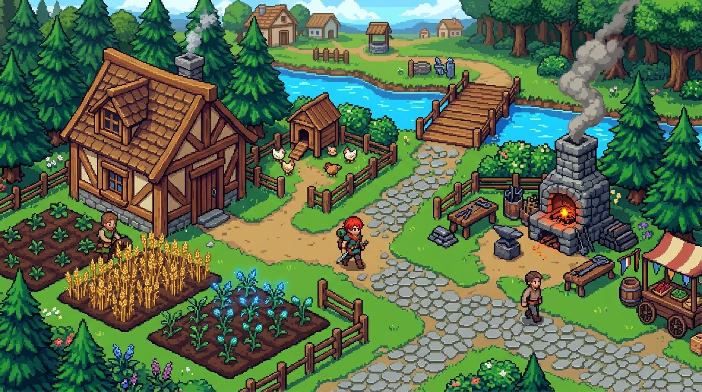
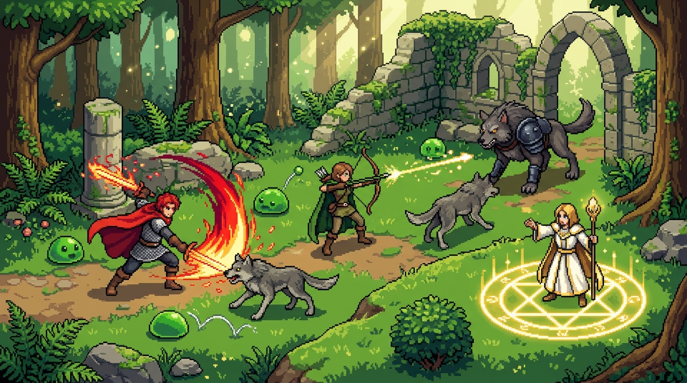
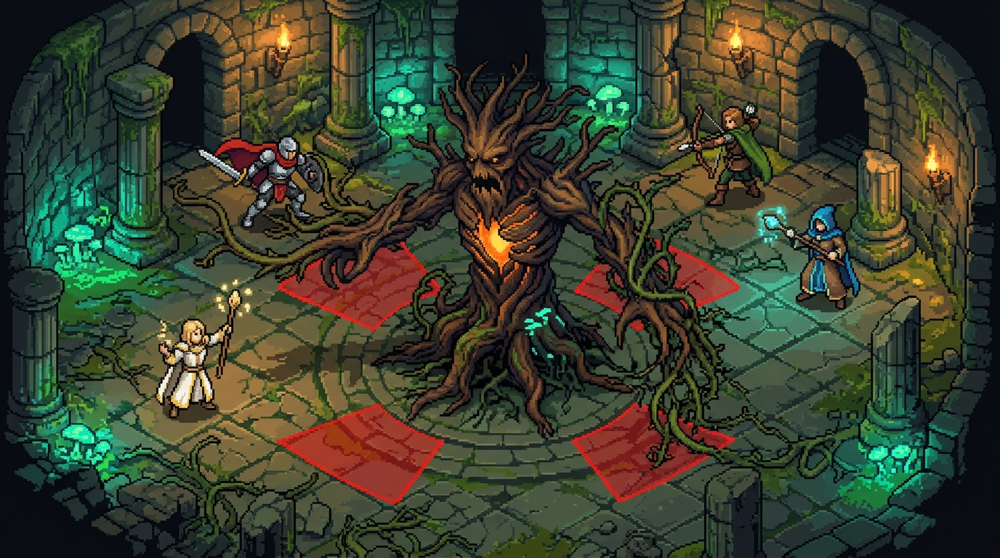

# Art Bible & Pixel Art Direction — Eldoria: Forgotten Wilds

**Trạng thái**: Design Baseline v1.0  
**Chế độ**: `DESIGN_AND_PLANNING_ONLY`  
**Cập nhật lần cuối**: 2026-11-19  
**Tài liệu quản trị**: [Constitution — Nguyên tắc V](../../.specify/memory/constitution.md), [00 — Game Vision](../game-design/00-game-vision.md), [Frontend Architecture](../architecture/frontend-architecture.md)

---

## 1. Tuyên ngôn Mỹ thuật (Art Direction Pillars)

**Eldoria: Forgotten Wilds** theo đuổi phong cách **Classic 16-bit Fantasy Pixel Art** với góc nhìn **Three-Quarter Top-Down (3/4 từ trên xuống, góc nghiêng thị giác ~45°)**, tái hiện sự ấm áp của thời kỳ hoàng kim RPG 16-bit nhưng được nâng cấp chiều sâu thị giác **2.5D** thông qua Y-sorting động, che khuất tán cây/mái nhà (occlusion), đổ bóng mềm định hướng và ánh sáng môi trường tinh tế.

### 5 Nguyên tắc Bất di Bất dịch (Non-Negotiable Visual Rules)
1. **Pixel-Perfect Tuyệt đối**: Mọi tài sản hình ảnh (tile, nhân vật, quái vật, boss, công trình, cây trồng, VFX, icon, khung UI) đều được vẽ tay trên lưới pixel đồng nhất (1 texel = 1 logical pixel). **TUYỆT ĐỐI CẤM** dùng ảnh photorealistic, vẽ vector mịn, anti-aliasing làm nhòe cạnh hoặc **mixel** (trộn lẫn các kích thước pixel khác nhau trên cùng khung hình).
2. **Độ đọc chiến trường là tối thượng (Readability First)**: Mọi nhân vật, quái vật và đặc biệt là **tín hiệu báo đòn của Boss (Boss Telegraph)** phải tách biệt tức thì khỏi nền đất trong vòng `< 150 ms` quan sát. Không hiệu ứng Ultimate hay kỹ năng nào được phép che khuất Boss Telegraph.
3. **Thế giới ấm áp nhưng giàu chiều sâu tương phản**: Khu vực làng mạc và nông trại sử dụng bảng màu tự nhiên ấm áp, tươi sáng (gợi cảm giác an toàn của căn cứ); rừng rậm, hầm ngục và đấu trường Boss giảm độ bão hòa nền để làm bật ánh sáng nguyên tố, đốm lửa và đòn đánh.
4. **Hiệu quả sản xuất cho đội ngũ tinh gọn**: Ưu tiên tái sử dụng thông minh theo hệ thống modular tileset, tách lớp vũ khí, palette-swap có kiểm soát cho biến thể nguyên tố và gom texture atlas khoa học, phục vụ trực tiếp từ hệ thống tệp cục bộ (**KHÔNG** phụ thuộc dịch vụ lưu trữ đám mây hay dịch vụ bên thứ ba nào).
5. **An toàn thị giác & Hòa nhập (Visual Safety)**: Tuân thủ nghiêm ngặt giới hạn chống nhấp nháy (`<= 3 flashes/s`, không strobe toàn màn hình), hỗ trợ chế độ nhận diện mù màu (colorblind pattern) và thanh trượt giảm cường độ hiệu ứng đồng đội.

---

## 2. Tư liệu Tham khảo Ý tưởng (Visual Concept References)

> **LƯU Ý QUAN TRỌNG VỀ QUY TRÌNH SẢN XUẤT**: Bốn hình ảnh concept dưới đây đóng vai trò **Visual Moodboard & Palette Reference** phục vụ giai đoạn thiết kế (`DESIGN_AND_PLANNING_ONLY`). Trong giai đoạn sản xuất thực tế (`IMPLEMENTATION MODE`), **TOÀN BỘ** sprite, tileset, icon và UI asset **PHẢI được họa sĩ pixel vẽ tay (hand-pixelled)** trên lưới tọa độ chính xác (`32×32`, `48×64`, `64×64`, `96×96`, `128×128`..`256×256`), xuất định dạng `.png` không nén mất dữ liệu (lossless RGBA), không có nén JPEG, không có pixel lệch lưới hay mixel.

### 2.1 Greenhaven Village — Làng Khởi Đầu & Nông Trại


*Điểm chuẩn mỹ thuật trích xuất*: Sự cân bằng hài hòa giữa mái ngói nâu ấm, đường đá cuội sáng độ bão hòa thấp, luống đất cày nâu đậm nổi bật sắc vàng của `crp_sunwheat` và ánh lam dịu của cây ma thuật, làn khói lò rèn sinh động và dòng suối xanh trong. (*Lưu ý kỹ thuật*: Concept mang bố cục chéo tự do để truyền đạt cảm xúc; bản đồ Tiled sản xuất thực tế tuân thủ lưới trực giao 3/4 top-down `32×32 px` chuẩn mực.)

### 2.2 Whispering Forest — Chiến Đấu Tổ Đội Ngoài Trời


*Điểm chuẩn mỹ thuật trích xuất*: Độ phân tách sắc nét giữa nền cỏ/rêu độ tương phản trung bình với nhân vật và hiệu ứng kỹ năng: vệt kiếm lửa đỏ cam của `chr_kael_vanguard`, mũi tên gió sáng của `chr_lyra_windrunner`, và vòng hồi phục ánh sáng vàng rạng đông dưới chân `chr_seraphina_dawn`. Quái vật (`mob_moss_slime`, `mob_timber_wolf`, `mob_elite_alpha_direwolf`) có silhouette khác hẳn nhân vật người chơi.

### 2.3 Mossroot Hollow — Đấu Trường Boss & Khả Năng Đọc Telegraph


*Điểm chuẩn mỹ thuật trích xuất*: Sàn đá hầm ngục tông xám-rêu trầm kết hợp ánh sáng điểm (nấm phát quang cyan và đuốc tường cam ấm) tạo độ sâu không gian mà không gây rối mắt. Boss `boss_thornback_elder` nổi bật nhờ silhouette vương miện cành khô lớn cùng lõi nhựa hổ phách phát sáng ở ngực. **Vùng cảnh báo màu đỏ (Boss Telegraph)** nằm phẳng trực tiếp trên mặt sàn đá bên dưới chân mọi nhân vật, giữ rõ nét biên giới nguy hiểm.

*(Tư liệu tham khảo nhân vật khởi đầu xem chi tiết tại mục 2 của [Character Design Standard](./character-design-standard.md) với liên kết `./concepts/starter-heroes-sheet-concept.jpg`.)*

---

## 3. Tiêu chuẩn Độ phân giải, Camera & Tỷ lệ Không gian

### 3.1 Logical Viewport & Scaling (Khớp `ASM-006` & `frontend-architecture.md`)
| Thông số | Giá trị Chuẩn | Giải thích Kỹ thuật |
| :--- | :--- | :--- |
| **Logical Viewport** | **`640 × 360 px`** | Tỷ lệ 16:9 chuẩn, hiển thị `20 × 11.25` base tiles (`32×32 px`) trên màn hình — vừa đủ rộng để quan sát toàn đấu trường Boss và tầm bắn cung (`288 px`), vừa giữ nhân vật `48×64 px` có kích thước rõ nét giàu biểu cảm. |
| **Integer Scaling** | `2x` (`1280×720`), `3x` (`1920×1080`), `4x` (`2560×1440`), `6x` (`3840×2160`) | Mọi độ phân giải phổ biến từ HD đến 4K đều nhân nguyên chính xác 100%, không bị méo tỷ lệ pixel. |
| **Scaling Modes (Settings)** | `INTEGER_FIT` (mặc định) / `FILL_PIXELATED` | `INTEGER_FIT` giữ viền tối khung tranh pixel sạch khi màn hình không phải bội số nguyên; `FILL_PIXELATED` cho người chơi muốn phủ đầy màn hình ultrawide mà vẫn dùng nearest-neighbor. |
| **Texture Filtering** | **Nearest-Neighbor (`NEAREST`)** | Phaser config: `pixelArt: true`, `antialias: false`, `roundPixels: true`. CSS canvas: `image-rendering: pixelated; image-rendering: crisp-edges;`. |
| **Camera Snap** | Làm tròn tọa độ nguyên (`Math.round`) trước khi render | Tránh hiện tượng rung mép pixel (pixel shimmering) khi camera đuổi theo người chơi. |

### 3.2 Hệ thống Kích thước Đối tượng (Resolution Hierarchy)
Toàn bộ kích thước đồng bộ tuyệt đối với nguồn chuẩn `game-data/*.json` (Nguyên tắc III Hiến pháp):

| Hạng mục Đối tượng | Kích thước Canvas Chuẩn | Quy đổi theo Base Tile | Ví dụ Cụ thể trong `game-data/` |
| :--- | :---: | :---: | :--- |
| **Base Environment Tile** | **`32 × 32 px`** | `1 × 1 tile` | Cỏ, đường đá, nước, đất cày, sàn hầm ngục |
| **Base Humanoid Character** | **`48 × 64 px`** | `1.5 × 2 tiles` | Toàn bộ 12 nhân vật (`chr_kael_vanguard`..`chr_aurelia_starbow`), NPC làng, `mob_forest_goblin` |
| **Small Animal / Critter / Loot** | **`32 × 32 px`** | `1 × 1 tile` | `anm_meadow_chicken`, vật phẩm rơi trên đất, hạt giống, cây trồng 1 ô |
| **Medium Animal / Quadruped Mob** | **`64 × 64 px`** | `2 × 2 tiles` | `mob_moss_slime`, `mob_timber_wolf` (lõi thân đứng `48×48` + `8 px` lề nhảy vồ), `anm_clover_cow` |
| **Large Character / Elite Monster** | **`96 × 96 px`** | `3 × 3 tiles` | `mob_elite_alpha_direwolf`, quái khổng lồ hầm ngục, nhân vật triệu hồi lớn |
| **Boss Tier 1 (MVP)** | **`128 × 128 px`** | `4 × 4 tiles` | `boss_thornback_elder` (`dng_mossroot_hollow`) |
| **Boss Tier 2 (Mid-game)** | **`160 × 160 px`** | `5 × 5 tiles` | `boss_ignis_forgelord` (`reg_ironpeak_mountains`) |
| **Boss Tier 3 (Late-game)** | **`192 × 192 px`** | `6 × 6 tiles` | `boss_prism_leviathan`, `boss_boreas_frostking` |
| **Boss Tier 4 (End-game Raid)** | **`256 × 256 px`** | `8 × 8 tiles` | `boss_malakor_abyss` (`reg_abyssal_kingdom`) |
| **Item Icons (UI)** | **`24 × 24 px`** & **`32 × 32 px`** | — | `24×24`: hotbar nhỏ/buff icon; `32×32`: inventory, blacksmith, shop, tooltip |
| **Character Portraits** | **`64 × 64 px`** & **`128 × 128 px`** | — | `64×64`: HUD/Party avatar; `128×128`: Dialogue/Gacha/Profile bust |

### 3.3 Phân biệt Bốn Lớp Khung Không gian (Tile vs Sprite vs Collision vs Interaction)
Một lỗi phổ biến của game 2D là dùng chung kích thước hình ảnh làm hộp va chạm, khiến nhân vật bị kẹt góc tường hoặc đánh hụt vô lý. Eldoria tách biệt rõ 4 khái niệm:

| Lớp Khung | Ví dụ trên Nhân vật (`48×64`) | Ví dụ trên Cây Sồi (`64×96`) | Mục đích & Nơi Xác thực |
| :--- | :---: | :---: | :--- |
| **1. Base Tile Footprint** | Không khóa vào tile (di chuyển tự do theo pixel) | `1 × 1 tile` (`32×32` tại gốc cây) | Lưới xây dựng, lưới địa hình Tiled và bản đồ dẫn đường (NavGrid) trên Server. |
| **2. Visual Sprite Frame** | `48 × 64 px` (pivot `(24, 58)`) | `64 × 96 px` (pivot `(32, 88)`) | Toàn bộ đồ họa vẽ lên canvas, bao gồm tán lá, mái nhà, mũ, áo choàng, vũ khí vung. |
| **3. Physics Collision Footbox** | `20 × 14 px` (tâm tại `footY = 58`) | `24 × 16 px` (chỉ bọc phần gốc rễ) | Ngăn đi xuyên vật thể rắn. Vì chỉ nằm ở bàn chân/gốc cây, phần đầu nhân vật có thể đi qua phía sau tán cây hoặc tường nhà phía bắc, tạo ảo giác 2.5D tự nhiên. **Server-Authoritative**. |
| **4. Interaction / Hurtbox** | Hurtbox: `24 × 34 px`<br>Interaction: `36 × 40 px` | Interaction: `48 × 48 px` quanh thân gỗ | Hurtbox tính trúng đòn combat trên Server; Interaction Box bắt sự kiện click/phím `E` chặt cây, thu hoạch, nói chuyện trong bán kính server `<= 96 px`. |

---

## 4. Hệ thống Phối màu Chuẩn (Master Color Palettes)

### 4.1 Quy tắc Phân tầng Độ sáng & Độ bão hòa (Value & Saturation Separation)
Để đảm bảo nhân vật luôn "bật" khỏi nền trong mọi khu vực và mọi khung giờ ngày/đêm:
- **Sàn đất & Địa hình nền (Ground Tiles)**: Độ bão hòa (Saturation) **`20% – 45%`**, độ tương phản nội bộ thấp (chênh lệch lightness giữa sáng nhất và tối nhất `<= 18%`).
- **Vật thể tĩnh & Kiến trúc (Props, Trees, Buildings)**: Độ bão hòa **`40% – 62%`**, bóng đổ rõ dưới chân.
- **Nhân vật & Quái vật (Entities)**: Độ bão hòa **`60% – 82%`**, có đường viền Sel-Out sắc nét và điểm sáng tập trung ở vùng đầu/vai/vũ khí.
- **VFX, Đạn đạo & Boss Telegraph**: Độ bão hòa **`85% – 100%`**, ưu tiên ánh sáng nóng/tương phản bổ túc so với nền khu vực.

### 4.2 Bảng màu Khu vực (Biome Palettes)

#### A. Greenhaven Village (`reg_greenhaven_village` — Ấm áp, An toàn, Nông nghiệp)
| Vai trò Màu | Tên Swatch | Mã Hex | Ứng dụng Chính |
| :--- | :--- | :---: | :--- |
| Cỏ nắng (Highlight) | `Meadow Sun` | `#84C44E` | Đỉnh bụi cỏ, viền rìa ánh sáng Tây-Bắc |
| Cỏ chuẩn (Base) | `Greenhaven Grass` | `#5B9E3E` | Tile cỏ nền chính 70% diện tích làng |
| Cỏ râm (Shadow) | `Clover Shade` | `#3B7034` | Bóng dưới hàng rào, chân gốc cây |
| Đường đất mòn | `Warm Dirt Path` | `#C79A63` | Lối đi nông trại, nền sân trước nhà |
| Đất cày ẩm | `Tilled Loam` | `#5C3B28` | Luống đất trồng trọt đã tưới (`#42281B` khi ướt) |
| Đá cuội quảng trường | `Cobble Warm` | `#9E9A8F` | Đường lát đá làng, viền giếng nước (`#6E6C68` kẽ đá) |
| Gỗ nhà & cầu | `Oak Timber` | `#8A5632` | Khung nhà, hàng rào, cầu gỗ (`#B87B49` highlight) |
| Mái ngói đất nung | `Hearth Shingle` | `#A64D32` | Mái nhà khởi đầu, mái chuồng gà |
| Mặt nước suối | `Brook Azure` | `#3FA7D6` | Dòng suối chính (`#8CE0F5` gợn bọt sáng, `#246B96` đáy sâu) |

#### B. Whispering Forest (`reg_whispering_forest` — Cổ thụ, Rêu ẩm, Huyền bí)
| Vai trò Màu | Tên Swatch | Mã Hex | Ứng dụng Chính |
| :--- | :--- | :---: | :--- |
| Rêu nắng xuyên tán | `Sunbeam Moss` | `#74A847` | Đốm nắng rọi qua tán rừng, mảng rêu trên đá cổ |
| Thảm cỏ rừng sâu | `Canopy Turf` | `#3E6E3B` | Sàn rừng nền chính |
| Bóng tán cây dày | `Deep Pine Shadow` | `#1F3B2C` | Tầng lá thấp, viền sâu lối mòn rừng |
| Vỏ cây cổ thụ | `Ancient Bark` | `#593E2E` | Thân cổ thụ, rễ cây trồi mặt đất (`#38251C` rãnh vỏ) |
| Đá tàn tích cổ | `Ruin Slate` | `#7A827B` | Cổng vòm đổ nát, cột đá dẫn vào hầm ngục |
| Sương mù rừng | `Whisper Mist` | `#A3C9BD` | Lớp sương nhẹ alpha `0.15` ở rìa sâu rừng |

#### C. Dungeon & Boss Arena (`dng_mossroot_hollow` — Trầm tĩnh, Tương phản Sắc nét)
| Vai trò Màu | Tên Swatch | Mã Hex | Ứng dụng Chính |
| :--- | :--- | :---: | :--- |
| Sàn đá hầm ngục | `Crypt Stone Base` | `#3A4047` | Sàn đá đấu trường (bão hòa cực thấp để bật Telegraph đỏ) |
| Kẽ gạch & bóng tường | `Hollow Shadow` | `#1E212B` | Đường ron gạch, viền hố sâu, chân trụ đá |
| Điểm sáng gờ đá | `Chiseled Edge` | `#59636E` | Cạnh trên trụ đá an toàn (Safe Pillars) |
| Nấm phát quang | `Spore Biolume` | `#2EE6B8` | Nấm rìa tường tạo không khí (không dùng cho vùng nguy hiểm!) |
| Ánh đuốc tường | `Torch Amber` | `#F59E3D` | Đốm sáng ấm tại 4 góc tường đấu trường |
| Lõi Boss Thornback | `Heartwood Core` | `#FF6E24` | Điểm nhấn phát sáng trên ngực Boss (`#4CE068` ở Phase 1 → `#FF3B24` ở Phase 3) |

#### D. Pixel Fantasy UI Palette (Khung Vàng – Giấy Da – Đá Hắc Diện)
| Vai trò UI | Tên Swatch | Mã Hex | Ứng dụng Chính |
| :--- | :--- | :---: | :--- |
| Nền bảng tối chính | `Obsidian Panel` | `#16141F` | Nền modal Inventory, Blacksmith, Settings (alpha `0.94`) |
| Nền ô vật phẩm | `Slate Slot` | `#252236` | Ô lưới kho đồ, thanh kỹ năng chưa kích hoạt |
| Nền cuộn giấy da | `Parchment Light` | `#F4E4C1` | Nền sổ nhiệm vụ (`Quest Journal`), thư NPC, bảng lore |
| Bóng giấy da | `Parchment Shade` | `#DCC496` | Viền trong cuộn giấy, phần tiêu đề phụ |
| Viền vàng hoàng kim | `Eldoria Gold` | `#E6B450` | Khung 9-slice chính, tiêu đề, viền nút hành động quan trọng |
| Bóng đồng cổ | `Antique Bronze` | `#8F6022` | Cạnh dưới khung 9-slice tạo độ nổi 3D pixel |
| Chữ chính (trên nền tối) | `Ivory Text` | `#F8F3E6` | Tỷ lệ tương phản `15.8:1` trên `#16141F` (vượt xa WCAG AAA) |
| Chữ chính (trên giấy da) | `Ink Sepia` | `#2B1F16` | Tỷ lệ tương phản `11.6:1` trên `#F4E4C1` |
| Thanh HP / Nguy hiểm | `Vital Crimson` | `#D93848` | Thanh máu, cảnh báo Boss, nút hủy nguy hiểm |
| Thanh MP | `Arcane Azure` | `#3B82F6` | Thanh năng lượng phép thuật |
| Thanh Stamina | `Vigor Emerald` | `#36B368` | Thanh thể lực Dodge/Sprint/Gather |
| Thanh Poise / Stagger | `Break Amber` | `#F2B705` | Thanh phá giáp dưới thanh máu Boss |

### 4.3 Bảng màu 9 Nguyên tố Chính thức (9 Elements Canonical Palette)
| Enum `Element` | Màu Lõi (Core) | Điểm Sáng (Highlight) | Màu Bóng (Shadow) | Biểu tượng Hình học (Colorblind Cue) |
| :--- | :---: | :---: | :---: | :--- |
| `FIRE` | `#E84A27` | `#FFB347` | `#8A1E14` | Ngọn lửa 3 đỉnh sắc nhọn |
| `WATER` | `#2989C4` | `#8AE6F5` | `#164673` | Giọt nước kết hợp 2 gợn sóng ngang |
| `EARTH` | `#A67542` | `#E0B86E` | `#593A1E` | Khối lục giác / tinh thể đá góc cạnh |
| `WIND` | `#3EB881` | `#A8F5D4` | `#1E634B` | Ba đường xoắn ốc lượn sóng |
| `LIGHTNING` | `#3CC4F5` | `#FFF275` | `#234B9E` | Tia chớp gãy 3 đoạn chéo |
| `FROST` | `#6EC8F0` | `#EDF9FF` | `#2E588C` | Bông tuyết 6 nhánh đối xứng |
| `LIGHT` | `#F5C742` | `#FFFCE0` | `#9E6E21` | Ngôi sao 4 cánh dài kèm vòng hào quang |
| `SHADOW` | `#7A3EC9` | `#D18FFF` | `#24143D` | Trăng lưỡi liềm ôm tinh thể tím |
| `NEUTRAL` | `#B59B76` | `#EFE6D5` | `#5C534A` | Hình thoi cân chuẩn màu đồng/thép |

### 4.4 Bảng màu Độ hiếm (Rarity Color Coding)
| Enum `Rarity` | Màu Viền / Tên | Mã Hex Chuẩn | Ánh Sáng Nền Ô (Tint Alpha `0.22`) |
| :--- | :--- | :---: | :---: |
| `COMMON` | Xám Thép Mờ | `#B0B7C3` | `#6B7280` |
| `UNCOMMON` | Lục Thảo Nguyên | `#4ADE80` | `#166534` |
| `RARE` | Lam Hoàng Gia | `#4EA8FF` | `#1D4ED8` |
| `EPIC` | Tím Tinh Thể | `#B86BFF` | `#6B21A8` |
| `LEGENDARY` | Vàng Hoàng Kim | `#FFB732` | `#B45309` |
| `MYTHIC` | Đỏ Hồng Ngọc Ánh Kim | `#FF4D79` | `#9F1239` |

---

## 5. Nguồn sáng, Hue-Shifting, Đổ bóng & Chiều sâu 2.5D

### 5.1 Nguồn sáng Chính & Quy tắc Hue-Shifting
- **Hướng nguồn sáng toàn cục**: **Trên – Trái (Top-Left, góc ~35° Tây-Bắc / NW)**. Mọi sprite, mái nhà, tán cây, đá tảng và icon vật phẩm PHẢI thống nhất phần sáng nằm phía trên-trái và phần tối nằm phía dưới-phải.
- **Quy tắc Dịch chuyển Sắc độ (Hue-Shifting)**:
  - Khi đi về vùng **Highlight**: tăng độ sáng đồng thời xoay sắc độ nhẹ về phía **Vàng Ấm (Warm Yellow)** để tạo cảm giác ánh nắng tự nhiên.
  - Khi đi về vùng **Shadow**: giảm độ sáng đồng thời xoay sắc độ về phía **Tím Chàm / Lam Lạnh (Cool Indigo/Violet)**.
  - **CẤM** tạo bóng đổ bằng cách giảm độ sáng tuyến tính về xám đục hoặc trộn đen thuần `#000000` (gây cảm giác bẩn và xỉn màu).

### 5.2 Quy chuẩn Bóng đổ Mặt đất (Ground Shadow)
- Mọi nhân vật, quái vật, động vật, Boss và cây cối đều có bóng elip bán trong suốt render trên lớp **Depth `200–299`**.
- **Màu bóng chuẩn**: **`#1A1628`** với độ mờ **`alpha = 0.38`** (ban đêm giảm dần về `alpha = 0.22` theo hệ số ánh sáng chung).
- **Hướng đổ bóng**: Dịch nhẹ tâm bóng sang phía **Đông-Nam (SE)** (`offsetX = +2 px`, `offsetY = +1 px` cho humanoid `48×64 px`; `offsetX = +5 px`, `offsetY = +2 px` cho Boss `128×128 px`).
- **Tỷ lệ bóng elip theo thực thể**:
  - Humanoid (`48×64`): `24 × 10 px` (thu nhỏ 75% khi đang nhảy/lướt Dodge trên không).
  - Medium Mob (`64×64`): `32 × 12 px`.
  - Small Animal (`32×32`): `16 × 7 px`.
  - Boss (`128×128`): `76 × 26 px`.

### 5.3 Kỹ thuật Tạo Chiều sâu 2.5D
1. **Tỷ lệ Mặt đứng 3/4 (Wall-to-Roof Ratio)**: Chiều cao mặt tường phía trước công trình bằng `1.0x` đến `1.25x` chiều cao mặt mái nhìn thấy; mỗi viên gạch tường thể hiện rõ mặt đứng phía nam và mép đỉnh phía bắc.
2. **Y-Sorting Động**: Toàn bộ thực thể thuộc lớp `1000..99999` được cập nhật `depth = 1000 + Math.round(entity.footY)` mỗi khung hình render (tối ưu chỉ cập nhật cho thực thể di chuyển).
3. **Occlusion Thông minh (Roof & Canopy Fade)**: Khi hộp `footbox` của người chơi đi vào vùng phía sau mái nhà hoặc tán cây lớn (cùng `x` nhưng `player.footY < building.footY`), chỉ phần **mái/tán phía trên** của vật cản chuyển mượt sang `alpha = 0.55` trong `150 ms` (không biến mất hoàn toàn để giữ không gian), giúp người chơi luôn thấy rõ vị trí nhân vật và quái xung quanh.
4. **Elevation & Cliff Layering**: Vách đá cao hơn 1 bậc (`+32 px` hoặc `+64 px`) phải có dải bóng chân vách (`12 px` chiều cao) và cạnh mép sáng ở đỉnh vách để người chơi phân biệt tức thì địa hình đi được và vách chắn.

---

## 6. Character Silhouette, Proportions & Environment Scale

*(Chi tiết hình thể nhân vật và 8 class xem đầy đủ tại [Character Design Standard](./character-design-standard.md).)*

### Bảng Tỷ lệ Quy mô Môi trường so với Nhân vật (`48×64 px`, cao thực ~`42 px`)
| Công trình / Vật thể Môi trường | Kích thước Sprite (px) | Footprint Tiled (Tiles) | Ghi chú Tỷ lệ so với Humanoid (`42 px`) |
| :--- | :---: | :---: | :--- |
| Luống đất / Cây trồng (`crp_*`) | `32 × 32` đến `32 × 48` | `1 × 1` | Cây trưởng thành cao ngang đầu gối đến thắt lưng (`18–26 px`) |
| Hàng rào gỗ / Bụi hoa | `32 × 32` | `1 × 1` | Hàng rào cao ngang hông (`20–24 px`), không che mặt nhân vật |
| Cửa ra vào công trình | `32 × 44` | `1 × 1` (lối vào) | Rộng hơn vai nhân vật ~30%, cao hơn đầu một chút để dễ đọc điểm tương tác |
| Cây Sồi / Cây Thông làng | `64 × 96` đến `96 × 128` | `1 × 1` hoặc `2 × 1` (gốc) | Cao gấp `2.2x – 3x` nhân vật, tạo mái vòm tự nhiên cho rừng |
| Chuồng Gà (`bld_chicken_coop` Lv1) | `96 × 96` | `3 × 2` | Cao gấp `1.8x` nhân vật, có cầu thang gà nhỏ phía trước |
| Lò Rèn (`bld_blacksmith` Lv1–4) | `128 × 128` | `4 × 3` | Lò đá hở thấy lửa rực + đe rèn ngoài trời để nhìn rõ người chơi đang rèn |
| Nhà Người chơi (`bld_player_house` Lv1) | `160 × 160` | `5 × 4` | Điểm neo thị giác của căn cứ, nâng cấp mở rộng tầng/ống khói/vườn hoa |
| Trụ Đá Boss Arena (`pil_moss_*`) | `64 × 96` | `2 × 2` | Cao gấp `2x` nhân vật, đổ bóng dài tạo vùng nấp đạn rõ ràng |

---

## 7. Tiêu chuẩn Tile Transitions & Autotiling

1. **Hệ thống Autotile 47-Tile Blob (Hoặc 16-Tile Wang Corner)**: Áp dụng cho chuyển tiếp giữa Cỏ ↔ Đất, Cỏ ↔ Đá cuội, Đất ↔ Nước và Sàn hầm ngục ↔ Tường. Đường ranh giới phải có độ bo tròn hữu cơ (`4–6 px` bán kính góc) và rìa cỏ/đá đan xen tự nhiên, **CẤM** để cạnh thẳng tắp sắc như cắt giấy (trừ gạch nhân tạo trong nhà).
2. **Phá vỡ Lặp lưới (Anti-Grid Tiling)**: Mọi bề mặt nền rộng (cỏ, đất, sàn đá hầm ngục) PHẢI có tối thiểu **4 biến thể tile liền mạch (seamless variants)** với tần suất rải ngẫu nhiên theo seed cố định:
   - Variant A (Nền sạch trung tính): `68%`
   - Variant B (Gợn cỏ/vết nứt nhẹ): `17%`
   - Variant C (Sỏi nhỏ/hoa dại/rêu mịn): `10%`
   - Variant D (Chi tiết đặc trưng hiếm): `5%`
3. **Nước & Tài nguyên Động**:
   - Mặt nước dùng chu kỳ **4 frames × 250 ms (`1000 ms/loop`)** chuyển động gợn sáng nhẹ song song đường bờ, tuyệt đối không nhấp nháy gắt.
   - Bờ nước có lớp viền sâu `4–6 px` dưới mặt nước tạo cảm giác độ cao bờ đất.

---

## 8. Quy tắc Viền Sprite (Selective Colored Outline — Sel-Out)

Eldoria áp dụng chuẩn **Selective Colored Outline (Sel-Out)** đặc trưng của pixel art 16-bit thương mại cao cấp:

| Loại Đối tượng | Quy tắc Viền Ngoài (Outer Outline) | Quy tắc Viền Trong (Inner Line) | Lý do Mỹ thuật |
| :--- | :--- | :--- | :--- |
| **Nhân vật & NPC** | Viền 1 px liên tục bao quanh toàn bộ silhouette. Màu viền tối hơn màu vật liệu `45–55%` và dịch sắc độ về tím chàm (ví dụ da dùng `#4D2C32`, áo đỏ dùng `#471522`, thép dùng `#1F2233`). **Không dùng đen thuần `#000000`** trừ bóng cực sâu dưới đế giày/mắt. | Viền trong sáng hơn viền ngoài 2 bậc, đứt đoạn tại điểm nhận sáng NW (Top-Left) để tránh cảm giác thô cứng. | Tách biệt hoàn hảo nhân vật khỏi mọi nền địa hình mà vẫn giữ nét mềm mại, ấm áp. |
| **Quái vật & Boss** | Viền 1 px đậm hơn nhân vật ~10% (`#181424` đến `#261822`) để nhấn mạnh mối đe dọa; Boss lớn `128×128+` dùng viền 1 px sắc nét (tuyệt đối KHÔNG tăng viền lên 2 px để tránh cảm giác mixel!). | Dùng 2–3 bậc shading phân khối cơ bắp/vỏ cây, đường gân phát sáng nguyên tố không có viền đen. | Đảm bảo độ uy nghiêm của Boss nhưng giữ cùng mật độ pixel với nhân vật. |
| **Công trình & Cây cối** | Viền mềm thấp tương phản (chỉ tối hơn nền kế cận 20–30%) tại các cạnh giao với bầu trời/đất sáng; chân tiếp xúc mặt đất dùng viền rêu/bóng mềm. | Không dùng đường kẻ đen dày trên mái ngói hay thân gỗ. | Giúp kiến trúc vững chãi nhưng không tranh chấp sự chú ý với người chơi. |
| **Sàn đất & Nước** | **Không viền (Outline-free)**. | Độ tương phản thấp. | Làm nền sạch cho hành động combat và Boss Telegraph. |
| **Loot & Vật thể Tương tác** | Khi ngoài tầm tương tác: viền chuẩn. Khi người chơi vào bán kính `<= 96 px`: kích hoạt shader/outline **1 px màu vàng kem `#FFF0A8`** ổn định (không nhấp nháy nhanh). | — | Thay thế cho mũi tên chỉ dẫn thô kệch, phản hồi tương tác tự nhiên. |

---

## 9. Quy ước Đặt tên Tài sản & Cấu trúc Thư mục Cục bộ

Toàn bộ tài sản được lưu trữ cục bộ trong monorepo `assets/` và phục vụ trực tiếp từ máy chủ tĩnh nội bộ (**KHÔNG dùng dịch vụ lưu trữ đám mây hay dịch vụ bên thứ ba** theo Constitution Principle I).

### 9.1 Quy tắc Đặt tên (Naming Convention)
- Dùng **`snake_case`**, chỉ ký tự thường ASCII `[a-z0-9_]`, KHÔNG dấu tiếng Việt, KHÔNG khoảng trắng.
- Luôn khớp tiền tố ID chuẩn từ [00-game-vision.md](../game-design/00-game-vision.md):
  - Atlas nhân vật: `atlas_chr_<hero_slug>.png` + `.json` (ví dụ `atlas_chr_kael_vanguard.png`)
  - Atlas quái / elite / boss: `atlas_mob_<mob_slug>.png`, `atlas_boss_<boss_slug>.png`
  - Atlas động vật: `atlas_anm_<animal_slug>.png`
  - Tileset khu vực: `tls_<region_slug>_<layer>.png` (ví dụ `tls_greenhaven_ground.png`, `tls_mossroot_dungeon.png`)
  - Bản đồ Tiled: `map_<zone_id>.tmj` (ví dụ `map_zon_greenhaven_square.tmj`)
  - VFX sheet: `vfx_<element_or_skill_slug>.png` (ví dụ `vfx_kael_crimson_crescent_wave.png`)
  - Icon vật phẩm: `icn_<item_id>_32.png` hoặc gói trong `atlas_ui_icons_32.png` với frame key `<item_id>`
  - Chân dung: `assets/ui/portraits/<character_id>.png` (`128×128`), `assets/ui/portraits/<character_id>_hud.png` (`64×64`), `assets/ui/portraits/<character_id>_expr.png` (5-expression strip `640×128`)

### 9.2 Cấu trúc Thư mục `assets/` Chuẩn
```text
assets/
├── atlases/               # Texture Atlas đóng gói runtime (PNG + Phaser 3 JSON + Anim Sidecar)
│   ├── characters/        # atlas_chr_kael_vanguard.{png,json}, anim_chr_kael_vanguard.json
│   ├── monsters/          # atlas_mobs_forest.{png,json}, atlas_mob_timber_wolf.{png,json}
│   ├── bosses/            # atlas_boss_thornback_elder.{png,json}
│   ├── animals/           # atlas_animals_mvp.{png,json}
│   ├── vfx/               # atlas_vfx_combat_mvp.{png,json}, atlas_vfx_telegraphs.{png,json}
│   └── ui/                # atlas_ui_icons_32.{png,json}, atlas_ui_icons_24.{png,json}, atlas_ui_panels.{png,json}
├── tilesets/              # Tileset PNG đã extrude 1px dùng cho Tiled & Phaser
├── maps/                  # Tệp bản đồ Tiled (.tmj / .json) cho các zone & dungeon
├── ui/
│   ├── portraits/         # Chân dung 64x64, 128x128 & expression strip
│   └── fonts/             # Bitmap font / Pixel TTF cục bộ hỗ trợ đầy đủ tiếng Việt
├── audio/                 # SFX (.ogg/.wav) và BGM (.ogg) phục vụ cục bộ
└── source-aseprite/       # Tệp gốc .aseprite (KHÔNG đóng gói vào bản build client runtime)
```

---

## 10. Quy ước Texture Atlas (Khớp `sprite-sheet-standard.md`)

1. **Kích thước tối đa**: Power-of-Two (POT), **tối đa `2048 × 2048 px`** mỗi trang atlas để bảo đảm tương thích 100% WebGL trên máy tính văn phòng/iGPU và lộ trình di động. Khuyến nghị mục tiêu `1024 × 1024 px` cho mỗi nhân vật/boss.
2. **Chống Lem Mép (Bleeding Prevention)**:
   - **`padding: 2 px`** (cả `shapePadding` và `borderPadding`).
   - **`extrude: 1 px`** (bắt buộc cho toàn bộ tileset và khuyến nghị cho sprite sát cạnh để ngăn tuyệt đối vệt hở 1 px giữa các ô đất khi camera di chuyển).
3. **Định dạng Xuất**: Phaser 3 JSON Hash (`phaser3`), `allowRotation: false`, xuất bởi **TexturePacker CLI** hoặc **free-tex-packer-core** chạy cục bộ.
4. **Phân nhóm Atlas theo Vòng đời Tải (Region Lazy Loading)**:
   - Nhóm `core_ui`: Tải ngay ở `BootScene` (`atlas_ui_panels`, `atlas_ui_icons_32`, `atlas_ui_icons_24`, `atlas_vfx_telegraphs`).
   - Nhóm `region_mvp`: Tải khi vào vùng (`tls_greenhaven_*`, `atlas_animals_mvp`, `atlas_mobs_forest`).
   - Nhóm `hero_on_demand`: Chỉ tải atlas của các nhân vật đang hiện diện trong Zone / Party hiện tại.
   - Nhóm `boss_instance`: Chỉ nạp khi bước vào `DungeonScene` (`atlas_boss_thornback_elder`), giải phóng khi rời phụ bản.
   - *Mục tiêu ngân sách VRAM Texture Client (`proposed/unverified`)*: `<= 128 MB` VRAM cùng lúc trong phiên chơi MVP (cần đo thực tế trên Chrome DevTools / Spector.js khi vào giai đoạn lập trình).

---

## 11. Thứ tự Layering & Depth Ordering (Khớp 100% `frontend-architecture.md`)

| Dải Depth Phaser | Tên Lớp (Layer Name) | Thành phần Render | Quy tắc Hiển thị & Đọc Chiến trường |
| :---: | :--- | :--- | :--- |
| **`0 – 99`** | **Ground Tile Layers** | `0`: Đáy nước / Hố sâu<br>`10`: Đất nền chính<br>`20`: Đường đi, bờ nước, đất cày<br>`40`: Hoa nhỏ, thảm cỏ dẹt, vết nứt gạch<br>`60`: Mảng trang trí sàn hầm ngục | Bão hòa thấp, không viền đen, luôn phẳng dưới chân. |
| **`100 – 199`** | **Ground Decals & Combat Telegraphs** | `100–119`: Vệt cháy xém, vết nứt đất sau chiêu, vòng hồi máu đồng đội<br>`120–139`: Build Grid & Ghost Preview<br>`140–179`: Environmental Hazards<br>`180–199`: **Enemy / Boss Telegraph Fill, Crisp Border & Timer Fill (UNLIT)** | **BẮT BUỘC** nằm TRÊN sàn đất và DƯỚI chân nhân vật (`1000–99999`), bỏ qua Day/Night tint. Vùng Boss Telegraph có thanh lấp đầy (fill sweep) tiến dần từ tâm ra viền khớp chính xác `telegraphMs` từ Server. |
| **`200 – 299`** | **Ground Shadows** | `210`: Bóng công trình & cây cối<br>`250`: Bóng nhân vật, quái, Boss, động vật | Màu `#1A1628`, `alpha = 0.38`, lệch SE. |
| **`1000 – 99999`** | **Y-Sorted World Entities** | `depth = 1000 + Math.round(sprite.footY)`<br>Nhân vật, Quái, Boss, Động vật, Cây trồng, Vật phẩm rơi, Thân cây, Thân công trình, Trụ đá Arena | Đảm bảo vật đứng phía nam (`footY` lớn hơn) luôn che vật đứng phía bắc (`footY` nhỏ hơn). |
| **`100000 – 109999`** | **Overhead Canopy, High Projectiles & Combat VFX** | `101000`: Mái nhà, tán cây trên cao (tự giảm `alpha = 0.55` khi che player)<br>`103000`: Đạn đạo bay cao, vệt chém vũ khí<br>`105000`: Hạt VFX kỹ năng & Ultimate (giới hạn opacity)<br>`109500`: **Telegraph Rim Echo** (chỉ vẽ viền cảnh báo rỗng `2 px` khi có Ultimate phủ đè) | VFX bị giới hạn độ mờ (Alpha Cap) để **KHÔNG BAO GIỜ** che mù chiến trường hoặc che khuất Telegraph của Boss! |
| **`110000 – 119999`** | **World-Space Overlays & Lighting** | `111000`: Day/Night Color Grading (`Multiply` dịu) + Điểm sáng đèn lồng/đuốc/lò rèn<br>`114000`: Hiệu ứng thời tiết (hạt mưa/tuyết pixel nhẹ)<br>`116000`: Nameplates, thanh máu mini trên đầu quái, biểu tượng trạng thái (`Burn`, `Stun`, `Poison`)<br>`118000`: Floating Damage Numbers & Crit Callouts | Không làm mờ chữ; số sát thương dùng bitmap pixel font sắc nét có viền tối 1 px. |
| **React DOM Layer** | **Screen-Space UI Overlay** | Main HUD, Skill Hotbar, Minimap, Boss HP & Poise Bar, Chat, Modals (`Inventory`, `Blacksmith`, `Gacha`, ...) | Tách hoàn toàn khỏi vòng lặp render 60 FPS của Phaser (cập nhật theo sự kiện qua `GameUiBridge` tối đa 10 Hz). |

---

## 12. Khả năng Đọc Chiến trường (Combat Readability) & Tiêu chuẩn VFX

### 12.1 Hệ thống Phân cấp Ưu tiên Thị giác (Visual Priority Hierarchy)
Trong một trận Boss Raid 4 người đầy kỹ năng, mắt người chơi phải phân biệt được thứ tự ưu tiên sau ngay lập tức:
1. **Hạng 1 (Tối thượng) — Boss Telegraph & Mối nguy Chết người**: Vùng đỏ thẫm `#FF2A4B` (nền `alpha 0.28` + sóng quét tiến độ `alpha 0.42` + viền 2 px sắc nét `#FF4D6D` kèm nội viền sáng `#FFF0F3` 1 px). Đối với đòn không thể né bằng Block thông thường (Unblockable), viền đổi sang cam-đỏ đậm kèm họa tiết chéo cảnh báo.
2. **Hạng 2 — Nhân vật của Chính mình & Vị trí Chân**: Nổi bật với vòng chân mảnh tùy chọn dưới chân Local Player (`#FFF4B8`, alpha `0.35`, bật sẵn trong Boss Arena) giúp không bị lạc mất nhân vật giữa đám đông.
3. **Hạng 3 — Quái vật & Boss Anticipation Pose**: Trước khi đòn nổ, quái/boss có tư thế nén lực (wind-up) kèm điểm lóe nhẹ 1 lần ở mắt/vũ khí.
4. **Hạng 4 — Kỹ năng Đồng đội & Ultimate**: Đẹp mắt, rõ bản sắc nguyên tố nhưng **kiểm soát độ mờ**.
5. **Hạng 5 — Hiệu ứng Môi trường** (lá rơi, đom đóm, khói lò): Mờ nhẹ, không bao giờ mang màu đỏ báo động giống Telegraph.

### 12.2 Quy tắc Chống Che Khuất Telegraph (Ultimate Safety Policy)
- **Giới hạn độ mờ vùng phủ (Area VFX Alpha Cap)**: Mọi hiệu ứng kỹ năng diện rộng (như `skl_kael_ult_crimson_crescent`, `skl_orin_ult_storm_dominion`, `skl_nyx_ult_abyssal_eclipse`) chỉ được sử dụng độ mờ mặt phẳng tối đa **`alpha <= 0.45`** (đồng đội khác trong party tự động giảm còn **`alpha <= 0.28`**, có thể hạ xuống `0.10` trong Settings `reduceAllyVfx`).
- **Không dùng Additive Stacking Bão hòa Trắng**: Giới hạn tối đa 2 lớp blend `ADD` chồng nhau tại cùng vùng pixel; các hạt thứ cấp dùng blend `NORMAL` với màu rực để không biến màn hình thành một mảng trắng xóa.
- **Lớp Bảo vệ Viền Telegraph (`Telegraph Rim Echo`, Depth `109500`)**: Bất kỳ lúc nào một Boss Telegraph đang hoạt động trùng vùng với hiệu ứng Ultimate trên màn hình, hệ thống render tự động bật bản sao **chỉ gồm đường viền 2 px sắc nét (hollow outline)** ở `Depth 109500` (`alpha = 0.70`). Nhờ đó người chơi **100% luôn thấy chính xác ranh giới sống còn của đòn Boss** dù 4 người chơi tung Ultimate cùng lúc.
- **Không dùng Cutscene Toàn màn hình (No Fullscreen Ultimate Lock)**: Trong game multiplayer thời gian thực, Ultimate **KHÔNG** cắt cảnh che toàn bộ bản đồ; thay vào đó chỉ hiện thanh chân dung cắt chéo nhỏ (`128×48 px`) lướt nhanh `450 ms` ở rìa trái màn hình trong pha cast.

### 12.3 Tiêu chuẩn Pixel VFX & Combat Feel
- **Pixel-Locked Particles**: Mọi hạt lửa, tia sét, giọt nước, lá cây, mảnh vỡ đều là sprite pixel sắc nét kích thước `2×2`, `4×4`, `6×6` hoặc `8×8 px`. **CẤM** dùng hạt hình tròn mờ Gaussian gradient.
- **Hit Flash**: Khi mục tiêu nhận sát thương hợp lệ (từ `COMBAT_DAMAGE_EVENT` của Server), sprite mục tiêu chuyển sang màu sáng ngà `#FFF8E7` trong đúng **`50 ms` (3 khung 60 FPS)** — đủ tạo cảm giác "trúng thịt" nhưng không nhấp nháy quá tần suất cho phép.
- **Hit-Stop (Impact Freeze)**: Tạm dừng hoạt ảnh cục bộ của kẻ đánh và nạn nhân trong `33 ms` (đòn thường crit), `50 ms` (đòn kết thúc combo 3), `66 ms` (Boss Poise Break). Chỉ áp dụng lên animation hiển thị trên client — **KHÔNG** dừng simulation tick 20 Hz của server hay khóa input di chuyển!
- **Camera Shake**: Rung tối đa `2–4 px` trong `80–160 ms` theo trục nguyên pixel (`Math.round`), giảm dần tuyến tính; **có công tắc tắt hoàn toàn (`0%`) hoặc giảm (`50%`)** trong Settings.

---

## 13. Tiêu chuẩn Icon Vật phẩm (`24×24` & `32×32 px`)

1. **Vẽ Độc lập theo Độ phân giải Đích**:
   - **`32 × 32 px` (Chuẩn Chính)**: Dùng trong Inventory, Equipment, Blacksmith/Enhancement, Crafting, Shop, Loot Tooltip và Gacha. Khung vẽ nội dung nằm gọn trong vùng an toàn `28 × 28 px` (chừa `2 px` đệm xung quanh để không chạm viền ô slot).
   - **`24 × 24 px` (Chuẩn Nhỏ)**: Dùng cho Buff/Debuff Icon trên HUD, mini-icon nguyên liệu trong danh sách công thức rút gọn và thông báo nhặt đồ nhanh. **KHÔNG** tự động thu nhỏ ảnh `32×32` xuống `24×24` bằng thuật toán vì sẽ phá hủy nét pixel; họa sĩ vẽ phiên bản `24×24` đơn giản hóa chi tiết.
2. **Định hướng Thống nhất (Icon Orientation)**:
   - Vũ khí cận chiến (`SWORD`, `GREATSWORD`, `DAGGER`, `SPEAR`, `AXE`) và `STAFF`/`WAND`: đặt **chéo góc 45°**, lưỡi/đầu phép hướng **lên trên – sang phải (NE)**, cán cầm hướng xuống dưới – sang trái (SW).
   - Cung & Nỏ (`BOW`, `CROSSBOW`): dây cung quay về phía SW, cánh cung cong hướng NE.
   - Khiên & Giáp (`SHIELD`, `HELMET`, `CHEST_ARMOR`): hướng chính diện nhẹ 3/4, nguồn sáng từ góc trên-trái (NW).
   - Bình thuốc & Món ăn (`csm_*`): đặt thẳng đứng, đáy nghỉ ở hàng `y = 28` (với khung `32×32`).
3. **Bóng & Viền Icon**: Viền Sel-Out 1 px tối màu vật liệu, kèm ánh sáng rìa (rim light) phía trên-trái giúp icon nổi bật trên nền ô tối `#252236` mà không cần thêm drop-shadow mờ.

---

## 14. Tiêu chuẩn Thiết kế UI Pixel Fantasy

*(Kết nối đồng bộ với `docs/ui-ux/design-system.md`)*

1. **Khung 9-Slice Pixel Art Chuẩn**: Toàn bộ hộp thoại, bảng Inventory, cửa sổ Blacksmith và Gacha sử dụng khung gỗ-vàng-đá theo lưới 9-slice với góc bo chạm khắc `8×8 px` hoặc `12×12 px`, đường viền sắc nét 1–2 logical pixel (scale nguyên 2x/3x theo UI scale). **KHÔNG** dùng bo góc CSS mềm kiểu SaaS dashboard (`rounded-2xl shadow-xl backdrop-blur`).
2. **Typography Pixel Tiếng Việt Sắc nét**: Sử dụng font pixel/bitmap cục bộ hỗ trợ đầy đủ bảng mã tiếng Việt có dấu (dấu sắc, huyền, hỏi, ngã, nặng không dính vào thân chữ) cho tiêu đề & số sát thương; văn bản dài (lore, mô tả kỹ năng) dùng font pixel-clean rõ nét kích thước tối thiểu `14 px` CSS (`16 px` khuyến nghị) với line-height `>= 1.45`.
3. **Không khí RPG Chứ Không Phải Bảng Quản trị**:
   - Thanh HP/MP/Stamina được lồng trong khung rèn kim loại mảnh bên cạnh chân dung `64×64 px` có biểu cảm phản ứng theo lượng máu.
   - Màn hình Blacksmith đặt khung vũ khí trên nền đe rèn ấm ánh than hồng; màn hình Gacha dùng vòng tròn tinh tú cổ tích pixel thay vì bảng danh sách nút bấm khô khan.
   - Các trạng thái tương tác UI (`Default`, `Hover`, `Focus`, `Pressed`, `Disabled`, `Loading`, `Error`) đều thể hiện bằng dịch chuyển 1–2 px, đổi khung sáng vàng `#E6B450` và âm thanh click gỗ/kim loại nhẹ.

---

## 15. Quy định An toàn Thị giác & Chống Nhấp nháy (Photosensitivity & Accessibility)

Dựa theo tiêu chuẩn an toàn quốc tế **WCAG 2.1/2.2 SC 2.3.1 (Three Flashes or Below Threshold)** và hướng dẫn tiếp cận game thương mại:

| Quy tắc An toàn | Giới hạn Cứng (Mandatory Limit) | Giải pháp Thay thế trong Eldoria |
| :--- | :--- | :--- |
| **Tần suất Chớp Sáng** | **TUYỆT ĐỐI `<= 3 flashes/giây`** (chuẩn nội bộ khuyến nghị `<= 1.5 Hz`). | Dùng nhịp thở ánh sáng êm dịu (`sine wave` chu kỳ `>= 1.2 giây`) cho hào quang cường hóa `+5..+10`, đốm sáng loot, và Boss Enrage. |
| **Cấm Strobe Toàn màn hình** | **0 lần** nhấp nháy trắng/đỏ toàn viewport (`100%` màn hình) trong toàn bộ game. | Khi Boss Enrage, Crit lớn hoặc quay ra nhân vật Mythic: chỉ làm tối nhẹ viền (vignette) + mở dải ánh sáng tụ tâm mượt trong `350 ms`, không chớp gắt. |
| **Diện tích Vùng Flash Tương phản Cao** | **`<= 25%` diện tích logical viewport** (`<= 57.600 px²` trên `640×360`). | Hit flash giới hạn trong đúng diện tích sprite mục tiêu; tia sét `LIGHTNING` vẽ dạng đường mảnh 2–4 px thay vì lóe sáng cả bầu trời. |
| **Hỗ trợ Mù màu (Colorblindness)** | Không truyền tải thông tin sống còn **chỉ bằng màu đỏ vs xanh lá**. | Boss Telegraph có chế độ thêm **họa tiết sọc chéo (diagonal hatch)** + viền kép trắng; độ hiếm vật phẩm kèm số sao/ký hiệu hình học; 9 nguyên tố có icon hình học riêng. |
| **Tùy chỉnh trong Settings** | Bắt buộc có ngay trong MVP. | Các công tắc độc lập: `Screen Shake (0% / 50% / 100%)`, `Reduce Flash & Hit-Stop (On/Off)`, `Ally VFX Opacity (10%–100%)`, `High-Contrast Telegraph Pattern (On/Off)`, `UI Scale (100% / 125% / 150%)`. |

---

## 16. Quy trình Review & Nghiệm thu Asset (Asset Sign-off Pipeline)

Mọi tài sản đồ họa trước khi hợp nhất vào nhánh `assets/` chính thức phải vượt qua **4 cổng kiểm duyệt** (tự động + thủ công bởi Art Director):

### Checklist Nghiệm thu Bắt buộc
- [ ] **P0 — Pixel Grid & No Mixel**: Kiểm tra zoom 400%: 100% pixel khớp lưới 1:1, không có pixel lệch kích thước, không có viền mờ anti-aliasing, không có nền trắng sót.
- [ ] **P0 — Bản quyền & Nguồn gốc**: Asset do nhóm tự vẽ tay hoặc trích xuất từ nguồn mở đã ghi nhận giấy phép hợp lệ trong `docs/management/sources-and-licenses.md` (tuyệt đối không dùng ảnh internet chưa xác minh).
- [ ] **P0 — An toàn Thị giác & Combat Readability**: Không vi phạm ngưỡng `<= 3 flashes/s`; VFX diện rộng kiểm thử chồng đè trực tiếp lên Boss Telegraph và đạt 100% khả năng nhìn rõ đường viền nguy hiểm.
- [ ] **P0 — Đồng bộ ID & Kích thước**: Tên file, `atlasKey`, `spriteSize` và số frame khớp chính xác 100% với `game-data/*.json` và `sprite-sheet-standard.md`.
- [ ] **P1 — Silhouette & Palette Check**: Vượt qua bài test bóng đen (Black Silhouette Test) ở kích thước 1x trên màn hình `640×360`; sử dụng đúng bảng màu khu vực/nguyên tố và quy tắc Hue-Shifting + nguồn sáng NW 35°.
- [ ] **P1 — Atlas & Bleeding Check**: Đóng gói POT `<= 2048×2048`, `padding >= 2 px`, `extrude >= 1 px` (tileset), không có đường kẽ đen/rách pixel khi di chuyển camera chéo trong Phaser.
- [ ] **P2 — Polish & Y-Sort Pivot**: Bàn chân nằm chuẩn tại `footY` quy định (`y = 58` cho `48×64`); bóng elip khớp vị trí đứng và không bị trôi khi chuyển trạng thái animation.

---

## 17. Kiểm chứng 14 Tiêu chí Quality Gate (Art & Visual Pipeline)

| # | Tiêu chí Quality Gate | Định nghĩa Cụ thể cho Hệ thống Đồ họa & Art Bible |
| :---: | :--- | :--- |
| 1 | **Mục tiêu Gameplay** | Đảm bảo nhận diện không gian tức thì, phản hồi combat sắc nét, đọc rõ Boss Telegraph trong co-op 4 người và tạo bản sắc thương mại 16-bit ấm áp. |
| 2 | **User Stories** | (US-ART-01) Người chơi phân biệt ngay nhân vật mình, đồng đội, quái vật và vùng nguy hiểm Boss ngay cả khi 4 người tung kỹ năng cùng lúc. (US-ART-02) Người chơi nhạy cảm ánh sáng tắt rung màn hình và giảm độ mờ VFX đồng đội trong 2 cú click. |
| 3 | **Functional Requirements** | Hỗ trợ render pixel-perfect `640×360` với integer scaling, 6 lớp Depth khớp `frontend-architecture.md`, Y-sorting động, roof occlusion fade và hệ thống Telegraph Rim Echo. |
| 4 | **Business Rules** | 100% asset lưu trữ và phục vụ trực tiếp cục bộ (không phụ thuộc dịch vụ bên thứ ba), không photorealism, không mixel, không dùng nguồn chưa kiểm chứng bản quyền, kích thước sprite khớp `game-data/*.json`. |
| 5 | **Input & Output** | Input: tệp `.aseprite` / `.png` gốc + cấu hình `game-data/*.json`. Output: Texture Atlas `.png` + Phaser 3 `.json` + sidecar metadata tại `assets/atlases/`. |
| 6 | **State Transitions** | Vòng đời asset: `CONCEPT` → `GREYBOX_GRID` → `HAND_PIXELLED` → `ANIMATED` → `PACKED_ATLAS` → `ART_QA_SIGNED_OFF` → `RUNTIME_LOADED` / `UNLOADED_ON_ZONE_LEAVE`. |
| 7 | **Data Model (JSON)** | Mọi đối tượng trong `game-data/*.json` tham chiếu trực tiếp tới `visualSpec` (`atlasKey`, `spriteSizePx`, `portraitPath`, `vfxTheme`) và atlas tuân thủ Phaser 3 JSON Hash schema. |
| 8 | **Dependencies** | Phụ thuộc `game-data/*.json` (ID/size), `docs/architecture/frontend-architecture.md` (depth/Phaser config), `docs/art-direction/sprite-sheet-standard.md` (packing) và `docs/ui-ux/design-system.md` (UI tokens). |
| 9 | **UI Interactions** | Settings ảnh hưởng tức thì (hot-apply không cần reload trang) tới chế độ `INTEGER_FIT`/`FILL_PIXELATED`, `reduceScreenShake`, `reduceFlashes`, `allyVfxOpacity` và `colorblindTelegraphMode`. |
| 10 | **Edge Cases** | Màn hình siêu rộng 21:9 hoặc tỷ lệ lẻ (1366×768); 4 Ultimate nổ đè lên Boss Telegraph; nhân vật đi sát sau mái nhà cao; zoom trình duyệt 125%/150% trên Windows DPI scaling. |
| 11 | **Failure Behavior** | Nếu thiếu một texture key hoặc lỗi tải một atlas phụ: `BootScene`/loader ghi log cảnh báo và hiển thị placeholder pixel kiểm định chuẩn (`32×32` checkerboard tím-đen) chứ KHÔNG crash game hay đóng băng vòng lặp render. |
| 12 | **Security Requirements** | Asset chỉ phục vụ qua static route chỉ đọc cục bộ không cho phép path traversal; sprite/animation client không bao giờ quyết định kích thước hitbox hay sát thương trên server. |
| 13 | **Acceptance Criteria** | 100% sprite MVP đạt kiểm tra không mixel ở zoom 400%; Telegraph luôn đọc được rõ ràng khi kiểm thử chồng 4 Ultimate; độ tương phản text UI `>= 4.5:1`; 0 vi phạm tần suất chớp `> 3 Hz`. |
| 14 | **Test Scenarios** | (TS-ART-01) Kiểm thử Integer Scaling trên 1280×720, 1920×1080, 1366×768. (TS-ART-02) Kiểm thử Boss Arena chồng 4 Ultimate lên `thorn_root_slam` xác nhận `Telegraph Rim Echo` hiển thị đúng. (TS-ART-03) Kiểm thử Roof Occlusion alpha `0.55`. (TS-ART-04) Kiểm thử tắt Camera Shake & bật Colorblind Pattern. |
