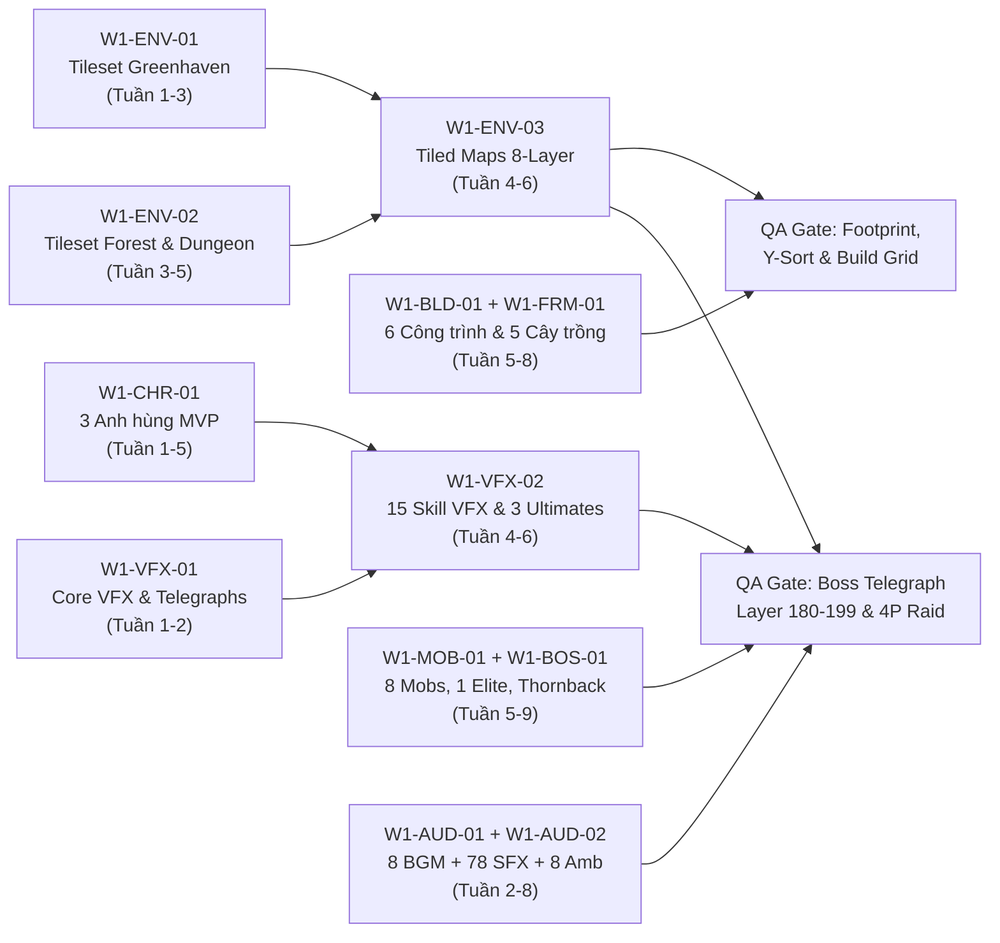

# Asset Production Backlog & QA Asset Acceptance Gate — Eldoria: Forgotten Wilds

**Trạng thái**: Hoàn thiện (Production Planning Baseline v1.0)  
**Chế độ**: `DESIGN_AND_PLANNING_ONLY`  
**Cập nhật lần cuối**: 2026-11-19  
**Tham chiếu cốt lõi**: [Constitution](../../.specify/memory/constitution.md) · [asset-manifest.md](asset-manifest.md) · [tileset-standard.md](tileset-standard.md) · [environment-design.md](environment-design.md) · [vfx-design.md](vfx-design.md) · [audio-design.md](audio-design.md)  
**Visual Benchmark References**:
- [Greenhaven Village Concept](concepts/greenhaven-village-concept.jpg)
- [Whispering Forest Combat Concept](concepts/whispering-forest-combat-concept.jpg)
- [Mossroot Hollow Boss Arena Concept](concepts/dungeon-boss-arena-concept.jpg)
- [Starter Heroes Sheet Concept](concepts/starter-heroes-sheet-concept.jpg)

---

## 1. Mục tiêu Quản lý Sản xuất & Tính Minh bạch Ước lượng

Tài liệu này chuyển hóa toàn bộ danh mục trong [asset-manifest.md](asset-manifest.md) thành **Lộ trình Sản xuất Tài nguyên 5 Làn sóng (Waves 1–5)** theo thứ tự phụ thuộc kỹ thuật, ưu tiên hoàn thành trọn vẹn **Wave 1 (M1 — MVP Vertical Slice)** trước khi mở rộng nội dung Post-MVP (M2–M5), tuân thủ **Nguyên tắc VII** của Hiến pháp.

> **Cảnh báo Minh bạch (Constitution Principle VIII)**: Toàn bộ ước lượng công sức theo ngày công (**person-days**) và năng suất đội ngũ dưới đây là ước lượng lập kế hoạch đề xuất (**`proposed` / `unverified`**) dựa trên chuẩn năng suất studio pixel art thương mại 16-bit (1 họa sĩ làm việc 8 giờ/ngày trên Aseprite/Tiled/DAW); **CHƯA được kiểm chứng trên vận tốc thực tế (real sprint velocity)** của đội ngũ triển khai.

### Cơ cấu Đội ngũ Sản xuất Tài nguyên Đề xuất (`proposed`)
- **Lead Pixel Character & Animation Artist** (`1` người): Nhân vật `48×64`, Quái vật `48×64..96×96`, Boss `128×128..256×256`, Vật nuôi, Chân dung `128×128`.
- **Pixel Environment & Prop Artist** (`1` người): Tilesets `32×32` (47-tile blob, 4-frame water, 2.5D cliffs), Công trình `bld_*` Lv1–Lv4, Cây trồng `crp_*`, Props môi trường, lắp ráp bản đồ Tiled `.tmj`.
- **Pixel VFX & UI Artist** (`1` người): Sprite VFX kỹ năng/Ultimates, Boss Telegraphs, 157 Item Icons, 60 Skill Icons, Pixel UI 9-slice Kit, Gacha Banners.
- **Chiptune/FM Audio Designer & Composer** (`0.5–1` người): Toàn bộ BGM, SFX 6 nhóm (gồm Enhancement `+1..+10` & Gacha rarity), Ambience, Mix & Mastering `.ogg`/`.mp3`.

---

## 2. Wave 1 — MVP Vertical Slice Production Backlog (Milestone M1)

Wave 1 bao phủ **100% nội dung có thể chơi hoàn chỉnh từ đầu đến cuối** theo `GAME_DESIGN_BRIEF.md` Mục 28 và đối soát chính xác số lượng từ `game-data/*.json`.

### 2.1 Bảng Kiểm kê & Ước lượng Công sức Wave 1 (`proposed` / `unverified`)

| ID Gói Việc | Hạng mục Tài nguyên Wave 1 (MVP) | Khối lượng Chính xác (Asset Count) | Độ phân giải / Định dạng | Ước lượng (`person-days`, `proposed`) | Vai trò Phụ trách |
| :--- | :--- | :--- | :---: | :---: | :--- |
| **W1-ENV-01** | Tileset `reg_greenhaven_village` + `ts_farming_soil` (7 trạng thái) + `ts_building_grid_overlay` (5 ô) + 4 mùa LUT | `1` bộ tileset chính (`~240` tiles gồm 47-tile grass/dirt/cobble/water 4f + cliff 2.5D) + `52` farm/grid tiles + `3` season LUTs | `32×32` extruded | `14.0` ngày | Environment Artist |
| **W1-ENV-02** | Tileset `reg_whispering_forest` + `dng_mossroot_hollow` (đuốc 4f, nấm phát quang, tàn tích cổ, 4 trụ phá hủy) | `~210` tiles rừng + `~140` tiles hầm ngục & đấu trường | `32×32` extruded | `11.0` ngày | Environment Artist |
| **W1-ENV-03** | Lắp ráp 5 bản đồ Tiled `.tmj` đủ 8 lớp chuẩn (`zon_greenhaven_square`, `zon_player_homestead`, `zon_forest_west`, `zon_forest_deep`, `dng_mossroot_hollow` + `boss` `26×20`) | `6` tệp `.tmj` đã xác thực collision & portal | Tiled JSON | `7.0` ngày | Environment Artist |
| **W1-BLD-01** | `6` Công trình MVP (`bld_player_house`, `bld_storage`, `bld_farm_plot`, `bld_chicken_coop`, `bld_blacksmith`, `bld_kitchen`) đủ cấp Lv1–Lv4 | **`22` biến thể kiến trúc** (+ hiệu ứng khói/lửa lò rèn) | `96×96`..`160×160` | `12.0` ngày | Environment Artist |
| **W1-FRM-01** | `5` Cây trồng MVP (`crp_sunwheat`, `crp_berry_bush`, `crp_moon_herb`, `crp_golden_carrot`, `crp_ember_pepper`) + Interactive Props (Oak/Pine, Copper/Iron, Chest, Campfire) | **`22` crop stage sprites** + `18` world props | `32×48` / `32×32..64×96` | `5.0` ngày | Environment Artist |
| **W1-CHR-01** | `3` Anh hùng MVP (`chr_kael_vanguard`, `chr_lyra_windrunner`, `chr_seraphina_dawn`) full 25 animation states 4 hướng + `3` Chân dung `128×128` | `3` character atlases (`408` frames tổng) + `3` portraits | `48×64` / `128×128` | `21.0` ngày | Character Artist |
| **W1-NPC-01** | `6` NPC Greenhaven (`npc_elder_rowan`, `npc_smith_garrik`, `npc_merchant_mira`, `npc_chef_bruno`, `npc_farmer_pip`, `npc_gacha_keeper_selene`) + `2` Vật nuôi MVP (`anm_meadow_chicken`, `anm_clover_cow`) | `6` NPC sheets + `6` portraits + `2` animal sheets (`48` frames) | `48×64` / `32×32..48×48` | `8.5` ngày | Character Artist |
| **W1-MOB-01** | `8` Quái thường MVP (`mob_moss_slime`..`mob_goblin_shaman`) + `1` Elite MVP (`mob_elite_alpha_direwolf`) | `9` monster sheets (`~320` frames tổng) | `48×64` / `64×64` / `96×96` | `13.5` ngày | Character Artist |
| **W1-BOS-01** | `1` Boss MVP (`boss_thornback_elder` — 3 phases, tim lõi cam phát sáng, gai Phase 2, nhựa độc Phase 3, stagger & death) | `1` Boss Atlas (`72` frames + `1` Boss Portrait) | `128×128` | `8.0` ngày | Character Artist |
| **W1-VFX-01** | VFX Core Combat (Hit sparks, Hit-flash, Poise Break, `5` loại Boss Telegraph chuẩn Layer `180–199`, Weather `RAIN/STORM/FOG/SNOW`, `12` pixel particles) | `1` Core VFX Atlas (`~120` frames) | `8×8`..`128×128` | `7.0` ngày | VFX & UI Artist |
| **W1-VFX-02** | VFX cho `15` Kỹ năng MVP (gồm 3 Ultimates `Crimson Crescent`, `Tempest Arrowstorm`, `Solar Judgment` + kỹ năng Boss `boss_thornback_elder`) | `15` skill VFX + `9` boss skill VFX (`~210` frames) | `32×32`..`160×280` | `11.0` ngày | VFX & UI Artist |
| **W1-ICO-01** | Toàn bộ Icons MVP: `10` Weapons (`+` weapon swing overlays), `12` Armor/Accessories, `29` Materials, `11` Consumables, `5` Seeds, `15` Skill Icons, `12` Status & Currency Icons | **`94` pixel icons** + `10` weapon overlays | `32×32` / `16×16` | `8.0` ngày | VFX & UI Artist |
| **W1-UI-01** | Pixel Fantasy UI Kit (9-slice panels, HUD HP/MP/Stamina/Poise, Hotbar, Minimap frame, Rarity frames, `2` Permanent Gacha Banners `bnr_perm_heroes`/`bnr_perm_arsenal`, `5` Cursors, Fonts Tiếng Việt `SIL_OFL_LOCAL_FONT` + Combat Bitmap Font) | `1` Core UI Atlas + `2` Banners + `3` Local Fonts | 9-slice / `640×260` | `10.0` ngày | VFX & UI Artist |
| **W1-AUD-01** | `8` Bản nhạc BGM MVP (Title, Greenhaven Day/Night, Forest, Mossroot Dungeon, Thornback P1–2 & P3 Enrage, Victory) có loop metadata | `8` tracks × 2 formats (`.ogg` + `.mp3`) | 44.1 kHz Stereo | `12.0` ngày | Audio Designer |
| **W1-AUD-02** | `78` SFX MVP (Combat + 15 Skills + Boss Telegraph/Break + Gathering/Farming/Animals + Blacksmith `+1..+10` escalation + Gacha rarity reveals + UI) + `8` Ambience Loops | `86` audio assets × 2 formats (`.ogg` + `.mp3`) | 44.1 kHz | `11.0` ngày | Audio Designer |
| **TỔNG WAVE 1 (M1 MVP)** | **Toàn bộ Vertical Slice chơi được 100%** | **~1.700+ frames sprite/VFX · 6 maps · 94 icons · 94 audio assets** | **100% Local `assets/`** | **`159.0` person-days** (`~8–10` tuần với team 4 người, `proposed/unverified`) | 4 Vai trò |

### 2.2 Biểu đồ Đường găng Phụ thuộc Wave 1 (Critical Path)

---

## 3. Lộ trình Mở rộng Tài nguyên Post-MVP (Waves 2–5 · Milestones M2–M5)

Sau khi Wave 1 vượt qua hoàn toàn **QA Asset Acceptance Gate** và bản Vertical Slice vận hành ổn định, nội dung dài hạn được sản xuất cuốn chiếu theo 4 làn sóng tiếp theo (ước lượng đều là `proposed/unverified`):

| Wave & Milestone | Khu vực & Boss Trọng tâm | Nhân vật, Kỹ năng & Quái vật | Công trình, Nông trại & Vật phẩm | Âm thanh & Hệ thống | Ước lượng (`person-days`, `proposed`) |
| :--- | :--- | :--- | :--- | :--- | :---: |
| **Wave 2 (M2 — Ironpeak Expansion)** | `reg_ironpeak_mountains` + `dng_slag_foundry` + **`boss_ignis_forgelord`** (`160×160`) | `3` Heroes (`chr_bram_bastion`, `chr_vex_nightblade`, `chr_rowan_tidewarden`), `15` Skills (gồm Ultimate **`Phantom Sever`**), `4` Mobs + `2` Elites (`mob_elite_briar_stag`, `mob_elite_magma_colossus`) | `3` Buildings (`bld_barn`, `bld_workshop`, `bld_furnace` = 9 variants), `2` Animals (`anm_cloud_sheep`, `anm_bristle_pig`), `3` Crops, `10` Weapons, `10` Eqp, `8` Materials | `2` BGM (Ironpeak, Ignis), `32` SFX, `2` Ambience (Mine/Lava), Limited Banner template | `108.0` ngày |
| **Wave 3 (M3 — Crystal & Ruins)** | `reg_crystal_caverns` + `dng_prism_sanctum` + **`boss_prism_leviathan`** (`192×192`) + `reg_forgotten_ruins` | `3` Heroes (`chr_orin_stormcaller`, `chr_freya_frostveil`, `chr_mira_ironfist`), `15` Skills (gồm **`Storm Dominion`**, **`Glacial Prison`**), `8` Mobs + `2` Elites | `3` Buildings (`bld_alchemy_lab`, `bld_training_ground`, `bld_stable` = 9 variants), `1` Animal (`anm_ridge_goat`), `4` Crops, `10` Weapons, `10` Eqp, `7` Materials | `3` BGM (Crystal, Ruins, Prism), `30` SFX, `2` Ambience (Cavern/Desert) | `124.0` ngày |
| **Wave 4 (M4 — Frost & Ember)** | `reg_frostbound_highlands` + `dng_glacial_citadel` + **`boss_boreas_frostking`** (`192×192`) + `reg_ember_wasteland` | `2` Heroes (`chr_torvald_rageborn`, `chr_aurelia_starbow`), `10` Skills (gồm **`Dragonheart Awakening`**, **`Celestial Rain`**), `7` Mobs + `2` Elites | `3` Crops (`crp_frost_turnip`, `crp_ash_chili`, `crp_starlight_melon`), `6` Weapons, `4` Eqp, `4` Materials, Weather `HEATWAVE` & Blizzard polish | `3` BGM (Frostbound, Ember, Boreas), `22` SFX, `2` Ambience | `98.0` ngày |
| **Wave 5 (M5 — Abyssal Endgame)** | `reg_abyssal_kingdom` + `dng_eclipse_throne` + **`boss_malakor_abyss`** (`256×256`) | `1` Mythic Hero (`chr_nyx_voidcaller`), `5` Skills (gồm **`Abyssal Eclipse`**), `3` Mobs + `1` Elite (`mob_elite_dread_harbinger`) | `1` Building (`bld_guild_hall` `7×6` = 3 variants), `1` Fantasy Animal (`anm_lunar_moth_hare`), `4` Mythic Weapons, `4` Endgame Eqp, `2` Materials, `1` Rich Fertilizer | `3` BGM (Abyssal, Malakor 3-tier, Gacha Summon), `18` SFX, `1` Void Ambience | `72.0` ngày |
| **TỔNG TOÀN DỰ ÁN (W1–W5)** | **8 Regions + 5 Boss Dungeons** | **12 Heroes · 60 Skills · 30 Mobs · 8 Elites · 5 Bosses** | **13 Buildings (43 lv) · 15 Crops (68 st) · 6 Animals · 157 Items** | **19 BGM · ~180 SFX · 15 Ambience** | **`561.0` person-days** (`proposed/unverified`) |

---

## 4. Cổng Kiểm duyệt Nghiệm thu Tài nguyên (Formal QA Asset Acceptance Review Gate)

**KHÔNG MỘT TÀI NGUYÊN NÀO** được phép hợp nhất vào nhánh `main` hay đăng ký vào `assets/manifest.json` nếu chưa vượt qua **7 Hạng mục Kiểm định Bắt buộc** dưới đây. Quy trình kết hợp **Script Kiểm định Tự động (Automated Gate)** và **Duyệt Thủ công của Art/Audio Director (Manual Sign-off)**.

### 4.1 Bảng Checklist Nghiệm thu Chính thức (7 Cổng Bắt buộc)

| Mã Cổng | Tên Kiểm định | Phương pháp Kiểm tra | Tiêu chí Đạt (Pass Criteria) | Mức lỗi nếu Trượt |
| :--- | :--- | :--- | :--- | :---: |
| **QA-ART-01** | **Pixel Grid & Mixel Check** | Script ảnh + Soi phóng đại 400% trong Phaser | - Khớp tuyệt đối khung kích thước chuẩn (`32×32`, `48×64`, `64×64`, `96×96`, `128×128..256×256`). - `0` pixel bán trong suốt chống răng cưa (anti-aliasing halo) quanh viền sprite. - `0` hiện tượng mixel (tỉ lệ pixel sai lệch giữa vũ khí, nhân vật và nền). - Tileset đã qua extrusion `1 px`, `margin 2 px`, `spacing 4 px`, 0 vết rách seam khi di chuyển camera chéo. | **`P0` (Blocker)** |
| **QA-ART-02** | **Palette & Silhouette Check** | Kiểm tra trên 4 nền (Cỏ Greenhaven, Rừng tối, Đá Dungeon, Tuyết/Đêm) | - Nhân vật/quái vật nhận diện rõ hình bóng (silhouette) ở kích thước gốc `1x` (`640×360`) ngay cả khi chuyển ảnh sang thang xám (grayscale readability test). - Bảng màu khớp mã Hex trong `environment-design.md` & `characters.json`; viền ngoài dùng màu tối đồng bộ theo sắc độ, không lem chói. | **`P1` (High)** |
| **QA-ART-03** | **Pivot & Footprint Alignment Check** | Bật Debug Collision Overlay trong Phaser & Tiled Validator | - Điểm Pivot của nhân vật/quái/boss nằm chính xác tại chân (Bottom-Center) khớp hộp va chạm server. - Công trình `bld_*` khớp chính xác `footprintTiles` (`W×H`) trong `buildings.json`, ô `interactionPoints` nằm ngoài vùng collision và tiếp cận được. - Tệp `.tmj` chứa đủ đúng tên 8 lớp chuẩn (`ground_base`..`overhead_canopy`). | **`P0` (Blocker)** |
| **QA-ART-04** | **Y-Sort & Occlusion Check** | Bài test đi vòng `360°` quanh cây, nhà, trụ đá `pil_moss_*` và Boss | - Khi đứng phía Bắc mái nhà/tán cây: nhân vật khuất tự nhiên phía sau và lớp `overhead_canopy` giảm mờ về `alpha 0.35`. - Khi đứng phía Nam: nhân vật nổi hoàn toàn phía trước, không bị cắt đầu hay nhảy giật Z-order (Z-fighting). | **`P1` (High)** |
| **QA-ART-05** | **Telegraph Readability & Photosensitivity Check** | Bài test Raid 4 người tung 4 Ultimate cùng lúc trong `dng_mossroot_hollow_boss` + đo tần suất chớp | - Vùng Boss Telegraph (`Layer 180–199`, viền đứt `#FF3B3B`, fill `0.25`, vòng đếm ngược) luôn rõ nét, không bị bất kỳ Ultimate nào che kín. - Tần suất nhấp nháy diện rộng **`≤ 3 Hz`**; không có strobe; chế độ `Camera Shake = 0%` và `Reduced Flashing = ON` hoạt động hoàn hảo. | **`P0` (Blocker)** |
| **QA-AUD-01** | **Audio Format, Loop & Polyphony Mix Check** | Kiểm tra trình duyệt Chrome (`.ogg`) & Safari (`.mp3`) + đồng hồ LUFS | - Đủ cả cặp tệp cục bộ `.ogg` + `.mp3` tại `assets/audio/`. - BGM & Ambience lặp 3 vòng liên tiếp `0` tiếng click/pop. - Loudness đạt `-16 LUFS` (BGM) / `-12 LUFS` (SFX), đỉnh `< -1.0 dBFS`. - Stress test 4 người co-op giữ polyphony `≤ 24` voices, `0` digital clipping, Enhancement `+1..+10` phát đúng nốt leo thang. | **`P1` (High)** |
| **QA-LIC-01** | **License & Zero-External-Dependency Check** | Quét tự động chuỗi URL + Đối chiếu `sources-and-licenses.md` | - `100%` tài nguyên có nhãn bản quyền rõ (`ORIGINAL_IN_HOUSE` hoặc `SIL_OFL_LOCAL_FONT`), tuyệt đối không chứa tài sản sao chép từ game khác. - `0` tham chiếu S3, CDN ngoài, Google Fonts hay đường dẫn `http(s)://` trong manifest/code/map (Hiến pháp Nguyên tắc I). | **`P0` (Blocker)** |

### 4.2 Quy trình Từ chối & Sửa lỗi (Rejection & Rework Workflow)
1. Tài nguyên nộp vào thư mục dàn dựng nội bộ (`source-art/review-queue/`) kèm phiếu kiểm kê ID chuẩn (`canonicalId`, `wave`, `author`, `license`).
2. Pipeline kiểm tra tự động chạy `QA-ART-01` (kích thước/extrusion), `QA-ART-03` (8-layer `.tmj` schema), `QA-AUD-01` (cặp `.ogg/.mp3`) và `QA-LIC-01` (quét URL ngoài). Lỗi **`P0`** tự động trả về ngay lập tức.
3. Art Director / Audio Lead duyệt trực quan trong bản dựng test sandbox (kiểm tra `QA-ART-02`, `QA-ART-04`, `QA-ART-05`) trong vòng `24 giờ` làm việc:
   - **`PASS`**: Đóng gói vào atlas cục bộ `assets/`, cập nhật `assets/manifest.json` và đánh dấu hoàn tất trong backlog.
   - **`NEEDS_REWORK` (`P0`/`P1`)**: Ghi rõ vị trí khung hình/tile lỗi kèm ảnh chụp đối chiếu; nghệ sĩ sửa và nộp kiểm duyệt lại đúng cổng bị trượt.
   - **`CONDITIONAL_PASS` (`P2`/`P3` — lỗi thẩm mỹ nhỏ)**: Cho phép tích hợp để không chặn lập trình viên gameplay, nhưng bắt buộc tạo ticket tinh chỉnh trước khi khóa mốc Milestone (Milestone Freeze).
