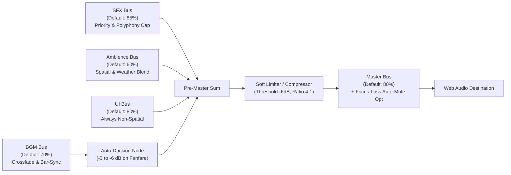

# Audio Design & Sound Production Specification — Eldoria: Forgotten Wilds

**Trạng thái**: Hoàn thiện (Audio Direction Baseline v1.0)  
**Chế độ**: `DESIGN_AND_PLANNING_ONLY`  
**Cập nhật lần cuối**: 2026-11-19  
**Tham chiếu cốt lõi**: [Constitution](../../.specify/memory/constitution.md) · [00-game-vision.md](../game-design/00-game-vision.md) · [skills.json](../../game-data/skills.json) · [bosses.json](../../game-data/bosses.json)  
**Visual Mood References**:
- [Greenhaven Village Concept](concepts/greenhaven-village-concept.jpg)
- [Whispering Forest Combat Concept](concepts/whispering-forest-combat-concept.jpg)
- [Mossroot Hollow Boss Arena Concept](concepts/dungeon-boss-arena-concept.jpg)

---

## 1. Định hướng Âm thanh (Audio Aesthetic & Originality Commitment)

Âm thanh của **Eldoria: Forgotten Wilds** theo đuổi phong cách **Classic 16-Bit Chiptune / FM-Orchestral Hybrid** — lấy cảm hứng từ tinh thần âm nhạc RPG giả tưởng thập niên 1990 (sự kết hợp ấm áp giữa âm sắc mẫu dàn nhạc kiểu SNES SPC700, âm trầm/kèn đồng sắc nét kiểu FM synthesis YM2612 và giai điệu chiptune trong trẻo dễ nhớ), nhưng được mix sạch sẽ theo chuẩn hiện đại để nghe êm tai trong các phiên chơi kéo dài hàng giờ.

### Quy tắc Bản quyền & Tự chủ (Constitution Principle I & V)
1. **100% Sáng tác Nguyên bản (`ORIGINAL_IN_HOUSE`)**: Toàn bộ BGM, SFX và Ambience được sáng tác/tổng hợp nguyên bản bằng công cụ hợp pháp (tracker/DAW synth, foley tự thu hoặc bộ mẫu CC0 đã kiểm định ghi rõ trong `docs/management/sources-and-licenses.md`). Tuyệt đối **KHÔNG** trích xuất nhạc/SFX từ game thương mại khác hoặc tải tài nguyên không rõ bản quyền trên Internet.
2. **100% Tự lưu trữ Cục bộ (Zero External Streaming)**: Mọi tệp âm thanh đặt trong thư mục cục bộ `assets/audio/` và phục vụ trực tiếp từ máy chủ tĩnh nội bộ; **KHÔNG** dùng S3, CDN ngoài, SoundCloud/streaming API hay dịch vụ âm thanh bên thứ ba.

---

## 2. Tiêu chuẩn Định dạng Tệp & Thông số Kỹ thuật (Local Format Spec)

Để đảm bảo phát mượt trên mọi trình duyệt desktop hiện đại (Chrome, Edge, Firefox, Safari) với dung lượng tải nhỏ và **không có tiếng "tách" (click/pop) khi lặp vòng (seamless loop)**:

| Thông số | Nhạc nền (`BGM`) & Không gian (`Ambience`) | Hiệu ứng Âm thanh (`SFX` & `UI`) |
| :--- | :--- | :--- |
| **Định dạng Chính (Primary)** | **OGG Vorbis (`.ogg`)** — 44.1 kHz, Stereo, `128–160 kbps` VBR | **OGG Vorbis (`.ogg`)** — 44.1 kHz, Mono (positional) / Stereo (UI/Gacha), `96–112 kbps` VBR |
| **Định dạng Dự phòng (Fallback)** | **MP3 (`.mp3`)** — 44.1 kHz, Stereo, `128 kbps` CBR (tự động chọn trên Safari/WebKit cũ) | **MP3 (`.mp3`)** — 44.1 kHz, `112 kbps` CBR |
| **Thư mục Lưu trữ Cục bộ** | `assets/audio/bgm/`, `assets/audio/ambience/` | `assets/audio/sfx/`, `assets/audio/ui/` |
| **Mức Âm lượng Chuẩn hóa (Loudness)** | `-16 LUFS` integrated · True Peak `≤ -1.5 dBFS` | `-12 LUFS` integrated · True Peak `≤ -1.0 dBFS` |
| **Cơ chế Lặp Vòng Mượt (Seamless Loop)** | Lưu metadata `introEndMs`, `loopStartMs`, `loopEndMs` trong `assets/audio/audio-manifest.json` để Phaser/Web Audio đặt `AudioBufferSourceNode.loopStart/loopEnd` chính xác từng sample (tránh khoảng lặng đệm của bộ mã hóa MP3) | Không lặp (trừ loop ngắn như tiếng mưa, tiếng lò rèn, kênh phép đang tụ lực có fade-in/out `20 ms`) |
| **Audio Sprite Packaging (Tùy chọn tối ưu)** | Tải từng tệp riêng (lazy-load theo Region để giảm tải lúc khởi động) | Có thể gom nhóm SFX nhỏ theo cụm (`sfx_ui_pack`, `sfx_farming_pack`) hoặc tải tệp rời đã cache cục bộ |

---

## 3. Danh mục Nhạc nền (BGM Track List)

### 3.1 Bộ Nhạc nền MVP Vertical Slice (Wave 1 — 8 Bản nhạc Cốt lõi)
| Track ID | Tên Bản nhạc | Khu vực / Ngữ cảnh | Nhịp (`BPM`) & Điệu thức | Phối khí 16-Bit Hybrid | Độ dài Vòng lặp | Chuyển cảnh (Transition) |
| :--- | :--- | :--- | :---: | :--- | :---: | :--- |
| `bgm_title_forgotten_wilds` | *Echoes of the Forgotten Wilds* | Màn hình Login, Chọn & Tạo nhân vật | `110 BPM` · D Dorian → D Major | Đàn hạc mở đầu, sáo gỗ giai điệu chính, dàn dây 16-bit nâng dần thành hợp âm anh hùng | `1:45` | Fade-out `1200 ms` khi vào thế giới |
| `bgm_greenhaven_day` | *Sunlit Hearths of Greenhaven* | `reg_greenhaven_village` & `zon_player_homestead` (`DAWN`/`DAY`) | `104 BPM` · G Major | Đàn lute gảy mộc, sáo trúc ấm, pizzicato bass nhẹ nhàng, bộ gõ gỗ nhỏ | `2:10` | Đồng bộ nhịp với `bgm_greenhaven_night`, crossfade `3000 ms` lúc `DUSK` |
| `bgm_greenhaven_night` | *Starlight Over the River* | `reg_greenhaven_village` & `zon_player_homestead` (`DUSK`/`NIGHT`) | `82 BPM` · G Major / E Minor | Hộp nhạc (celesta 16-bit), đàn hạc rải chậm, đệm pad ấm dịu, không trống | `2:00` | Crossfade `3000 ms` với bản ban ngày |
| `bgm_whispering_forest` | *Canopy of Whispers* | `reg_whispering_forest` (`zon_forest_west`, `zon_forest_deep`) | `118 BPM` · A Dorian | Sáo phiêu lưu dẫn nhịp, marimba gỗ gõ đều, bass FM đàn hồi, hợp âm rừng huyền bí | `2:15` | Crossfade `1500 ms` khi qua cầu Đông |
| `bgm_dng_mossroot_hollow` | *Beneath the Tangled Roots* | Hầm ngục `dng_mossroot_hollow` (Phòng 1–2 & Tiền sảnh) | `108 BPM` · C Minor | Dàn dây trầm căng thẳng, chuông hang vang (reverb nhẹ), nhịp tim trầm chậm | `1:50` | Cắt gọn bằng stinger cửa rễ khóa khi bước vào Boss Arena |
| `bgm_boss_thornback_p1_p2` | *Wrath of the Ancient Bramble* | Đấu trường `boss_thornback_elder` (Phase 1 & Phase 2: `100%–35% HP`) | `138 BPM` · D Minor | Trống bộ lạc dồn dập, dàn dây FM staccato, kèn đồng cổ điển dẫn giai điệu kịch tính | `2:05` | **Bar-quantized transition** ngay nhịp kế tiếp khi Boss sang Phase 3! |
| `bgm_boss_thornback_p3_enrage` | *Heartwood Unbound (Phase 3 / Enrage)* | Đấu trường `boss_thornback_elder` (Phase 3 `≤ 35% HP` & Enrage) | `152 BPM` · D Phrygian | Đẩy nhịp double-time snare, arpeggio chiptune sắc nét, kèn đồng dồn dập, bass sâu căng thẳng | `1:45` | Dừng dứt khoát bằng tiếng đổ sập khi Boss bị hạ, nghỉ `600 ms` rồi phát Victory |
| `bgm_victory_fanfare` | *Triumph in the Wilds* | Màn hình Boss Reward & Hoàn thành Dungeon | `124 BPM` · D Major | Fanfare kèn đồng 8 giây hoành tráng chuyển mượt sang vòng lặp hòa âm êm dịu khi chia loot | `0:08` intro + `1:00` loop | Fade-out `1000 ms` khi rời hầm ngục |

### 3.2 Lộ trình Nhạc nền Post-MVP (Waves 2–5)
- **M2 (`reg_ironpeak_mountains`)**: `bgm_ironpeak_mountains` (nhịp búa đe công nghiệp, `114 BPM`), `bgm_boss_ignis_forgelord` (metal-FM 16-bit, `146 BPM`).
- **M3 (`reg_crystal_caverns`, `reg_forgotten_ruins`)**: `bgm_crystal_caverns` (chuông pha lê + arpeggio thủy tinh, `96 BPM`), `bgm_forgotten_ruins` (âm hưởng cổ đại sa mạc + bộ gõ khung, `112 BPM`), `bgm_boss_prism_leviathan` (`144 BPM`).
- **M4 (`reg_frostbound_highlands`, `reg_ember_wasteland`)**: `bgm_frostbound_highlands` (điệp khúc lạnh giá + dàn đồng ca synth, `98 BPM`), `bgm_ember_wasteland` (bass trầm núi lửa, `120 BPM`), `bgm_boss_boreas_frostking` (`148 BPM`).
- **M5 (`reg_abyssal_kingdom`)**: `bgm_abyssal_kingdom` (nhạc gothic hư không hùng vĩ, `106 BPM`), `bgm_boss_malakor_abyss` (bản giao hưởng 16-bit 3 tầng cho Boss cuối, `156 BPM`), kèm `bgm_gacha_summon` (nhạc chờ tinh tú nhẹ nhàng trong màn hình Gacha).

---

## 4. Danh mục Hiệu ứng Âm thanh Chi tiết (SFX Catalog — 6 Nhóm)

Mọi hiệu ứng lặp lại thường xuyên (vung kiếm, bước chân, chặt cây, trúng đòn) **BẮT BUỘC** áp dụng biến thiên cao độ ngẫu nhiên (**Pitch Randomization `±5%` đến `±8%`**) và có `2–3` biến thể âm sắc (`_v1`, `_v2`, `_v3`) để triệt tiêu cảm giác "máy móc lặp lại" (machine-gun effect).

### 4.1 Nhóm 1: Combat SFX (Chiến đấu & Kỹ năng)
| SFX Key | Ngữ cảnh Kích hoạt | Đặc trưng Âm học 16-Bit | Priority | Debounce |
| :--- | :--- | :--- | :---: | :---: |
| `sfx_wpn_swing_blade` / `_heavy` / `_bow` / `_staff` | Đòn đánh thường theo nhóm vũ khí (`SWORD/DAGGER`, `GREATSWORD/AXE/SPEAR`, `BOW/CROSSBOW`, `STAFF/WAND`, `GAUNTLET/SHIELD`) | Tiếng rít gió sắc (noise-filter sweep) khớp đúng tốc độ vung vũ khí | `2` | `60 ms` |
| `sfx_hit_flesh` / `_armor` / `_crit` | Trúng mục tiêu thường / giáp cứng / Chí mạng (`CRITICAL`) | Đòn thường: lực đấm trầm + tách nhẹ; Crit: thêm âm sắc kim loại sáng cộng hưởng ở `2.8 kHz` | `2` / `1` | `50 ms` |
| `sfx_dodge_whoosh` / `sfx_block_clang` / `sfx_parry_perfect` | Né tránh i-frame / Đỡ khiên / **Parry chuẩn** | Parry chuẩn: tiếng vang thép sắc lẹm hai tầng (`E6 + B6`) rất thỏa mãn tai, báo hiệu cửa sổ phản công | `0` | `80 ms` |
| `sfx_player_hurt` / `sfx_player_death` | Nhân vật bị sát thương / Gục ngã | Thấp, rõ ràng, không chói; gục ngã có hợp âm rơi trầm ngắn | `0` | `120 ms` |
| **15 MVP Skill `sfxKey`s** | Khớp 100% `skills.json`: `sfx_kael_resolve_ignite`, `sfx_kael_blazing_lunge`, `sfx_kael_cinder_parry_clang`, `sfx_kael_sunder_cleave`, `sfx_kael_crimson_crescent_slash`, `sfx_lyra_swirl_proc`, `sfx_lyra_gale_volley`, `sfx_lyra_zephyr_vault`, `sfx_lyra_cyclone_snare`, `sfx_lyra_tempest_arrowstorm`, `sfx_seraphina_grace_chime`, `sfx_seraphina_dawn_mend`, `sfx_seraphina_searing_halo`, `sfx_seraphina_sanctuary_ward`, `sfx_seraphina_solar_judgment` | Chữ ký âm thanh riêng theo nguyên tố: `FIRE` (rít lửa + nổ ấm), `WIND` (lọc thông dải tiếng sáo gió), `LIGHT` (chuông hòa âm vàng trong trẻo) | `1` (Self) / `2` (Ally) | `65 ms` |
| `sfx_boss_telegraph_warn` | Boss bắt đầu gồng đòn diện rộng / đòn tử thần | Tiếng chuông cảnh báo trầm pha rung nhẹ (dễ nhận biết ngay lập tức giữa tiếng combat hỗn loạn) | **`0` (CRITICAL)** | `150 ms` |
| `sfx_boss_poise_break` | Thanh Poise Boss vỡ — kích hoạt Stagger Window | Tiếng pha lê/giáp cổ vỡ tan + cú nổ sub-bass `60 Hz` đầy uy lực | **`0` (CRITICAL)** | `250 ms` |
| `sfx_boss_thornback_roar` / `_root_slam` / `_pillar_crash` | Gầm chuyển phase, giậm rễ và vỡ trụ đá `pil_moss_*` | Gỗ cổ nứt gãy + âm trầm rừng sâu vang dội | `0` / `1` | `120 ms` |

### 4.2 Nhóm 2: Gathering, Farming & Animal Husbandry SFX
| SFX Key | Hành động | Đặc trưng Âm học |
| :--- | :--- | :--- |
| `sfx_gather_wood_chop` / `sfx_gather_tree_fall` | Chặt cây gỗ Oak/Pine & cây đổ | Tiếng rìu găm vào gỗ khô sắc gọn (3 biến thể) + tiếng lá xào xạc đổ rầm |
| `sfx_gather_ore_mine` / `sfx_gather_ore_break` | Cuốc đá / quặng Copper, Iron & vỡ vỉa quặng | Tiếng cuốc thép nện đá tóe tia kim loại, cao độ tăng nhẹ ở nhát vỡ cuối |
| `sfx_farm_hoe_till` / `sfx_farm_seed_plant` | Cuốc đất `SOIL_TILLED_DRY` & gieo hạt `sed_*` | Tiếng xới đất sột soạt ấm + tiếng "bụp" mềm vui tai khi gieo hạt |
| `sfx_farm_water_pour` / `sfx_farm_fertilize` | Tưới nước `SOIL_TILLED_WATERED` & rải phân bón | Tiếng nước róc rách trong + tiếng rắc hạt lấp lánh nhẹ |
| `sfx_farm_harvest_pop` | Thu hoạch cây trồng trưởng thành (`MATURE`) | Tiếng "póc" tươi giòn tăng dần nửa cung nếu gặt liên tiếp nhiều ô trong `1.5 giây`! |
| `sfx_animal_chicken_cluck` / `sfx_animal_cow_moo` / `sfx_animal_happy_heart` | Chăm sóc, vuốt ve & thu trứng/sữa `anm_meadow_chicken`, `anm_clover_cow` | Tiếng kêu 16-bit dễ thương ngắn gọn + nốt chuông hạnh phúc `C6–G6` |
| `sfx_fish_cast` / `sfx_fish_bite_alert` / `sfx_fish_reel_catch` | Câu cá trên sông Greenhaven | Tiếng quăng dây, tiếng tõm phao rõ nét báo giật cần, fanfare nhỏ khi bắt được cá |
| `sfx_cook_sizzle` / `sfx_build_hammer_place` | Nấu ăn tại `bld_kitchen` & đặt công trình `bld_*` | Tiếng chảo xèo ấm áp; tiếng đóng cọc gỗ hoàn thành công trình |

### 4.3 Nhóm 3: Blacksmith & Weapon Enhancement SFX (`+1` đến `+10` Musical Chime Escalation)
Cường hóa vũ khí trong MVP là **100% thành công khi đủ nguyên liệu** (theo Hiến pháp Nguyên tắc VI & `ASM-010`). Để mỗi cột mốc từ `+1` đến `+10` mang lại cảm xúc thăng hoa rõ rệt — đặc biệt biến mốc `+10` thành khoảnh khắc đáng nhớ — hệ thống âm thanh Lò Rèn thiết kế chuỗi **nâng âm nhạc học leo thang (Harmonic Chime Escalation)**:

- **Âm thanh rèn chung (`sfx_forge_hammer_strike`)**: 3 nhịp búa đe (`t = 0 ms`, `320 ms`, `640 ms`) với tiếng thép nóng rực xèo khói (`sfx_forge_quench`) trước khi vang lên giai điệu hoàn thành:

| Cấp Cường hóa | SFX Key | Âm giai / Hợp âm Chuông 16-Bit | Lớp Âm sắc & Cảm xúc |
| :---: | :--- | :--- | :--- |
| **`+1`** | `sfx_enhance_tier1_p1` | Nốt đơn sáng `C5` | Tiếng đe thép gọn gàng, trong trẻo |
| **`+2`** | `sfx_enhance_tier1_p2` | Nốt đôi `D5 → F#5` | Cao hơn, thêm 1 tiếng lấp lánh nhẹ |
| **`+3`** | `sfx_enhance_tier1_p3` | Hợp âm mở `E5 → G5 → B5` | Hoàn tất bậc Lò Rèn Lv 1 (Common Tier), cảm giác sắc bén rõ rệt |
| **`+4`** | `sfx_enhance_tier2_p4` | Hợp âm `G5` + âm bội chuông đồng | Bắt đầu bậc quặng tinh luyện (Lò Rèn Lv 2), âm trầm ấm hơn |
| **`+5`** | `sfx_enhance_tier2_p5` | Arpeggio 3 nốt `A5 → C#6 → E6` | Tiếng lửa bùng nhẹ kèm vang kim loại |
| **`+6`** | `sfx_enhance_tier2_p6` | Hợp âm rực rỡ `C6 Major` | Cột mốc trung cấp, vang ngân `1.2 giây` |
| **`+7`** | `sfx_enhance_tier3_p7` | Chuông thánh đường + tia tinh thể `D6 → F#6 → A6` | Bắt đầu bậc nguyên liệu Dungeon/Elite (Lò Rèn Lv 3), trang trọng |
| **`+8`** | `sfx_enhance_tier3_p8` | Hợp âm đầy `E6 Major` + tiếng gió lửa | Cảm giác vũ khí đã đạt tầm tinh anh |
| **`+9`** | `sfx_enhance_tier4_p9` | Kèn đồng 16-bit dâng trào + hợp âm `G6 Major7` | Cận kề đỉnh cao (Lò Rèn Lv 4), giàu kịch tính |
| **`+10`** | **`sfx_enhance_tier4_p10_max`** | **Fanfare Huyền thoại: `C6 → E6 → G6 → B6 → C7` + sub-bass đe rèn + đuôi tinh quang ngân `2.8 giây`** | **Cột mốc Masterwork tối đa** — tự động duck BGM `-4 dB` trong `2.5 giây` để tôn vinh khoảnh khắc đạt `+10`! |

- **Bổ trợ Lò Rèn**: `sfx_forge_smelt_ingot` (tiếng lò nung sôi), `sfx_forge_repair_clang` (sửa độ bền), `sfx_forge_dismantle` (tách nguyên liệu).

### 4.4 Nhóm 4: Gacha Reveal SFX (Phân tầng Theo Độ hiếm `Rarity`)
| Giai đoạn / Độ hiếm | SFX Key | Đặc trưng Âm học & Cảm xúc |
| :--- | :--- | :--- |
| Khởi động quay (Single / 10-Pull) | `sfx_gacha_pull_start` | Hợp âm đàn hạc vuốt lên tạo cảm giác triệu hồi ánh sao từ bầu trời |
| Sao băng rơi xuống Đền Triệu hồi | `sfx_gacha_comet_drop` | Tiếng gió lấp lánh rít nhẹ giảm dần cao độ rồi chạm đất |
| **`COMMON`** / **`UNCOMMON`** | `sfx_gacha_reveal_common` | Tiếng chuông thủy tinh ngắn dịu (`G5`), nhanh gọn không kéo dài |
| **`RARE`** | `sfx_gacha_reveal_rare` | Hợp âm xanh lam sáng `C5–E5–G5` ngân nhẹ `0.9 giây` |
| **`EPIC`** | `sfx_gacha_reveal_epic` | Đàn hạc tím lướt nhanh + cú đánh trống định âm + hợp âm `A5 Minor9` (`1.6 giây`) |
| **`LEGENDARY`** | `sfx_gacha_reveal_legendary` | BGM tự duck `-5 dB`; nhịp lắng `200 ms` rồi bùng nổ hợp âm vàng 16-bit + kèn đồng + đồng ca synth ngân `2.6 giây` |
| **`MYTHIC`** | `sfx_gacha_reveal_mythic` | BGM tự duck `-6 dB`; hiệu ứng chậm thời gian trầm ấm `350 ms` → vỡ tung thành arpeggio tinh tú 2 quãng tám + fanfare huyền thoại `3.5 giây` |
| Quy đổi vật phẩm trùng (`STAR_ESSENCE`) | `sfx_gacha_duplicate_convert` | Tiếng tinh thể hóa tụ sáng êm dịu (`0.6 giây`), rõ ràng minh bạch |

### 4.5 Nhóm 5: UI Clicks & System Feedback SFX
| SFX Key | Ngữ cảnh | Đặc trưng Âm học |
| :--- | :--- | :--- |
| `sfx_ui_hover` | Di chuột qua nút menu / ô vật phẩm | Tiếng gỗ/giấy chạm cực nhỏ (`20 ms`, âm lượng `-8 dB` so với click) |
| `sfx_ui_click_confirm` | Nhấn xác nhận, mở túi đồ, trang bị | Tiếng khóa da/gỗ pixel đanh gọn, ấm áp |
| `sfx_ui_click_cancel` | Đóng cửa sổ, hủy thao tác | Tông thấp hơn `confirm` 1 quãng ba thứ |
| `sfx_ui_tab_switch` | Chuyển tab Inventory / Quest / Map | Tiếng lật trang sách da mềm (`45 ms`) |
| `sfx_ui_item_pickup` / `sfx_ui_gold_jingle` | Nhặt vật phẩm / Nhận hoặc tiêu `GOLD` | Tiếng xu vàng va vào nhau trong trẻo (pitch thay đổi nhẹ theo số lượng) |
| `sfx_ui_quest_accept` / `sfx_ui_quest_complete` | Nhận / Hoàn thành nhiệm vụ `qst_*` | Nhận: tiếng đóng dấu sáp; Hoàn thành: fanfare ngắn 4 nốt ấm áp |
| `sfx_ui_level_up` | Lên cấp nhân vật | Hợp âm tỏa sáng 16-bit kinh điển (BGM duck `-3 dB` trong `1.5 giây`) |
| `sfx_ui_error_invalid` | Thiếu Mana, đang Cooldown, sai vị trí xây | 2 nốt trầm ngắn mềm (không gắt chói tai), cooldown debounce `250 ms` |
| `sfx_ui_party_invite` / `sfx_ui_chat_ping` | Lời mời Party / Tin nhắn nhắc tên | Tiếng chuông mời thân thiện 2 nốt `F5 → C6` |

### 4.6 Nhóm 6: Ambience Loops (Âm thanh Môi trường Nền)
| Ambience Key | Khu vực / Thời tiết | Mô tả Lớp Âm thanh Nền |
| :--- | :--- | :--- |
| `amb_greenhaven_day` | Greenhaven Village (`DAWN`/`DAY`) | Gió nhẹ qua lá, tiếng chim hót xa rải rác, tiếng suối chảy êm đềm |
| `amb_greenhaven_night` | Greenhaven Village (`DUSK`/`NIGHT`) | Tiếng dế kêu nhịp nhàng, dòng suối êm, tiếng củi nổ tí tách gần lò rèn/nhà |
| `amb_whispering_forest` | Whispering Forest | Tiếng tán cây xào xạc sâu hơn, tiếng côn trùng rừng, thỉnh thoảng vọng gió xa |
| `amb_dungeon_mossroot` | `dng_mossroot_hollow` | Giọt nước nhỏ vang vọng trong hang đá, tiếng gió rít trầm qua khe rễ |
| `amb_weather_rain` | Thời tiết `RAIN` | Tiếng hạt mưa rơi đều trên cỏ và mái ngói gỗ (lọc nhẹ tần số cao để không lấn SFX) |
| `amb_weather_storm` | Thời tiết `STORM` | Mưa dày + tiếng sấm rền xa ngẫu nhiên mỗi `12–25 giây` |
| `amb_weather_snow_wind` | Thời tiết `SNOW` / Frostbound | Tiếng gió lạnh lùa êm qua thung lũng băng |
| `amb_forge_hearth` | Không gian gần `bld_blacksmith` / Ironpeak | Tiếng than lửa bập bùng (spatial sound — tăng dần âm lượng khi tiến gần lò rèn trong bán kính `224 px`) |

---

## 5. Kiến trúc Trộn Âm (Volume Mixing Buses & Auto-Ducking)

Toàn bộ âm thanh trên client đi qua cây **5 GainNode Buses** chuẩn Web Audio API trong `AudioEngine` (cấu hình lưu cục bộ và chỉnh được trực tiếp từ màn hình Settings, bước chia `0%–100%` kèm nút Mute nhanh):

### Quy tắc Auto-Ducking & Focus Handling
- **Auto-Ducking**: Khi phát `sfx_enhance_tier4_p10_max`, `sfx_gacha_reveal_legendary/mythic`, `sfx_ui_level_up`, hoặc `sfx_boss_poise_break`, node `DUCK` hạ âm lượng `BGM` xuống `-4 dB` đến `-6 dB` (`attack 150 ms`, `hold 1200–2500 ms`, `release 600 ms`) rồi trả về bình thường.
- **Browser Autoplay Unlock**: Nếu trình duyệt khóa `AudioContext` khi mới mở trang Login, hệ thống tự động hiển thị biểu tượng loa nhỏ trạng thái tạm khóa và kích hoạt `audioContext.resume()` ngay tại thao tác click/nhấn phím đầu tiên của người chơi mà không văng lỗi console.
- **Tab Background Mute**: Tùy chọn `Mute When Window Unfocused` (mặc định `ON` cho BGM/Ambience, vẫn phát `sfx_ui_party_invite` nếu người chơi bật thông báo).

---

## 6. Kiểm soát Đa âm & Chống Vỡ Tiếng trong Co-op Raid (Voice Limiting & Polyphony Cap)

Khi 4 người chơi đồng thời xả combo kỹ năng, mưa tên và AoE lên `boss_thornback_elder` cùng 6 quái nhỏ, việc phát không kiểm soát mọi SFX sẽ dẫn tới vỡ tiếng kỹ thuật số (digital clipping) và nhiễu loạn thông tin. Eldoria áp dụng cơ chế **4 tầng bảo vệ âm thanh Co-op** (`proposed/unverified` cho đến khi đo kiểm trên client thực tế):

| Tầng Bảo vệ | Thông số Thiết kế (`proposed`) | Cơ chế Hoạt động |
| :--- | :--- | :--- |
| **1. Hard Polyphony Cap** | **Tối đa `24` voices SFX hoạt động đồng thời** (không tính 2 kênh BGM crossfade + 2 kênh Ambience) | Phân bổ theo 4 bể ưu tiên:  - **Priority 0 (`CRITICAL`, 4 voices khóa cứng)**: Boss Telegraph, Boss Poise Break, Parry, Player Hurt/Death — **không bao giờ bị cướp kênh**. - **Priority 1 (`HIGH`, 6 voices)**: Kỹ năng & Ultimate của chính người chơi. - **Priority 2 (`MEDIUM`, 6 voices)**: Kỹ năng của 3 đồng đội co-op. - **Priority 3 (`LOW`, 8 voices)**: Quái trúng đòn, bước chân, mũi tên phụ, tiếng động vật — áp dụng *oldest-voice stealing* khi đầy bể. |
| **2. Per-Key Micro-Debounce** | Cửa sổ `45–80 ms` theo từng `sfxKey` | Nếu đòn AoE (`Crimson Crescent` hoặc `Gale Volley`) trúng 6 con Slime trong cùng 1 server tick, chỉ phát **1 tiếng impact** (cộng thêm `+1.5 dB` độ dày nếu trúng ≥ 3 mục tiêu) thay vì chồng 6 sóng âm đồng pha gây nổ loa! |
| **3. Co-op Ally Attenuation & Spatial Panning** | Đồng đội giảm `-4 dB` mặc định; Pan stereo tuyến tính `[-0.65 .. +0.65]` theo vị trí X tương đối so với camera; Roll-off âm lượng về `0%` ngoài khoảng cách `480 px` | Giúp người chơi luôn nghe rõ nhịp đánh của bản thân và hướng kỹ năng của đồng đội mà không bị ầm ĩ |
| **4. Master DynamicsCompressorNode** | Threshold `-6 dB`, Knee `12 dB`, Ratio `4:1`, Attack `3 ms`, Release `120 ms` | Hàng rào vật lý cuối cùng chặn tuyệt đối đỉnh sóng vượt `0 dBFS` (clipping) |

---

## 7. Quality Gate — Accessibility, Failure Behavior & Test Scenarios

- **Failure Behavior**: Nếu trình duyệt không hỗ trợ `.ogg`, `AudioLoader` tự động chuyển sang `.mp3` cùng đường dẫn cục bộ. Nếu một tệp âm thanh bị lỗi decode hoặc bị chặn quyền âm thanh, game tiếp tục chạy hoàn toàn bình thường ở chế độ im lặng có log cảnh báo `WARN_AUDIO_LOAD_FAILED` (không bao giờ crash gameplay).
- **Accessibility (Người chơi Khiếm thính / Tắt loa)**: Mọi tín hiệu âm thanh mang ý nghĩa sinh tử (`sfx_boss_telegraph_warn`, `sfx_boss_poise_break`, `sfx_fish_bite_alert`, `sfx_ui_party_invite`) **BẮT BUỘC** có tín hiệu thị giác tương đương (Telegraph đỏ `#FF3B3B`, chữ `BREAK!`, dấu `!` trên phao câu, biểu tượng rung trên nút Party).

| Mã Kiểm thử | Kịch bản Kiểm chứng | Kết quả Mong đợi (Pass Criteria) |
| :--- | :--- | :--- |
| **TC-AUD-01** | Phát vòng lặp `bgm_greenhaven_day`, `bgm_boss_thornback_p1_p2` qua 3 chu kỳ liên tiếp trên Chrome (`.ogg`) và Safari (`.mp3`) | Không xuất hiện tiếng tách/click hoặc khoảng lặng ở điểm nối loop |
| **TC-AUD-02** | Boss `boss_thornback_elder` giảm HP qua mốc `35%` sang Phase 3 giữa lúc nhạc Phase 1–2 đang phát | Nhạc chuyển mượt đúng đầu ô nhịp sang `bgm_boss_thornback_p3_enrage` không bị cắt ngang chói tai |
| **TC-AUD-03** | Stress test 4 người chơi đánh AoE trúng 8 quái vật cùng lúc kèm Boss tung telegraph | Số voice đồng thời không vượt `24`; `sfx_boss_telegraph_warn` vẫn nghe rõ nét; đỉnh sóng Master không bị clip (`< 0 dBFS`) |
| **TC-AUD-04** | Thực hiện chuỗi cường hóa vũ khí liên tục từ `+0 → +10` tại `bld_blacksmith` | Mỗi cấp phát đúng thang chime leo thang `+1..+10`; riêng mốc `+10` kích hoạt fanfare đặc biệt và duck BGM `-4 dB` |
| **TC-AUD-05** | Điều chỉnh độc lập 5 thanh trượt (`Master`, `BGM`, `SFX`, `Ambience`, `UI`) và tải lại trang | Mức âm lượng áp dụng tức thì không cần reload và lưu đúng cấu hình sau khi tải lại |
