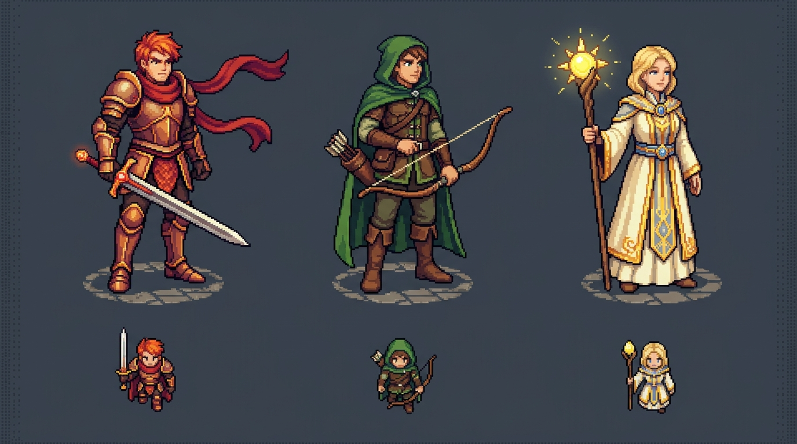

# Character Design Standard — Eldoria: Forgotten Wilds

**Trạng thái**: Design Baseline v1.0  
**Chế độ**: `DESIGN_AND_PLANNING_ONLY`  
**Cập nhật lần cuối**: 2026-11-19  
**Tài liệu liên kết**: [Art Bible](./art-bible.md), [00 — Game Vision](../game-design/00-game-vision.md), [characters.json](../../game-data/characters.json)

---

## 1. Mục tiêu Thiết kế Nhân vật 16-Bit

Hệ thống thiết kế nhân vật của **Eldoria: Forgotten Wilds** phải giải quyết đồng thời hai yêu cầu cốt lõi của một game Action RPG Multiplayer có sưu tầm nhân vật:
1. **Nhận diện tức thì trong combat tốc độ cao**: Trên màn hình `640×360 px` với tối đa 4 người chơi cùng đánh Boss và hàng chục quái vật, người chơi phải phân biệt được ngay **Class, Nguyên tố và Nhân vật cụ thể** chỉ qua hình bóng (silhouette) và 3–4 màu chủ đạo.
2. **Công bằng thị giác & Chống phình to sản xuất**: Mọi nhân vật playable dùng chung chuẩn khung hình `48×64 px` và vùng nhận sát thương chuẩn hóa (Hurtbox) trên server, tránh tình trạng nhân vật nhỏ con khó bị đánh trúng hơn hoặc phải vẽ hàng chục nghìn tổ hợp áo giáp.

---

## 2. Tư liệu Tham khảo Nhân vật Khởi đầu (Visual Concept Reference)



> **LƯU Ý CHUẨN HÓA SẢN XUẤT**: Hình ảnh trên là **Design Visual Reference** minh họa ngôn ngữ màu sắc, tương phản silhouette giữa 3 nhân vật khởi đầu MVP (`chr_kael_vanguard`, `chr_lyra_windrunner`, `chr_seraphina_dawn`) và quy đổi sang tỷ lệ overworld sprite (hàng dưới). Trong quá trình sản xuất thực tế, toàn bộ sprite `48×64 px` và chân dung `64×64`/`128×128 px` **PHẢI được họa sĩ pixel vẽ tay trên lưới chuẩn**, tuân thủ chính xác tiểu sử & tạo hình chuẩn trong `game-data/characters.json` (ví dụ: `chr_lyra_windrunner` có tạo hình nữ cung thủ đội mũ trùm lục bảo lệch kèm khăn choàng gió; không dùng ảnh nén JPEG hay pixel lệch lưới).

---

## 3. Tỷ lệ Hình thể & Hệ Tọa độ Lưới `48×64 px`

### 3.1 Tỷ lệ Chibi / Heroic 16-Bit (~2.6 – 3.0 Đầu)
Nhân vật humanoid chuẩn của Eldoria KHÔNG quá lùn như chibi 2 đầu (khó diễn tả thế đánh action RPG giàu uy lực) và cũng KHÔNG quá gầy cao 5–6 đầu (dễ mất chi tiết khuôn mặt trên lưới `48×64 px`). Tỷ lệ vàng được cố định ở mức **2.6 đến 3.0 đầu** trong chiều cao đứng thực tế **`38 – 44 px`**:

| Bộ phận Cơ thể | Chiều cao (px) | Tọa độ Y Chuẩn (Standing Idle) | Ghi chú Tỷ lệ & Thiết kế |
| :--- | :---: | :---: | :--- |
| **Khoảng trống Đỉnh (Headgear & Motion Margin)** | `14 – 20 px` | `y = 0 .. 15` | Chứa chỏm mũ phù thủy, sừng giáp, chóp mũ trùm, tóc dựng khi nhảy/dodge hoặc vũ khí giơ qua đầu. |
| **Đầu & Khuôn mặt (Head)** | `14 – 16 px` | `y = 16 .. 30` | Rộng `13 – 15 px`. Mắt cao `2 – 3 px` (vẽ 1 điểm sáng trắng 1 px ở góc NW tạo thần thái), kiểu tóc và phụ kiện đầu là điểm neo silhouette số 1. |
| **Thân trên, Vai & Áo choàng (Torso)** | `13 – 15 px` | `y = 31 .. 45` | Vai rộng theo class: `KNIGHT`/`BERSERKER` `18–22 px`, `WARRIOR` `16–18 px`, `ARCHER`/`ASSASSIN`/`MAGE`/`HEALER` `13–15 px`. |
| **Chân & Giày (Legs & Feet)** | `10 – 13 px` | `y = 46 .. 58` | Bước chân tách rõ 2 ống quần/ủng giúp chu kỳ `Walk`/`Run`/`Sprint` sống động; đế giày dừng chính xác tại **Foot Baseline `y = 58`**. |
| **Khoảng trống Đáy (Ground & Shadow Margin)** | `6 px` | `y = 59 .. 63` | Chừa chỗ cho đế bóng đổ, mũi kiếm/áo choàng dài rũ xuống dưới chân hoặc tư thế khuỵu gối khi `Dodge`/`Stun`. |

### 3.2 Sơ đồ Lưới Tọa độ & Phân tách 4 Hộp Không gian (Coordinate Blueprint)
Tâm ngang (Center X) cố định tại **`x = 24`**, đường chân (Foot Baseline) cố định tại **`y = 58`** → **Anchor / Pivot chuẩn = `(24, 58)`** (tương đương normalized `(0.5, 0.90625)` trong Phaser 3):

```text
         x=0     x=6  x=12 x=14    x=24    x=33 x=35  x=41    x=47
y=0      +-----------------------------------------------------+  <- Sprite Frame Canvas: 48 x 64 px
         |           [ Headgear / Weapon Swing Margin ]        |
y=16     |                 .---------------.                   |
         |                /   HEAD (15px)   \                  |
y=20     |     +---------+-------------------+---------+       |  <- Interaction Box TOP (y=20)
y=24     |     |     +---+-------------------+---+     |       |  <- Server Hurtbox TOP (y=24)
y=31     |     |     |      TORSO & SHOULDERS    |     |       |
         |     |     |     (Weapon & Cloak)      |     |       |
y=45     |     |     |         LEGS              |     |       |
y=48     |     |     |  +-------------------+    |     |       |  <- Collision Footbox TOP (y=48)
y=55     |     |     |  |    * (24, 55)     |    |     |       |  <- Physics Center
y=58     |=====|=====|==|====+==============|====|=====|=======|  <- FOOT BASELINE (y=58, Y-Sort FootY)
y=59     |     +-----+--|-------------------+----+-----+       |  <- Interaction Box BOTTOM (y=59)
y=61     |              +-------------------+                  |  <- Collision Footbox BOTTOM (y=61)
y=63     +-----------------------------------------------------+  <- Sprite Frame BOTTOM (y=63)
```

### 3.3 Bảng Thông số Bốn Hộp Không gian Bắt buộc
| Tên Hộp | Kích thước (px) | Tọa độ Cục bộ `(x, y)` | Quyền Xác thực | Mục đích Sử dụng |
| :--- | :---: | :---: | :---: | :--- |
| **Sprite Frame Canvas** | **`48 × 64 px`** | `x: 0..47, y: 0..63` | Client Render | Giới hạn pixel tối đa trên atlas của 1 frame nhân vật. |
| **Collision Footbox** | **`20 × 14 px`** | `x: 14..33, y: 48..61` | **Server-Authoritative** (Client predict) | Xử lý va chạm địa hình Tiled, tường, hàng rào, trụ đá Boss và tính tọa độ `footY = 58` cho Y-Sorting. |
| **Combat Hurtbox** | **`24 × 34 px`** | `x: 12..35, y: 24..57` | **Server-Authoritative 100%** | Vùng kiểm tra trúng đòn quái/Boss/đạn đạo trên server. Mọi nhân vật playable dùng chung 1 kích thước Hurtbox để công bằng tuyệt đối. |
| **Interaction Box** | **`36 × 40 px`** | `x: 6..41, y: 20..59` | Client Hover + Server Range Check (`<= 96 px`) | Bắt click chuột vào nhân vật khác (mời party, xem thông tin) và hiển thị highlight tương tác. |

---

## 4. Quy tắc Silhouette cho Toàn bộ 8 Class & 12 Nhân vật Chuẩn

Mọi nhân vật phải vượt qua **Black Silhouette Test**: khi tô đen 100% hình dáng ở kích thước thật `48×64 px` trên nền xám, người chơi mới phải nhận ra ngay class/vai trò mà không cần nhìn màu sắc.

### 4.1 Ma trận Silhouette 8 Class (`CharacterClass`)
| `CharacterClass` | Hình khối Tổng thể (Shape Language) | Đặc điểm Đầu / Vai / Áo choàng | Tư thế Cầm Vũ khí Đặc trưng | Độ rộng Vai (px) |
| :--- | :--- | :--- | :--- | :---: |
| **`WARRIOR`** | **Chữ nhật vững chắc + đường chéo năng động** | Giáp vai bất đối xứng hoặc khăn/áo choàng ngắn vắt lệch 1 vai, tóc gọn sắc cạnh. | Tay phải hạ trường kiếm/găng sắt chếch 35° sẵn sàng lao lên; thế đứng mở vừa. | `16 – 18 px` |
| **`KNIGHT`** | **Khối thang ngược nặng & kiên cố (Bulky Trapezoid)** | Mũ giáp hoặc cầu vai tròn dày đối xứng, giáp ngực bản lớn, áo choàng dài thẳng đứng. | Tay trái dựng **Khiên Lớn** che trước ngực hoặc cầm **Thương Dài** dựng thẳng cao vượt đỉnh đầu (`y = 4`). | `19 – 22 px` |
| **`ASSASSIN`** | **Tam giác nhọn nghiêng về trước (Sleek Wedge)** | Khăn che nửa mặt hoặc mũ trùm bó sát, đuôi khăn xẻ 2 dải nhọn phía sau, dáng hơi khom thấp. | Cầm **Song Đoản Đao (Dagger)** ngược mũi hướng ra sau tạo hai góc nhọn dễ nhận biết. | `13 – 15 px` |
| **`ARCHER`** | **Chữ S thanh thoát + vòng cung lớn** | Mũ trùm nhẹ hoặc cài lông chim/kính ngắm, ống tên đeo chéo sau lưng nhô qua vai trái. | Tay trái nâng **Cung Dài cong rộng** hoặc **Nỏ cơ khí** nằm ngang rõ nét bên ngoài thân. | `13 – 15 px` |
| **`MAGE`** | **Đồng hồ cát / Chóp nón cao** | Mũ phù thủy chóp lệch hoặc cổ áo cao dựng viền hoa văn, vạt áo choàng xòe hình chuông. | Cầm **Trượng Dài** có lõi tinh thể lơ lửng ở đỉnh hoặc **Đũa Phép** có quả cầu nguyên tố phát sáng quay quanh tay. | `14 – 16 px` |
| **`HEALER`** | **Hình chuông mềm mại & cân xứng** | Khăn voan/choàng vai trắng viền vàng bo tròn, mái tóc mềm, ánh sáng ấm tập trung ở đỉnh gậy. | Cầm **Quyền Trượng Lồng Đèn / Biểu tượng Mặt Trời** dựng cao bên phải, tay trái mở nhẹ tư thế chúc phúc. | `14 – 15 px` |
| **`BERSERKER`** | **Tam giác ngược đồ sộ & gai góc (Aggressive V)** | Cầu vai gai/bờm lông thú lớn, thân trên cơ bắp lộ giáp nhẹ, không đội mũ kín để lộ nét mặt dữ dội. | Vác **Trọng Kiếm (`GREATSWORD`)** bản cực rộng gác ngang qua vai phải, tạo đường chéo khổng lồ vượt khỏi thân. | `20 – 22 px` |
| **`SUMMONER`** | **Dáng cao mảnh + Thực thể bay kèm (Companion Anchor)** | Áo choàng dài rách mép ma thuật hoặc cổ áo sừng cong, luôn có **1 tiểu linh thể / ấn ký bóng tối bay lơ lửng** ở góc trên-trái vai (nằm trong khung `48×64`). | Tay cầm **Đũa/Cổ Thư Hư Không**, dáng đứng hơi lơ lửng nhẹ `1–2 px` trong animation `Cast`/`Idle`. | `14 – 15 px` |

### 4.2 Bảng Ánh xạ Nhận diện Thị giác cho Toàn bộ 12 Nhân vật Chuẩn (`game-data/characters.json`)
| `characterId` | Tên & Class | Nguyên tố & Rarity | Vũ khí Chính | Điểm Neo Silhouette Độc bản | Bảng Màu Chuẩn (`signatureColors` từ `characters.json`) |
| :--- | :--- | :---: | :---: | :--- | :--- |
| `chr_kael_vanguard` *(MVP)* | Kael Ironbound (`WARRIOR`) | `FIRE` / `RARE` | `SWORD` | Tóc đỏ dựng, khăn/choàng đỏ than lệch vai, giáp vai thép bất đối xứng, kiếm gân lửa | `#C83E2B`, `#F28C28`, `#3B3F46`, `#E8D5B7` |
| `chr_lyra_windrunner` *(MVP)* | Lyra Galeweaver (`ARCHER`) | `WIND` / `RARE` | `BOW` | Mũ trùm lục bảo lệch, khăn gió bay sau lưng, cung dài uốn hình cánh chim + ống tên | `#2E8B57`, `#7CE0C3`, `#D9C398`, `#2B3A35` |
| `chr_seraphina_dawn` *(MVP)* | Seraphina Solis (`HEALER`) | `LIGHT` / `RARE` | `STAFF` | Tóc vàng rạng đông, áo trắng ngà viền vàng, quyền trượng lồng đèn ánh sáng | `#F6C945`, `#FFF7E0`, `#5C8FD6`, `#8A6238` |
| `chr_bram_bastion` | Bram Stoneheart (`KNIGHT`) | `EARTH` / `EPIC` | `SHIELD` | Cầu vai đá-thép vuông dày, khiên tháp lớn chạm phù hiệu núi đất che kín thân trái | `#8C6239`, `#C49A45`, `#5B6066`, `#3E2F23` |
| `chr_vex_nightblade` | Vex Duskveil (`ASSASSIN`) | `SHADOW` / `EPIC` | `DAGGER` | Mũ trùm đen-tím góc nhọn, khăn mặt ngọc lục bảo, song đoản đao cầm ngược | `#4B2E6B`, `#9D5CFF`, `#232530`, `#45D1A0` |
| `chr_orin_stormcaller` | Orin Voltspire (`MAGE`) | `LIGHTNING` / `LEGENDARY` | `STAFF` | Cổ áo cao sắc nhọn hình tia chớp, trượng cột thu lôi phát tia lam-vàng trên đỉnh | `#2A4D9B`, `#49D8FF`, `#FFE156`, `#1D2436` |
| `chr_freya_frostveil` | Freya Glaciersong (`MAGE`) | `FROST` / `EPIC` | `WAND` | Vòng nguyệt quế pha lê băng trên tóc, áo choàng viền lông trắng, đũa băng mảnh | `#6BC5E8`, `#E6F7FF`, `#2B4C7E`, `#A8B8D0` |
| `chr_torvald_rageborn` | Torvald Bloodforge (`BERSERKER`) | `FIRE` / `LEGENDARY` | `GREATSWORD` | Giáp vai bờm thú rực than, sẹo chiến binh, trọng kiếm rèn lửa bản rộng vác trên vai | `#9E1B1B`, `#FF6B2B`, `#2B2121`, `#E6B450` |
| `chr_nyx_voidcaller` | Nyx Umbramancer (`SUMMONER`) | `SHADOW` / `MYTHIC` | `WAND` | Vương miện sừng lưỡi liềm, vạt áo bay không trọng lực + cầu bóng tối nhỏ xoay bên vai | `#2C1B47`, `#B84DFF`, `#E2D9F3`, `#12101A` |
| `chr_rowan_tidewarden` | Rowan Mistbreaker (`KNIGHT`) | `WATER` / `UNCOMMON` | `SPEAR` | Giáp vảy xanh biển sáng, áo choàng sóng ngắn, trường thương mũi đinh ba cao vút | `#1E7898`, `#6FE3E8`, `#DCE8F2`, `#263B4D` |
| `chr_mira_ironfist` | Mira Crankbolt (`WARRIOR`) | `NEUTRAL` / `COMMON` | `GAUNTLET` | Kính thợ rèn đẩy trên trán, tạp dề da kỹ sư, cặp găng cơ khí đồng thau ngoại cỡ | `#B87333`, `#F0B429`, `#4A5568`, `#D9E2EC` |
| `chr_aurelia_starbow` | Aurelia Astralforge (`ARCHER`) | `LIGHT` / `MYTHIC` | `CROSSBOW` | Khăn choàng bầu trời sao xanh đậm-vàng kim, nỏ ánh sao 2 cánh năng lượng mảnh | `#FFD166`, `#FFFFFF`, `#2B3A67`, `#7B9ACC` |

---

## 5. Mã hóa Màu sắc theo 9 Nguyên tố (Elemental Color-Coding Rules)

Để màu sắc nhân vật vừa hài hòa fantasy cổ điển vừa truyền đạt ngay nguyên tố chiến thuật (quan trọng cho phản ứng nguyên tố và điểm yếu Boss), áp dụng **Quy tắc Tỷ lệ 60 – 30 – 10**:
- **60% — Màu nền Vật liệu & Class**: Da, vải lanh, thép rèn, da thuộc nâu, quần áo trung tính giúp nhân vật gắn kết tự nhiên với thế giới làng quê/rừng rậm.
- **30% — Màu Bản sắc Nguyên tố (Primary Element Swatch)**: Áo choàng, mũ trùm, thân giáp chính hoặc dải lụa nhận diện (lấy từ bảng 9 nguyên tố trong [Art Bible Mục 4.3](./art-bible.md#43-bảng-màu-9-nguyên-tố-chính-thức-9-elements-canonical-palette)).
- **10% — Màu Nhấn Phát quang (Accent / Focal Point)**: Lưỡi vũ khí, viên ngọc cài áo, viền chỉ sáng hoặc hiệu ứng nguyên tố tập trung gần vùng đầu và tay cầm vũ khí.

### Bảng Tránh Xung đột Màu sắc Nhân vật với Nền & Telegraph
- Nhân vật hệ `FIRE` (`chr_kael_vanguard`, `chr_torvald_rageborn`) dùng sắc **đỏ gạch / đỏ than trầm `#C83E2B`, `#9E1B1B`** kết hợp cam đồng `#F28C28` cho trang phục — **KHÔNG** dùng màu đỏ neon `#FF2A4B` dành riêng cho Boss Telegraph.
- Nhân vật hệ `WIND` (`chr_lyra_windrunner`) tại rừng xanh `Whispering Forest` dùng sắc **lục bảo trầm `#2E8B57`** phối cùng **bạc hà sáng `#7CE0C3` và da kem `#D9C398`** kèm viền Sel-Out tối `#182924` để tách hẳn khỏi thảm cỏ vàng-lục `#5B9E3E`.

---

## 6. Đặc tả Chân dung Nhân vật (Character Portrait Specification)

Tất cả chân dung sử dụng pixel art vẽ tay sắc nét cùng bảng màu với sprite in-game (không dùng ảnh vẽ anime mịn hay 3D render để giữ đồng nhất 16-bit).

### 6.1 Ba Biến thể Chuẩn & Đường dẫn Cục bộ
| Biến thể | Kích thước | Khung Bố cục | Đường dẫn Tài sản Cục bộ | Nơi Hiển thị trong Game |
| :--- | :---: | :--- | :--- | :--- |
| **HUD / Party Avatar** | **`64 × 64 px`** | Cận mặt + cổ áo (từ vai trở lên), hướng nhìn 3/4 sang phải (`RIGHT`). | `assets/ui/portraits/<characterId>_hud.png` | Main Game HUD góc trên-trái, danh sách Party, khung chọn nhân vật nhỏ, biểu tượng Minimap đồng đội. |
| **Dialogue / Profile / Gacha Bust** | **`128 × 128 px`** | Bán thân (từ eo/ngực trở lên), lộ rõ phụ kiện biểu tượng & một phần vũ khí đặc trưng. | `assets/ui/portraits/<characterId>.png` *(khớp `portraitPath` trong `characters.json`)* | Khung hội thoại NPC/Story, Character Sheet, Character Collection, thẻ kết quả Gacha 1x/10x. |
| **5-Expression Strip** | **`640 × 128 px`** (`5 × 128×128`) | 5 ô liên tiếp theo hàng ngang, giữ nguyên phần thân/vai để chỉ thay đổi mắt, lông mày, miệng và điểm nhấn cảm xúc. | `assets/ui/portraits/<characterId>_expr.png` | Chuyển đổi linh hoạt theo ngữ cảnh đối thoại, HUD cảnh báo HP thấp và dải cut-in nhỏ khi tung Ultimate. |

### 6.2 Quy chuẩn 5 Biểu cảm Bắt buộc (`PortraitExpression`)
| Index | Enum `PortraitExpression` | Tọa độ X trên Strip `640×128` | Đặc tả Diễn xuất Pixel | Ngữ cảnh Kích hoạt |
| :---: | :--- | :---: | :--- | :--- |
| `0` | **`NEUTRAL`** | `x = 0..127` | Ánh mắt bình tĩnh, miệng khép tự nhiên, tư thế tự tin chuẩn bản tính nhân vật. | HUD bình thường (`HP > 35%`), trang Character Sheet, hội thoại thông thường. |
| `1` | **`HAPPY`** | `x = 128..255` | Khóe mắt cong nhẹ, nụ cười rõ hoặc mỉm cười ấm áp (tùy tính cách). | Hoàn thành Quest, nâng cấp vũ khí thành công, thu hoạch nông sản Gold quality, chiến thắng Boss. |
| `2` | **`ANGRY_COMBAT`** | `x = 256..383` | Lông mày chau sắc, ánh mắt tập trung mạnh, viền sáng nguyên tố nổi nhẹ phía sau vai. | Dải Ultimate Cut-in nhỏ bên rìa màn hình (`450 ms`), hội thoại đối đầu Boss. |
| `3` | **`SURPRISED`** | `x = 384..511` | Mắt mở rộng (thêm 1 px tròng trắng trên dưới), lông mày nhướn cao. | Phát hiện tình tiết bất ngờ trong Quest, Boss chuyển Phase đột ngột, mở rương hiếm. |
| `4` | **`HURT_SAD`** | `x = 512..639` | Lông mày cụp lo lắng, miệng mím chịu đau, có vệt xây xát nhẹ trên má. | HUD khi `HP <= 35%`, trạng thái `STUN` dài hoặc màn hình Death & Respawn. |

---

## 7. Chính sách Phân lớp Hình ảnh Trang bị (Equipment Visual Layering Policy)

### 7.1 Bài toán Bùng nổ Tổ hợp & Giải pháp Kiến trúc MVP
Nếu hiển thị trực quan cả 7 mảnh giáp (Helmet, Chest, Gloves, Boots, Ring...) lên sprite `48×64 px` cho 12 nhân vật × 25 animation × 4 hướng, đội nghệ thuật sẽ phải vẽ hàng chục nghìn sprite sheet — bất khả thi với quy mô studio độc lập và làm mất nhận diện bản sắc của các nhân vật sưu tầm Gacha.

Vì vậy, Eldoria cố định **Chính sách Phân lớp 3 Tầng (3-Layer Character Visual Policy)** cho MVP:

| Tầng Render (Sub-depth) | Thành phần | Quy tắc Thay đổi Hình ảnh (MVP) | Lý do Thiết kế |
| :---: | :--- | :--- | :--- |
| **Layer A — Base Hero Sheet** (`+0.00`) | Thân hình, khuôn mặt, tóc & trang phục bản sắc gắn liền với `characterId`. | **Cố định theo nhân vật** (không đổi hình khi mặc áo giáp/mũ khác trong MVP; giáp vẫn cộng đầy đủ chỉ số và hiển thị icon 32×32 trên màn hình Equipment). | Bảo toàn 100% silhouette đặc trưng từng anh hùng, tiết kiệm >85% công vẽ animation mà vẫn sắc nét thủ công từng pixel. |
| **Layer B — Active Weapon / Tool Overlay** (`+0.10` phía trước hoặc `-0.10` phía sau tùy hướng) | Vũ khí đang trang bị (`MAIN_HAND`, `OFF_HAND` cho khiên/song đao) hoặc Công cụ Life-Sim (`Pickaxe`, `Axe`, `Hoe`, `Watering Can`, `Fishing Rod`). | **Hoán đổi động theo `weaponId` / `WeaponType`** dựa trên tọa độ neo `weaponAnchorPx` `(x, y, angleDeg, behindBody)` lưu trong animation sidecar JSON. Tự động đổi sang công cụ lao động khi vào state `MINING`, `WOODCUTTING`, `FARMING`, `FISHING`. | Người chơi thấy rõ vũ khí mới rèn hoặc quay được từ Weapon Banner ngay trên tay nhân vật trong mọi trận đánh. |
| **Layer C — Weapon Enhancement Glow & Aura** (`+0.20`) | Hào quang cường hóa `+0..+10` & dấu ấn độ hiếm vũ khí. | Phân chia chính xác theo 4 bậc cường hóa (xem bảng 7.2 dưới đây). | Tạo động lực thị giác rõ ràng cho hệ thống nâng cấp vũ khí `+1` đến `+10` mà không phá vỡ khả năng đọc combat. |

### 7.2 Bảng Phân bậc Hiệu ứng Thị giác Cường hóa Vũ khí (`+0` đến `+10`)
| Cấp Cường hóa | Hiệu ứng trên Sprite Vũ khí (`48×64`) | Hiệu ứng trên Icon `32×32` (Inventory/Blacksmith) | Quy định An toàn Thị giác |
| :---: | :--- | :--- | :--- |
| **`+0` – `+4`** | Giữ nguyên màu thép/vật liệu nguyên bản của vũ khí. | Nhãn số `+1..+4` góc trên-phải màu trắng kem `#F8F3E6`. | Sạch sẽ, dễ phân biệt người chơi mới. |
| **`+5` – `+7`** | Viền sáng mảnh `1 px` chạy dọc lưỡi vũ khí theo màu nguyên tố (hoặc màu Rarity nếu `NEUTRAL`), kèm 1–2 hạt pixel `2×2` tỏa chậm khi đứng yên. | Khung viền lóe nhẹ 1 vòng sáng chậm (chu kỳ `2.4s`), nhãn số màu vàng sáng `#FFE156`. | `alpha <= 0.65`, không nhấp nháy, không che mặt nhân vật. |
| **`+8` – `+9`** | Vầng sáng nguyên tố ổn định quanh lưỡi vũ khí + vệt chém (`slash smear`) khi `Attack Combo` có thêm dải hạt nguyên tố dày hơn 25%. | Khung sáng viền kép + 2 đốm sao nhỏ ở góc, nhãn số màu cam hoàng kim `#FFB732`. | Không dùng additive sáng trắng gắt. |
| **`+10` (Tối đa)** | **Cột mốc Huyền thoại**: Hào quang tinh tế 2 lớp quanh lưỡi vũ khí + 3 hạt tinh thể bay chậm theo quỹ đạo + vệt chém đặc trưng nâng cấp khi ra đòn (tắt/giảm được trong Settings). | Khung viền hoàng kim chạm khắc đặc biệt + nhãn `+10` màu đỏ vàng rực `#FF6B2B`. | Vẫn tuân thủ giới hạn diện tích flash và không đè Boss Telegraph. |

### 7.3 Lộ trình Mở rộng Trang phục Hậu MVP (Post-MVP Cosmetic Roadmap — M3+)
Để mở rộng tùy biến ngoại hình mà không phải vẽ lại animation cơ bản:
- Mỗi frame nhân vật dự phòng sẵn 2 điểm neo metadata: `hatAnchorPx` (đỉnh đầu cho mũ sự kiện/vương miện Boss) và `backAnchorPx` (lưng cho áo choàng/cánh trang trí).
- Skin đặc biệt cho nhân vật (ví dụ *Kael — Festival Blacksmith*) được triển khai dưới dạng 1 atlas thay thế hoàn chỉnh (`atlas_chr_kael_vanguard_skin01`), chỉ đổi tham chiếu `skinId` ở client mà không đổi bất kỳ chỉ số hay hitbox nào trên server.

---

## 8. Kiểm chứng 14 Tiêu chí Quality Gate (Character Design Standard)

| # | Tiêu chí Quality Gate | Định nghĩa Cụ thể cho Hệ thống Thiết kế Nhân vật |
| :---: | :--- | :--- |
| 1 | **Mục tiêu Gameplay** | Tạo bản sắc chiến thuật rõ ràng cho 8 class / 12 nhân vật, bảo đảm công bằng hitbox/hurtbox giữa các nhân vật và phản ánh rõ tiến trình vũ khí `+1..+10`. |
| 2 | **User Stories** | (US-CHR-01) Người chơi mới chọn 1 trong 3 nhân vật khởi đầu dựa trên ngoại hình, silhouette và biểu cảm chân dung rõ ràng. (US-CHR-02) Khi nâng cấp kiếm lên `+5` và `+10`, người chơi thấy hào quang vũ khí thay đổi trực tiếp trên nhân vật giữa quảng trường làng. |
| 3 | **Functional Requirements** | Hỗ trợ sprite `48×64` pivot `(24, 58)`, tách 4 hộp không gian, hoán đổi layer vũ khí/công cụ tự động, 5 biểu cảm chân dung và 4 bậc glow cường hóa vũ khí. |
| 4 | **Business Rules** | Mọi nhân vật playable có chung kích thước Combat Hurtbox `24×34 px` và Collision Footbox `20×14 px` trên server; trang phục MVP cố định theo hero, không vẽ tổ hợp giáp. |
| 5 | **Input & Output** | Input: hồ sơ nhân vật `game-data/characters.json` và vật phẩm `game-data/items.json`. Output: atlas nhân vật, weapon overlays, chân dung `64×64`/`128×128`/`640×128` và bảng anchor JSON. |
| 6 | **State Transitions** | Thay đổi trang bị: `UNEQUIPPED` → `EQUIPPED_WEAPON_CHANGED` → `SWAP_WEAPON_LAYER` → `UPDATE_ENHANCE_GLOW_TIER`; Chân dung HUD: `NEUTRAL` ↔ `HURT_SAD` (khi `HP <= 35%`) / `ANGRY_COMBAT` (khi Ultimate). |
| 7 | **Data Model (JSON)** | Khớp trực tiếp trường `signatureColors`, `visualSpec` (`spriteSizePx`, `portraitPath`, `atlasKey`, `animationSetKey`) trong `game-data/characters.json` và trường `enhancementLevel` (`0..10`) trong `ItemInstance`. |
| 8 | **Dependencies** | Phụ thuộc `art-bible.md` (palette, Sel-Out), `animation-standard.md` (weapon anchors theo từng frame), `sprite-sheet-standard.md` (đóng gói atlas) và `docs/game-design/04-character-design.md`. |
| 9 | **UI Interactions** | Màn hình Character Selection & Collection hiển thị cả sprite idle động `48×64` (phóng to integer 3x = `144×192`) lẫn chân dung `128×128`; hover/equip vũ khí cập nhật tức thì bản xem trước. |
| 10 | **Edge Cases** | Nhân vật đổi sang dùng công cụ thu hoạch khi đang cầm vũ khí `+10` (tạm ẩn glow vũ khí trong lúc cuốc đất/đào mỏ để không rối mắt); nhân vật bất đối xứng xoay từ `RIGHT` sang `LEFT` không bị đảo ngược tay cầm khiên/kiếm. |
| 11 | **Failure Behavior** | Nếu thiếu sprite của 1 vũ khí mới hoặc thiếu file expression strip: hệ thống tự fallback về sprite vũ khí mặc định cùng `WeaponType` và chân dung `NEUTRAL` (`<characterId>.png`), ghi log cảnh báo cho QA. |
| 12 | **Security Requirements** | Giao diện trang bị và mức glow `+10` lấy độc quyền từ `Inventory`/`Equipment` JSON do server xác thực; client không thể tự giả mạo hiển thị vũ khí hoặc chỉ số trang bị cho người chơi khác thấy. |
| 13 | **Acceptance Criteria** | 12/12 nhân vật vượt qua Black Silhouette Test ở 1x; 100% bảng `signatureColors` trùng khớp `game-data/characters.json`; bàn chân toàn bộ sprite neo đúng `y = 58`; 5 biểu cảm chân dung tách biệt rõ ở 1x. |
| 14 | **Test Scenarios** | (TS-CHR-01) Xác minh tọa độ `footY = 58` và độ khít Y-sort khi 2 nhân vật đi cắt ngang nhau. (TS-CHR-02) Hoán đổi vũ khí `+0`, `+5`, `+8`, `+10` kiểm tra đúng bậc glow. (TS-CHR-03) Kiểm thử chuyển biểu cảm HUD khi HP giảm dưới 35% và hồi máu trở lại trên 35%. |
