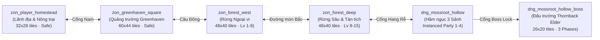
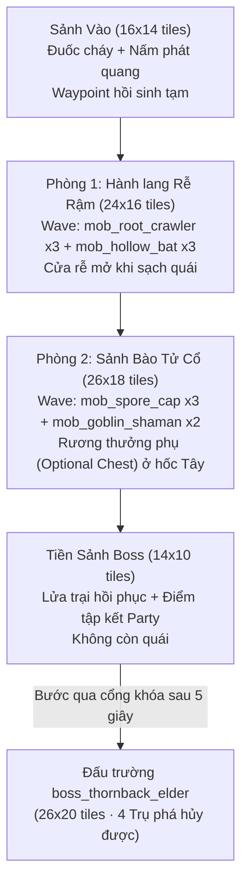

# Environment Design & World Visual Direction — Eldoria: Forgotten Wilds

**Trạng thái**: Hoàn thiện (Art Direction Baseline v1.0)  
**Chế độ**: `DESIGN_AND_PLANNING_ONLY`  
**Cập nhật lần cuối**: 2026-11-19  
**Tham chiếu cốt lõi**: [Constitution](../../.specify/memory/constitution.md) · [00-game-vision.md](../game-design/00-game-vision.md) · [tileset-standard.md](tileset-standard.md) · [bosses.json](../../game-data/bosses.json) · [buildings.json](../../game-data/buildings.json)  
**Visual Concept References**:
- [Greenhaven Village Concept](concepts/greenhaven-village-concept.jpg)
- [Whispering Forest Combat Concept](concepts/whispering-forest-combat-concept.jpg)
- [Mossroot Hollow Boss Arena Concept](concepts/dungeon-boss-arena-concept.jpg)

---

## 1. Mục tiêu Thiết kế Môi trường (Environmental Storytelling Pillars)

Thế giới **Eldoria: Forgotten Wilds** gồm **8 khu vực sinh thái (Regions)** trải dài từ cấp độ `1` đến `100`, kết nối thông qua vòng lặp khám phá và cột mốc Boss Dungeon. Định hướng mỹ thuật môi trường tuân thủ 4 nguyên tắc cốt lõi:

1. **Đọc Sinh thái trong 1 Giây (Instant Biome Identity)**: Mỗi khu vực sở hữu bộ bảng màu chủ đạo (dominant hue + accent light + shadow tint) và ngôn ngữ kiến trúc độc lập, không lặp lại màu nền giữa hai khu vực liền kề.
2. **Tách nền Khỏi Thực thể (Figure-Ground Separation)**: Môi trường nền (`ground_base`, `ground_detail`) giữ độ bão hòa trung bình (`S: 30%–55%`, `V: 35%–70%`) để nhân vật, quái vật, vật phẩm rơi và đặc biệt là **Boss Telegraph đỏ `#FF3B3B`** luôn nổi bật tuyệt đối.
3. **Chiều sâu 2.5D Sống động**: Kết hợp vách nâng địa hình 2 tile (`64 px`), mặt nước 4 frame, ánh sáng điểm (lò rèn, đèn lồng, nấm phát quang, tinh thể), bóng đổ tán cây hướng Đông-Nam (nguồn sáng cố định từ Tây-Bắc `~315°`) và các hạt khí quyển nhẹ.
4. **Tính Liên tục Gameplay**: Kiến trúc và bố cục từng khu vực dẫn dắt tự nhiên mắt người chơi tới mục tiêu (con đường đá cuội dẫn từ Nhà người chơi qua Lò Rèn ra cổng Đông vào Whispering Forest; vết rễ cây dẫn thẳng tới cửa hang `dng_mossroot_hollow`).

---

## 2. Định hướng Mỹ thuật Chi tiết cho 8 Khu vực & Boss Arenas

### 2.1 Region 1: `reg_greenhaven_village` — Greenhaven Village (Lv 1–5 · M1 MVP)
> *Tham chiếu trực quan*: [greenhaven-village-concept.jpg](concepts/greenhaven-village-concept.jpg)

- **Bối cảnh & Cảm xúc**: Ngôi làng định cư ấm áp nằm cạnh dòng sông xanh trong vắt, nơi người chơi khởi đầu với căn nhà gỗ nhỏ và mảnh đất nông trại riêng (`zon_player_homestead`). Cảm giác an lành, thân thiện, giàu sức sống kiểu RPG 16-bit cổ điển.
- **Bảng màu Địa hình (Hex)**:
  - Cỏ đồng bằng (Base / Highlight / Shadow): `#5CA63B` / `#83C94F` / `#3B732C`
  - Đường đất ấm & Đường đá cuội: `#B88B58` / `#8E633A` · Đá cuội `#9DA6AD` / `#6E7880` / khe cỏ `#4C8C34`
  - Sông suối trong (Deep / Mid / Foam): `#1F90C8` / `#38BDF8` / `#CCF5FF`
  - Gỗ kiến trúc & Mái ngói đất nung: Gỗ sồi `#8C5A32`, tường vữa kem `#EADCC4`, mái ván gỗ nâu `#A86438` / `#784323`
- **Ngôn ngữ Kiến trúc**: Nhà khung gỗ bán mộc (half-timbered cottages), mái dốc lợp ván gỗ xếp lớp, ống khói đá nhả khói pixel mềm, cầu gỗ ván cong bắc qua sông, lò rèn đá hở mái với lò than rực lửa (`#FF6B1A`), quầy hàng vải sọc đỏ-kem.
- **Thực vật & Đạo cụ**: Thông xanh tầng lớp, cây sồi tán tròn, bụi hoa dại trắng/tím/vàng, giếng đá mái tranh, hàng rào cọc gỗ, xe đẩy nông sản, thùng gỗ, đe rèn và giá vũ khí.
- **Nguy hiểm Môi trường**: Không có (Vùng an toàn `isSafeZone: true`; ngoại vi bờ Đông chỉ xuất hiện `mob_moss_slime` cấp 1 hiền hòa phục vụ nhiệm vụ nhập môn).

### 2.2 Region 2: `reg_whispering_forest` — Whispering Forest (Lv 1–15 · M1 MVP) & `dng_mossroot_hollow`
> *Tham chiếu trực quan*: [whispering-forest-combat-concept.jpg](concepts/whispering-forest-combat-concept.jpg) · [dungeon-boss-arena-concept.jpg](concepts/dungeon-boss-arena-concept.jpg)

- **Bối cảnh & Cảm xúc**: Khu rừng cổ thụ rậm rạp với những tia nắng vàng xiên qua tán lá cao, xen lẫn tàn tích cổng vòm đá phủ rêu từ thời vương quốc cổ và dẫn sâu xuống hang rễ ngầm `dng_mossroot_hollow` — nơi `boss_thornback_elder` đang thức tỉnh.
- **Bảng màu Địa hình (Hex)**:
  - **Rừng ngoài (`reg_whispering_forest`)**: Cỏ rêu rừng `#4A8B3B` / `#6BA84F`, đất mùn rừng `#7D5B3B` / `#523A24`, thân cổ thụ `#5E3E26` / `#3B2416`, đá tàn tích phủ rêu `#8D948A` / `#5B6359`, tia nắng lọc lá `#FBE8A6` (alpha `0.18`).
  - **Hầm ngục (`dng_mossroot_hollow`)**: Đá lát ngầm `#4F5A57` / `#333C3B`, bóng tường sâu `#181F21`, rêu hầm ngục `#3D6E48`, ánh đuốc ấm `#FF9E3D`, **nấm phát quang xanh ngọc `#2EE6A6` / `#0F766E`** (tạo tương phản nóng–lạnh kinh điển giữa đuốc lửa và bào tử rừng sâu).
- **Ngôn ngữ Kiến trúc**: Cổng vòm đá đổ nát, cột đá tròn vỡ đôi phủ dây leo; bên trong `dng_mossroot_hollow` là sảnh hình bầu dục lát phiến đá cổ khắc vòng tròn đồng tâm cổ ngữ, 4 cột trụ chống phá hủy được (`pil_moss_nw/ne/sw/se`).
- **Thực vật & Đạo cụ**: Dương xỉ lá răng cưa, nấm chấm đỏ, rễ cây khổng lồ bò ngang mặt đất, bụi gai leo, tổ sói, cọc gỗ goblin, đuốc gắn tường cháy 4 frame.
- **Nguy hiểm Môi trường**:
  - Rừng sâu: Bẫy bụi gai tự nhiên làm chậm `15%` nếu đi vào vùng gai rậm.
  - Boss Arena `dng_mossroot_hollow`: `hz_briar_perimeter` (vành đai gai bọc viền đấu trường từ Phase 2, gây Earth DoT + Bleed) và `hz_toxic_sap_pool` (vũng nhựa độc màu xanh lục-tím `#5EEAD4`/`#7E22CE` xuất hiện từ Phase 3, làm chậm `30%` + Poison).

### 2.3 Region 3: `reg_ironpeak_mountains` — Ironpeak Mountains (Lv 15–30 · M2) & `dng_slag_foundry`
- **Bối cảnh & Cảm xúc**: Dãy núi đá xám dựng đứng với các mỏ quặng đồng/sắt/bạc lộ thiên, đường ray xe goòng bỏ hoang và pháo đài luyện kim cổ xưa dẫn tới `dng_slag_foundry` (`boss_ignis_forgelord`).
- **Bảng màu Địa hình (Hex)**:
  - Đá núi & Sỏi bazan: `#6D747E` / `#4D535C` / `#2E333B`
  - Đất đỏ quặng sắt: `#8F523B` / `#613425`
  - Dòng xỉ nóng & Dung nham lò đúc: `#FF5722` / `#FFA726` / lõi sáng `#FFF176`
  - Mạch quặng đồng & sắt: `#C87D4B`, `#B0BEC5`
- **Ngôn ngữ Kiến trúc**: Cầu đá vòm hẹp bắc qua khe núi, giàn gỗ chống hầm mỏ, đường ray sắt, bánh răng khổng lồ, ống khói đúc thép và rãnh dẫn kim loại nóng chảy trong `dng_slag_foundry`.
- **Thực vật & Đạo cụ**: Thông núi lá kim sẫm, cỏ khô hốc đá, xe goòng quặng, đèn bão treo trụ gỗ, vỉa quặng sắt/than phát ánh kim, đe rèn cổ.
- **Nguy hiểm Môi trường**: Đá lở báo trước ở sườn núi; trong `dng_slag_foundry` có `hz_molten_trough` (rãnh dung nham cháy liên tục) và `hz_superheated_floor` (sàn gạch nung đỏ rực theo chu kỳ).

### 2.4 Region 4: `reg_crystal_caverns` — Crystal Caverns (Lv 30–45 · M3) & `dng_prism_sanctum`
- **Bối cảnh & Cảm xúc**: Hệ thống hang động ngầm mê hoặc với những cụm tinh thể thạch anh lam-tím khổng lồ khúc xạ ánh sáng xuống hồ nước ngầm trong suốt, dẫn vào `dng_prism_sanctum` (`boss_prism_leviathan`).
- **Bảng màu Địa hình (Hex)**:
  - Đá hang xanh tím sẫm: `#2D314D` / `#1D2036` / bóng `#111322`
  - Tinh thể Lăng kính (Cyan / Amethyst / Specular): `#38BDF8` / `#A855F7` / `#E0F7FF`
  - Hồ nước ngầm phản chiếu: `#1E4E79` / `#4CC9F0`
- **Ngôn ngữ Kiến trúc**: Cầu pha lê tự nhiên, cột nhũ đá nối trần-sàn, bậc thang đá khắc rãnh dẫn dòng năng lượng điện từ cổ đại.
- **Thực vật & Đạo cụ**: Nấm pha lê bán trong suốt, cụm tinh thể thạch anh khai thác được (`mat_arcane_crystal`), hồ nước tĩnh có gợn sáng, đèn tinh thể nổi.
- **Nguy hiểm Môi trường**: Vùng nước dẫn điện tăng sát thương `LIGHTNING`; trong `dng_prism_sanctum` có `hz_electrified_pool` (hồ nhiễm điện sáng tia chớp xanh) và `hz_resonant_shards` (mảnh tinh thể nổ cộng hưởng).

### 2.5 Region 5: `reg_forgotten_ruins` — Forgotten Ruins (Lv 45–60 · M3)
- **Bối cảnh & Cảm xúc**: Kinh đô sa mạc bán hoang mạc bị thời gian vùi lấp với những quảng trường đá cát vàng, tháp mặt trời nứt vỡ, tượng hộ vệ khổng lồ và tàn dư ma pháp Tinh Quang.
- **Bảng màu Địa hình (Hex)**:
  - Đá sa thạch & Cát vàng ấm: `#D4B483` / `#B58E58` / bóng tím ấm `#6C5248`
  - Phiến đá đền đài & Chữ khắc vàng: `#C9BFA8` / `#8C826E` / cổ ngữ phát sáng `#F6C945`
  - Cây bụi khô & Ốc đảo nhỏ: `#6F8748` / `#2B9EB3`
- **Ngôn ngữ Kiến trúc**: Đền đài cột đá chạm khắc phù điêu, bậc thềm rộng đối xứng, đĩa nhật quỹ khổng lồ ở trung tâm quảng trường, cổng dịch chuyển cổ ngữ (`Ancient Trials`).
- **Thực vật & Đạo cụ**: Bụi gai sa mạc, dây leo khô, mảnh tượng vỡ, lư hương đồng cổ, bia chữ cổ phát ánh vàng nhẹ.
- **Nguy hiểm Môi trường**: Bẫy sàn cổ ngữ kích hoạt theo nhịp (có telegraph hình vuông rõ ràng) và bão cát cục bộ làm giảm tầm nhìn rìa màn hình.

### 2.6 Region 6: `reg_frostbound_highlands` — Frostbound Highlands (Lv 60–75 · M4) & `dng_glacial_citadel`
- **Bối cảnh & Cảm xúc**: Cao nguyên băng giá quanh năm phủ tuyết trắng xanh, sông băng đóng cứng trong suốt, tường thành đá xanh khắc băng cổ và thành trì `dng_glacial_citadel` (`boss_boreas_frostking`).
- **Bảng màu Địa hình (Hex)**:
  - Tuyết phủ (Lit / Mid / Cool Shadow): `#EBF5FF` / `#C7DEF2` / `#7C9DC2`
  - Mặt băng trơn phản chiếu: `#7DD3FC` / `#38A3D9` / vết nứt trắng `#FFFFFF`
  - Đá thành trì băng giá: `#4B5D75` / `#2A364A`
- **Ngôn ngữ Kiến trúc**: Thành lũy đá xanh góc cạnh sắc nét, trụ băng kết tinh khổng lồ, cầu đá treo băng rủ, lò sưởi lửa xanh giữ ấm trạm nghỉ.
- **Thực vật & Đạo cụ**: Thông phủ tuyết dày, cành cây đóng băng, tảng băng lộ xương thú cổ, cọc tiêu cờ đỏ-vàng dẫn đường trong bão tuyết.
- **Nguy hiểm Môi trường**: Mặt băng giảm ma sát di chuyển (nhẹ, vẫn kiểm soát được); trong `dng_glacial_citadel` có `hz_creeping_hypothermia` (thanh tích tụ giá rét cần đứng gần lò lửa/cột nhiệt) và `hz_blizzard_gale` (gió tuyết đẩy hướng có mũi tên chỉ gió).

### 2.7 Region 7: `reg_ember_wasteland` — Ember Wasteland (Lv 75–90 · M4)
- **Bối cảnh & Cảm xúc**: Vùng bình nguyên tro tàn và đá hắc diện thạch bao quanh miệng núi lửa cổ đang âm ỉ, nơi những vết nứt địa chất phát ánh đỏ cam rực cháy dưới bầu trời tro xám.
- **Bảng màu Địa hình (Hex)**:
  - Tro tàn & Đá hắc diện thạch (Obsidian): `#3A353A` / `#242026` / viền ánh tím xám `#5A525E`
  - Khe nứt magma & Dòng dung nham: `#E63900` / `#FF7B00` / `#FFD166`
  - Tro bay & Khói nhiệt: `#9E9599` (alpha `0.35`)
- **Ngôn ngữ Kiến trúc**: Đền thờ núi lửa xây từ khối đá đen hình lục giác, xiềng xích sắt khổng lồ bắc qua hố lửa, bàn thờ rèn cổ đại (`Forge Trials`).
- **Thực vật & Đạo cụ**: Cây cháy trụi hóa than, cụm pha lê hắc diện thạch (`mat_obsidian_shard`), mạch lưu huỳnh vàng xỉn, cột đá núi lửa phun khói.
- **Nguy hiểm Môi trường**: Sóng nhiệt (`HEATWAVE` mặc định) tăng nhẹ tiêu hao stamina khi sprint nếu không có đồ ăn giải nhiệt (`csm_herb_stew` / đồ uống băng); mạch phun lửa định kỳ có telegraph rõ.

### 2.8 Region 8: `reg_abyssal_kingdom` — Abyssal Kingdom (Lv 90–100 · M5) & `dng_eclipse_throne`
- **Bối cảnh & Cảm xúc**: Vương quốc đổ nát trôi lơ lửng bên rìa khe nứt Hư Không dưới nhật thực vĩnh cửu, nơi kiến trúc gothic-fantasy vỡ vụn thành các đảo đá nổi dẫn tới ngai vàng `dng_eclipse_throne` (`boss_malakor_abyss`).
- **Bảng màu Địa hình (Hex)**:
  - Đá cẩm thạch đen & Nền hư không: `#1B1629` / `#2E2447` / viền xám bạc `#6B608A`
  - Năng lượng Nhật Thực (Void Magenta / Starlight Gold): `#B84DFF` / `#6D28D9` / viền nhật thực `#FDE047`
  - Vực thẳm bầu trời sao nền parallax: `#0B0814` / chấm sao `#C4B5FD`
- **Ngôn ngữ Kiến trúc**: Đại lộ lát đá vỡ nối bằng cầu ánh sáng tím, đại sảnh ngai vàng cột cao sụp mái lộ vầng nhật thực, biểu tượng mắt/nhật thực khắc trên sàn.
- **Thực vật & Đạo cụ**: Cột đèn lửa tím ma quái, mảnh đá lơ lửng dao động chậm, tinh thể Hư Không (`mat_void_crystal`), vũ khí chiến binh cổ cắm trên mặt đất.
- **Nguy hiểm Môi trường**: Trong `dng_eclipse_throne` có `hz_eclipse_void_edge` (rìa sàn sụp đổ từng phần ở Phase 3, được cảnh báo bằng nứt sáng tím trước 3 giây) và `hz_abyssal_eclipse_pool` (vũng hư không gây DoT Shadow).

---

## 3. Bảng Chu kỳ Ngày/Đêm & Color Grading LUT (Day/Night Cycle)

Tham chiếu quyết định `ASM-007`: **1 ngày trong game = 24 phút thời gian thực** (đồng bộ theo Server World Clock, không phụ thuộc đồng hồ máy client).

| Giai đoạn (`DayPhase`) | Khung giờ In-game | Thời lượng Thực | Multiply Tint (Hex) | Overlay Tint & Alpha | Độ sáng Nguồn Đèn (Torch/Lantern) | Hạt Môi trường & Không khí | Ngưỡng An toàn Đọc Chiến trường |
| :--- | :---: | :---: | :---: | :---: | :---: | :--- | :--- |
| **`DAWN`** (Bình minh) | `05:00 – 06:00` | `1 phút` | `#FFE0C2` | `#FF9E64` (`0.10`) | `0.50 → 0.00` (tắt dần) | Sương sớm mỏng trên mặt sông, đom đóm tan biến | Giữ nguyên độ sáng vùng đất ≥ `82%` |
| **`DAY`** (Ban ngày) | `06:00 – 20:00` | `14 phút` | `#FFFFFF` (Trung tính) | Không (`0.00`) | `0.00` (lò rèn vẫn phát sáng cục bộ `0.45`) | Bướm nhỏ (làng), tia nắng lọc tán cây (rừng) | Chuẩn tham chiếu `100%` độ tương phản |
| **`DUSK`** (Hoàng hôn) | `20:00 – 23:00` | `3 phút` | `#F5B98A` | `#C85A32` (`0.14`) | `0.00 → 0.85` (bật dần) | Bóng đổ kéo dài nhẹ thêm `2 px`, màu ấm cam-tím dịu | Giữ độ tương phản mặt đất ≥ `78%` |
| **`NIGHT`** (Ban đêm) | `23:00 – 05:00` | `6 phút` | `#5C73A8` | `#161E3B` (`0.32`) | `1.00` (đèn lồng làng, đuốc, đèn cầm tay, cây `crp_moon_herb` phát quang) | Đom đóm vàng-lục trôi chậm, ánh trăng phản chiếu mặt nước | **Giới hạn tối sàn**: TUYỆT ĐỐI không tối hơn luminance `38%`; **Layer 180–199 (Boss Telegraph)** & **Layer 800–899 (Combat VFX)** bỏ qua lớp tint tối ban đêm (unlit/post-grade) để luôn rực rõ `100%`! |

> **Chuyển pha mượt mà (Interpolation)**: Chuyển màu giữa `DAWN → DAY → DUSK → NIGHT` nội suy tuyến tính trong `15 giây` thời gian thực bằng shader/canvas multiply pass ở `Depth 920`, không gây giật màu đột ngột. Các khu vực hang động kín (`dng_mossroot_hollow`, `reg_crystal_caverns`, `reg_abyssal_kingdom`) sử dụng **Fixed Dungeon Lighting Profile** thay vì chu kỳ ngày/đêm ngoài trời.

---

## 4. Hệ thống Hiệu ứng Thời tiết (`WeatherType` Overlays)

6 trạng thái thời tiết chuẩn được đồng bộ từ Server theo từng Region:

| `WeatherType` | Khu vực Áp dụng | Hiệu ứng Thị giác 16-Bit (`Depth 900–915`) | Tác động Ánh sáng | Liên kết Gameplay & Audio |
| :--- | :--- | :--- | :--- | :--- |
| **`CLEAR`** | Tất cả vùng ngoài trời | Hạt phấn hoa/lá bay thưa (`≤ 12` hạt/viewport) | Giữ nguyên LUT Ngày/Đêm | Trạng thái chuẩn; âm thanh gió nhẹ |
| **`RAIN`** | Greenhaven, Whispering Forest, Ironpeak | Vệt mưa pixel sắc nét `1×8 px` nghiêng `15°`, màu `#B8E1FF` alpha `0.55` (`45–60` hạt/viewport) + vòng gợn nước nhỏ `3 frame` rơi rải rác trên đất & mặt sông | Giảm bão hòa `-12%`, tint lam xám `#9BB4CC` alpha `0.15` | **Tự động tưới toàn bộ cây trồng ngoài trời (`SOIL_TILLED_WATERED`)**; kích hoạt `amb_rain_loop` |
| **`STORM`** | Greenhaven, Whispering Forest, Ironpeak | Mưa dày nghiêng `28°` (`80–95` hạt/viewport), bụi nước thấp; tia chớp xa làm sáng nền trời dịu `+18%` trong `120 ms` (tần suất tối đa 1 lần / 12–25 giây — tuân thủ tuyệt đối an toàn ≤ 3 Hz) | Tint xám sẫm `#6E829E` alpha `0.25` | Tự động tưới cây + tăng nhẹ tỷ lệ cá hiếm; `amb_storm_thunder` |
| **`FOG`** | Whispering Forest, Forgotten Ruins, Frostbound | 2 lớp dải sương pixel mềm (tile seamless `256×128 px`) trôi ngang ngược tốc độ (`8 px/s` và `14 px/s`), alpha `0.22–0.32`, rỗng hoàn toàn vùng bán kính `110 px` quanh nhân vật để không cản combat | Tint trắng sữa `#D4E0E8` alpha `0.12` | Không khí huyền bí; `amb_forest_mist` |
| **`SNOW`** | Greenhaven/Forest (mùa `WINTER`), Frostbound (quanh năm) | Bông tuyết pixel `2×2 px` và `3×3 px` dấu `+` màu `#F0F9FF` rơi lắc ngang theo hàm sin (`40–65` hạt/viewport) | Tint xanh lạnh `#D6ECFF` alpha `0.12` | Kích hoạt hiệu ứng thở ra khói nhẹ; `amb_snow_wind` |
| **`HEATWAVE`** | Forgotten Ruins, Ember Wasteland, Greenhaven (hiếm vào `SUMMER`) | Hạt tro/bụi sáng cam nhạt trôi lên chậm (`20–30` hạt) + dải gợn sóng nhiệt `1 px` cực nhẹ ở biên trên màn hình (tắt được trong Settings) | Tint vàng ấm `#FFCF87` alpha `0.14` | Nhắc người chơi dùng đồ ăn/thức uống giải nhiệt; `amb_ember_heat` |

---

## 5. Hệ thống Hoán đổi Bảng màu Mùa vụ (`Season` Palette Swaps)

Tham chiếu `ASM-007`: **1 mùa = 14 ngày trong game**. Để giữ dung lượng nhẹ mà thế giới vẫn biến đổi rõ rệt, các khu vực hỗ trợ mùa vụ (`reg_greenhaven_village`, `reg_whispering_forest`, `zon_player_homestead`) sử dụng **Palette Swap LUT / Regional Season Tileset Variants** (4 biến thể màu cho cùng một bản đồ `.tmj`, không cần vẽ lại hình học tile):

| `Season` | Cỏ nền (`Base / Hi / Lo`) | Tán cây Sồi & Bụi cây | Chi tiết Bổ sung (`decor_below`) | Hạt Mùa vụ (`Depth 905`) | Ảnh hưởng Khu vực Khác |
| :--- | :--- | :--- | :--- | :--- | :--- |
| **`SPRING`** (Mùa Xuân) | `#5CA63B` / `#83C94F` / `#3B732C` | Xanh non rực `#4EA33E` + điểm hoa hồng phấn `#F9A8D4` | Hoa cúc trắng, chồi non, hoa bồ công anh | Cánh hoa hồng-trắng bay chéo chậm | Mặc định cho M1 MVP khởi đầu |
| **`SUMMER`** (Mùa Hè) | `#4C9A2A` / `#76BE3F` / `#2E6622` | Xanh lục bảo đậm `#2D7D32`, bóng tán cây sắc nét hơn | Hoa hướng dương nhỏ, quả mọng dại đỏ | Đom đóm vàng đêm dày hơn + bướm xanh | Tối ưu cây `crp_ember_pepper`, `crp_honey_melon` |
| **`AUTUMN`** (Mùa Thu) | `#B59438` / `#D6B656` / `#7D6324` | Đỏ phong `#C84B31`, cam cháy `#E07A2B`, vàng mật `#E6B83A` | Thảm lá vàng rụng rải rác trên đường đá cuội | Lá phong đỏ/cam rơi xoay 4 frame | Tạo cảm giác ấm áp hoài cổ rõ nét |
| **`WINTER`** (Mùa Đông) | `#DCEBF7` / `#F2F8FD` / `#99B8D4` | Tán cây phủ mũ tuyết trắng `#EDF6FC`, lá thông xanh thẫm `#254D46` | Băng đóng mép bờ sông, cột băng nhỏ dưới mái nhà | Bông tuyết rơi nhẹ; tuyết phủ nóc công trình `bld_*` | `reg_frostbound_highlands`, `reg_ember_wasteland`, hang động ngầm giữ khí hậu riêng quanh năm |

---

## 6. Sơ đồ Bố cục Không gian Tile-Grid (Visual Layout Blueprints)

Mọi bản vẽ dưới đây được quy đổi chính xác theo lưới tile `32×32 px` và khớp 100% với kích thước footprint trong `game-data/buildings.json` và tọa độ đấu trường trong `game-data/bosses.json`.

### 6.1 Sơ đồ Kết nối 5 Khu vực MVP (World Topology)


### 6.2 Blueprint 1: Greenhaven Village (`zon_greenhaven_square` — `60 × 44 tiles`)
*Mỗi ký tự = `2×2 tiles` (`64×64 px`) để hiển thị tổng thể toàn làng:*
```text
Legend: T=Rừng thông/sồi | ~=Sông Greenhaven | ===Cầu gỗ | .=Đường đá cuội | :=Đường đất
        H=Lối lên Player Homestead | Q=Quảng trường & Giếng | B=Lò Rèn NPC Garrik | M=Chợ & Gacha Shrine
        G=Bãi Slime nhập môn (Lv1) | E=Cổng Đông đi Whispering Forest | W=Waypoint Fast Travel

     0         10        20        30        40        50       60 (tiles)
  0  TTTTTTTTTTTTTT[==H==]TTTTTTTTTTTTTTTTTT~~~~~~TTTTTTTTTTTTTT
  4  TTTT::::::TTTTT:::::TTTTT[Nhà NPC]TTTT~~~~~~~TTTT[Rừng Bắc]
  8  TT:::bbbb:::TT:::::::TTT::::::::::::TT~~~~~~~TTT:::::::::TT
 12  TT::[Bản tin]....W....[Q:Giếng Làng]....===....[B:Garrik]TT
 16  TT:::::::::::..........[Elder Rowan]....===....[Lò Rèn]..TT
 20  TT[Tiệm Hạt].............::::::::::...~~~~~~~..........==E> (tới reg_whispering_forest)
 24  TT[M:Gacha]..............::::::::::...~~~~~~~....GGG.....TT
 28  TT:::::::::....[Quán Ăn]....:::::.....~~~~~~~...GGGGG....TT
 32  TTTT:::::......................::::..~~~~~~~~....GGG.....TT
 36  TTTTTTTTTTTT..........::::::::::::..~~~~~~~~~TTTTTTTTTTTTTT
 40  TTTTTTTTTTTTTTTTTTTTTT~~~~~~~~~~~~~~TTTTTTTTTTTTTTTTTTTTTTT
```
- **Điểm nhấn dẫn hướng**: Người chơi đi từ cổng Homestead (`x=14..18, y=0`) xuống thẳng Quảng trường trung tâm (`Q`, `x=24..34, y=12..18`), gặp `npc_elder_rowan`, đi ngang Đền Triệu hồi Gacha (`M`) và qua cầu gỗ ván cong (`x=39..43, y=12..17`) sang Lò Rèn `npc_smith_garrik` (`B`) trước khi tiến ra bãi `mob_moss_slime` (`G`) và cổng Đông (`E`) vào `reg_whispering_forest`.

### 6.3 Blueprint 2: Player Homestead & Farm (`zon_player_homestead` — `32 × 28 tiles`)
*Mỗi ký tự = `1×1 tile` (`32×32 px`), khớp chính xác `footprintTiles` từ `buildings.json`:*
```text
Legend: #=Hàng rào biên | P=bld_player_house (5x4) | S=bld_storage (3x2) | K=bld_kitchen (3x3)
        F=bld_farm_plot (4x4) | C=bld_chicken_coop (3x3) | B=bld_blacksmith (4x3) | *=Interaction Point
        .=Đường đất chính (BUILD_FORBIDDEN_ZONE) | +=Ô đất trống cho mở rộng công trình (Barn/Workshop/Lab)

      0   4   8  12  16  20  24  28  31
  0  ################################
  2  #TTT  PPPPP   SSS   ++++++  TTT#  <- bld_player_house (x=5..9, y=2..5), bld_storage (x=13..15, y=2..3)
  4  #TTT  PPPPP   *.*   ++++++  TTT#  <- interaction bld_storage (14,4)
  6  #TTT  .*.*.   ...   ++++++  TTT#  <- interaction bld_player_house: (6,6) Rest, (7,6) Enter
  8  #     .........     ......     #
 10  #  FFFF  FFFF .   CCC   BBBB   #  <- 2x bld_farm_plot (4x4), bld_chicken_coop (3x3), bld_blacksmith (4x3)
 12  #  FFFF  FFFF .   CCC   BBBB   #
 14  #  FFFF  FFFF .   .*C   ..*.   #  <- interaction Coop & Blacksmith
 16  #  FFFF  FFFF .   ..........   #
 18  #             .   KKK   ++++   #  <- bld_kitchen (3x3) + Expansion Pad
 20  #  +++++++++  .   KKK   ++++   #  <- Expansion Pad cho bld_barn (5x4) ở M2
 22  #  +++++++++  .   .*.   ++++   #
 24  #  +++++++++  ...              #
 26  ###############..###############  <- Cổng Nam nối về zon_greenhaven_square (x=15..16, y=26..27)
```
- **Quy tắc chống tắc đường**: Con đường trục chữ T (`..`, rộng `2 tiles`) nối từ cửa `bld_player_house` xuống Cổng Nam được đánh dấu `BUILD_FORBIDDEN_ZONE` trong `objects_spawn` để người chơi không bao giờ tự nhốt mình trong lãnh địa.

### 6.4 Blueprint 3: Whispering Forest (`zon_forest_west` + `zon_forest_deep` — `80 × 60 tiles`)
*Mỗi ký tự = `4×4 tiles` (`128×128 px`) mô tả 2 phân khu liên thông:*
```text
Legend: T=Cây dày (collision) | .=Đường mòn chính | S=mob_moss_slime / mob_spore_cap | G=mob_forest_goblin / shaman
        W=mob_timber_wolf | B=mob_briar_boar | R=Tàn tích cổ + mob_elite_alpha_direwolf | D=Cửa dng_mossroot_hollow
        O=Bãi gỗ Oak/Pine & Quặng Copper/Iron | C=Trại cắm trại Safe Campfire

     0   10   20   30   40   50   60   70   80 (tiles)
  0  TTTTTTTTTTTTTTTTTTTT[===D===]TTTTTTTTTT  <- Cửa hang dng_mossroot_hollow (x=40..46, y=2)
  8  TTTT OOO TTTT....RRRRRRRRR....TTTTTT TT  <- Tàn tích Cổng Vòm (alpha_direwolf Lv14)
 16  TTT OOOOO ...W...R  ELITE  R...G G..TTT
 24  TTT..W..W....W...RRRR.RRRR....G.G...TTT  <- Đường chia 2 nhánh (Tây: Sói/Quặng; Đông: Trại Goblin)
 32  TT....C....:::::.............B..B...TTT  <- Trại nghỉ Campfire giữa rừng (x=16, y=32)
 40  <W..S...S..:::::...B....B.....O..O..TTT  <- Cổng Tây nối từ Greenhaven Village (x=0, y=40)
 48  TTT..S..O..TTTTTTTTTTTT....S..S.....TTT
 56  TTTTTTTTTTTTTTTTTTTTTTTTTTTTTTTTTTTTTTT
```

### 6.5 Blueprint 4: Mossroot Hollow Dungeon (`dng_mossroot_hollow` — 3-Chamber Progression)


### 6.6 Blueprint 5: Thornback Elder Boss Arena (`dng_mossroot_hollow_boss` — CHÍNH XÁC `26 × 20 tiles`)
Khớp 100% tọa độ từ `game-data/bosses.json` (`widthTiles: 26`, `heightTiles: 20`, 4 cột đá phá hủy được tại `(7,6)`, `(18,6)`, `(7,13)`, `(18,13)`):
```text
Legend: #=Tường đá hang + Đuốc/Nấm phát quang | !=hz_briar_perimeter (Phase 2 viền tường)
        P=Trụ đá phá hủy được (pil_moss_nw/ne/sw/se) | B=boss_thornback_elder (4x4 visual, tâm 13,9)
        ~=hz_toxic_sap_pool (vùng xuất hiện ngẫu nhiên Phase 3) | .=Sàn đá cổ khắc vòng tròn
        E=Cổng vào Party (tự đóng rào rễ sau 5 giây từ khi aggro)

     0 1 2 3 4 5 6 7 8 9 0 1 2 3 4 5 6 7 8 9 0 1 2 3 4 5  (tileX)
 0   # # # # # # # # # # # # # # # # # # # # # # # # # #
 1   # ! ! ! ! ! ! ! ! ! ! ! ! ! ! ! ! ! ! ! ! ! ! ! ! #
 2   # ! . . . . . . . . . . . . . . . . . . . . . . ! #
 3   # ! . . . . . . . . . . . . . . . . . . . . . . ! #
 4   # ! . . . . . . . . . . . . . . . . . . . . . . ! #
 5   # ! . . . . . . . . . . . . . . . . . . . . . . ! #
 6   # ! . . . . . P . . . . . . . . . . P . . . . . ! #  <- pil_moss_nw(7,6) & pil_moss_ne(18,6)
 7   # ! . . . . . . . . . ~ ~ . . . . . . . . . . . ! #
 8   # ! . . . . . . . . . B B B . . . . . . . . . . ! #
 9   # ! . . . . . . . . . B B B . . . ~ ~ . . . . . ! #  <- Boss Spawn Center (13,9)
10   # ! . . . . . . . . . B B B . . . . . . . . . . ! #
11   # ! . . . . . . . . . . . . . . . . . . . . . . ! #
12   # ! . . . . . ~ ~ . . . . . . . . . . . . . . . ! #
13   # ! . . . . . P . . . . . . . . . . P . . . . . ! #  <- pil_moss_sw(7,13) & pil_moss_se(18,13)
14   # ! . . . . . . . . . . . . . . . . . . . . . . ! #
15   # ! . . . . . . . . . . . . . . . . . . . . . . ! #
16   # ! . . . . . . . . . . . . . . . . . . . . . . ! #
17   # ! . . . . . . . . . . . . . . . . . . . . . . ! #
18   # ! ! ! ! ! ! ! ! ! ! . E E . ! ! ! ! ! ! ! ! ! ! #  <- Party Entry Gate (12..13, 18)
19   # # # # # # # # # # # # E E # # # # # # # # # # # #
```
> *Đối chiếu trực quan*: Xem [dungeon-boss-arena-concept.jpg](concepts/dungeon-boss-arena-concept.jpg) — bố cục sàn đá cổ xám rêu trung tính làm nổi bật tuyệt đối lõi tim cam phát sáng của `boss_thornback_elder` và 4 mảng telegraph đỏ `#FF3B3B` trải phẳng dưới sàn.

---

## 7. Ngân sách Hiệu năng Môi trường & Quality Gate

### 7.1 Mục tiêu Hiệu năng Đề xuất (`proposed` / `unverified`)
Theo Nguyên tắc VIII của Hiến pháp, các ngưỡng sau là mục tiêu thiết kế đề xuất và **CHƯA được đo thực tế trên engine**:
- **Draw Calls môi trường tối đa/frame**: `≤ 25 draw calls` cho toàn bộ tile layers + props + weather trên logical viewport `640×360 px` (`proposed/unverified`).
- **Tải trước bản đồ (Chunk Streaming)**: Mỗi zone kích thước tối đa `80×60 tiles` (~`2560×1920 px`); toàn bộ tileset 1 vùng gói gọn trong `1–2` atlas `1024×1024 px` (< `8 MB` VRAM chưa nén, `proposed/unverified`).
- **Phản hồi ánh sáng động**: Tối đa `16` nguồn sáng điểm (đèn lồng, đuốc, nấm phát quang) được render đồng thời trong viewport bằng texture vòng tròn phát sáng additive giá rẻ thay vì raycast nặng (`proposed/unverified`).

### 7.2 Edge Cases, Failure Behavior & Acceptance Criteria
- **Failure Behavior (Thiếu biến thể mùa vụ)**: Nếu một vùng bật cờ `supportsSeasonSwap: true` nhưng thiếu file palette mùa `WINTER`, client tự động fallback về bảng màu gốc `SPRING` và ghi cảnh báo `WARN_MISSING_SEASON_PALETTE` vào console dev, tuyệt đối không render texture màu tím/đen lỗi.
- **Accessibility**: Cung cấp tùy chọn `Weather Effects Intensity` (`FULL` / `REDUCED` / `MINIMAL`) và `Night Brightness Boost` (`+15%`) trong màn hình Settings cho người chơi nhạy cảm thị giác hoặc màn hình tối.
- **Acceptance Criteria**:
  1. Đủ hồ sơ bảng màu (hex cụ thể), kiến trúc, props và hazard cho toàn bộ 8 region + 5 boss arenas.
  2. Tọa độ 4 trụ phá hủy được trong blueprint `dng_mossroot_hollow_boss` khớp từng ô `(7,6)`, `(18,6)`, `(7,13)`, `(18,13)` với `game-data/bosses.json`.
  3. Tại khung giờ `NIGHT` kết hợp thời tiết `STORM`, Boss Telegraph `#FF3B3B` và viền nhân vật vẫn giữ tỷ lệ tương phản `≥ 4.5:1` so với nền đất tối nhất.
  4. Chuyển đổi 4 mùa (`SPRING → SUMMER → AUTUMN → WINTER`) trong Greenhaven Village không làm thay đổi hình học va chạm hay làm chìm ô đất đã tưới (`SOIL_TILLED_WATERED`).
