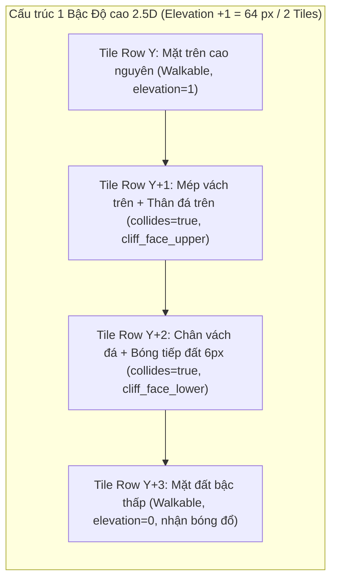

# Tileset Standard & Tiled Map Layer Contract — Eldoria: Forgotten Wilds

**Trạng thái**: Hoàn thiện (Art Direction Baseline v1.0)  
**Chế độ**: `DESIGN_AND_PLANNING_ONLY`  
**Cập nhật lần cuối**: 2026-11-19  
**Tham chiếu cốt lõi**: [Constitution](../../.specify/memory/constitution.md) · [00-game-vision.md](../game-design/00-game-vision.md) · [Assumptions & Decisions](../management/assumptions-and-decisions.md)  
**Visual Concept References**:
- [Greenhaven Village Concept](concepts/greenhaven-village-concept.jpg)
- [Whispering Forest Combat Concept](concepts/whispering-forest-combat-concept.jpg)
- [Mossroot Hollow Boss Arena Concept](concepts/dungeon-boss-arena-concept.jpg)

---

## 1. Mục tiêu Thiết kế & Triết lý Kỹ thuật (Design Goals)

Tài liệu này quy định tiêu chuẩn kỹ thuật bắt buộc cho toàn bộ **Tileset 16-bit**, **Autotile transitions**, **Tiled Map (`.tmj`/`.json`)**, **extrusion chống rách viền WebGL**, **ranh giới va chạm vs tương tác**, **trạng thái ô đất nông trại** và **lưới đặt công trình (Building Placement Grid)** trong **Eldoria: Forgotten Wilds**.

### Nguyên tắc Bất biến (Constitution Compliance)
1. **Pixel-Perfect 16-Bit Cohesion (Nguyên tắc V)**: Mọi tile dùng lưới gốc cố định `32×32 px`, lọc ảnh `NEAREST` (nearest-neighbor), tuyệt đối **CẤM** mixel (trộn mật độ pixel), làm mờ bilinear hoặc dùng ảnh photorealistic.
2. **Local-Only Static Hosting (Nguyên tắc I)**: Toàn bộ tileset PNG, JSON atlas và bản đồ Tiled `.tmj` được lưu trữ và phục vụ 100% cục bộ tại `assets/tilesets/` và `assets/maps/`; tuyệt đối **KHÔNG** dùng S3, CDN ngoài hay dịch vụ lưu trữ bên thứ ba.
3. **Server-Authoritative Collision Sync (Nguyên tắc II)**: Lớp `collision` và `objects_portals` trong file `.tmj` được biên dịch thành dữ liệu va chạm dùng chung giữa NestJS Game Server (`apps/game-server`) và Phaser 3 Client (`apps/client`). Client không bao giờ tự quyết định tính hợp lệ của di chuyển hay vị trí đặt công trình.

---

## 2. Hệ lưới Cơ sở & Thông số Hiển thị (Base Grid & Viewport Spec)

| Tham số | Giá trị Chuẩn | Giải thích & Ứng dụng |
| :--- | :--- | :--- |
| **Base Tile Size** | `32 × 32 px` | Đơn vị không gian nền tảng cho địa hình, collision grid, nông trại và đặt công trình |
| **Logical Viewport** | `640 × 360 px` | Tỉ lệ `16:9` hiển thị chính xác `20 × 11.25` tile (tham chiếu `ASM-006`) |
| **Integer Scaling** | `2x` (`1280×720`), `3x` (`1920×1080`), `4x` (`2560×1440`) | Khớp pixel nguyên vẹn trên màn hình desktop phổ biến, loại bỏ hiện tượng pixel méo |
| **Perspective Angle** | Three-quarter Top-Down (`~45°–55°`) | Mặt đứng tường/vách đá hiển thị tỷ lệ `1:1` đến `1:1.5` chiều cao thực để tạo chiều sâu 2.5D |
| **Texture Filtering** | `Phaser.Textures.FilterMode.NEAREST` | Bắt buộc bật `pixelArt: true`, `roundPixels: true`, `antialias: false` trong cấu hình Phaser |
| **Camera Coordinate Snapping** | `Math.round(camera.scrollX)`, `Math.round(camera.scrollY)` | Loại bỏ rung cạnh pixel (pixel shimmer) và đường kẽ nứt tile khi camera trượt theo nhân vật |
| **Max Atlas Texture Size** | `1024 × 1024 px` (khuyến nghị), trần cứng `2048 × 2048 px` | Đảm bảo tương thích WebGL trên mọi iGPU tầm trung và tối ưu GPU texture binding |

> *Tham chiếu trực quan*: Trong [greenhaven-village-concept.jpg](concepts/greenhaven-village-concept.jpg), mỗi viên đá cuội trên con đường lát đá, các luống đất canh tác và nhịp cầu gỗ đều giữ kích thước pixel đồng nhất so với nhân vật, tạo cảm giác gắn kết của game RPG 16-bit kinh điển.

---

## 3. Quy chuẩn Extrusion `1 px`, Margin `2 px` & Spacing

Khi render tilemap trên WebGL (Phaser 3), lỗi sai số dấu phẩy động ở UV coordinates thường gây ra hiện tượng **texture bleeding** (lộ 1 đường kẻ trong suốt hoặc lem màu từ tile kế bên giữa các ranh giới `32×32 px`). Mọi tileset xuất ra cho runtime **BẮT BUỘC** đi qua pipeline đóng gói tile cục bộ (`tools/asset-pipeline/extrude-tileset.mjs` hoặc `tile-extruder` nội bộ) theo đúng thông số sau:

| Thuộc tính Tileset | Giá trị Raw (Họa sĩ vẽ) | Giá trị Packed Runtime (Phaser load) | Lý do Kỹ thuật |
| :--- | :---: | :---: | :--- |
| **Tile Content Size** | `32 × 32 px` | `32 × 32 px` | Diện tích nội dung pixel thật hiển thị trên màn hình |
| **Extrusion** | `0 px` | `1 px` (4 phía: Top, Right, Bottom, Left) | Nhân bản 1 hàng/cột pixel ngoài cùng của mỗi tile ra viền để GPU sample đúng màu khi nội suy cạnh |
| **Margin (Outer Border)** | `0 px` | `2 px` | Khoảng đệm ngoài cùng xung quanh toàn bộ ảnh tileset (gồm `1 px` an toàn + `1 px` extrusion cạnh ngoài) |
| **Spacing (Between Tiles)** | `0 px` | `2 px` (tương ứng stride `36 × 36 px` sau extrusion: `1px + 32px + 1px + 2px gap` hoặc `margin: 2, spacing: 4` nếu tính tâm tile) | **Quy ước chuẩn Eldoria**: Tiled `.tmj` tham chiếu ảnh **đã extrude** với thông số cố định `tilewidth: 32`, `tileheight: 32`, `margin: 2`, `spacing: 4` (tổng bước nhảy `36 px` = `32 px` nội dung + `1 px` extrusion trái + `1 px` extrusion phải + `2 px` khoảng trống an toàn trong suốt giữa hai ô) |

```text
Cấu trúc 1 ô trong Tileset Packed Runtime (Bước nhảy Stride = 36 px):
[2px Margin] | [1px Ext][ 32px Tile Content ][1px Ext] | [2px Gap] | [1px Ext][ 32px Tile Content ][1px Ext] | ...
             |<--------------- 34 px ----------------->|<-- 2px -->|
             |<--------------------- 36 px Stride (margin=2, spacing=4 trong Tiled) --------------------->|
```

> **Lưu ý kiểm thử quan trọng**: Tệp gốc họa sĩ vẽ (`source-art/tilesets/*_raw.png`) KHÔNG có margin/spacing để dễ căn lưới `32×32` trên Aseprite. Script build cục bộ sẽ tự động sinh tệp runtime `assets/tilesets/ts_<region>.png` có `extrusion=1px`, `margin=2px`, `spacing=4px` và xác thực kích thước ảnh chia hết công thức `width = 2 * margin + cols * 32 + (cols - 1) * spacing`.

---

## 4. Quy tắc Autotile 16-Tile & 47-Tile Blob Transitions

Eldoria sử dụng **hai hệ thống Autotile chuẩn** được khai báo trong Tiled bằng **Wang Sets (`wangsets`)** nhằm cân bằng tốc độ sản xuất của đội ngũ nghệ thuật nhỏ với độ tự nhiên cao của địa hình 16-bit.

### 4.1 Hệ 16-Tile Cardinal Autotile (4-Bit Bitmask — N/E/S/W)
Áp dụng cho: **Hàng rào gỗ (Fences)**, **Tường gạch hẹp (Thin Walls)**, **Đường ống tưới tiêu (Irrigation Pipes)**, **Đường ray mỏ (Minecart Rails)** và **Rãnh dung nham mảnh**.

Công thức bitmask 4 hướng:
$$\text{mask}_4 = (1 \times \text{North}) + (2 \times \text{East}) + (4 \times \text{South}) + (8 \times \text{West}) \in [0..15]$$

| Bitmask | Kết nối | Hình dạng Tile | Ứng dụng điển hình |
| :---: | :--- | :--- | :--- |
| `0` | Cô lập | Cọc đơn / ô đơn | Cột rào trang trí, góc rào gãy |
| `1, 2, 4, 8` | 1 đầu cụt | Đầu mút N / E / S / W | Điểm kết thúc hàng rào cạnh lối đi trang trại |
| `5, 10` | Thẳng đứng / Ngang | Đoạn thẳng N-S (`5`), E-W (`10`) | Hàng rào bao quanh `bld_chicken_coop`, đường ống nước |
| `3, 6, 9, 12` | Góc `90°` | Góc NE, SE, NW, SW | 4 góc khuôn viên `bld_farm_plot` |
| `7, 11, 13, 14` | Ngã ba (T-Junction) | Nhánh chữ T | Hàng rào chia ô chuồng gà & khu trồng trọt |
| `15` | Ngã tư (+) | Giao điểm 4 chiều | Mạng lưới ống tưới tiêu cao cấp |

### 4.2 Hệ 47-Tile Blob Autotile (8-Bit Corner-Validated Bitmask)
Áp dụng cho toàn bộ **mảng địa hình rộng cần bo góc trong và góc ngoài mượt mà**:
1. **Grass ↔ Dirt (`ts_transition_grass_dirt`)**: Đổ bóng cỏ nhẹ `1–2 px` lên nền đất ấm (`#A87C4F`), có cụm cỏ nhỏ nhô qua đường biên để phá cảm giác "ô vuông cứng" (xem [greenhaven-village-concept.jpg](concepts/greenhaven-village-concept.jpg)).
2. **Grass ↔ Cobblestone (`ts_transition_grass_cobble`)**: Viên đá cuội ở rìa tự nhiên thưa dần, lộ khe cỏ xanh (`#5CA63B`) giữa các viên đá sát mép, không vẽ đường thẳng cắt ngang viên đá.
3. **Dirt ↔ Sand / Snow / Ash**: Chuyển màu dithering 16-bit có kiểm soát (không vượt quá 4 px dải dither) ở vùng biên giới sinh thái.
4. **Water Shoreline (`ts_water_shoreline_47`)**: 47 biến thể bờ đất/cỏ/đá vát 3/4 top-down với gờ bờ sâu `6 px` ở cạnh Bắc (tạo cảm giác mặt nước thấp hơn mặt đất) và mép bọt trắng sát bờ.
5. **Tilled Farm Soil (`ts_farm_soil_47`)**: Ô đất cày xới kết nối liền mạch thành luống dài `4×4` khi đặt cạnh nhau, tự động bo viền đất đắp cao quanh rìa luống.

Công thức bitmask 8 hướng (chỉ kích hoạt bit góc chéo nếu **cả hai** cạnh liền kề đều bằng `1`, giúp rút gọn từ 256 xuống đúng **47 trạng thái duy nhất**):
```text
Bit weights:
  NW (128) |  N (1)  | NE (2)
  ---------+---------+--------
   W (64)  |  CENTER |  E (4)
  ---------+---------+--------
  SW (32)  |  S (16) | SE (8)

Corner validity rule:
  NE_valid = (N && E && NE)
  SE_valid = (S && E && SE)
  SW_valid = (S && W && SW)
  NW_valid = (N && W && NW)
```

### 4.3 Quy chuẩn Mặt nước Hoạt ảnh 4 Khung hình (`water_anim`)
- **Số khung hình**: Đúng **4 frames** (`frame_0`, `frame_1`, `frame_2`, `frame_3`) cho mỗi loại chất lỏng (Nước suối Greenhaven, Nước hồ hang Crystal, Dung nham Ironpeak/Ember, Hố hư không Abyssal).
- **Nhịp độ animation**: `220 ms/frame` (~`4.5 FPS`) cho sông suối yên bình; `160 ms/frame` (~`6.25 FPS`) cho thác nước hoặc dòng dung nham chảy xiết.
- **Vòng lặp đồng bộ pha**: Toàn bộ 47 tile bờ nước và tile lòng sông dùng chung một đồng hồ animation toàn cục trong Tiled (`animation` property trên GID gốc) để sóng gợn trắng (`#CCF5FF`) và bọt mép bờ chuyển động đồng pha, không bị đứt gãy giữa các tile.
- **Tương tác mặt nước**: Nước nông (`depth=shallow`, độ sâu đến mắt cá) cho phép đi chậm `-25%` kèm VFX gợn sóng chân; nước sâu (`depth=deep`) có cờ `collides=true` và chỉ tương tác bằng cần câu (`FISHING` action).

### 4.4 Quy chuẩn Địa hình Độ cao & Vách đá 2.5D (`Cliff Elevation Walls`)
Để tạo chiều sâu 2.5D rõ ràng mà không gây nhầm lẫn về khả năng đi qua:
- **Chiều cao tiêu chuẩn 1 bậc địa hình (`1 Elevation Step`)**: **64 px = 2 tile chiều dọc**.
  - **Hàng trên (`y`)**: Mặt đỉnh vách đá (`cliff_cap`) với viền cỏ/đá bo sáng nguồn sáng Tây-Bắc (`#A4D65E` hoặc `#9AA3AD`), dày `8–10 px`.
  - **Hàng giữa (`y+1`)**: Thân vách đá đứng lớp trên (`cliff_face_upper`) có nứt đá ngang và rễ cây/rêu rủ xuống.
  - **Hàng dưới (`y+2`)**: Chân vách đá (`cliff_face_lower`) tối màu hơn `20%` + dải bóng đổ `6 px` trực tiếp xuống mặt đất bậc dưới (`ground_detail` hoặc tích hợp phần đáy).
- **Cầu thang & Dốc chuyển bậc (`Stairs / Ramp`)**: Rộng tối thiểu `2 tile` (`64 px`) để 2 người chơi trong party có thể chạy song song không kẹt hitbox; hai bên có lan can hoặc gờ đá chặn va chạm ngang.
- **Vách Bắc vs Vách Nam**:
  - **Vách nhìn về hướng Nam** (người chơi đứng phía dưới nhìn lên): Hiển thị đủ 2 tile chiều đứng mặt đá.
  - **Vách nhìn về hướng Bắc** (mép cao nguyên phía sau): Hiển thị viền gờ cao `10–14 px` ở mép trên cùng kèm rào chắn thị giác để người chơi thấy rõ mép vực mà không bị che thân khi đứng sát bờ Bắc.



---

## 5. Hợp đồng Lớp Bản đồ Tiled (`.tmj` / `.json` Layer Contract)

Mọi tệp bản đồ Tiled (`assets/maps/**/*.tmj` theo định dạng JSON của Tiled v1.10+) **BẮT BUỘC** sử dụng chính xác **8 lớp tiêu chuẩn** theo đúng thứ tự dưới đây. Trình xác thực tự động (`tools/design-validation/` và boot loader server) sẽ **từ chối load bản đồ** nếu thiếu lớp bắt buộc hoặc sai tên định danh.

| Thứ tự | Tên Lớp Chuẩn (Tiled Name) | Loại Lớp Tiled | Phaser Render Depth | Server đọc? | Mục đích & Quy tắc Sử dụng |
| :---: | :--- | :--- | :---: | :---: | :--- |
| 1 | `ground_base` | `tilelayer` | `0` | Có (surface type) | Nền địa hình chính phủ kín 100% map (cỏ, đất nền, đá sàn dungeon). Không được để ô trống lộ màu nền đen |
| 2 | `ground_detail` | `tilelayer` | `10` | Không | Autotile chuyển tiếp (đường đất, đường đá cuội, thảm rêu, gạch nứt, bóng đổ vách đá, thảm hoa phẳng) |
| 3 | `water_anim` | `tilelayer` | `20` | Có (fishing/water) | Các ô mặt nước hoạt ảnh 4 frame, bờ suối, thác nước, rãnh dung nham. Nằm trên nền hố đất của `ground_base` |
| 4 | `decor_below` | `tilelayer` | `50` | Không | Chi tiết trang trí phẳng dưới chân nhân vật: cỏ dại nhỏ, nấm bé, lá rụng, vết nứt cổ ngữ, vũng bùn, thảm trước cửa |
| 5 | `collision` | `tilelayer` (hoặc `objectgroup`) | *Ẩn (`visible: false`)* | **BẮT BUỘC** | Lưới va chạm tĩnh (tường, vách đá, nước sâu, thân cây cố định, biên giới bản đồ). Tile ID đại diện cờ bitmask: `1=SOLID`, `2=WATER_DEEP`, `3=PROJECTILE_PASS_ONLY` (hàng rào thấp/hố vực cho phép cung tên bay qua nhưng chặn bước chân) |
| 6 | `objects_spawn` | `objectgroup` | Spawn động (`200–699`) | **BẮT BUỘC** | Điểm neo thực thể động: `PLAYER_SPAWN`, `MONSTER_SPAWNER`, `ELITE_SPAWNER`, `BOSS_SPAWN`, `NPC_ANCHOR`, `RESOURCE_NODE`, `DESTRUCTIBLE_PILLAR`, `HOMESTEAD_PLOT_BOUND`, `BUILD_FORBIDDEN_ZONE` |
| 7 | `objects_portals` | `objectgroup` | Trigger (`150` glow) | **BẮT BUỘC** | Vùng dịch chuyển nối các vùng (`REGION_PORTAL`), cửa hầm ngục (`DUNGEON_ENTRANCE` / `DUNGEON_EXIT`), cổng lãnh địa (`HOMESTEAD_GATE`), điểm dịch chuyển nhanh (`WAYPOINT_SHRINE`) |
| 8 | `overhead_canopy` | `tilelayer` | `700` | Không | Tán cây trên cao, mái vòm cổng cổ tích, phần chóp mái nhà che qua lưng nhân vật. Tự động giảm alpha từ `1.0 → 0.35` trong `150 ms` khi hitbox nhân vật đi vào bên dưới |

### 5.1 Quy ước Custom Properties bắt buộc trong Tiled `.tmj`
- **Map-level properties**: `regionId` (`reg_*`), `zoneId` (`zon_*` hoặc `dng_*`), `isSafeZone` (`bool`), `allowBuilding` (`bool`), `ambientBgmKey` (`bgm_*`), `defaultWeatherPool` (`string` CSV), `supportsSeasonSwap` (`bool`).
- **Tile-level properties (trong `.tsj`)**: `collides` (`bool`), `projectilePassable` (`bool`), `footstepSurface` (`GRASS | DIRT | STONE | WOOD | WATER_SHALLOW | SNOW | ASH`), `elevation` (`int: 0..3`), `isFarmableSoil` (`bool`).
- **Object-level properties (`objects_spawn` / `objects_portals`)**:
  - `entityType`: Enum chuẩn (`PLAYER_SPAWN`, `MONSTER_SPAWNER`, `BOSS_SPAWN`, `NPC_ANCHOR`, `RESOURCE_NODE`, `DESTRUCTIBLE_PILLAR`, `PORTAL`).
  - `canonicalId`: Tham chiếu trực tiếp ID trong `game-data/*.json` (ví dụ `mob_timber_wolf`, `boss_thornback_elder`, `npc_smith_garrik`, `mat_oak_wood`).
  - `targetRegionId`, `targetZoneId`, `targetSpawnTag`: Cho mọi object trong `objects_portals`.
  - `maxConcurrent`, `respawnSeconds`, `patrolRadiusPx`: Cho mọi `MONSTER_SPAWNER`.

### 5.2 Tích hợp Độ sâu Hiển thị Tổng thể (Render Depth Master Stack)
```text
Depth 000–099 : Tileset Nền (ground_base=0, ground_detail=10, water_anim=20, farming_soil=30, decor_below=50, shadows=80)
Depth 100–199 : Ground Decals & Telegraph (ally_runes=100-119, build_grid=120-139, hazards=140-179, BOSS_TELEGRAPH=180-199)
Depth 200–699 : Thực thể Động Y-Sorted (Players, NPCs, Mobs, Bosses, Animals, Crops, Buildings Body, Trees Trunk, Loot)
Depth 700–799 : overhead_canopy & Upper Roofs (có occlusion fade 0.35)
Depth 800–899 : Combat VFX Trên Không, Projectiles, Ultimate Foreground (alpha có kiểm soát), Floating Damage Text
Depth 900–949 : Weather Particles & Day/Night LUT Lighting Pass
Depth 950–999 : World-space Diegetic UI (HP/Poise Bar, Nameplates, [E] Interaction Hint)
```

---

## 6. Quy tắc Phân biệt Visual Size, Collision Footprint & Interaction Zone

Một trong những lỗi phổ biến nhất ở game 2.5D top-down là đặt khung va chạm bằng đúng khung hình ảnh sprite, khiến người chơi bị "vướng không khí" quanh đầu nhân vật hoặc mái nhà. Eldoria áp dụng nghiêm ngặt quy tắc **3 lớp hình học tách biệt**:

| Đối tượng | Kích thước Sprite / Visual | Vùng Collision (Server-Authoritative) | Vùng Tương tác / Hitbox | Pivot Point |
| :--- | :--- | :--- | :--- | :--- |
| **Base Humanoid (`chr_*`, `npc_*`)** | `48 × 64 px` | Hình hộp chân `20 × 14 px` (tâm tại chân, cách đáy sprite `4 px`) | Combat Hurtbox `24 × 36 px`; Vùng tương tác `[E]` bán kính `48 px` tính từ tâm chân | `(24, 60)` — Bottom-Center |
| **Regular Monster (`64×64`)** | `64 × 64 px` | Hộp chân `28 × 18 px` (Slime/Wolf/Boar) | Combat Hurtbox `36 × 32 px` | `(32, 58)` |
| **Elite Monster (`96×96`)** | `96 × 96 px` | Hộp chân `44 × 24 px` | Combat Hurtbox `56 × 52 px` | `(48, 86)` |
| **Boss (`128×128` đến `256×256`)** | `128×128` (`boss_thornback_elder`) → `256×256` (`boss_malakor_abyss`) | Hộp rễ/chân tròn bán kính `36–72 px` | Combat Hurtbox `84×96 px` → `160×180 px` (tách khỏi chân để melee dễ chạm tới) | `(W/2, H - 16)` |
| **Cây Gỗ (`Tree — Oak/Pine`)** | `64 × 96 px` (2×3 tiles) | Gốc cây `1 × 1 tile` (`24 × 18 px` ở ô đáy) | Vùng chặt gỗ bán kính `52 px` quanh gốc; `2×2 tile` tán phía trên thuộc lớp Y-sort/canopy cho phép đi xuyên phía sau | `(32, 86)` |
| **Mỏ Đá / Quặng (`Ore Node`)** | `48 × 48 px` | Khối đáy `28 × 22 px` (`1×1 tile`) | Vùng khai thác bán kính `48 px` | `(24, 42)` |
| **Công trình (`bld_*`)** | Mái có thể nhô cao thêm `1–2 tile` phía Bắc so với footprint | Khớp chính xác `footprintTiles` (`W × H` trong `buildings.json`, ví dụ `bld_player_house` = `5 × 4 tiles` = `160 × 128 px`) | **Interaction Point Tiles** xác định tọa độ tương đối `(x, y)` ngay trước cửa (ví dụ `bld_player_house`: `(2, 4)` vào nhà, `(1, 4)` giường nghỉ — nằm **ngoài** vùng collision `height=4`) | Góc Tây-Bắc Footprint `(0, 0)` |
| **Cây trồng (`crp_*`)** | `32 × 48 px` (cao hơn ô đất `16 px` ở giai đoạn trưởng thành để tạo chiều sâu) | **Không có collision** (`walkable: true`) — người chơi tự do đi xuyên luống cây để tưới/gặt | Toàn bộ ô `32 × 32 px` + vùng kề `1 tile` theo hướng mặt nhân vật | `(16, 44)` |

> **Quy tắc Vàng Y-Sort**: Mọi thực thể trên lớp `200–699` sắp xếp chiều sâu theo tọa độ `footWorldY` (chính là tọa độ Y của **Pivot Point**). Nhờ tách riêng `collision` ở gốc và cho phép mái nhà/tán cây vượt lên phía Bắc, nhân vật đi phía sau mái nhà sẽ bị mái che tự nhiên, còn đi phía trước cửa nhà sẽ hiển thị nổi lên trên nền tường.

---

## 7. Tiêu chuẩn Tile Nông trại (Farming Soil States)

Toàn bộ cơ chế nông trại trong `bld_farm_plot` (`4×4 tiles` mỗi lô canh tác, nâng cấp tối đa Lv 4 theo `buildings.json`) sử dụng một tileset riêng `assets/tilesets/ts_farming_soil.png` hiển thị tại **Depth `30`** (trên `ground_detail`, dưới `decor_below` và dưới cây trồng `crp_*`).

### 7.1 Bảng Trạng thái Trực quan của Ô Đất Canh tác
Mỗi ô đất `32×32 px` được cấu thành từ **Lớp nền đất** + **Lớp phủ trạng thái phân bón/tưới tiêu**:

| State Key | Điều kiện Server | Bảng màu Chủ đạo (Hex) | Dấu hiệu Thị giác 16-Bit | Autotile |
| :--- | :--- | :--- | :--- | :---: |
| `SOIL_UNTILLED` | Ô trống chưa dùng cuốc | Nền cỏ/đất vùng hiện tại (`#5CA63B` / `#9E7850`) | Cỏ mượt có khung rào gỗ `bld_farm_plot` bao quanh | N/A |
| `SOIL_TILLED_DRY` | Đã cuốc, chưa tưới (`watered=false`) | Nâu đất khô `#8B5E3C` · rãnh `#633E24` · viền sáng `#A97852` | 3 đường rãnh cày ngang rõ nét, màu nâu sáng khô ráo | 47-tile blob |
| `SOIL_TILLED_WATERED` | Đã tưới tay, mưa hoặc vòi tưới (`watered=true`) | Nâu sẫm ẩm `#4B2E1E` · rãnh `#2E1B11` · ánh nước `#6E4A36` | Sậm màu hơn rõ rệt (`-38%` độ sáng), 2–3 pixel lấp lánh nước nhẹ khi mới tưới | 47-tile blob |
| `SOIL_FERTILIZED_BASIC` | Áp dụng `csm_fertilizer_basic` | Hạt khoáng vàng kem `#E6C97A` rải trên nền đất | 6–8 chấm hạt phân bón rải đều mặt đất (không nhấp nháy) | Overlay `32×32` |
| `SOIL_FERTILIZED_RICH` | Áp dụng `csm_fertilizer_rich` | Tinh thể lam-lục nhẹ `#6CE5C6` + bụi vàng `#F7D774` | Chấm tinh thể nhỏ + 1 hạt sparkle trôi chậm (0.8 Hz, an toàn thị giác) | Overlay `32×32` |
| `SOIL_IRRIGATED_SPRINKLER` | Ô thuộc vùng phủ của vòi tưới (`bld_farm_plot` Lv 3–4) | Đầu vòi đồng thau `#B87333` tại tâm ô (lớp Y-sort) + vòng nước `4 frame` lúc bình minh | Khi nhấn xem vùng phủ (hover/build mode), hiển thị viền xanh nước biển `#38BDF8` alpha `0.30` | Radius overlay |
| `SOIL_OFF_SEASON_WITHERED` | Cây chuyển sang mùa không tương thích (trừ cây trồng trong nhà kính/4 mùa như `crp_starlight_melon`) | Xám nâu héo `#6B5F52` · thân khô `#4A4037` | Sprite cây úa vàng rũ xuống, có biểu tượng lưỡi hái nhỏ khi đứng gần để dọn đất | Per-tile sprite |

### 7.2 Khả năng Đọc Trạng thái Nhanh (Glanceability)
- Người chơi chỉ cần nhìn lướt 0.5 giây là phân biệt ngay ô nào **chưa tưới** (`#8B5E3C` sáng ấm) và ô nào **đã tưới** (`#4B2E1E` sẫm ẩm) ở mọi khung giờ Dawn/Day/Dusk/Night.
- Cây trưởng thành sẵn sàng thu hoạch (`MATURE`, ví dụ `spr_crp_sunwheat_stage_3` hay `spr_crp_moon_herb_stage_3` phát sáng xanh dịu như trong [greenhaven-village-concept.jpg](concepts/greenhaven-village-concept.jpg)) có animation đung đưa nhẹ 2 frame (`600 ms/frame`) + đốm sáng nhỏ trên đỉnh ngọn (tối đa 1 Hz) để báo hiệu thu hoạch mà không gây rối mắt.

---

## 8. Tiêu chuẩn Lưới Đặt Công trình (Building Placement Grid Overlay)

Khi người chơi mở chế độ Xây dựng (`Building Mode`) trong khu vực cho phép (`zon_player_homestead`, `allowBuilding=true`), Phaser hiển thị lớp **Building Placement Grid** tại **Depth `120–139`** bằng tileset `assets/tilesets/ts_building_grid_overlay.png` (`32×32 px` mỗi ô trạng thái).

### 8.1 Bộ Tile Trạng thái Grid Snapping
| Tile Overlay Key | Màu Sắc (Hex) | Alpha | Biểu tượng Pixel Bên trong | Ý nghĩa Logic |
| :--- | :---: | :---: | :--- | :--- |
| `grid_tile_valid` | `#34D399` (Ngọc lục bảo) | `0.35` | Viền nét đứt sáng `1 px` quanh ô `32×32` | Ô hợp lệ, bằng phẳng, không chồng lấn |
| `grid_tile_invalid` | `#EF4444` (Đỏ cảnh báo) | `0.45` | Gạch chéo `X` pixel đậm góc `45°` (hỗ trợ người mù màu) | Ô vi phạm: đè lên công trình khác, nước, đá cố định, hoặc ngoài ranh giới đất sở hữu |
| `grid_tile_forbidden_path` | `#F59E0B` (Hổ phách) | `0.40` | Biểu tượng dấu cấm / đường mòn gạch sọc | Đường đi bắt buộc, điểm hồi sinh (`PLAYER_SPAWN`), vùng nhiệm vụ hoặc cổng portal (cấm xây đè theo Mục 13) |
| `grid_tile_interaction_point` | `#FBBF24` (Vàng rực) | `0.60` | Mũi tên pixel hướng vào cửa công trình | Hiển thị vị trí ô cửa/điểm tương tác (`interactionPoints`) — ô này **phải trống và đi tới được** mới cho phép đặt |
| `grid_homestead_boundary` | `#E2E8F0` (Trắng xám) | `0.50` | Viền đứt đoạn nét đôi bao quanh toàn bộ lô đất sở hữu | Giúp người chơi thấy rõ ranh giới đất được quyền xây dựng của mình |

### 8.2 Quy tắc Ghost Preview & Xác thực Server
1. **Grid Snapping**: Tọa độ con trỏ chuột `(worldX, worldY)` được làm tròn cứng về góc tile: `tileX = Math.floor(worldX / 32)`, `tileY = Math.floor(worldY / 32)`. Không bao giờ cho phép đặt công trình ở tọa độ nửa tile.
2. **Ghost Preview Sprite**: Render bản thể của công trình (`bld_*_lv1`) với `alpha = 0.65`, tint `#A7F3D0` (nếu toàn bộ `W×H` footprint + `interactionPoints` đều hợp lệ) hoặc tint `#FCA5A5` (nếu có dù chỉ 1 ô không hợp lệ).
3. **Double Validation**: Preview trên client chỉ mang tính phản hồi tức thì (`0 ms` cảm nhận). Khi người chơi xác nhận đặt, client gửi yêu cầu kèm `idempotencyKey` lên NestJS Server; server kiểm tra lại quyền sở hữu đất, ranh giới `HOMESTEAD_PLOT_BOUND`, xung đột footprint, vùng cấm `BUILD_FORBIDDEN_ZONE`, số lượng công trình tối đa theo cấp `bld_player_house` và trừ nguyên liệu nguyên tử qua `JsonDatabaseEngine` trước khi phát tán sự kiện đặt công trình thành công.

---

## 9. Quy chuẩn Đặt tên Tệp Tileset & Bản đồ

- **Tileset Runtime PNG**: `assets/tilesets/ts_<domain>_<variant>.png` (ví dụ: `ts_greenhaven_terrain.png`, `ts_greenhaven_props.png`, `ts_whispering_forest.png`, `ts_dng_mossroot.png`, `ts_farming_soil.png`, `ts_building_grid_overlay.png`).
- **Tiled Tileset Descriptor**: `assets/tilesets/ts_<domain>_<variant>.tsj` (JSON format, trỏ tương đối `./ts_<domain>_<variant>.png`, lưu đầy đủ Wang sets và tile properties).
- **Tiled World / Dungeon Map**: `assets/maps/<region_short>/<zoneId>.tmj` (ví dụ: `assets/maps/greenhaven/zon_greenhaven_square.tmj`, `assets/maps/greenhaven/zon_player_homestead.tmj`, `assets/maps/whispering_forest/zon_forest_west.tmj`, `assets/maps/dungeons/dng_mossroot_hollow.tmj`).

---

## 10. Quality Gate — Kiểm định, Ngoại lệ & Tiêu chí Nghiệm thu Tileset

### 10.1 Edge Cases & Failure Behavior
- **Edge Case 1 — Đường nối giữa 2 Map Chunk (`zon_greenhaven_square` ↔ `zon_forest_west`)**: 2 hàng tile biên giới ngoài cùng (`border buffer = 2 tiles`) của hai bản đồ giáp ranh bắt buộc dùng chung cùng GID nền cỏ/đường để khi chuyển cổng portal hoặc cuộn camera cạnh rìa không xảy ra lệch họa tiết.
- **Edge Case 2 — Zoom / DPI không nguyên (ví dụ màn hình 1366×768 hoặc trình duyệt zoom 125%)**: Client tự động chọn bậc scale nguyên gần nhất có viền letterbox tối giản (`#14161D`) hoặc fallback canvas nearest-neighbor kết hợp tile đã extrude `1 px` để tuyệt đối không xuất hiện khe hở trắng giữa các tile.
- **Edge Case 3 — File `.tmj` lỗi cấu trúc hoặc thiếu lớp `collision`**: Khi khởi động server NestJS, `MapValidationBootstrap` báo lỗi `FATAL_MAP_CONTRACT_ERROR` kèm tên lớp/property bị thiếu và chặn khởi chạy vùng lỗi, tránh tình trạng người chơi đi xuyên tường do map hỏng.
- **Edge Case 4 — Đặt công trình khi có người chơi/động vật khác đứng trong vùng footprint**: Server kiểm tra thêm tập thực thể động trong bán kính footprint; nếu có động vật/người chơi đang đứng, trả mã lỗi `ERR_BUILD_TILE_OCCUPIED` và hiển thị thông báo rõ trên UI.

### 10.2 Acceptance Criteria & Test Scenarios
| Mã Kiểm thử | Kịch bản Kiểm chứng | Kết quả Mong đợi (Pass Criteria) |
| :--- | :--- | :--- |
| **TC-TS-01** | Di chuyển camera chéo `45°` liên tục 60 giây qua khu vực cỏ, đường đá cuội và bờ sông ở độ phân giải `1280×720`, `1920×1080`, `1366×768` | 0 đường kẻ nứt seam giữa tile, 0 lem pixel viền (extrusion `1 px` + `margin 2 px` hoạt động chuẩn) |
| **TC-TS-02** | Vẽ toàn bộ 47 hình khối địa hình Grass-Dirt, Grass-Cobble, Water Shoreline trong Tiled bằng Wang Set | Toàn bộ 47 bitmask hiển thị liền mạch, không lộ cạnh cắt gãy hoặc góc trống |
| **TC-TS-03** | Kiểm tra hoạt ảnh mặt nước `water_anim` trên khu vực sông rộng `10×6 tiles` | Toàn bộ ô nước và mép bờ sóng chạy đồng pha 4 frame liên tục, không bị giật cục |
| **TC-TS-04** | Nhân vật đi sát vòng quanh `bld_player_house` (`5×4`) và gốc cây (`1×1` collision / `2×3` visual) | Nhân vật đi khuất sau mái nhà/tán cây ở phía Bắc (canopy fade `0.35`), hiện nổi phía trước ở phía Nam, không bị kẹt tường tàng hình |
| **TC-TS-05** | Kiểm định tự động file `.tmj` bằng validator schema | 100% map chứa đủ 8 lớp theo đúng thứ tự, mọi `canonicalId` trong `objects_spawn` tồn tại trong `game-data/*.json`, server collision khớp client `100%` |
| **TC-TS-06** | Thử đặt `bld_blacksmith` (`4×3`) đè lên đường làng, `PLAYER_SPAWN`, hoặc sát tường khiến `interactionPoint` bị chặn | Client tô đỏ ô vi phạm kèm dấu `X`; gửi request giả lập trực tiếp lên server bị từ chối với lỗi validation |
| **TC-TS-07** | Chuyển đổi ô đất `UNTILLED → TILLED_DRY → TILLED_WATERED + FERTILIZED_RICH` ở cả Ban ngày và Ban đêm | Độ tương phản giữa đất khô và đất ướt rõ ràng ngay lập tức, autotile luống `4×4` nối kín không rách viền |
