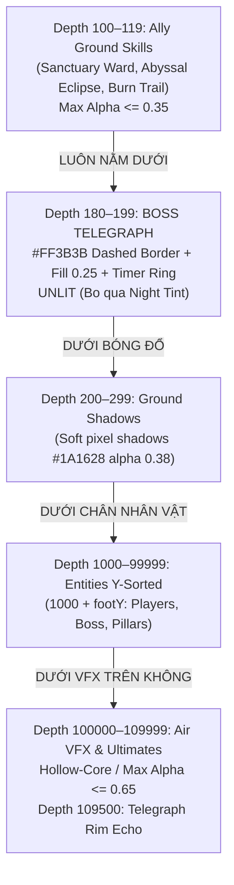

# VFX Design & Combat Readability Standard — Eldoria: Forgotten Wilds

**Trạng thái**: Hoàn thiện (Art Direction Baseline v1.0)  
**Chế độ**: `DESIGN_AND_PLANNING_ONLY`  
**Cập nhật lần cuối**: 2026-11-19  
**Tham chiếu cốt lõi**: [Constitution](../../.specify/memory/constitution.md) · [00-game-vision.md](../game-design/00-game-vision.md) · [skills.json](../../game-data/skills.json) · [bosses.json](../../game-data/bosses.json)  
**Visual Concept References**:
- [Whispering Forest Combat Concept](concepts/whispering-forest-combat-concept.jpg)
- [Mossroot Hollow Boss Arena Concept](concepts/dungeon-boss-arena-concept.jpg)
- [Starter Heroes Sheet Concept](concepts/starter-heroes-sheet-concept.jpg)

---

## 1. Triết lý VFX 16-Bit & Nguyên tắc Đọc Chiến trường (Core VFX Pillars)

Trong một game **Online Multiplayer Action RPG** có tối đa 4 người chơi đồng thời tung kỹ năng và Ultimate vào cùng một Boss, VFX không chỉ để "đẹp" mà là **hệ thống giao tiếp trạng thái sinh tử (Tactical Visual Communication)**. Toàn bộ VFX của Eldoria tuân thủ 5 luật bất biến:

1. **100% Pixel-Native VFX (Không Soft Blur / Không Mixel)**: Mọi hoạt ảnh VFX dùng sprite vẽ tay theo pixel nguyên `1:1` với mật độ nhân vật, lọc `NEAREST`, tọa độ hạt khóa tròn nguyên (`Math.round(x), Math.round(y)`). **CẤM** dùng hạt hình tròn mờ Gaussian blur, gradient mượt độ phân giải cao hay hiệu ứng bloom làm vỡ phong cách 16-bit.
2. **Thứ bậc Đọc Chiến trường (Visual Priority Hierarchy)**:
   - **Ưu tiên 1 (Tuyệt đối)**: **Boss & Enemy Telegraphs** (`Depth 180–199`, kèm viền `Telegraph Rim Echo` tại `Depth 109500`) và hình bóng Boss/Nhân vật (`Depth 1000–99999` Y-sorted).
   - **Ưu tiên 2**: Đòn đánh, projectile của chính người chơi và hiệu ứng phá giáp (Poise Break).
   - **Ưu tiên 3**: Hiệu ứng buff/vùng hồi máu của đồng minh (tự động giảm độ mờ khi co-op).
   - **Ưu tiên 4**: Hạt môi trường, tia lửa phụ và dấu vết mờ dần.
3. **VFX Không Bao Giờ Quyết định Hitbox (Constitution Principle II)**: VFX chỉ là tầng hiển thị trên client; toàn bộ phát hiện va chạm, sát thương, trạng thái khống chế và hit-confirm do NestJS server tính toán độc lập trên lưới 20 Hz. Tuy nhiên, bán kính hình ảnh của VFX **PHẢI khớp ±4 px** với `hitboxDimensions` trong `game-data/skills.json` để đảm bảo cảm giác công bằng.
4. **An toàn Thị giác & Chống Động kinh Ánh sáng**: Tần suất nhấp nháy tối đa `≤ 3 Hz`, cấm hoàn toàn strobe tốc độ cao và cấm chớp trắng toàn màn hình.
5. **Tự chủ Hoàn toàn**: Toàn bộ sprite sheet VFX và texture hạt lưu cục bộ trong `assets/vfx/` — không dùng shader hay asset nạp từ nguồn ngoài.

---

## 2. Quy chuẩn Kỹ thuật Sprite VFX & Pixel Particle

| Hạng mục | Tiêu chuẩn Bắt buộc | Ghi chú Triển khai Phaser 3 |
| :--- | :--- | :--- |
| **Tốc độ khung hình Sprite VFX** | `12 FPS` (`83 ms/frame`) cho lửa/khói/nước; `15 FPS` (`66 ms/frame`) cho nhát chém kiếm, sét, vụ nổ tức thì | Tạo độ sắc bén, đanh gọn (snappy) đặc trưng của 16-bit action RPG (như *Hades* chuyển dịch sang 16-bit) |
| **Đường nét & Số màu** | Tối đa `3–4` bậc màu trên 1 sprite VFX (Core sáng → Mid màu nguyên tố → Edge đậm → Outer dark rim nếu cần tách nền sáng) | Không viền đen đậm quanh lửa/ánh sáng; dùng màu nguyên tố tối nhất để bo cạnh |
| **Hình dạng Pixel Particle** | Bộ texture hạt `assets/vfx/vfx_pixel_particles.png` gồm 12 mẫu `8×8 px`: chấm vuông `1×1`, `2×2`, `3×3`, dấu cộng `+` (`3×3`, `5×5`), hình thoi kim cương, vệt tia `1×6`, mảnh tinh thể, lá rơi, bọt tròn pixel, dấu X nhỏ, tia lửa chữ V | Tái sử dụng 1 texture atlas duy nhất để toàn bộ particle gộp chung **1 Draw Call** (`batch`) |
| **Blend Mode** | `NORMAL` cho khói, đất đá, bóng tối, mảnh băng, vũng độc; `ADD` (Additive) có giới hạn `alpha ≤ 0.65` cho lửa, sét, ánh sáng | CẤM xếp chồng `ADD` alpha `1.0` gây cháy sáng trắng xóa màn hình khi 4 người chơi tung chiêu cùng lúc |
| **Co-op Ally VFX Dimming** | Cài đặt người chơi: `100%` (Mặc định nhẹ `70%` cho đồng minh) / `50%` / `25%` (Tối giản Raid) | Luôn giữ nguyên `100%` cho vòng hồi máu/khiên có ích (`Dawn Mend`, `Sanctuary Ward`) ở dạng viền mảnh sạch sẽ |

---

## 3. Ngôn ngữ Màu sắc & Hình khối cho 9 Nguyên tố (`Element` VFX Language)

Mỗi trong **9 nguyên tố chuẩn** sở hữu bảng màu 4 bậc và hình khối (Shape Language) riêng biệt để người chơi nhận diện tức thì kể cả khi có khiếm khuyết sắc giác (color-vision deficiency):

| Nguyên tố (`Element`) | Core (Lõi sáng) | Mid (Chủ đạo) | Edge (Viền đậm) | Accent / Dark | Hình khối Chủ đạo (Shape Motif) | Hạt Phụ (Secondary Particles) | Đường cong Chuyển động |
| :--- | :---: | :---: | :---: | :---: | :--- | :--- | :--- |
| **`FIRE`** | `#FFF4B8` | `#FF6B1A` | `#C8281E` | `#4A1212` | Lưỡi liềm cong, ngọn lửa răng cưa hướng lên | Tia than hồng vuông `2×2` bay lên, tàn tro đen | Bùng nổ nhanh (ease-out), trôi lên |
| **`WATER`** | `#E0FAFF` | `#38BDF8` | `#0284C7` | `#0C4A6E` | Sóng vòng cung mềm, vòng tròn đồng tâm | Giọt nước pixel, bọt trắng `+`, sương mỏng | Chảy uốn lượn, lan tỏa gợn sóng |
| **`EARTH`** | `#FDE68A` | `#C49A45` | `#7C5329` | `#3B2614` | Khối đá đa giác góc cạnh, vết nứt zic-zac trên đất | Mảnh đá vỡ rơi theo trọng lực, đám bụi nâu `NORMAL` | Nặng nề, nảy bật rồi dừng dứt khoát |
| **`WIND`** | `#ECFEFF` | `#7CE0C3` | `#10B981` | `#1B4332` | Dải ruy-băng xoắn mảnh, đường cắt mảnh tốc độ cao | Lá xanh xoáy vòng, vệt gió trắng mảnh `1×8 px` | Xoáy ốc hướng tâm hoặc lao thẳng nhanh |
| **`LIGHTNING`** | `#FFFFFF` | `#49D8FF` | `#2563EB` | `#FFE156` | Tia sét gấp khúc góc nhọn `1–2 px`, vòng tĩnh điện | Tia lửa điện hình chữ V và dấu `+` nhảy chớp ngắn | Tức thời (snap 1–2 frame), giật bậc thang |
| **`FROST`** | `#FFFFFF` | `#93E1FF` | `#3B82F6` | `#1E3A8A` | Tinh thể lục giác, mũi giáo băng nhọn, lưới tinh thể | Bông tuyết `5×5`, mảnh băng lăng kính rơi vỡ | Sắc lạnh, đóng băng dừng đột ngột rồi nứt vỡ |
| **`LIGHT`** | `#FFFFFF` | `#FFE566` | `#F59E0B` | `#92400E` | Vòng tròn cổ ngữ hình học, cột sáng thẳng đứng, sao 4 cánh | Hạt tinh quang `+` bay thẳng lên, vòng hào quang mảnh | Trang nghiêm, hội tụ từ trên xuống hoặc tỏa vòng |
| **`SHADOW`** | `#F3E8FF` | `#9D5CFF` | `#4C1D95` | `#140B24` | Vết rạch sắc lẹm, vòng nhật thực rỗng ruột, khói đặc xoáy | Mảnh khói tím đen `NORMAL`, đốm mắt/tinh thể tím | Thoắt ẩn thoắt hiện, hút vào tâm rồi bung ra |
| **`NEUTRAL`** | `#FFFFFF` | `#E2E8F0` | `#94A3B8` | `#475569` | Vòng sóng xung kích đồng tâm (shockwave), tia thép sắc | Tia lửa kim loại vàng-trắng `#FDE047`, vòng bụi trắng | Dứt khoát vật lý, lực đẩy ngang mạnh |

### 3.1 Dấu hiệu Phản ứng Nguyên tố (Elemental Synergy VFX Cues)
Khi 2 người chơi phối hợp kích hoạt phản ứng nguyên tố trên mục tiêu, một biểu tượng VFX ngắn (`6 frames`, `400 ms`) + nhãn pixel nổi xuất hiện trên đỉnh mục tiêu:
- **Vaporize / Steam (`FIRE + WATER`)**: Cột hơi nước trắng đục `#E2E8F0` bốc lên + tia lửa cam.
- **Overload (`FIRE + LIGHTNING`)**: Vòng sóng xung kích cam-xanh `#FF6B1A`/`#49D8FF` bán kính `64 px` đẩy lùi nhẹ.
- **Melt / Shatter (`FIRE/EARTH + FROST`)**: Mảnh tinh thể băng vỡ bắn 8 hướng (`8–12` mảnh) kèm tiếng vỡ giòn.
- **Electro-Conduct (`WATER + LIGHTNING`)**: Dây sét xanh nhảy nối giữa các mục tiêu ướt trong bán kính `96 px`.
- **Eclipse Burst (`LIGHT + SHADOW`)**: Vòng nhật thực vàng-tím giao thoa thu nhỏ rồi bung sáng 1 nhịp (alpha `0.55`).

---

## 4. Đặc tả VFX Chi tiết cho 8 Iconic Ultimates (+ 4 Ultimates Còn lại)

Mọi thông số `id`, `vfxKey`, `hitboxDimensions`, `castTimeMs`, `startupMs`, `activeMs` và `recoveryMs` dưới đây khớp chính xác **100%** với [skills.json](../../game-data/skills.json).

### 4.1 Chi tiết 8 Kỹ năng Tuyệt kỹ Biểu tượng (Iconic Ultimates)

#### 1. `skl_kael_ult_crimson_crescent` — **Crimson Crescent** (`chr_kael_vanguard` · `FIRE` · **MVP**)
- **`vfxKey`**: `vfx_kael_crimson_crescent_wave` | **Atlas**: `assets/vfx/vfx_ult_fire.png`
- **Hitbox & Timing**: Projectile `96×36 px`, tốc độ `480 px/s`, xuyên mục tiêu (`pierceCount: 99`); Cast `240 ms` → Startup `260 ms` → Active `600 ms` → Recovery `260 ms`.
- **Chuỗi Khung hình VFX**:
  - *Anticipation (`0–260 ms`)*: Kael thu kiếm ngang hông; tia lửa đỏ `#FF6B1A` tụ dọc sống kiếm (4 frames, `48×64 px`), 1 vòng tụ khí lửa mỏng `Layer 110` dưới chân (`alpha 0.30`).
  - *Active (`260–860 ms`)*: Phóng làn sóng kiếm khí hình lưỡi liềm đỏ rực cỡ `96×48 px` (`Depth 103000`, 6 frames loop `15 FPS`, lõi `#FFF4B8` → thân `#FF6B1A` → viền đỏ thẫm `#C8281E` đúng như [whispering-forest-combat-concept.jpg](concepts/whispering-forest-combat-concept.jpg)). Để lại dải vệt than cháy nhẹ trên sàn (`Depth 105`, alpha `0.30`, tan sau `450 ms`) và `18` hạt tàn lửa bay dọc quỹ đạo.
  - *Impact*: Hit-stop `60 ms`, hit-flash 2 frame `#FFFFFF` + nổ tia lửa chữ V `32×32 px` tại mỗi kẻ địch bị chém trúng.
- **Bảo vệ Telegraph**: Vệt cháy nền nằm ở `Layer 105` (luôn dưới `Layer 180` Boss Telegraph); thân lưỡi liềm bay nhanh qua chiến trường với vùng rỗng phía sau và `alpha 0.85` cục bộ chỉ rộng `36 px` nên tuyệt đối không che dấu báo đòn boss.

#### 2. `skl_vex_ult_phantom_sever` — **Phantom Sever** (`chr_vex_nightblade` · `SHADOW` · Post-MVP M2)
- **`vfxKey`**: `vfx_vex_phantom_sever_slashes` | **Atlas**: `assets/vfx/vfx_ult_shadow.png`
- **Hitbox & Timing**: Circle `radiusPx: 192`; Cast `160 ms` → Startup `160 ms` → Active `850 ms` → Recovery `240 ms`.
- **Chuỗi Khung hình VFX**:
  - *Anticipation (`0–160 ms`)*: Bóng mờ tím `#4C1D95` thu gọn quanh Vex kèm tia lóe mắt xanh ngọc `#45D1A0` (3 frames).
  - *Active (`160–1010 ms`)*: Vex hóa thành 5 tàn ảnh (afterimages alpha `0.45`) lướt chéo liên tiếp tạo **7 đường cắt sắc mảnh dạng lưới sao** trên phạm vi bán kính `192 px` (`Depth 105000`, nét cắt rộng `4–6 px`, lõi `#F3E8FF`, viền `#9D5CFF`), không phủ kín nền. Sau `650 ms`, toàn bộ đường cắt co thắt lại phát nổ 1 nhịp khói tím nhẹ (`24` hạt khói mảnh).
- **Bảo vệ Telegraph**: Thiết kế dạng **đường chém hình học mảnh (line-art slashes)** với `> 85%` diện tích bên trong vòng tròn hoàn toàn trong suốt để thấy rõ 100% Boss Telegraph bên dưới.

#### 3. `skl_orin_ult_storm_dominion` — **Storm Dominion** (`chr_orin_stormcaller` · `LIGHTNING` · Post-MVP M3)
- **`vfxKey`**: `vfx_orin_storm_dominion_field` | **Atlas**: `assets/vfx/vfx_ult_lightning.png`
- **Hitbox & Timing**: Circle `radiusPx: 160`; Cast `340 ms` → Startup `340 ms` → Active `6000 ms` → Recovery `240 ms`.
- **Chuỗi Khung hình VFX**:
  - *Anticipation (`0–340 ms`)*: Orin giơ trượng tạo vòng dẫn điện mảnh bán kính `160 px` trên sàn (`Layer 112`, viền xanh `#49D8FF` dày `2 px`, nền rỗng `alpha 0.12`).
  - *Active (`340–6340 ms`)*: Vòng giông sét tồn tại `6 giây`. Mỗi `750 ms` (tần suất `1.33 Hz` — an toàn tuyệt đối dưới ngưỡng `3 Hz`), 2–3 tia sét dọc sắc nét (`16×144 px`, 4 frames, `#FFFFFF`/`#49D8FF`/`#FFE156`) giáng xuống các điểm ngẫu nhiên trong vòng, kèm sóng tĩnh điện nhỏ `32×16 px` ở chân tia sét.
- **Bảo vệ Telegraph**: Vòng giới hạn chỉ vẽ **viền chu vi mỏng** tại `Layer 112` (dưới Boss Telegraph `180`); các tia sét mảnh chỉ xuất hiện `200 ms` với `alpha 0.75` và không bao giờ dùng chớp trắng toàn vùng.

#### 4. `skl_freya_ult_glacial_prison` — **Glacial Prison** (`chr_freya_frostveil` · `FROST` · Post-MVP M3)
- **`vfxKey`**: `vfx_freya_glacial_prison_pillars` | **Atlas**: `assets/vfx/vfx_ult_frost.png`
- **Hitbox & Timing**: Circle `radiusPx: 136`; Cast `360 ms` → Startup `360 ms` → Active `4000 ms` → Recovery `240 ms`.
- **Chuỗi Khung hình VFX**:
  - *Anticipation (`0–360 ms`)*: Hoa văn bông tuyết 6 cánh bằng nét băng mảnh `#93E1FF` nở dần từ tâm (`Layer 110`, alpha `0.30`).
  - *Active (`360–4360 ms`)*: **6 trụ băng lục giác bán trong suốt** (`32×64 px`, alpha `0.60`, Y-sorted quanh chu vi `r = 136 px`) trồi lên tạo lồng giam, kèm hiệu ứng đóng băng bao bọc kẻ địch bị trói (`4 frames` đóng đá xanh nhạt). Hạt tuyết tinh thể rơi chậm bên trong (`16` hạt). Khi hết giờ, 6 trụ băng vỡ tung thành mảnh lăng kính.
- **Bảo vệ Telegraph**: Trụ băng chỉ mọc dọc **chu vi rìa** với độ trong suốt `0.60`; vùng sàn trung tâm chỉ phủ hoa văn băng nét mảnh tại `Layer 110`, để trống 100% tầm nhìn cho vùng đỏ `Layer 180`.

#### 5. `skl_seraphina_ult_solar_judgment` — **Solar Judgment** (`chr_seraphina_dawn` · `LIGHT` · **MVP**)
- **`vfxKey`**: `vfx_seraphina_solar_judgment_pillar` | **Atlas**: `assets/vfx/vfx_ult_light.png`
- **Hitbox & Timing**: Circle `radiusPx: 136`; Cast `380 ms` → Startup `380 ms` → Active `700 ms` → Recovery `260 ms`.
- **Chuỗi Khung hình VFX**:
  - *Anticipation (`0–380 ms`)*: Vòng tròn cổ ngữ thái dương 6 cánh vàng rực `#F6C945` xoay chậm trên mặt đất (tham chiếu trực tiếp vòng phép dưới chân Seraphina trong [whispering-forest-combat-concept.jpg](concepts/whispering-forest-combat-concept.jpg)), render tại `Layer 115`, alpha `0.40`.
  - *Active (`380–1080 ms`)*: Cột ánh sáng mặt trời (`160×280 px`, `Depth 105000`) giáng thẳng từ đỉnh màn hình xuống tâm vòng tròn: lõi trắng-vàng mảnh ở giữa (`alpha 0.62`, rộng `48 px`) bao bọc bởi hào quang nét sọc dọc bán trong suốt (`alpha 0.35`), kèm `22` hạt tinh quang `+` bay ngược lên trên. Đồng minh đứng trong vòng nhận viền lá chắn sáng nhẹ `1 px`.
- **Bảo vệ Telegraph**: Thời gian cột sáng chính chỉ `700 ms` với `maxAlpha 0.62` ở vùng thân cột và `0.35` ở viền, cho phép nhìn xuyên qua cột sáng thấy rõ đường viền đỏ `#FF3B3B` của Boss ngay bên dưới.

#### 6. `skl_nyx_ult_abyssal_eclipse` — **Abyssal Eclipse** (`chr_nyx_voidcaller` · `SHADOW` · Post-MVP M5)
- **`vfxKey`**: `vfx_nyx_abyssal_eclipse_domain` | **Atlas**: `assets/vfx/vfx_ult_shadow.png`
- **Hitbox & Timing**: Circle `radiusPx: 160`; Cast `360 ms` → Startup `360 ms` → Active `7000 ms` → Recovery `240 ms`.
- **Chuỗi Khung hình VFX**:
  - *Anticipation (`0–360 ms`)*: Biểu tượng nhật thực (đĩa đen `#140B24` viền vàng-tím `#B84DFF`/`#FDE047`) mở rộng nhanh từ tâm ra bán kính `160 px` tại `Layer 108`.
  - *Active (`360–7360 ms`)*: Vùng bóng tối DoT kéo dài `7 giây`: nền sàn đổi màu tím đen nhẹ (`alpha 0.28` — đủ tối để nhận ra vùng DoT nhưng đủ trong để thấy rõ hoa văn sàn), viền ngoài khắc cổ ngữ nhật thực xoay cực chậm (`15°/giây`) và `14` tàn sáng tím trôi lên dọc rìa. Mỗi `1000 ms` tick sát thương, 1 vòng sóng tím mảnh gợn từ tâm ra ngoài.
- **Bảo vệ Telegraph**: Toàn bộ vùng tối nằm cứng tại `Layer 108` — **luôn ở dưới Boss Telegraph (`Layer 180`)**, khiến vùng telegraph đỏ `#FF3B3B` thực tế còn **nổi bật hơn nữa** trên nền tím sẫm của Abyssal Eclipse!

#### 7. `skl_aurelia_ult_celestial_rain` — **Celestial Rain** (`chr_aurelia_starbow` · `LIGHT` · Post-MVP M4)
- **`vfxKey`**: `vfx_aurelia_celestial_rain_meteors` | **Atlas**: `assets/vfx/vfx_ult_light.png`
- **Hitbox & Timing**: Circle `radiusPx: 152`; Cast `320 ms` → Startup `320 ms` → Active `3000 ms` → Recovery `240 ms`.
- **Chuỗi Khung hình VFX**:
  - *Anticipation (`0–320 ms`)*: Aurelia bắn 1 mũi tên tinh quang thẳng lên trời; vòng tròn mục tiêu chòm sao `r = 152 px` hiện tại `Layer 112` (nét vàng mỏng `#FFD166`, alpha `0.35`).
  - *Active (`320–3320 ms`)*: `12` thiên thạch tinh tú (`24×40 px`, góc rơi nghiêng `70°`, đuôi vàng-trắng `#FFD166`/`#FFFFFF`, `Depth 105000`) rơi rải rác theo nhịp `250 ms/viên` xuống vùng tròn. Mỗi điểm rơi tạo vòng sóng ánh sao nhỏ `48×24 px` (5 frames, alpha `0.55`, tan trong `280 ms`).
- **Bảo vệ Telegraph**: Thiên thạch rơi rải rác từng viên nhỏ (`24 px`), vụ nổ mặt đất nhỏ gọn và tan nhanh dưới `300 ms`, tuyệt đối không phủ kín màn hình.

#### 8. `skl_torvald_ult_dragonheart_awakening` — **Dragonheart Awakening** (`chr_torvald_rageborn` · `FIRE` · Post-MVP M4)
- **`vfxKey`**: `vfx_torvald_dragonheart_aura` | **Atlas**: `assets/vfx/vfx_ult_fire.png`
- **Hitbox & Timing**: Circle `radiusPx: 128` (initial shockwave) + Self Transformation Aura `10000 ms`; Cast `240 ms` → Startup `240 ms` → Active `10000 ms` → Recovery `200 ms`.
- **Chuỗi Khung hình VFX**:
  - *Activation Burst (`0–480 ms`)*: Torvald gầm vang, vòng sóng nhiệt rồng đỏ-cam bán kính `128 px` bung ra 1 lần (`Depth 105000`, 6 frames, alpha `0.65`), bóng cánh/sừng rồng lửa pixel (`96×80 px`, alpha `0.55`) lóe phía sau lưng Torvald trong `450 ms` rồi thu vào thân.
  - *Awakened Aura (`10 giây`)*: Bao quanh sprite `48×64 px` của Torvald là hào quang ngọn lửa nhỏ viền thân (`56×72 px`, 4 frames loop, alpha `0.50`, `Depth 1000 + Math.round(footY) + 1`), thanh đại kiếm bốc lửa cam rực và bước chạy để lại `1` dấu chân tro nóng mỗi `300 ms` (`Depth 105`).
- **Bảo vệ Telegraph**: Hào quang thức tỉnh ôm sát kích thước nhân vật (`56×72 px`) thay vì trải lớn ra sàn, đảm bảo tầm nhìn chiến trường sạch hoàn toàn trong suốt `10 giây` buff.

### 4.2 Bảng Tóm tắt 4 Ultimates Còn lại trong Bộ 12 Nhân vật (Gồm MVP Lyra)
| Skill ID & Tên | Nhân vật (`Element`) | `vfxKey` (khớp `skills.json`) | Đặc tả VFX Ngắn gọn & Bảo vệ Telegraph |
| :--- | :--- | :--- | :--- |
| `skl_lyra_ult_tempest_arrowstorm` (**Tempest Arrowstorm** · **MVP**) | `chr_lyra_windrunner` (`WIND`) | `vfx_lyra_tempest_arrowstorm_zone` | Vòng gió lục bảo mảnh `r=128` (`Depth 112`) + mưa mũi tên gió xanh trắng rơi góc `75°` trong `3 giây` (`Depth 105000`, nét mảnh `12×28 px`, alpha `0.70`) + hạt lá bay nhẹ |
| `skl_bram_ult_earthshaker_citadel` (**Earthshaker Citadel**) | `chr_bram_bastion` (`EARTH`) | `vfx_bram_earthshaker_citadel_ring` | 8 trụ đá thấp mọc quanh rìa `r=144` (Y-sorted `1000+footY`) + sóng nứt sàn `Depth 108`; tâm hoàn toàn thoáng để đồng đội đọc telegraph |
| `skl_rowan_ult_tidebreaker_sanctuary` (**Tidebreaker Sanctuary**) | `chr_rowan_tidewarden` (`WATER`) | `vfx_rowan_tidebreaker_sanctuary_wave` | Sóng thủy triều xanh ngọc lan ra `r=160` (`Depth 110`, alpha `0.30`) để lại gợn nước trong suốt nhẹ tạo lá chắn nước `6 giây` |
| `skl_mira_ult_runeforge_overdrive` (**Runeforge Overdrive**) | `chr_mira_ironfist` (`NEUTRAL`) | `vfx_mira_runeforge_overdrive_cones` | 3 sóng xung kích hình chữ nhật liên tiếp `72×144 px` màu đồng-vàng `#F0B429` (`Depth 105000`, 5 frames/đợt) bắn tia lửa cơ khí |

---

## 5. Tiêu chuẩn Thiết kế Boss Telegraph (NON-NEGOTIABLE Readability Rules)

Boss trong **Eldoria: Forgotten Wilds** khó nhờ cơ chế né tránh và phá giáp (Stagger/Poise Break), không phải do bất công về tầm nhìn. Mọi đòn tấn công nguy hiểm của Monster, Elite và Boss tuân thủ chặt chẽ chuẩn **Boss Telegraph System**:

### 5.1 Quy chuẩn Hình học & Màu sắc Telegraph
1. **Lớp Hiển thị Bắt buộc**: **Depth `180–199`** (thuộc dải `Depth 100–199` NẰM DƯỚI bóng đổ `200–299` và toàn bộ thực thể Y-sorted `1000–99999`, nhưng LUÔN NẰM TRÊN mọi decal kỹ năng mặt đất của người chơi `Depth 100–119`, lưới xây dựng `120–139`, hazards `140–179` và bỏ qua lớp làm tối ban đêm `Day/Night LUT`! Khi có Ultimate phủ đè, viền rỗng `Telegraph Rim Echo` tự động hiển thị ở `Depth 109500`).
2. **Cấu trúc 3 Thành phần Bắt buộc của 1 Telegraph**:
   - **Viền ngoài độ tương phản cao**: Đường nét đứt pixel dày `2 px` màu đỏ thẫm rực **`#FF3B3B`** (chạy viền kiểu marching ants tốc độ chậm `12 px/s`), bo ngoài bằng viền tối `1 px` `#450A0A` để nổi bật ngay cả trên nền tuyết trắng (`reg_frostbound_highlands`) hay cát vàng (`reg_forgotten_ruins`).
   - **Vùng phủ báo phạm vi**: Màu **`#FF3B3B`** với **`alpha = 0.25`** (khớp chính xác phạm vi hitbox thực tế của server, tham chiếu [dungeon-boss-arena-concept.jpg](concepts/dungeon-boss-arena-concept.jpg)).
   - **Vòng/Thanh Tiến độ Đếm ngược (Animated Fill Timer Ring)**: Một lớp phủ thứ hai cùng hình dạng (Tròn, Hình quạt Cone, Hình chữ nhật Line, Vòng nhẫn Donut) mở rộng tuyến tính từ tâm/gốc ra tới đúng đường viền ngoài theo đúng `telegraphMs` của đòn đánh (`alpha 0.25 → 0.50`). Đúng thời điểm vòng trong chạm khớp đường viền ngoài, đòn đánh chốt khóa (`1 frame` sáng viền `#FFE5E5`, rồi kích hoạt VFX đòn đánh thật).

### 5.2 Phân loại Mã Màu & Họa tiết Telegraph (Hỗ trợ Người Mù Màu)
| Loại Cơ chế Boss | Màu Chính (Hex) | Fill Alpha | Họa tiết Nhận diện (Colorblind-Safe Pattern) | Ví dụ trên `boss_thornback_elder` |
| :--- | :---: | :---: | :--- | :--- |
| **Standard Damage / Lethal AoE** | `#FF3B3B` (Crimson Red) | `0.25` | Viền nét đứt đơn + vòng mở rộng từ tâm | `Root Slam`, `Canopy Thorn Rain`, `Heartwood Charge` (Line) |
| **Party Stack / Soak Mechanic** | `#FF9F1C` (Amber Orange) | `0.25` | 4 mũi tên pixel chĩa **vào trong** + biểu tượng nhiều người | Cơ chế chia sát thương (M2–M5 Bosses) |
| **Knockback / Push Wave** | `#C084FC` (Telegraph Violet) | `0.22` | Họa tiết mũi tên chevron `>>>` hướng đẩy ra ngoài | `Mossroot Quake Waves` (Donut / Wave đẩy lùi) |
| **Interruptible / Stagger Window** | `#FACC15` (Stagger Gold) | `0.30` | Vòng sáng vàng + biểu tượng Khiên Nứt trên thanh cast Boss | `Regrowth Sap Channel` (Phase 2 — cần phá poise ngắt chiêu) |
| **Safe Zone / Cleanse Shelter** | `#34D399` (Emerald Safe) | `0.22` | Viền nét liền chấm tròn xanh + ký hiệu dấu cộng bảo vệ | Bóng sau 4 trụ `pil_moss_*` khi Boss tung `Sylvan Tempest` |

### 5.3 Luật Chống Che Khuất (Anti-Occlusion Guarantee)

- **Quy tắc Bắt buộc**: Không một kỹ năng hay Ultimate nào được phép render khối màu đặc (`alpha > 0.65`) phủ kín diện tích lớn hơn `64×64 px` quá `250 ms`. Ngoài ra, khi có bất kỳ Boss Telegraph nào đang đếm ngược trong bán kính `220 px`, client tự động kích hoạt chế độ **Telegraph Clarity Boost** (giảm tạm `30%` alpha của mọi foreground VFX đồng minh trong vùng giao cắt).

---

## 6. Cảm giác Chiến đấu (Combat Feel / Game Juice)

| Cơ chế | Thông số Chuẩn | Nguyên tắc Đồng bộ Multiplayer |
| :--- | :--- | :--- |
| **Hit-Stop (Impact Freeze)** | - Đòn đánh thường / Crit nhẹ: **`40 ms`** (~2.5 frames ở 60 FPS) - Active Skill nặng (`Sunder Cleave`, `Tectonic Slam`): **`50 ms`** (~3 frames) - Ultimate Impact / Parry Thành công / Boss Poise Break: **`65 ms`** (~4 frames) | **CHỈ đóng băng cục bộ hoạt ảnh sprite** của người ra đòn và mục tiêu trên client; TUYỆT ĐỐI không dừng game loop, không dừng timer server 20 Hz, không dừng chuyển động của các đồng đội khác! |
| **Hit-Flash** | Chính xác **2 frames (`33 ms` ở 60 FPS)** tô phủ solid `#FFFFFF` lên toàn bộ hình bóng sprite mục tiêu trúng đòn (đòn Crit: Frame 1 `#FFFFFF`, Frame 2 `#FFD1C1`) | Dùng shader/tint nhanh trên Phaser sprite (`setTintFill(0xffffff)`), không gây nháy dài quá 2 frame để tuân thủ an toàn thị giác |
| **Camera Shake (Toggleable)** | Cài đặt 3 mức trong Settings: **`0%` (Tắt hoàn toàn)** · **`50%` (Nhẹ)** · **`100%` (Mặc định)**. - Đòn thường/Crit: `2 px` trong `80 ms` - Active nặng / Trúng đòn Boss: `4 px` trong `130 ms` - Ultimate / Boss Stagger Break: `6 px` trong `180 ms` | Biên độ làm tròn pixel nguyên (`Math.round`), suy giảm theo hàm tắt dần (damped decay), không cộng dồn vô hạn khi nhận nhiều hit liên tục (cap biên độ tối đa `6 px`) |
| **Floating Combat Text** | Font pixel sắc nét `8×10 px` (thường `#FFFFFF`), `10×12 px` (Crit `#FFD166` + biểu tượng sao nhỏ), Hồi máu `#4ADE80`, Sát thương nguyên tố tô viền màu nguyên tố, chữ `BREAK!` vàng lớn khi phá giáp Boss | Bay vòng cung nhẹ `24 px` trong `650 ms`, tự động giãn lệch tọa độ X ngẫu nhiên `±10 px` để số không đè chồng thành khối khó đọc |

---

## 7. Hàng rào An toàn Chống Kích ứng Ánh sáng (Photosensitivity Safety Guardrails)

Eldoria tuân thủ nghiêm ngặt hướng dẫn an toàn ánh sáng **WCAG 2.3.1 (Three Flashes or Below Threshold)** cho toàn bộ VFX chiến đấu, thời tiết và Gacha:
1. **Giới hạn Tần suất Chớp**: Mọi hiệu ứng thay đổi độ sáng diện rộng (> 25% viewport hoặc > 10% góc nhìn) bị khóa cứng tối đa **`≤ 3 Hz`** (khoảng cách tối thiểu `334 ms` giữa 2 lần lóe sáng).
2. **Cấm Strobe & Full-Screen Whiteout**: Tuyệt đối **KHÔNG** có hiệu ứng nhấp nháy đen-trắng luân phiên (strobe), không có chớp `#FFFFFF` toàn màn hình khi tung Ultimate, sấm sét `STORM` hay mở Gacha `LEGENDARY`/`MYTHIC`. Mức lóe toàn màn hình tối đa khi Boss Stagger Break là viền sáng dịu `alpha ≤ 0.12` kéo dài `≤ 66 ms`.
3. **Tùy chọn Giảm Hiệu ứng (`Reduced Flashing / Photosensitivity Mode`)**: Khi bật trong Settings:
   - Tắt hoàn toàn chớp sáng màn hình (kể cả `STORM` lightning ambient lift và Gacha burst flash).
   - Chuyển Hit-Flash từ `#FFFFFF` sang viền sáng dịu `#D8B4FE` hoặc tắt hoàn toàn tùy chọn.
   - Khóa `Camera Shake = 0%` và giảm tốc độ hoạt ảnh vòng xoay cổ ngữ xuống `50%`.

---

## 8. Ngân sách Particle Pool & Hiệu năng Phaser 3 (`proposed` / `unverified`)

*Ghi chú minh bạch theo Hiến pháp Nguyên tắc VIII*: Các giới hạn dưới đây là **ngân sách thiết kế đề xuất (`proposed`) và CHƯA được đo benchmark thực tế (`unverified`)** trên bản build Phaser 3:

| Pool / Tài nguyên Phaser | Dung lượng Cấp phát Sẵn (Desktop) | Chế độ Low-Spec / Minimal | Chiến lược Xử lý Quá tải (Pool Exhaustion) |
| :--- | :---: | :---: | :--- |
| **`VfxSpritePool`** (Hoạt ảnh skill/impact) | `128` sprite objects (`proposed`) | `64` sprite objects | Thu hồi (recycle) VFX ưu tiên thấp cũ nhất (bước chân, bụi nhỏ); không bao giờ thu hồi Boss VFX |
| **`PixelParticlePool`** (Hạt pixel 1–4 px) | `400` hạt đồng thời (`proposed`) | `180` hạt đồng thời | Giảm tỷ lệ spawn hạt phụ của đồng minh (`50%`) khi tổng hạt vượt `80%` ngưỡng; giữ nguyên `100%` hạt của Boss & người chơi chính |
| **`TelegraphShapePool`** (Vùng báo đòn) | `32` shape objects (`proposed`) | `32` (KHÔNG giảm) | Không bao giờ bỏ qua Boss Telegraph; dự phòng tăng mềm lên `48` nếu raid có nhiều đòn đồng thời |
| **`FloatingTextPool`** (Số sát thương) | `48` bitmap text (`proposed`) | `24` bitmap text | Gộp số DoT nhỏ cùng mục tiêu trong cửa sổ `200 ms` khi quá tải |
| **Rác Bộ nhớ (GC Allocation)** | `0` object tạo mới trong `update()` (`proposed`) | `0` | 100% tái sử dụng đối tượng từ Pool để loại bỏ micro-stutter trên trình duyệt |

---

## 9. Quality Gate — Kiểm thử & Tiêu chí Nghiệm thu VFX

| Mã Kiểm thử | Kịch bản Kiểm chứng | Kết quả Mong đợi (Pass Criteria) |
| :--- | :--- | :--- |
| **TC-VFX-01** | 4 người chơi đồng thời tung `Crimson Crescent`, `Tempest Arrowstorm`, `Solar Judgment` và `Abyssal Eclipse` ngay lúc `boss_thornback_elder` hiện 4 vùng Telegraph `Root Slam` | 100% đường viền đỏ `#FF3B3B`, vùng phủ `0.25` và vòng đếm ngược của Boss nhìn rõ ràng không bị che khuất ở cả 3 mức cài đặt Ally VFX Opacity |
| **TC-VFX-02** | So sánh bán kính hình ảnh của 8 Iconic Ultimates với khung debug `hitboxDimensions` trả về từ Server | Độ lệch hình ảnh vs hitbox thực tế `≤ 4 px` ở mọi hướng |
| **TC-VFX-03** | Bật `Camera Shake = 0%` và `Photosensitivity Mode = ON` trong Settings rồi kích hoạt Boss Poise Break + `Storm Dominion` + `STORM` weather | Không có bất kỳ dịch chuyển camera nào; không có nhấp nháy `> 3 Hz`; không có lóe trắng toàn màn hình |
| **TC-VFX-04** | Kiểm tra Hit-Stop (`40–65 ms`) trong phiên co-op 2 người chơi | Khi người chơi A kích hoạt Hit-Stop `65 ms` lúc đánh Boss, chuyển động của người chơi B và đồng hồ cooldown server vẫn trôi đều không bị khựng mạng |
| **TC-VFX-05** | Stress test 400 hạt + 4 Ultimate đồng thời trong 60 giây | Zero memory leak từ VFX pool; bộ đếm đối tượng pool giữ ổn định trong ngưỡng ngân sách đã định |
