# Quantitative Economy & Balancing Analysis — Eldoria: Forgotten Wilds

**Trạng thái**: Hoàn thiện (Design Baseline v1.0 — Có bằng chứng mô phỏng thực thi bằng Node.js)  
**Chế độ**: `DESIGN_AND_PLANNING_ONLY`  
**Cập nhật lần cuối**: 2026-11-19  
**Bằng chứng Thực thi (Execution Evidence)**: [`tools/design-validation/run-simulations.mjs`](../../tools/design-validation/run-simulations.mjs) → [`tools/design-validation/last-sim-output.json`](../../tools/design-validation/last-sim-output.json) *(chạy lúc `2026-11-19T15:45:36.958Z` trên `Node.js v22.20.0`, Mulberry32 deterministic PRNG)*  
**Nguồn dữ liệu chuẩn**: [`weapon-upgrade-costs.csv`](./weapon-upgrade-costs.csv) · [`gacha-probabilities.csv`](./gacha-probabilities.csv) · [`game-data/items.json`](../../game-data/items.json) · [`game-data/crops.json`](../../game-data/crops.json) · [`game-data/animals.json`](../../game-data/animals.json) · [`game-data/loot-tables.json`](../../game-data/loot-tables.json) · [`game-data/buildings.json`](../../game-data/buildings.json) · [`game-data/quests.json`](../../game-data/quests.json) · [`game-data/gacha-banners.json`](../../game-data/gacha-banners.json) · [`19-game-economy.md`](../game-design/19-game-economy.md)

---

## 1. Phương pháp luận & Nguyên tắc Minh bạch Bằng chứng (Evidence Integrity)

Tuân thủ **Constitution Principle VIII (Verifiable Quality Gates & Evidence Integrity)**, tài liệu này phân tách rạch ròi giữa **hai loại số liệu**:

1. **Kết quả Mô phỏng & Tính toán Thực thi Thực tế (`verified-sim` / `catalog-exact`)**: Toàn bộ số liệu sinh trực tiếp từ phép tính chính xác trên `game-data/*.json`, `docs/balancing/*.csv` và kết quả chạy thực tế `tools/design-validation/run-simulations.mjs` lưu tại `tools/design-validation/last-sim-output.json` (có thể tái lập 100% cùng seed).
2. **Giả định Hành vi Người chơi Live-Ops & Kịch bản Thị trường Tương lai (`proposed / unverified`)**: Các dự báo về phân bổ người chơi thực (tỷ lệ Casual/Regular/Hardcore), độ co giãn giá P2P khi mở Safe Trade ở M3, hành vi tích trữ Gold sau ngày 30 và sức chịu tải I/O của `data/db/ledgers/currency-ledger-YYYY-MM.json` ở quy mô 100–500 CCU — tất cả đều gắn nhãn **`proposed / unverified`** cho đến khi có dữ liệu telemetry và load test thực tế.

---

## 2. Phân tích Kinh tế 30 Ngày: Faucet vs Sink (`verified-sim`)

### 2.1 Tham số Mô hình Thực thi (`run-simulations.mjs`, dòng 308–399)

Kịch bản mô phỏng 30 ngày đầu trong MVP kiểm tra 3 hình mẫu người chơi với vốn khởi đầu `200 GOLD`, `0 STARLIGHT_SHARD`:
- **Gold Faucets / ngày**:
  - Săn quái (`mobGold`): `Math.round(hoursPerDay × 340)` (`340G` Casual / `850G` Regular / `1,700G` Hardcore).
  - Nông trại & Chăn nuôi (`farmGold`): `Math.round(Math.min(2.5, hoursPerDay) × 260)` *(trần thực tế 2.5 giờ năng suất cao vì bị giới hạn bởi số ô đất và chu kỳ chín: `260G` Casual / `650G` Regular & Hardcore)*.
  - Nhiệm vụ (`questGold`): `320G/ngày` trong 12 ngày Onboarding/Main MVP, sau đó `180G/ngày` từ Daily Commissions.
  - Đột kích Boss (`bossGold`): `+650G` mỗi 3 ngày (tương đương trung bình 1 lượt hạ `boss_thornback_elder` `450–680G` + rương `ltb_chest_mossroot_clear` `220–360G`).
- **Gold Sinks / ngày & Vốn**:
  - Vận hành thường nhật (`routineSink`): `Math.round(hoursPerDay × 210 + 120)` (hạt giống tái gieo, sửa độ bền, phí luyện kim/nấu ăn, bình thuốc).
  - 7 mốc đầu tư Công trình MVP (`buildingUpgrades`): `[400, 900, 1500, 2200, 3500, 5000, 7500]` = **`21,000 GOLD`** *(nhóm trọng tâm House/Storage/Coop/Kitchen/Blacksmith Lv 1..4)*.
  - 10 mốc Cường hóa vũ khí (`+0 → +10`): **`26,400 GOLD`** theo đúng `weapon-upgrade-costs.csv`.
  - 1 lần Tẩy điểm thuộc tính (`Respec` ngày 18 ở Lv 15): **`3,750 GOLD`** (`250 × 15`).

### 2.2 Kết quả Thực thi 30 Ngày cho 3 Hình mẫu Người chơi (`last-sim-output.json`)

| Chỉ số 30 Ngày (`verified-sim`) | Casual (`1.0h/ngày`) | Regular (`2.5h/ngày`) | Hardcore (`5.0h/ngày`) | Nhận định Cân bằng |
| :--- | :---: | :---: | :---: | :--- |
| **Tổng `GOLD` Faucet (Vào)** | `31,780 G` | `58,780 G` | `84,280 G` | Hardcore kiếm gấp `2.65×` Casual (nhưng bị trần nông trại giảm khoảng cách giàu–nghèo cực đoan). |
| **Tổng `GOLD` Sink (Ra)** | `31,000 G` | `51,250 G` | `78,250 G` | Bể tiêu thụ hấp thụ phần lớn dòng Gold ở cả 3 nhóm. |
| **Số dư `GOLD` Ngày 30** | `780 G` | `7,530 G` | `6,030 G` | **Không xảy ra bùng nổ tồn kho Gold** trong tháng đầu. |
| **Tỷ lệ `Sink / Faucet` (`%`)** | **`97.5%`** | **`87.2%`** | **`92.8%`** | Đều nằm vững trong vùng cân bằng khỏe mạnh (`85% – 98%`). |
| **Mốc Cường hóa Vũ khí Đạt được** | **`+8`** | **`+9`** | **`+9`** *(chạm `+10` ngày 31)* | Xem giải thích kỹ thuật bên dưới. |
| **Công trình MVP Hoàn tất** | **`5 / 7`** | **`6 / 7`** | **`7 / 7`** | Phản ánh rõ lộ trình đầu tư lãnh địa theo thời gian chơi. |
| **Tổng `STARLIGHT_SHARD` Vào** | `6,072` | `6,072` | `6,072` | **Công bằng tuyệt đối cho Casual** — không ép cày 5h/ngày mới có lượt quay Gacha! |
| **Tổng `STARLIGHT_SHARD` Đã quay** | `4,800` | `4,800` | `4,800` | Hoàn thành đúng **`3` lần 10-pull = `30` lượt quay**. |
| **Số dư `STARLIGHT_SHARD` Ngày 30** | `1,272` | `1,272` | `1,272` | Tương đương thêm `7.95` lượt (sắp chạm 10-pull thứ 4 ở ngày 34). |

### 2.3 Diễn biến Số dư & Tiến trình Theo Mốc Ngày 1 / 7 / 14 / 30 (`last-sim-output.json`)

| Hình mẫu | Ngày 1 (Gold / Vũ khí / Bld / Pulls) | Ngày 7 | Ngày 14 | Ngày 30 |
| :--- | :--- | :--- | :--- | :--- |
| **Casual (`1.0h/ngày`)** | `640G` · `+1` · `0/7` · `0` | `1,030G` · `+5` · `2/7` · `10` | `2,580G` · `+6` · `3/7` · `20` | `780G` · `+8` · `5/7` · `30` |
| **Regular (`2.5h/ngày`)** | `825G` · `+1` · `1/7` · `0` | `1,525G` · `+6` · `3/7` · `10` | `2,070G` · `+7` · `5/7` · `20` | `7,530G` · `+9` · `6/7` · `30` |
| **Hardcore (`5.0h/ngày`)** | `1,150G` · `+1` · `1/7` · `0` | `1,600G` · `+6` · `4/7` · `10` | `2,420G` · `+8` · `5/7` · `20` | `6,030G` · `+9` · `7/7` · `30` |

```mermaid
xychart-beta
    title "So sánh Gold Faucet vs Gold Sink trong 30 ngày (last-sim-output.json)"
    x-axis ["Casual (1h/d)", "Regular (2.5h/d)", "Hardcore (5h/d)"]
    y-axis "Gold (G)" 0 --> 90000
    bar [31780, 58780, 84280]
    bar [31000, 51250, 78250]
```

> **Phân tích Chuyên sâu Mốc `+9 → +10` của Hardcore trong Mô phỏng**: Tại Ngày 30, Hardcore đạt `7/7` công trình (vừa chi `7,500G` cho công trình cuối) và còn `6,030G` — chỉ thiếu `2,270G` so với ngưỡng `8,000G + 300G` đệm của bước `+9 → +10`, nên **chắc chắn đạt `+10` ngay vào Ngày 31**. Điều này khẳng định thiết kế **chủ đích song hành**: nếu người chơi dồn toàn bộ Gold nâng thẳng vũ khí và `bld_blacksmith` Lv 4 trước các công trình phụ, thời gian chạm `+10` sẽ rút xuống **~1.8 – 5.5 ngày** như bảng giờ farm thuần túy ở Mục 3; còn nếu phát triển cân bằng cả lãnh địa lẫn vũ khí, hành trình sẽ kéo dài bền vững trọn tháng đầu.

---

## 3. Phân tích Chi phí Cường hóa Vũ khí `+0 → +10` (`26,400 GOLD`) (`verified-sim` & `catalog-exact`)

Dữ liệu khớp 100% [`docs/balancing/weapon-upgrade-costs.csv`](./weapon-upgrade-costs.csv) và phần `weaponEnhancement` trong `last-sim-output.json` (với vũ khí mẫu `wpn_iron_longsword`, `baseAtk = 26`):

| Bậc | Cấp `bld_blacksmith` | Tỷ lệ MVP (Vỡ / Tụt) | `wpn_iron_longsword` ATK (`+Pct%` / `+Flat`) | Chi phí `GOLD` | Nguyên liệu Bắt buộc (`mat_*`) | Giờ farm (Cas / Reg / HC) |
| :-: | :-: | :-: | :---: | :---: | :--- | :---: |
| `+0 → +1` | Lv 1 *(hoặc Garrik)* | `100%` (Không) | `32` (`+8%` / `+4`) | `150 G` | `mat_copper_ingot ×3`, `mat_oak_wood ×4` | `0.20 / 0.12 / 0.08` |
| `+1 → +2` | Lv 1 *(hoặc Garrik)* | `100%` (Không) | `38` (`+16%` / `+8`) | `300 G` | `mat_copper_ingot ×5`, `mat_slime_gel ×4` | `0.35 / 0.22 / 0.15` |
| `+2 → +3` | Lv 1 | `100%` (Không) | `45` (`+25%` / `+13`) | `550 G` | `mat_iron_ingot ×4`, `mat_goblin_tooth ×6` | `0.55 / 0.35 / 0.22` |
| `+3 → +4` | Lv 2 | `100%` (Không) | `54` (`+35%` / `+19`) | `900 G` | `mat_iron_ingot ×7`, `mat_wolf_pelt ×6`, `mat_coal ×5` | `0.90 / 0.55 / 0.35` |
| `+4 → +5` | Lv 2 | `100%` (Không) | **`65`** (`+48%` / `+27`) *+3% Crit & Glow I* | `1,400 G` | `mat_iron_ingot ×10`, `mat_spore_cap_dust ×8`, `mat_boar_tusk ×6` | `1.35 / 0.85 / 0.55` |
| `+5 → +6` | Lv 2 | `100%` (Không) | `77` (`+60%` / `+36`) | `2,100 G` | `mat_steel_ingot ×5`, `mat_crawler_chitin ×8`, `mat_shaman_totem ×4` | `1.80 / 1.15 / 0.75` |
| `+6 → +7` | Lv 3 | `100%` (Không) | `92` (`+74%` / `+47`) | `3,000 G` | `mat_steel_ingot ×8`, `mat_alpha_fang ×3`, `mat_starlight_dust ×6` | `2.50 / 1.55 / 1.00` |
| `+7 → +8` | Lv 3 | `100%` (Không) | `109` (`+90%` / `+60`) | `4,200 G` | `mat_steel_ingot ×12`, `mat_alpha_fang ×5`, `mat_thornback_heart ×1` | `3.40 / 2.10 / 1.35` |
| `+8 → +9` | Lv 4 | `100%` (Không) | `130` (`+108%` / `+76`) | `5,800 G` | `mat_steel_ingot ×16`, `mat_thornback_heart ×2`, `mat_starlight_dust ×12` | `4.80 / 2.95 / 1.90` |
| `+9 → +10` | Lv 4 | `100%` (Không) | **`155`** (`+130%` / `+96`) *+8% Poise, +5% Skill & Aura II* | `8,000 G` | `mat_steel_ingot ×22`, `mat_thornback_heart ×4`, `mat_starlight_dust ×20` | `6.50 / 4.00 / 2.60` |
| **TỔNG** | **Lv 1 → Lv 4** | **100% An toàn** | **`26 → 155 ATK` (`+496%`)** | **`26,400 G`** | **15 loại nguyên liệu (chi tiết bên dưới)** | **`22.35h / 13.84h / 8.95h`** |

### Tổng hợp Quy đổi Nguyên liệu Gốc cho 1 Vũ khí `+0 → +10` (`catalog-exact`)
- **Tổng thời gian farm nguyên liệu thuần túy** (`last-sim-output.json`):
  - **Casual (`1.0h/ngày`)**: **`22.35 giờ`** (`22.4 ngày`).
  - **Regular (`2.5h/ngày`)**: **`13.84 giờ`** (`5.5 ngày`).
  - **Hardcore (`5.0h/ngày`)**: **`8.95 giờ`** (`1.8 ngày`).
- **Hiệu ứng khuếch đại luyện kim (Hidden Raw-Material Sink)**:
  - Tổng cộng cần **`63 mat_steel_ingot`** + **`21 mat_iron_ingot`** + **`8 mat_copper_ingot`**.
  - Quy đổi theo `game-data/recipes.json`, riêng `63` thỏi thép + `21` thỏi sắt đòi hỏi **`441 mat_iron_ore`**, **`504 mat_coal`** (kèm `5` than trực tiếp ở `+4` = `509` than), **`126 mat_rough_stone`** và **`10,275 GOLD` phí nung luyện kim** *(cộng với `26,400G` phí đập trực tiếp = **`36,675 GOLD` tổng chi phí toàn chuỗi** nếu tự luyện 100% từ quặng thô!)*.
  - Tổng cộng cần **`7 mat_thornback_heart`** (thêm `4` lõi nữa để nâng `bld_blacksmith` Lv 3–4 = **`11` lõi** cho vũ khí `+10` đầu tiên → tương đương **`7–8` lượt hạ `boss_thornback_elder`** ở mức rơi trung bình `1.5` lõi/lượt).

---

## 4. Nhịp Kiếm `STARLIGHT_SHARD` Miễn phí & Mô phỏng Gacha 100.000 Lượt (`verified-sim`)

### 4.1 Cơ cấu Kiếm `STARLIGHT_SHARD` 30 Ngày Hoàn toàn Từ Gameplay (0 VNĐ)

| Nguồn Kiếm `STARLIGHT_SHARD` (MVP) | Số lượng 30 Ngày (`last-sim-output.json` & Catalog) | Quy đổi Lượt quay (`160/pull`) | Ghi chú Kiểm soát |
| :--- | :---: | :---: | :--- |
| Chuỗi 12 Nhiệm vụ MVP (`qst_001`..`qst_012`) | `2,240` ròng *(`2,400` gộp − `160` pull `qst_005`; trong sim: `12 × 186 = 2,232`)* | `14.0` pulls *(+1 pull tại `qst_005`)* | Mốc `qst_001..qst_010` đạt `1,680` ròng → **10-pull đầu ngay giờ thứ 1–2**. |
| Hạ `boss_thornback_elder` Lần đầu (`First Clear`) | `480` *(ngày 4 trong sim)* | `3.0` pulls | Khóa 1 lần theo `Account` (chống tạo alt farm). |
| Daily Commissions & Khám phá (`80/ngày × 30`) | `2,400` | `15.0` pulls | Giới hạn `80/ngày` cấp `Account`, bảo đảm công bằng Casual. |
| Weekly Boss (`160/tuần`) + Weekly Supply (`80/tuần`) × 4 tuần | `960` *(4 mốc ngày 7, 14, 21, 28)* | `6.0` pulls | Tăng mạnh ở M2–M5 khi mở thêm 4 Boss vùng mới (`+240..+480`/tuần). |
| **Tổng thực thi trong `last-sim-output.json`** | **`6,072 STARLIGHT_SHARD`** | **`37.95` pulls** (`30` đã quay + `1,272` dư) | **Vượt yêu cầu tối thiểu `~30+` lượt quay miễn phí trong 30 ngày đầu.** |
| *(Cộng thêm mở Waypoint MVP `40×3` + 100% Fog of War 2 vùng `160×2`)* | *`+440 STARLIGHT_SHARD` (`catalog-exact`)* | *`+2.75` pulls → **Tổng `~40.7` pulls*** | Khuyến khích thám hiểm trọn vẹn `reg_greenhaven_village` & `reg_whispering_forest`. |

### 4.2 Kết quả Mô phỏng Monte Carlo 100.000 Lượt / Banner (`last-sim-output.json`)

| Chỉ số Monte Carlo (`100,000 pulls`, `verified-sim`) | `bnr_perm_heroes` *(Seed `20261119` — MVP)* | `bnr_perm_arsenal` *(Seed `20261120` — MVP)* | `bnr_lim_storm_sovereign` *(Seed `20261121` — M2+)* |
| :--- | :---: | :---: | :---: |
| **Hard Pity / Soft Pity Start / Slope** | `80` / `65` / `+6.0%/lượt` | `70` / `55` / `+6.5%/lượt` | `80` / `65` / `+6.0%/lượt` *(50/50 Guarantee)* |
| **Tỷ lệ Cơ bản (`MYTHIC` / `LEGENDARY` / `EPIC`)** | `0.40%` / `1.20%` / `8.40%` | `0.50%` / `1.50%` / `9.00%` | `0.40%` / `1.20%` / `8.40%` |
| **Tỷ lệ Thực nghiệm (`MYTHIC` / `LEGENDARY` / `EPIC`)** | **`0.544%`** / **`1.840%`** / **`13.289%`** | **`0.717%`** / **`2.153%`** / **`13.536%`** | **`0.605%`** / **`1.771%`** / **`13.311%`** |
| **Tổng Tỷ lệ Top-Tier Hiệu dụng (`MYTHIC+LEGENDARY`)** | **`2.384%`** *(gấp `1.49×` base `1.60%`)* | **`2.870%`** *(gấp `1.435×` base `2.00%`)* | **`2.376%`** *(gấp `1.485×` base `1.60%`)* |
| **Số lượt Trung bình cho 1 Top-Tier** | **`41.95` pulls** (`6,711` Shards) | **`34.84` pulls** (`5,575` Shards) | **`42.09` pulls** (`6,734` Shards) |
| **Trung vị `p50` / Phân vị `p90` / Lớn nhất quan sát** | `44` / `70` / `75` pulls | `35` / `59` / `66` pulls | `45` / `70` / `77` pulls |
| **Tỷ lệ Trúng Featured trong Top-Tier (50/50 Guarantee)** | *N/A (Permanent)* | *N/A (Permanent)* | **`67.80%`** *(khớp lý thuyết Markov `2/3 = 66.67%`)* |
| **`STAR_ESSENCE` Trung bình / 10-Pull** | **`234.77`** *(gần 1 nhân vật `EPIC` Shop `240`)* | **`83.03`** | **`235.16`** |

- **Kết luận trải nghiệm F2P**: Với nguồn kiếm `~40` lượt quay miễn phí trong 30 ngày đầu (chưa kể các vùng M2–M5), một người chơi F2P hoàn toàn có **~50% xác suất chạm mốc Top-Tier ngay trong tháng đầu** trên banner nhân vật (`p50 = 44`), **vượt qua trung vị** trên banner vũ khí (`p50 = 35`), và **chắc chắn 100% đạt Hard Pity (`<= 75–80` lượt)** trước cuối tháng thứ 2 — hoàn toàn không cần chi tiền thật.

---

## 5. Phân tích Hiệu suất Nông trại, Chăn nuôi & Tỷ lệ Rơi đồ (`catalog-exact`)

### 5.1 Hiệu suất Kinh tế Toàn bộ 15 Loại Cây trồng (`game-data/crops.json` & `items.json`)

*(Tính theo phẩm chất `NORMAL`; phẩm chất `SILVER` nhân `1.25×` và `GOLD` nhân `1.60×` giá bán thu hoạch)*:

| Crop ID | MVP | Giá mua Hạt | Sản phẩm (`sellPriceGold`) | Sản lượng TB | Thời gian chín / Tái thu | Lợi nhuận Ròng (Bán thô `NORMAL`) | Hiệu suất (`Gold/giờ/ô`) | Vai trò Kinh tế & Lưu ý Cân bằng |
| :--- | :-: | :-: | :--- | :-: | :-: | :-: | :-: | :--- |
| **`crp_sunwheat`** | **Có** | `12G` | `mat_sunwheat_grain` (`10G`) | `3.0` | `12m` / — | `+18.0G` | **`90.0`** | Cây chủ lực hoạt động ngắn; đòi hỏi chăm liên tục mới đạt trần `G/h`. |
| **`crp_berry_bush`** | **Có** | `18G` | `mat_wild_berry` (`8G`) | `4.0` | `24m` / `12m` | `+14.0G` *(lần 1)* / `+32G` *(tái)* | **`35.0`** *(lần 1)* / **`160.0`** *(tái)* | Cây tái thu hoạch lý tưởng cho người chơi vào kiểm tra định kỳ; nguyên liệu Potion & Berry Pie. |
| **`crp_moon_herb`** | **Có** | `28G` | `mat_moon_herb_leaf` (`18G`) | `2.5` | `36m` / — | `+17.0G` | **`28.3`** | Thảo dược pha Mana/HP Potion & Herb Stew (`+10%` tốc độ lớn ban đêm). |
| **`crp_golden_carrot`** | **Có** | `35G` | `mat_golden_carrot` (`22G`) | `3.0` | `48m` / — | `+31.0G` | **`38.8`** | Nguyên liệu lõi của `csm_golden_roast` (+10% ATK, +8% DEF). |
| **`crp_ember_pepper`** | **Có** | `55G` | `mat_ember_pepper` (`35G`) | `2.5` | `60m` / `24m` | `+32.5G` *(lần 1)* / `+87.5G` *(tái)* | **`32.5`** *(lần 1)* / **`218.8`** *(tái)* | Cây MVP cấp cao (chỉ `SUMMER/AUTUMN`), đặc trị nấu `csm_ember_curry` đánh Boss. |
| `crp_frost_turnip` | Post | `52G` | `mat_frost_turnip` (`38G`) | `3.0` | `48m` / — | `+62.0G` | `77.5` | Cây mùa Đông (`AUTUMN/WINTER`) giữ dòng thu nhập khi cây ấm ngủ đông. |
| `crp_clover_hay` | Post | `10G` | `mat_fiber_hemp` (`3G`) | `4.5` | `18m` / `12m` | `+3.5G` *(+13.5G tái)* | `11.7` *(67.5 tái)* | Nguồn thức ăn rẻ cho bò/cừu (`anm_clover_cow`, `anm_cloud_sheep`). |
| `crp_silver_pumpkin` | Post | `42G` | `mat_golden_carrot` (`22G`) | `4.0` | `96m` / — | `+46.0G` | `28.8` | Phù hợp người chơi chỉ đăng nhập 1–2 lần/ngày (`AUTUMN`). |
| `crp_storm_radish` | Post | `48G` | `mat_ember_pepper` (`35G`) | `3.0` | `54m` / — | `+57.0G` | `63.3` | Thay thế nguồn cay mùa Xuân/Hè (`SPRING/SUMMER`). |
| `crp_crimson_tomato` | Post | `30G` | `mat_wild_berry` (`8G`) | `4.0` | `40m` / `16m` | `+2.0G` *(+32G tái)* | `3.0` *(120.0 tái)* | Cây tái thu hoạch mùa Hè/Thu. |
| `crp_honey_melon` | Post | `60G` | `mat_starlight_melon` (`95G`) | `2.0` | `72m` / — | **`+130.0G`** | **`108.3`** | **[Phát hiện Cân bằng P2 — Xem Mục 5.4]** Cần tách phẩm vật thu hoạch hoặc chỉnh giá trước M3. |
| `crp_shadow_garlic` | Post | `58G` | `mat_moon_herb_leaf` (`18G`) | `3.0` | `60m` / — | `-4.0G` *(NORMAL)* | `-4.0` | Chỉ có lãi nếu trồng từ hạt rơi quái (`ltb_mob_cursed_acolyte`) hoặc dùng phân bón lên `SILVER/GOLD`. |
| `crp_crystal_lotus` | Post | `110G` | `mat_arcane_crystal` (`42G`) | `1.5` | `120m` / `48m` | `-47.0G` *(lần 1)* / `+63G` *(tái)* | `-23.5` *(+78.8 tái)* | Hòa vốn sau lần hái thứ 2; cung cấp tinh thể bền vững cho nhà kính Lv 4. |
| `crp_ash_chili` | Post | `120G` | `mat_ember_pepper` (`35G`) | `4.0` | `84m` / `30m` | `+20.0G` *(+140G tái)* | `14.3` *(280.0 tái)* | Cây núi lửa `SUMMER` năng suất cao sau tái thu hoạch. |
| `crp_starlight_melon` | Post | `220G` | `mat_starlight_melon` (`95G`) | `1.5` | `144m` / — | `-77.5G` *(NORMAL)* | `-32.3` | Thiết kế chống mua hạt bán thô lấy lãi; nguồn hạt chính từ loot Abyssal Kingdom & `qst_029`. |

### 5.2 Hiệu suất Kinh tế Toàn bộ 6 Loài Vật nuôi (`game-data/animals.json` & `items.json`)

| Animal ID | MVP | Giá mua (`GOLD`) | Công trình Yêu cầu | Sản phẩm (`sellPriceGold` × TB) | Chu kỳ (`phút`) | Hiệu suất (`Gold/giờ/con`) | Thời gian Hoàn vốn (`ROI`) | Vai trò Kinh tế |
| :--- | :-: | :-: | :--- | :--- | :-: | :-: | :-: | :--- |
| **`anm_meadow_chicken`** | **Có** | `150 G` | `bld_chicken_coop` Lv 1 | `mat_fresh_egg` (`12G × 1.5`) | `48m` | `22.5 G/h` | **`6.7 giờ`** | Hoàn vốn nhanh nhất; cung cấp trứng cho Berry Pie, Ember Curry & Revive Feather. |
| **`anm_clover_cow`** | **Có** | `450 G` | `bld_farm_plot` Lv 2 | `mat_fresh_milk` (`18G × 1.5`) | `72m` | `22.5 G/h` | **`20.0 giờ`** | Nguồn sữa lõi cho `csm_golden_roast` & `csm_ember_curry` trong MVP. |
| `anm_cloud_sheep` | Post | `650 G` | `bld_barn` Lv 1 | `mat_soft_wool` (`24G × 2.5`) | `96m` | `37.5 G/h` | `17.3 giờ` | Nguyên liệu giáp pháp sư (`eqp_crystal_vestment`) & nâng Chuồng Gà Lv 3. |
| `anm_ridge_goat` | Post | `780 G` | `bld_barn` Lv 1 | `mat_fresh_milk` (`18G × 2.5`) | `60m` | `45.0 G/h` | `17.3 giờ` | Nâng cấp sản lượng sữa gấp đôi so với bò ở M2. |
| `anm_bristle_pig` | Post | `900 G` | `bld_barn` Lv 2 | `mat_truffle_mushroom` (`58G × 1.5`) | `120m` | `43.5 G/h` | `20.7 giờ` | Nguồn duy nhất của Truffle pha `csm_fertilizer_rich`. |
| `anm_lunar_moth_hare` | Post | `2,400 G` | `bld_barn` Lv 3 | `mat_moon_silk` (`88G × 1.5`) | `144m` | **`55.0 G/h`** | **`43.6 giờ`** | Linh thú Endgame sản sinh Tơ Nguyệt Linh cho `bld_player_house` Lv 4 & giáp Mythic. |

### 5.3 Hiệu suất Tỷ lệ Rơi đồ & Dòng Tiền Chiến đấu MVP (`game-data/loot-tables.json`)

| Loot Table ID (`mvp: true`) | Loại | `GOLD` TB/lượt | Vật phẩm Bảo đảm (`100%`) | Vật phẩm Hiếm Đáng chú ý | Đóng góp vào Lộ trình `+0 → +10` |
| :--- | :--- | :---: | :--- | :--- | :--- |
| `ltb_mob_moss_slime` | Monster Lv 1 | `9.0 G` | `mat_slime_gel ×1.5` | `sed_sunwheat` (`12%`), `csm_hp_potion_small` (`8%`) | `+2` (`4` gel ≈ `3` con) + Phân bón |
| `ltb_mob_forest_goblin` | Monster Lv 3 | `15.0 G` | `mat_goblin_tooth ×1.5` | `eqp_hunter_tunic` (`3%`) | `+3` (`6` răng ≈ `4` con) |
| `ltb_mob_timber_wolf` | Monster Lv 5 | `21.0 G` | `mat_wolf_pelt ×1.5` | `mat_monster_bone` (`55%`) | `+4` (`6` da ≈ `4` con) |
| `ltb_mob_spore_cap` | Monster Lv 7 | `27.0 G` | `mat_spore_cap_dust ×1.5` | `sed_moon_herb` (`10%`), `csm_mp_potion_small` (`25%`) | `+5` (`8` phấn ≈ `6` con) |
| `ltb_mob_briar_boar` | Monster Lv 9 | `34.0 G` | `mat_boar_tusk ×1.5` | `mat_monster_bone` (`60%`) | `+5` (`6` nanh ≈ `4` con) + `csm_golden_roast` |
| `ltb_mob_hollow_bat` | Monster Lv 11 | `39.0 G` | `mat_bat_wing ×1.5` | `csm_stamina_tonic` (`14%`), `mat_iron_ore` (`25%`) | Thuốc Stamina + Quặng Sắt |
| `ltb_mob_root_crawler` | Monster Lv 13 | `46.0 G` | `mat_crawler_chitin ×1.5` | `mat_starlight_dust` (`18%`), `eqp_mossroot_gauntlets` (`4%`) | `+6` (`8` vỏ ≈ `6` con) |
| `ltb_mob_goblin_shaman` | Monster Lv 14 | `51.0 G` | `mat_shaman_totem ×1.0` | `mat_starlight_dust` (`22%`), `sed_ember_pepper` (`10%`) | `+6` (`4` totem = `4` con) + `csm_revive_feather` |
| **`ltb_mob_elite_alpha_direwolf`** | **Elite Lv 12** | **`172.5 G`** | `mat_alpha_fang ×1.5`, `mat_wolf_pelt ×4.0` | `mat_starlight_dust` (`75%`), `wpn_wolf_fang_dagger` / `eqp_direwolf_fang_pendant` (`45%` pool) | `+7..+8` (`8` nanh ≈ **`5–6` lần săn Elite**) |
| **`ltb_boss_thornback_elder`** | **Boss Lv 15** | **`565.0 G`** | `mat_thornback_heart ×1.5`, `mat_starlight_dust ×4.0` | `100%` 1 món gear (`wpn_elderwood_cleaver` `12%`, `wpn_starbloom_scepter` `3%`, mảnh `set_mossroot_guard` `56%`) | `+8..+10` (`7` lõi) + `bld_blacksmith` Lv 3–4 (`4` lõi) ≈ **`7–8` lượt Boss** |
| **`ltb_chest_mossroot_clear`** | **Dungeon Chest** | **`290.0 G`** | `mat_starlight_dust ×3.0`, `csm_hp_potion_med ×2.5` | `100%` 1 món gear bộ Mossroot / vũ khí (`eqp_mossroot_*` `76%`) | Tổng thu 1 lượt clear `dng_mossroot_hollow`: **`~855 GOLD` + `7 mat_starlight_dust` + `2` món gear bảo đảm** |
| `ltb_node_fishing_spot` | Resource Node | `21.0 G` | `mat_clay ×1.5` | `mat_starlight_dust` (`8%`), `eqp_copper_vitality_ring` (`2%`) | Hoạt động thư giãn sinh Gold nhẹ ~`250–350G/giờ` (`proposed`) |

### 5.4 Các Phát hiện Kiểm toán Dữ liệu Trung thực Cần Chỉnh Trước M2/M3

Trong quá trình kiểm chứng chéo toàn bộ 12 tệp `game-data/*.json`, nhóm cân bằng ghi nhận **2 điểm nhỏ** (không phải lỗi `P0`/`P1` của MVP, nhưng cần minh bạch và lên lịch xử lý):

1. **Phát hiện `P2` (Post-MVP M3 — `crp_honey_melon`)**: Trong `crops.json`, `crp_honey_melon` (M3, mua hạt `60G`, chín `72m`, sản lượng `1–3`) hiện đang dùng chung `harvestItemId: "mat_starlight_melon"` (`sellPriceGold: 95G`), tạo ra lợi nhuận ròng `+130G/ô` (`108.3 G/h`), vượt xa cây bậc cao hơn là `crp_starlight_melon` (`220G` hạt, `144m`). **Khuyến nghị trước M3**: Tạo `mat_honey_melon` riêng (`sellPriceGold: 36G`) hoặc giảm `yieldMax` của `crp_honey_melon` xuống `1` trước khi kích hoạt M3 để tránh hiện tượng người chơi chỉ trồng Honey Melon làm lạm phát mùa Hè.
2. **Phát hiện `P3` (Metadata `quests.json`)**: Trường mô tả `rules.mvpTotalQuestStarlightShards` ghi `2240` (tương ứng số dư **ròng** sau khi tiêu `160` shard hoàn thành `obj_005_pull` tại `qst_005_starlight_calling`), trong khi tổng **gộp** `rewards.starlightShard` của 12 nhiệm vụ MVP là `2,400`. **Khuyến nghị**: Giữ nguyên giá trị thưởng (vì khớp hoàn hảo mốc `1,680` ròng tại `qst_010` cho lượt 10-pull đầu) và ghi rõ nhãn `net` vs `gross` trong tài liệu & UI.

---

## 6. Kiểm thử Sức chịu đựng Lạm phát & Các Cần gạt Tinh chỉnh Trước M3 Safe Trade (`proposed / unverified`)

> *Lưu ý minh bạch (Constitution Principle VIII)*: Toàn bộ dự phóng dưới đây là **mô hình kịch bản căng thẳng thiết kế (`proposed / unverified`)**, dùng làm khung vận hành cho giai đoạn Live-Ops và trước khi bật P2P Safe Trade ở Milestone 3; chưa phải dữ liệu người chơi thực.

### 6.1 Ba Kịch bản Stress-Test Kinh tế (`proposed / unverified`)

| Kịch bản Stress-Test | Cơ chế Gây áp lực | Hệ quả Dự báo Nếu Không Can thiệp (`proposed`) | Phòng tuyến Hiện có & Giải pháp Bổ sung |
| :--- | :--- | :--- | :--- |
| **ST-01: Thặng dư Hậu Ngày 30 (Post-Cap Surplus)** | Người chơi Hardcore hoàn tất vũ khí `+10` đầu tiên & `7/7` công trình MVP ở ngày 31; không còn sink vốn đơn lẻ, tiếp tục farm `2,800G/ngày` trong khi sink thường nhật chỉ `~1,170G/ngày`. | Tỷ lệ `Sink / Faucet` của nhóm Hardcore có thể tụt xuống **`~42%`** (`proposed`), tích lũy **`+48,900 GOLD/tháng`** ở tháng thứ 2 nếu M2 chậm ra mắt. | 1) Động lực nâng vũ khí `+10` thứ 2 & thứ 3 cho đội hình đa nguyên tố (`52,800G` bổ sung). 2) Tung M2 (`reg_ironpeak_mountains` + `bld_barn`/`bld_furnace`/`bld_workshop` = `+22,350G` công trình + rèn giáp Ironpeak) trong vòng 30–45 ngày. 3) Bổ sung vật phẩm trang trí lãnh địa (Cosmetic Housing Gold Sink `2,000–15,000G`) ở M2+. |
| **ST-02: Canh tác Tái thu hoạch / Farm Bot 24/7** | Tài khoản cố tình trồng kín `36 ô` `crp_ember_pepper` (`218.8 G/h/ô` tái thu hoạch) hoặc treo macro đánh `mob_goblin_shaman` liên tục 24h/ngày. | Bơm vào server `~50,000 – 150,000 GOLD/ngày/tài khoản` (gấp `18–50×` chuẩn Hardcore), phá vỡ cân bằng khi mở Trade. | 1) Mùa vụ giới hạn `crp_ember_pepper` chỉ sống `SUMMER/AUTUMN` (50% năm) trừ khi đạt nhà kính Lv 4 (M3). 2) Chi phí `Stamina` + `Hunger` chặn farm không nghỉ; Offline Cap `24h` chặn tích vô hạn. 3) Rate-limit `INTERACT_REQ` + cảnh báo tốc độ bất thường `> 9,500G/ngày` trên `CurrencyLedger` vào `security-audit`. |
| **ST-03: Cú sốc Thanh khoản M3 Safe Trade** | Kích hoạt giao dịch P2P khi nhóm kỳ cựu đang nắm lượng lớn Gold dư từ M1–M2 → đẩy giá nguyên liệu hiếm (`mat_starlight_dust`, `mat_arcane_crystal`) tăng vọt, người chơi mới không mua nổi. | Phân hóa giàu–nghèo mạnh, lạm phát giá giao dịch P2P (`proposed`). | 1) Áp **Thuế Giao dịch `5% GOLD`** (sink trực tiếp, ghi `TRADE_TAX`). 2) Giới hạn vật phẩm được phép giao dịch (chỉ nguyên liệu/nông sản/thực phẩm; khóa `bound: true` với vũ khí `+1..+10`, trang bị Mythic, `STARLIGHT_SHARD`). 3) Kích hoạt `bld_guild_hall` (`42,000G`) ngay cùng M3 để hút mạnh lượng Gold tích lũy của nhóm kỳ cựu. |

### 6.2 Sáu Cần gạt Tinh chỉnh Kinh tế Chỉ qua Dữ liệu (`game-data/*.json` — Zero Core Code Change)

Toàn bộ các cần gạt dưới đây được đọc trực tiếp từ `data/db/ledgers/currency-ledger-YYYY-MM.json` và tinh chỉnh thuần túy qua cấu hình JSON:

| # | Cần gạt (`Tuning Lever`) | Chỉ số Theo dõi từ `CurrencyLedger` | Ngưỡng Cảnh báo (`proposed`) | Hành động Tinh chỉnh qua `game-data/*.json` |
| :-: | :--- | :--- | :--- | :--- |
| **1** | **Hệ số Phí Sửa Độ bền (`RarityFactor`)** | `Sink / Faucet` nhóm Hardcore Lv 20+ | `< 60%` kéo dài 7 ngày | Tăng nhẹ `durability` hao mòn trên đòn đánh Boss hoặc điều chỉnh `RarityFactor` `+10%..+15%` để hút Gold theo đúng cường độ chiến đấu. |
| **2** | **Giá Bán Thô vs Nấu ăn (`sellPriceGold`)** | Tỷ trọng `NPC_SELL` trong tổng `GOLD` Faucet | `NPC_SELL > 45%` tổng Faucet | Giảm `10%–15%` `sellPriceGold` nguyên liệu thô dư thừa nhưng **giữ nguyên** hiệu lực Food Buff để khuyến khích nấu ăn thay vì bán tháo. |
| **3** | **Phí Luyện Kim & Rèn (`recipes.json[].goldCost`)** | Tồn kho `mat_steel_ingot` / `mat_mythril_ingot` | Tồn kho tăng đột biến trước M3 | Điều chỉnh `goldCost` của `rcp_smelt_steel_ingot` / `rcp_smelt_mythril_ingot` (`±15%`) để điều tiết tốc độ bơm trang bị. |
| **4** | **Thuế Giao dịch Safe Trade (`TRADE_TAX`)** | Chỉ số giá giao dịch trung bình M3 | Giá nguyên liệu tăng `> +20%/tuần` | Nâng `TRADE_TAX` theo bậc (`5%` mặc định → `7%–8%` cho giao dịch giá trị lớn `> 10,000G`). |
| **5** | **Tỷ lệ Hộp Cứu trợ / Boss Token Exchange** | Tỷ lệ hoàn thành bộ `set_mossroot_guard` sau 10 lượt Boss | `< 75%` người chơi đủ 4/4 mảnh sau 10 lượt | Giảm nhẹ giá đổi `BOSS_TOKEN` (`10 → 8` token/mảnh) để bảo đảm không rơi vào grind vô nghĩa (Constitution Principle VI). |
| **6** | **Bể Hút Prestige / Cosmetic Homestead (M2+)** | Số dư `GOLD` trung vị nhóm Top 10% người chơi | Vượt `> 50,000G` (M2) / `> 150,000G` (M3) | Bổ sung bản vẽ ngoại trang nhà cửa, hàng rào, tượng kỷ niệm Boss (`non-P2W`, chỉ thẩm mỹ) tốn `5,000–25,000 GOLD` làm van xả thanh khoản sạch cho người chơi giàu mà không ảnh hưởng cân bằng chiến đấu. |

---

## 7. Kết luận Thẩm định Kinh tế Trước Triển khai (Sign-off Readiness)

1. **MVP 30 ngày đạt cân bằng đã kiểm chứng (`verified-sim`)**: Tỷ lệ `Sink / Faucet` ở mức **`97.5%`** (Casual), **`87.2%`** (Regular) và **`92.8%`** (Hardcore); cường hóa `+0 → +10` (`26,400G`, `100%` không vỡ đồ) tạo cảm giác tiến bộ rõ rệt (`26 → 155 ATK`); và dòng kiếm `STARLIGHT_SHARD` miễn phí (`6,072` trong 30 ngày = `30+` pulls, tiệm cận `40` pulls với khám phá) kết hợp Pity xác thực qua **100.000 lượt Monte Carlo** chứng minh tính công bằng F2P bền vững.
2. **Kiến trúc kiểm toán 100% JSON cục bộ sẵn sàng**: Mọi đồng tiền của cả 5 `CurrencyType` đi qua `data/db/ledgers/currency-ledger-YYYY-MM.json` với Multi-File WAL, bảo đảm khả năng đối chiếu 100% không phụ thuộc database hay dịch vụ bên thứ ba.
3. **Danh mục hành động tiếp theo trước M3**: Xử lý phát hiện `P2` đối với `crp_honey_melon`, đo kiểm thực tế p95 độ trễ ghi tệp `currency-ledger-YYYY-MM.json` tại mốc 50–100 CCU trong [`docs/testing/performance-test-plan.md`](../testing/performance-test-plan.md) và kích hoạt `TRADE_TAX 5%` đồng thời với `bld_guild_hall` trước khi mở Safe Trade ở M3.
