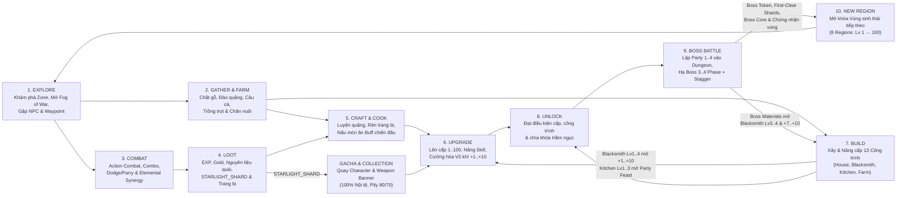
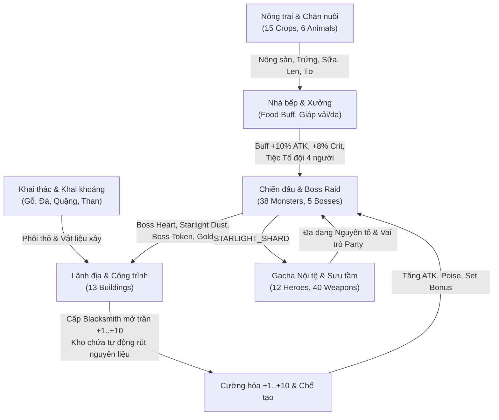

# 01 — Master Game Design Document (GDD): Eldoria: Forgotten Wilds

**Trạng thái**: Hoàn thiện (Design Baseline v1.0)  
**Chế độ**: `DESIGN_AND_PLANNING_ONLY`  
**Cập nhật lần cuối**: 2026-11-19  
**Tài liệu quản trị tối thượng**: [Constitution](../../.specify/memory/constitution.md) | [00 — Game Vision](./00-game-vision.md) | [MVP Scope](../management/mvp-scope.md) | [Feature Roadmap](../management/feature-roadmap.md)

---

## 1. Tóm tắt Điều hành (Executive Summary)

**Eldoria: Forgotten Wilds** là tựa game **Online Multiplayer Open-World Pixel RPG** mang phong cách **Classic 16-bit Fantasy Pixel Art** với chiều sâu thị giác **2.5D** (Y-sorting, occlusion, bóng đổ thống nhất và phân tầng cao độ). Trò chơi kết hợp hai dòng trải nghiệm vốn thường tách rời thành một vòng lặp thống nhất có giá trị thực chất:

1. **Nhịp sống ấm áp và tự chủ**: Sinh tồn (Hunger/Stamina), trồng trọt theo mùa, chăn nuôi gia súc & linh thú, câu cá, nấu ăn, khai khoáng, chế tác và xây dựng lãnh địa cá nhân (`Homestead`) theo lưới `32x32 px`.
2. **Hành động chiến đấu thời gian thực và đột kích tổ đội**: Action RPG combat chạy mô phỏng server-authoritative `20 Hz` (client render `60 FPS`), có basic combo, dodge i-frame, block/parry, 60 kỹ năng bản sắc trên 12 nhân vật, cộng hưởng 9 nguyên tố, cường hóa vũ khí chắc chắn `+0 → +10`, gacha sưu tầm 100% tiền tệ trong game và 5 Boss Raid đa giai đoạn trên 8 vùng sinh thái.

Về mặt kỹ thuật, dự án tuân thủ kiến trúc **Modular Monolith** tự chủ hoàn toàn (React + Phaser 3 + Zustand + Tailwind CSS ở Client; NestJS + WebSocket ở Game Server) và đặc biệt áp dụng **100% cơ sở dữ liệu JSON cục bộ (`data/db/**/*.json`)** quản lý bởi `JsonDatabaseEngine` nội bộ (có per-aggregate async mutex, atomic temp+fsync+rename, JSON WAL và local backup xoay vòng), **tuyệt đối không sử dụng bất kỳ cơ sở dữ liệu truyền thống hay dịch vụ bên thứ ba nào** theo Nguyên tắc I của Hiến pháp.

---

## 2. Bản sắc Trò chơi (Full Game Identity)

| Thuộc tính | Đặc tả Chính thức |
| :--- | :--- |
| **Tên dự án** | **Eldoria: Forgotten Wilds** (tên làm việc chính thức) |
| **Thể loại kết hợp** | Online Multiplayer Action RPG × Survival × Farming Simulation × Crafting & Housing × Co-op Boss Raid × Fair In-Game Gacha |
| **Góc nhìn & Mỹ thuật** | Classic 16-bit Fantasy Pixel Art, Three-Quarter Top-Down với chiều sâu 2.5D; base tile `32x32 px`, base humanoid `48x64 px`, large `96x96 px`, boss `128x128` đến `256x256 px`; logical viewport `640x360 px` (integer scaling 2x/3x/4x), nearest-neighbor filtering |
| **Nền tảng mục tiêu** | **MVP (M1)**: Desktop Web Browser (Chrome/Edge/Firefox hiện đại, điều khiển bàn phím + chuột, giao diện React responsive). **Roadmap (M4–M5)**: Gamepad Native (M4) và Mobile Touch UI tối ưu (M5) |
| **Chế độ chơi** | **Online PvE & Co-op** ưu tiên tuyệt đối trong MVP (chơi đơn tự do hoặc lập Party 2–4 người khám phá, phụ làm nông, đi Dungeon và hạ Boss). Post-MVP mở Safe Trade & Guild (M3), Opt-in Normalized PvP Arena (M4), Raid 8 người (M5) |
| **Kiến trúc kỹ thuật** | Monorepo Modular Monolith (`apps/client`, `apps/game-server`, `packages/shared`, `packages/game-config`, `game-data`, `assets`, `docs`, `specs`, `tools`); Server simulation `20 Hz` (`proposed`), Snapshot `10 Hz` (`proposed`), Client render `60 FPS` (`proposed`) |
| **Lưu trữ bền vững** | **100% Local JSON Database (`data/db/**/*.json`)** qua `JsonDatabaseEngine` + Static Content Catalog (`game-data/*.json`) là Single Source of Truth |
| **Triết lý tham khảo** | Chắt lọc tinh hoa cơ chế (100% nguyên bản, không sao chép IP/asset) từ *Stardew Valley* (nông trại & mùa vụ), *Terraria / Core Keeper* (khám phá → chế tạo → Boss mở vùng), *Minecraft* (tự do xây dựng căn cứ), *Albion Online* (liên kết kinh tế nghề nghiệp), *Ragnarok Online / MapleStory* (xã hội pixel & class), *Genshin Impact* (cộng hưởng nguyên tố & pity minh bạch), *Hades* (cảm giác combat dodge/parry sắc nét) |

---

## 3. Bảy Trụ cột Thiết kế (The 7 Design Pillars) & Cách Hiện thực hóa

| STT | Trụ cột Thiết kế | Cơ chế Hiện thực hóa Cụ thể trong Eldoria | Tài liệu Chính |
| :-: | :--- | :--- | :--- |
| **1** | **Thế giới sống động và có thể khám phá** | 8 vùng sinh thái riêng biệt từ đồng cỏ ôn đới đến vực thẳm nhật thực, chu kỳ ngày/đêm 24 phút thực, 4 mùa (14 ngày/mùa), 6 trạng thái thời tiết tác động gameplay, tài nguyên tái tạo, Fog of War và cột mốc mở vùng gắn với Boss. | [`03-world-building.md`](./03-world-building.md) |
| **2** | **Chiến đấu phản hồi tốt, có chiều sâu kỹ năng** | Action combat server-authoritative 20 Hz với 3-hit basic combo, dodge i-frame (`300 ms`), Perfect Parry (`200 ms`), 60 kỹ năng độc bản, phản ứng 9 nguyên tố, thanh Poise/Stagger của Boss và telegraph sắc nét không bị VFX che khuất. | [`06-combat-system.md`](./06-combat-system.md), [`07-skill-system.md`](./07-skill-system.md) |
| **3** | **Mọi hoạt động farm đều có giá trị đối với tiến trình** | Nông sản & sản phẩm chăn nuôi chế biến thành món ăn buff ATK/DEF/Crit/Fire Damage cho Boss Raid; gỗ/đá/quặng nâng cấp `bld_blacksmith` Lv 1..4 (điều kiện bắt buộc để mở cường hóa `+1..+10`) và `bld_kitchen` mở khóa Tiệc Tổ Đội. | [`02-core-gameplay-loop.md`](./02-core-gameplay-loop.md), [`12-farming-system.md`](./12-farming-system.md), [`14-building-system.md`](./14-building-system.md) |
| **4** | **Người chơi tự lựa chọn con đường phát triển** | Có thể ưu tiên làm nông dân/nghệ nhân xây căn cứ giàu tài nguyên, thợ săn tốc độ cao đi dungeon cùng party, hoặc cân bằng cả hai. Mọi nhân vật `COMMON`/`UNCOMMON`/`RARE` đều giữ vai trò chiến thuật không thể thay thế bởi `MYTHIC`. | [`04-character-design.md`](./04-character-design.md), [`05-character-progression.md`](./05-character-progression.md) |
| **5** | **Pixel Art nhất quán, đẹp mắt và dễ nhận diện** | Quy chuẩn 16-bit nghiêm ngặt (`32x32` tile, `48x64` humanoid, nguồn sáng thống nhất, không mixel, không photorealistic, tránh nhấp nháy quá mức), silhouette tách biệt cho cả 12 nhân vật, 38 quái và 5 Boss. | [`art-bible.md`](../art-direction/art-bible.md) |
| **6** | **Multiplayer công bằng, bảo mật và chống gian lận** | Server xác thực toàn bộ chuyển động, hitbox, sát thương, cooldown và loot ownership (`PERSONAL_INSTANCED` chống cướp đồ). Mọi giao dịch kinh tế dùng khóa aggregate, `idempotencyKey`, JSON WAL và `CurrencyLedger` bất biến. | [`20-multiplayer-design.md`](./20-multiplayer-design.md), [`anti-cheat-design.md`](../architecture/anti-cheat-design.md) |
| **7** | **Chơi lâu dài không grind vô nghĩa** | Lộ trình mục tiêu rõ ràng từ 5 phút đến 1 tháng; cường hóa `+1..+10` chắc chắn 100% không vỡ đồ trong MVP; Gacha minh bạch 100% dùng nội tệ `STARLIGHT_SHARD`; tiến trình nông trại offline được bảo vệ tối đa 24 giờ theo đồng hồ server. | [`09-weapon-enhancement.md`](./09-weapon-enhancement.md), [`10-gacha-system.md`](./10-gacha-system.md), [`19-game-economy.md`](./19-game-economy.md) |

---

## 4. Vòng lặp Tổng thể & Liên kết Giá trị (Master Gameplay Loop)

Toàn bộ trải nghiệm của Eldoria vận hành xoay quanh vòng lặp cốt lõi 10 bước:
**`Explore → Gather → Combat → Loot → Craft → Upgrade → Build → Unlock → Boss Battle → New Region`**

### Luồng Tương hỗ Xuyên hệ thống (Cross-Domain Value Flow)

---

## 5. Ma trận Kiến trúc Hệ thống & Bản đồ Tài liệu (System Architecture Matrix)

Mọi hệ thống trong GDD tổng thể này đều được đặc tả sâu ở tài liệu chuyên biệt tương ứng (mỗi hệ thống chính đáp ứng đầy đủ 14 tiêu chí Quality Gate tại Mục 27 của `GAME_DESIGN_BRIEF.md`) và liên kết trực tiếp tới nguồn dữ liệu chuẩn duy nhất `game-data/*.json`:

### 5.1 Nhóm Game Design (21 Tài liệu trong `docs/game-design/`)

| Mã | Tài liệu Hệ thống | Phạm vi Chức năng Chính | Nguồn Dữ liệu Chuẩn (`game-data/`) | Lưu trữ Bền vững (`data/db/`) |
| :-: | :--- | :--- | :--- | :--- |
| `00` | [`00-game-vision.md`](./00-game-vision.md) | Tầm nhìn, 7 trụ cột, quy ước tiền tố ID, Enum chuẩn, 12 Hero & 8 Region | Toàn bộ 12 tệp JSON | — |
| `01` | [`01-game-design-document.md`](./01-game-design-document.md) | **Master GDD** tổng hợp tầm nhìn, kiến trúc hệ thống, MVP vs Roadmap, đạo đức kinh tế & hồ sơ người chơi | Toàn bộ 12 tệp JSON | Toàn bộ `data/db/` |
| `02` | [`02-core-gameplay-loop.md`](./02-core-gameplay-loop.md) | Phân rã vòng lặp 10 bước, chu kỳ ngắn/trung/dài hạn, mốc 5p–1 tháng, Onboarding không tường chữ & ma trận hiệp lực kinh tế | `quests.json`, `items.json`, `buildings.json` | `characters/<id>.json`, `houses/<id>.json` |
| `03` | [`03-world-building.md`](./03-world-building.md) | Truyền thuyết Eldoria, hồ sơ chi tiết 8 Region, Tiled `.tmj` layers, World Partitioning, Fast Travel, Fog of War, Ngày/Đêm/Mùa/Thời tiết | `monsters.json`, `bosses.json`, `items.json`, `quests.json` | `world/<regionId>.json`, `characters/<id>.json` |
| `04` | [`04-character-design.md`](./04-character-design.md) | Hồ sơ thiết kế 12 nhân vật, 8 Class, 6 Role, 9 Nguyên tố, cân bằng giữa các Rarity, synergy & counter | `characters.json`, `skills.json` | `characters/<id>.json` |
| `05` | [`05-character-progression.md`](./05-character-progression.md) | 17 thuộc tính, cấp 1–100, EXP curve, phân bổ Attribute/Skill point, Mastery, Ascension, Talent tree, Combat Rating | `characters.json`, `skills.json` | `characters/<id>.json` |
| `06` | [`06-combat-system.md`](./06-combat-system.md) | Action combat 20 Hz, combo, Dodge i-frame, Block/Parry, Hitbox, Crowd Control, 9 nguyên tố, Poise/Stagger, công thức sát thương & chống mất cân bằng | `skills.json`, `monsters.json`, `bosses.json` | RAM Simulation + `characters/<id>.json` |
| `07` | [`07-skill-system.md`](./07-skill-system.md) | Đặc tả 60 kỹ năng độc bản (15 MVP), khung thời gian Startup/Active/Recovery, VFX/SFX, PvE/PvP modifier & quy tắc validation server | `skills.json` | `characters/<id>.json` |
| `08` | [`08-equipment-system.md`](./08-equipment-system.md) | 11 `WeaponType` (40 vũ khí), 10 `EquipmentSlot` (40 trang bị), 6 Equipment Sets, độ bền, sửa chữa, phân rã & khảm ngọc (M2+) | `items.json` | `inventories/<id>.json`, `characters/<id>.json` |
| `09` | [`09-weapon-enhancement.md`](./09-weapon-enhancement.md) | Cường hóa chắc chắn `+0 → +10` (không vỡ đồ ở MVP), cổng `bld_blacksmith` Lv 1..4, bảng chi phí 10 cấp, mốc `+5`/`+10` & giao dịch WAL | `items.json`, `buildings.json` | `inventories/<id>.json`, `history/upgrade-history-<id>.json`, `ledgers/` |
| `10` | [`10-gacha-system.md`](./10-gacha-system.md) | Character & Weapon Banner 100% nội tệ `STARLIGHT_SHARD`, công khai tỷ lệ, Pity 80/70, trùng lặp → `STAR_ESSENCE`/Constellation, phân tích Monte Carlo | `gacha-banners.json`, `characters.json`, `items.json` | `characters/<id>.json`, `history/gacha-history-<id>.json`, `ledgers/` |
| `11` | [`11-crafting-system.md`](./11-crafting-system.md) | Khai thác tài nguyên, Luyện kim (Smelting), Rèn, Nấu ăn, Giả kim, 50 nguyên liệu & 30 công thức chế tạo | `items.json`, `recipes.json`, `buildings.json` | `inventories/<id>.json`, `world/<regionId>.json` |
| `12` | [`12-farming-system.md`](./12-farming-system.md) | Sinh tồn Hunger/Stamina/Food Buff, 15 loại cây trồng, 4 mùa, tưới tiêu, phân bón, chất lượng Normal/Silver/Gold, Auto-Farming & offline cap 24h | `crops.json`, `items.json`, `buildings.json` | `houses/<id>.json`, `world/<regionId>.json` |
| `13` | [`13-animal-husbandry.md`](./13-animal-husbandry.md) | 6 loài vật nuôi (từ gà/bò MVP đến linh thú `anm_lunar_moth_hare`), Happiness/Hunger/Health, chu kỳ sản xuất & chuỗi cung ứng | `animals.json`, `items.json`, `buildings.json` | `houses/<id>.json` |
| `14` | [`14-building-system.md`](./14-building-system.md) | 13 công trình lãnh địa, Placement System (ghost preview, grid snapping, pathfinding check), phân quyền `OWNER_ONLY`/`PARTY_ACCESS`/`GUILD_ACCESS` | `buildings.json`, `items.json` | `houses/<id>.json`, `ledgers/` |
| `15` | [`15-monster-ai.md`](./15-monster-ai.md) | 30 quái thường + 8 Elite, AI FSM 10 trạng thái, Aggro/Leash, Pathfinding, Threat Table, Spawn Manager & Multiplayer Scaling | `monsters.json`, `loot-tables.json` | RAM Simulation + `world/<regionId>.json` |
| `16` | [`16-boss-design.md`](./16-boss-design.md) | 5 Boss đa giai đoạn (3–4 phase), đấu trường cơ chế (trụ chắn, van làm mát, chậu lửa, cột ánh sáng), Poise/Stagger, Enrage & Anti-Exploit | `bosses.json`, `loot-tables.json` | RAM DungeonInstance + `world/<regionId>.json` |
| `17` | [`17-dungeon-design.md`](./17-dungeon-design.md) | Phụ bản `dng_mossroot_hollow` (MVP) và 4+ hầm ngục mở rộng, cấu trúc phòng, Ready Check, Entry Lock, Wipe Reset & Cooldown thưởng | `bosses.json`, `monsters.json`, `loot-tables.json` | RAM DungeonInstance + `parties/<id>.json` |
| `18` | [`18-quest-and-npc.md`](./18-quest-and-npc.md) | 30 nhiệm vụ (Onboarding, Main, Side, Weekly), hệ thống NPC làng & khu vực, hội thoại nhánh & nguồn `STARLIGHT_SHARD` bền vững | `quests.json`, `items.json` | `characters/<id>.json`, `ledgers/` |
| `19` | [`19-game-economy.md`](./19-game-economy.md) | 5 loại tiền tệ (`GOLD`, `STARLIGHT_SHARD`, `CRAFTING_TOKEN`, `BOSS_TOKEN`, `STAR_ESSENCE`), Faucet/Sink, kiểm soát lạm phát & sổ cái kiểm toán | Toàn bộ 12 tệp JSON | `ledgers/currency-ledger-<YYYY-MM>.json` |
| `20` | [`20-multiplayer-design.md`](./20-multiplayer-design.md) | PvE/Co-op server-authoritative, Presence, Sync 20Hz/10Hz, Chat an toàn, Friends, Party 2–4, Co-op Farming, Loot Ownership, Reconnect & Roadmap | `buildings.json`, `bosses.json` | `parties/<id>.json`, `houses/<id>.json`, `audit/` |

### 5.2 Liên kết Các Nhóm Tài liệu Chuyên môn Khác

- **Art Direction & Audio** (`docs/art-direction/`): `art-bible.md`, `character-design-standard.md`, `animation-standard.md`, `animation-state-machine.md`, `sprite-sheet-standard.md`, `tileset-standard.md`, `environment-design.md`, `vfx-design.md`, `audio-design.md`, `asset-manifest.md`, `asset-production-backlog.md`, cùng 4 concept art thực tế trong `docs/art-direction/concepts/`.
- **UI/UX & Mockups** (`docs/ui-ux/`): `design-system.md`, `screen-inventory.md` (24 màn hình bắt buộc), `user-flows.md`, `interaction-design.md`, `responsive-design.md`, `accessibility.md`, `ui-testing-strategy.md` và bộ mockup tại `docs/ui-ux/mockups/`.
- **Technical Architecture** (`docs/architecture/`): [`system-architecture.md`](../architecture/system-architecture.md), [`frontend-architecture.md`](../architecture/frontend-architecture.md), [`backend-architecture.md`](../architecture/backend-architecture.md), [`game-server-architecture.md`](../architecture/game-server-architecture.md), [`network-protocol.md`](../architecture/network-protocol.md), [`database-design.md`](../architecture/database-design.md), [`data-dictionary.md`](../architecture/data-dictionary.md), [`security-design.md`](../architecture/security-design.md), [`anti-cheat-design.md`](../architecture/anti-cheat-design.md), [`api-contracts.md`](../architecture/api-contracts.md), [`websocket-contracts.md`](../architecture/websocket-contracts.md), [`deployment-design.md`](../architecture/deployment-design.md) và 6 ADR (`ADR-001` đến `ADR-006`).
- **Balancing & Validation** (`docs/balancing/` & `tools/design-validation/`): `progression-model.md`, `combat-formulas.md`, `weapon-upgrade-costs.csv`, `gacha-probabilities.csv`, `economy-analysis.md`, `simulation-results.md`.
- **QA, Testing & Management** (`docs/testing/`, `docs/management/`, `specs/`): `test-strategy.md`, `test-scenarios.md`, `acceptance-criteria.md`, `performance-test-plan.md`, `security-test-plan.md`, 12 thư mục đặc tả Spec Kit (`specs/001-*` đến `specs/012-*`).

---

## 6. Phạm vi Vertical Slice MVP so với Tầm nhìn Dài hạn (M1 → M5)

Thiết kế bao quát toàn bộ tầm nhìn dài hạn (8 vùng, cấp 100, 12 nhân vật, 60 kỹ năng), nhưng triển khai tuân theo chiến lược **Vertical Slice MVP hoàn chỉnh** (Nguyên tắc VII) để đội ngũ nhỏ bàn giao được vòng lặp chơi hoàn chỉnh ở M1 trước khi mở rộng theo 4 bản cập nhật lớn:

| Khía cạnh | Milestone 1 — Vertical Slice MVP | Milestone 2 (Ironpeak) | Milestone 3 (Crystal & Ruins) | Milestone 4 (Frost & Ember) | Milestone 5 (Abyssal Endgame) |
| :--- | :--- | :--- | :--- | :--- | :--- |
| **Khu vực & Dungeon** | `reg_greenhaven_village`, `reg_whispering_forest`, `dng_mossroot_hollow` | `reg_ironpeak_mountains`, `dng_slag_foundry` | `reg_crystal_caverns` (`dng_prism_sanctum`), `reg_forgotten_ruins` (Ancient Trials) | `reg_frostbound_highlands` (`dng_glacial_citadel`), `reg_ember_wasteland` (Volcanic Trials) | `reg_abyssal_kingdom`, `dng_eclipse_throne` |
| **Trần Cấp độ** | **Lv 1 – 30** (soft cap MVP Lv 20–25) | Lv 45 | Lv 65 | Lv 90 | **Lv 100** |
| **Nhân vật & Kỹ năng** | **3 Starter** (`chr_kael_vanguard`, `chr_lyra_windrunner`, `chr_seraphina_dawn`, **15 kỹ năng**), engine sẵn sàng nạp đủ 12 hero JSON | +4 Hero (`chr_bram_bastion`, `chr_vex_nightblade`, `chr_rowan_tidewarden`, `chr_mira_ironfist`) | +2 Hero (`chr_freya_frostveil`, `chr_orin_stormcaller`) | +1 Hero (`chr_torvald_rageborn`) | +2 Hero (`chr_nyx_voidcaller`, `chr_aurelia_starbow`) — đủ **12 Hero / 60 Skill** |
| **Quái, Elite & Boss** | **8 quái thường**, **1 Elite** (`mob_elite_alpha_direwolf`), **1 Boss** (`boss_thornback_elder`) | +4 quái, +1 Elite, `boss_ignis_forgelord` | +8 quái, +2 Elite, `boss_prism_leviathan` | +7 quái, +2 Elite, `boss_boreas_frostking` | +3 quái, +1 Elite, `boss_malakor_abyss` — đủ **30+8+5** |
| **Vũ khí & Cường hóa** | 10 vũ khí MVP, 12 trang bị, 2 bộ set, **Cường hóa `+0 → +10` chắc chắn 100%** | Mở rộng lên 20 vũ khí, Khảm ngọc (Socketing) & Reforging | Mở rộng 30 vũ khí, Set bậc Epic | Mở rộng 36 vũ khí, Set bậc Legendary | Đủ **40 vũ khí, 40 trang bị, 6 Set** |
| **Nông trại, Chăn nuôi & Xây dựng** | 5 cây trồng, 2 động vật (`anm_meadow_chicken`, `anm_clover_cow`), 6 công trình (`bld_player_house`, `bld_storage`, `bld_farm_plot`, `bld_chicken_coop`, `bld_blacksmith`, `bld_kitchen`) | +4 công trình (`bld_barn`, `bld_furnace`, `bld_workshop`, `bld_alchemy_lab`), +4 cây, +2 vật nuôi | Auto-Farming bậc cao (`bld_farm_plot` Lv 4), `bld_guild_hall`, +3 cây, +1 vật nuôi | `bld_stable`, `bld_training_ground`, +3 cây, `anm_lunar_moth_hare` | Hoàn thiện toàn bộ **15 cây, 6 vật nuôi, 13 công trình** |
| **Gacha & Kinh tế** | Permanent Character (`bnr_perm_heroes`) & Weapon (`bnr_perm_arsenal`) — **100% `STARLIGHT_SHARD` nội tệ** | Bổ sung pool M2 vào Permanent Banner | Shop `STAR_ESSENCE` mở rộng, Safe Trade có kiểm toán | Limited Banner xoay vòng (vẫn ưu tiên nội tệ minh bạch) | Hoàn chỉnh hệ sinh thái sưu tầm & Boss Token Shop |
| **Multiplayer & Thiết bị** | Zone Sync 20Hz/10Hz, Chat (Zone/Party), Friends cơ bản, Party 2–4, Co-op Farm & Boss, Save/Reconnect (Desktop) | Tối ưu Party Finder & Boss Weekly Ledger | Guild System, `zon_guild_sanctuary`, Safe Player Trade | Opt-in Normalized PvP Arena, Gamepad Native | Raid 8 người, Multi-Region Sharding (theo load test), Mobile Touch UI |

---

## 7. Tuyên ngôn Đạo đức Kinh tế, Gacha, Cường hóa & Tự chủ Dữ liệu

Đây là bốn cam kết kiến trúc và đạo đức không thể thương lượng (trích từ Hiến pháp Nguyên tắc I, II, VI và [`ADR-001`](../architecture/architecture-decisions/ADR-001-json-only-local-database.md), [`ADR-005`](../architecture/architecture-decisions/ADR-005-deterministic-enhancement-and-fair-gacha.md)):

### 7.1 Gacha Minh bạch 100% Nội tệ trong MVP (Non-Predatory Gacha)
- **Không thanh toán tiền thật trong MVP**: Toàn bộ lượt quay trên `bnr_perm_heroes` và `bnr_perm_arsenal` sử dụng duy nhất **`STARLIGHT_SHARD`** (`160`/lượt đơn, `1.600`/10 lượt) kiếm được qua nhiệm vụ cốt truyện, khám phá khu vực, thành tựu, thưởng hạ Boss lần đầu (`480`–`1.600` shard/boss) và thưởng Boss hàng tuần (`160`–`480` shard/tuần). Không có cổng nạp tiền, không có đổi thưởng ra tiền thật.
- **Công khai tuyệt đối & Có bảo hiểm Pity**: Toàn bộ tỷ lệ rơi theo từng bậc `Rarity` hiển thị công khai ngay trên UI Banner. Áp dụng Soft Pity (từ lượt `65` cho Character / `55` cho Weapon) và Hard Pity (`80` lượt cho Character / `70` lượt cho Weapon), bảo đảm tối thiểu 1 vật phẩm `EPIC` trở lên trong mỗi 10-pull.
- **Chuyển đổi trùng lặp công bằng**: Nhân vật/vũ khí trùng chuyển thành **Constellation/Mastery Shard** (tối đa 6 bậc tăng tiện ích cân bằng, không khóa kỹ năng cốt lõi) và tiền tệ **`STAR_ESSENCE`** dùng để đổi trực tiếp nhân vật/vũ khí mục tiêu tại cửa hàng cố định.
- **Không Paywall / Không Power Creep phá vỡ vai trò**: 3 nhân vật khởi đầu (`chr_kael_vanguard`, `chr_lyra_windrunner`, `chr_seraphina_dawn`) cùng nhân vật `COMMON`/`UNCOMMON` (`chr_mira_ironfist`, `chr_rowan_tidewarden`) đủ sức hoàn thành 100% nội dung cốt lõi và giữ những công cụ chiến thuật riêng (phá Poise thuần vật lý, làm nguội giáp Boss bằng Water, giải hiệu ứng cho đội) mà nhân vật `MYTHIC` không thay thế hoàn toàn.

### 7.2 Cường hóa Vũ khí Chắc chắn `+0 → +10` (Zero-Breakage Enhancement)
- Mọi vũ khí khởi đầu ở `+0`, có tối đa **10 cấp nâng cấp (`+1` đến `+10`)**, khóa cứng tại server và JSON schema (`0 <= enhancementLevel <= 10`).
- Trong MVP, nâng cấp đạt tỷ lệ **thành công 100% (deterministic)** khi người chơi gom đủ Gold và nguyên liệu; **tuyệt đối không phá hủy vũ khí và không tụt cấp**.
- Giá trị danh giá của mốc `+10` đến từ chiều sâu hành trình: nguyên liệu phân tầng từ khai thác thô (`+1..+3`) → luyện kim & săn quái (`+4..+6`) → Elite & Boss Dungeon (`+7..+10`) kết hợp điều kiện nâng cấp công trình `bld_blacksmith` (Lv 1: `+1..+3`, Lv 2: `+4..+6`, Lv 3: `+7..+8`, Lv 4: `+9..+10`).

### 7.3 100% Cơ sở Dữ liệu JSON Cục bộ & Không Dịch vụ Bên thứ ba
- Toàn bộ trạng thái bền vững lưu 100% dưới dạng tệp JSON phân mảnh tại `data/db/**/*.json` (`accounts/`, `sessions/`, `characters/`, `inventories/`, `houses/`, `world/`, `parties/`, `ledgers/`, `history/`, `audit/`, `indexes/`, `wal/`).
- Mọi giao dịch đa tệp sử dụng khóa `AsyncLockManager` theo thứ tự chuẩn, `idempotencyKey`, `revision` OCC, `checksumSha256`, ghi nguyên tử `.tmp → fsync → rename` và JSON WAL khôi phục sau sự cố khi khởi động.
- **Phương án bị từ chối (Rejected Alternatives — xem chi tiết tại `ADR-001`)**: Các hệ quản trị cơ sở dữ liệu truyền thống hoặc dịch vụ đám mây bên thứ ba (như PostgreSQL, TypeORM, MySQL, MongoDB, SQLite, Redis, S3, Firebase, Supabase, Auth0) bị từ chối hoàn toàn theo chỉ thị `DEC-001` và Nguyên tắc I của Hiến pháp nhằm bảo đảm khả năng tự chủ 100% (zero external dependency, self-hosted).

---

## 8. Hồ sơ Nhóm Người chơi Mục tiêu (Target Player Archetypes)

Hệ thống cân bằng tiến trình, giới hạn offline 24 giờ và chi phí cường hóa được thiết kế để phục vụ hài hòa cả 3 nhóm người chơi mà không ép nhóm nào phải "cày cuốc kiệt sức" hay bị bỏ lại phía sau:

| Tiêu chí | Casual Player (~1 giờ/ngày) | Regular Player (~2.5 giờ/ngày) | Hardcore Player (~5 giờ/ngày) |
| :--- | :--- | :--- | :--- |
| **Động lực cốt lõi** | Trồng trọt thư giãn, chăm sóc động vật, xây đẹp lãnh địa, trải nghiệm cốt truyện & thỉnh thoảng đi Boss cùng bạn | Hoàn thành vòng lặp toàn diện mỗi ngày: nông trại → khai khoáng → chế tạo → 2–3 lượt Dungeon → tích lũy sưu tầm Gacha | Tối ưu sát thương/thời gian clear Boss, mở khóa sớm mọi công trình & vũ khí `+10`, thử nghiệm đội hình phản ứng nguyên tố & dẫn dắt Party |
| **Nhịp chơi điển hình/ngày** | 20p chăm nông trại/vật nuôi/nấu ăn + 25p làm 1–2 quest khám phá + 15p chế tạo/chat làng | 25p nông trại & xưởng + 45p khai thác & săn quái rừng + 60p lập Party đánh Elite/Boss + 20p nâng cấp/gacha | 30p tối ưu nông trại/tự động hóa + 90p farm route quặng/elite hiệu suất cao + 150p chạy chuỗi Dungeon/Boss + 30p thử nghiệm build & hỗ trợ cộng đồng |
| **Thời gian đạt vũ khí `+10` MVP** | ~5–6 tuần (tiến đều chắc chắn, không sợ vỡ đồ mất công sức) | ~2–3 tuần (đạt mốc `+7` cuối tuần 1, `+10` giữa tuần 3) | ~7–10 ngày (nâng sớm `bld_blacksmith` Lv 4 và tối ưu farm `boss_thornback_elder`) |
| **Cơ chế bảo vệ trải nghiệm** | Offline progression tối đa **24 giờ** (động vật không chết khi nghỉ); nâng cấp 100% không vỡ đồ; nội dung chính vượt được với đội hình starter | Thưởng tuần `STARLIGHT_SHARD` & `BOSS_TOKEN` giúp tích đủ Pity 80 lượt trong ~3–4 tuần chơi đều; Co-op Farm rút ngắn thời gian chuẩn bị | Cơ chế Boss stagger, parry, tối ưu nguyên tố, đồ Set 4 mảnh, thành tựu tốc độ và chiều sâu lộ trình 8 vùng Lv 100 |

---

## 9. Tóm tắt Kiến trúc Kỹ thuật, Multiplayer & Tính trung thực Hiệu năng

- **Tách biệt 3 vòng đời (Nguyên tắc IV)**:
  1. **Server Simulation Loop (`apps/game-server`)**: `20 Hz` (`50 ms/tick`, `proposed`) chạy thuần trong RAM trên từng `ZoneInstance`, `HomesteadInstance` và `DungeonInstance` với `SpatialHashGrid` (`256x256 px`). Tuyệt đối không ghi tệp JSON theo tick; chỉ đánh dấu dirty flag để `CheckpointFlusher` ghi mỗi `30 giây` và ghi ngay khi chuyển zone/ngắt kết nối/shutdown.
  2. **Client Phaser 3 World Layer (`apps/client`)**: `60 FPS` (`proposed`), thực hiện Client-Side Prediction cho di chuyển, Server Reconciliation, Entity Interpolation (`100 ms`), Y-sorting 2.5D và render pixel-perfect.
  3. **Client React + Zustand UI Layer (`apps/client`)**: Chỉ lắng nghe sự kiện cần thiết (`HP/MP/Stamina`, `InventoryPatch`, `Quest`, `Chat`, `Party`), bị cô lập khỏi vòng lặp 60 FPS của Phaser (`ADR-004`).
- **Tuyên bố Trung thực về Sức chứa (`proposed / unverified`)**:
  - Mục tiêu MVP đề xuất trên 1 máy chủ NVMe SSD: **20–50 người chơi đồng thời (CCU)** ổn định (`proposed / unverified`), mở rộng kiểm thử tải tới **100 CCU** và ngưỡng áp lực **500 CCU** theo [`performance-test-plan.md`](../testing/performance-test-plan.md).
  - Dự án **KHÔNG** tuyên bố hỗ trợ MMO-scale hàng nghìn người chơi trên cùng một bản đồ hay một nút lưu trữ JSON đơn trước khi có dữ liệu benchmark thực tế sau giai đoạn lập trình.

---

## 10. Lộ trình Quản trị Spec Kit & Điều kiện Chuyển sang Giai đoạn Lập trình

Dự án áp dụng quy trình Spec-Driven Development chuẩn (`constitution → specify → clarify → plan → checklist → tasks → analyze`) trên **12 Feature độc lập** (`specs/001-foundation-game-engine` đến `specs/012-game-ui-qa`, xem [`feature-roadmap.md`](../management/feature-roadmap.md)). Trong giai đoạn `DESIGN_AND_PLANNING_ONLY`, toàn bộ thiết kế, dữ liệu `game-data/*.json`, mô phỏng cân bằng, mockup UI và đặc tả Spec Kit phải vượt qua kiểm định chéo tự động và được tổng hợp tại `docs/management/FINAL-DESIGN-REPORT.md` trước khi chủ dự án xem xét phê duyệt chuyển sang `IMPLEMENTATION MODE`.
