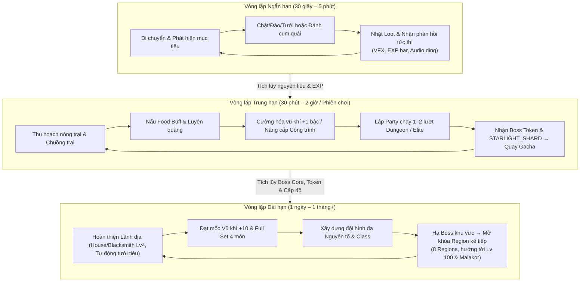
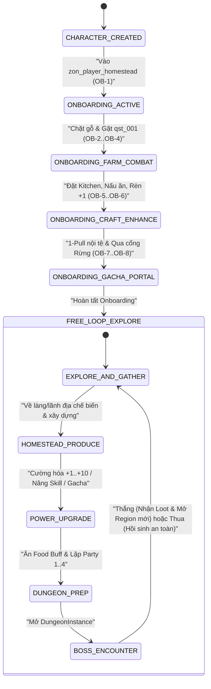

# 02 — Core Gameplay Loop, Player Milestones & Onboarding Design

**Trạng thái**: Hoàn thiện (Design Baseline v1.0)  
**Chế độ**: `DESIGN_AND_PLANNING_ONLY`  
**Cập nhật lần cuối**: 2026-11-19  
**Tham chiếu**: [Constitution](../../.specify/memory/constitution.md) | [01 — Master GDD](./01-game-design-document.md) | [03 — World Building](./03-world-building.md) | [19 — Game Economy](./19-game-economy.md)

---

## 1. Mục tiêu Gameplay (Gameplay Objectives)

1. **Tạo động lực khép kín tự duy trì**: Mọi hành động của người chơi — từ chặt một thân cây `mat_oak_wood`, tưới luống `crp_sunwheat`, nhặt trứng `mat_fresh_egg`, đến né đòn hạ `boss_thornback_elder` — đều trực tiếp tạo đầu vào hữu ích cho khâu kế tiếp trong chuỗi `Explore → Gather → Combat → Loot → Craft → Upgrade → Build → Unlock → Boss Battle → New Region`.
2. **Nhịp phần thưởng đa tầng không đứt quãng**: Bảo đảm người chơi luôn có một mục tiêu hoàn thành trong vòng 3–5 phút (micro reward), một bước nhảy sức mạnh rõ rệt trong phiên 30–60 phút (session reward) và một cột mốc chinh phục đáng tự hào theo ngày/tuần/tháng (macro reward).
3. **Onboarding qua hành động (Gameplay-First)**: Giúp người chơi mới làm chủ toàn bộ 8 cơ chế nền tảng (di chuyển, chặt/đào, trồng trọt, nấu ăn, chiến đấu, chế tạo, cường hóa `+1`, quay gacha đầu tiên) trong 20–30 phút đầu ngay tại `reg_greenhaven_village` mà **không dùng tường văn bản hướng dẫn dài dòng (zero text-wall tutorials)**.
4. **Hiệp lực kinh tế thực chất giữa Hòa bình & Chiến đấu**: Không để nông trại/chăn nuôi trở thành mini-game tách biệt; chứng minh bằng cấu trúc vật phẩm thực tế rằng Farming + Husbandry + Gathering + Building trực tiếp khuếch đại sức mạnh Combat, cường hóa `+1..+10` và khả năng vượt Boss Raid.

---

## 2. User Stories

- **US-LOOP-01 (Người chơi mới — 5 phút đầu)**: Là một người chơi vừa tạo nhân vật, tôi muốn bước ngay ra khỏi `bld_player_house` tại `reg_greenhaven_village`, chặt cây gỗ đầu tiên, thu hoạch luống lúa mì mẫu và hạ 1 `mob_moss_slime` bằng gợi ý ngữ cảnh trực tiếp trên màn hình để nắm ngay cảm giác chơi mà không phải đọc 5 trang hướng dẫn.
- **US-LOOP-02 (Người chơi Casual — 30 phút/phiên)**: Là một người chơi chỉ có 1 giờ mỗi ngày, tôi muốn mỗi lần vào game đều hoàn thành trọn vẹn một vòng chăm nông trại → nấu món ăn buff → đi 1 lượt khám phá rừng/hầm ngục → nâng cấp 1 bậc vũ khí hoặc công trình để cảm nhận tiến bộ rõ rệt.
- **US-LOOP-03 (Người chơi yêu thích Nông trại & Xây dựng)**: Là một người thích quản lý lãnh địa, tôi muốn nông sản (`crp_golden_carrot`, `crp_ember_pepper`), sản phẩm vật nuôi (`mat_fresh_egg`, `mat_fresh_milk`) và việc nâng cấp `bld_blacksmith` / `bld_kitchen` đem lại lợi thế chiến đấu rõ rệt khi cùng bạn bè đánh Boss.
- **US-LOOP-04 (Người chơi Action RPG — Thợ săn Boss)**: Là một người chơi tập trung chiến đấu, tôi muốn chiến lợi phẩm từ quái tinh anh (`mob_elite_alpha_direwolf`) và Boss (`boss_thornback_elder`) mở khóa công trình cấp cao, vũ khí `+7..+10` và cánh cổng sang vùng đất mới `reg_ironpeak_mountains`.
- **US-LOOP-05 (Người chơi Sưu tầm F2P)**: Là một người chơi không nạp tiền, tôi muốn các cột mốc trong vòng lặp cốt lõi (quest, khám phá, hạ Boss lần đầu & hàng tuần) cung cấp đủ `STARLIGHT_SHARD` để thực hiện lượt quay 10 lần đầu tiên trong giờ chơi đầu và tích lũy đều đặn tới mốc Pity.

---

## 3. Phân rã Chi tiết Vòng lặp Cốt lõi & Mục tiêu Thời gian (Functional Requirements)

### 3.1 Phân rã 10 Khâu của Master Loop

| Khâu | Hành động Người chơi | Đầu vào Chính | Đầu ra & Giá trị Tiến trình | Tệp JSON Cập nhật (`data/db/`) |
| :--- | :--- | :--- | :--- | :--- |
| **1. Explore** | Di chuyển qua các zone, mở Fog of War, kích hoạt Waypoint, trò chuyện NPC | Stamina (khi sprint), bản đồ Tiled | Điểm Fast Travel, Quest mới (`qst_*`), vị trí mỏ quặng & cửa Dungeon, thưởng `STARLIGHT_SHARD` mốc khám phá | `characters/<id>.json` (position, fogOfWar, waypoints, quests) |
| **2. Gather & Farm** | Chặt gỗ, đập đá, đào quặng, hái thảo dược, câu cá, cuốc/gieo/tưới/thu hoạch 15 loại cây, chăm 6 loài vật nuôi | Stamina, công cụ, hạt giống (`sed_*`), thức ăn thú | Nguyên liệu thô (`mat_oak_wood`, `mat_copper_ore`, `mat_iron_ore`, `mat_coal`, `mat_sunwheat_grain`, `mat_fresh_egg`, `mat_fresh_milk`...) | `inventories/<id>.json`, `houses/<id>.json`, `world/<regionId>.json` |
| **3. Combat** | Đánh quái thường, Elite bằng Basic 3-hit combo, 3 Active Skills, Ultimate, Dodge i-frame, Block/Parry, phản ứng nguyên tố | HP, MP, Stamina, độ bền trang bị, Food Buff đang kích hoạt | Trạng thái hạ quái (`MonsterKilledEvent`), tích lũy thông thạo kỹ năng (`masteryExp`), tiến độ nhiệm vụ | RAM 20 Hz → dirty flush `characters/<id>.json` |
| **4. Loot** | Nhặt chiến lợi phẩm cá nhân (`PERSONAL_INSTANCED`) và nhận thưởng quest/thành tựu | Quyền sở hữu loot (`eligibleCharacterIds`), ô túi trống | EXP, `GOLD`, `STARLIGHT_SHARD`, nguyên liệu quái (`mat_slime_gel`, `mat_wolf_pelt`, `mat_alpha_fang`...), vũ khí & giáp | `inventories/<id>.json`, `characters/<id>.json`, `ledgers/` |
| **5. Craft & Cook** | Luyện quặng thành thỏi (`mat_copper_ingot`, `mat_iron_ingot`), rèn vũ khí/giáp, nấu món ăn buff (`csm_herb_stew`, `csm_golden_roast`, `csm_ember_curry`), pha thuốc | Nguyên liệu thô/quái/nông sản, `GOLD`, trạm chế tạo đạt cấp | Trang bị bậc mới, món ăn hồi Hunger/Stamina & buff combat (+ATK/DEF/Crit/Elemental), phân bón | `inventories/<id>.json`, `ledgers/` (atomic WAL) |
| **6. Upgrade** | Tăng cấp nhân vật (`Lv 1..100`), phân bổ Attribute/Skill Point, nâng cấp kỹ năng, **cường hóa vũ khí chắc chắn `+0 → +10`**, quay Gacha nội tệ mở rộng đội hình | EXP, `GOLD`, phôi luyện kim, `mat_starlight_dust`, Boss Core, `STARLIGHT_SHARD`, cấp `bld_blacksmith` | Tăng trực tiếp `ATK`, `DEF`, `HP`, `Combat Rating`, hiệu ứng phát sáng mốc `+5`/`+10`, đa dạng đội hình nguyên tố | `characters/<id>.json`, `inventories/<id>.json`, `history/upgrade-*.json`, `history/gacha-*.json`, `ledgers/` |
| **7. Build** | Đặt mới và nâng cấp 13 công trình trên lãnh địa (`bld_player_house`, `bld_storage`, `bld_farm_plot`, `bld_chicken_coop`, `bld_blacksmith`, `bld_kitchen`...) | Gỗ, đá, thỏi kim loại, Boss Core, `GOLD`, diện tích đất hợp lệ | Mở trần cường hóa (`bld_blacksmith` Lv 1..4), tăng ô kho + auto-craft pull (`bld_storage` Lv 2), tự tưới/thu hoạch (`bld_farm_plot` Lv 3–4), Tiệc Tổ Đội (`bld_kitchen` Lv 3) | `houses/<id>.json`, `inventories/<id>.json`, `ledgers/` |
| **8. Unlock** | Hoàn thành điều kiện cấp độ, trang bị, công trình và chuỗi nhiệm vụ khu vực | Mốc cấp độ, nhiệm vụ tiên quyết, cổng hầm ngục đã khám phá | Mở khóa kỹ năng Active Lv 3/Lv 6, Ultimate Lv 10, quyền mở `DungeonInstance`, công thức bậc cao | `characters/<id>.json` |
| **9. Boss Battle** | Solo hoặc lập Party 2–4 người vào `dng_mossroot_hollow` (và 4 hầm ngục sau), đọc telegraph, phá Poise/Stagger, vượt 3–4 phase Boss | Food Buff, Potion, `csm_revive_feather`, trang bị đã cường hóa, phối hợp nguyên tố/vai trò | `BOSS_TOKEN`, First-Clear & Weekly `STARLIGHT_SHARD`, Boss Core (`mat_thornback_heart`...), vũ khí/set hiếm (`wpn_elderwood_cleaver`, `set_mossroot_guard`) | `inventories/<id>.json`, `characters/<id>.json`, `ledgers/`, `world/<regionId>.json` |
| **10. New Region** | Nộp chứng nhận hạ Boss cho NPC dẫn dắt để mở niêm phong cổng khu vực tiếp theo | Đánh bại Boss vùng hiện tại (ví dụ `boss_thornback_elder` → mở `reg_ironpeak_mountains`) | Tiếp cận sinh thái mới, quặng bậc cao (`mat_granite_block`, `mat_silver_ore`...), bộ set mới, Boss mới và lặp lại chu trình ở tầng sâu hơn | `characters/<id>.json` (unlockedRegionIds) |

### 3.2 Ba Chu kỳ Vòng lặp (Short-Term, Mid-Term, Long-Term Loops)

### 3.3 Lộ trình Mục tiêu Người chơi theo 6 Mốc Thời gian (5 phút → 1 tháng)

| Mốc thời gian | Mục tiêu Cốt lõi Đạt được | Hoạt động Cụ thể & Định danh Chuẩn | Phần thưởng & Cảm xúc Mục tiêu |
| :--- | :--- | :--- | :--- |
| **5 phút** | Làm quen điều khiển, thu hoạch & trận chiến đầu tiên | Tạo nhân vật chọn 1 trong 3 starter (`chr_kael_vanguard`, `chr_lyra_windrunner`, `chr_seraphina_dawn`); bước ra khỏi `bld_player_house` ở `zon_player_homestead`; chặt 2 cây `mat_oak_wood`; thu hoạch luống `crp_sunwheat` đã chín sẵn theo `qst_001_first_harvest`; đánh bại 2 `mob_moss_slime` bằng basic combo + kỹ năng Active 1. | Hiểu ngay cảm giác di chuyển 60 FPS, chặt cây & combat phản hồi nhanh; lên **Lv 2**, nhận `GOLD` và `mat_slime_gel`. |
| **30 phút** | Trải nghiệm chuỗi Craft → Cook → Enhance `+2` → Social | Xây `bld_farm_plot` Lv 1 & `bld_kitchen` Lv 1; nấu `csm_herb_stew` (ăn thử nhận buff hồi HP + hồi Hunger); đào `mat_copper_ore` & `mat_coal`; gặp `npc_smith_garrik` tại `zon_greenhaven_square` luyện `mat_copper_ingot` và cường hóa vũ khí starter (`wpn_iron_longsword` / `wpn_ashwood_shortbow` / `wpn_oak_acolyte_staff`) lên **`+2`**; gặp người chơi khác ở quảng trường và gửi tin nhắn Zone Chat đầu tiên. | Thấy rõ nông sản giúp khỏe hơn và cường hóa `+2` tăng sát thương thấy rõ trên quái; cảm nhận thế giới online sống động. |
| **1 giờ** | Khám phá rừng sâu, chạm trán Elite & **Quay Gacha 10 lần đầu** | Tiến vào `zon_forest_west` và `zon_forest_deep` (`reg_whispering_forest`); săn `mob_forest_goblin`, `mob_timber_wolf`, `mob_spore_cap`; đạt **Lv 6–10** mở khóa kỹ năng Active 2 (Lv 3), Active 3 (Lv 6) và Ultimate (Lv 10, ví dụ `skl_kael_ult_crimson_crescent`); đối đầu thử hoặc hạ `mob_elite_alpha_direwolf`; tích đủ `1.600 STARLIGHT_SHARD` từ chuỗi nhiệm vụ khởi đầu + khám phá để thực hiện **10-pull đầu tiên** trên `bnr_perm_heroes` (bảo đảm tối thiểu 1 `EPIC`+). | Trải nghiệm trọn vẹn chiều sâu combat & cảm giác phấn khích khi mở khóa hero/vũ khí mới hoàn toàn miễn phí bằng nội tệ. |
| **1 ngày** | Nâng cấp Lãnh địa & **Chinh phục Co-op Boss đầu tiên** | Nâng `bld_player_house` Lv 2, xây `bld_chicken_coop` Lv 1 (nuôi `anm_meadow_chicken`), `bld_storage` Lv 1 và `bld_blacksmith` Lv 2 (mở cường hóa `+4..+6`); nấu `csm_golden_roast` / `csm_ember_curry`; lập Party 2–4 người tiến vào `dng_mossroot_hollow` hạ gục **`boss_thornback_elder`** qua đủ 3 phase (dùng trụ đá chặn húc + lửa phá Poise). | Nhận First-Clear `480 STARLIGHT_SHARD`, `5 BOSS_TOKEN`, `mat_thornback_heart` và mảnh `set_mossroot_guard`; cảm giác đồng đội rõ nét. |
| **1 tuần** | Đạt chuẩn Endgame MVP (`Lv 20–25`, `+7` đến `+10`, Nông trại tự tưới) | Nâng `bld_farm_plot` Lv 3 (mở **Tưới Tự Động** hoạt động cả offline 24h) & bãi chăn thả nuôi `anm_clover_cow`; nâng `bld_storage` Lv 2 (tự rút nguyên liệu khi rèn/nấu); nâng `bld_blacksmith` Lv 3–4 mở khóa mốc **`+7..+10`**; hoàn thiện bộ 4 mảnh `set_mossroot_guard` và vũ khí chủ lực (ví dụ `wpn_elderwood_cleaver` `+7`..`+10`); tích lũy ~45–65 lượt quay nội tệ tiến sát Soft Pity. | Căn cứ tự vận hành gọn gàng, nhân vật mạnh rõ rệt có hiệu ứng sáng vũ khí `+5`/`+10`, tự tin hỗ trợ người mới đi Boss. |
| **1 tháng** *(Bao gồm lộ trình Post-MVP M2–M3)* | Vượt ranh giới vùng mới & Đa dạng đội hình nguyên tố | Chinh phục `reg_ironpeak_mountains` (Lv 15–30, hạ `boss_ignis_forgelord` trong `dng_slag_foundry`) và tiến sang `reg_crystal_caverns` (Lv 30–45, `boss_prism_leviathan`); xây `bld_barn`, `bld_furnace`, `bld_workshop`, `bld_alchemy_lab`; hoàn thành ít nhất 1 vòng Hard Pity (80 lượt) sở hữu đội hình đa nguyên tố khắc chế từng Boss; rèn vũ khí bậc Rare/Epic lên `+10`. | Chuyển từ giai đoạn học cơ chế sang giai đoạn chiến lược xây dựng đội hình, tối ưu kinh tế và chuẩn bị cho vùng Lv 50–100. |

### 3.4 Thiết kế Onboarding Qua Gameplay (Gameplay-First, Zero Text-Wall Tutorials)

Triết lý: **Không bao giờ đóng băng màn hình bằng hộp thoại dài quá 2 câu hay pop-up 5 trang liên tiếp.** Mọi hướng dẫn đều là **diegetic cue** (chỉ dẫn gắn vào thế giới: viền sáng mềm quanh vật thể tương tác, biểu tượng phím nhỏ `[E]`, `[Space]`, `[LMB]` nổi trên đầu nhân vật khi tới gần, mũi tên dẫn đường nhẹ trên mặt đất và lời thoại ngắn 1 dòng của NPC).

| Bước | Phút dự kiến | Vị trí (`zon_*`) | Cơ chế Dạy qua Hành động | Tín hiệu Thị giác & Thao tác (Không tường chữ) | Điều kiện Hoàn thành & Phần thưởng |
| :---: | :---: | :--- | :--- | :--- | :--- |
| **OB-1** | 0:00–1:30 | `zon_player_homestead` | Di chuyển (`WASD`), Sprint (`Shift`), Dodge (`Space`) | Người chơi xuất hiện trước bậc thềm `bld_player_house`; 3 điểm sáng dẫn ra cổng sân vườn. Vừa di chuyển 5 tile → phím nổi `[Space] Né` hiện thoáng khi đi qua vũng bùn nhỏ. | Đi tới hàng rào sân trước gặp `npc_elder_rowan` đang vẫy tay. |
| **OB-2** | 1:30–3:00 | `zon_player_homestead` | Tương tác (`E`) & Chặt gỗ (`mat_oak_wood`) | Một gốc sồi non ngay cạnh hàng rào phát ánh sáng viền vàng dịu kèm icon chiếc rìu `[E]`. Chặt 3 nhát có hit-stop nhẹ + hạt lá bay → khúc gỗ tự hút vào túi. | Thu thập `3 mat_oak_wood`; mở tức thì ô hotbar công cụ. |
| **OB-3** | 3:00–5:00 | `zon_greenhaven_farmland` | Nông trại (Thu hoạch → Gieo → Tưới) | `qst_001_first_harvest`: 3 ô `crp_sunwheat` đã chín vàng đung đưa sẵn ngay bên cạnh để thu hoạch trước (tạo thỏa mãn tức thì), sau đó 2 ô đất trống hiện gợi ý `[E] Gieo hạt` & `[E] Tưới`. | Thu hoạch `3 mat_sunwheat_grain`, gieo & tưới 2 hạt `sed_sunwheat` → nhận `150 GOLD` + `160 STARLIGHT_SHARD`. |
| **OB-4** | 5:00–8:00 | Rìa `zon_greenhaven_farmland` | Chiến đấu cơ bản (Basic Combo, Active 1, Dodge, Nhặt Loot) | 2 `mob_moss_slime` nhảy vào phá hàng rào ruộng lúa; vòng telegraph đỏ rõ nét hiện `600 ms` trước cú húc `moss_lunge` kèm nhắc nhỏ `[Space] Né` đúng 1 lần duy nhất. | Hạ 2 `mob_moss_slime`, nhặt `mat_slime_gel` rơi sáng trên đất → lên **Lv 2**. |
| **OB-5** | 8:00–13:00 | `zon_player_homestead` | Xây dựng (Ghost Preview + Grid Snapping) & Nấu ăn | Mở chế độ Build (`B`) đặt `bld_kitchen` Lv 1 trên ô đất sáng màu xanh lá hợp lệ (đỏ nếu đè đường đi); nấu ngay `1 csm_herb_stew` từ `mat_sunwheat_grain` + `mat_wild_berry` và ăn bằng phím tắt `5`. | Hoàn tất đặt `bld_kitchen` & kích hoạt buff thức ăn đầu tiên (`+4 HP/s`). |
| **OB-6** | 13:00–20:00 | `zon_greenhaven_square` | Khai khoáng, Luyện kim & Cường hóa vũ khí `+1` | Đào 2 cụm `mat_copper_ore` gần bờ suối, đến lò của `npc_smith_garrik` luyện `mat_copper_ingot` và nhấn cường hóa vũ khí starter lên **`+1`** (thấy ngay chỉ số ATK xanh lục tăng tức thì + hiệu ứng tia lửa búa rèn). | Vũ khí đạt `+1`; hoàn thành quest dẫn đường của `npc_smith_garrik`, nhận thêm `320 STARLIGHT_SHARD`. |
| **OB-7** | 20:00–25:00 | `zon_greenhaven_square` | Gacha minh bạch (1-Pull mẫu bằng nội tệ) & Social | Đền Ánh Sao (Starlight Altar) tại quảng trường phát sáng nhẹ; người chơi dùng `160 STARLIGHT_SHARD` thưởng nhiệm vụ thực hiện lượt quay đơn đầu tiên thấy bảng xác suất công khai & bộ đếm Pity `1/80`; đồng thời thấy người chơi khác đang qua lại quảng trường. | Hoàn tất 1 lượt quay trên `bnr_perm_heroes` (hoàn toàn miễn phí từ shard nhiệm vụ) → mở khóa Quest tuyến chính tiến vào `reg_whispering_forest`. |
| **OB-8** | 25:00–35:00 | `zon_forest_west` | Chuyển vùng mượt & chuẩn bị Party/Dungeon | Bước qua cổng Đông sang `reg_whispering_forest` (fade `< 250 ms`, thanh địa danh hiện trên màn hình); mở bảng nhiệm vụ mục tiêu săn `mob_forest_goblin` và dấu mốc cửa `dng_mossroot_hollow` trên bản đồ. | Khám phá Waypoint đầu tiên ngoài làng; kết thúc Onboarding, mở hoàn toàn tự do thế giới. |

### 3.5 Ma trận Hiệp lực Kinh tế Xuyên Vòng lặp (Cross-Loop Economic Synergy Matrix)

Bảng dưới đây chứng minh bằng các ID thực tế từ `game-data/*.json` rằng không một hoạt động hòa bình nào bị cô lập khỏi chiến đấu và tiến trình Boss:

| Hoạt động Nguồn | Nguyên liệu / Sản phẩm Chính (`game-data/`) | Khâu Chế biến / Công trình Trung gian | Tác động Trực tiếp lên Combat, Cường hóa & Boss Raid | Phản hồi Ngược từ Combat/Boss về Lãnh địa |
| :--- | :--- | :--- | :--- | :--- |
| **Nông trại (Farming)** | `crp_sunwheat` (`mat_sunwheat_grain`), `crp_berry_bush` (`mat_wild_berry`), `crp_moon_herb` (`mat_moon_herb_leaf`), `crp_golden_carrot` (`mat_golden_carrot`), `crp_ember_pepper` (`mat_ember_pepper`) | `bld_kitchen` Lv 1–3 & `bld_alchemy_lab` → nấu `csm_herb_stew`, `csm_berry_pie`, `csm_golden_roast`, `csm_ember_curry`, `csm_hp_potion_med` | **Tăng trực tiếp hiệu năng hạ Boss**: `csm_golden_roast` (+10% ATK, +8% DEF), `csm_ember_curry` (+8% Crit Rate, +10% Fire DMG — khắc chế trực tiếp `boss_thornback_elder` và `boss_boreas_frostking` yếu Fire `-35%`!), `bld_kitchen` Lv 3 mở Tiệc Tổ Đội buff cả 4 người. | `mob_moss_slime` (`mat_slime_gel`) & `mob_spore_cap` (`mat_spore_cap_dust`) dùng nâng `bld_farm_plot` Lv 3 (mở **Tưới Tự Động**) và `bld_kitchen` Lv 3; `mat_starlight_dust` từ Dungeon mở `bld_farm_plot` Lv 4 (**Auto-Harvest**). |
| **Chăn nuôi (Animal Husbandry)** | `anm_meadow_chicken` (`mat_fresh_egg`), `anm_clover_cow` (`mat_fresh_milk`), `anm_cloud_sheep` (`mat_soft_wool`), `anm_bristle_pig` (`mat_truffle_mushroom`), `anm_lunar_moth_hare` (`mat_moon_silk`) | `bld_kitchen`, `bld_workshop`, `bld_barn` | Cung cấp nguyên liệu cho món ăn buff cấp cao, thuốc hồi sinh & chế tạo giáp vải/giáp ma pháp (`set_crystal_arcanist`, áo choàng/phụ kiện); tạo dòng `GOLD` ổn định tài trợ phí cường hóa `+1..+10`. | Chiến lợi phẩm vùng cao (`mat_prism_scale`, `mat_arcane_crystal`) nâng `bld_barn` Lv 3 mở khóa nuôi linh thú `anm_lunar_moth_hare` sản sinh `mat_moon_silk` cho trang bị Endgame. |
| **Khai thác & Khai khoáng (Gathering)** | `mat_oak_wood`, `mat_pine_wood`, `mat_rough_stone`, `mat_granite_block`, `mat_copper_ore`, `mat_iron_ore`, `mat_silver_ore`, `mat_coal`, `mat_clay` | `bld_furnace` / `npc_smith_garrik` → luyện `mat_copper_ingot`, `mat_iron_ingot`, `mat_steel_ingot`, `mat_mythril_ingot` | **Bắt buộc cho mọi bậc cường hóa `+1..+10`**: không thể nâng vũ khí hay rèn giáp nếu thiếu thỏi kim loại tinh luyện và than đá. Cũng là nguồn xây toàn bộ 13 công trình. | Quái Elite & Boss rơi nguyên liệu hiếm (`mat_alpha_fang`, `mat_thornback_heart`, `mat_cinder_core`) kết hợp với thỏi kim loại để rèn vũ khí đặc trưng (`wpn_elderwood_cleaver`, `wpn_forgelord_waraxe`). |
| **Xây dựng & Nhà cửa (Building)** | `bld_player_house`, `bld_storage`, `bld_blacksmith`, `bld_kitchen`, `bld_training_ground` | Nâng cấp Lv 1 → Lv 4 trên `zon_player_homestead` | **`bld_blacksmith` Lv 1..4 trực tiếp mở trần cường hóa** (`+3 → +6 → +8 → +10`) và giảm tới 30% phí sửa đồ; `bld_player_house` cấp buff Well-Rested (+5%..+20% EXP, +8% Max HP/MP); `bld_storage` Lv 2 bật tự rút nguyên liệu khi chế tạo. | Không thể lên `bld_blacksmith` Lv 3–4 nếu chưa đánh bại `boss_thornback_elder` thu thập `mat_thornback_heart` (1 lõi cho Lv 3, 3 lõi cho Lv 4). |

---

## 4. Business Rules (Quy tắc Nghiệp vụ Bắt buộc)

- **BR-LOOP-01 (Không Dead-End tài nguyên)**: Người chơi luôn có thể hồi phục cơ bản miễn phí tại `bld_player_house` (`REST_BED`, hồi `60%–100%` Stamina, hồi chiêu `10 phút`) và thu thập lại tài nguyên cấp thấp (`mat_oak_wood`, `mat_wild_berry`, `mat_rough_stone`) quanh `reg_greenhaven_village` kể cả khi `GOLD = 0` và `Stamina` thấp.
- **BR-LOOP-02 (Bỏ qua Onboarding có kiểm soát cho nhân vật thứ 2)**: Nhân vật đầu tiên của tài khoản chạy tuần tự chuỗi `OB-1..OB-8`. Từ nhân vật thứ 2 trong cùng tài khoản trở đi, người chơi có thể bấm tùy chọn bỏ qua hướng dẫn hiển thị phím nổi (vẫn giữ chuỗi nhiệm vụ thưởng `GOLD` & `STARLIGHT_SHARD` để không thiệt thòi kinh tế).
- **BR-LOOP-03 (Chống chặn cứng bằng Gacha)**: Mọi ngưỡng mở khóa Dungeon, Boss và Region tiếp theo chỉ yêu cầu hoàn thành nhiệm vụ, đạt cấp độ hoặc đánh bại Boss trước đó — TUYỆT ĐỐI KHÔNG yêu cầu sở hữu nhân vật/vũ khí `LEGENDARY`/`MYTHIC` từ Gacha.
- **BR-LOOP-04 (Giới hạn Food Buff chống cộng dồn vô hạn)**: Mỗi nhân vật chỉ duy trì tối đa **2 Food Buff** đồng thời (1 Buff Tấn công/Nguyên tố + 1 Buff Phòng thủ/Sinh tồn/Tốc độ). Ăn món cùng nhóm sẽ thay thế món cũ thay vì cộng dồn tuyến tính.
- **BR-LOOP-05 (Trần Offline Progression 24 giờ)**: Tiến trình nông trại, vật nuôi và thời gian xây công trình được tính dựa trên `serverTime - lastSimulatedAt`, giới hạn trần tích lũy tối đa `24 giờ` offline mỗi chu kỳ đăng nhập (`ASM-008`).
- **BR-LOOP-06 (Khóa trần Cường hóa theo Lò Rèn)**: `bld_blacksmith` Lv 1 mở tối đa `+3`, Lv 2 mở `+6`, Lv 3 mở `+8`, Lv 4 mở `+10` (`ASM-010`). Tại `reg_greenhaven_village`, lò rèn công cộng của `npc_smith_garrik` chỉ hỗ trợ tối đa `+2` (phục vụ Onboarding `OB-6`), khuyến khích người chơi xây lò rèn riêng tại lãnh địa từ `+3` trở đi.

---

## 5. Input & Output (Hợp đồng Giao tiếp Vòng lặp)

| Thao tác Vòng lặp | Kênh & Endpoint / Event | Input (Client → Server) | Output (Server → Client) |
| :--- | :--- | :--- | :--- |
| Nhận / Trả nhiệm vụ Onboarding & Tuyến chính | `POST /api/v1/characters/:charId/quests/:questId/accept` & `/claim` | `{ npcId }`, header `X-Idempotency-Key` | `{ questState, rewardsGranted: { exp, gold, starlightShard, items[] }, unlockedFlags[] }` |
| Khai thác nút tài nguyên / Tương tác NPC / Cổng | WS `INTERACT_REQ` | `{ requestId, targetType: "NODE"|"NPC"|"PORTAL"|"BUILDING"|"CROP", targetId }` | `WORLD_SNAPSHOT` / `INVENTORY_PATCH` / `ZONE_TRANSITION` hoặc `ACTION_ERROR` |
| Canh tác nông trại & Chăn nuôi | `POST /api/v1/characters/:charId/farming/action` & `/animals/action` | `{ action, tileX, tileY, itemId? }` / `{ action, animalInstanceId?, feedItemId? }` + `X-Idempotency-Key` | `{ homesteadDelta, inventoryPatch, staminaAfter }` |
| Chế tạo, Nấu ăn & Cường hóa `+1..+10` | `POST /api/v1/characters/:charId/crafting/execute` & `/enhancement/upgrade` | `{ recipeId, count }` hoặc `{ itemInstanceId }` + `X-Idempotency-Key` | `{ resultItem, currenciesAfter, revision, upgradeHistoryEntry? }` |
| Tiêu thụ Food Buff / Bình hồi phục | WS `INVENTORY_QUICK_USE` | `{ idempotencyKey, itemInstanceId }` | `INVENTORY_PATCH` + cập nhật `activeFoodBuffs[]` trong `WORLD_SNAPSHOT` |
| Khởi động Dungeon & Mở Region mới | WS `PARTY_ACTION { action: "START_DUNGEON" }` | `{ dungeonId }` | `ZONE_TRANSITION` vào `dng:<instanceUuid>`; sau khi hạ Boss phát `BOSS_STATE_EVENT { state: "DEFEATED" }` + mở khóa `unlockedRegionIds` |

---

## 6. State Transitions (Sơ đồ Trạng thái Vòng lặp & Onboarding)

### Quy tắc Chuyển trạng thái Bắt buộc
- Nhân vật trong trạng thái `ONBOARDING_ACTIVE` vẫn được phép tự do di chuyển trong `reg_greenhaven_village`, chỉ khóa cổng sang `reg_whispering_forest` cho tới khi hoàn thành tối thiểu `OB-4` (đã đánh bại `mob_moss_slime` và có vũ khí trang bị hợp lệ) để tránh người chơi tay không lạc vào khu quái Lv 5+.
- Trạng thái `BOSS_ENCOUNTER` tự động chuyển về `EXPLORE_AND_GATHER` (điểm hồi sinh an toàn hoặc cửa Dungeon) khi Boss bị hạ hoặc khi toàn Party gục ngã / rời phụ bản.

---

## 7. Data Model (Tham chiếu JSON Collections trong `data/db/` & `game-data/`)

Toàn bộ tiến trình vòng lặp cốt lõi lưu bền vững 100% dưới dạng JSON cục bộ:

1. **`data/db/characters/<characterId>.json`** (bổ sung vào `Character`):
   - `onboardingStep`: `"OB_1" | ... | "OB_8" | "COMPLETED"`
   - `unlockedRegionIds`: `string[]` (khởi đầu `["reg_greenhaven_village", "reg_whispering_forest"]` sau OB-8)
   - `discoveredWaypoints`: `string[]`
   - `claimedFirstClearBossIds`: `string[]` (đối chiếu cả ở cấp `Account` chống tạo nhân vật cày lặp `STARLIGHT_SHARD`)
   - `weeklyBossClearTimestamps`: `{ [bossId]: ISO-8601 }`
   - `activeFoodBuffs`: `[{ buffKey, itemId, statModifiers, expiresAt }]` (tối đa 2 phần tử)
   - `quests`: `CharacterQuestState[]`
2. **`data/db/inventories/<characterId>.json`**: `bagItems[]`, `storageItems[]`, `ItemInstance` (`enhancementLevel: 0..10`, `quality: NORMAL|SILVER|GOLD`).
3. **`data/db/houses/<characterId>.json`**: `buildings[]` (gồm `bld_blacksmith.level` kiểm soát trần cường hóa), `crops[]`, `animals[]`, `lastSimulatedAt`.
4. **`data/db/ledgers/currency-ledger-<YYYY-MM>.json`**: Mọi dòng tiền faucet/sink của vòng lặp (`QUEST_REWARD`, `MONSTER_LOOT`, `CRAFT_FEE`, `BUILDING_UPGRADE`, `WEAPON_ENHANCE`, `GACHA_PULL`, `BOSS_REWARD`).
5. **Read-Only Static Catalog (`game-data/`)**: `quests.json`, `items.json`, `recipes.json`, `crops.json`, `animals.json`, `buildings.json`, `monsters.json`, `bosses.json`, `loot-tables.json`, `gacha-banners.json`.

---

## 8. Dependencies (Phụ thuộc Liên hệ thống)

- **Phụ thuộc đầu vào (Upstream)**:
  - `001-foundation-game-engine` (`JsonDatabaseEngine` WAL, vòng lặp 20 Hz, `game-data/*.json` loader).
  - `002-auth-character` (tạo nhân vật khởi đầu & phân bổ starter hero/weapon).
  - `003-world-movement` (chuyển vùng, cổng, tài nguyên, `zon_player_homestead`).
- **Hệ thống đồng vận hành (Peer Loops)**:
  - `004-combat-skills`, `005-inventory-loot`, `006-gathering-crafting`, `007-equipment-enhancement`, `008-housing-farming`, `009-gacha-collection`, `010-multiplayer-social`, `011-dungeon-boss`.
- **Phụ thuộc đầu ra (Downstream)**:
  - `012-game-ui-qa` (HUD tracker, contextual key prompts, milestone banners, E2E test suite chạy xuyên suốt vòng lặp).

---

## 9. UI Interactions (Tương tác Giao diện & Phản hồi Người chơi)

- **Quest & Loop Tracker (Góc phải trên HUD)**: Hiển thị tối đa 1 nhiệm vụ đang ghim với thanh tiến trình gọn (`Chặt gỗ: 2/3`) và nút bật/tắt mũi tên dẫn hướng mờ dưới chân nhân vật.
- **Contextual World Prompt**: Khi đứng trong bán kính `<= 96 px` của cây, mỏ quặng, ô đất, công trình hoặc NPC, hiển thị thẻ nhỏ pixel `[E] Chặt gỗ sồi` / `[E] Thu hoạch Lúa mì` ngay phía trên đối tượng (không che thanh máu).
- **HUD Food Buff & Hunger Bar**: Dưới thanh HP/MP/Stamina là 2 ô icon nhỏ hiển thị Food Buff đang hiệu lực + vòng đếm ngược; khi Hunger `< 20%`, biểu tượng dạ dày chuyển màu hổ phách dịu nhắc ăn thức ăn (không nhấp nháy gắt).
- **Milestone Toast & Banner**: Khi đạt cột mốc lớn (lên cấp, vũ khí đạt `+5`/`+10`, hạ Boss lần đầu, mở khóa Region mới), hiển thị banner pixel fantasy trang trọng phía trên giữa màn hình trong `3.5 giây` kèm SFX vui tai, không chặn điều khiển di chuyển của người chơi.

---

## 10. Edge Cases (Trường hợp Biên)

1. **Túi đồ đầy khi thu hoạch hoặc trả quest Onboarding**: Server trả `ERR_INVENTORY_FULL` kèm gợi ý mở `bld_storage` hoặc bán bớt đồ; với thưởng quest/boss quan trọng không vừa túi, hệ thống gửi vào **Homestead Overflow Mail/Claim Box** lưu trong `inventories/<id>.json` (giới hạn 20 ô tạm, hết hạn sau 7 ngày, không bao giờ làm mất thưởng).
2. **Người chơi bán/tiêu hết hạt giống khởi đầu `sed_sunwheat` trước khi làm xong `OB-3`**: `npc_farm_merchant` cung cấp 1 gói cứu trợ miễn phí 2 hạt `sed_sunwheat` nếu nhân vật đang kẹt tại `OB-3` và có `0` hạt giống lẫn `< 20 GOLD`.
3. **Nông sản đang chín đúng lúc chuyển mùa**: Các ô đã trồng trước thời điểm đổi mùa được phép giữ thêm 1 ngày ân hạn (không chết rụi tức thì vào giây 00:00) để tránh gây ức chế cho người chơi đang đi Dungeon.
4. **Hạ Boss trong Party nhưng nhân vật chết ở 10% HP cuối**: Miễn nhân vật vẫn còn trong phòng Boss và đã đóng góp `>= 5%` sát thương/hỗ trợ/chặn đòn trước đó, vẫn đủ điều kiện nhận loot, mở khóa Region và hoàn thành quest.
5. **Chuyển nhân vật hero (`switch-hero`) khi đang ăn Food Buff**: Food Buff gắn với thực thể `Character` (người chơi), giữ nguyên khi đổi giữa các hero đã mở khóa ở Safe Zone.

---

## 11. Failure Behavior (Hành vi Khi Có Lỗi / Sự cố)

- **Lỗi ghi JSON hoặc hết thời gian chờ khóa (`ERR_CONCURRENT_LOCK_TIMEOUT`)**: Giao dịch bị hủy hoàn toàn trước pha commit WAL; tiền tệ, nguyên liệu và bước quest không bị trừ một nửa. Client hiển thị toast *"Hệ thống đang xử lý, vui lòng thử lại sau giây lát"* và giữ nguyên nút bấm hợp lệ.
- **Ngắt kết nối ngay sau khi thu hoạch / nhận thưởng Boss**: Nhờ mọi thay đổi kho đồ và tiền tệ đều chạy **Immediate Multi-File WAL + Atomic Write**, khi người chơi kết nối lại (`SESSION_RESUME`), vật phẩm và tiến độ đã được bảo toàn 100% trong `data/db/`.
- **Crash máy chủ giữa chuỗi Onboarding**: Khi khởi động lại, `CrashRecoveryService` replay/dọn WAL, nhân vật đăng nhập lại đúng `onboardingStep` gần nhất mà không bị lặp vô hạn phần thưởng `STARLIGHT_SHARD`.

---

## 12. Security Requirements (Yêu cầu Bảo mật Vòng lặp)

- **Chống cày lặp `STARLIGHT_SHARD` qua tái tạo nhân vật**: Phần thưởng First-Clear Boss và mốc thành tựu lớn gắn với `accountId` (lưu `claimedAccountMilestones[]` trong `accounts/<accountId>.json`), ngăn xóa và tạo lại nhân vật để farm Gacha vô hạn.
- **Chống bỏ qua điều kiện mở khóa vùng / công trình**: Server kiểm tra bắt buộc `unlockedRegionIds`, `bld_blacksmith.level` và `prereqQuestIds` trước khi cho phép `ZONE_TRANSITION`, cường hóa vũ khí hay nhận nhiệm vụ cao hơn — không tin trạng thái UI client.
- **Chống gửi trùng yêu cầu thưởng (Replay Attack)**: Mọi endpoint nhận thưởng quest, chế tạo, cường hóa, thu hoạch, gacha bắt buộc mang `X-Idempotency-Key` và ghi nhận bất biến vào `CurrencyLedger`.
- **Chống sửa đồng hồ client để ép chín cây / hồi stamina**: Toàn bộ `wateredUntil`, `completesAt`, `expiresAt` của Food Buff và `weeklyBossClearTimestamps` tính 100% theo `Date.now()` của máy chủ.

---

## 13. Acceptance Criteria (Tiêu chí Nghiệm thu)

- **AC-LOOP-01**: Người chơi mới hoàn toàn không đọc tài liệu ngoài có thể đi hết chuỗi `OB-1 → OB-8` tại `reg_greenhaven_village` trong `<= 30 phút`, hoàn tất đủ 8 kỹ năng lõi (di chuyển, chặt gỗ, trồng/gặt, đánh quái, đặt công trình & nấu ăn, luyện quặng & cường hóa `+1`, quay 1 lượt gacha nội tệ, qua cổng vào rừng).
- **AC-LOOP-02**: Mỗi bước chuyển giữa 10 khâu trong Master Loop đều ghi nhận thay đổi nhất quán trên `data/db/**/*.json` không sai lệch số dư khi đối chiếu tổng `CurrencyLedger`.
- **AC-LOOP-03**: Món ăn chế biến từ nông sản/chăn nuôi (`csm_golden_roast`, `csm_ember_curry`) thực sự áp dụng đúng hệ số chỉ số vào công thức tính sát thương trên `CombatService` của server.
- **AC-LOOP-04**: Không thể cường hóa vũ khí lên `+4` khi `bld_blacksmith` mới ở Lv 1, và mở khóa ngay khi nâng lên Lv 2.
- **AC-LOOP-05**: Sau khi hạ `boss_thornback_elder` lần đầu trong `dng_mossroot_hollow`, nhân vật nhận đủ `480 STARLIGHT_SHARD`, `5 BOSS_TOKEN`, `mat_thornback_heart` và mở cờ tiến trình sang `reg_ironpeak_mountains` (khi M2 được bật).

---

## 14. Test Scenarios (Kịch bản Kiểm thử Thiết kế)

| Mã Test | Loại | Kịch bản Kiểm thử | Kết quả Kỳ vọng |
| :--- | :--- | :--- | :--- |
| **TS-LOOP-01** | Happy Path (E2E) | Tạo tài khoản mới → chọn `chr_kael_vanguard` → chạy trọn chuỗi `OB-1..OB-8` → xây `bld_kitchen` & `bld_blacksmith` → cường hóa `wpn_iron_longsword` lên `+2` → quay 1 lần `bnr_perm_heroes`. | Toàn bộ bước thành công; `onboardingStep === "COMPLETED"`; số dư `GOLD` và `STARLIGHT_SHARD` khớp tuyệt đối với tổng bút toán `CurrencyLedger`. |
| **TS-LOOP-02** | Cross-Loop Synergy | Thu hoạch `crp_ember_pepper` → nấu `csm_ember_curry` tại `bld_kitchen` → ăn trước khi đánh `boss_thornback_elder` bằng `skl_kael_act_blazing_lunge`. | Server cộng đúng `+8% Crit Rate` và `+10% Fire DMG` vào phép tính sát thương; hết thời hạn buff tự động trả về chỉ số gốc. |
| **TS-LOOP-03** | Business Rule / Negative | Gửi request `POST /enhancement/upgrade` nâng vũ khí `+3 → +4` khi `bld_blacksmith` đang Lv 1. | Server từ chối với `409 ERR_BLACKSMITH_LEVEL_REQUIRED`; không trừ nguyên liệu/Gold. |
| **TS-LOOP-04** | Edge Case / Overflow | Làm đầy `40/40` ô túi đồ rồi trả `qst_001_first_harvest` có thưởng vật phẩm. | Vật phẩm thưởng không bị mất; chuyển vào Overflow Claim Box trong `inventories/<id>.json` hoặc cảnh báo dọn túi rõ ràng. |
| **TS-LOOP-05** | Security / Anti-Exploit | Tạo nhân vật mới thứ 2 cùng tài khoản, chạy vào hạ `boss_thornback_elder` lần đầu để cố lấy lại `480 STARLIGHT_SHARD` First-Clear. | Nhân vật vẫn nhận loot Boss, `GOLD`, `BOSS_TOKEN` và thưởng tuần bình thường, nhưng **KHÔNG** nhận lặp `480 STARLIGHT_SHARD` First-Clear cấp tài khoản. |
| **TS-LOOP-06** | Failure Recovery | Gửi đồng thời 2 lệnh `POST /quests/qst_001_first_harvest/claim` cùng `X-Idempotency-Key` và 2 lệnh khác key cách nhau 5 ms. | Chỉ đúng 1 lần cộng thưởng thành công; lệnh trùng key trả kết quả cũ; lệnh khác key thất bại với trạng thái quest đã `CLAIMED`. |
