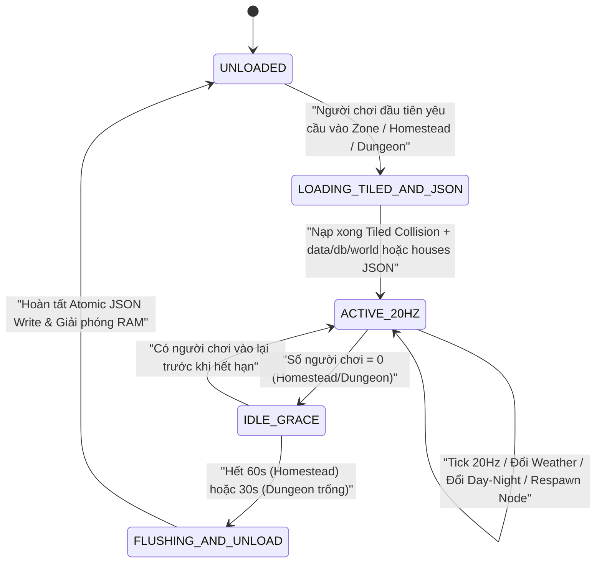

# 03 — World Building, 8 Regions & Open-World Level Design

**Trạng thái**: Hoàn thiện (Design Baseline v1.0)  
**Chế độ**: `DESIGN_AND_PLANNING_ONLY`  
**Cập nhật lần cuối**: 2026-11-19  
**Tham chiếu**: [Constitution](../../.specify/memory/constitution.md) | [00 — Game Vision](./00-game-vision.md) | [ADR-006 World Partitioning](../architecture/architecture-decisions/ADR-006-in-process-world-partitioning.md) | [`monsters.json`](../../game-data/monsters.json) | [`bosses.json`](../../game-data/bosses.json) | [`items.json`](../../game-data/items.json)

---

## 1. Mục tiêu Gameplay (Gameplay Objectives)

1. **Xây dựng một lục địa sống động có chiều sâu địa lý & truyền thuyết**: Tạo bản sắc khí hậu, địa hình, hệ sinh thái và câu chuyện riêng cho toàn bộ **8 khu vực (Regions)** của **Eldoria**, từ thung lũng ấm áp `reg_greenhaven_village` (Lv 1–5) đến vực thẳm nhật thực `reg_abyssal_kingdom` (Lv 90–100).
2. **Thiết kế thế giới mở phân vùng mượt mà (Seamless-Feeling Partitioned World)**: Ứng dụng bản đồ **Tiled (`.tmj`/`.json`)** chuẩn `32x32 px` kết hợp phân vùng `ZoneInstance` / `HomesteadInstance` / `DungeonInstance` (`ADR-006`), prefetch tài nguyên trước cổng `6 tiles` và chuyển cảnh `< 250 ms` mà không yêu cầu một tiến trình đơn lẻ phải mô phỏng toàn bộ lục địa cùng lúc.
3. **Thế giới vận hành theo thời gian thực có tác động gameplay**: Đồng bộ chu kỳ **Ngày/Đêm (24 phút thực)**, **4 Mùa (14 ngày/mùa)** và **6 Trạng thái Thời tiết** từ máy chủ (`data/db/world/<regionId>.json`), tác động trực tiếp lên nông trại, tầm nhìn, quái vật ban đêm và chiến thuật sinh tồn.
4. **Hỗ trợ triển khai Vertical Slice MVP gọn gàng**: Hoàn thiện thiết kế tổng thể cả 8 vùng trong tài liệu này nhưng cô lập rõ **2 vùng MVP** (`reg_greenhaven_village`, `reg_whispering_forest` + `dng_mossroot_hollow`) để triển khai trọn vẹn ở Milestone 1 trước khi mở 6 vùng tiếp theo ở M2–M5.

---

## 2. User Stories

- **US-WLD-01 (Người chơi khám phá)**: Là người chơi mới, tôi muốn nhìn thấy sự chuyển đổi rõ rệt về bảng màu, cây cối, âm thanh và độ nguy hiểm khi bước từ cánh đồng xanh của `reg_greenhaven_village` vào tán rừng cổ `reg_whispering_forest` mà không phải chờ màn hình tải kéo dài.
- **US-WLD-02 (Người chơi nông trại & sinh tồn)**: Là người chơi thích canh tác, tôi muốn khi trời đổ mưa (`RAIN`) hoặc chuyển mùa (`SPRING` → `SUMMER`), đồng ruộng của tôi tự động được tưới ẩm và danh mục hạt giống mùa vụ phản ánh chân thực nhịp điệu thiên nhiên.
- **US-WLD-03 (Người chơi định hướng)**: Là người chơi đang làm nhiệm vụ hoặc săn tài nguyên, tôi muốn mở World Map xem các vùng đã khám phá (Fog of War), kiểm tra cấp độ đề xuất của từng Region và dịch chuyển nhanh (Fast Travel) giữa các trụ Waypoint đã mở khóa.
- **US-WLD-04 (Thợ săn hầm ngục & Boss)**: Là đội trưởng Party, tôi muốn mỗi vùng đất có dấu mốc cổng Dungeon rõ ràng, khu vực hồi sinh an toàn gần cửa hầm ngục và điều kiện mở khóa vùng tiếp theo gắn chặt với việc chinh phục Boss của vùng hiện tại.

---

## 3. Thiết kế Thế giới, Hồ sơ 8 Vùng & Hệ thống Bản đồ (Functional Requirements)

### 3.1 Truyền thuyết & Địa lý Lục địa Eldoria (World Lore & Geography)

Hàng nghìn năm trước, lục địa **Eldoria** được duy trì cân bằng bởi **Trục Ấn Ánh Sao (The Starlight Axis)** — mạng lưới 5 Thánh Điện Nguyên Tố giúp mùa màng tươi tốt, mạch quặng dồi dào và ma thú ôn hòa. Tổng Quản Ánh Sao **Malakor** (`boss_malakor_abyss`), bị ám ảnh bởi sự hữu hạn của sinh mệnh, đã xé toạc bầu trời phương Bắc bằng nghi thức **Rạn Nứt Nhật Thực (The Eclipse Fracture)** nhằm chiếm đoạt quyền năng bất tử.

Hậu quả của vụ rạn nứt đã chia cắt Eldoria thành **8 vành đai sinh thái** biến dị tăng dần mức độ khắc nghiệt từ đồng bằng bình yên phía Nam lên tới ngai vàng vực thẳm phía Bắc:

```mermaid
flowchart LR
    R1["1. reg_greenhaven_village<br/>(Lv 1–5 | M1 MVP | Safe Hub)"] <--> R2["2. reg_whispering_forest<br/>(Lv 1–15 | M1 MVP | boss_thornback_elder)"]
    R2 <-->|"Hạ Thornback Elder"| R3["3. reg_ironpeak_mountains<br/>(Lv 15–30 | M2 | boss_ignis_forgelord)"]
    R3 <-->|"Hạ Ignis Forgelord"| R4["4. reg_crystal_caverns<br/>(Lv 30–45 | M3 | boss_prism_leviathan)"]
    R4 <-->|"Hạ Prism Leviathan"| R5["5. reg_forgotten_ruins<br/>(Lv 45–60 | M3 | Ancient Trials)"]
    R5 <-->|"Vượt Sunstone Vault"| R6["6. reg_frostbound_highlands<br/>(Lv 60–75 | M4 | boss_boreas_frostking)"]
    R6 <-->|"Hạ Boreas Frostking"| R7["7. reg_ember_wasteland<br/>(Lv 75–90 | M4 | Volcanic Trials)"]
    R7 <-->|"Vượt Caldera Forge Trial"| R8["8. reg_abyssal_kingdom<br/>(Lv 90–100 | M5 | boss_malakor_abyss)"]
```

---

### 3.2 Hồ sơ Đầy đủ 8 Khu vực Thế giới (Full Regional Profiles)

Mọi định danh `mob_*`, `boss_*`, `mat_*`, `ltb_*`, `dng_*` và `npc_*` dưới đây khớp chính xác 100% với `game-data/monsters.json`, `game-data/bosses.json` và `game-data/items.json`.

---

#### Vùng 1: `reg_greenhaven_village` — Greenhaven Village *(M1 — MVP)*
- **Sub-zones (`zon_*`)**: `zon_greenhaven_square` (Quảng trường trung tâm & Chợ), `zon_greenhaven_farmland` (Cánh đồng lúa & Rìa tập luyện Đông), `zon_player_homestead` (Instance lãnh địa riêng từng người chơi), `zon_guild_sanctuary` (Mở rộng M3 cho `bld_guild_hall`).
- **Lore**: Ngôi làng nông nghiệp yên bình nép mình trong thung lũng gió nam, nằm xa tâm chấn Rạn Nứt Nhật Thực nhất. Dưới sự dẫn dắt của Trưởng làng Rowan và thợ rèn Garrik, nơi đây là mái nhà khởi đầu cho mọi nhà thám hiểm và cũng là vựa lương thực cung ứng cho các đoàn viễn chinh tiến vào rừng sâu.
- **Recommended Level**: **Lv 1–5** (Phù hợp toàn bộ quá trình Onboarding & trở về canh tác mọi cấp độ).
- **Climate**: Ôn đới dễ chịu quanh năm; đủ 4 mùa rõ rệt (`SPRING`, `SUMMER`, `AUTUMN`, `WINTER`); thời tiết phổ biến `CLEAR` (65%), `RAIN` (25%), `FOG` sáng sớm (10%), rất hiếm `STORM`.
- **Terrain**: Đồng cỏ bậc thang mềm mại, đường lát đá cuội ấm, dòng suối cạn có cầu gỗ vòm, nhà mái ngói gỗ thông, hàng rào rơm và mảnh đất canh tác bằng phẳng tách biệt cao độ 2.5D bằng bờ đất cỏ 1 tầng.
- **Resource Distribution**:
  - `TREE`: `mat_oak_wood` (respawn `60s`), `HERB_PATCH`: `mat_wild_berry`, `mat_fiber_hemp` (respawn `45s`).
  - `STONE` / `ORE_VEIN`: `mat_rough_stone`, `mat_copper_ore`, `mat_coal` dọc bờ suối Đông Bắc (respawn `90s`).
  - `FISHING_SPOT` & Bờ sông: `mat_clay`, cá nước ngọt phục vụ nấu ăn.
- **Monsters & Elites**:
  - Quái thường (chỉ xuất hiện ở bãi cỏ rìa Đông `zon_greenhaven_farmland`, không bao giờ vào quảng trường): **`mob_moss_slime`** (Lv 1, `EARTH`, MVP).
  - Elite: Không có.
- **Boss**: Không có (Vùng an toàn & Lãnh địa).
- **NPCs**: `npc_elder_rowan` (Trưởng làng, tuyến nhiệm vụ chính), `npc_smith_garrik` (Thợ rèn công cộng hỗ trợ đến `+2` & bán đồ cơ bản), `npc_farm_merchant` (Thương nhân hạt giống `sed_*` & vật nuôi `anm_*`), `npc_village_herbalist` (Thảo dược & bình hồi phục), `npc_village_tailor` (Giáp vải khởi đầu & nhiệm vụ trang bị).
- **Quests**: Chuỗi Onboarding (`qst_001_first_harvest`, chặt gỗ, nấu ăn, rèn `+1`, gacha mẫu), nhiệm vụ phụ nông trại/chăn nuôi và nhiệm vụ hàng tuần giao nông sản nhận `CRAFTING_TOKEN` & `STARLIGHT_SHARD`.
- **Dungeon Entrance**: Không có trực tiếp; cổng Đông dẫn thẳng sang `zon_forest_west` (`reg_whispering_forest`).
- **Safe Zones**: Toàn bộ `zon_greenhaven_square`, `zon_player_homestead` và `zon_guild_sanctuary` (cấm mọi sát thương, hồi HP/MP thụ động `+5%/s`, cấm kéo quái vượt rào).
- **Spawn Points**: Điểm khởi tạo nhân vật trước cửa `bld_player_house`; điểm hồi sinh mặc định tại Đài phun nước `zon_greenhaven_square`; 2 cụm `SpawnPoint` cho `mob_moss_slime` (tối đa 6 con đồng thời) ở rìa Đông.
- **Unlock Conditions**: Mở sẵn ngay khi tạo nhân vật (`Lv 1`).
- **Environmental Hazards**: Không có hiểm họa gây sát thương (chỉ có mưa nhẹ làm đất ẩm và đêm tối giảm nhẹ độ sáng tạo bầu không khí đèn lồng ấm cúng).
- **Loot Table Refs**: `ltb_mob_moss_slime`, bảng tài nguyên nút thu thập làng.
- **Art Direction**: Bảng màu xanh lục ấm, vàng lúa mì, gỗ sồi mật ong và đá vôi kem; ánh sáng nắng xiên góc Tây Bắc tạo bóng đổ mềm về Đông Nam; tham chiếu concept art [`greenhaven-village-concept.jpg`](../art-direction/concepts/greenhaven-village-concept.jpg).

---

#### Vùng 2: `reg_whispering_forest` — Whispering Forest *(M1 — MVP)*
- **Sub-zones (`zon_*`)**: `zon_forest_west` (Rừng Sồi Thì Thầm, Lv 1–8), `zon_forest_deep` (Rừng Rậm Đầm Lầy & Cổng Mossroot, Lv 8–15).
- **Lore**: Khu rừng cổ thụ bao bọc phía Đông Greenhaven, từng được Thụ Thần `boss_thornback_elder` che chở. Từ khi nhựa hủ hóa thấm qua tầng rễ sâu tại `dng_mossroot_hollow`, các đàn sói gỗ trở nên hung dữ, yêu tinh rừng dựng trại cướp phá và nấm độc lan khắp các con suối khuất nắng.
- **Recommended Level**: **Lv 1–15** (Khu vực chiến đấu và farm cốt lõi của MVP).
- **Climate**: Rừng ẩm ôn đới; `CLEAR` (45%), `FOG` dày dưới tán cây (25%), `RAIN` (25%), `STORM` nhẹ (5%).
- **Terrain**: Tán cổ thụ 2.5D dày tạo lớp `Canopy_Occlusion` (nhân vật đi dưới tán lá hiện viền bóng mờ readability), lối mòn đất phủ lá khô, trại gỗ goblin, vũng đầm lầy nấm phát quang và vách đá rêu dẫn vào hang rễ cây.
- **Resource Distribution**:
  - `TREE`: `mat_oak_wood`, `mat_pine_wood` (respawn `60–75s`).
  - `ORE_VEIN` / `STONE`: `mat_rough_stone`, `mat_copper_ore`, `mat_iron_ore`, `mat_coal` tại vách đá rừng sâu (respawn `90–120s`).
  - `HERB_PATCH` / Bờ suối: `mat_wild_berry`, `mat_moon_herb_leaf`, `mat_fiber_hemp`, `mat_clay`.
- **Monsters & Elites**:
  - Quái thường (7 loài MVP): **`mob_forest_goblin`** (Lv 3), **`mob_timber_wolf`** (Lv 5), **`mob_spore_cap`** (Lv 7), **`mob_briar_boar`** (Lv 9), **`mob_hollow_bat`** (Lv 11), **`mob_root_crawler`** (Lv 13), **`mob_goblin_shaman`** (Lv 14).
  - Elite: **`mob_elite_alpha_direwolf`** (Lv 12, `WIND`, MVP — tuần tra khu vực bãi săn `zon_forest_deep`), **`mob_elite_briar_stag`** (Lv 15, `EARTH`, M2 bổ sung).
- **Boss**: **`boss_thornback_elder`** (Lv 15, `EARTH`, yếu `FIRE`, 3 Phase, sprite `128x128 px`, đấu trường `26x20 tiles`) bên trong **`dng_mossroot_hollow`**.
- **NPCs**: `npc_ranger_kellan` (Trạm kiểm lâm đầu rừng `zon_forest_west`, giao nhiệm vụ săn quái & cảnh báo Elite), `npc_moss_scholar_elara` (Trại khảo cổ trước cửa `dng_mossroot_hollow`, hướng dẫn cơ chế phá giáp bằng lửa & đổi thưởng Boss Token).
- **Quests**: Tuyến chính điều tra nhựa cổ thụ → săn `mob_elite_alpha_direwolf` → chinh phục `dng_mossroot_hollow` hạ `boss_thornback_elder`; chuỗi quest thu thập gỗ/quặng sắt & bảo vệ thương đoàn.
- **Dungeon Entrance**: Cổng rễ cổ thụ phát sáng rêu xanh ở phía Đông Bắc `zon_forest_deep` dẫn vào phụ bản **`dng_mossroot_hollow`**.
- **Safe Zones**: Trạm Kiểm Lâm `zon_forest_west` (vòng tròn đèn lửa bán kính 5 tile) và Trại Khảo Cổ ngay trước cổng `dng_mossroot_hollow` (điểm tập kết Party & hồi sinh phụ bản).
- **Spawn Points**: 2 Waypoint (`wp_forest_outpost`, `wp_mossroot_camp`); 18 `SpawnPoint` phân tầng từ Lv 3 (cổng Tây) tăng dần đến Lv 14 (sát cửa hang); 1 điểm tuần tra Elite (`respawn 10 phút`).
- **Unlock Conditions**: Hoàn thành bước Onboarding `OB-4` (đã trang bị vũ khí & hạ `mob_moss_slime`) để qua cổng Đông từ `reg_greenhaven_village`.
- **Environmental Hazards**: Bụi gai tầm gửi ở rừng sâu làm chậm `15%` khi bước qua; ban đêm (`Night`) đàn `mob_timber_wolf` và `mob_hollow_bat` tăng `+15%` bán kính phát hiện (`aggroRadiusPx`).
- **Loot Table Refs**: `ltb_mob_forest_goblin`, `ltb_mob_timber_wolf`, `ltb_mob_spore_cap`, `ltb_mob_briar_boar`, `ltb_mob_hollow_bat`, `ltb_mob_root_crawler`, `ltb_mob_goblin_shaman`, `ltb_mob_elite_alpha_direwolf`, `ltb_mob_elite_briar_stag`, `ltb_boss_thornback_elder`.
- **Art Direction**: Sắc xanh rêu thẫm, nâu vỏ sồi cổ, đốm sáng bào tử lam-vàng dịu và tia nắng xuyên tán lá (dappled sunlight); tham chiếu [`whispering-forest-combat-concept.jpg`](../art-direction/concepts/whispering-forest-combat-concept.jpg) và [`dungeon-boss-arena-concept.jpg`](../art-direction/concepts/dungeon-boss-arena-concept.jpg).

---

#### Vùng 3: `reg_ironpeak_mountains` — Ironpeak Mountains *(M2)*
- **Sub-zones (`zon_*`)**: `zon_ironpeak_foothills` (Chân núi Đá Xám, Lv 15–22), `zon_ironpeak_ridge` (Sườn Lò Đúc & Mỏ Bạc, Lv 22–30).
- **Lore**: Dãy núi khoáng sản hùng vĩ phía Đông Bắc, quê hương của hội Đại Thợ Rèn cổ đại. Khi Đại Thợ Rèn `boss_ignis_forgelord` bị ngọn lửa tham vọng nuốt chửng bên trong xưởng đúc `dng_slag_foundry`, các mỏ sắt tràn ngập người đá bảo hộ và lũ kobold chiếm cứ hầm lò.
- **Recommended Level**: **Lv 15–30**.
- **Climate**: Khô lạnh vùng cao nguyên núi đá chuyển sang nóng rát gần ống khói dung nham; `CLEAR` (50%), `FOG` núi cao (20%), `STORM` sấm núi (15%), `HEATWAVE` cục bộ gần lò (15%).
- **Terrain**: Vách đá dựng đứng phân tầng 2–3 cao độ rõ rệt (cầu treo gỗ, thang đá, đường ray mỏ quặng), khe suối sắt đỏ, khu vực xưởng đúc bỏ hoang và rãnh dung nham nguội.
- **Resource Distribution**:
  - `TREE`: `mat_pine_wood` ở chân núi.
  - `ORE_VEIN` / `STONE`: `mat_granite_block`, `mat_iron_ore`, `mat_silver_ore`, `mat_coal` (nguồn cung chính cho thép `mat_steel_ingot` và cường hóa bậc trung/cao).
- **Monsters & Elites**:
  - Quái thường: **`mob_stone_golem`** (Lv 17), **`mob_ironhide_kobold`** (Lv 20), **`mob_cinder_drake`** (Lv 24), **`mob_slag_elemental`** (Lv 28).
  - Elite: **`mob_elite_magma_colossus`** (Lv 27, `FIRE`).
- **Boss**: **`boss_ignis_forgelord`** (Lv 30, `FIRE`, yếu `WATER`, 3 Phase, sprite `160x160 px`, đấu trường `28x22 tiles` có 4 van làm mát) bên trong **`dng_slag_foundry`**.
- **NPCs**: `npc_ironpeak_quartermaster` (Quân nhu tiền đồn bán bản vẽ giáp `set_ironpeak_forge` & thu mua quặng), `npc_forgemaster_durn` (Cựu đồ đệ của Ignis dẫn đường vào xưởng đúc).
- **Quests**: Khai thông tuyến mỏ sắt, đánh bại `mob_elite_magma_colossus`, chế tạo trang bị chống cháy và đột kích `dng_slag_foundry` dập lửa `boss_ignis_forgelord`.
- **Dungeon Entrance**: Cổng lò đúc bằng thép đen phun hơi nước ở đỉnh `zon_ironpeak_ridge` dẫn vào **`dng_slag_foundry`**.
- **Safe Zones**: Tiền đồn Khai khoáng Ironpeak (`zon_ironpeak_foothills`) và Bệ nghỉ Cửa Lò (`zon_ironpeak_ridge`).
- **Spawn Points**: 2 Waypoint (`wp_ironpeak_outpost`, `wp_foundry_gate`); các cụm mỏ quái theo từng bậc núi cao dần.
- **Unlock Conditions**: Đánh bại **`boss_thornback_elder`** (và đạt tối thiểu **Lv 15**) để mở con đèo đá phía Bắc `reg_whispering_forest`.
- **Environmental Hazards**: Rãnh xỉ nóng gần đỉnh gây hiệu ứng `Burn` nếu đứng lâu; bão núi `STORM` làm giảm tầm nhìn xa `15%`.
- **Loot Table Refs**: `ltb_mob_stone_golem`, `ltb_mob_ironhide_kobold`, `ltb_mob_cinder_drake`, `ltb_mob_slag_elemental`, `ltb_mob_elite_magma_colossus`, `ltb_boss_ignis_forgelord`.
- **Art Direction**: Xám đá phiến lạnh, đỏ gỉ sắt, cam tro lò và hơi nước trắng xám; độ tương phản mạnh giữa nền đá trầm và các vết nứt dung nham giúp telegraph chiến đấu sắc nét.

---

#### Vùng 4: `reg_crystal_caverns` — Crystal Caverns *(M3)*
- **Sub-zones (`zon_*`)**: `zon_cavern_shimmering_grotto` (Động Thạch Anh Lam, Lv 30–38), `zon_cavern_depths` (Hồ Ngầm Cộng Hưởng, Lv 38–45).
- **Lore**: Mạng lưới hang động ngầm khổng lồ nằm sâu dưới chân dãy Ironpeak, nơi mạch ma lực cổ xưa kết tinh thành rừng thạch anh phát sáng. Tiếng búa khoan của các đoàn săn cổ vật đã đánh thức Hải Xà Tinh Thể **`boss_prism_leviathan`**, khiến toàn bộ hồ ngầm nhiễm điện tích dữ dội.
- **Recommended Level**: **Lv 30–45**.
- **Climate**: Khí hậu hang động ngầm ổn định, không có chu kỳ nắng mưa ngoài trời; thay vào đó luân chuyển 3 trạng thái vi khí hậu riêng: `CLEAR` (hang tĩnh 60%), `FOG` sương mù hơi nước ngầm (25%), `STORM` cộng hưởng tĩnh điện hang (15%).
- **Terrain**: Cầu đá tự nhiên bắc qua hồ nước trong suốt phát quang, cụm tinh thể lục giác cản tầm nhìn & khúc xạ ánh sáng, thềm đá trơn ướt và mạch quặng bạc ẩn sâu.
- **Resource Distribution**:
  - `ORE_VEIN`: `mat_silver_ore`, `mat_arcane_crystal` (nguyên liệu thiết yếu cho `bld_player_house` Lv 4, `bld_workshop` Lv 3, `set_crystal_arcanist`), `mat_granite_block`, `mat_coal`.
  - `FISHING_SPOT`: Cá tinh thể phát quang dùng nấu món hồi MP & giảm hồi chiêu.
- **Monsters & Elites**:
  - Quái thường: **`mob_quartz_beetle`** (Lv 32), **`mob_cavern_hydroid`** (Lv 36), **`mob_amethyst_stalker`** (Lv 40), **`mob_voltaic_jelly`** (Lv 44).
  - Elite: **`mob_elite_crystal_matriarch`** (Lv 43, `LIGHTNING`).
- **Boss**: **`boss_prism_leviathan`** (Lv 50, `LIGHTNING`, yếu `EARTH`, 3 Phase, sprite `192x192 px`, đấu trường `30x24 tiles` có cơ chế khúc xạ laser & trụ tiếp đất) bên trong **`dng_prism_sanctum`**.
- **NPCs**: `npc_crystal_geologist_lysa` (Nhà địa chất nghiên cứu mạch pha lê & đổi công thức khảm ngọc), `npc_deep_cartographer_toren` (Người vẽ bản đồ hang sâu giao quest mở đường lên di tích).
- **Quests**: Thu thập mẫu `mat_arcane_crystal`, ổn định trụ tiếp đất chống bão tĩnh điện, hạ `mob_elite_crystal_matriarch` và thanh tẩy `dng_prism_sanctum`.
- **Dungeon Entrance**: Mái vòm thạch anh tím khổng lồ giữa hồ ngầm `zon_cavern_depths` dẫn vào **`dng_prism_sanctum`**.
- **Safe Zones**: Trại Đèn Lồng Địa Chất tại cửa vào `zon_cavern_shimmering_grotto` và Bệ Đá Tiếp Địa trước cổng `dng_prism_sanctum`.
- **Spawn Points**: 2 Waypoint (`wp_cavern_entry`, `wp_prism_landing`); cụm quái thủy sinh dọc bờ hồ và sâu trong đường hầm pha lê.
- **Unlock Conditions**: Đánh bại **`boss_ignis_forgelord`** (và đạt tối thiểu **Lv 30**) để khai mở hầm thang máy ngầm phía Đông `reg_ironpeak_mountains`.
- **Environmental Hazards**: Vũng nước nhiễm điện định kỳ phát tia phóng điện yếu mỗi `10s` trong thời tiết `STORM` (có vòng báo trước `1.2s`); khuyến khích trang bị kháng `LIGHTNING` hoặc đi theo cầu đá khô.
- **Loot Table Refs**: `ltb_mob_quartz_beetle`, `ltb_mob_cavern_hydroid`, `ltb_mob_amethyst_stalker`, `ltb_mob_voltaic_jelly`, `ltb_mob_elite_crystal_matriarch`, `ltb_boss_prism_leviathan`.
- **Art Direction**: Tông lam ngọc, tím thạch anh, xanh đen đáy nước và điểm sáng pha lê ấm áp (tuyệt đối không chớp trắng gắt gây mỏi mắt).

---

#### Vùng 5: `reg_forgotten_ruins` — Forgotten Ruins *(M3)*
- **Sub-zones (`zon_*`)**: `zon_ruins_outer_courtyard` (Quảng trường Sa Thạch Cổ, Lv 45–52), `zon_ruins_sunstone_sanctuary` (Đền Đài Nhật Thạch & Hầm Mộ, Lv 52–60).
- **Lore**: Phế tích kinh đô cổ của triều đại Ánh Sao trước ngày Rạn Nứt Nhật Thực. Những pho tượng bảo vệ bằng đá cát và các đạo sĩ bị nguyền rủa vẫn tuần tra không biết mệt giữa những cột đá vỡ mang cổ ngữ kể lại tội lỗi của Malakor.
- **Recommended Level**: **Lv 45–60**.
- **Climate**: Khô hanh bán hoang mạc lộng gió; `CLEAR` (55%), `HEATWAVE` trưa nắng (20%), `FOG` bão cát mảnh (15%), `STORM` ma lực ban đêm (10%).
- **Terrain**: Sàn đá lát vỡ nứt mọc cổ thụ hóa thạch, cầu cạn sụp một phần, hàng cột đá cổ che chắn tốt đạn tầm xa, bệ chữ cổ phát sáng vào ban đêm và cổng vòm dẫn xuống mật thất.
- **Resource Distribution**:
  - `TREE`: `mat_ancient_heartwood` (cổ thụ hóa linh trong sân đền — nguyên liệu xây công trình Lv 4).
  - `ORE_VEIN`: `mat_mythril_ore`, `mat_obsidian_shard`.
  - Di vật / Drops vùng: `mat_ancient_relic_frag`, `mat_shadow_thread`.
- **Monsters & Elites**:
  - Quái thường: **`mob_ruin_sentinel`** (Lv 47), **`mob_cursed_acolyte`** (Lv 51), **`mob_sandstone_gargoyle`** (Lv 55), **`mob_astral_wraith`** (Lv 59).
  - Elite: **`mob_elite_sunstone_warden`** (Lv 58, `LIGHT`).
- **Boss / Thử thách Đại diện**: Theo `00-game-vision.md` & `bosses.json`, vùng này đóng vai trò bản lề cốt truyện giữa 5 Boss chính bằng **Thử thách Cổ đại (Ancient Trials — `dng_sunstone_vault`)** gồm 3 phòng giải cơ chế ánh sáng và trận quyết đấu cường hóa với Elite Guardian **`mob_elite_sunstone_warden`**.
- **NPCs**: `npc_ruin_archivist_verin` (Học giả giải mã bia đá cốt truyện Malakor), `npc_relic_broker_sela` (Đổi `mat_ancient_relic_frag` lấy bản vẽ vũ khí `wpn_runic_ruin_saber`, `wpn_duskveil_twinblade`).
- **Quests**: Giải mã 4 bia đá Lịch sử Nhật Thực, thanh tẩy hành lang oan hồn và vượt thử thách `dng_sunstone_vault` lấy Ấn Dẫn Đường phương Bắc.
- **Dungeon Entrance**: Cánh cửa tròn khắc mặt trời tại trung tâm `zon_ruins_sunstone_sanctuary` dẫn vào Trial Instance **`dng_sunstone_vault`**.
- **Safe Zones**: Doanh trại Khảo cổ phía Tây `zon_ruins_outer_courtyard`.
- **Spawn Points**: 2 Waypoint (`wp_ruins_camp`, `wp_sunstone_plaza`); bẫy tượng đá thức tỉnh khi lại gần & oan hồn tăng mật độ vào ban đêm.
- **Unlock Conditions**: Đánh bại **`boss_prism_leviathan`** (và đạt tối thiểu **Lv 45**) để mở lối lên mặt đất từ cuối `reg_crystal_caverns`.
- **Environmental Hazards**: Bẫy phiến đá cổ ngữ bắn tia năng lượng theo chu kỳ cố định (có rãnh sáng báo trước rõ); vào ban đêm `mob_astral_wraith` di chuyển ẩn hiện mờ.
- **Loot Table Refs**: `ltb_mob_ruin_sentinel`, `ltb_mob_cursed_acolyte`, `ltb_mob_sandstone_gargoyle`, `ltb_mob_astral_wraith`, `ltb_mob_elite_sunstone_warden`.
- **Art Direction**: Vàng cát sa thạch, vàng đồng cổ ngữ, tím khói huyền bí về đêm và màu gỗ lõi cổ thụ nâu đỏ đậm.

---

#### Vùng 6: `reg_frostbound_highlands` — Frostbound Highlands *(M4)*
- **Sub-zones (`zon_*`)**: `zon_frostbound_tundra` (Thảo nguyên Băng Giá, Lv 60–68), `zon_frostbound_glacier_pass` (Đèo Sông Băng & Thành Lũy, Lv 68–75).
- **Lore**: Cao nguyên tuyết trắng nơi quân vương phương Bắc **`boss_boreas_frostking`** lập khế ước với cơn bão tuyết nguyên thủy để ngăn chặn quân đoàn Hư Không tràn xuống phương Nam. Thành trì băng giá giờ đây đứng sừng sững như bài kiểm tra ý chí khắc nghiệt nhất trước khi bước vào vùng đất chết.
- **Recommended Level**: **Lv 60–75**.
- **Climate**: Hàn đới khắc nghiệt quanh năm; `SNOW` (50%), `STORM` bão tuyết (25%), `CLEAR` trời quang giá rét (15%), `FOG` sương băng (10%).
- **Terrain**: Đồng tuyết sâu, mặt hồ đóng băng có quán tính trượt nhẹ, rừng thông phủ tuyết dày, các chậu lửa cổ ven đường tuần tra và cầu băng bắc qua hẻm núi sâu.
- **Resource Distribution**:
  - `TREE`: `mat_ancient_heartwood` (cổ thụ tuyết).
  - `ORE_VEIN`: `mat_mythril_ore` (nguồn phong phú nhất cho `mat_mythril_ingot`), `mat_granite_block`.
  - `HERB_PATCH`: Hạt giống/củ `mat_frost_turnip` dã sinh & thảo dược lạnh.
- **Monsters & Elites**:
  - Quái thường: **`mob_frostbite_hound`** (Lv 62), **`mob_glacier_yeti`** (Lv 66), **`mob_ice_valkyrie_shade`** (Lv 70), **`mob_blizzard_elemental`** (Lv 74).
  - Elite: **`mob_elite_permafrost_mammoth`** (Lv 73, `FROST`).
- **Boss**: **`boss_boreas_frostking`** (Lv 75, `FROST`, yếu `FIRE`, 3 Phase, sprite `192x192 px`, đấu trường `32x24 tiles` có 4 Chậu Lửa Cổ & cơ chế Hypothermia) bên trong **`dng_glacial_citadel`**.
- **NPCs**: `npc_hearthkeeper_astrid` (Người giữ lửa trạm dừng chân, bán thực phẩm sưởi ấm & bản vẽ `set_frostbound_warden`), `npc_northern_scout_bjorn` (Trinh sát chỉ vị trí `mob_elite_permafrost_mammoth` và lối vào thành băng).
- **Quests**: Thắp sáng 5 đài lửa dẫn đường cao nguyên, săn `mob_elite_permafrost_mammoth` và vượt `dng_glacial_citadel` chứng minh bản lĩnh trước `boss_boreas_frostking`.
- **Dungeon Entrance**: Cổng thành băng cao vút với hai ngọn đuốc xanh ở cuối `zon_frostbound_glacier_pass` dẫn vào **`dng_glacial_citadel`**.
- **Safe Zones**: Trạm Giữ Lửa Astrid (`zon_frostbound_tundra`) và Sảnh Chậu Lửa tiền đồn `dng_glacial_citadel`.
- **Spawn Points**: 2 Waypoint (`wp_frost_hearth`, `wp_citadel_approach`); các bầy sói băng tuần tra và người tuyết canh giữ mỏ Mythril.
- **Unlock Conditions**: Vượt qua Ancient Trials tại `reg_forgotten_ruins` (và đạt tối thiểu **Lv 60**).
- **Environmental Hazards**: Cơ chế **Giá Rét (Cold Exposure)** tích tụ chậm trong thời tiết `STORM` bão tuyết khi đứng xa đài lửa quá 45 giây — hóa giải hoàn toàn bằng món ăn nóng (`csm_ember_curry`), đứng cạnh đài lửa 3 giây hoặc mặc 2 mảnh `set_frostbound_warden`.
- **Loot Table Refs**: `ltb_mob_frostbite_hound`, `ltb_mob_glacier_yeti`, `ltb_mob_ice_valkyrie_shade`, `ltb_mob_blizzard_elemental`, `ltb_mob_elite_permafrost_mammoth`, `ltb_boss_boreas_frostking`.
- **Art Direction**: Trắng tuyết ánh lam, xanh băng sông băng, gỗ thông đen và đối lập cực ấm từ ánh lửa cam các chậu sưởi (tăng định hướng thị giác rất tốt).

---

#### Vùng 7: `reg_ember_wasteland` — Ember Wasteland *(M4)*
- **Sub-zones (`zon_*`)**: `zon_ember_ashfields` (Cánh đồng Tro Tàn, Lv 75–82), `zon_ember_caldera_rim` (Vành Miệng Núi Lửa & Đấu trường Long Hỏa, Lv 82–90).
- **Lore**: Miền đất bị thiêu rụi khi mảnh vỡ đầu tiên của Nhật Thực rơi xuống, đánh thức hàng loạt núi lửa và loài hỏa long cổ. Giáo phái Hỏa Diệm dựng tế đàn bên miệng núi lửa nhằm hút năng lượng rồng để phá vỡ phong ấn cuối cùng dẫn vào vương quốc của Malakor.
- **Recommended Level**: **Lv 75–90**.
- **Climate**: Nóng bức tro bụi; `HEATWAVE` (45%), `CLEAR` bầu trời tro cam (30%), `FOG` khói lưu huỳnh (15%), `STORM` bão tro sấm sét (10%).
- **Terrain**: Mặt đất đá bazan nứt nẻ, sông dung nham chảy chậm có cầu đá hắc diện thạch, tàn tích xương rồng khổng lồ và mạch núi lửa phun tro định kỳ.
- **Resource Distribution**:
  - `ORE_VEIN`: `mat_obsidian_shard` (nguồn chính cho vũ khí bậc `LEGENDARY`), `mat_coal`.
  - Drops / Dã sinh hiếm: `mat_dragon_scale` (nguyên liệu rèn `wpn_solaris_eclipse_blade`, `wpn_bloodforge_colossus`, `wpn_dragonspine_partisan`), bụi `mat_ember_pepper` tự nhiên.
- **Monsters & Elites**:
  - Quái thường: **`mob_ash_hound`** (Lv 78), **`mob_obsidian_brute`** (Lv 83), **`mob_pyroclast_cultist`** (Lv 88).
  - Elite: **`mob_elite_cinder_wyvern`** (Lv 89, `FIRE`).
- **Boss / Thử thách Đại diện**: Theo `00-game-vision.md` & `bosses.json`, vùng này là tiền tuyến áp chót với **Thử thách Lò Núi Lửa (Volcanic Forge Trials — `dng_caldera_trial`)**: chiến trận bảo vệ lò rèn cổ qua các đợt giáo phái & trận đấu đặc biệt hạ **`mob_elite_cinder_wyvern`** để rèn Chìa Khóa Nhật Thực mở đường sang `reg_abyssal_kingdom`.
- **NPCs**: `npc_ashwarden_kaia` (Chỉ huy tiền tuyến chống giáo phái), `npc_obsidian_smith_vok` (Nghệ nhân rèn hắc diện thạch truyền công thức vũ khí Legendary).
- **Quests**: Phá hủy 3 tế đàn giáo phái Hỏa Diệm, thu thập `mat_dragon_scale` và hoàn tất `dng_caldera_trial`.
- **Dungeon Entrance**: Miệng lò bazan hình đầu rồng trên `zon_ember_caldera_rim` dẫn vào **`dng_caldera_trial`**.
- **Safe Zones**: Pháo đài Đá Đen của Kaia tại `zon_ember_ashfields`.
- **Spawn Points**: 2 Waypoint (`wp_ash_fortress`, `wp_caldera_overlook`); cụm quái quanh sông dung nham và bãi đáp Hỏa Long.
- **Unlock Conditions**: Đánh bại **`boss_boreas_frostking`** (và đạt tối thiểu **Lv 75**).
- **Environmental Hazards**: Mạch khí phun lửa (Geyser) tại miệng núi lửa báo trước vòng cam `1.5s` trước khi phun; `HEATWAVE` làm tăng nhẹ tiêu hao Stamina khi sprint (`+15%`, hóa giải bằng `csm_stamina_tonic` hoặc thực phẩm mát).
- **Loot Table Refs**: `ltb_mob_ash_hound`, `ltb_mob_obsidian_brute`, `ltb_mob_pyroclast_cultist`, `ltb_mob_elite_cinder_wyvern`.
- **Art Direction**: Đen than bazan, xám tro, đỏ cam magma sáng và tím sẫm đường chân trời báo hiệu sự cận kề của Abyssal Kingdom.

---

#### Vùng 8: `reg_abyssal_kingdom` — Abyssal Kingdom *(M5 — Endgame Lv 90–100)*
- **Sub-zones (`zon_*`)**: `zon_abyssal_shattered_causeway` (Con Đường Gãy Vực Thẳm, Lv 90–95), `zon_abyssal_outer_citadel` (Thành Ngoại Nhật Thực, Lv 95–100).
- **Lore**: Tàn tích lơ lửng của vương triều cổ bị kéo vào khe nứt không gian dưới bóng vầng Nhật Thực vĩnh cửu. Đây là lãnh địa tối hậu nơi đội quân bóng đêm bảo vệ ngai vàng **`dng_eclipse_throne`** của **`boss_malakor_abyss`** — thử thách đỉnh cao hội tụ toàn bộ kỹ năng chiến đấu, trang bị `+10`, bộ set Mythic và sự phối hợp tổ đội của Eldoria.
- **Recommended Level**: **Lv 90–100**.
- **Climate**: Không gian nhật thực siêu thực (bầu trời hoàng hôn tím vĩnh cửu, có chu kỳ dao động cường độ ánh sáng nhật thực theo đồng hồ server); `CLEAR` nhật thực tĩnh (50%), `FOG` sương hư không (30%), `STORM` bão tinh tú vỡ (20%).
- **Terrain**: Các khối đại lộ đá cẩm thạch đen lơ lửng nối nhau bằng cầu ánh sao, phế tích cung điện vương gia vỡ nửa, cột Ấn Mặt Trời tàn dư và đại sảnh bậc thang hướng lên ngai vàng.
- **Resource Distribution**:
  - `ORE_VEIN`: `mat_void_crystal` (quặng cấp `LEGENDARY` chế tác trang bị endgame), `mat_obsidian_shard`.
  - Drops vùng: `mat_shadow_thread`, `mat_starlight_dust`, và từ Boss: `mat_eclipse_shard` (`MYTHIC`).
- **Monsters & Elites**:
  - Quái thường: **`mob_void_thrall`** (Lv 92), **`mob_abyssal_knight`** (Lv 96), **`mob_eclipse_weaver`** (Lv 99).
  - Elite: **`mob_elite_dread_harbinger`** (Lv 98, `SHADOW`).
- **Boss**: **`boss_malakor_abyss`** (Lv 100, `SHADOW`, yếu `LIGHT`, **4 Phase**, sprite `256x256 px`, đấu trường `36x28 tiles` có sàn sụp đổ & 4 Cột Ấn Mặt Trời) bên trong **`dng_eclipse_throne`**.
- **NPCs**: `npc_starlight_envoy_orion` (Sứ giả Ánh Sao canh giữ trại tiền tiêu cuối cùng, đổi `BOSS_TOKEN` lấy vũ khí `MYTHIC` & mảnh `set_abyssal_sovereign`), `npc_eclipse_chronicler_lyraen` (Ghi chép sử thi & mở bảng thành tích đột kích).
- **Quests**: Chiến dịch cuối cùng tiến quân qua Con Đường Gãy, phá vỡ đội cận vệ `mob_elite_dread_harbinger` và hạ gục `boss_malakor_abyss` khép lại chương Nhật Thực (kèm nhiệm vụ đột kích hàng tuần nhận `480 STARLIGHT_SHARD`).
- **Dungeon Entrance**: Đại cổng Nhật Thực khảm vàng và tinh thể đen trên đỉnh `zon_abyssal_outer_citadel` dẫn vào **`dng_eclipse_throne`**.
- **Safe Zones**: Thánh Địa Ánh Sao của Orion ở đầu `zon_abyssal_shattered_causeway` (vòm sáng vàng bảo vệ tuyệt đối).
- **Spawn Points**: 2 Waypoint (`wp_abyss_sanctuary`, `wp_eclipse_steps`); chốt chặn các Hiệp sĩ Vực Thẳm trên cầu đá.
- **Unlock Conditions**: Hoàn tất Volcanic Forge Trials tại `reg_ember_wasteland` (và đạt tối thiểu **Lv 88**).
- **Environmental Hazards**: Rìa vực không gian có hàng rào va chạm an toàn ở bản đồ ngoài (không cho rơi chết tức thì ngoài ý muốn) nhưng các vết nứt hư không định kỳ phát nổ AOE có viền vàng sáng báo trước rõ nét `1.4s`.
- **Loot Table Refs**: `ltb_mob_void_thrall`, `ltb_mob_abyssal_knight`, `ltb_mob_eclipse_weaver`, `ltb_mob_elite_dread_harbinger`, `ltb_boss_malakor_abyss`.
- **Art Direction**: Đen cẩm thạch, tím nhật thực sâu, bạc ánh trăng và vàng kim tương phản cao cho toàn bộ đường telegraph (đáp ứng tuyệt đối tiêu chuẩn combat readability của Art Bible).

---

### 3.3 Kiến trúc Bản đồ Tiled (`.tmj` / `.json`) & Chuẩn Layering

Toàn bộ bản đồ Zone, Homestead và Dungeon được biên tập bằng **Tiled Map Editor**, xuất chuẩn **JSON (`.tmj`/`.json`)** kích thước base tile **`32 × 32 px`** và lưu cục bộ trong `assets/maps/` (phục vụ trực tiếp từ static hosting nội bộ, cũng được NestJS nạp phần collision & object metadata khi khởi động).

| Thứ tự Layer (Depth) | Tên Layer Tiled | Loại Layer | Mục đích & Quy tắc Render / Server |
| :---: | :--- | :--- | :--- |
| `0` | `Ground_Base` | Tile Layer | Nền địa hình chính (cỏ, đất, cát, đá, tuyết, sàn dungeon). |
| `10` | `Ground_Transition` | Tile Layer | Đường viền chuyển tiếp mượt (auto-tile bờ cỏ-đường mòn, viền bờ sông, bậc thang). |
| `20` | `Water_Animated` | Tile Layer | Mặt nước, suối, dung nham, hồ tinh thể (animation 4–6 frame đồng bộ). |
| `30` | `Elevation_Cliff` | Tile Layer | Vách đá, tường thành, bậc cao độ 2.5D và bóng đổ cứng chân tường. |
| `40` | `Props_Ground` | Tile Layer | Hoa cỏ, đá nhỏ, thảm rơm, vết nứt sàn, vạch đường — không chặn va chạm. |
| `100–199` | *(Dynamic Telegraph Layer)* | Phaser Runtime | **Lớp vẽ Boss/Monster Telegraph đỏ/cam sắc nét** nằm dưới chân nhân vật nhưng trên mặt đất, không bao giờ bị VFX che khuất. |
| `200` | `YSort_Entities` | Dynamic Group | Toàn bộ nhân vật, NPC, quái, Boss, cây cối, công trình (`bld_*`), loot rơi — tự động sắp xếp độ sâu `depth = 200 + footY / 1000` tạo chiều sâu 2.5D. |
| `400` | `Canopy_Occlusion` | Tile / Object Layer | Tán cây cao, mái vòm cổng, xà nhà che phần trên nhân vật; tự động giảm alpha về `0.45` khi nhân vật bước vào vùng occlusion phía sau. |
| `500` | `Lighting_Overlay` | Runtime Tint | Lớp màu chuyển sáng Ngày/Dusk/Đêm/Bình minh & hiệu ứng hạt thời tiết (`RAIN`, `SNOW`, `FOG`), không làm mờ đường telegraph. |
| *(Server+Client)* | `Collisions` | Object / Tile Bitmask | Ma trận ô không thể đi qua (`1 = blocked`, `2 = water/projectile-passable`, `3 = buildable_homestead`, `4 = no_build_corridor`). NestJS xuất lưới bitmask này làm nguồn chân lý chống đi xuyên tường và xác thực đặt công trình. |
| *(Server Metadata)* | `Portals` | Object Layer | Hình chữ nhật cửa chuyển vùng `{ targetRegionId, targetZoneId, targetSpawnKey, requiredUnlockFlag }`. |
| *(Server Metadata)* | `SpawnPoints` | Object Layer | Vị trí & thông số `{ spawnId, monsterId, maxAlive, patrolRadiusPx, respawnSeconds }`. |
| *(Server Metadata)* | `ResourceNodes` | Object Layer | Vị trí `{ nodeId, nodeType, requiredToolTier, maxCharges, respawnSeconds, lootTableId }`. |
| *(Server Metadata)* | `SafeZones` & `Hazards` | Object Layer | Đa giác vùng an toàn (cấm combat, leash quái) và vùng hiểm họa môi trường. |
| *(Server Metadata)* | `NpcMarkers` & `Waypoints` | Object Layer | Tọa độ cố định NPC và trụ Fast Travel (`waypointId`). |
| *(Server Nav)* | `Navigation_Grid` | Exported JSON Grid | Lưới dẫn đường A* cho quái/NPC (tự động sinh khi build map từ lớp `Collisions` + vùng cấm đi vào Safe Zone). |

- **Kích thước chuẩn bản đồ**:
  - Open-World Zone: `64 × 48 tiles` (`2048 × 1536 px`) đến `96 × 72 tiles` (`3072 × 2304 px`), chia nhỏ thành các **Map Chunk `16 × 16 tiles`** (`512 × 512 px`) để hỗ trợ Fog of War và culling render trên Phaser.
  - Private Homestead (`zon_player_homestead`): `40 × 32 tiles` (`1280 × 1024 px`), trong đó có vùng đất bằng phẳng `28 × 20 tiles` gắn cờ `buildable_homestead` và hành lang `3 tiles` cố định không thể bị xây bít từ cửa `bld_player_house` ra cổng làng.
  - Dungeon Instance: Các phòng hành lang nối tiếp dẫn vào phòng Boss (`26×20` đến `36×28 tiles` theo `bosses.json`).

### 3.4 Phân vùng Thế giới (World Partitioning), Cổng Chuyển vùng & Tải Mượt

Tuân thủ [`ADR-006`](../architecture/architecture-decisions/ADR-006-in-process-world-partitioning.md), thế giới được phân mảnh hoàn toàn trong tiến trình NestJS (không dùng dịch vụ phân phối ngoài):

1. **Open-World `ZoneInstance`**: Mỗi `zon_*` đang có ít nhất 1 người chơi (hoặc là làng trung tâm) chạy vòng lặp mô phỏng `20 Hz` và `SpatialHashGrid` (`256 × 256 px`) riêng. Giới hạn mềm đề xuất (`proposed / unverified`): `30` người chơi/zone ở rừng, `50` người chơi/zone ở quảng trường làng; nếu vượt ngưỡng ở tương lai (M5) có thể mở Channel 2 cùng kiến trúc.
2. **Private `HomesteadInstance` (`homestead:<characterId>`)**: Nạp từ `data/db/houses/<characterId>.json` vào RAM ngay khi chủ nhân hoặc thành viên Party có quyền `PARTY_ACCESS` bước vào; chạy mô phỏng tiến trình offline trước khi render; tự động flush JSON và giải phóng RAM sau **`60 giây`** trống người.
3. **Instanced `DungeonInstance` (`dng:<instanceUuid>`)**: Cấp phát độc lập cho mỗi Party (1–4 người); cô lập hoàn toàn AI, Boss phase, trụ đá, bẫy và loot; giải phóng sau **`30 giây`** khi mọi thành viên rời đi hoặc `300 giây` sau khi hạ Boss xong.
4. **Cơ chế Chuyển vùng Cảm giác Mượt (Seamless-Feeling Traversal)**:
   - Khi nhân vật tiến vào vùng đệm **`6 tiles` (`192 px`)** quanh `Portal`, client âm thầm tải trước (prefetch) tệp `.tmj` và atlas của Zone đích (nếu chưa có trong bộ nhớ đệm Phaser).
   - Khi nhân vật chạm hình chữ nhật `Portal`, server xác thực điều kiện mở khóa (`unlockedRegionIds`), flush nhanh vị trí, chuyển thực thể sang `ZoneInstance` đích và gửi `ZONE_TRANSITION`.
   - Client chạy chuyển cảnh fade tối nhẹ **`< 250 ms`**, hoán đổi scene map và nhận gói Full Snapshot đầu tiên của Zone mới.

### 3.5 Fast Travel Waypoints, Minimap, World Map & Fog of War

- **Fast Travel Waypoints**:
  - Mỗi vùng có 1–2 trụ đá cổ **Starlight Waypoint** (`wp_*`). Người chơi cần chạy tới tương tác lần đầu (`INTERACT_REQ`) để kích hoạt (lưu vào `discoveredWaypoints[]` trong `characters/<id>.json` + nhận thưởng khám phá `40 STARLIGHT_SHARD`).
  - **Quy tắc dịch chuyển**: Chỉ kích hoạt được khi **ngoài combat** (`5 giây` không nhận/gây sát thương) và **không ở trong phòng Boss đang khóa**. Dịch chuyển về `reg_greenhaven_village` hoặc `zon_player_homestead` luôn **miễn phí** (hồi chiêu `60 giây`); dịch chuyển sang Waypoint vùng khác tốn phí tượng trưng nhỏ (`20–100 GOLD` theo bậc vùng, hoạt động như Gold Sink nhẹ) và có animation tụ lực `2.5 giây` (bị hủy nếu bị đánh trúng).
- **Minimap (HUD Góc phải trên, `160 × 160 px`)**: Hiển thị thu nhỏ địa hình quanh người chơi bán kính `24 tiles`, đánh dấu chấm xanh lá (bản thân), xanh dương (thành viên Party), vàng (NPC có quest), đỏ (Elite/Boss), biểu tượng xanh lam (Waypoint) và cửa cổng chuyển vùng.
- **World Map (Phím `M`)**: Hiển thị bản đồ mỹ thuật pixel toàn bộ 8 Region của Eldoria với trạng thái mở khóa, cấp độ đề xuất, tỷ lệ hoàn thành khám phá `%`, vị trí bạn bè/Party và cho phép bấm trực tiếp vào trụ Waypoint để Fast Travel.
- **Fog of War**: Mỗi Open-World Zone được chia thành lưới khám phá **`8 × 8 tiles`** (`256 × 256 px`). Khi nhân vật di chuyển, ô hiện tại và 8 ô lân cận được đánh dấu đã khám phá (lưu gọn bằng mảng bitmask nén base64/hex theo `zoneId` trong `characters/<id>.json`). Đạt mốc `100%` khám phá một vùng thưởng thành tựu `160 STARLIGHT_SHARD` (1 lần/tài khoản).

### 3.6 Chu kỳ Ngày/Đêm, 4 Mùa & 6 Trạng thái Thời tiết (Server-Authoritative)

Theo `ASM-007`, đồng hồ thế giới chạy thống nhất trên máy chủ và đồng bộ cho toàn bộ client trong gói `WS_WELCOME` và sự kiện đổi pha:

- **Chu kỳ 1 Ngày trong game = `24 phút` thời gian thực**:
  - **Bình minh (`DAWN`)**: `05:00 – 06:00` (`1 phút` thực) — ánh sáng hồng vàng dịu, tính mốc làm mới chu kỳ tưới cây trong ngày.
  - **Ban ngày (`DAY`)**: `06:00 – 20:00` (`14 phút` thực) — ánh sáng rõ nhất, NPC cửa hàng mở cửa đầy đủ, quái ôn hòa ở trạng thái bình thường.
  - **Hoàng hôn (`DUSK`)**: `20:00 – 23:00` (`3 phút` thực) — tông cam hổ phách, đèn lồng làng tự động bật sáng.
  - **Ban đêm (`NIGHT`)**: `23:00 – 05:00` (`6 phút` thực) — nền xanh lam đêm sâu, đèn lồng tỏa ánh sáng ấm; một số quái đêm (`mob_timber_wolf`, `mob_hollow_bat`, `mob_astral_wraith`) tăng `+15%` aggro & `+10%` tỷ lệ rơi nguyên liệu hiếm (`mat_bat_wing`, `mat_moon_herb_leaf`).
- **Chu kỳ 4 Mùa (`Season`)**: Mỗi mùa kéo dài **`14 ngày trong game`** (`5.6 giờ` thời gian thực): `SPRING → SUMMER → AUTUMN → WINTER → SPRING`. Mùa quyết định danh sách hạt giống sinh trưởng chuẩn (ví dụ `crp_sunwheat` phát triển `SPRING/SUMMER/AUTUMN`; `crp_frost_turnip` phát triển `AUTUMN/WINTER`) và bảng màu lá cây tại `reg_greenhaven_village` / `reg_whispering_forest`.
- **6 Trạng thái Thời tiết (`WeatherType`)** (xoay vòng mỗi `6 giờ` trong game = `6 phút` thực, lưu tại `data/db/world/<regionId>.json`):

| `WeatherType` | Tác động Trực tiếp lên Gameplay | Mùa / Vùng phổ biến |
| :--- | :--- | :--- |
| `CLEAR` | Điều kiện tiêu chuẩn, tầm nhìn tối đa | Mọi mùa / Mọi vùng |
| `RAIN` | **Tự động tưới ẩm 100% toàn bộ cây trồng ngoài trời** tại `zon_player_homestead`; tăng `+15%` sát thương phản ứng `WATER` + `LIGHTNING` ngoài trời | `SPRING`, `AUTUMN` (Greenhaven, Forest) |
| `STORM` | Tự động tưới cây; tăng `+20%` tỷ lệ câu cá hiếm; giảm nhẹ tầm nhìn xa `15%`; kích hoạt nguy cơ tĩnh điện/gió tuyết ở vùng cấp cao | `SUMMER`, `WINTER` (Ironpeak, Caverns, Frostbound) |
| `FOG` | Giảm nhẹ tầm nhìn biên màn hình bằng lớp sương mềm; tăng tỷ lệ xuất hiện thảo dược `mat_moon_herb_leaf` | Sáng sớm / Forest, Ruins, Abyss |
| `SNOW` | Tạo cảnh tuyết rơi; giảm tốc độ sinh trưởng cây trái mùa thêm `15%`; đặc trưng mùa đông & `reg_frostbound_highlands` | `WINTER`, Frostbound Highlands |
| `HEATWAVE` | Tăng tốc độ khô đất nông trại (`wateredUntil` ngắn hơn `20%`); tăng `+15%` tiêu hao Stamina khi sprint ở vùng lửa | `SUMMER`, Forgotten Ruins, Ember Wasteland |

---

## 4. Business Rules (Quy tắc Nghiệp vụ)

- **BR-WLD-01 (Quyền mở khóa tuần tự theo tiến trình)**: Người chơi không thể bước qua cổng hoặc Fast Travel tới Region bậc trên nếu `regionId` chưa nằm trong `unlockedRegionIds` (được mở bằng việc hoàn thành Boss/Trial tương ứng hoặc mở mốc Milestone của server).
- **BR-WLD-02 (Tuyệt đối không kéo quái vào Safe Zone)**: Mọi quái vật có mục tiêu bước vào đa giác `SafeZone` lập tức chuyển trạng thái `RETURN`, xóa threat table và hồi đầy máu trên đường quay về `SpawnPoint`.
- **BR-WLD-03 (Chống kẹt bản đồ — Unstuck)**: Nếu tọa độ nhân vật rơi vào ô `blocked` do thay đổi bản đồ giữa hai bản cập nhật, server tự động đưa nhân vật về `lastSafeZoneId / lastSafeX / lastSafeY` gần nhất ngay khi đăng nhập.
- **BR-WLD-04 (Quản lý tái tạo tài nguyên công bằng)**: Nút tài nguyên (`ResourceNode`) trong Open-World chia sẻ theo Zone có thời gian tái sinh nhanh (`45–120 giây`); khi bị khai thác hết `remainingCharges = 0`, đổi sprite thành gốc cây/hố đá trống và server đặt `respawnAt` theo đồng hồ máy chủ.
- **BR-WLD-05 (Bảo vệ MVP Boundary)**: Trong Milestone 1, cổng dẫn từ `reg_whispering_forest` sang `reg_ironpeak_mountains` hiển thị rào chắn cổ tích kèm thông báo lore *"Con đèo Ironpeak đang bị phong tỏa — mở khóa ở Bản mở rộng M2"*.

---

## 5. Input & Output

| Thao tác Thế giới | Kênh | Input (Client → Server) | Output (Server → Client) |
| :--- | :--- | :--- | :--- |
| Chuyển Zone qua Portal | WS `MOVE_INPUT` / `INTERACT_REQ { targetType: "PORTAL" }` | `{ targetId: portalId }` | `ZONE_TRANSITION { regionId, zoneId, instanceId?, spawnX, spawnY, tiledMapKey }` + `WORLD_SNAPSHOT (isFull: true)` |
| Kích hoạt / Dùng Waypoint Fast Travel | `POST /api/v1/characters/:charId/world/fast-travel` | `{ targetWaypointId }` + `X-Idempotency-Key` | `200 { goldSpent, zoneTransition }` + WS `ZONE_TRANSITION` (hoặc `409 ERR_IN_COMBAT` / `ERR_WAYPOINT_LOCKED`) |
| Khai thác `ResourceNode` | WS `INTERACT_REQ { targetType: "NODE" }` | `{ requestId, targetId: nodeId }` | `INVENTORY_PATCH` + cập nhật trạng thái nút trong `WORLD_SNAPSHOT` (`remainingCharges`) |
| Đồng bộ Thời gian / Thời tiết / Mùa | WS `WS_WELCOME` & `WORLD_ENV_UPDATE` | *(Server Push)* | `{ serverTime, dayTimeMinutes, phase: "DAWN"|"DAY"|"DUSK"|"NIGHT", season, seasonDay, weather }` |
| Truy vấn Bản đồ & Fog of War | `GET /api/v1/characters/:charId/world/map-state` | Auth Header | `{ unlockedRegionIds, discoveredWaypoints, fogBitmasksByZone, explorationPercentByRegion }` |

---

## 6. State Transitions (Vòng đời Zone & Chuyển vùng)

---

## 7. Data Model (Tham chiếu JSON Collections)

1. **`data/db/world/<regionId>.json`** (`WorldRegion` + `WorldZone[]` + `ResourceNode[]` + `SpawnPoint[]` + `BossRespawnState`):
   - Lưu trạng thái động của từng Region (`currentWeather`, `weatherChangesAt`, `currentSeason`, `seasonDay`, `remainingCharges` & `respawnAt` của nút tài nguyên, thời điểm respawn World Boss).
   - Nạp vào RAM khi boot và flush định kỳ `60 giây` hoặc khi đổi thời tiết/mùa/tắt server.
2. **`data/db/characters/<characterId>.json`**:
   - Nhúng `position` (`PlayerPosition`: `regionId`, `zoneId`, `x`, `y`, `facing`, `lastSafeZoneId`, `lastSafeX`, `lastSafeY`), `unlockedRegionIds[]`, `discoveredWaypoints[]`, `fogOfWar` (`{ [zoneId]: base64Bitmask }`).
3. **`data/db/houses/<characterId>.json`**:
   - Dữ liệu riêng cho `HomesteadInstance` (`buildings[]`, `crops[]`, `animals[]`).
4. **Static Assets & Catalog**:
   - `assets/maps/<regionId>/<zoneId>.tmj` (Tiled JSON map).
   - `game-data/monsters.json`, `game-data/bosses.json`, `game-data/items.json`, `game-data/loot-tables.json`, `game-data/quests.json`.

---

## 8. Dependencies

- **Upstream**: `001-foundation-game-engine` (`JsonDatabaseEngine`, Tiled parser & Collision loader), `002-auth-character`.
- **Downstream**: `004-combat-skills` (collision & line-of-sight), `006-gathering-crafting` (`ResourceNode`), `008-housing-farming` (thời tiết mưa tưới cây, mùa vụ, `HomesteadInstance`), `010-multiplayer-social` (Zone sync & Spatial Grid), `011-dungeon-boss` (`DungeonInstance`), `012-game-ui-qa` (Minimap, World Map, Day/Night shader).

---

## 9. UI Interactions

- **Banner Địa danh (Zone Entry Toast)**: Khi bước vào Zone mới, dải chữ pixel tinh tế xuất hiện phía trên trong `2.5 giây` (ví dụ: *Whispering Forest — Rừng Sồi Thì Thầm | Đề xuất Lv 1–15*).
- **Đồng hồ Thời gian & Thời tiết (Cạnh Minimap)**: Icon mặt trời/mặt trăng + biểu tượng thời tiết (`CLEAR`/`RAIN`/`SNOW`...) + tên Mùa & Ngày (`Xuân — Ngày 4`) + đồng hồ nhỏ.
- **Bảng World Map (`M`)**: Zoom 2 mức (Toàn lục địa 8 Region ↔ Chi tiết từng Zone), hover hiện danh sách tài nguyên (`mat_*`), quái/Boss chính và nút bấm Fast Travel kèm chi phí Gold rõ ràng.
- **Cảnh báo Ranh giới Nguy hiểm**: Nếu người chơi bước vào khu vực cao hơn cấp hiện tại `>= 5` cấp, thanh địa danh hiển thị biểu tượng cảnh báo màu hổ phách (không chặn cứng nếu vùng đã mở khóa).

---

## 10. Edge Cases

1. **Đang tụ lực Fast Travel (`2.5s`) thì bị quái đánh trúng hoặc di chuyển**: Server lập tức hủy phiên tụ lực, không trừ Gold và trả `ACTION_ERROR { code: "ERR_FAST_TRAVEL_INTERRUPTED" }`.
2. **Hai người chơi cùng đập nhát cuối vào 1 mỏ `mat_iron_ore` trong cùng 1 tick 20 Hz**: `ZoneInstance` xử lý tuần tự theo hàng đợi tick; người đầu tiên giảm `remainingCharges` về `0` và nhận quặng, người thứ hai nhận thông báo nhẹ *"Tài nguyên vừa được khai thác hết"* mà không gây nhân bản quặng.
3. **Đổi mùa ngay khi người chơi đang đứng trong `HomesteadInstance`**: Server phát sự kiện `WORLD_ENV_UPDATE`, client chuyển mượt bảng màu lá cây theo mùa mới và áp dụng quy tắc ân hạn 1 ngày cho cây đã trồng trước đó.
4. **Người chơi đang đứng sát biên cổng nhưng bị `Knockback` đẩy ngược qua `Portal`**: Server chỉ kích hoạt `Portal` khi nhân vật chủ động di chuyển vào vùng cổng và không ở trạng thái `KNOCKBACK`/`STUN`/`DEATH`.

---

## 11. Failure Behavior

- **Thiếu hoặc hỏng tệp `.tmj` bản đồ Zone đích khi chuyển vùng**: Server không di chuyển nhân vật sang Zone lỗi, giữ nhân vật an toàn tại Zone hiện tại, ghi log `ERROR` và gửi `ACTION_ERROR` rõ ràng.
- **Homestead JSON bị sai checksum khi tải**: `JsonDatabaseEngine` từ chối ghi đè mù, giữ nhân vật tại `zon_greenhaven_square`, ghi `SECURITY_FILE_TAMPER_OR_CORRUPT` và báo quản trị viên khôi phục từ `data/backups/`.
- **Mất kết nối đúng khoảnh khắc đang chuyển Zone**: Trạng thái `position` được cập nhật nguyên tử trước khi phát `ZONE_TRANSITION`; khi reconnect, nhân vật xuất hiện chính xác tại điểm spawn của Zone đích (hoặc `lastSafeZoneId` nếu đích là Dungeon đã đóng).

---

## 12. Security Requirements

- **Server-Authoritative Collision & Portal Validation**: Client KHÔNG BAO GIỜ tự quyết định vị trí xuyên tường hay nhảy sang Region khác; mọi chuyển động đối chiếu trực tiếp lưới `Collisions` nạp từ `.tmj` trên NestJS server, và mọi `Portal` / `Fast Travel` đều kiểm tra `unlockedRegionIds` + `discoveredWaypoints`.
- **Chống khai thác tài nguyên tầm xa (Remote Gathering Hack)**: `INTERACT_REQ` trên `ResourceNode` bắt buộc kiểm tra khoảng cách Euclidean `<= 96 px` trên tọa độ server và kiểm tra thời gian thao tác (mining/woodcutting channel `1.2s–2.0s`) chống instant-gather.
- **Chống chỉnh đồng hồ địa phương**: Ngày/Đêm, Mùa, Thời tiết và `respawnAt` chạy 100% theo `Date.now()` của server.
- **An toàn đường dẫn tệp Region**: `regionId` và `zoneId` chỉ chấp nhận từ whitelist `game-data` (`^[a-z0-9_]{3,48}$`), chặn tuyệt đối Path Traversal tới `data/db/world/`.

---

## 13. Acceptance Criteria

- **AC-WLD-01**: Toàn bộ 8 Region được định nghĩa nhất quán với đủ 30 quái thường, 8 Elite và 5 Boss khớp 100% ID trong `monsters.json` và `bosses.json`.
- **AC-WLD-02**: Trong MVP, người chơi di chuyển mượt từ `zon_player_homestead` → `zon_greenhaven_square` → `zon_greenhaven_farmland` → `zon_forest_west` → `zon_forest_deep` → `dng_mossroot_hollow` với thời gian chuyển cảnh `< 250 ms` (`proposed`).
- **AC-WLD-03**: Quái vật đuổi tới ranh giới `SafeZone` tự động hủy aggro, chuyển sang `RETURN` và không thể gây sát thương cho người chơi trong làng.
- **AC-WLD-04**: Khi thời tiết trên server chuyển sang `RAIN`, toàn bộ cây trồng ngoài trời tại `zon_player_homestead` được server đánh dấu ẩm mà không cần người chơi tưới tay.
- **AC-WLD-05**: Khám phá ô mới cập nhật Fog of War và lưu bền vững trong `data/db/characters/<id>.json` sau khi đăng xuất và đăng nhập lại.

---

## 14. Test Scenarios

| Mã Test | Loại | Kịch bản Kiểm thử | Kết quả Kỳ vọng |
| :--- | :--- | :--- | :--- |
| **TS-WLD-01** | Happy Path | Đi bộ từ `zon_greenhaven_square` qua cổng Đông vào `zon_forest_west`, tương tác trụ `wp_forest_outpost`, sau đó mở World Map dùng Fast Travel về lại làng. | Chuyển Zone đúng tọa độ spawn, `wp_forest_outpost` lưu vào `discoveredWaypoints[]`, Fast Travel về làng miễn phí và đưa về đúng đài phun nước. |
| **TS-WLD-02** | Security / Anti-Cheat | Gửi request `POST /world/fast-travel` tới `wp_ironpeak_outpost` hoặc gửi gói chuyển cổng sang `reg_ironpeak_mountains` khi chưa hạ `boss_thornback_elder`. | Server từ chối (`403/409 ERR_REGION_LOCKED` / `ERR_WAYPOINT_LOCKED`) và cộng điểm nghi vấn vào `suspicionScore`. |
| **TS-WLD-03** | Boundary / Safe Zone | Dụ 2 con `mob_moss_slime` chạy theo từ rìa ruộng vào bên trong đa giác `SafeZone` của `zon_greenhaven_square`. | Quái dừng ngay tại ranh giới, chuyển trạng thái `RETURN`, hồi đầy HP và quay lại `SpawnPoint`. |
| **TS-WLD-04** | Concurrency / Gathering | Hai client cùng đứng cạnh 1 mỏ `mat_copper_ore` còn `remainingCharges = 1` và gửi `INTERACT_REQ` cùng thời điểm. | Chỉ đúng 1 người chơi nhận được `mat_copper_ore`, mỏ chuyển `remainingCharges = 0` và đặt `respawnAt = now + 90s`. |
| **TS-WLD-05** | Environmental Simulation | Mô phỏng đồng hồ server chạy qua mốc `RAIN` tại `reg_greenhaven_village` khi `HomesteadInstance` có 10 ô `crp_sunwheat` đang khô. | Toàn bộ 10 ô tự cập nhật `wateredUntil` hợp lệ và tiếp tục tăng `growthProgressMinutes`. |
| **TS-WLD-06** | Memory Lifecycle | Chủ nhà rời khỏi `homestead:<charId>`, không còn ai bên trong trong `65 giây`. | Server flush toàn bộ dữ liệu vào `data/db/houses/<charId>.json` và giải phóng `HomesteadInstance` khỏi RAM. |
