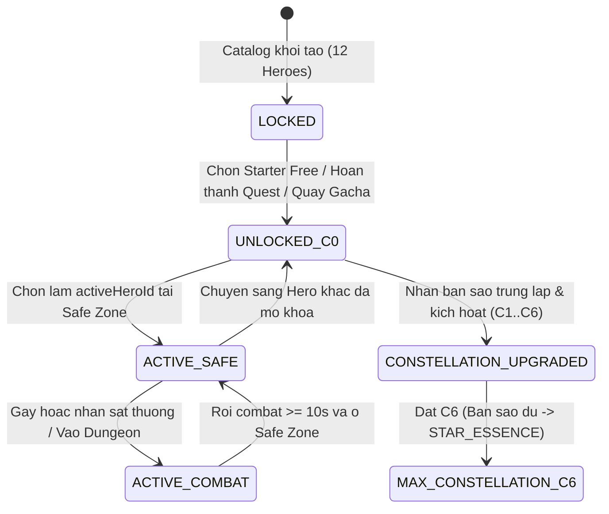

# 04 — Character Design System & Complete Roster (12 Nhân vật): Eldoria: Forgotten Wilds

**Trạng thái**: Hoàn thiện (Design Baseline v1.0)  
**Chế độ**: `DESIGN_AND_PLANNING_ONLY`  
**Cập nhật lần cuối**: 2026-11-19  
**Nguồn chân lý dữ liệu (Single Source of Truth)**: [`game-data/characters.json`](../../game-data/characters.json), [`game-data/skills.json`](../../game-data/skills.json), [`game-data/items.json`](../../game-data/items.json)  
**Tham chiếu Hiến pháp**: [`.specify/memory/constitution.md`](../../.specify/memory/constitution.md) (Nguyên tắc I, II, III, V, VI, VII, VIII)

---

## 1. Tổng quan Hệ thống & Kiến trúc Roster 12 Nhân vật

Hệ thống Nhân vật của **Eldoria: Forgotten Wilds** được thiết kế theo triết lý **"Bản sắc cơ chế quyết định giá trị chiến thuật — không bán sức mạnh bằng độ hiếm"**. Danh mục dài hạn gồm **12 nhân vật nguyên bản** trải đều trên **8 Class cốt lõi** (`WARRIOR`, `KNIGHT`, `ASSASSIN`, `ARCHER`, `MAGE`, `HEALER`, `BERSERKER`, `SUMMONER`), **6 Vai trò** (`TANK`, `MELEE_DPS`, `RANGED_DPS`, `MAGIC_DPS`, `SUPPORT`, `HYBRID`), **9 Nguyên tố** (`FIRE`, `WATER`, `EARTH`, `WIND`, `LIGHTNING`, `FROST`, `LIGHT`, `SHADOW`, `NEUTRAL`) và **6 Bậc độ hiếm** (`COMMON`, `UNCOMMON`, `RARE`, `EPIC`, `LEGENDARY`, `MYTHIC`).

Trong phạm vi **Vertical Slice MVP (Milestone 1)**, người chơi được chọn miễn phí 1 trong **3 nhân vật khởi đầu** (`chr_kael_vanguard`, `chr_lyra_windrunner`, `chr_seraphina_dawn` — tổng cộng **15 kỹ năng MVP**) ngay tại `reg_greenhaven_village`, đồng thời có thể mở khóa toàn bộ 2 nhân vật còn lại qua `bnr_perm_heroes` bằng `STARLIGHT_SHARD` kiếm trong game. 9 nhân vật còn lại thuộc lộ trình mở rộng `M2–M5`.

### 1.1 Bảng Tổng hợp Danh mục 12 Nhân vật Chuẩn

| # | Character ID | Tên & Danh hiệu | Class / Subclass | Role | Element | Rarity | Vũ khí chính & Thông thạo | Unlock | MVP |
| :-: | :--- | :--- | :--- | :---: | :---: | :---: | :--- | :--- | :-: |
| 1 | `chr_kael_vanguard` | **Kael Ironbound** — *Vanguard of the Ashen Hearth* | `WARRIOR` / `BLADE_MASTER` | `MELEE_DPS` | `FIRE` | `RARE` | `SWORD` (`SWORD`, `AXE`, `GREATSWORD`) | `STARTER_FREE` | **Có** |
| 2 | `chr_lyra_windrunner` | **Lyra Galeweaver** — *Whisper of the Emerald Canopy* | `ARCHER` / `GALE_RANGER` | `RANGED_DPS` | `WIND` | `RARE` | `BOW` (`BOW`, `DAGGER`) | `STARTER_FREE` | **Có** |
| 3 | `chr_seraphina_dawn` | **Seraphina Solis** — *Keeper of the First Dawn* | `HEALER` / `DAWN_CLERIC` | `SUPPORT` | `LIGHT` | `RARE` | `STAFF` (`STAFF`, `WAND`) | `STARTER_FREE` | **Có** |
| 4 | `chr_bram_bastion` | **Bram Stoneheart** — *Bulwark of Ironpeak* | `KNIGHT` / `AEGIS_WARDEN` | `TANK` | `EARTH` | `EPIC` | `SHIELD` (`SHIELD`, `SWORD`, `AXE`) | `GACHA_OR_QUEST` | Không |
| 5 | `chr_vex_nightblade` | **Vex Duskveil** — *Silencer of the Umbral Path* | `ASSASSIN` / `PHANTOM_STALKER` | `MELEE_DPS` | `SHADOW` | `EPIC` | `DAGGER` (`DAGGER`, `SWORD`) | `GACHA_PERMANENT` | Không |
| 6 | `chr_orin_stormcaller` | **Orin Voltspire** — *Archmage of the Thunder Spire* | `MAGE` / `TEMPEST_ARCHMAGE` | `MAGIC_DPS` | `LIGHTNING` | `LEGENDARY` | `STAFF` (`STAFF`, `WAND`) | `GACHA_PERMANENT` | Không |
| 7 | `chr_freya_frostveil` | **Freya Glaciersong** — *Cantor of the Eternal Glacier* | `MAGE` / `CRYOMANCER` | `MAGIC_DPS` | `FROST` | `EPIC` | `WAND` (`WAND`, `STAFF`) | `GACHA_PERMANENT` | Không |
| 8 | `chr_torvald_rageborn` | **Torvald Bloodforge** — *Scion of the Ember Wyrm* | `BERSERKER` / `DRAGON_REAVER` | `MELEE_DPS` | `FIRE` | `LEGENDARY` | `GREATSWORD` (`GREATSWORD`, `AXE`) | `GACHA_PERMANENT` | Không |
| 9 | `chr_nyx_voidcaller` | **Nyx Umbramancer** — *Sovereign of the Quiet Eclipse* | `SUMMONER` / `ECLIPSE_CONJURER` | `MAGIC_DPS` | `SHADOW` | `MYTHIC` | `WAND` (`WAND`, `STAFF`) | `GACHA_LIMITED` | Không |
| 10 | `chr_rowan_tidewarden` | **Rowan Mistbreaker** — *Lancer of the Silver Shoals* | `KNIGHT` / `TIDE_LANCER` | `TANK` | `WATER` | `UNCOMMON` | `SPEAR` (`SPEAR`, `SHIELD`) | `GACHA_OR_QUEST` | Không |
| 11 | `chr_mira_ironfist` | **Mira Crankbolt** — *Artificer of the Runic Gauntlets* | `WARRIOR` / `RUNE_BRAWLER` | `HYBRID` | `NEUTRAL` | `COMMON` | `GAUNTLET` (`GAUNTLET`, `AXE`) | `GACHA_OR_QUEST` | Không |
| 12 | `chr_aurelia_starbow` | **Aurelia Astralforge** — *Arbalest of the Astral Loom* | `ARCHER` / `STAR_ARBALEST` | `RANGED_DPS` | `LIGHT` | `MYTHIC` | `CROSSBOW` (`CROSSBOW`, `BOW`) | `GACHA_LIMITED` | Không |

### 1.2 Quy chuẩn Chung về Đồ họa, Chân dung & Constellation (`C0–C6`)

- **Sprite & Silhouette (Pixel Art 16-bit)**: Toàn bộ 12 nhân vật sử dụng khung humanoid chuẩn **`48x64 px`**, lọc nearest-neighbor, collision chân `24x16 px` nằm ở đáy sprite phục vụ Y-sorting 2.5D. Mọi nhân vật có ít nhất 1 chi tiết hình khối độc bản (áo choàng lệch vai, đại khiên tháp, cặp găng cổ ngữ, trường thương đinh ba, vầng trăng khuyết sau lưng...) để nhận diện tức thì ở kích thước `640x360 px` logical viewport.
- **Đặc tả Chân dung (Character Portrait Spec)**: Kích thước gốc `64x64 px` pixel art sắc nét (scale nguyên `2x`/`3x` trên HUD/Character Sheet), hỗ trợ 3 biểu cảm tối thiểu (`NEUTRAL`, `COMBAT_DETERMINED`, `LOW_HP`), nền gradient tối nhẹ mang màu nhận diện phụ và viền khung theo `Rarity` (`COMMON`: Xám sắt `#8D99AE`, `UNCOMMON`: Lục ngọc `#43AA8B`, `RARE`: Lam biếc `#3A86FF`, `EPIC`: Tím thạch anh `#9B5DE5`, `LEGENDARY`: Vàng hổ phách `#F4A261`, `MYTHIC`: Hồng quang cầu vồng ánh sao `#FF6B9D`–`#FFD166`).
- **Hệ thống Nâng cấp Trùng lặp — Constellation (`C0` → `C6`)**: Khi quay trùng nhân vật đã sở hữu trong Gacha, bản sao chuyển thành `1 Hero Constellation Seal` (cho tới khi đạt `C6`; từ bản sao thứ 8 trở đi hoàn đổi sang `STAR_ESSENCE`). Tổng giá trị cộng thêm từ `C0` đến `C6` được **khóa trần nghiêm ngặt** nhằm chống pay-to-win:
  - `C1`: Giảm `5%` tiêu hao MP/Stamina của kỹ năng Active 1 và mở hiệu ứng phát sáng tinh tế ở tư thế Idle.
  - `C2`: Tăng `+4%` chỉ số cốt lõi theo Role (`ATK` với DPS, `DEF/HP` với Tank, `INT` với Mage/Healer).
  - `C3`: Tăng `+1` bậc tối đa (hoặc `+1` cấp miễn phí) cho Active 1 & Active 2.
  - `C4`: Cải thiện tiện ích chiến thuật (QoL) cho cơ chế Passive (ví dụ kéo dài thời gian duy trì tầng thêm `+1.5s` hoặc tăng phạm vi hào quang thêm `+24 px`).
  - `C5`: Tăng `+1` cấp miễn phí cho Active 3 & Ultimate.
  - `C6`: Mở khóa hiệu ứng hoàn thiện nhịp chơi (tổng tăng DPS/Hiệu quả thực chiến tối đa `<= +14%` so với `C0`, tuyệt đối không tạo kỹ năng bất tử hay bỏ qua cơ chế Boss).

---

## 2. Hồ sơ Thiết kế Chi tiết 12 Nhân vật (Character Design Sheets)

---

### 2.1 `chr_kael_vanguard` — Kael Ironbound `[MVP]`

- **Định danh & Phân loại**: ID `chr_kael_vanguard` | Tên: **Kael Ironbound** | Danh hiệu: *Vanguard of the Ashen Hearth* | Class: `WARRIOR` (`BLADE_MASTER`) | Role: `MELEE_DPS` | Nguyên tố: `FIRE` | Rarity: `RARE` | MVP: `true`.
- **Lore & Nguồn gốc**: Cựu đội trưởng tuần tra biên giới của Lò Rèn Cổ Ironpeak, Kael chuyển về `reg_greenhaven_village` sau trận hỏa hoạn rừng rậm năm xưa. Anh mang theo thanh kiếm rèn từ thép tro tàn, thề bảo vệ những người định cư mới trước mối đe dọa đang thức tỉnh trong các khu rừng bị lãng quên.
- **Tính cách (Personality)**: Điềm tĩnh, kiên định, trọng lời hứa và luôn đứng ở tuyến đầu che chở đồng đội mới.
- **Ngoại hình & Silhouette (`48x64 px`)**: Chiến binh tầm trung mặc áo choàng ngắn viền đỏ than lệch vai, giáp vai thép rèn bất đối xứng, thanh trường kiếm sáng rực đường gân lửa ở tay phải giúp nhận diện rõ ngay trên lưới `48x64 px`.
- **Bảng màu Nhận diện (`signatureColors`)**: `#C83E2B` (Đỏ tro rèn — chủ đạo), `#F28C28` (Cam ngọn lửa — điểm nhấn VFX), `#3B3F46` (Thép xám — giáp), `#E8D5B7` (Vải lanh ấm — lớp lót).
- **Vũ khí Đặc trưng**: Loại chính `SWORD` | Thông thạo: `SWORD`, `AXE`, `GREATSWORD` | Vũ khí khởi đầu MVP: `wpn_iron_longsword` | Vũ khí trấn phái (Signature): `wpn_crimson_vanguard_blade` (và nâng cấp dài hạn `wpn_solaris_eclipse_blade`).
- **Chỉ số Gốc, Tăng trưởng & Kháng Nguyên tố**:

| Chỉ số | Base (Lv 1) | Growth / Lv | Mốc Lv 30 (chưa cộng điểm) | Mốc Lv 100 (chưa cộng điểm) | Kháng Nguyên tố Gốc | Giá trị |
| :--- | :---: | :---: | :---: | :---: | :--- | :---: |
| `HP` / `MP` / `Stamina` | `195` / `85` / `120` | `+22.5` / `+5.5` / `+1.4` | `848` / `245` / `161` | `2,423` / `630` / `259` | `FIRE` / `FROST` | `+12%` / `+5%` |
| `ATK` / `DEF` | `28` / `18` | `+4.2` / `+2.3` | `150` / `85` | `444` / `246` | `WIND` / `EARTH` / `NEUTRAL` | `+4%` / `+2%` / `+2%` |
| `STR` / `AGI` / `INT` | `15` / `11` / `8` | `+1.4` / `+0.9` / `+0.5` | `55.6` / `37.1` / `22.5` | `153.6` / `100.1` / `57.5` | `WATER` (Điểm yếu) | `-5%` |
| `VIT` / `DEX` / `LUK` | `13` / `11` / `9` | `+1.2` / `+0.9` / `+0.7` | `47.8` / `37.1` / `29.3` | `131.8` / `100.1` / `78.3` | `LIGHTNING` / `LIGHT` / `SHADOW` | `0%` / `0%` / `0%` |
| `CritRate` / `CritDmg` | `8.0%` / `155%` | `+0.10%` / `+0.30%` | `10.9%` / `163.7%` | `17.9%` / `184.7%` | `AtkSpd` / `MoveSpd` / `CDR` | `1.05` (`+0.002/lv`) / `152` / `2.0%` |

- **Điểm mạnh & Điểm yếu**:
  - *Điểm mạnh*: (1) Cân bằng xuất sắc giữa sát thương cận chiến, độ bền sinh tồn và cơ chế phản đòn (`Cinder Parry`) chủ động; (2) Duy trì Thiêu Đốt (`eff_burn`) ổn định và giảm 20% DEF mục tiêu (`eff_armor_sunder`) giúp tăng sát thương cho toàn tổ đội; (3) Hào quang Nhiệt Huyết ở 5 tầng cung cấp `+6% ATK` cho đồng đội trong các trận Boss.
  - *Điểm yếu*: (1) Tầm đánh trung bình ngắn (`68 px`), cần dùng `Blazing Lunge` hợp lý để áp sát quái đánh xa cơ động; (2) Hiệu quả cao nhất khi giữ chuỗi đánh duy trì 5 tầng Nhiệt Huyết; bị tụt nhịp nếu phải rời mục tiêu quá 6 giây.
- **Bộ Kỹ năng Toàn diện**:
  - **Basic Attack — `atk_kael_ember_combo` (*Ember Blade Combo*)**: Chuỗi 3 nhát chém kiếm liền mạch hệ `FIRE` (`hitMultipliers`: `[0.85, 0.95, 1.30]`, `damageScale: 1.03` theo `ATK`), tiêu `6` Stamina, hồi `4` MP/hit, Poise `[8, 10, 18]`, hình cung `ARC` bán kính `68 px`, góc `120°`, khung thời gian `120/110/170 ms` (`kael_atk_combo_1..3`).
  - **Passive — `skl_kael_pas_forged_resolve` (*Forged Resolve*)**: Đánh trúng kẻ địch đang bị Thiêu Đốt tích 1 tầng Nhiệt Huyết (`+4% ATK`, `+3% Attack Speed`, tối đa 5 tầng trong 6s, ICD `500 ms`). Ở 5 tầng tỏa hào quang `160 px` tăng `+6% ATK` cho đồng minh (`eff_hearth_aura`).
  - **Active 1 (Lv 1) — `skl_kael_act_blazing_lunge` (*Blazing Lunge*)**: Lao thẳng `160 px` (`LINE 160x40 px`, `14 MP / 12 Sta`, CD `5,500 ms`, `140/220/180 ms`), gây `42 + 1.35×ATK` sát thương `FIRE`, `24` Poise, áp dụng `eff_burn` (`22% ATK/s` trong `4s`, tối đa 3 tầng).
  - **Active 2 (Lv 3) — `skl_kael_act_cinder_parry` (*Cinder Parry*)**: Dựng thế đỡ kiếm `550 ms` (`12 MP / 10 Sta`, CD `8,000 ms`, `60/550/180 ms`) giảm `70%` sát thương đòn tới; đỡ chuẩn trong `300 ms` đầu phản công sóng lửa `CIRCLE r=84 px` gây `56 + 1.55×ATK`, `45` Poise, đẩy lùi `64 px` và hồi `20` Stamina.
  - **Active 3 (Lv 6) — `skl_kael_act_sunder_cleave` (*Sunder Cleave*)**: Quét hình quạt `ARC r=92 px, 135°` (`22 MP / 16 Sta`, CD `9,000 ms`, `220/130/220 ms`), gây `64 + 1.75×ATK`, `34` Poise, phá `20% DEF` trong 6s (`eff_armor_sunder`) và kích nổ thêm sát thương theo tầng Thiêu Đốt.
  - **Ultimate (Lv 10) — `skl_kael_ult_crimson_crescent` (*Crimson Crescent*)**: Tụ lực `240 ms` (`45 MP / 20 Sta`, CD `28,000 ms`, `260/600/260 ms`), phóng kiếm khí lưỡi liềm đỏ xuyên thấu `PROJECTILE 96x36 px`, tốc `480 px/s`, tầm `288 px`, gây `135 + 3.10×ATK` sát thương `FIRE`, `68` Poise, áp dụng 2 tầng Burn (`35% ATK/s`, 5s) và vệt tro cháy `4s` (`40% ATK/s`, độ trong suốt 45% bảo toàn tầm nhìn telegraph Boss).
- **Synergy & Counter**:
  - *Synergy*: `chr_lyra_windrunner` (khuếch tán Burn sang cả đàn quái bằng `Swirl`), `chr_seraphina_dawn` (khuếch đại sát thương `Searing Halo` + hồi phục tuyến đầu), `chr_freya_frostveil` (kích hoạt phản ứng **Melt** `+35%` sát thương). Đặc trị `boss_thornback_elder` (yếu Lửa `-35%` kháng) và `boss_boreas_frostking`.
  - *Counter*: Dễ bị kiềm tỏa bởi kẻ địch hệ Nước dập tắt Thiêu Đốt hoặc các Boss có vùng sát thương cận chiến liên tục ép rời tầm chém.
- **Yêu cầu Animation, VFX, SFX & Portrait**:
  - Atlas: `atlas_chr_kael_vanguard` | AnimSet: `anim_chr_kael_vanguard` (4 hướng MVP, mở rộng 8 hướng; đầy đủ 25 state chuẩn từ `Idle` đến `Mining/Farming/Crafting`, combo `kael_atk_combo_1..3` và 4 anim kỹ năng).
  - VFX Theme: `ember_steel_arc` (tia lửa tro rèn sắc nét cam-đỏ, vệt chém 2-tone pixel art) | SFX Profile: `sfx_profile_blade_fire` (tiếng thép va chạm trầm + tiếng lửa bùng gọn, tiếng keng kim loại đặc trưng khi `Cinder Parry` thành công).
  - Portrait: `assets/ui/portraits/chr_kael_vanguard.png` (`64x64 px`, ánh nhìn kiên nghị, vệt sẹo nhỏ trên má trái, viền `RARE` xanh lam).
- **Mở khóa & Lộ trình Nâng cấp**: `STARTER_FREE` — chọn miễn phí ngay lúc tạo nhân vật tại `reg_greenhaven_village` hoặc mở từ `bnr_perm_heroes`. Constellation `C1–C6` tăng độ bền tầng Nhiệt Huyết (`C4`: thời gian duy trì `6s → 8s`) và mở rộng chiều rộng kiếm khí `Crimson Crescent` ở `C6` (`+12%` tổng hiệu suất tối đa).

---

### 2.2 `chr_lyra_windrunner` — Lyra Galeweaver `[MVP]`

- **Định danh & Phân loại**: ID `chr_lyra_windrunner` | Tên: **Lyra Galeweaver** | Danh hiệu: *Whisper of the Emerald Canopy* | Class: `ARCHER` (`GALE_RANGER`) | Role: `RANGED_DPS` | Nguyên tố: `WIND` | Rarity: `RARE` | MVP: `true`.
- **Lore & Nguồn gốc**: Người dẫn đường trẻ tuổi trưởng thành giữa tán cổ thụ `reg_whispering_forest`. Lyra đọc được hướng gió để lần theo dấu vết thú rừng và dò đường qua sương mù, đồng thời là cầu nối giữ sự hài hòa giữa làng nông nghiệp Greenhaven và vùng hoang dã.
- **Tính cách**: Nhanh nhạy, lạc quan, ưa tự do và luôn phát hiện hiểm nguy trước khi đồng đội nhận ra.
- **Ngoại hình & Silhouette (`48x64 px`)**: Cung thủ mảnh khảnh đội mũ trùm lệch xanh lục bảo kèm khăn choàng gió bay nhẹ phía sau, mang cây cung dài uốn lượn hình cánh chim dễ nhận diện khi di chuyển và bắn tên.
- **Bảng màu Nhận diện**: `#2E8B57` (Lục bảo rừng sâu), `#7CE0C3` (Xanh gió ngọc — VFX), `#D9C398` (Da thuộc cát sáng), `#2B3A35` (Rêu đậm — viền bóng).
- **Vũ khí Đặc trưng**: Loại chính `BOW` | Thông thạo: `BOW`, `DAGGER` | Vũ khí khởi đầu MVP: `wpn_ashwood_shortbow` | Signature: `wpn_galeweaver_longbow` (nâng cấp dài hạn `wpn_tempest_horizon_bow`).
- **Chỉ số Gốc, Tăng trưởng & Kháng Nguyên tố**:

| Chỉ số | Base (Lv 1) | Growth / Lv | Mốc Lv 30 | Mốc Lv 100 | Kháng Nguyên tố Gốc | Giá trị |
| :--- | :---: | :---: | :---: | :---: | :--- | :---: |
| `HP` / `MP` / `Stamina` | `155` / `100` / `125` | `+17.5` / `+7.0` / `+1.6` | `663` / `303` / `171` | `1,888` / `793` / `283` | `WIND` / `LIGHTNING` / `WATER` | `+14%` / `+4%` / `+3%` |
| `ATK` / `DEF` | `27` / `13` | `+4.3` / `+1.6` | `152` / `59` | `453` / `171` | `EARTH` (Điểm yếu) | `-5%` |
| `STR` / `AGI` / `INT` | `8` / `15` / `9` | `+0.6` / `+1.3` / `+0.6` | `25.4` / `52.7` / `26.4` | `67.4` / `143.7` / `68.4` | Các nguyên tố khác | `0%` |
| `VIT` / `DEX` / `LUK` | `9` / `16` / `10` | `+0.7` / `+1.5` / `+0.9` | `29.3` / `59.5` / `36.1` | `78.3` / `164.5` / `99.1` | `AtkSpd` / `MoveSpd` / `CDR` | `1.12` (`+0.0025/lv`) / `164` / `4.0%` |
| `CritRate` / `CritDmg` | `11.0%` / `160%` | `+0.14%` / `+0.35%` | `15.06%` / `170.15%` | `24.86%` / `194.65%` | — | — |

- **Điểm mạnh & Điểm yếu**:
  - *Điểm mạnh*: (1) Cơ động hàng đầu đội hình, thả diều (kiting) mượt mà nhờ `Zephyr Vault` có i-frame; (2) Khuếch tán (`Swirl`) mọi hiệu ứng Lửa/Nước/Băng/Sét giữa đám đông quái; (3) Buff `+15% MoveSpeed` cho party giúp đồng đội né cơ chế Boss toàn sàn.
  - *Điểm yếu*: (1) HP và DEF thấp, dễ tử vong nếu bị áp sát bất ngờ hoặc dính CC cứng trong không gian hẹp; (2) Cần góc bắn thoáng không bị tường/cột địa hình chặn đạn đạo.
- **Bộ Kỹ năng Toàn diện**:
  - **Basic Attack — `atk_lyra_swift_arrows` (*Gale Feather Volley*)**: Bắn 3 mũi tên nhanh hệ `WIND` (`[0.80, 0.88, 1.22]`, `damageScale: 0.97` theo `ATK`), tiêu `5` Sta, hồi `4` MP/hit, Poise `[5, 5, 11]`, `PROJECTILE 16x10 px`, tốc `560 px/s`, tầm `288 px`, mũi thứ 3 xuyên 1 mục tiêu (`pierceCount: 1`), timing `110/90/160 ms` (`lyra_atk_shot_1..3`).
  - **Passive — `skl_lyra_pas_tailwind_stride` (*Tailwind Stride*)**: Sau Dodge/Skill nhận `+15% MoveSpeed`, `+12% CritRate` trong `4s`; bắn trúng địch có trạng thái nguyên tố kích hoạt `Swirl` bán kính `72 px` gây `18 + 0.35×ATK` sát thương Gió (`6` Poise, ICD `2,000 ms`).
  - **Active 1 (Lv 1) — `skl_lyra_act_gale_volley` (*Gale Volley*)**: Bắn 5 mũi tên quạt `55°` (`14 MP / 10 Sta`, CD `5,000 ms`, `130/120/160 ms`, tầm `256 px`), gây `34 + 1.25×ATK`, `18` Poise, đẩy lùi `48 px` ở cự ly `< 96 px` (tối đa 2 mũi trúng cùng 1 mục tiêu chống shotgun one-shot).
  - **Active 2 (Lv 3) — `skl_lyra_act_zephyr_vault` (*Zephyr Vault*)**: Nhảy lùi `128 px` kèm `260 ms` i-frame (`16 MP / 14 Sta`, CD `8,500 ms`, `60/260/140 ms`), nổ gió tại chỗ cũ `CIRCLE r=72 px` gây `38 + 1.15×ATK`, `16` Poise, làm chậm `35%` trong `3s`.
  - **Active 3 (Lv 6) — `skl_lyra_act_cyclone_snare` (*Cyclone Snare*)**: Lốc xoáy mặt đất `CIRCLE r=104 px`, tầm `288 px`, tồn tại `3.5s` (`24 MP / 10 Sta`, CD `12,000 ms`, cast `150 ms`, `160/3500/180 ms`), gây `24 + 0.55×ATK` mỗi `0.5s`, `28` Poise, kéo quái thường `65 px/s` và khuếch tán `Swirl`.
  - **Ultimate (Lv 10) — `skl_lyra_ult_tempest_arrowstorm` (*Tempest Arrowstorm*)**: Gọi 6 đợt mưa tên gió `CIRCLE r=128 px`, tầm `304 px`, trong `3s` (`45 MP / 18 Sta`, CD `30,000 ms`, cast `260 ms`, `260/3000/220 ms`), gây `46 + 0.68×ATK`/đợt, `56` Poise, giảm `15%` kháng mọi nguyên tố `6s` (`eff_elemental_shred`) và tăng `+15% MoveSpeed` cho đồng đội đi vào vùng (`5s`).
- **Synergy & Counter**:
  - *Synergy*: `chr_kael_vanguard`, `chr_orin_stormcaller`, `chr_freya_frostveil` (cộng hưởng `Swirl` lan truyền hiệu ứng nguyên tố + debuff `-15%` kháng).
  - *Counter*: Kẻ địch có khiên phản đạn hoặc kỹ năng dịch chuyển áp sát tức thời cắt đứt khoảng cách an toàn.
- **Yêu cầu Animation, VFX, SFX & Portrait**:
  - Atlas: `atlas_chr_lyra_windrunner` | AnimSet: `anim_chr_lyra_windrunner` (có khung kéo dây cung riêng, lộn ngược `Zephyr Vault`, giữ khăn choàng vẫy 2 frame ở Idle/Run).
  - VFX Theme: `emerald_wind_ribbon` (dải gió lục mảnh bán trong suốt, lá rừng pixel) | SFX Profile: `sfx_profile_bow_wind` (tiếng dây cung bật sắc, gió rít cao thanh).
  - Portrait: `assets/ui/portraits/chr_lyra_windrunner.png` (`64x64 px`, mũ trùm lệch, ánh mắt tinh anh, viền `RARE`).
- **Mở khóa & Lộ trình Nâng cấp**: `STARTER_FREE` hoặc `bnr_perm_heroes`. `C1–C6` rút gọn nhẹ ICD `Swirl` (`C4`: `2.0s → 1.6s`) và cộng thêm 1 mũi tên ngoài rìa cho `Gale Volley` (`C6`, vẫn giữ cap 2 hit/mục tiêu).

---

### 2.3 `chr_seraphina_dawn` — Seraphina Solis `[MVP]`

- **Định danh & Phân loại**: ID `chr_seraphina_dawn` | Tên: **Seraphina Solis** | Danh hiệu: *Keeper of the First Dawn* | Class: `HEALER` (`DAWN_CLERIC`) | Role: `SUPPORT` | Nguyên tố: `LIGHT` | Rarity: `RARE` | MVP: `true`.
- **Lore & Nguồn gốc**: Tư tế trẻ của Tu viện Bình Minh, Seraphina rời điện thờ để chữa lành cho dân làng và các nhà thám hiểm bị thương bởi chướng khí từ `reg_forgotten_ruins`. Cây trượng lồng đèn ánh sáng của cô có thể xua tan bóng tối lẫn độc tố rừng sâu.
- **Tính cách**: Nhân hậu, bình tĩnh dưới áp lực, sẵn sàng hy sinh nhịp tấn công để cứu đồng đội đúng tích tắc quyết định.
- **Ngoại hình & Silhouette (`48x64 px`)**: Áo choàng trắng ngà thêu viền vàng rạng đông, khăn trùm vai nhẹ và cây quyền trượng lồng đèn phát sáng dịu ở đầu gậy tạo điểm nhấn dễ nhìn giữa chiến trường đông người.
- **Bảng màu Nhận diện**: `#F6C945` (Vàng rạng đông), `#FFF7E0` (Trắng ngà ấm), `#5C8FD6` (Lam bầu trời bình minh), `#8A6238` (Gỗ đồng trượng).
- **Vũ khí Đặc trưng**: Loại chính `STAFF` | Thông thạo: `STAFF`, `WAND` | Khởi đầu MVP: `wpn_oak_acolyte_staff` | Signature Endgame: `wpn_celestial_dawn_staff`.
- **Chỉ số Gốc, Tăng trưởng & Kháng Nguyên tố**:

| Chỉ số | Base (Lv 1) | Growth / Lv | Mốc Lv 30 | Mốc Lv 100 | Kháng Nguyên tố Gốc | Giá trị |
| :--- | :---: | :---: | :---: | :---: | :--- | :---: |
| `HP` / `MP` / `Stamina` | `170` / `140` / `105` | `+19.5` / `+11.5` / `+1.1` | `736` / `474` / `137` | `2,101` / `1,279` / `214` | `LIGHT` | `+15%` |
| `ATK` / `DEF` | `21` / `15` | `+3.1` / `+1.9` | `111` / `70` | `328` / `203` | `FIRE` / `WATER` / `NEUTRAL` | `+2%` / `+2%` / `+2%` |
| `STR` / `AGI` / `INT` | `6` / `9` / `17` | `+0.4` / `+0.7` / `+1.6` | `17.6` / `29.3` / `63.4` | `45.6` / `78.3` / `175.4` | `SHADOW` (Điểm yếu) | `-5%` |
| `VIT` / `DEX` / `LUK` | `13` / `10` / `12` | `+1.2` / `+0.7` / `+1.0` | `47.8` / `30.3` / `41.0` | `131.8` / `79.3` / `111.0` | `AtkSpd` / `MoveSpd` / `CDR` | `0.98` (`+0.0015/lv`) / `148` / `6.0%` |
| `CritRate` / `CritDmg` | `6.0%` / `150%` | `+0.08%` / `+0.20%` | `8.32%` / `155.8%` | `13.92%` / `169.8%` | — | — |

- **Điểm mạnh & Điểm yếu**:
  - *Điểm mạnh*: (1) **Healer thuần duy nhất** trong toàn roster 12 nhân vật — trụ cột không thể thay thế trong mọi Dungeon và Boss Raid; (2) Kết hợp hồi máu tức thì, HoT, khiên cứu nguy khẩn cấp (`Radiant Grace`) và thanh tẩy debuff cho cả tổ đội; (3) `Searing Halo` gắn `+12%` sát thương nhận vào lên mục tiêu giúp đóng góp DPS lớn kể cả khi đồng đội đầy máu.
  - *Điểm yếu*: (1) Sát thương solo đơn mục tiêu chậm hơn các class DPS thuần; (2) Phụ thuộc quản lý lượng MP và cần đứng vị trí an toàn tránh bị ngắt cast phép hồi máu.
- **Bộ Kỹ năng Toàn diện**:
  - **Basic Attack — `atk_seraphina_sunmote_bolts` (*Sunmote Orbs*)**: Phóng 3 cầu sáng hệ `LIGHT` (`[0.75, 0.82, 1.05]`, `damageScale: 0.87` theo `INT`), tiêu `2` Sta, hồi **`6` MP/hit** (cao nhất roster để nuôi chu kỳ hồi máu), Poise `[4, 4, 9]`, `PROJECTILE 16x16 px`, tốc `480 px/s`, tầm `256 px`, timing `140/100/180 ms` (`seraphina_atk_bolt_1..3`).
  - **Passive — `skl_seraphina_pas_radiant_grace` (*Radiant Grace*)**: Hồi máu cho đồng minh `< 50% HP` tăng `+25%` hiệu quả và tự động ban Khiên Rạng Đông `8% Max HP` của Seraphina trong `5s` (ICD `10,000 ms`/mục tiêu).
  - **Active 1 (Lv 1) — `skl_seraphina_act_dawn_mend` (*Dawn Mend*)**: Vùng hồi máu `CIRCLE r=176 px` (`24 MP / 4 Sta`, CD `7,500 ms`, cast `220 ms`, `180/4000/160 ms`), hồi tức thì `55 + 1.45×INT` HP + HoT `36% INT`/giây trong `4s` cho cả party.
  - **Active 2 (Lv 3) — `skl_seraphina_act_searing_halo` (*Searing Halo*)**: Đĩa sáng boomerang bay đi `240 px` và quay về (`PROJECTILE 32x32 px`, tốc `460 px/s`, `18 MP / 4 Sta`, CD `7,000 ms`, cast `120 ms`, `140/700/160 ms`), gây `34 + 0.95×INT` (tối đa 2 hit), `18` Poise, gắn `eff_radiant_mark` (`+12%` sát thương nhận vào trong `6s`).
  - **Active 3 (Lv 6) — `skl_seraphina_act_sanctuary_ward` (*Sanctuary Ward*)**: Khắc Thánh Địa `CIRCLE r=128 px`, tầm `256 px`, tồn tại `6s` (`28 MP / 4 Sta`, CD `14,000 ms`, cast `200 ms`, `180/6000/160 ms`): đồng minh bên trong giảm `15%` sát thương nhận vào, `+20%` hồi Stamina và miễn nhiễm Làm Chậm.
  - **Ultimate (Lv 10) — `skl_seraphina_ult_solar_judgment` (*Solar Judgment*)**: Gọi cột ánh sáng mặt trời `CIRCLE r=136 px`, tầm `288 px` (`55 MP / 8 Sta`, CD `32,000 ms`, cast `380 ms`, `380/700/260 ms`): gây `110 + 2.45×INT` sát thương `LIGHT`, `50` Poise, giảm `20% ATK` địch trong `6s` (`eff_solar_weaken`), đồng thời hồi `120 + 2.40×INT` HP và thanh tẩy 2 debuff cho đồng minh trong vùng.
- **Synergy & Counter**:
  - *Synergy*: `chr_bram_bastion` (bảo kê bất khả xâm phạm), `chr_torvald_rageborn` (giữ ngưỡng máu thấp an toàn bằng khiên `Radiant Grace` mà không phá passive mất máu), `chr_kael_vanguard`. Đặc biệt mạnh trước `boss_malakor_abyss` (yếu Ánh Sáng, `1.7x` Poise).
  - *Counter*: Hiệu ứng Câm Lặng (`SILENCE`), Giảm Hồi Máu hoặc sát thủ cô lập tách khỏi đội hình.
- **Yêu cầu Animation, VFX, SFX & Portrait**:
  - Atlas: `atlas_chr_seraphina_dawn` | AnimSet: `anim_chr_seraphina_dawn` (ánh sáng lồng đèn đầu trượng dao động nhẹ ở mọi state).
  - VFX Theme: `warm_solar_halo` (vòng sáng vàng nhạt dạng viền rune mảnh, alpha thấp bảo toàn telegraph Boss) | SFX Profile: `sfx_profile_staff_light` (chuông thủy tinh ấm, hợp âm hòa thanh thanh khiết).
  - Portrait: `assets/ui/portraits/chr_seraphina_dawn.png` (`64x64 px`, tóc vàng mật ong, nụ cười dịu dàng, viền `RARE`).
- **Mở khóa & Lộ trình Nâng cấp**: `STARTER_FREE` hoặc `bnr_perm_heroes`. `C4` giảm ICD `Radiant Grace` từ `10s → 8s`; `C6` cộng thêm hồi `10 MP` cho đồng đội đứng trong `Sanctuary Ward`.

---

### 2.4 `chr_bram_bastion` — Bram Stoneheart

- **Định danh & Phân loại**: ID `chr_bram_bastion` | Tên: **Bram Stoneheart** | Danh hiệu: *Bulwark of Ironpeak* | Class: `KNIGHT` (`AEGIS_WARDEN`) | Role: `TANK` | Nguyên tố: `EARTH` | Rarity: `EPIC` | MVP: `false` (M2).
- **Lore & Nguồn gốc**: Kỵ sĩ cận vệ kỳ cựu từng chặn đứng trận lở quái đá tại đèo `reg_ironpeak_mountains` suốt một đêm ròng. Tấm đại khiên khắc phù văn thạch anh của Bram mang đầy vết sẹo chiến đấu nhưng chưa từng một lần bị xuyên thủng.
- **Tính cách**: Trầm ổn, hài hước kiểu thợ mỏ già, kiên quyết không để bất kỳ đồng đội nào gục ngã sau lưng mình.
- **Ngoại hình & Silhouette (`48x64 px`)**: Thân hình vạm vỡ mang giáp nặng màu đồng đất, mũ giáp nửa đầu để lộ bộ râu rậm và tấm đại khiên tháp lớn vuông góc phía trước tạo hình khối vững chãi cực rõ.
- **Bảng màu Nhận diện**: `#8C6239` (Đồng đất cổ), `#C49A45` (Vàng thạch anh), `#5B6066` (Thép rèn), `#3E2F23` (Nâu đá trầm).
- **Vũ khí Đặc trưng**: Loại chính `SHIELD` | Thông thạo: `SHIELD`, `SWORD`, `AXE` | Signature: `wpn_stoneheart_aegis` (nâng cấp `wpn_boreal_bastion_shield`).
- **Chỉ số Gốc, Tăng trưởng & Kháng Nguyên tố**:

| Chỉ số | Base (Lv 1) | Growth / Lv | Mốc Lv 30 | Mốc Lv 100 | Kháng Nguyên tố Gốc | Giá trị |
| :--- | :---: | :---: | :---: | :---: | :--- | :---: |
| `HP` / `MP` / `Stamina` | `230` / `90` / `110` | `+28.0` / `+5.8` / `+1.2` | `1,042` / `258` / `145` | `3,002` / `664` / `229` | `EARTH` / `LIGHTNING` / `NEUTRAL` | `+15%` / `+8%` / `+6%` |
| `ATK` / `DEF` | `22` / `26` | `+3.2` / `+3.4` | `115` / `125` | `339` / `363` | `FIRE` / `FROST` | `+4%` / `+2%` |
| `STR` / `AGI` / `INT` | `14` / `7` / `7` | `+1.2` / `+0.5` / `+0.4` | `48.8` / `21.5` / `18.6` | `132.8` / `56.5` / `46.6` | `WIND` (Điểm yếu) | `-5%` |
| `VIT` / `DEX` / `LUK` | `19` / `11` / `10` | `+1.9` / `+0.9` / `+0.8` | `74.1` / `37.1` / `33.2` | `207.1` / `100.1` / `89.2` | `AtkSpd` / `MoveSpd` / `CDR` | `0.92` (`+0.001/lv`) / `138` / `4.0%` |
| `CritRate` / `CritDmg` | `5.0%` / `150%` | `+0.05%` / `+0.20%` | `6.45%` / `155.8%` | `9.95%` / `169.8%` | — | — |

- **Điểm mạnh & Điểm yếu**:
  - *Điểm mạnh*: (1) Chống chịu vật lý & lượng HP cao nhất roster (`3,002` Base HP / `363` Base DEF ở Lv 100), giữ thù hận (Threat) chắc chắn; (2) Chuyển hóa `18%` tổng DEF thành ATK giúp đầu tư giáp vẫn dọn quái tốt; (3) `Earthshaker Citadel` gánh hộ `30%` sát thương toàn tổ đội bảo vệ các Mage/Archer mỏng.
  - *Điểm yếu*: (1) Tốc độ di chuyển cơ bản chậm nhất (`138 px/s`), phải đọc telegraph sớm để thoát đòn toàn sàn; (2) Sát thương duy trì đơn mục tiêu thấp hơn DPS.
- **Bộ Kỹ năng Toàn diện**:
  - **Basic Attack — `atk_bram_shield_bash` (*Stonewall Mace & Shield*)**: Chuỗi 3 đòn hệ `EARTH` scale theo **`DEF`** (`[0.80, 0.90, 1.25]`, `damageScale: 0.98`), tiêu `7` Sta, hồi `4` MP/hit, Poise cao `[12, 14, 24]`, tạo `+40%` Threat, `ARC r=60 px, 115°`, timing `150/120/200 ms` (`bram_atk_bash_1..3`).
  - **Passive — `skl_bram_pas_granite_oath` (*Granite Oath*)**: Chuyển hóa `18%` tổng DEF thành ATK; khi đỡ đòn/hứng sát thương tích 1 tầng Ý Chí Đá (`-3%` sát thương nhận vào, tối đa 5 tầng = `15%` trong `8s`, ICD `500 ms`).
  - **Active 1 (Lv 1) — `skl_bram_act_aegis_charge` (*Aegis Charge*)**: Húc đại khiên `RECT 48x160 px` (`14 MP / 14 Sta`, CD `7,000 ms`, `140/280/200 ms`), gây `38 + 1.55×DEF`, `38` Poise, tạo `2.5x` Threat và làm choáng quái thường `1.2s`.
  - **Active 2 (Lv 3) — `skl_bram_act_taunting_roar` (*Taunting Roar*)**: Gầm khiêu khích `CIRCLE r=160 px` (`18 MP / 8 Sta`, CD `11,000 ms`, `120/160/160 ms`), `12` Poise, `Taunt` `4s` + dựng Khiên Thạch Anh `60 + 16% Max HP` trong `6s`.
  - **Active 3 (Lv 6) — `skl_bram_act_tectonic_slam` (*Tectonic Slam*)**: Nện khiên địa chấn `CIRCLE r=112 px` (`22 MP / 14 Sta`, CD `10,000 ms`, `260/140/240 ms`), gây `58 + 1.85×DEF`, `46` Poise, để lại vùng đất nứt làm chậm `40%` trong `4s`.
  - **Ultimate (Lv 10) — `skl_bram_ult_earthshaker_citadel` (*Earthshaker Citadel*)**: Pháo Đài Đá Cổ `CIRCLE r=144 px` trong `7s` (`48 MP / 18 Sta`, CD `34,000 ms`, cast `280 ms`, `280/7000/260 ms`): gây `105 + 2.60×DEF`, `74` Poise, Khiên `25% Max HP`, miễn nhiễm CC cứng và gánh hộ `30%` sát thương đồng minh trong vòng.
- **Synergy & Counter**:
  - *Synergy*: `chr_seraphina_dawn`, `chr_orin_stormcaller`, `chr_aurelia_starbow` (giữ Boss đứng yên tạo điều kiện xả đạn đạo và AoE). Đặc trị `boss_prism_leviathan` (yếu Đất, `1.6x` Poise).
  - *Counter*: Sát thương chuẩn (True Damage), phá giáp `Armor Sunder`/`Armor Crack` làm giảm đồng thời phòng thủ và ATK chuyển hóa.
- **Yêu cầu Animation, VFX, SFX & Portrait**: Atlas `atlas_chr_bram_bastion`, AnimSet `anim_chr_bram_bastion`, VFX `amber_stone_fortress` (vết nứt đá hổ phách gọn dưới sàn), SFX `sfx_profile_shield_earth`, Portrait `assets/ui/portraits/chr_bram_bastion.png` (viền `EPIC`).
- **Mở khóa & Lộ trình Nâng cấp**: `GACHA_OR_QUEST` — mở khóa qua chuỗi nhiệm vụ danh vọng `reg_ironpeak_mountains` (M2) hoặc `bnr_perm_heroes`. `C4` tăng trần Ý Chí Đá thêm `+1` tầng (vẫn nằm dưới trần giảm sát thương chung); `C6` tăng bán kính `Earthshaker Citadel` lên `168 px`.

---

### 2.5 `chr_vex_nightblade` — Vex Duskveil

- **Định danh & Phân loại**: ID `chr_vex_nightblade` | Tên: **Vex Duskveil** | Danh hiệu: *Silencer of the Umbral Path* | Class: `ASSASSIN` (`PHANTOM_STALKER`) | Role: `MELEE_DPS` | Nguyên tố: `SHADOW` | Rarity: `EPIC` | MVP: `false` (M2).
- **Lore & Nguồn gốc**: Từng là trinh sát mật của hội thám hiểm `reg_forgotten_ruins`, Vex sống sót khỏi màn sương bóng tối bằng cách thuần hóa chính năng lượng u ảnh bám vào cặp song đoản đao của mình.
- **Tính cách**: Ít nói, sắc sảo, thực dụng và luôn kết thúc trận chiến nhanh gọn trước khi kẻ địch kịp xoay người.
- **Ngoại hình & Silhouette (`48x64 px`)**: Áo choàng ngắn rách đuôi màu tím đêm, khăn che nửa mặt và cặp đoản đao cầm ngược phát ánh tím lục mảnh giúp nổi bật dáng lướt tốc độ cao.
- **Bảng màu Nhận diện**: `#4B2E6B` (Tím hoàng hôn), `#9D5CFF` (Tím hư ảnh — VFX), `#232530` (Đen lam khói), `#45D1A0` (Lục độc mảnh).
- **Vũ khí Đặc trưng**: Loại chính `DAGGER` | Thông thạo: `DAGGER`, `SWORD` | Signature: `wpn_duskveil_twinblade` (nâng cấp `wpn_phantom_eclipse_kris`).
- **Chỉ số Gốc, Tăng trưởng & Kháng Nguyên tố**:

| Chỉ số | Base (Lv 1) | Growth / Lv | Mốc Lv 30 | Mốc Lv 100 | Kháng Nguyên tố Gốc | Giá trị |
| :--- | :---: | :---: | :---: | :---: | :--- | :---: |
| `HP` / `MP` / `Stamina` | `155` / `95` / `130` | `+17.0` / `+6.2` / `+1.7` | `648` / `275` / `179` | `1,838` / `709` / `298` | `SHADOW` / `WIND` | `+14%` / `+4%` |
| `ATK` / `DEF` | `30` / `13` | `+4.6` / `+1.5` | `163` / `57` | `485` / `162` | `LIGHT` (Điểm yếu) | `-6%` |
| `STR` / `AGI` / `INT` | `11` / `17` / `8` | `+0.9` / `+1.6` / `+0.5` | `37.1` / `63.4` / `22.5` | `100.1` / `175.4` / `57.5` | Các nguyên tố khác | `0%` |
| `VIT` / `DEX` / `LUK` | `8` / `13` / `11` | `+0.6` / `+1.1` / `+1.0` | `25.4` / `44.9` / `40.0` | `67.4` / `121.9` / `110.0` | `AtkSpd` / `MoveSpd` / `CDR` | `1.20` (`+0.0025/lv`) / `170` / `5.0%` |
| `CritRate` / `CritDmg` | `14.0%` / `168%` | `+0.16%` / `+0.40%` | `18.64%` / `179.6%` | `29.84%` / `207.6%` | — | — |

- **Điểm mạnh & Điểm yếu**:
  - *Điểm mạnh*: (1) Sát thương dồn đơn mục tiêu và Crit Rate thuộc nhóm cao nhất khi khai thác góc đánh sau lưng `120°`; (2) Tốc độ chạy (`170`) và tốc độ đánh (`1.20`) cao nhất roster, có dịch chuyển `Shadowstep Blink` & ẩn thân xóa aggro; (3) `Phantom Sever` cấp `750 ms` bất tử né đòn quét Boss.
  - *Điểm yếu*: (1) Rất mỏng manh (`155` HP / `13` DEF gốc), sai một nhịp né đòn dễ bị hạ gục; (2) Kém hiệu quả khi Boss áp sát tường khóa góc sau lưng.
- **Bộ Kỹ năng Toàn diện**:
  - **Basic Attack — `atk_vex_twin_fangs` (*Twin Dusk Fangs*)**: Chuỗi **4 nhát** song đoản đao cực nhanh hệ `SHADOW` (`[0.68, 0.72, 0.85, 1.25]`, `damageScale: 0.88` theo `ATK`), tiêu `4` Sta, hồi `3` MP/hit, Poise `[5, 5, 7, 13]`, `ARC r=56 px, 100°`, timing `80/80/120 ms` (`vex_atk_fang_1..4`).
  - **Passive — `skl_vex_pas_backstab_ledger` (*Backstab Ledger*)**: Đánh góc sau lưng `120°` hoặc thoát Ẩn Thân tăng `+25% CritRate`, `+20% CritDamage` (vẫn chịu trần server `75%`/`250%`); kết liễu kẻ địch giảm `3s` hồi chiêu mọi Active.
  - **Active 1 (Lv 1) — `skl_vex_act_shadowstep_blink` (*Shadowstep Blink*)**: Dịch chuyển ra sau lưng mục tiêu trong `224 px` (server kiểm tra `navmeshDestinationCheck`), chém `ARC r=64 px, 110°` (`16 MP / 12 Sta`, CD `6,500 ms`, `90/100/140 ms`), gây `46 + 1.45×ATK`, `18` Poise, gắn `eff_shadow_mark` (`+15%` sát thương Shadow từ Vex trong `6s`).
  - **Active 2 (Lv 3) — `skl_vex_act_venom_fan` (*Venom Fan*)**: Ném 4 phi tiêu quạt `45°`, tầm `208 px` (`15 MP / 10 Sta`, CD `5,500 ms`, `100/100/140 ms`), gây `32 + 1.15×ATK` (tối đa 2 hit/mục tiêu), `12` Poise, gắn `eff_umbral_poison` (`24% ATK/s`, `5s`, 3 tầng; `+35%` nếu có Ấn Bóng Tối).
  - **Active 3 (Lv 6) — `skl_vex_act_dusk_shroud` (*Dusk Shroud*)**: Ẩn Thân `3s` (`22 MP / 10 Sta`, CD `13,000 ms`, `80/3000/100 ms`), `+35% MoveSpeed`, xóa aggro quái thường; đòn đầu thoát ẩn thân `100%` chí mạng và cộng `+30% ATK` sát thương Shadow (bị đánh AoE sẽ lộ diện).
  - **Ultimate (Lv 10) — `skl_vex_ult_phantom_sever` (*Phantom Sever*)**: Lướt ảo ảnh tung 5 nhát chém trong `CIRCLE r=192 px` với `750 ms` bất tử (`48 MP / 22 Sta`, CD `30,000 ms`, cast `160 ms`, `160/850/240 ms`), tổng `148 + 3.35×ATK` (đánh 1 Boss giảm dần `100%/85%/75%/65%/60%`), `58` Poise, sau `0.6s` kích nổ vết cắt gây thêm `45% ATK` (`+20%` nếu địch `< 35% HP`).
- **Synergy & Counter**:
  - *Synergy*: `chr_bram_bastion` (giữ mặt Boss xoay về Tank để Vex đánh sau lưng `100%` thời gian), `chr_nyx_voidcaller` (giảm 20% kháng nguyên tố + 12% kháng Shadow), `chr_mira_ironfist` (phá 25% DEF + mở cửa sổ Break).
  - *Counter*: Kẻ địch có AoE 360° liên tục quanh thân hoặc hiệu ứng `True Sight` phá ẩn thân.
- **Yêu cầu Animation, VFX, SFX & Portrait**: Atlas `atlas_chr_vex_nightblade`, AnimSet `anim_chr_vex_nightblade`, VFX `violet_phantom_slash` (vệt chém chữ X tím sắc nét), SFX `sfx_profile_dagger_shadow`, Portrait `assets/ui/portraits/chr_vex_nightblade.png` (viền `EPIC`).
- **Mở khóa & Lộ trình Nâng cấp**: `GACHA_PERMANENT` (`bnr_perm_heroes` hoặc đổi tích lũy `STAR_ESSENCE`). `C4` mở rộng góc Backstab `120° → 140°`; `C6` hồi `15` Stamina khi vết cắt `Phantom Sever` kích nổ.

---

### 2.6 `chr_orin_stormcaller` — Orin Voltspire

- **Định danh & Phân loại**: ID `chr_orin_stormcaller` | Tên: **Orin Voltspire** | Danh hiệu: *Archmage of the Thunder Spire* | Class: `MAGE` (`TEMPEST_ARCHMAGE`) | Role: `MAGIC_DPS` | Nguyên tố: `LIGHTNING` | Rarity: `LEGENDARY` | MVP: `false` (M3).
- **Lore & Nguồn gốc**: Học giả lập dị của Tháp Lôi Điện trên rìa `reg_crystal_caverns`, Orin nghiên cứu cách dẫn truyền lôi khí tự nhiên qua tinh thể cộng hưởng. Ông gia nhập hành trình khám phá Eldoria để giải mã nguồn năng lượng bão tố cổ đại.
- **Tính cách**: Nhiệt huyết với tri thức, nói nhanh như chớp và luôn hào hứng thử nghiệm các phản ứng nguyên tố mới.
- **Ngoại hình & Silhouette (`48x64 px`)**: Áo choàng pháp sư xanh chàm xẻ tà kết hợp cầu vai đồng dẫn điện và cây trượng chĩa đôi lóe hồ quang xanh vàng đặc trưng.
- **Bảng màu Nhận diện**: `#2A4D9B` (Xanh chàm bão), `#49D8FF` (Lam hồ quang — VFX), `#FFE156` (Vàng sét), `#1D2436` (Xanh đêm đậm).
- **Vũ khí Đặc trưng**: Loại chính `STAFF` | Thông thạo: `STAFF`, `WAND` | Signature: `wpn_voltspire_stormstaff`.
- **Chỉ số Gốc, Tăng trưởng & Kháng Nguyên tố**:

| Chỉ số | Base (Lv 1) | Growth / Lv | Mốc Lv 30 | Mốc Lv 100 | Kháng Nguyên tố Gốc | Giá trị |
| :--- | :---: | :---: | :---: | :---: | :--- | :---: |
| `HP` / `MP` / `Stamina` | `150` / `145` / `100` | `+16.5` / `+12.2` / `+1.1` | `629` / `499` / `132` | `1,784` / `1,353` / `209` | `LIGHTNING` / `WATER` / `WIND` / `LIGHT` | `+16%` / `+5%` / `+4%` / `+2%` |
| `ATK` / `DEF` | `29` / `11` | `+4.4` / `+1.4` | `157` / `52` | `465` / `150` | `EARTH` (Điểm yếu) | `-6%` |
| `STR` / `AGI` / `INT` | `6` / `10` / `20` | `+0.4` / `+0.8` / `+1.9` | `17.6` / `33.2` / `75.1` | `45.6` / `89.2` / `208.1` | Các nguyên tố khác | `0%` |
| `VIT` / `DEX` / `LUK` | `9` / `13` / `12` | `+0.7` / `+1.0` / `+1.0` | `29.3` / `42.0` / `41.0` | `78.3` / `112.0` / `111.0` | `AtkSpd` / `MoveSpd` / `CDR` | `1.04` (`+0.002/lv`) / `150` / `7.0%` |
| `CritRate` / `CritDmg` | `10.0%` / `162%` | `+0.12%` / `+0.35%` | `13.48%` / `172.15%` | `21.88%` / `196.65%` | — | — |

- **Điểm mạnh & Điểm yếu**:
  - *Điểm mạnh*: (1) Dọn đám đông AoE vượt trội nhờ sét dây chuyền và vùng bão `Storm Dominion`; (2) Bùng nổ phản ứng **Electro-Shock** với `chr_rowan_tidewarden` và **Swirl** với `chr_lyra_windrunner`; (3) `Static Conduit` tự hồi `12% Max MP` giúp xoay vòng chiêu ổn định.
  - *Điểm yếu*: (1) DEF thấp nhất toàn roster (`11` gốc / `150` ở Lv 100), cực kỳ nguy hiểm nếu mất `Volt Surge`; (2) Giảm hiệu suất mạnh trước quái hệ Đất kháng Sét.
- **Bộ Kỹ năng Toàn diện**:
  - **Basic Attack — `atk_orin_arc_sparks` (*Arc Spark Discharge*)**: 3 tia điện áp hệ `LIGHTNING` (`[0.78, 0.85, 1.15]`, `damageScale: 0.93` theo `INT`), tiêu `2` Sta, hồi `5` MP/hit, Poise `[4, 5, 10]`, tia 3 tự nhảy thêm 1 mục tiêu trong `96 px`, `PROJECTILE 14x14 px`, tốc `600 px/s`, tầm `272 px`, timing `120/90/170 ms` (`orin_atk_spark_1..3`).
  - **Passive — `skl_orin_pas_static_conduit` (*Static Conduit*)**: Kỹ năng trúng địch tích 1 Điện Tích (tối đa 4 tầng trong `10s`). Đạt 4 tầng phóng sét phụ nhảy 3 mục tiêu (`CIRCLE r=128 px`, `24 + 0.65×INT`, `10` Poise, ICD `3,000 ms`) và hồi `12% Max MP`.
  - **Active 1 (Lv 1) — `skl_orin_act_chain_lightning` (*Chain Lightning*)**: Sét dây chuyền `LINE 288x32 px`, nhảy 4 địch trong `112 px` (`20 MP / 4 Sta`, CD `6,000 ms`, cast `180 ms`, `180/180/160 ms`), gây `44 + 1.40×INT` (`+25%` nếu mục tiêu đang `Wet`), `20` Poise, gắn `eff_shocked` (`+10%` sát thương Sét trong `5s`).
  - **Active 2 (Lv 3) — `skl_orin_act_volt_surge` (*Volt Surge*)**: Hóa tia chớp lướt `LINE 176x44 px` có `220 ms` i-frame (`22 MP / 10 Sta`, CD `9,500 ms`, `60/500/140 ms`), vệt điện nổ sau `0.5s` gây `40 + 1.20×INT`, `22` Poise, tê liệt quái thường `0.8s`.
  - **Active 3 (Lv 6) — `skl_orin_act_fulmination_orb` (*Fulmination Orb*)**: Quả cầu sấm bay chậm `80 px/s` suốt `3.5s` (`280 px`, `PROJECTILE 80x80 px`, `28 MP / 4 Sta`, CD `11,500 ms`, cast `220 ms`, `220/3500/180 ms`), giật mỗi `0.5s` gây `26 + 0.58×INT`, `26` Poise, 80% gắn `eff_shocked` rồi phát nổ cuối hành trình.
  - **Ultimate (Lv 10) — `skl_orin_ult_storm_dominion` (*Storm Dominion*)**: Vùng giông sét `CIRCLE r=160 px`, tầm `304 px`, tồn tại `6s` (`58 MP / 10 Sta`, CD `32,000 ms`, cast `340 ms`, `340/6000/240 ms`): mỗi `0.75s` giáng 2 thiên lôi (8 đợt, `52 + 0.82×INT`/đợt, `64` Poise); Orin đứng trong vùng nhận `-25% Cast Time` và `+15% CritRate`.
- **Synergy & Counter**:
  - *Synergy*: `chr_rowan_tidewarden` (gắn `Wet` kích hoạt `+25%` `Chain Lightning` + `Electro-Shock`), `chr_lyra_windrunner`, `chr_bram_bastion`.
  - *Counter*: Quái hệ Đất kháng Sét hoặc Boss dịch chuyển liên tục ra khỏi vùng `Storm Dominion`.
- **Yêu cầu Animation, VFX, SFX & Portrait**: Atlas `atlas_chr_orin_stormcaller`, AnimSet `anim_chr_orin_stormcaller`, VFX `cyan_gold_lightning_arc` (tia sét pixel răng cưa không flash quá 3 Hz), SFX `sfx_profile_staff_lightning`, Portrait `assets/ui/portraits/chr_orin_stormcaller.png` (viền `LEGENDARY`).
- **Mở khóa & Lộ trình Nâng cấp**: `GACHA_PERMANENT` (`bnr_perm_heroes`, Pity 80 công khai). `C4` giảm tầng cần kích `Static Conduit` từ 4 xuống 3 trong trạng thái `Storm Dominion`; `C6` tăng tốc độ nhảy sét thêm `+1` mục tiêu.

---

### 2.7 `chr_freya_frostveil` — Freya Glaciersong

- **Định danh & Phân loại**: ID `chr_freya_frostveil` | Tên: **Freya Glaciersong** | Danh hiệu: *Cantor of the Eternal Glacier* | Class: `MAGE` (`CRYOMANCER`) | Role: `MAGIC_DPS` | Nguyên tố: `FROST` | Rarity: `EPIC` | MVP: `false` (M3/M4).
- **Lore & Nguồn gốc**: Nghệ sĩ băng thuật sinh ra tại vùng cao nguyên tuyết phủ `reg_frostbound_highlands`. Freya sử dụng giai điệu tinh thể để tạo băng tinh kiểm soát chiến trường và phong ấn những sinh vật cuồng bạo trong băng giá.
- **Tính cách**: Thanh lịch, điềm đạm, kỷ luật và luôn tính trước hai bước trong mọi pha phối hợp tổ đội.
- **Ngoại hình & Silhouette (`48x64 px`)**: Áo khoàng lông cổ trắng bạc trên nền váy lam băng dài, vương miện băng mảnh và cây đũa pha lê lục giác tỏa hạt tuyết nhỏ quanh đầu đũa.
- **Bảng màu Nhận diện**: `#6BC5E8` (Lam băng tinh), `#E6F7FF` (Trắng tuyết sáng), `#2B4C7E` (Xanh đại dương lạnh), `#A8B8D0` (Bạc sương).
- **Vũ khí Đặc trưng**: Loại chính `WAND` | Thông thạo: `WAND`, `STAFF` | Signature: `wpn_glaciersong_wand`.
- **Chỉ số Gốc, Tăng trưởng & Kháng Nguyên tố**:

| Chỉ số | Base (Lv 1) | Growth / Lv | Mốc Lv 30 | Mốc Lv 100 | Kháng Nguyên tố Gốc | Giá trị |
| :--- | :---: | :---: | :---: | :---: | :--- | :---: |
| `HP` / `MP` / `Stamina` | `155` / `140` / `100` | `+17.5` / `+11.8` / `+1.1` | `663` / `482` / `132` | `1,888` / `1,308` / `209` | `FROST` / `WATER` / `WIND` | `+16%` / `+6%` / `+2%` |
| `ATK` / `DEF` | `27` / `13` | `+4.2` / `+1.7` | `149` / `62` | `443` / `181` | `FIRE` (Điểm yếu) | `-6%` |
| `STR` / `AGI` / `INT` | `6` / `9` / `19` | `+0.4` / `+0.7` / `+1.8` | `17.6` / `29.3` / `71.2` | `45.6` / `78.3` / `197.2` | Các nguyên tố khác | `0%` |
| `VIT` / `DEX` / `LUK` | `10` / `12` / `12` | `+0.8` / `+1.0` / `+1.0` | `33.2` / `41.0` / `41.0` | `89.2` / `111.0` / `111.0` | `AtkSpd` / `MoveSpd` / `CDR` | `1.00` (`+0.0018/lv`) / `148` / `6.0%` |
| `CritRate` / `CritDmg` | `9.0%` / `160%` | `+0.12%` / `+0.30%` | `12.48%` / `168.7%` | `20.88%` / `189.7%` | — | — |

- **Điểm mạnh & Điểm yếu**:
  - *Điểm mạnh*: (1) Kiểm soát đám đông (Crowd Control) xuất sắc nhất game với Lạnh Giá (`eff_chill`), Đóng Băng và `Glacial Prison`; (2) Tự bảo vệ tốt hơn pháp sư thuần nhờ `Rime Barrier`; (3) Kích hoạt **Melt** với Kael/Torvald hoặc **Freeze** liên hoàn với Rowan.
  - *Điểm yếu*: (1) Thiếu kỹ năng lướt di chuyển chuyên biệt, phải quản lý Dodge tốt; (2) Boss miễn nhiễm Đóng Băng cứng nên cần khai thác hiệu ứng Tê Lạnh (`-20%` tốc đánh, `+15%` sát thương Băng).
- **Bộ Kỹ năng Toàn diện**:
  - **Basic Attack — `atk_freya_icicle_darts` (*Glacier Note Darts*)**: 3 mũi băng hệ `FROST` (`[0.76, 0.84, 1.12]`, `damageScale: 0.91` theo `INT`), tiêu `2` Sta, hồi `5` MP/hit, Poise `[5, 5, 11]`, mũi 3 gắn 1 tầng `Chill` (`-12% MoveSpeed`, 3s), `PROJECTILE 16x12 px`, tốc `520 px/s`, tầm `272 px`, timing `130/95/175 ms` (`freya_atk_dart_1..3`).
  - **Passive — `skl_freya_pas_crystalline_resonance` (*Crystalline Resonance*)**: Địch tích đủ 3 tầng `Chill` bị Đóng Băng `1.8s` (`14` Poise, ICD `6,000 ms`); trên Boss chuyển thành Tê Lạnh (`-20%` tốc đánh, `+15%` sát thương Băng nhận vào trong `4s`).
  - **Active 1 (Lv 1) — `skl_freya_act_frost_lance` (*Frost Lance*)**: Thương băng xuyên 3 mục tiêu `PROJECTILE 20x16 px`, tốc `640 px/s`, tầm `288 px` (`18 MP / 4 Sta`, CD `5,500 ms`, cast `180 ms`, `180/140/160 ms`), gây `46 + 1.48×INT`, `24` Poise, gắn 1 tầng `Chill`; kích **Shatter** (`+45%` sát thương) lên địch đang Đóng Băng/Tê Lạnh.
  - **Active 2 (Lv 3) — `skl_freya_act_rime_barrier` (*Rime Barrier*)**: Giáp Tinh Thể Băng `6s` (`22 MP / 4 Sta`, CD `12,000 ms`, `80/6000/120 ms`) hấp thụ `50 + 1.35×INT` sát thương; phản `40% INT` + 1 tầng `Chill` khi bị đánh cận chiến (`20` base + `8` Poise).
  - **Active 3 (Lv 6) — `skl_freya_act_blizzard_veil` (*Blizzard Veil*)**: Bão tuyết `CIRCLE r=112 px`, tầm `288 px`, trong `4s` (`28 MP / 4 Sta`, CD `11,000 ms`, cast `240 ms`, `240/4000/180 ms`), gây `22 + 0.50×INT` mỗi `0.5s`, `24` Poise, 65% cơ hội gắn 1 tầng `Chill`/nhịp.
  - **Ultimate (Lv 10) — `skl_freya_ult_glacial_prison` (*Glacial Prison*)**: Vòng cột băng `CIRCLE r=136 px`, tầm `288 px`, trong `4s` (`56 MP / 10 Sta`, CD `32,000 ms`, cast `360 ms`, `360/4000/240 ms`): đóng băng quái thường `2.5s` (PvP cap `1.2s`), làm chậm Boss `30%` + Tê Lạnh, sau `4s` kích nổ gây `132 + 2.95×INT` sát thương Băng và `68` Poise.
- **Synergy & Counter**:
  - *Synergy*: `chr_rowan_tidewarden`, `chr_kael_vanguard`, `chr_lyra_windrunner`.
  - *Counter*: Kẻ địch hệ Lửa hóa giải nhanh tầng `Chill` hoặc phá `Rime Barrier` (`+25%` phá giáp băng).
- **Yêu cầu Animation, VFX, SFX & Portrait**: Atlas `atlas_chr_freya_frostveil`, AnimSet `anim_chr_freya_frostveil`, VFX `crystalline_frost_shards`, SFX `sfx_profile_wand_frost`, Portrait `assets/ui/portraits/chr_freya_frostveil.png` (viền `EPIC`).
- **Mở khóa & Lộ trình Nâng cấp**: `GACHA_PERMANENT` hoặc sự kiện vùng `reg_frostbound_highlands` (M4). `C4` tăng thêm `+10%` độ bền `Rime Barrier`; `C6` giảm 1 giây hồi `Frost Lance` mỗi khi kích hoạt `Shatter`.

---

### 2.8 `chr_torvald_rageborn` — Torvald Bloodforge

- **Định danh & Phân loại**: ID `chr_torvald_rageborn` | Tên: **Torvald Bloodforge** | Danh hiệu: *Scion of the Ember Wyrm* | Class: `BERSERKER` (`DRAGON_REAVER`) | Role: `MELEE_DPS` | Nguyên tố: `FIRE` | Rarity: `LEGENDARY` | MVP: `false` (M4).
- **Lore & Nguồn gốc**: Chiến binh mang ấn rồng lửa của bộ tộc rèn cổ `reg_ember_wasteland`. Torvald sử dụng đại kiếm quá khổ nung đỏ bởi chính nhiệt huyết chiến đấu, càng bị thương càng bộc phát sức mạnh áp đảo.
- **Tính cách**: Cuồng nhiệt, thẳng thắn, tôn trọng đối thủ mạnh và xem mọi vết sẹo là huy chương danh dự.
- **Ngoại hình & Silhouette (`48x64 px`)**: Thân hình cao lớn vác đại kiếm nứt dung nham qua vai, bờm tóc rực đỏ cam và giáp ngực để trần một phần nổi bật vẻ hoang dã trên chiến trường.
- **Bảng màu Nhận diện**: `#9E1B1B` (Đỏ huyết rồng), `#FF6B2B` (Cam dung nham — VFX), `#2B2121` (Đá núi lửa), `#E6B450` (Vàng ấn cổ).
- **Vũ khí Đặc trưng**: Loại chính `GREATSWORD` | Thông thạo: `GREATSWORD`, `AXE` | Signature: `wpn_bloodforge_colossus` (nâng cấp `wpn_abyssal_sovereign_claymore`).
- **Chỉ số Gốc, Tăng trưởng & Kháng Nguyên tố**:

| Chỉ số | Base (Lv 1) | Growth / Lv | Mốc Lv 30 | Mốc Lv 100 | Kháng Nguyên tố Gốc | Giá trị |
| :--- | :---: | :---: | :---: | :---: | :--- | :---: |
| `HP` / `MP` / `Stamina` | `210` / `75` / `120` | `+25.0` / `+4.8` / `+1.5` | `935` / `214` / `164` | `2,685` / `550` / `269` | `FIRE` / `FROST` / `EARTH` / `NEUTRAL` | `+16%` / `+6%` / `+4%` / `+3%` |
| `ATK` / `DEF` | `32` / `16` | `+4.8` / `+2.0` | `171` / `74` | `507` / `214` | `WATER` (Điểm yếu) | `-7%` |
| `STR` / `AGI` / `INT` | `19` / `10` / `6` | `+1.8` / `+0.8` / `+0.4` | `71.2` / `33.2` / `17.6` | `197.2` / `89.2` / `45.6` | Các nguyên tố khác | `0%` |
| `VIT` / `DEX` / `LUK` | `16` / `10` / `9` | `+1.4` / `+0.8` / `+0.6` | `56.6` / `33.2` / `26.4` | `154.6` / `89.2` / `68.4` | `AtkSpd` / `MoveSpd` / `CDR` | `0.94` (`+0.0015/lv`) / `150` / `2.0%` |
| `CritRate` / `CritDmg` | `9.0%` / `165%` | `+0.10%` / `+0.38%` | `11.9%` / `176.02%` | `18.9%` / `202.62%` | — | — |

- **Điểm mạnh & Điểm yếu**:
  - *Điểm mạnh*: (1) Sát thương càn quét cận chiến diện rộng cực mạnh, đặc biệt trong 10 giây `Dragonheart Awakening`; (2) Hút máu tích hợp (có trần cứng 35%) + Khiên Nham Thạch cho phép trụ giao tranh bền bỉ ở ngưỡng máu trung bình-thấp; (3) Lượng Poise trên từng đòn đại kiếm cao.
  - *Điểm yếu*: (1) Recovery đòn nặng lâu (`240 ms`), dễ bị Boss trừng phạt nếu tham combo sai nhịp; (2) Lối chơi hy sinh HP yêu cầu kiểm soát rủi ro tốt hoặc đi cùng Seraphina/Rowan cấp khiên.
- **Bộ Kỹ năng Toàn diện**:
  - **Basic Attack — `atk_torvald_greatsword_cleave` (*Bloodforge Heavy Cleave*)**: Chuỗi 3 nhát đại kiếm góc rộng `140°`, `ARC r=84 px`, hệ `FIRE` (`[1.00, 1.15, 1.55]`, `damageScale: 1.23` theo `ATK`), tiêu `10` Sta, hồi `4` MP/hit, Poise lớn `[14, 16, 28]`, timing `200/140/240 ms` (`torvald_atk_cleave_1..3`).
  - **Passive — `skl_torvald_pas_blood_boiling_fury` (*Blood-Boiling Fury*)**: Mỗi `10% HP` đã mất tăng `+5% ATK`, `+3% Lifesteal` (tối đa 7 tầng ở 30% HP = `+35% ATK`, `+21% Lifesteal`; tuân thủ trần tổng Lifesteal `35%`).
  - **Active 1 (Lv 1) — `skl_torvald_act_molten_rend` (*Molten Rend*)**: Quét vòng cung `ARC r=100 px, 150°` (`14 MP / 16 Sta`, CD `6,000 ms`, `220/140/220 ms`), gây `54 + 1.62×ATK`, `34` Poise, Chảy Máu Nóng (`25% ATK/s`, `4s`, 2 tầng); trúng `>= 2` địch hoặc 1 Boss hồi `5%` HP đã mất.
  - **Active 2 (Lv 3) — `skl_torvald_act_furious_leap` (*Furious Leap*)**: Nhảy tới vị trí chỉ định `224 px` (`navmeshDestinationCheck`), nổ nham thạch `CIRCLE r=96 px` (`18 MP / 18 Sta`, CD `9,500 ms`, `260/220/240 ms`), gây `62 + 1.75×ATK`, `44` Poise, choáng quái thường `1s`.
  - **Active 3 (Lv 6) — `skl_torvald_act_warlord_bellow` (*Warlord Bellow*)**: Hy sinh `10% HP` hiện tại (`minRemainingHp: 1`, `16 MP / 8 Sta`, CD `13,500 ms`, `100/6000/140 ms`) tạo Khiên Nham Thạch `20% Max HP` (`6s`), xóa Làm Chậm và tăng `+25% Attack Speed`, gây `10` Poise xung quanh `96 px`.
  - **Ultimate (Lv 10) — `skl_torvald_ult_dragonheart_awakening` (*Dragonheart Awakening*)**: Thức tỉnh `10s` (`45 MP / 20 Sta`, CD `36,000 ms`, cast `240 ms`, `240/10000/200 ms`): sóng nổ `CIRCLE r=128 px` gây `115 + 2.40×ATK`, `64` Poise, đẩy lùi `80 px`; nhận `+30% ATK`, `+20% Attack Speed`, `+15% Lifesteal` (trần 35%) và mọi nhát đánh thường phóng thêm sóng lửa tầm `144 px`.
- **Synergy & Counter**:
  - *Synergy*: `chr_seraphina_dawn` (Khiên `Radiant Grace` bảo vệ Torvald ở 30% HP mà không làm mất tầng Passive), `chr_rowan_tidewarden` (Khiên Nước + thanh tẩy), `chr_freya_frostveil` (Melt).
  - *Counter*: Hiệu ứng Giảm Hồi Máu (`Grievous Wounds`), đòn dứt điểm chuẩn xác hoặc thả diều làm chậm kéo dài.
- **Yêu cầu Animation, VFX, SFX & Portrait**: Atlas `atlas_chr_torvald_rageborn`, AnimSet `anim_chr_torvald_rageborn`, VFX `molten_dragon_flame` (viền lửa rồng sắc nét quanh thân không che telegraph), SFX `sfx_profile_greatsword_fire`, Portrait `assets/ui/portraits/chr_torvald_rageborn.png` (viền `LEGENDARY`).
- **Mở khóa & Lộ trình Nâng cấp**: `GACHA_PERMANENT` (`bnr_perm_heroes`, Pity 80). `C4` tăng tốc hồi Stamina `+15%` trong `Dragonheart Awakening`; `C6` kéo dài `Dragonheart Awakening` thêm `2s` khi kết liễu Elite hoặc phá Poise Boss.

---

### 2.9 `chr_nyx_voidcaller` — Nyx Umbramancer

- **Định danh & Phân loại**: ID `chr_nyx_voidcaller` | Tên: **Nyx Umbramancer** | Danh hiệu: *Sovereign of the Quiet Eclipse* | Class: `SUMMONER` (`ECLIPSE_CONJURER`) | Role: `MAGIC_DPS` | Nguyên tố: `SHADOW` | Rarity: `MYTHIC` | MVP: `false` (M5).
- **Lore & Nguồn gốc**: Người giữ khế ước cuối cùng với Nhật Thực cổ xưa ngoài rìa `reg_abyssal_kingdom`. Thay vì hủy diệt, Nyx chỉ huy các tinh linh bóng đêm trầm lặng để khóa chặt những vết nứt hư không đang rò rỉ vào Eldoria.
- **Tính cách**: Bí ẩn, trầm mặc, tôn trọng trật tự tự nhiên giữa ánh sáng và bóng tối; dành sự quan tâm kỳ lạ cho các sinh vật bị bỏ rơi.
- **Ngoại hình & Silhouette (`48x64 px`)**: Áo choàng đen tím lơ lửng mép gấu, vầng trăng khuyết bạc mảnh sau lưng và hai đốm linh hồn bóng đêm xoay nhẹ quanh cây đũa nhật thực.
- **Bảng màu Nhận diện**: `#2C1B47` (Tím nhật thực), `#B84DFF` (Tím hư không sáng — VFX), `#E2D9F3` (Bạc trăng khuyết), `#12101A` (Đen sâu).
- **Vũ khí Đặc trưng**: Loại chính `WAND` | Thông thạo: `WAND`, `STAFF` | Signature: `wpn_umbramancer_void_wand`.
- **Chỉ số Gốc, Tăng trưởng & Kháng Nguyên tố**:

| Chỉ số | Base (Lv 1) | Growth / Lv | Mốc Lv 30 | Mốc Lv 100 | Kháng Nguyên tố Gốc | Giá trị |
| :--- | :---: | :---: | :---: | :---: | :--- | :---: |
| `HP` / `MP` / `Stamina` | `155` / `150` / `105` | `+17.5` / `+12.8` / `+1.2` | `663` / `521` / `140` | `1,888` / `1,417` / `224` | `SHADOW` / `WIND` / `LIGHTNING` / `FROST` | `+16%` / `+2%` / `+2%` / `+2%` |
| `ATK` / `DEF` | `30` / `12` | `+4.5` / `+1.5` | `161` / `56` | `476` / `161` | `LIGHT` (Điểm yếu) | `-6%` |
| `STR` / `AGI` / `INT` | `6` / `10` / `21` | `+0.4` / `+0.8` / `+2.0` | `17.6` / `33.2` / `79.0` | `45.6` / `89.2` / `219.0` | Các nguyên tố khác | `0%` |
| `VIT` / `DEX` / `LUK` | `10` / `11` / `13` | `+0.8` / `+0.8` / `+1.1` | `33.2` / `34.2` / `44.9` | `89.2` / `90.2` / `121.9` | `AtkSpd` / `MoveSpd` / `CDR` | `1.02` (`+0.0018/lv`) / `152` / `8.0%` |
| `CritRate` / `CritDmg` | `10.0%` / `164%` | `+0.12%` / `+0.36%` | `13.48%` / `174.44%` | `21.88%` / `199.64%` | — | — |

- **Điểm mạnh & Điểm yếu**:
  - *Điểm mạnh*: (1) Duy trì sát thương ổn định ngay cả khi phải né liên tục nhờ tối đa 3 Thực Thể Hư Không tự chiến đấu; (2) `Abyssal Eclipse` giảm `20%` kháng mọi nguyên tố diện rộng khuếch đại toàn bộ tổ đội phép thuật; (3) Trần kỹ năng cao qua quản lý vòng đời triệu hồi và nhịp `Void Detonation` (giới hạn chia sẻ sát thương 30% tránh bất tử).
  - *Điểm yếu*: (1) Cần thời gian thiết lập (`ramp-up`) gọi đủ thực thể, sát thương 3 giây đầu thấp hơn Vex/Orin; (2) Nếu Boss quét AoE tiêu diệt cả 3 thực thể cùng lúc sẽ tốn nhiều MP triệu hồi lại.
- **Bộ Kỹ năng Toàn diện**:
  - **Basic Attack — `atk_nyx_umbral_needle` (*Umbral Command Needles*)**: 3 kim bóng tối hệ `SHADOW` (`[0.74, 0.82, 1.08]`, `damageScale: 0.88` theo `INT`), tiêu `2` Sta, hồi `5` MP/hit, Poise `[4, 4, 9]`, đánh dấu mục tiêu ưu tiên cho mọi Thực Thể triệu hồi, `PROJECTILE 14x10 px`, tốc `540 px/s`, tầm `280 px`, timing `120/90/165 ms` (`nyx_atk_needle_1..3`).
  - **Passive — `skl_nyx_pas_eclipse_pact` (*Eclipse Pact*)**: Duy trì tối đa `3` Thực Thể Hư Không (`auraRadiusPx: 320`); mỗi thực thể tăng `+6% INT` và gánh hộ `15%` sát thương Nyx nhận vào (trần tổng `30%`).
  - **Active 1 (Lv 1) — `skl_nyx_act_summon_shade_wisp` (*Summon Shade Wisp*)**: Triệu hồi 1 Tinh Linh tầm xa `16s` (tối đa 2 con, HP `= 35% Max HP`, tầm bắn `240 px`, `22 MP / 4 Sta`, CD `7,000 ms`, cast `200 ms`, `200/16000/160 ms`), bắn mỗi `1.2s` gây `24 + 0.55×INT`, `8` Poise.
  - **Active 2 (Lv 3) — `skl_nyx_act_umbral_sentinel` (*Umbral Sentinel*)**: Triệu hồi 1 Vệ Binh cận chiến `14s` (tối đa 1 con, HP `= 85% Max HP`, `28 MP / 4 Sta`, CD `12,500 ms`, cast `260 ms`, `260/14000/180 ms`), quét mỗi `1.5s` gây `36 + 0.80×INT`, `18` Poise, giảm `12%` kháng Shadow (`4s`).
  - **Active 3 (Lv 6) — `skl_nyx_act_void_detonation` (*Void Detonation*)**: Ra lệnh toàn bộ thực thể phát xung `CIRCLE r=96 px` (`20 MP / 4 Sta`, CD `9,000 ms`, cast `140 ms`, `180/140/160 ms`, yêu cầu `>= 1` summon), gây `48 + 1.35×INT` (chồng vụ nổ giảm còn `55%` từ vụ thứ 2), `22` Poise, DoT `22% INT/s` trong `4s` và hồi `15 MP`.
  - **Ultimate (Lv 10) — `skl_nyx_ult_abyssal_eclipse` (*Abyssal Eclipse*)**: Vùng Nhật Thực `CIRCLE r=160 px`, tầm `304 px`, tồn tại `7s` (`60 MP / 10 Sta`, CD `34,000 ms`, cast `360 ms`, `360/7000/240 ms`): gây `38 + 0.62×INT` mỗi `0.7s` (10 nhịp), `56` Poise, giảm `20%` kháng mọi nguyên tố, làm mới thời gian tồn tại và tăng `+35%` sát thương mọi thực thể triệu hồi.
- **Synergy & Counter**:
  - *Synergy*: `chr_vex_nightblade` (cộng hưởng Shadow + giảm kháng), `chr_orin_stormcaller`, `chr_bram_bastion` (kéo aggro bảo vệ thực thể). Kích **Eclipse Burst** (`+35%`) với Seraphina/Aurelia.
  - *Counter*: Boss có đòn quét AoE diện rộng tiêu diệt nhanh thực thể hoặc kháng DoT.
- **Yêu cầu Animation, VFX, SFX & Portrait**: Atlas `atlas_chr_nyx_voidcaller` (kèm sprite riêng cho Shade Wisp `32x32` & Umbral Sentinel `48x48`), AnimSet `anim_chr_nyx_voidcaller`, VFX `eclipse_void_sigil`, SFX `sfx_profile_wand_shadow`, Portrait `assets/ui/portraits/chr_nyx_voidcaller.png` (viền `MYTHIC`).
- **Mở khóa & Lộ trình Nâng cấp**: `GACHA_LIMITED` (Limited Character Banner theo mùa Post-MVP hoàn toàn bằng `STARLIGHT_SHARD` từ gameplay, Pity 80, bảo đảm 50/50). `C4` hồi `20%` HP thực thể khi dùng `Void Detonation`; `C6` cộng thêm `+10 MP` mỗi khi thực thể hết giờ tự nhiên.

---

### 2.10 `chr_rowan_tidewarden` — Rowan Mistbreaker

- **Định danh & Phân loại**: ID `chr_rowan_tidewarden` | Tên: **Rowan Mistbreaker** | Danh hiệu: *Lancer of the Silver Shoals* | Class: `KNIGHT` (`TIDE_LANCER`) | Role: `TANK` | Nguyên tố: `WATER` | Rarity: `UNCOMMON` | MVP: `false` (M2).
- **Lore & Nguồn gốc**: Hộ vệ thủy lộ từ vùng hồ sương mù phía nam Greenhaven, Rowan sử dụng cây trường thương kết tinh sương biển để che chở thương đoàn và dập tắt những đám cháy rừng do quái vật lửa gây ra.
- **Tính cách**: Ôn hòa, linh hoạt như dòng nước, luôn giữ đầu óc mát lạnh khi đồng đội rơi vào hỗn loạn.
- **Ngoại hình & Silhouette (`48x64 px`)**: Giáp nhẹ màu lam ngọc pha vảy bạc, khăn cổ xanh biển sâu và cây trường thương dài mũi đinh ba tạo tầm với nổi bật hẳn so với các nhân vật cận chiến khác.
- **Bảng màu Nhận diện**: `#1E7898` (Lam thủy triều), `#6FE3E8` (Ngọc bọt sóng — VFX), `#DCE8F2` (Bạc sương), `#263B4D` (Xanh đáy hồ).
- **Vũ khí Đặc trưng**: Loại chính `SPEAR` | Thông thạo: `SPEAR`, `SHIELD` | Signature: `wpn_tidebreaker_halberd` (nâng cấp `wpn_glacier_lance`).
- **Chỉ số Gốc, Tăng trưởng & Kháng Nguyên tố**:

| Chỉ số | Base (Lv 1) | Growth / Lv | Mốc Lv 30 | Mốc Lv 100 | Kháng Nguyên tố Gốc | Giá trị |
| :--- | :---: | :---: | :---: | :---: | :--- | :---: |
| `HP` / `MP` / `Stamina` | `220` / `105` / `115` | `+26.5` / `+7.5` / `+1.3` | `989` / `323` / `153` | `2,844` / `848` / `244` | `WATER` / `FIRE` / `FROST` / `NEUTRAL` | `+14%` / `+10%` / `+6%` / `+4%` |
| `ATK` / `DEF` | `22` / `23` | `+3.3` / `+3.0` | `118` / `110` | `349` / `320` | `LIGHTNING` (Điểm yếu) | `-6%` |
| `STR` / `AGI` / `INT` | `12` / `9` / `10` | `+1.0` / `+0.7` / `+0.8` | `41.0` / `29.3` / `33.2` | `111.0` / `78.3` / `89.2` | Các nguyên tố khác | `0%` |
| `VIT` / `DEX` / `LUK` | `17` / `9` / `8` | `+1.7` / `+0.7` / `+0.6` | `66.3` / `29.3` / `25.4` | `185.3` / `78.3` / `67.4` | `AtkSpd` / `MoveSpd` / `CDR` | `1.00` (`+0.0015/lv`) / `146` / `5.0%` |
| `CritRate` / `CritDmg` | `6.0%` / `150%` | `+0.06%` / `+0.20%` | `7.74%` / `155.8%` | `11.94%` / `169.8%` | — | — |

- **Điểm mạnh & Điểm yếu**:
  - *Điểm mạnh*: (1) Chuyên gia thanh tẩy hiệu ứng xấu (Burn/Poison/Slow/Shred) kèm tạo Khiên Nước cho cả party — **cực kỳ giá trị trong các trận Boss lửa/độc dù chỉ ở bậc `UNCOMMON`**; (2) Nguồn gắn `eff_wet` diện rộng tốt nhất game nuôi combo **Electro-Shock** (Orin) & **Freeze** (Freya); (3) Tầm thương `88 px` dài hơn kiếm/khiên giúp giữ cự ly tank an toàn.
  - *Điểm yếu*: (1) Độ cứng vật lý thuần thấp hơn nhẹ so với Bram; (2) Nhạy cảm với kẻ địch hệ Sét.
- **Bộ Kỹ năng Toàn diện**:
  - **Basic Attack — `atk_rowan_tide_thrust` (*Silver Shoal Thrusts*)**: 3 đòn trường thương `LINE 88x28 px`, hệ `WATER` (`[0.82, 0.90, 1.20]`, `damageScale: 0.97` theo `ATK`), tiêu `6` Sta, hồi `5` MP/hit, Poise `[9, 10, 16]`, đòn 3 gắn `eff_wet` `4s`, timing `130/110/170 ms` (`rowan_atk_thrust_1..3`).
  - **Passive — `skl_rowan_pas_ebbing_current` (*Ebbing Current*)**: Đánh trúng địch đang `Wet` tự hồi `2.5% Max HP` (ICD `2,000 ms`); đồng minh trong `160 px` nhận `+15%` độ bền cho mọi lớp Khiên hấp thụ (`eff_tide_shield_amp`).
  - **Active 1 (Lv 1) — `skl_rowan_act_riptide_pierce` (*Riptide Pierce*)**: Đâm luồng nước `LINE 144x36 px` (`14 MP / 10 Sta`, CD `5,500 ms`, `140/160/160 ms`), gây `40 + 1.32×ATK`, `24` Poise, gắn `eff_wet` `6s` và kéo nhẹ quái thường về gần Rowan.
  - **Active 2 (Lv 3) — `skl_rowan_act_mist_bulwark` (*Mist Bulwark*)**: Màn Sương Nước `CIRCLE r=144 px` (`22 MP / 8 Sta`, CD `11,000 ms`, `100/6000/140 ms`), ban Khiên Nước `45 + 12% Max HP` của Rowan trong `6s` cho cả party và dập tắt 1 Burn/Poison.
  - **Active 3 (Lv 6) — `skl_rowan_act_undertow_sweep` (*Undertow Sweep*)**: Quét 360° `CIRCLE r=104 px` (`20 MP / 12 Sta`, CD `9,500 ms`, `160/180/180 ms`), gây `48 + 1.50×DEF`, `32` Poise, `Taunt` `3.5s`, gắn `Wet` và giảm `15% Attack Speed` kẻ địch `4s`.
  - **Ultimate (Lv 10) — `skl_rowan_ult_tidebreaker_sanctuary` (*Tidebreaker Sanctuary*)**: Sóng thủy triều bảo hộ `CIRCLE r=160 px` trong `6s` (`50 MP / 14 Sta`, CD `32,000 ms`, cast `220 ms`, `220/6000/220 ms`): gây `92 + 2.20×DEF`, `56` Poise, thanh tẩy TOÀN BỘ debuff cho cả party, giảm `35%` sát thương đồng đội nhận trong `3s` đầu, hồi nhẹ HP/s và gắn `Wet` `8s` toàn bộ địch.
- **Synergy & Counter**:
  - *Synergy*: `chr_orin_stormcaller`, `chr_freya_frostveil`, `chr_torvald_rageborn`. Khắc tinh số 1 của `boss_ignis_forgelord` (yếu Nước, `1.6x` Poise).
  - *Counter*: Kẻ địch hệ Sét và đòn phá khiên trực tiếp.
- **Yêu cầu Animation, VFX, SFX & Portrait**: Atlas `atlas_chr_rowan_tidewarden`, AnimSet `anim_chr_rowan_tidewarden`, VFX `silver_tide_ripple`, SFX `sfx_profile_spear_water`, Portrait `assets/ui/portraits/chr_rowan_tidewarden.png` (viền `UNCOMMON`).
- **Mở khóa & Lộ trình Nâng cấp**: `GACHA_OR_QUEST` — mở qua nhiệm vụ cốt truyện ven hồ Greenhaven / `reg_crystal_caverns` hoặc tỷ lệ cao trên `bnr_perm_heroes` (dễ đạt `C6` tự nhiên cho người chơi F2P!).

---

### 2.11 `chr_mira_ironfist` — Mira Crankbolt

- **Định danh & Phân loại**: ID `chr_mira_ironfist` | Tên: **Mira Crankbolt** | Danh hiệu: *Artificer of the Runic Gauntlets* | Class: `WARRIOR` (`RUNE_BRAWLER`) | Role: `HYBRID` | Nguyên tố: `NEUTRAL` | Rarity: `COMMON` | MVP: `false` (M2).
- **Lore & Nguồn gốc**: Thợ cơ khí trẻ học việc cùng thợ rèn `npc_smith_garrik`, Mira tự chế tạo cặp găng tay thủy lực khắc cổ ngữ từ phế liệu hầm mỏ để đập vỡ đá cứng và giáp quái vật. Cô chứng minh rằng kỹ nghệ và sức bền có thể sánh ngang phép thuật cổ đại.
- **Tính cách**: Năng động, sáng tạo, bướng bỉnh đáng mến và luôn háo hức thử sức với những con Boss có lớp giáp dày nhất.
- **Ngoại hình & Silhouette (`48x64 px`)**: Tạp dề thợ rèn da nâu, kính bảo hộ đồng thau đeo trên trán và cặp găng tay cơ khí cỡ lớn phát sáng mạch cổ ngữ xanh hổ phách cực kỳ dễ nhận diện.
- **Bảng màu Nhận diện**: `#B87333` (Đồng thau cơ khí), `#F0B429` (Hổ phách cổ ngữ — VFX), `#4A5568` (Thép xám xưởng), `#D9E2EC` (Hơi áp suất).
- **Vũ khí Đặc trưng**: Loại chính `GAUNTLET` | Thông thạo: `GAUNTLET`, `AXE` | Khởi đầu: `wpn_copper_knuckle_gauntlet` | Nâng cấp: `wpn_obsidian_crusher_gauntlet`, `wpn_embercore_titan_gauntlet`.
- **Chỉ số Gốc, Tăng trưởng & Kháng Nguyên tố**:

| Chỉ số | Base (Lv 1) | Growth / Lv | Mốc Lv 30 | Mốc Lv 100 | Kháng Nguyên tố Gốc | Giá trị |
| :--- | :---: | :---: | :---: | :---: | :--- | :---: |
| `HP` / `MP` / `Stamina` | `190` / `90` / `125` | `+22.0` / `+5.8` / `+1.5` | `828` / `258` / `169` | `2,368` / `664` / `274` | `NEUTRAL` | `+10%` |
| `ATK` / `DEF` | `26` / `18` | `+4.0` / `+2.3` | `142` / `85` | `422` / `246` | Toàn bộ 8 nguyên tố còn lại | `+3%` (không có điểm yếu!) |
| `STR` / `AGI` / `INT` | `14` / `10` / `8` | `+1.3` / `+0.9` / `+0.5` | `51.7` / `36.1` / `22.5` | `142.7` / `99.1` / `57.5` | `AtkSpd` / `MoveSpd` / `CDR` | `1.10` (`+0.002/lv`) / `156` / `4.0%` |
| `VIT` / `DEX` / `LUK` | `13` / `11` / `8` | `+1.2` / `+0.9` / `+0.6` | `47.8` / `37.1` / `25.4` | `131.8` / `100.1` / `67.4` | `CritRate` / `CritDmg` | `8.0%` (`+0.10%/lv`) / `154%` (`+0.30%/lv`) |

- **Điểm mạnh & Điểm yếu**:
  - *Điểm mạnh*: (1) **Chuyên gia phá giáp Poise/Stagger số 1 toàn game** (`+60%` sát thương Poise lên Elite & Boss), mở cửa sổ Break `x1.40–1.50` sát thương cho mọi đội hình bất kể độ hiếm `COMMON`; (2) Sát thương `NEUTRAL` bỏ qua 100% kháng nguyên tố, không bao giờ bị khắc hệ ở bất kỳ vùng nào; (3) Ngắt chiêu (`Interrupt`) chuẩn xác và giảm `25% DEF` kẻ địch (`Concussive Slam`).
  - *Điểm yếu*: (1) Tầm đánh ngắn nhất trong các đấu sĩ (`52 px`), phải áp sát liên tục; (2) Không tự kích hoạt phản ứng nguyên tố mà đóng vai trò mở khóa Break và phá giáp vật lý.
- **Bộ Kỹ năng Toàn diện**:
  - **Basic Attack — `atk_mira_piston_jabs` (*Runic Piston Combo*)**: Chuỗi **4 cú đấm** thủy lực hệ `NEUTRAL` (`[0.70, 0.75, 0.90, 1.30]`, `damageScale: 0.91` theo `ATK`), tiêu `5` Sta, hồi `4` MP/hit, Poise vượt trội `[10, 10, 14, 24]` (lên Boss thành `[16, 16, 22.4, 38.4]`!), `ARC r=52 px, 105°`, timing `95/85/135 ms` (`mira_atk_jab_1..4`).
  - **Passive — `skl_mira_pas_shatter_knuckles` (*Shatter Knuckles*)**: `+60%` sát thương Poise/Stagger lên Elite & Boss (`eliteBossPoiseMultiplier: 1.6`); sát thương `NEUTRAL` bỏ qua `100%` kháng nguyên tố và tăng `+15%` sát thương lên mục tiêu đang bị Break.
  - **Active 1 (Lv 1) — `skl_mira_act_kinetic_uppercut` (*Kinetic Uppercut*)**: Lao ngắn `RECT 44x96 px` (`12 MP / 12 Sta`, CD `5,500 ms`, `130/140/160 ms`), gây `44 + 1.42×ATK`, `48` Poise gốc (`76.8` lên Boss!) và ngắt chiêu (`eff_interrupt`).
  - **Active 2 (Lv 3) — `skl_mira_act_runic_guard` (*Runic Guard*)**: Trường lực `3s` (`16 MP / 10 Sta`, CD `9,500 ms`, `80/3000/160 ms`), giảm `40%` sát thương nhận vào và tích `30%` sát thương đã chặn (trần `180% ATK`) phóng sóng phản xung kích `CIRCLE r=96 px` (`38 + 1.10×ATK`, `36` Poise).
  - **Active 3 (Lv 6) — `skl_mira_act_concussive_slam` (*Concussive Slam*)**: Đập găng `CIRCLE r=104 px` (`20 MP / 14 Sta`, CD `9,500 ms`, `200/140/200 ms`), gây `56 + 1.55×ATK`, `54` Poise gốc (`86.4` lên Boss!), phá `25% DEF` trong `6s` (`eff_armor_crack`).
  - **Ultimate (Lv 10) — `skl_mira_ult_runeforge_overdrive` (*Runeforge Overdrive*)**: 3 cú đấm quá tải `RECT 72x144 px` (`44 MP / 22 Sta`, CD `30,000 ms`, cast `200 ms`, `200/720/240 ms`), gây `124 + 2.85×ATK`, **`120` Poise gốc (`192` Poise lên Boss!)**, đồng thời tỏa xung lực `+15% Attack Speed` cho cả party trong `160 px` suốt `6s` đúng cửa sổ Boss Break!
- **Synergy & Counter**:
  - *Synergy*: `chr_vex_nightblade`, `chr_kael_vanguard`, `chr_aurelia_starbow` (kết hợp phá 25% DEF + Break tức thì + `+15%` Attack Speed cho pha dồn sát thương).
  - *Counter*: Quái bay tầm xa hoặc Boss di chuyển liên tục ngoài tầm đấm `52 px`.
- **Yêu cầu Animation, VFX, SFX & Portrait**: Atlas `atlas_chr_mira_ironfist`, AnimSet `anim_chr_mira_ironfist`, VFX `brass_kinetic_shockwave`, SFX `sfx_profile_gauntlet_impact` (tiếng piston khí nén + va đập trầm đanh), Portrait `assets/ui/portraits/chr_mira_ironfist.png` (viền `COMMON`).
- **Mở khóa & Lộ trình Nâng cấp**: `GACHA_OR_QUEST` — nhận miễn phí khi hoàn thành nhiệm vụ nâng cấp Lò Rèn đầu tiên tại `reg_greenhaven_village` hoặc phổ biến trên `bnr_perm_heroes` (dễ dàng nâng `C6` sớm cho mọi người chơi!).

---

### 2.12 `chr_aurelia_starbow` — Aurelia Astralforge

- **Định danh & Phân loại**: ID `chr_aurelia_starbow` | Tên: **Aurelia Astralforge** | Danh hiệu: *Arbalest of the Astral Loom* | Class: `ARCHER` (`STAR_ARBALEST`) | Role: `RANGED_DPS` | Nguyên tố: `LIGHT` | Rarity: `MYTHIC` | MVP: `false` (M5).
- **Lore & Nguồn gốc**: Xạ thủ tinh tú đến từ Đài Thiên Văn Cổ bị chôn vùi trên đỉnh trời Eldoria. Cây nỏ cơ học ánh sao của Aurelia sử dụng thấu kính tinh thể hội tụ ánh sáng chòm sao thành mũi tên xuyên thấu bóng tối sâu thẳm nhất.
- **Tính cách**: Tự tin, chuẩn xác tuyệt đối, tôn sùng kỷ luật xạ kích và luôn giữ tầm nhìn bao quát toàn chiến trường.
- **Ngoại hình & Silhouette (`48x64 px`)**: Áo choàng nửa vai xanh đêm điểm bụi sao vàng kim, đai vai giáp trắng bạc và cây đại nỏ tinh thể phát ánh vàng trắng rực nét.
- **Bảng màu Nhận diện**: `#FFD166` (Vàng ánh sao — VFX), `#FFFFFF` (Trắng chòm sao), `#2B3A67` (Xanh thiên văn), `#7B9ACC` (Lam bạc).
- **Vũ khí Đặc trưng**: Loại chính `CROSSBOW` | Thông thạo: `CROSSBOW`, `BOW` | Signature: `wpn_astralforge_starbow`.
- **Chỉ số Gốc, Tăng trưởng & Kháng Nguyên tố**:

| Chỉ số | Base (Lv 1) | Growth / Lv | Mốc Lv 30 | Mốc Lv 100 | Kháng Nguyên tố Gốc | Giá trị |
| :--- | :---: | :---: | :---: | :---: | :--- | :---: |
| `HP` / `MP` / `Stamina` | `160` / `110` / `120` | `+18.0` / `+7.6` / `+1.5` | `682` / `330` / `164` | `1,942` / `862` / `269` | `LIGHT` / `WIND` / `LIGHTNING` / `FIRE` / `NEUTRAL` | `+16%` / `+3%` / `+3%` / `+2%` / `+2%` |
| `ATK` / `DEF` | `31` / `13` | `+4.7` / `+1.6` | `167` / `59` | `496` / `171` | `SHADOW` (Điểm yếu) | `-5%` |
| `STR` / `AGI` / `INT` | `9` / `14` / `11` | `+0.7` / `+1.2` / `+0.8` | `29.3` / `48.8` / `34.2` | `78.3` / `132.8` / `90.2` | Các nguyên tố khác | `0%` |
| `VIT` / `DEX` / `LUK` | `9` / `17` / `11` | `+0.7` / `+1.6` / `+0.9` | `29.3` / `63.4` / `37.1` | `78.3` / `175.4` / `100.1` | `AtkSpd` / `MoveSpd` / `CDR` | `1.06` (`+0.0022/lv`) / `158` / `5.0%` |
| `CritRate` / `CritDmg` | `13.0%` / `166%` | `+0.15%` / `+0.38%` | `17.35%` / `177.02%` | `27.85%` / `203.62%` | — | — |

- **Điểm mạnh & Điểm yếu**:
  - *Điểm mạnh*: (1) Tầm bắn xa nhất trò chơi (`320–352 px`) với xuyên giáp 20% DEF và khuếch đại sát thương chí mạng (`+24%` ở 3 tầng Dấu Ấn Chòm Sao); (2) Trụ `Prism Beacon` phản xạ góc bắn tưởng thưởng người chơi chọn vị trí thông minh; (3) `Celestial Rain` dội mưa thiên thạch Ánh Sáng dọn quái lẫn gắn ngay 3 tầng Dấu Ấn Chòm Sao lên Boss.
  - *Điểm yếu*: (1) Độ cơ động thấp hơn Lyra (không có nhảy lùi i-frame), dễ bị phạt khi đang nạp `320 ms` `Radiant Piercer`; (2) Cần giữ đều nhịp 5 tầng `Astral Cadence`.
- **Bộ Kỹ năng Toàn diện**:
  - **Basic Attack — `atk_aurelia_starbolts` (*Astral Crossbow Bolts*)**: 3 phát bắn nỏ nặng hệ `LIGHT` (`[0.86, 0.92, 1.28]`, `damageScale: 1.02` theo `ATK`), tiêu `6` Sta, hồi `4` MP/hit, Poise `[6, 6, 14]`, tầm xa nhất **`320 px`**, `PROJECTILE 16x10 px`, tốc `620 px/s`, timing `135/95/185 ms` (`aurelia_atk_bolt_1..3`).
  - **Passive — `skl_aurelia_pas_astral_cadence` (*Astral Cadence*)**: Mỗi phát bắn/kỹ năng trúng tích 1 tầng Tinh Tượng (tối đa 5 tầng trong `8s`). Đạt 5 tầng bắn Tia Tinh Tú xuyên `LINE 336x20 px` gây thêm `22 + 0.40×ATK`, `12` Poise, hồi `15` Stamina (ICD `2,500 ms`).
  - **Active 1 (Lv 1) — `skl_aurelia_act_radiant_piercer` (*Radiant Piercer*)**: Nạp nỏ `320 ms` bắn tia xuyên 5 địch `LINE 352x22 px` (`18 MP / 12 Sta`, CD `6,500 ms`, `320/120/180 ms`), gây `52 + 1.62×ATK` bỏ qua `20% DEF`, `26` Poise, tích 2 tầng Tinh Tượng.
  - **Active 2 (Lv 3) — `skl_aurelia_act_starlight_salvo` (*Starlight Salvo*)**: Bắn liên thanh 4 mũi tên trong `0.6s` (`18 MP / 12 Sta`, CD `8,000 ms`, `120/600/160 ms`, tầm `304 px`, `burstIntervalMs: 150`), gây `22 + 0.45×ATK`/mũi, `18` Poise, mỗi mũi gắn 1 tầng `eff_constellation_mark` (`+8%` CritDamage nhận vào, tối đa 3 tầng = `+24%` trong `6s`).
  - **Active 3 (Lv 6) — `skl_aurelia_act_prism_beacon` (*Prism Beacon*)**: Cắm 1 Trụ Lăng Kính `6s` (`24 MP / 8 Sta`, CD `13,000 ms`, cast `140 ms`, `140/6000/140 ms`, tầm `288 px`, `maxActiveBeacons: 1`): gây `28 + 0.65×ATK` khi cắm, tăng `+18% Attack Speed` cho Aurelia trong `256 px`, phản xạ `35%` sát thương đòn bắn sang tối đa 2 mục tiêu trong `144 px` quanh trụ.
  - **Ultimate (Lv 10) — `skl_aurelia_ult_celestial_rain` (*Celestial Rain*)**: Triệu hồi 6 đợt mưa thiên thạch `CIRCLE r=152 px`, tầm `336 px`, trong `3s` (`54 MP / 16 Sta`, CD `32,000 ms`, cast `320 ms`, `320/3000/240 ms`), gây `50 + 0.72×ATK`/đợt, `64` Poise và gắn lập tức tối đa 3 tầng `eff_constellation_mark` (`+24%` CritDamage nhận vào trong `8s`).
- **Synergy & Counter**:
  - *Synergy*: `chr_mira_ironfist` (mở cửa sổ Break + giảm 25% DEF cho Aurelia bắn xuyên), `chr_bram_bastion` (giữ Boss đứng cạnh `Prism Beacon`), `chr_seraphina_dawn`. Đặc trị `boss_malakor_abyss` (yếu Ánh Sáng, `1.7x` Poise).
  - *Counter*: Sát thủ áp sát nhanh cắt nhịp nạp `Radiant Piercer` hoặc địa hình nhiều vật cản dày.
- **Yêu cầu Animation, VFX, SFX & Portrait**: Atlas `atlas_chr_aurelia_starbow`, AnimSet `anim_chr_aurelia_starbow`, VFX `astral_gold_starlight` (chòm sao mảnh alpha thấp không che telegraph Boss), SFX `sfx_profile_crossbow_light`, Portrait `assets/ui/portraits/chr_aurelia_starbow.png` (viền `MYTHIC`).
- **Mở khóa & Lộ trình Nâng cấp**: `GACHA_LIMITED` (Limited Banner bằng `STARLIGHT_SHARD` từ gameplay, Pity 80). `C4` tăng số mục tiêu phản xạ của `Prism Beacon` từ 2 lên 3; `C6` hồi `15%` thời gian hồi `Radiant Piercer` khi kích hoạt tia 5 tầng `Astral Cadence`.

---

## 3. Phân tích Cân bằng Chiến thuật (Tactical Balance Analysis — Anti-Pay-to-Win)

Theo **Nguyên tắc VI của Hiến pháp**, nhân vật `LEGENDARY` và `MYTHIC` **tuyệt đối không được làm vô hiệu hóa vai trò chiến thuật** của các nhân vật `COMMON`, `UNCOMMON` và `RARE`. Dữ liệu chuẩn trong `game-data/characters.json` chứng minh cam kết này qua 3 tầng bằng chứng định lượng:

### 3.1 Kiểm chứng Ngân sách Chỉ số Gốc (Stat Budget Parity Lv 1 → Lv 100)

| Nhân vật | Rarity | Tổng 6 Thuộc tính (Lv 1) | Tỷ lệ vs Mythic (Lv 1) | Tổng 6 Thuộc tính (Lv 100) | Tỷ lệ vs Mythic (Lv 100) | Base ATK (Lv 100) | Base HP (Lv 100) |
| :--- | :---: | :---: | :---: | :---: | :---: | :---: | :---: |
| `chr_mira_ironfist` | `COMMON` | `64` | **90.1%** | `599` | **91.5%** | `422` | `2,368` |
| `chr_rowan_tidewarden` | `UNCOMMON` | `65` | **91.5%** | `610` | **93.1%** | `349` (Tank) | `2,844` |
| `chr_kael_vanguard` `[MVP]` | `RARE` | `67` | **94.4%** | `621` | **94.8%** | `444` | `2,423` |
| `chr_lyra_windrunner` `[MVP]` | `RARE` | `67` | **94.4%** | `621` | **94.8%** | `453` | `1,888` |
| `chr_seraphina_dawn` `[MVP]` | `RARE` | `67` | **94.4%** | `621` | **94.8%** | `328` (Healer) | `2,101` |
| `chr_bram_bastion` | `EPIC` | `68` | **95.8%** | `632` | **96.5%** | `339` (Tank) | `3,002` |
| `chr_vex_nightblade` | `EPIC` | `68` | **95.8%** | `632` | **96.5%** | `485` | `1,838` |
| `chr_freya_frostveil` | `EPIC` | `68` | **95.8%** | `632` | **96.5%** | `443` | `1,888` |
| `chr_orin_stormcaller` | `LEGENDARY` | `70` | **98.6%** | `644` | **98.3%** | `465` | `1,784` |
| `chr_torvald_rageborn` | `LEGENDARY` | `70` | **98.6%** | `644` | **98.3%** | `507` | `2,685` |
| `chr_nyx_voidcaller` | `MYTHIC` | `71` | `100.0%` | `655` | `100.0%` | `476` | `1,888` |
| `chr_aurelia_starbow` | `MYTHIC` | `71` | `100.0%` | `655` | `100.0%` | `496` | `1,942` |

> **Nhận định toán học**: Biên độ chênh lệch chỉ số gốc từ `COMMON` tới `MYTHIC` luôn nằm trong **`8.5% – 9.9%`**, nhỏ hơn cả mức tăng của một món ăn nấu từ nông trại (`csm_golden_roast` `+10% ATK`) và nhỏ hơn rất nhiều so với cường hóa vũ khí `+10` (`+130%` Weapon ATK + `96` Flat ATK) hay kỹ năng `Perfect Parry` / `Boss Break` (`+40%–50%` sát thương). Hơn nữa, nhân vật `COMMON`/`UNCOMMON`/`RARE` dễ đạt `C4–C6` hơn nhiều qua gameplay tự nhiên, san bằng hoàn toàn khoảng cách chỉ số thô.

### 3.2 Vai trò Chiến thuật Độc quyền Không thể Thay thế của Nhân vật Độ hiếm Thấp

1. **`chr_mira_ironfist` (`COMMON`) — Nữ hoàng Phá giáp Poise & Ngắt chiêu**: Không có bất kỳ nhân vật `LEGENDARY` hay `MYTHIC` nào chạm tới khả năng phá thanh Poise của Mira (`+60%` lên Boss từ `Shatter Knuckles`; chuỗi `Kinetic Uppercut` + `Concussive Slam` + `Runeforge Overdrive` gây tới `76.8 + 86.4 + 192 = 355.2` Poise chỉ trong 1 nhịp ngắn, cộng thêm phá `25% DEF` và `+15% Attack Speed` cho toàn đội). Hơn nữa, sát thương `NEUTRAL` xuyên 100% kháng nguyên tố khiến Mira luôn là lựa chọn số 1 trong mọi Boss Raid bất kể hệ Boss.
2. **`chr_rowan_tidewarden` (`UNCOMMON`) — Chìa khóa Phản ứng Nước & Thanh tẩy Toàn đội**: Rowan là nhân vật **duy nhất** trong 12 hero mang nguyên tố `WATER`. Thiếu Rowan, `chr_orin_stormcaller` (`LEGENDARY`) mất nguồn `Wet` ổn định để kích `+25%` `Chain Lightning` và **Electro-Shock**, còn `chr_freya_frostveil` mất bộ kích **Freeze** tức thời. Trong trận `boss_ignis_forgelord` (Lv 30, yếu Nước `1.6x` Poise và rải Burn dày đặc), `Mist Bulwark` và `Tidebreaker Sanctuary` thanh tẩy toàn bộ debuff giúp Rowan vượt trội hẳn về giá trị sống còn so với cả Tank `EPIC` Bram.
3. **`chr_seraphina_dawn` (`RARE`, Starter MVP) — Healer Thuần Duy nhất**: Toàn bộ roster 12 nhân vật chỉ có **duy nhất** Seraphina đảm nhiệm vai trò Healer chuyên sâu (hồi tức thì + HoT + khiên cứu nguy tự động + vùng giảm 15% sát thương + thanh tẩy + khuếch đại `+12%` sát thương nhận vào). Mọi tổ đội Endgame chinh phục `boss_boreas_frostking` và `boss_malakor_abyss` đều cần Seraphina — dù cô là nhân vật miễn phí từ phút đầu tiên.
4. **`chr_lyra_windrunner` (`RARE`, Starter MVP) — Nhạc trưởng Swirl & Cơ động Tổ đội**: Lyra là nhân vật **duy nhất** mang nguyên tố `WIND`, độc quyền cơ chế gom quái + khuếch tán `Swirl` (`Cyclone Snare`) kết hợp debuff giảm `15%` toàn bộ kháng nguyên tố và buff `+15% MoveSpeed` tổ đội (`Tempest Arrowstorm`).
5. **`chr_kael_vanguard` (`RARE`, Starter MVP) — Đấu sĩ Toàn diện & Phản đòn Chuẩn**: Kael là nhân vật duy nhất sở hữu kỹ năng phản đòn `Cinder Parry` cửa sổ `300 ms` vừa hồi Stamina vừa gây `45` Poise, kết hợp phá `20% DEF` (`Sunder Cleave`), hào quang `+6% ATK` party và khắc chế trực tiếp `boss_thornback_elder` (MVP Boss) lẫn `boss_boreas_frostking`.

### 3.3 Các Đội hình Co-op 4 Người Tiêu biểu

| Đội hình | Thành phần 4 Nhân vật | Ý đồ Chiến thuật & Mục tiêu Khắc chế |
| :--- | :--- | :--- |
| **1. Đội hình MVP Khởi đầu (100% Miễn phí)** | `chr_kael_vanguard` + `chr_lyra_windrunner` + `chr_seraphina_dawn` + `chr_kael_vanguard` (hoặc `chr_mira_ironfist` M2) | Đủ bộ Cận chiến Lửa + Tầm xa Gió Swirl + Healer Ánh Sáng; hạ mượt `boss_thornback_elder` tại `dng_mossroot_hollow`. |
| **2. Đội hình Phá Giáp Siêu Tốc (Poise-Break)** | `chr_mira_ironfist` (`COMMON`) + `chr_bram_bastion` (`EPIC`) + `chr_aurelia_starbow` (`MYTHIC`) + `chr_seraphina_dawn` (`RARE`) | Mira + Bram phá Poise trong < 12s, chồng `-25% DEF` + `+12% Radiant Mark` + `+24% Constellation Mark` để Aurelia dồn chí mạng tối đa. |
| **3. Đội hình Bão Nguyên tố (Elemental Reaction)** | `chr_rowan_tidewarden` (`UNCOMMON`) + `chr_orin_stormcaller` (`LEGENDARY`) + `chr_freya_frostveil` (`EPIC`) + `chr_lyra_windrunner` (`RARE`) | Rowan phủ `Wet` diện rộng → Orin kích **Electro-Shock** + Freya kích **Freeze/Shatter** → Lyra gom quái `Swirl` và giảm `-15%` kháng. |
| **4. Đội hình Endgame Abyssal Raid (Lv 100)** | `chr_rowan_tidewarden` (`UNCOMMON`) + `chr_seraphina_dawn` (`RARE`) + `chr_nyx_voidcaller` (`MYTHIC`) + `chr_aurelia_starbow` (`MYTHIC`) | Chinh phục `boss_malakor_abyss`: Rowan thanh tẩy & khiên, Nyx giảm 20% kháng + kích **Eclipse Burst** cùng Seraphina & Aurelia (`1.7x` Poise hệ Light). |

---

## 4. Đặc tả 14 Tiêu chí Quality Gate (Section 27)

### 4.1 Mục tiêu Gameplay (Gameplay Objectives)
- Tạo ra 12 nhân vật mang bản sắc lối chơi, hình khối pixel `48x64 px`, vũ khí và chu kỳ kỹ năng khác biệt rõ rệt, giúp người chơi tự do xây dựng đội hình theo phong cách cá nhân.
- Đảm bảo 3 nhân vật MVP miễn phí bao phủ trọn vẹn tam giác chiến thuật cổ điển (**Cận chiến Lửa — Tầm xa Gió — Hỗ trợ/Hồi máu Ánh Sáng**) và đủ sức chinh phục toàn bộ nội dung MVP.
- Ngăn chặn tình trạng "nhân vật bậc cao thay thế tuyệt đối nhân vật bậc thấp" thông qua biên độ chỉ số gốc `90–96%` và các cơ chế chiến thuật độc quyền theo nhân vật.

### 4.2 User Stories
- **US-CHR-01**: Là người chơi mới, tôi muốn chọn 1 trong 3 nhân vật khởi đầu (`chr_kael_vanguard`, `chr_lyra_windrunner`, `chr_seraphina_dawn`) với mô tả trực quan về vũ khí, vai trò và thử combo ngay tại màn hình Starter Selection để chọn đúng lối chơi yêu thích.
- **US-CHR-02**: Là người chơi sưu tầm, tôi muốn xem bộ sưu tập nhân vật (Character Collection), đọc lore, xem chỉ số, kỹ năng và chuyển đổi `activeHeroId` tại khu vực an toàn (`reg_greenhaven_village` hoặc Nhà riêng) mà vẫn giữ nguyên cấp độ tài khoản nhân vật, túi đồ và nhà cửa.
- **US-CHR-03**: Là người chơi F2P sử dụng nhân vật `COMMON`/`UNCOMMON`/`RARE`, tôi muốn đóng góp vai trò thiết yếu (phá Poise, thanh tẩy, hồi máu, khuếch tán nguyên tố) khi đi Co-op Boss Raid cùng những người chơi sở hữu `LEGENDARY`/`MYTHIC`.
- **US-CHR-04**: Là người chơi quay trùng nhân vật trong Gacha, tôi muốn bản sao tự động chuyển đổi minh bạch thành `Constellation` (`C1–C6`) hoặc `STAR_ESSENCE` mà không bị lãng phí tài nguyên.

### 4.3 Functional Requirements
- **FR-CHR-01**: Hệ thống phải nạp toàn bộ định nghĩa 12 nhân vật từ nguồn chuẩn duy nhất `game-data/characters.json` khi khởi động server và client bundle; nghiêm cấm hardcode chỉ số hay danh sách kỹ năng trong mã nguồn.
- **FR-CHR-02**: Cho phép tài khoản tạo tối đa `4` Character slot; mỗi Character có thể sở hữu nhiều Hero trong `unlockedHeroIds` và chuyển đổi `activeHeroId` khi đang ở vùng an toàn (`isSafeZone === true`) và ngoài trạng thái chiến đấu (`inCombat === false`).
- **FR-CHR-03**: Khi chuyển đổi `activeHeroId`, server tự động kiểm tra vũ khí đang trang bị tại `MAIN_HAND`; nếu loại vũ khí không nằm trong `weaponProficiencies` của Hero mới, server tự động tháo vũ khí về túi đồ (nếu còn chỗ) hoặc từ chối chuyển đổi kèm thông báo rõ ràng.
- **FR-CHR-04**: Mọi chỉ số hiển thị và tính toán chiến đấu của Hero đang điều khiển phải được `StatCalculator` trên server tính lại từ `characters.json` + cấp độ + điểm thuộc tính + `heroConstellations[activeHeroId]` + trang bị + buff thực phẩm.
- **FR-CHR-05**: Hệ thống Constellation hỗ trợ từ `C0` đến `C6` trên từng `heroId`; mọi bản sao vượt `C6` phải tự động chuyển thành `STAR_ESSENCE` theo tỷ lệ công khai trong `10-gacha-system.md`.

### 4.4 Business Rules
- **BR-CHR-01**: Một tài khoản mới ở MVP chỉ được chọn `STARTER_FREE` từ tập `{ chr_kael_vanguard, chr_lyra_windrunner, chr_seraphina_dawn }`.
- **BR-CHR-02**: Nghiêm cấm chuyển đổi `activeHeroId` bên trong Dungeon đang chạy, trong phạm vi Boss Arena hoặc trong vòng `10 giây` kể từ lần gây/nhận sát thương cuối cùng (`combatLockoutMs = 10000`).
- **BR-CHR-03**: Mỗi Hero chỉ được trang bị vũ khí thuộc danh sách `weaponProficiencies` của mình; mọi hành động trang bị sai loại vũ khí đều bị server bác bỏ.
- **BR-CHR-04**: Không một hiệu ứng Constellation (`C1–C6`) nào được phép phá vỡ các trần cứng chiến đấu (`CritRate <= 75%`, `CritDamage <= 250%`, `CDR <= 40%`, `AttackSpeed <= 1.60x`, `Lifesteal <= 35%`).
- **BR-CHR-05**: Trong MVP, các nhân vật có `"mvp": false` bị khóa khỏi banner quay và nhiệm vụ mở khóa cho tới khi milestone tương ứng kích hoạt cờ mở rộng trong `game-data/`.

### 4.5 Input và Output
- **Input (REST API / WebSocket)**:
  - `POST /api/v1/characters`: `{ name, starterHeroId }` (tạo nhân vật khởi đầu).
  - `POST /api/v1/characters/:characterId/switch-hero`: `{ targetHeroId, idempotencyKey }` (chuyển đổi Hero đang điều khiển tại vùng an toàn).
  - `POST /api/v1/characters/:characterId/constellations/activate`: `{ heroId, idempotencyKey }` (kích hoạt bậc Constellation tiếp theo từ Seal đã tích lũy).
- **Output**:
  - Hồ sơ `Character` cập nhật (`activeHeroId`, `unlockedHeroIds`, `heroConstellations`, `stats.derivedSnapshot`, `skills[]`, `combatRating`).
  - Sự kiện WebSocket `WORLD_SNAPSHOT` phát `heroId` và `atlasKey` mới tới các người chơi khác trong cùng vùng quan tâm (Spatial Grid) để Phaser cập nhật sprite tức thì.

### 4.6 State Transitions (Vòng đời Hero trên Tài khoản & Chuyển đổi)



### 4.7 JSON Data Model (100% Local JSON Database — `JsonDatabaseEngine`)
- **Dữ liệu tĩnh (Read-Only Catalog)**: `game-data/characters.json` (chứa 12 đối tượng hero hoàn chỉnh theo schema `schemaVersion: "1.0.0"`).
- **Dữ liệu bền vững người chơi (`data/db/characters/<characterId>.json`)**:
```json
{
  "$schemaVersion": "1.0.0",
  "entityType": "Character",
  "entityId": "019a9f12-3456-7890-abcd-ef0123456789",
  "revision": 14,
  "updatedAt": "2026-11-19T15:30:00.000Z",
  "checksumSha256": "e3b0c44298fc1c149afbf4c8996fb924...",
  "data": {
    "characterId": "019a9f12-3456-7890-abcd-ef0123456789",
    "accountId": "019a9f10-0000-7000-8000-000000000001",
    "name": "KaelVanguard01",
    "activeHeroId": "chr_kael_vanguard",
    "unlockedHeroIds": ["chr_kael_vanguard", "chr_lyra_windrunner"],
    "heroConstellations": {
      "chr_kael_vanguard": 1,
      "chr_lyra_windrunner": 0
    },
    "heroConstellationSeals": {
      "chr_kael_vanguard": 0,
      "chr_lyra_windrunner": 1
    },
    "level": 15,
    "ascensionTier": 0
  }
}
```
*Lưu ý Hiến pháp*: Lưu trữ hoàn toàn bằng tệp JSON cục bộ thông qua `JsonDatabaseEngine` (per-aggregate mutex + atomic temp/fsync/rename + WAL). Không sử dụng cơ sở dữ liệu quan hệ hay dịch vụ bên thứ ba.

### 4.8 Dependencies
- **Phụ thuộc đầu vào**: `game-data/characters.json`, `game-data/skills.json`, `game-data/items.json`, `05-character-progression.md` (công thức tính chỉ số phái sinh), `10-gacha-system.md` (nguồn mở khóa & chuyển đổi trùng lặp), `docs/art-direction/character-design-standard.md` & `animation-standard.md`.
- **Phụ thuộc đầu ra**: `06-combat-system.md`, `07-skill-system.md`, `08-equipment-system.md` (kiểm tra `weaponProficiencies`), `docs/ui-ux/screen-inventory.md` (màn hình Character Creation, Selection, Collection).

### 4.9 UI Interactions
- **Starter Selection**: Hiển thị 3 nhân vật MVP với sprite preview động 4 hướng (`Idle` + nút bấm xem thử đòn đánh/Ultimate), biểu đồ radar 5 trục (Damage, Defense, Mobility, Control, Support) và thẻ tóm tắt ưu/nhược điểm.
- **Character Collection**: Lưới 12 chân dung `64x64 px` có bộ lọc theo `Class`, `Element`, `Role`, `Rarity` và trạng thái Đã sở hữu/Chưa mở khóa; nhân vật chưa mở khóa hiển thị silhouette tối kèm đường dẫn mở khóa minh bạch (Quest / Banner nào).
- **Chuyển đổi Hero**: Nút `Switch Hero` bật sáng khi ở vùng an toàn; nếu đang có vũ khí không tương thích, hiện modal xác nhận tự động tháo vũ khí về túi trước khi gửi request.
- **States bắt buộc**: `loading` (skeleton card), `empty` (không có kết quả khớp bộ lọc), `disabled` (đang trong combat hoặc túi đầy không tháo được vũ khí), `error` (toast tiếng Việt chi tiết từ mã lỗi server).

### 4.10 Edge Cases
- **EC-CHR-01 — Túi đồ đầy khi chuyển Hero khác loại vũ khí**: Người chơi đang mặc `wpn_iron_longsword` (`SWORD`) trên Kael và chuyển sang Seraphina (`STAFF`/`WAND`) khi túi đồ `40/40` đã đầy → Server trả lỗi `ERR_INVENTORY_FULL_UNEQUIP_REQUIRED`, không thực hiện chuyển đổi nửa chừng.
- **EC-CHR-02 — Gửi song song 2 lệnh kích hoạt Constellation**: Hai request kích hoạt cùng `heroId` đến đồng thời → Per-aggregate async mutex trên `characters/<characterId>.json` + kiểm tra `idempotencyKey` bảo đảm chỉ tiêu hao đúng 1 Seal và cộng đúng 1 bậc `C`.
- **EC-CHR-03 — Nhận bản sao khi đã đạt `C6`**: Gacha trả về nhân vật đã ở `C6` → Hệ thống không cộng `heroConstellations` lên 7 mà ghi thẳng `STAR_ESSENCE` vào `currencies` và sổ cái `CurrencyLedger` trong cùng giao dịch WAL.
- **EC-CHR-04 — Chuyển Hero đúng tích tắc bị quái ngoài rìa đánh trúng**: Server kiểm tra cờ `inCombat` và `zone.isSafeZone` tại thời điểm khóa mutex; nếu đã vào combat thì bác bỏ lệnh chuyển đổi.

### 4.11 Failure Behavior
- Nếu tệp `game-data/characters.json` thiếu trường bắt buộc hoặc không khớp với `skillIds` trong `game-data/skills.json`, server NestJS **từ chối khởi động (fail-fast)** kèm thông báo lỗi schema chi tiết.
- Nếu ghi `characters/<characterId>.json` thất bại giữa chừng do lỗi I/O ổ đĩa, cơ chế ghi tệp tạm + `fsync` + `rename` và WAL đảm bảo dữ liệu cũ còn nguyên vẹn, client nhận mã `ERR_PERSISTENCE_RETRY` và giữ trạng thái Hero trước đó.

### 4.12 Security Requirements
- **Server-Authoritative Hero Ownership**: Client không bao giờ có quyền tự gửi `activeHeroId` hoặc `baseStats` tùy ý. Server kiểm tra `targetHeroId ∈ character.unlockedHeroIds` và đối chiếu `mvp === true` (trong giai đoạn MVP) trước mọi thao tác.
- **Chống gian lận vũ khí chéo class**: Mọi lệnh trang bị và lệnh tung kỹ năng đều đối chiếu `equippedWeapon.weaponType ∈ hero.weaponProficiencies` và `skill.validationRules.requiresWeaponTypes`.
- **Audit Log bất biến**: Mọi sự kiện mở khóa Hero mới, kích hoạt Constellation và chuyển đổi bản sao thừa thành `STAR_ESSENCE` đều ghi vào `AuditLog` / `CurrencyLedger` JSON có `txId` và `idempotencyKey`.

### 4.13 Acceptance Criteria
- **AC-CHR-01**: Toàn bộ 12 nhân vật trong `04-character-design.md` khớp `100%` về `id`, `name`, `class`, `subclass`, `role`, `element`, `rarity`, `mvp`, `baseStats`, `statGrowthPerLevel`, `baseElementalResistances`, `basicAttack` và `skillIds` với `game-data/characters.json`.
- **AC-CHR-02**: Chênh lệch ngân sách chỉ số gốc giữa `COMMON` và `MYTHIC` nằm trong `90%–96%` ở cả Lv 1 và Lv 100.
- **AC-CHR-03**: Người chơi mới tạo tài khoản chọn được 1 trong 3 Hero MVP miễn phí, nhận đúng bộ 5 kỹ năng MVP tương ứng và không thể chọn Hero có `mvp: false` qua API giả mạo.
- **AC-CHR-04**: Chuyển đổi Hero trong Safe Zone tự động tính lại `derivedSnapshot` và đồng bộ sprite sang các client lân cận trong `< 200 ms` (`proposed/unverified` cho tới khi đo thực tế).

### 4.14 Test Scenarios
| Mã Test | Kịch bản | Đầu vào | Kết quả Kỳ vọng |
| :--- | :--- | :--- | :--- |
| **TC-CHR-01** | Happy path — Tạo nhân vật Starter MVP | `POST /characters` với `starterHeroId: "chr_kael_vanguard"` | Tạo tệp JSON `characters/<id>.json`, `unlockedHeroIds: ["chr_kael_vanguard"]`, đủ 5 `skillIds` Kael, cấp Lv 1. |
| **TC-CHR-02** | Security — Chọn nhân vật `MYTHIC` làm Starter | `POST /characters` với `starterHeroId: "chr_nyx_voidcaller"` | Server trả `400/403 ERR_INVALID_STARTER_HERO`, không tạo bản ghi. |
| **TC-CHR-03** | Edge case — Đổi Hero trong Dungeon/Combat | `POST /switch-hero` khi `inCombat: true` | Trả `409 ERR_CANNOT_SWITCH_IN_COMBAT`, giữ nguyên `activeHeroId`. |
| **TC-CHR-04** | Edge case — Đổi Hero sang class khác vũ khí khi túi đầy | Kael mặc `SWORD`, túi `40/40`, đổi sang `chr_seraphina_dawn` | Trả `409 ERR_INVENTORY_FULL_UNEQUIP_REQUIRED`, không làm mất vũ khí. |
| **TC-CHR-05** | Concurrency — Kích hoạt Constellation trùng lặp đồng thời | 2 request `activate` cùng lúc khi chỉ có `1` Seal | Chỉ 1 request thành công (`C0 → C1`), request còn lại nhận `409 ERR_INSUFFICIENT_SEALS` hoặc kết quả idempotent. |
| **TC-CHR-06** | Data integrity — Xác thực chéo 12 Hero × 5 Skills | Chạy script kiểm chứng `characters.json` vs `skills.json` | 12/12 Hero, 60/60 `skillIds` tham chiếu hợp lệ, 0 ID mồ côi. |
