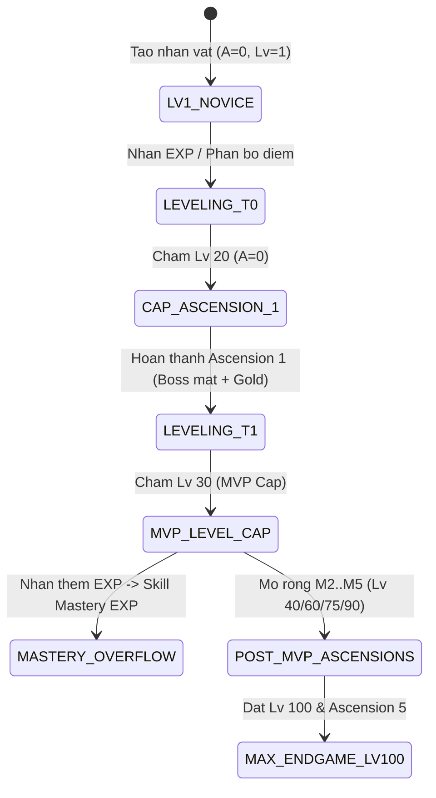

# 05 — Character Progression & Attribute System (Lv 1 – Lv 100): Eldoria: Forgotten Wilds

**Trạng thái**: Hoàn thiện (Design Baseline v1.0)  
**Chế độ**: `DESIGN_AND_PLANNING_ONLY`  
**Cập nhật lần cuối**: 2026-11-19  
**Tham chiếu Chéo**: [`docs/balancing/combat-formulas.md`](../balancing/combat-formulas.md), [`docs/balancing/progression-model.md`](../balancing/progression-model.md), [`docs/balancing/weapon-upgrade-costs.csv`](../balancing/weapon-upgrade-costs.csv), [`game-data/characters.json`](../../game-data/characters.json)  
**Tham chiếu Hiến pháp**: [`.specify/memory/constitution.md`](../../.specify/memory/constitution.md) (Nguyên tắc I, II, III, VI, VII, VIII)

---

## 1. Triết lý Tiến trình & Phạm vi MVP vs Dài hạn

Hệ thống Tiến trình Nhân vật trong **Eldoria: Forgotten Wilds** được xây dựng trên 3 trụ cột cân bằng dài hạn:

1. **Tăng trưởng Tuyến tính + Đa thức Có Kiểm soát (Non-Exponential Scaling)**: Sức mạnh nhân vật tăng rõ rệt qua từng mốc vùng đất (`Lv 1 → Lv 15 → Lv 30 → Lv 60 → Lv 100`) mà **không** phình to theo hàm mũ cực đoan (tránh tình trạng số sát thương nhảy từ `100` lên `10,000,000` gây gãy cấu trúc Boss và làm vô dụng nội dung cũ).
2. **Đa nguồn Sức mạnh Liên kết Vòng lặp Gameplay**: Cấp độ nhân vật chỉ chiếm khoảng `~35%` tổng sức mạnh thực chiến; `~45%` đến từ vũ khí/trang bị và cường hóa `+0 → +10` (gắn với khai khoáng, dungeon và nâng cấp `bld_blacksmith`); `~20%` đến từ thực phẩm nông trại, kỹ năng, Ascension và Talent Tree.
3. **Phân kỳ MVP rõ ràng**: Lộ trình dài hạn trải dài tới **Lv 100** và **5 Bậc Ascension**, nhưng **MVP (Milestone 1)** khóa trần tại **Lv 30** và **Ascension Tier 1 (Lv 20)**. Kinh nghiệm nhận được sau khi chạm trần MVP Lv 30 sẽ tự động tích lũy vào `Skill Mastery EXP` thay vì bị lãng phí.

---

## 2. Hệ thống 17 Thuộc tính Chuẩn (Full Attribute System)

Mọi nhân vật đều được điều khiển bởi **17 chỉ số chính thức**, chia làm 3 tầng: **3 Tài nguyên Sinh tồn & Chiến đấu**, **6 Thuộc tính Gốc (Primary Attributes)** và **8 Chỉ số Phái sinh / Chiến đấu (Derived & Secondary Combat Stats)**. Toàn bộ phép tính được thực hiện 100% tại `StatCalculator` trên NestJS game server.

### 2.1 Danh mục Đầy đủ 17 Chỉ số & Vai trò

| # | Mã Chỉ số | Nhóm | Nguồn Tăng trưởng | Tác động Gameplay Chính | Trần / Giới hạn Cứng |
| :-: | :--- | :---: | :--- | :--- | :---: |
| 1 | `HP` (Max HP) | Tài nguyên | Base + Growth + `VIT`/`STR` + Equip + Ascension | Sinh lực tối đa; chạm `0` kích hoạt trạng thái `DEAD` | Không giới hạn cứng (tuyến tính) |
| 2 | `MP` (Max MP) | Tài nguyên | Base + Growth + `INT`/`VIT` + Equip | Năng lượng tung Active/Ultimate; hồi bằng Basic Attack & thuốc | Không giới hạn cứng (tuyến tính) |
| 3 | `Stamina` | Tài nguyên | `100` + `AGI`/`VIT` + Equip + Food | Tiêu hao cho Dodge (`20`), Sprint, Block (`12`), Basic/Skill | **Cap: `260`** |
| 4 | `ATK` (Total ATK) | Chiến đấu | Base + Growth + `STR`/`DEX`/`INT_magic` + Weapon(+e) + Equip + Ascension + Food | Chỉ số sát thương nền cho Basic Attack & kỹ năng scale `ATK` | Tuyến tính có kiểm soát |
| 5 | `DEF` (Total DEF) | Chiến đấu | Base + Growth + `VIT`/`STR` + Equip + Ascension | Giảm sát thương nhận vào theo đường cong hyperbolic & scale kỹ năng Tank (`Bram`, `Rowan`) | Không bao giờ đạt 100% giảm sát thương |
| 6 | `STR` (Strength) | Thuộc tính gốc | Base + Growth + Allocated + Equip | `+2.4 ATK`, `+4 MaxHP`, `+0.6 DEF` mỗi điểm | `allocatedStr <= 500` |
| 7 | `AGI` (Agility) | Thuộc tính gốc | Base + Growth + Allocated + Equip | `+1.5 MaxStamina`, `+0.3% AttackSpeed`, `+0.15% MoveSpeed` mỗi điểm | `allocatedAgi <= 500` |
| 8 | `INT` (Intelligence) | Thuộc tính gốc | Base + Growth + Allocated + Equip | `+10 MaxMP`, `+0.15% CDR`, `+2.2 ATK` (cho class phép `MAGE`/`HEALER`/`SUMMONER`) & scale trực tiếp kỹ năng `INT` | `allocatedInt <= 500` |
| 9 | `VIT` (Vitality) | Thuộc tính gốc | Base + Growth + Allocated + Equip | `+18 MaxHP`, `+2 MaxMP`, `+1.0 MaxStamina`, `+1.8 DEF` mỗi điểm | `allocatedVit <= 500` |
| 10 | `DEX` (Dexterity) | Thuộc tính gốc | Base + Growth + Allocated + Equip | `+1.4 ATK`, `+0.25% CritRate`, `+0.2% AttackSpeed` mỗi điểm | `allocatedDex <= 500` |
| 11 | `LUK` (Luck) | Thuộc tính gốc | Base + Growth + Allocated + Equip | `+0.35% CritRate`, `+0.4% CritDamage` mỗi điểm; tăng nhẹ xác suất phẩm chất nông sản/tinh luyện (có cap) | `allocatedLuk <= 500` |
| 12 | `Critical Rate` | Phái sinh | Base + Growth + `DEX`/`LUK` + Equip + Weapon +5 + Buff | Tỷ lệ kích hoạt đòn đánh chí mạng | **Hard Cap: `75%` (`0.75`)** |
| 13 | `Critical Damage` | Phái sinh | Base (`150%–168%`) + Growth + `LUK` + Equip + Buff | Hệ số nhân sát thương khi chí mạng | **Hard Cap: `250%` (`2.50`)** |
| 14 | `Attack Speed` | Phái sinh | `1.00` + `AGI`/`DEX` + Equip + Buff | Giảm khoảng cách giữa các đòn đánh thường & rút ngắn tốc độ combo | **Hard Cap: `+60%` (`1.60x`)** |
| 15 | `Movement Speed` | Phái sinh | `BaseMove` (`138–170 px/s`) × `(1 + AGI + Equip + Buff)` | Tốc độ di chuyển px/giây trên bản đồ & né telegraph | **Hard Cap: `+45%` (`1.45x BaseMove`)** |
| 16 | `Elemental Resistance` | Phái sinh (9 hệ) | `BaseRes(el)` + `EquipRes(el)` + Buff cho cả 9 nguyên tố | Giảm sát thương của từng nguyên tố (`FIRE..NEUTRAL`) | **Clamp: `[-35%, +70%]`** |
| 17 | `Cooldown Reduction` | Phái sinh | `BaseCDR` + `INT` + Equip + Set Bonus | Giảm thời gian hồi chiêu mọi Active & Ultimate | **Hard Cap: `40%` (`0.40`)** |

### 2.2 Bộ Công thức Tính Chỉ số Phái sinh Chính thức (Canonical Derived Stat Formulas)

Khớp `100%` với [`docs/balancing/combat-formulas.md`](../balancing/combat-formulas.md), với cấp độ $L \in [1, 100]$, bậc đột phá $A \in [0, 5]$, bậc cường hóa vũ khí $e \in [0, 10]$, và tổng mỗi thuộc tính sơ cấp $P \in \{\text{STR, AGI, INT, VIT, DEX, LUK}\}$ được tính là:

$$P_{\text{total}} = P_{\text{base}} + P_{\text{growth}}\cdot(L - 1) + P_{\text{allocated}} + P_{\text{equip}} + P_{\text{food}} + P_{\text{constellation}}$$

Các chỉ số tổng hợp của nhân vật được tính theo đúng thứ tự sau trên server:

$$\text{MaxHP} = \left\lfloor \left(\text{BaseHP} + \text{HP\_Growth}\cdot(L-1) + 18\cdot\text{VIT} + 4\cdot\text{STR} + \text{EquipHP}\right)\cdot(1 + 0.06\cdot A) \right\rfloor$$
$$\text{MaxMP} = \left\lfloor \text{BaseMP} + \text{MP\_Growth}\cdot(L-1) + 10\cdot\text{INT} + 2\cdot\text{VIT} + \text{EquipMP} \right\rfloor$$
$$\text{MaxStamina} = \min\left(260,\; \left\lfloor 100 + 1.5\cdot\text{AGI} + 1.0\cdot\text{VIT} + \text{EquipStamina} \right\rfloor\right)$$
$$\text{WeaponATK}(e) = \left\lfloor \text{WeaponBaseATK}\cdot\left(1 + \text{EnhPct}(e)\right) + \text{EnhFlat}(e) \right\rfloor, \quad e \in \{0..10\}$$
$$\text{TotalATK} = \left\lfloor \left(\text{BaseATK} + \text{ATK\_Growth}\cdot(L-1) + 2.4\cdot\text{STR} + 1.4\cdot\text{DEX} + 2.2\cdot\text{INT}_{\text{magic}} + \text{WeaponATK}(e) + \text{EquipATK}\right)\cdot\left(1 + 0.06\cdot A + \text{FoodAtkPct}\right) \right\rfloor$$
$$\text{TotalDEF} = \left\lfloor \left(\text{BaseDEF} + \text{DEF\_Growth}\cdot(L-1) + 1.8\cdot\text{VIT} + 0.6\cdot\text{STR} + \text{EquipDEF}\right)\cdot(1 + 0.06\cdot A) \right\rfloor$$
$$\text{CritRate} = \min\left(0.75,\; \text{BaseCrit} + \text{CritGrowth}\cdot(L-1) + 0.0025\cdot\text{DEX} + 0.0035\cdot\text{LUK} + \text{EquipCrit} + \text{EnhMilestoneCrit}\right)$$
$$\text{CritDamage} = \min\left(2.50,\; \text{BaseCritDmg} + \text{CritDmgGrowth}\cdot(L-1) + 0.004\cdot\text{LUK} + \text{EquipCritDmg}\right)$$
$$\text{AttackSpeedMult} = \min\left(1.60,\; 1.00 + 0.003\cdot\text{AGI} + 0.002\cdot\text{DEX} + \text{EquipAtkSpd}\right)$$
$$\text{CDR} = \min\left(0.40,\; \text{BaseCDR} + 0.0015\cdot\text{INT} + \text{EquipCDR}\right)$$
$$\text{MoveSpeed} = \min\left(\left\lfloor \text{BaseMove}\cdot 1.45 \right\rfloor,\; \left\lfloor \text{BaseMove}\cdot\left(1 + 0.0015\cdot\text{AGI} + \text{EquipMovePct}\right) \right\rfloor\right)$$
$$\text{ElementalRes}(el) = \text{clamp}\left(\text{BaseRes}(el) + \text{EquipRes}(el) + \text{BuffRes}(el),\; -0.35,\; 0.70\right)$$

*Ghi chú quy ước*: Hệ số `2.2 * INT_magic` chỉ cộng vào `TotalATK` khi nhân vật thuộc lớp phép thuật (`MAGE`, `HEALER`, `SUMMONER`); các kỹ năng ghi `scalingStat: "INT"` sử dụng trực tiếp tổng `INT` (hoặc `TotalATK` phép quy đổi theo từng công thức skill).

---

## 3. Đường cong Kinh nghiệm (EXP Curve Lv 1 → Lv 100)

Để đảm bảo 30 phút đầu tạo nhịp lên cấp nhanh gây hưng phấn (`Lv 1 → Lv 5`), giai đoạn `Lv 10–30` đủ thử thách cho vòng lặp MVP, và giai đoạn dài hạn `Lv 31–100` duy trì mục tiêu nhiều tháng mà không bị lạm phát hàm mũ, Eldoria áp dụng công thức đa thức bậc `2.25`:

$$\text{EXP}_{\text{toNext}}(L) = \left\lfloor 100 + 35\cdot L + 12\cdot L^{2.25} \right\rfloor, \quad L \in \{1..99\}$$

### 3.1 Bảng Mốc Tiến trình Chuẩn (Đã Kiểm chứng Toán học bằng Công thức Chính xác)

| Cấp độ ($L$) | EXP lên cấp tiếp ($\text{EXP}_{\text{toNext}}$) | Tổng EXP tích lũy ($\sum_{k=1}^{L-1}$) | Vùng / Nội dung Tương ứng | Thời gian ước tính (Regular 2.5h/ngày — `proposed`) | Điểm Thuộc tính tích lũy (`+5/lv`) | Điểm Kỹ năng tích lũy (`L + floor(L/5)`) | Cột mốc Mở khóa |
| :---: | :---: | :---: | :--- | :---: | :---: | :---: | :--- |
| **1** | `147` | `0` | `reg_greenhaven_village` | 0 phút (Khởi đầu) | `0` | `1` | Active 1 + Passive Lv 1 |
| **5** | `723` | `1,232` | `reg_whispering_forest` (Rìa rừng) | ~25 phút | `20` | `6` | Active 2 (Lv 3), +1 SP mốc 5 |
| **10** | `2,583` | `8,011` | `reg_whispering_forest` (Sâu) | ~2.5 giờ | `45` | `12` | Active 3 (Lv 6), **Ultimate (Lv 10)** |
| **15** | `5,938` | `27,003` | `dng_mossroot_hollow` (**MVP Boss**) | ~6 giờ (~2–3 ngày) | `70` | `18` | Chinh phục `boss_thornback_elder` |
| **20** | `10,950` | `66,028` | MVP Mid-Endgame | ~14 giờ (~6 ngày) | `95` | `24` | **Ascension Tier 1** + Talent Nhánh 1 |
| **25** | `17,745` | `133,633` | MVP Hardcore / Rèn `+10` | ~26 giờ (~10 ngày) | `120` | `30` | Sẵn sàng hoàn thiện vũ khí `+10` |
| **30 `[MVP Cap]`** | `26,425` | `238,946` | **Trần MVP** / `reg_ironpeak_mountains` (M2) | ~42 giờ (~17 ngày) | `145` | `36` | Khóa trần MVP; dư EXP → Mastery EXP |
| **45** | `64,612` | `879,265` | `reg_crystal_caverns` (M3) | ~1.5 tháng | `220` | `54` | Sau **Ascension Tier 2 (Lv 40)** |
| **60** | `122,432` | `2,227,757` | `reg_forgotten_ruins` / `reg_frostbound_highlands` | ~2.5 tháng | `295` | `72` | **Ascension Tier 3** + Talent Nhánh 2 |
| **75** | `201,366` | `4,589,691` | `reg_ember_wasteland` (M4) | ~4 tháng | `370` | `90` | **Ascension Tier 4** + `boss_boreas_frostking` |
| **90** | `302,632` | `8,290,569` | `reg_abyssal_kingdom` (M5) | ~6 tháng | `445` | `108` | **Ascension Tier 5** + Talent Keystone |
| **100 (Max)** | `—` | `11,670,182` | Endgame Raid (`boss_malakor_abyss`) | ~7–8 tháng | `495` | `120` | Tối đa cấp độ dài hạn |

> *Ghi chú kiểm toán chéo (Cross-Audit Note)*: Toàn bộ giá trị cột `EXP lên cấp tiếp` và `Tổng EXP tích lũy` ở bảng trên được tính trực tiếp bằng phép tính chuẩn $\lfloor 100 + 35L + 12L^{2.25}\rfloor$ (Node.js verified). Một số giá trị ước lượng tay trong `docs/balancing/progression-model.md` (ví dụ `724` vs `723` ở Lv 5, `26,307` vs `26,425` ở Lv 30, `12,188,242` vs `11,670,182` ở Lv 100) cần được đồng bộ về giá trị chính xác này trong Phase 8 Cross-Document Audit.

### 3.2 Quy tắc Nhận EXP & Chống Power-Leveling (Anti-Leech)
- **Nguồn EXP**: Đánh quái/Elite/Boss (`50%`), hoàn thành Quest (`30%`), Thu thập/Chế tạo/Thu hoạch nông sản (`20%` — khẳng định trụ cột mọi hoạt động farm đều đóng góp tiến trình).
- **Phạt chênh lệch cấp**: Nếu quái vật thấp hơn nhân vật `> 10` cấp, EXP giảm tuyến tính về sàn `15%`. Trong Party Co-op, thành viên chỉ nhận EXP nếu đứng trong phạm vi `640 px` (20 tiles) từ điểm quái bị hạ và có hành động hợp lệ trong 30 giây gần nhất (chống AFK kéo cấp).

---

## 4. Điểm Thuộc tính, Điểm Kỹ năng, Thông thạo, Đột phá & Cây Thiên phú

### 4.1 Attribute Points (`+5` điểm / cấp) & Cơ chế Tẩy điểm (Respec)
- Mỗi lần lên cấp ($L \to L+1$), nhân vật nhận **`+5` Attribute Points** tự do (`495` điểm ở Lv 100; `145` điểm ở MVP Cap Lv 30).
- Điểm phân bổ được chia sẻ theo hồ sơ Character hoặc lưu preset riêng cho từng Hero (tối đa 2 preset miễn phí; chuyển đổi tại Safe Zone).
- **Tẩy điểm (Attribute Respec)**: Thực hiện tại `bld_training_ground` hoặc NPC `npc_elder_rowan` tại Greenhaven Village với chi phí **`250 × Level` Gold** (Gold sink lành mạnh, không bán vật phẩm tẩy điểm bằng tiền thật).

### 4.2 Skill Points (`+1` / cấp + Thưởng Mốc 5) & Skill Mastery
- **Skill Points (SP)**: Khởi đầu Lv 1 có `1` SP; mỗi cấp nhận `+1` SP; mỗi mốc chia hết cho 5 (`Lv 5, 10, 15, 20, ...`) thưởng thêm `+1` SP → Công thức tổng SP tích lũy: $\text{TotalSP}(L) = L + \lfloor L/5 \rfloor$.
  - Chi phí nâng tối đa 1 Hero (1 Passive Max Rank 5 = `4` SP + 3 Active Max Rank 10 = `27` SP + 1 Ultimate Max Rank 5 = `4` SP) chỉ cần tổng **`35` SP** → Đạt đủ tại **Lv 30 (`36` SP)**! Số SP dư ở Lv 31–100 được dùng để mở khóa & nâng điểm **Talent Tree** và nâng song song bộ kỹ năng của các Hero phụ trong bộ sưu tập.
- **Skill Mastery (Thông thạo Kỹ năng — 5 Bậc)**: Mỗi lần sử dụng kỹ năng trúng mục tiêu hợp lệ trong chiến đấu (có ICD `2s` chống spam vào không khí) cộng `10 Mastery EXP` cho kỹ năng đó:
  - **Rank I (Novice — 0 EXP)**: Mặc định.
  - **Rank II (Adept — 500 EXP)**: Giảm `2%` Mana/Stamina tiêu hao của kỹ năng.
  - **Rank III (Expert — 2,000 EXP)**: Tăng `+2%` `baseDamage` hoặc hiệu lực khiên/hồi máu.
  - **Rank IV (Master — 6,000 EXP)**: Giảm `3%` hồi chiêu nội tại (vẫn nằm trong trần chung `CDR <= 40%`).
  - **Rank V (Grandmaster — 15,000 EXP)**: Mở khóa biến thể viền VFX tinh tế (chỉ mỹ thuật, không tăng sát thương phá cân bằng) và danh hiệu Mastery.

### 4.3 Character Ascension (5 Bậc Đột phá — Lv 20 / 40 / 60 / 75 / 90)

Ascension là cột mốc gắn chặt tiến trình cá nhân với **Boss Raid Co-op** và **Chế tạo**:

| Bậc Ascension ($A$) | Mốc Cấp mở khóa | Phần thưởng Chỉ số Tích lũy | Mở khóa Tính năng | Nguyên liệu Yêu cầu Chính | Milestone |
| :---: | :---: | :--- | :--- | :--- | :---: |
| **Tier 1** | **Lv 20** | `+6%` Total ATK / HP / DEF | Mở Talent Tier 1 (Cấp nhánh cơ bản) + giới hạn Lv 21–40 | `2× mat_thornback_heart` + `5× mat_steel_ingot` + `2,500 Gold` | **M1 (MVP)** |
| **Tier 2** | **Lv 40** | `+12%` Total ATK / HP / DEF | Mở Talent Tier 2 + giới hạn Lv 41–60 | `3×` Boss Token `boss_ignis_forgelord` + tinh thể Ironpeak + `8,000 Gold` | M2 |
| **Tier 3** | **Lv 60** | `+18%` Total ATK / HP / DEF | Mở Talent Tier 3 + giới hạn Lv 61–75 | `4×` Boss Token `boss_prism_leviathan` + lõi Crystal + `20,000 Gold` | M3 |
| **Tier 4** | **Lv 75** | `+24%` Total ATK / HP / DEF | Mở Talent Tier 4 + giới hạn Lv 76–90 | `5×` Boss Token `boss_boreas_frostking` + băng tinh + `45,000 Gold` | M4 |
| **Tier 5** | **Lv 90** | `+30%` Total ATK / HP / DEF | Mở **Talent Keystone** + giới hạn Lv 91–100 | `6×` Boss Token `boss_malakor_abyss` + tinh chất Hư Không + `90,000 Gold` | M5 |

### 4.4 Talent Tree (3 Nhánh Chuyên biệt Theo Vai trò)

Mỗi nhóm vai trò sở hữu **3 nhánh Talent** (mỗi nhánh có 4 nút nhỏ mở theo Ascension Tier 1–4 và 1 nút **Keystone** ở Tier 5). Người chơi chỉ được chọn **tối đa 1 Keystone chủ lực** và phân bổ tổng tối đa `15` điểm Talent nhằm ngăn build ôm trọn cả 3 nhánh gây mất cân bằng:

| Nhóm Vai trò | Nhánh 1 — Chuyên sâu Công / Cốt lõi | Nhánh 2 — Kiểm soát / Phản ứng & Nhịp độ | Nhánh 3 — Sinh tồn / Hỗ trợ Tổ đội |
| :--- | :--- | :--- | :--- |
| **`MELEE_DPS` / `HYBRID`** (*Kael, Vex, Torvald, Mira*) | **Bladestorm / Executioner**: Tăng sát thương đòn kết combo (`+6%`), tăng `DefPenPct` (`+6%`), Keystone: đòn kết combo giảm `0.5s` CD Active 1. | **Poise Breaker**: Tăng `+12%` Poise Damage, hồi `8` Stamina khi phá Poise Boss, Keystone: tăng `+10%` sát thương phản ứng nguyên tố. | **Vanguard Grit**: Giảm `2` Stamina tiêu hao khi Dodge/Block, hồi `3% Max HP` sau Perfect Parry, Keystone: tự kích Khiên `10% Max HP` khi tụt `< 25% HP` (ICD `45s`). |
| **`RANGED_DPS`** (*Lyra, Aurelia*) | **Deadeye Precision**: Tăng `+5%` CritRate (trong trần `75%`), `+8%` sát thương mục tiêu xa `> 180 px`, Keystone: mũi bắn thứ 3 cộng `+8%` xuyên giáp. | **Gale Tempo**: Giảm `5%` hồi chiêu kỹ năng cơ động, tăng `+10%` sát thương `Swirl`/Đạn xuyên, Keystone: sau Dodge tăng `+10% Attack Speed` trong `3s`. | **Ranger Survival**: Tăng `+8%` hiệu lực thức ăn buff, giảm `20%` thời gian bị Làm Chậm, Keystone: chia sẻ `+6% MoveSpeed` cho đồng minh quanh `160 px`. |
| **`MAGIC_DPS`** (*Orin, Freya, Nyx*) | **Arcane Surge**: Tăng `+6%` tổng `INT`, giảm `8%` Cast Time, Keystone: tung Ultimate hồi `15% Max MP`. | **Elemental Resonance**: Tăng `+10%` hiệu lực DoT & Phản ứng Nguyên tố, kéo dài thời gian Debuff `+1s`, Keystone: phản ứng nguyên tố giảm `1s` CD Active 3 (ICD `6s`). | **Spellward Barrier**: Tăng `+12%` độ bền Khiên bản thân / HP Thực Thể triệu hồi, giảm `10%` tiêu hao MP khi HP `< 50%`, Keystone: tạo vòng đẩy lùi nhẹ khi vỡ Khiên (ICD `30s`). |
| **`TANK`** (*Bram, Rowan*) | **Retaliation Bulwark**: Tăng `+15%` Threat sinh ra và chuyển thêm `+4% DEF` thành ATK, Keystone: Perfect Parry phản gấp đôi Poise (`25% → 50%` trong `1` đòn, ICD `8s`). | **Crowd Warden**: Tăng `+15%` bán kính Taunt/AoE kiểm soát, giảm `10%` sát thương DoT nhận vào, Keystone: đòn gây Poise làm giảm `8%` ATK kẻ địch trong `4s`. | **Aegis Protector**: Tăng `+12%` độ bền Khiên cho tổ đội, `+10%` lượng hồi máu nhận vào từ Healer, Keystone: tăng `+10%` kháng nguyên tố cho đồng minh trong `160 px`. |
| **`SUPPORT`** (*Seraphina*) | **Radiant Smite**: Tăng `+12%` sát thương kỹ năng `LIGHT` và tăng thời lượng `eff_radiant_mark` thêm `+1.5s`, Keystone: đòn đánh thường hồi thêm `+2 MP`. | **Chrono Blessing**: Tăng `+5% CDR` (trong trần `40%`), giảm `10%` Cast Time kỹ năng hồi máu, Keystone: thanh tẩy debuff thành công tăng `+8% ATK` cho đồng minh trong `5s`. | **Merciful Sanctuary**: Tăng `+12%` hiệu quả hồi máu & khiên, giảm `15%` sát thương nhận vào khi đang niệm phép, Keystone: đồng đội nhận sát thương chí tử được giữ lại `1 HP` + Khiên `15%` (ICD `90s`/người). |

---

## 5. Công thức Equipment Power (`EP`) & Combat Rating (`CR`)

### 5.1 Equipment Power (`EP`)
Mỗi món vũ khí/trang bị được đánh giá minh bạch bằng điểm `EP` hiển thị trên Tooltip để người chơi so sánh nhanh (không thay thế giá trị chiến thuật của Set Bonus):

$$\text{EP}_{\text{item}} = \left\lfloor 2.8\cdot\text{ATK}_{\text{eff}} + 2.0\cdot\text{DEF} + 0.20\cdot\text{HP} + 0.30\cdot\text{MP} + 1.8\cdot\sum\text{PrimaryStats} + 350\cdot\text{CritRate} + 140\cdot\text{CritDmg} + 320\cdot\text{CDR} + 25\cdot e_{\text{enhance}} \right\rfloor$$

Trong đó $\text{ATK}_{\text{eff}} = \text{WeaponATK}(e)$ đối với vũ khí.

### 5.2 Combat Rating (`CR`) — Công thức Chuẩn
Khớp `100%` công thức trong [`docs/balancing/progression-model.md`](../balancing/progression-model.md):

$$\text{CR} = \left\lfloor 0.25\cdot\text{MaxHP} + 0.40\cdot\text{MaxMP} + 3.2\cdot\text{TotalATK} + 2.4\cdot\text{TotalDEF} + 450\cdot\text{CritRate} + 180\cdot(\text{CritDamage}-1) + 400\cdot\text{CDR} + 15\cdot\sum\text{SkillRank} \right\rfloor$$

### 5.3 Khung Tham chiếu Combat Rating Theo Giai đoạn (Từ Công thức Tính Thực tế)

> *Ghi chú minh bạch*: Kết quả kiểm chứng bằng Node.js trên công thức `CR` đầy đủ cho nhân vật `chr_kael_vanguard` ở mục 6 dưới đây cho thấy mốc `CR` thực tế tăng tuyến tính từ `~960` (Lv 1) đến `~3,269` (Lv 15) và `~6,576` (Lv 30). Các ngưỡng tham chiếu sơ bộ nhỏ hơn trong `docs/balancing/progression-model.md` (`180–2,200`) là bảng ước tính khi chưa cộng đủ 6 thuộc tính phái sinh (`STR/VIT/DEX`) và cần được đồng bộ về dải tính thực tế dưới đây ở Phase 8 Audit.

| Nội dung / Mốc Chinh phục | Cấp đề xuất | Trang bị Kỳ vọng | Dải Combat Rating Thực tế (`CR` — Verified Formula) |
| :--- | :---: | :--- | :---: |
| `reg_whispering_forest` (Ngoài) | Lv 1–7 | Vũ khí khởi đầu `+0..+2` + Novice 2–4 món | `900 – 1,750` |
| `mob_elite_alpha_direwolf` | Lv 10–13 | Vũ khí sắt `+3..+5` + Giáp thợ săn | `2,200 – 2,900` |
| `dng_mossroot_hollow` (`boss_thornback_elder`) | **Lv 15** | Vũ khí `+6` + Bộ `set_mossroot_guard` + Món ăn Buff | **`3,000 – 3,600`** |
| **MVP Endgame Cap (`+10` + Ascension 1)** | **Lv 30** | Vũ khí Rare `+10` + Bộ Ironpeak + Ascension 1 | **`6,200 – 7,000`** |
| Mid-Endgame (`reg_forgotten_ruins` / `reg_frostbound_highlands`) | **Lv 60** | Vũ khí Epic `+10` + Ascension 3 | **`12,500 – 13,800`** |
| Endgame Raid (`boss_malakor_abyss`) | **Lv 100** | Vũ khí Legendary/Mythic `+10` + Ascension 5 | **`21,500 – 23,500`** |

---

## 6. Ví dụ Tính toán Chi tiết Qua 5 Mốc Tiến trình (Worked Examples — Node.js Verified)

Tất cả các con số dưới đây được tính chính xác cho nhân vật khởi đầu MVP **`chr_kael_vanguard` (Kael Ironbound)** sử dụng đúng dữ liệu `game-data/characters.json`, `game-data/items.json`, `docs/balancing/weapon-upgrade-costs.csv` và bộ công thức tại Mục 2.2:

### 6.1 Bảng Tổng hợp 5 Mốc Chuẩn của `chr_kael_vanguard`

| Thông số | **Lv 1** (Khởi đầu) | **Lv 15** (MVP Boss) | **Lv 30** (MVP Cap) | **Lv 60** (Mid-Endgame) | **Lv 100** (Max Raid) |
| :--- | :---: | :---: | :---: | :---: | :---: |
| **Bậc Ascension ($A$)** | `0` (`+0%`) | `0` (`+0%`) | `1` (`+6%`) | `3` (`+18%`) | `5` (`+30%`) |
| **Phân bổ Attribute Points** | `0` | `70` (`35 STR, 15 VIT, 15 DEX, 5 LUK`) | `145` (`70 STR, 30 VIT, 30 DEX, 15 LUK`) | `295` (`140 STR, 60 VIT, 60 DEX, 35 LUK`) | `495` (`230 STR, 100 VIT, 100 DEX, 65 LUK`) |
| **Vũ khí & Cường hóa** | `wpn_iron_longsword +0` (`26` ATK) | `wpn_iron_longsword +6` (`+60%`, `+36` flat → **`77` ATK**) | `wpn_crimson_vanguard_blade +10` (`78` base → **`275` ATK**) | `wpn_runic_ruin_saber +10` (`172` base → **`491` ATK**) | `wpn_solaris_eclipse_blade +10` (`302` base → **`790` ATK**) |
| **Bộ Giáp & Món ăn** | `set_greenhaven_novice` (2p) | `set_mossroot_guard` (4p) + `csm_golden_roast` (`+10% ATK`) | `set_ironpeak_forge` (4p) + `csm_golden_roast` (`+10% ATK`) | Giáp Epic Lv 60 + Food (`+10% ATK`) | Giáp Endgame Lv 100 + Food (`+12% ATK`) |
| **`STR` / `AGI` / `INT`** | `18.0` / `11.0` / `8.0` | `78.6` / `23.6` / `15.0` | `143.6` / `37.1` / `22.5` | `269.6` / `64.1` / `37.5` | `438.6` / `100.1` / `57.5` |
| **`VIT` / `DEX` / `LUK`** | `15.0` / `11.0` / `9.0` | `54.8` / `38.6` / `23.8` | `93.8` / `67.1` / `44.3` | `171.8` / `142.1` / `85.3` | `276.8` / `230.1` / `163.3` |
| **`MaxHP`** | **`577`** | **`2,030`** | **`3,636`** | **`7,520`** | **`13,662`** |
| **`MaxMP` / `MaxStamina`** | `195` / `146` | `421` / `190` | `657` / `249` | `1,128` / `260 (Cap)` | `1,758` / `260 (Cap)` |
| **`TotalATK`** | **`112`** | **`447`** | **`1,027`** | **`2,147`** | **`3,902`** |
| **`TotalDEF`** | **`63`** | **`258`** | **`487`** | **`1,008`** | **`1,855`** |
| **`CritRate` / `CritDamage`** | `17.90%` / `158.6%` | `36.38%` / `168.7%` | `56.18%` / `199.4%` | `75.00% (Cap)` / `234.8%` | `75.00% (Cap)` / `250.0% (Cap)` |
| **`AttackSpeed` / `CDR` / `MoveSpd`** | `1.055x` / `3.2%` / `154` | `1.198x` / `4.3%` / `157` | `1.326x` / `9.4%` / `160` | `1.597x` / `15.6%` / `166` | `1.600x (Cap)` / `22.6%` / `174` |
| **Tổng Rank Kỹ năng** | `2` | `16` | `32` | `45` | `45` |
| **Combat Rating (`CR`)** | **`960`** | **`3,269`** | **`6,576`** | **`12,938`** | **`22,430`** |

### 6.2 Giải trình Từng Bước Tại Mốc Trọng điểm: Lv 15 (MVP Boss `boss_thornback_elder`)
- `STR = 15 + 1.4 × 14 + 35 (allocated) + 9 (equip) = 78.6`.
- `VIT = 13 + 1.2 × 14 + 15 (allocated) + 10 (equip) = 54.8`.
- `WeaponATK(+6) = floor(26 × (1 + 0.60) + 36) = floor(41.6 + 36) = 77`.
- `MaxHP = floor((195 + 22.5 × 14 + 18 × 54.8 + 4 × 78.6 + 220) × 1.00) = floor(2030.8) = 2,030`.
- `TotalATK = floor((28 + 4.2 × 14 + 2.4 × 78.6 + 1.4 × 38.6 + 77 + 0) × (1 + 0 + 0.10)) = floor(406.48 × 1.10) = 447`.
- `TotalDEF = floor(18 + 2.3 × 14 + 1.8 × 54.8 + 0.6 × 78.6 + 62) = floor(258.0) = 258`.
- So sánh với `boss_thornback_elder` (Lv 15: `HP = 10,500`, `DEF = 34`, yếu `FIRE -35%`): Kael Lv 15 gây khoảng `~550–1,450` sát thương/kỹ năng (và `~2,800+` khi Ultimate `Crimson Crescent` trúng pha Break), hoàn toàn hợp lý để một tổ đội 2–4 người hoàn thành Boss trong `2.5 – 4.5 phút` giàu kịch tính!

### 6.3 Kiểm chứng Công bằng Giữa `COMMON` vs `LEGENDARY` Ở Cùng Trang bị (Lv 30)
Với cùng bộ trang bị Lv 30 (`+10` vũ khí `84` base ATK, `set_ironpeak_forge` 4p, `csm_golden_roast`, `145` điểm phân bổ và `Ascension 1`):
- **`chr_mira_ironfist` (`COMMON`)**: `MaxHP = 3,598`, `TotalATK = 1,023`, `TotalDEF = 484`, `CritRate = 54.82%`, `CR = 6,549`.
- **`chr_torvald_rageborn` (`LEGENDARY`)**: `MaxHP = 3,962`, `TotalATK = 1,105`, `TotalDEF = 502`, `CritRate = 55.19%`, `CR = 6,931`.
- **Tỷ lệ ngang bằng**: Mira đạt **`92.58%` ATK** và **`94.49%` CR** của Torvald, chưa kể Mira đóng góp `+60%` Poise Boss và `-25%` DEF cho toàn party — khẳng định tuyệt đối không có khoảng cách pay-to-win.

---

## 7. Kiểm toán Chống Power Creep & Chống Khai thác Lỗi (Anti-Power-Creep & Exploitation Audit)

### 7.1 Bảng Trần Cứng Bắt buộc (Hard Caps Enforced at `StatCalculator`)

| Tham số / Chỉ số | Trần Cứng (Hard Cap) | Cơ chế Cưỡng chế trên Server | Rủi ro Bị Triệt tiêu |
| :--- | :---: | :--- | :--- |
| **`CritRate`** | **`<= 75%`** (`0.75`) | `Math.min(0.75, rawCrit)` sau mọi nguồn (Base + DEX/LUK + Equip + Buff; chỉ ngoại lệ có điều kiện duy nhất 1 đòn thoát `Dusk Shroud`) | Chặn build `100%` crit kích hoạt vô hạn các hiệu ứng on-crit |
| **`CritDamage`** | **`<= 250%`** (`2.50`) | `Math.min(2.50, rawCritDmg)` | Chặn one-shot Boss bỏ qua hoàn toàn Phase 2 & Phase 3 |
| **`CDR`** | **`<= 40%`** (`0.40`) | `Math.min(0.40, rawCdr)` + sàn cứng `EffectiveCooldownMs >= 400 ms` | Chặn spam kỹ năng i-frame (`Zephyr Vault`, `Volt Surge`) thành bất tử |
| **`AttackSpeed`** | **`<= +60%`** (`1.60x`) | `Math.min(1.60, rawAtkSpd)` + sàn `EffectiveAttackIntervalMs >= 280 ms` | Chặn phá vỡ cửa sổ đồng bộ animation và giới hạn tick 20 Hz |
| **`ElementalRes`** | **`<= 70%`** (và sàn `-35%`) | `clamp(rawRes, -0.35, 0.70)` cho từng nguyên tố riêng biệt | Chặn miễn nhiễm 100% nguyên tố khiến cơ chế Boss vô nghĩa |
| **`MoveSpeed`** | **`<= +45%`** (`1.45x BaseMove`) | `Math.min(BaseMove * 1.45, rawMove)` và dùng làm ngưỡng phát hiện Speed Hack | Chặn kiting vô hạn làm gãy Monster AI leash & speed exploit |
| **`DefPenPct`** | **`<= 50%`** (`0.50`) | `Math.min(0.50, totalPenPct)` | Bảo vệ giá trị của chỉ số `DEF` và vai trò Tank |
| **`Lifesteal`** | **`<= 35%`** (`0.35`) | Trần tổng hợp giữa Passive Torvald + Ultimate + Trang bị | Chặn Berserker hồi máu bất tử bất chấp đòn đánh Boss |
| **`MaxStamina`** | **`<= 260`** | `Math.min(260, rawStamina)` | Chặn lướt né (Dodge) 15 lần liên tục phá vỡ nhịp chiến đấu |
| **`WeaponEnhancement`** | **`<= +10`** | Khóa cứng schema `0..10` trên mọi vũ khí | Bảo vệ tuổi thọ nền kinh tế & không vượt thiết kế mặc định |

### 7.2 Phân tích Kiểm chứng 4 Rủi ro Mất Cân bằng Nghiêm trọng
1. **Chống Tăng trưởng Hàm mũ (Exponential Scaling Audit)**: So sánh `chr_kael_vanguard` từ Lv 1 đến Lv 100 cho thấy tỷ lệ tăng trưởng `TotalATK` (`112 → 3,902` = `34.8x`) tương ứng chặt chẽ với tỷ lệ tăng trưởng máu Boss (`boss_thornback_elder` Lv 15 `10,500` → `boss_malakor_abyss` Lv 100 `460,000` = `43.8x`, cân bằng bằng tổ đội 4 người + phản ứng nguyên tố). Tất cả các bậc nâng cấp skill (`upgradeScalingPerRank`), Ascension (`+6%` cộng gộp tuyến tính, không nhân chồng `1.06^5`), và food buff đều là phép cộng tuyến tính trong cùng nhóm hệ số.
2. **Chống Infinite Combo & Perma-CC**: Kết hợp `EffectiveCooldownMs >= 400 ms`, `CDR <= 40%`, tiêu hao Stamina/MP thật trên mỗi đòn và cơ chế **CC Diminishing Returns** (`100% → 50% → 25% → Miễn nhiễm` trong cửa sổ 20s) khiến không bất kỳ tổ hợp kỹ năng hay party 4 người nào có thể giữ cho Elite hoặc đối thủ PvP bị choáng vĩnh viễn.
3. **Chống Stat Overflow & Multi-Buff Stacking**: Nhân vật chỉ được mang tối đa **`2` active food buffs** khác nhóm cùng lúc (`activeFoodBuffs.length <= 2`); các buff cùng `effectId` làm mới thời gian (`refresh`) thay vì nhân cộng dồn vô hạn.
4. **Chống Giả mạo Stat Client-Side**: Trường `derivedSnapshot` trong `characters/<id>.json` chỉ phục vụ hiển thị nhanh; mỗi lần nhân vật đăng nhập, đổi trang bị, lên cấp hay ăn thức ăn, `StatCalculator` trên server tính lại toàn bộ từ đầu từ `game-data/*.json`.

---

## 8. Đặc tả 14 Tiêu chí Quality Gate (Section 27)

### 8.1 Mục tiêu Gameplay
- Cung cấp cảm giác tiến bộ rõ ràng theo từng phiên chơi (5 phút → 30 phút → 1 ngày → 1 tuần → 1 tháng) thông qua nhiều trục phát triển đan xen (Level, Attribute, Skill, Mastery, Ascension, Talent, Equipment).
- Duy trì cân bằng số học chặt chẽ suốt dải `Lv 1 – Lv 100`, bảo đảm không tồn tại build phá game, không lạm phát số và không ép buộc Gacha để tiến cấp.

### 8.2 User Stories
- **US-PRG-01**: Là người chơi mới, tôi muốn thấy rõ thanh EXP, thông báo lên cấp rực rỡ và biết mỗi điểm thuộc tính (`STR`, `AGI`, `INT`, `VIT`, `DEX`, `LUK`) thay đổi trực tiếp bao nhiêu HP, ATK, CritRate trước khi nhấn Xác nhận.
- **US-PRG-02**: Là người chơi thử nghiệm nhiều lối build (Tank, Crit DPS, CDR Mage), tôi muốn tẩy điểm thuộc tính và Talent tại `bld_training_ground` bằng Gold kiếm trong game mà không sợ "hỏng nhân vật vĩnh viễn".
- **US-PRG-03**: Là người chơi đạt trần MVP Lv 30, tôi muốn tiếp tục nhận giá trị tiến trình (Ascension Tier 1, nâng vũ khí `+10`, tích `Skill Mastery`) mà không cảm thấy công sức đi Dungeon bị bỏ phí.
- **US-PRG-04**: Là đội trưởng Party chuẩn bị vào `dng_mossroot_hollow`, tôi muốn thấy `Combat Rating (CR)` đề xuất so với `CR` hiện tại của bản thân và đồng đội để đánh giá mức độ sẵn sàng.

### 8.3 Functional Requirements
- **FR-PRG-01**: Server cộng EXP từ chiến đấu/nhiệm vụ/thu thập theo công thức $\text{EXP}_{\text{toNext}}(L) = \lfloor 100 + 35L + 12L^{2.25}\rfloor$, hỗ trợ xử lý lên nhiều cấp liên tiếp trong 1 lần nhận EXP lớn (multi-level-up loop) và khóa trần cứng tại `levelCap` (`30` trong MVP, `100` dài hạn).
- **FR-PRG-02**: Mỗi lần lên cấp tự động cộng `+5` `attributePointsFree`, `+1` `skillPointsFree` (và `+1` thưởng thêm tại mốc chia hết cho 5), hồi đầy `100%` HP/MP/Stamina (ngoài trạng thái `DEAD`) và phát sự kiện `LEVEL_UP`.
- **FR-PRG-03**: API phân bổ điểm thuộc tính cho phép cộng theo lô (`{ str, agi, int, vit, dex, luk }`), xác thực tổng điểm yêu cầu `<= attributePointsFree` và mỗi chỉ số `>= 0` trong giao dịch khóa mutex.
- **FR-PRG-04**: Hệ thống Ascension kiểm tra đủ điều kiện cấp độ tối thiểu (`20/40/60/75/90`), trừ nguyên liệu + Gold nguyên tử (WAL + `CurrencyLedger`), tăng `ascensionTier` và mở khóa giới hạn cấp/Talent tương ứng.
- **FR-PRG-05**: `StatCalculator` tính lại toàn bộ 17 chỉ số, áp dụng đủ toàn bộ Hard Caps và tính `combatRating` mỗi khi có thay đổi cấp độ, điểm cộng, trang bị, cường hóa, Ascension, Talent hoặc Food Buff.

### 8.4 Business Rules
- **BR-PRG-01**: Không thể nhận EXP để vượt quá mốc khóa cấp của bậc Ascension hiện tại (ví dụ: ở Lv 20 với `ascensionTier = 0`, EXP được tích tối đa đến `EXP_toNext(20) - 1` cho đến khi hoàn thành Ascension Tier 1 — riêng MVP cho phép hoàn thành Ascension Tier 1 ngay tại Lv 20 để lên tới Lv 30).
- **BR-PRG-02**: Chi phí tẩy điểm thuộc tính hoặc Talent là `250 × Level` Gold (trừ qua `CurrencyLedger` với `reasonCode: "STAT_RESPEC"`), chỉ thực hiện được tại Safe Zone (`isSafeZone === true`).
- **BR-PRG-03**: Không cho phép phân bổ điểm âm hoặc cộng vượt quá `500` điểm tự do cho một thuộc tính đơn lẻ.
- **BR-PRG-04**: Nhân vật đang trong trạng thái `DEAD` không nhận được hiệu ứng hồi đầy HP khi lên cấp từ đồng đội hoàn thành nhiệm vụ/hạ quái.
- **BR-PRG-05**: Mọi chỉ số đạt trần cứng (ví dụ `CritRate = 75%`) phải hiển thị màu vàng nổi bật kèm nhãn `(CAP)` trên UI để người chơi không cộng lãng phí.

### 8.5 Input và Output
- **Input (REST API)**:
  - `POST /api/v1/characters/:id/attributes/allocate`: `{ idempotencyKey, delta: { str, agi, int, vit, dex, luk } }`
  - `POST /api/v1/characters/:id/attributes/respec`: `{ idempotencyKey }`
  - `POST /api/v1/characters/:id/skills/:skillId/upgrade`: `{ idempotencyKey }`
  - `POST /api/v1/characters/:id/ascend`: `{ idempotencyKey }`
  - `POST /api/v1/characters/:id/talents/allocate`: `{ idempotencyKey, branchId, nodeId }`
- **Output**:
  - `{ level, exp, expToNext, ascensionTier, attributePointsFree, skillPointsFree, stats, derivedSnapshot, combatRating, appliedCaps[] }`.

### 8.6 State Transitions (Tiến trình Cấp độ & Ascension)



### 8.7 JSON Data Model (100% Local JSON Database)
Trường tiến trình được nhúng trực tiếp trong `data/db/characters/<characterId>.json` và ghi nhận biến động Gold/nguyên liệu vào `data/db/ledgers/currency-ledger-<YYYY-MM>.json`:
```json
{
  "level": 15,
  "exp": 1240,
  "ascensionTier": 0,
  "attributePointsFree": 5,
  "skillPointsFree": 2,
  "stats": {
    "allocatedStr": 35,
    "allocatedAgi": 0,
    "allocatedInt": 0,
    "allocatedVit": 15,
    "allocatedDex": 15,
    "allocatedLuk": 5,
    "currentHp": 2030,
    "currentMp": 421,
    "currentStamina": 190,
    "derivedSnapshot": {
      "maxHp": 2030,
      "maxMp": 421,
      "maxStamina": 190,
      "atk": 447,
      "def": 258,
      "critRate": 0.3638,
      "critDamage": 1.6872,
      "attackSpeed": 1.198,
      "moveSpeed": 157,
      "cdr": 0.0425,
      "elementalRes": { "FIRE": 0.12, "WATER": -0.05, "EARTH": 0.14, "WIND": 0.04, "LIGHTNING": 0, "FROST": 0.05, "LIGHT": 0, "SHADOW": 0, "NEUTRAL": 0.02 }
    }
  },
  "talents": {
    "primaryBranch": "BLADESTORM",
    "allocatedNodes": ["tlt_melee_combo_1", "tlt_melee_pen_1"],
    "keystoneId": null
  },
  "combatRating": 3269
}
```

### 8.8 Dependencies
- **Đầu vào**: `game-data/characters.json`, `game-data/skills.json`, `game-data/items.json`, `docs/balancing/combat-formulas.md`, `docs/balancing/weapon-upgrade-costs.csv`, `09-weapon-enhancement.md`, `14-building-system.md` (`bld_training_ground`).
- **Đầu ra**: `06-combat-system.md` (nhận `derivedSnapshot`), `07-skill-system.md` (nhận `skill.rank` và `Mastery`), `17-dungeon-design.md` (kiểm tra `minLevel` & gợi ý `CR`), `19-game-economy.md` (Gold sink Respec & Ascension).

### 8.9 UI Interactions
- **Character Stats Panel**: Hiển thị đầy đủ 17 chỉ số chia 3 cột rõ ràng; khi người chơi bấm `+`/`-` thử phân bổ `STR/AGI/INT/VIT/DEX/LUK`, bảng bên phải lập tức hiển thị **Preview xanh lá (`+12 ATK`, `+1.2% Crit`)** trước khi bấm `Confirm`.
- **Cap Indicator**: Khi chỉ số chạm trần cứng (`75% CritRate`, `40% CDR`, `1.60x AtkSpd`...), hiện huy hiệu `CAP` kèm tooltip giải thích nguồn đang vượt trần để người chơi tối ưu lại điểm.
- **Ascension & Talent Modal**: Hiển thị nguyên liệu đang có/cần thiết, nút đi nhanh tới vị trí farm Boss trên World Map và cây 3 nhánh trực quan.

### 8.10 Edge Cases
- **EC-PRG-01 — Nhận EXP vượt nhiều cấp cùng lúc**: Hoàn thành Quest thưởng `2,000 EXP` ở Lv 1 → Vòng lặp tăng cấp tuần tự `Lv 1 → 2 → 3 → 4 → 5`, cộng chính xác `(5-1)×5 = 20` Attribute Points và `5 + 1 = 6` Skill Points, giữ lại phần dư `EXP` chuẩn xác.
- **EC-PRG-02 — Đột ngột tháo trang bị khiến `currentHp > maxHp` mới**: Server lập tức cắt `currentHp = Math.min(currentHp, newMaxHp)` và `currentMp = Math.min(currentMp, newMaxMp)`.
- **EC-PRG-03 — Tẩy điểm khi đang đeo món ăn Buff hoặc bị Debuff**: Chỉ đặt lại 6 giá trị `allocated*` về `0` và hoàn trả đúng `(level - 1) × 5` vào `attributePointsFree`; giữ nguyên buff/debuff đang chạy rồi tính lại `derivedSnapshot`.
- **EC-PRG-04 — Chạm trần MVP Lv 30**: Mọi nguồn EXP mới khi `level === 30` trong MVP không làm tràn `level = 31` mà chuyển `50%` lượng EXP quy đổi thành `Skill Mastery EXP` cho kỹ năng gần nhất hoặc dừng tích lũy kèm thông báo UI.

### 8.11 Failure Behavior
- Nếu lệnh Ascension hoặc Respec gặp lỗi ghi ổ đĩa ở bước giữa (trừ nguyên liệu/Gold trong `inventories/<id>.json` nhưng chưa cập nhật `characters/<id>.json`), giao dịch đa tệp chạy qua **JSON WAL 2 pha** sẽ rollback nguyên trạng toàn bộ khi phục hồi, đảm bảo không mất nguyên liệu Boss mà chưa tăng bậc Ascension.

### 8.12 Security Requirements
- **Chống cộng điểm âm để sinh điểm vô hạn (Negative Delta Exploit)**: Server kiểm tra nghiêm ngặt `Number.isInteger(val) && val >= 0` cho từng trường `delta.*` và `sum(delta) <= attributePointsFree`.
- **Chống gửi lặp Respec / Ascension (Double-Spend / Race Condition)**: Bắt buộc `idempotencyKey` và khóa đồng thời per-aggregate mutex trên `characters/<id>.json` + `inventories/<id>.json` theo thứ tự khóa cố định tránh deadlock.
- **Chống sửa `derivedSnapshot` từ client**: Client tuyệt đối không có endpoint nào cập nhật trực tiếp `ATK`, `DEF`, `HP`, `EXP`, `Level` hay `combatRating`.

### 8.13 Acceptance Criteria
- **AC-PRG-01**: Toàn bộ 17 chỉ số được định nghĩa công thức tường minh, có kết quả tính toán tái lập 100% giữa `05-character-progression.md` và `docs/balancing/combat-formulas.md`.
- **AC-PRG-02**: Mọi Hard Cap (`CritRate <= 75%`, `CritDamage <= 250%`, `CDR <= 40%`, `AttackSpeed <= 1.60x`, `ElementalRes in [-35%, 70%]`, `MoveSpeed <= 1.45x`, `MaxStamina <= 260`, `DefPenPct <= 50%`, `Lifesteal <= 35%`) được kiểm chứng không thể vượt qua ở mọi tổ hợp trang bị + buff.
- **AC-PRG-03**: Bảng EXP Lv 1–100 khớp chính xác hàm $\lfloor 100 + 35L + 12L^{2.25}\rfloor$ trên toàn bộ 12 mốc chuẩn.
- **AC-PRG-04**: Chênh lệch `Combat Rating` giữa nhân vật `COMMON` và `LEGENDARY` cùng trang bị ở Lv 30 nhỏ hơn `6%`.

### 8.14 Test Scenarios
| Mã Test | Kịch bản | Đầu vào | Kết quả Kỳ vọng |
| :--- | :--- | :--- | :--- |
| **TC-PRG-01** | Happy path — Multi-level-up từ Quest | Nhân vật Lv 1 (`0 EXP`) nhận `1,500 EXP` | Lên đúng Lv 5 (`268 EXP` dư), `attributePointsFree = 20`, `skillPointsFree = 6`. |
| **TC-PRG-02** | Hard Cap Enforcement — Cố đẩy vượt trần | Trang bị + Buff tổng `CritRate = 95%`, `CDR = 62%`, `AtkSpd = 1.90x` | `StatCalculator` kẹp chính xác `CritRate = 0.75`, `CDR = 0.40`, `AttackSpeed = 1.60`. |
| **TC-PRG-03** | Security — Negative Attribute Exploit | `POST /attributes/allocate` với `{ str: 50, agi: -45 }` khi có `5` điểm | Server từ chối `400 ERR_INVALID_ATTRIBUTE_DELTA`, không thay đổi dữ liệu. |
| **TC-PRG-04** | Concurrency — Gửi đồng thời 3 lệnh Respec / Allocate | 3 request song song trên cùng `characterId` | Per-aggregate mutex tuần tự hóa; tổng điểm đã cộng + còn dư luôn đúng bằng `(level - 1) × 5`. |
| **TC-PRG-05** | Atomicity — Crash giả lập giữa giao dịch Ascension Tier 1 | Ngắt tiến trình sau khi ghi WAL `PENDING` trước khi rename `characters/<id>.json` | Khi khởi động lại, WAL recovery hoàn nguyên đầy đủ `mat_thornback_heart` và `2,500 Gold` hoặc hoàn tất trọn vẹn cả 2 tệp. |
| **TC-PRG-06** | Boundary — Chạm trần MVP Lv 30 | Nhân vật Lv 30 (`mvpMode = true`) hạ thêm Boss nhận `5,000 EXP` | `level` giữ nguyên `30`, chuyển phần thưởng sang `Skill Mastery EXP`, không lỗi tràn bảng. |
