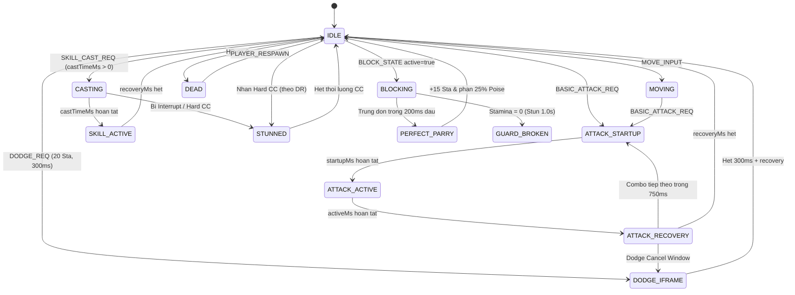

# 06 — Real-Time Action Combat System: Eldoria: Forgotten Wilds

**Trạng thái**: Hoàn thiện (Design Baseline v1.0)  
**Chế độ**: `DESIGN_AND_PLANNING_ONLY`  
**Cập nhật lần cuối**: 2026-11-19  
**Tham chiếu Chéo**: [`docs/balancing/combat-formulas.md`](../balancing/combat-formulas.md), [`04-character-design.md`](./04-character-design.md), [`05-character-progression.md`](./05-character-progression.md), [`07-skill-system.md`](./07-skill-system.md), [`docs/architecture/websocket-contracts.md`](../architecture/websocket-contracts.md), [`game-data/bosses.json`](../../game-data/bosses.json)  
**Tham chiếu Hiến pháp**: [`.specify/memory/constitution.md`](../../.specify/memory/constitution.md) (Nguyên tắc I, II, III, IV, V, VIII)

---

## 1. Kiến trúc Chiến đấu Thời gian thực Server-Authoritative

Hệ thống chiến đấu của **Eldoria: Forgotten Wilds** là **Action RPG thời gian thực 2D/2.5D** lấy cảm hứng cảm giác đánh mượt mà từ *Hades*, chiều sâu cộng hưởng nguyên tố từ *Genshin Impact* và phối hợp tổ đội từ *Ragnarok Online*, chạy trên mô hình **Server-Authoritative hoàn toàn**:

- **Tách biệt 3 Vòng đời**:
  1. **Server Simulation Loop (NestJS `CombatService`)**: Mục tiêu **`20 Hz` (`50 ms/tick`)** (*`proposed/unverified` cho tới khi đo load test*), giữ toàn bộ trạng thái thực thể chiến đấu (`HP`, `MP`, `Stamina`, `Poise`, vị trí, hitbox, cooldown, buff/debuff, projectile) trong RAM (in-process spatial grid).
  2. **Snapshot Broadcast**: Mục tiêu **`10 Hz` (`100 ms/snapshot`)** truyền delta state theo vùng quan tâm (Interest Management) qua WebSocket `/game`.
  3. **Client Render & Game Feel (Phaser 3)**: Mục tiêu **`60 FPS` (`16.67 ms/frame`)**, thực hiện client-side prediction cho chuyển động, phát animation khởi động tức thì (Anticipation) và xử lý hit-stop / hit-flash cục bộ để cảm giác phản hồi mượt mà ngay cả ở RTT `60–120 ms`.
- **Quy tắc Bất khả Xâm phạm (Nguyên tắc II)**: Client **KHÔNG BAO GIỜ** gửi sát thương, kết quả trúng đích hay cờ chí mạng. Client chỉ gửi **Ý định (Intent)**: `BASIC_ATTACK_REQ`, `SKILL_CAST_REQ`, `DODGE_REQ`, `BLOCK_STATE`. Toàn bộ phép kiểm tra giao cắt hitbox, lượng sát thương, tiêu hao tài nguyên, trạng thái CC và kiểm soát i-frame đều do server quyết định và trả về qua `COMBAT_DAMAGE_EVENT`.

---

## 2. Toàn bộ Cơ chế Chiến đấu Cốt lõi (Core Combat Mechanics)

### 2.1 Basic Attack & Chuỗi Combo (3-Hit / 4-Hit Combo)
- Mỗi nhân vật sở hữu chuỗi đánh thường đặc trưng (`3 hit` chuẩn cho 10/12 nhân vật; `4 hit` tốc độ cao cho `chr_vex_nightblade` và `chr_mira_ironfist`).
- **Cửa sổ nối Combo (`comboWindowMs = 750 ms`)**: Sau khi kết thúc pha `activeMs` của đòn $k$, nếu người chơi nhấn tấn công tiếp trong vòng `750 ms` (hỗ trợ **Input Buffering `150 ms`** trước khi hết `recoveryMs`), hệ thống chuyển sang đòn $k+1$ với `hitMultipliers` và `poiseDamagePerHit` tăng dần (đòn kết combo luôn mạnh nhất và kích hoạt hiệu ứng phụ như xuyên 1 mục tiêu của Lyra, gắn `Chill` của Freya, gắn `Wet` của Rowan).
- **Hồi phục Mana bằng Đòn đánh Thường**: Đánh trúng mục tiêu bằng Basic Attack hồi **`3–6 MP/hit`** tùy nhân vật (`6 MP` cho Seraphina, `5 MP` cho Orin/Freya/Nyx/Rowan, `4 MP` cho Kael/Lyra/Torvald/Bram/Mira/Aurelia, `3 MP` cho Vex), buộc người chơi đan xen đánh thường giữa các vòng kỹ năng thay vì đứng từ xa xả phép thụ động.

### 2.2 Critical Hit (Đòn Chí mạng)
- Xác suất kích hoạt dựa trên `CritRate` (trần cứng **`75%`**) và nhân sát thương bởi `CritDamage` (trần cứng **`250%`**).
- **Ngoại lệ Chí mạng Đảm bảo Có điều kiện**: Một số cơ chế thưởng lối chơi chuẩn xác (như đòn đầu tiên thoát `skl_vex_act_dusk_shroud`) được phép đảm bảo `100% Crit` cho **duy nhất 1 đòn đánh**, nhưng hệ số `CritDamage` vẫn bị khóa dưới trần `250%`.
- Số sát thương chí mạng hiển thị phông chữ pixel lớn hơn `1.35x`, màu vàng cam viền đen đậm kèm biểu tượng tia sáng nhỏ.

### 2.3 Dodge & Invulnerability Window (Né đòn & Khung Bất tử)
- **Thông số chuẩn bắt buộc**:
  - **Tiêu hao**: **`20 Stamina`**.
  - **Thời gian hồi chiêu (Cooldown)**: **`1,200 ms`** (không chịu ảnh hưởng bởi `CDR` để ngăn spam bất tử).
  - **Khung Bất tử (`i-frame`)**: **`300 ms`** tính chính xác theo tick trên server (`6 ticks` ở 20 Hz) ngay sau `20 ms` khởi động.
  - **Quãng đường lướt**: **`112 px`** (`3.5 tiles`) theo vector hướng di chuyển hiện tại (hoặc hướng đối mặt nếu đứng yên), kiểm tra va chạm tường theo từng bước nhỏ (swept raycast) chống lướt xuyên tường.
- **Quy tắc i-frame**: Trong `300 ms` bất tử, nhân vật miễn nhiễm `100%` sát thương, knockback và CC thường từ quái vật/Boss. **Ngoại lệ**: Đòn hủy diệt Enrage toàn sàn của Boss (`Enrage Wipe`) và sát thương môi trường liên tục (nham thạch/vực thẳm) không thể bị bỏ qua bằng i-frame.

### 2.4 Block & Perfect Parry (Đỡ đòn & Phản đòn Chuẩn)
- **Áp dụng**: Khả dụng cho mọi nhân vật cầm vũ khí cận chiến (`SWORD`, `GREATSWORD`, `SPEAR`, `AXE`, `SHIELD`, `GAUNTLET`, `DAGGER`); nhân vật cầm `SHIELD` (`chr_bram_bastion`, `chr_rowan_tidewarden`) được thưởng thêm `+12%` hiệu quả giảm sát thương từ trang bị khiên.
- **Block Thường (Giữ nút Block)**:
  - Giảm **`60%`** sát thương vật lý và nguyên tố từ góc `120°` phía trước mặt (miễn giảm thấp hơn từ phía sau: `0%`).
  - Tiêu hao **`12 Stamina`** mỗi đòn đỡ thành công.
  - **Guard Break**: Nếu `Stamina` tụt về `0` khi đang đỡ, nhân vật bị phá thủ và choáng **`1,000 ms` (`1.0s`)**.
- **Perfect Parry (Phản đòn Chuẩn)**:
  - **Cửa sổ thời gian chuẩn**: **`200 ms`** (`4 ticks` trên server) tính từ tick server nhận `BLOCK_STATE { active: true }` và đòn tấn công chạm hitbox nhân vật. *(Riêng kỹ năng Active chuyên biệt `skl_kael_act_cinder_parry` mở rộng cửa sổ phản công lên `300 ms` trong tổng `550 ms` thế thủ).*
  - **Phần thưởng Perfect Parry**: Giảm **`100%` sát thương**, tiêu **`0` Stamina**, lập tức hồi **`+15 Stamina`**, kích hoạt âm thanh keng kim loại + client hit-stop `60 ms` và phản ngược **`25%` Poise Damage** của đòn đánh (tối thiểu `25` Poise) lên kẻ tấn công / Boss!

### 2.5 Skill Casting, Cooldown, Mana & Stamina Regeneration / Exhaustion
- **Chu kỳ thi triển**: `CASTING (castTimeMs) → STARTUP (startupMs) → ACTIVE (activeMs) → RECOVERY (recoveryMs)` (xem kiến trúc chi tiết tại [`07-skill-system.md`](./07-skill-system.md)).
- **Hồi chiêu (Cooldown)**: Tính bằng $\text{EffectiveCooldownMs} = \max(400, \lfloor \text{BaseCooldownMs} \cdot (1 - \text{CDR}) \rfloor)$, bắt đầu đếm từ thời điểm kỹ năng rời pha `CASTING`/`STARTUP` vào `ACTIVE` (hoặc sau khi kết thúc trạng thái kéo dài với kỹ năng dạng Buff/Transform như `Dragonheart Awakening` tùy cấu hình).
- **Tái tạo Tài nguyên & Trạng thái Kiệt sức (`Exhaustion`)**:
  - **Stamina Regen**: Ngoài chiến đấu `+28 Sta/s`; trong chiến đấu `+16 Sta/s` sau `0.8s` không tiêu hao Stamina.
  - **Exhaustion (Kiệt sức)**: Khi `Stamina` chạm `0`, nhân vật rơi vào `EXHAUSTED` trong **`1,500 ms`** (không thể Sprint hoặc Dodge, thanh Stamina chớp đỏ nhẹ, tốc độ hồi chậm 50% cho đến khi vượt `25 Stamina`) — thưởng cho người chơi quản lý Stamina có kỷ luật.
  - **Mana Regen**: Ngoài chiến đấu `+8% Max MP/s`; trong chiến đấu `+2.5% Max MP/s` + hồi trực tiếp qua Basic Attack (`3–6 MP/hit`) + bình Mana (`csm_mp_potion_small`, CD `5,000 ms`) + nội tại hồi MP (`Static Conduit`, `Void Detonation`).

### 2.6 Hình học AoE & Đường đạn (AoE & Projectile Geometry)
Server NestJS kiểm tra va chạm 2D trên không gian pixel chuẩn (`1 tile = 32 px`) với 6 dạng hình học định nghĩa trong `game-data/skills.json`:
1. **`ARC` (Hình quạt)**: Kiểm tra khoảng cách $d \le \text{radiusPx} + r_{\text{target}}$ và góc lệch $|\Delta\theta| \le \text{angleDeg}/2$. Dùng cho chém kiếm, đại kiếm, găng tay, khiên.
2. **`CIRCLE` (Hình tròn — `SELF_AOE` / `GROUND_TARGET`)**: Kiểm tra khoảng cách Euclidean từ tâm `(cx, cy)` đến mục tiêu $\le \text{radiusPx} + r_{\text{target}}$.
3. **`LINE` / `RECT` (Hình chữ nhật định hướng — OBB)**: Biến đổi tọa độ mục tiêu về hệ tọa độ cục bộ theo `aimAngle`, kiểm tra $0 \le x' \le \text{lengthPx}$ và $|y'| \le \text{widthPx}/2 + r_{\text{target}}$.
4. **`PROJECTILE` (Đạn đạo & Boomerang)**: Cập nhật vị trí mỗi tick `50 ms` bằng **Swept Segment Collision** (kiểm tra đoạn thẳng nối vị trí tick $t-1$ tới tick $t$ giao với hình tròn collision của mục tiêu) để đạn bay nhanh (`640 px/s` = `32 px/tick`) **không bao giờ bay xuyên qua mục tiêu mỏng (anti-tunneling)**. Hỗ trợ `pierceCount`, `spreadDeg`, `boomerang: true` (`Searing Halo`), `maxHitsPerSingleTarget` (chặn shotgun 5 mũi tên dồn 1 đích).
5. **`SELF` / `NONE`**: Áp dụng tức thì cho bản thân hoặc vùng hào quang đồng minh (`auraRadiusPx`).

### 2.7 Crowd Control (CC), Knockback & Diminishing Returns (DR)

Để ngăn chặn hoàn toàn tình trạng **perma-stun** (khóa chết mục tiêu vĩnh viễn) trong Co-op 4 người và PvP mở rộng, Eldoria áp dụng hệ thống **CC Diminishing Returns** nghiêm ngặt trên server:

| Nhóm CC | Các Trạng thái | Tác động Lên Quái Thường | Tác động Lên Boss | Chịu DR? |
| :--- | :--- | :--- | :--- | :---: |
| **Hard CC** | `STUN`, `FREEZE`, `KNOCKDOWN`, `SILENCE` | Ngắt hành động & khóa di chuyển/tung chiêu | **Miễn nhiễm cứng** → Chuyển hóa thành sát thương Poise cộng thêm (`+15` Poise) hoặc `Frostbite` (với `FREEZE`) | **Có (Cửa sổ 20s)** |
| **Soft CC** | `SLOW`, `ROOT`, `TAUNT`, `PULL`, `KNOCKBACK` | Giảm tốc (`cap 60%`), giữ chân, ép mục tiêu, kéo/đẩy kiểm tra tường | Giảm `50%` hiệu lực `SLOW` (cap `30%`), miễn nhiễm `PULL`/`KNOCKBACK`, `TAUNT` tăng mạnh bảng Threat thay vì cướp AI tuyệt đối | **Có (Riêng `ROOT`/`TAUNT`)** |
| **Interrupt** | `eff_interrupt` (`Kinetic Uppercut`) | Ngắt ngay đòn đang cast | Ngắt các chiêu có cờ `interruptible: true` và gây thưởng Poise | Không (theo CD chiêu) |

- **Công thức Diminishing Returns (Cửa sổ theo dõi `20 giây` trên từng nhóm CC của từng mục tiêu)**:
  - **Lần 1**: **`100%`** thời lượng gốc.
  - **Lần 2** (trong 20s): **`50%`** thời lượng gốc.
  - **Lần 3** (trong 20s): **`25%`** thời lượng gốc.
  - **Lần 4** (trong 20s): **`0%` — MIỄN NHIỄM (`IMMUNE`)** cho đến khi đồng hồ 20 giây kể từ lần CC gần nhất đặt lại.
- **Quy tắc Knockback**: Vector đẩy lùi tính từ tâm sát thương (hoặc hướng đòn đánh), server mô phỏng trượt dọc tường nếu chạm lớp `Collision` của Tiled Map — tuyệt đối không đẩy mục tiêu xuyên tường hoặc kẹt ngoài bản đồ.

### 2.8 Buff / Debuff Stacking & Damage over Time (DoT)
- **Phân loại 6 loại Hiệu ứng (`statusEffects[].type`)**: `BUFF`, `DEBUFF`, `SHIELD`, `DOT`, `CC`, `ZONE`, `SUMMON`.
- **Quy tắc Cộng dồn (Stacking Rules)**:
  - `stackable: false`: Áp dụng lại cùng `effectId` sẽ **làm mới thời lượng (`refresh duration`)** và giữ giá trị `value` cao hơn (không cộng dồn chồng chất).
  - `stackable: true`: Tăng số tầng lên đến `maxStacks` (ví dụ `eff_burn` tối đa 3 tầng, `eff_chill` tối đa 3 tầng, `eff_forged_resolve_stack` tối đa 5 tầng) và làm mới bộ đếm thời lượng của toàn bộ cụm tầng.
  - **Khiên Hấp thụ (`SHIELD`)**: Nhiều lớp khiên khác `effectId` tồn tại song song theo nguyên tắc **tiêu thụ lớp khiên sắp hết hạn trước** (FIFO by expiry), tổng lượng khiên hiển thị dạng thanh trắng bạc đè lên mép thanh HP.
- **Nhịp DoT & Zone Ticks**:
  - DoT đơn mục tiêu (`eff_burn`, `eff_umbral_poison`, `eff_molten_bleed`, `eff_void_burn_dot`): Gây sát thương chuẩn mỗi **`1,000 ms`** (`20 ticks`), sử dụng chỉ số **snapshot tại thời điểm áp dụng tầng mới nhất** (để dễ tính toán và minh bạch). DoT không kích hoạt chí mạng (trừ khi Talent chuyên biệt ghi rõ) nhằm tránh nhiễu tính toán.
  - Vùng mặt đất (`ZONE` như `Cyclone Snare`, `Blizzard Veil`, `Storm Dominion`, `Abyssal Eclipse`): Tick đúng theo chu kỳ riêng (`0.5s`, `0.7s`, `0.75s`) ghi trong `game-data/skills.json`.

---

## 3. Ma trận Cộng hưởng & Phản ứng 9 Nguyên tố (9-Element Synergy & Reaction Matrix)

### 3.1 Ma trận Khắc hệ Cơ bản (`AffinityMult`)
Khớp `100%` với `docs/balancing/combat-formulas.md`:
- **Lợi thế (`1.25x`)**: `FIRE > FROST` & `FIRE > EARTH` | `WATER > FIRE` | `EARTH > LIGHTNING` | `LIGHTNING > WATER` | `WIND > EARTH` | `FROST > WIND`.
- **Song khắc (`1.20x` hai chiều)**: `LIGHT <-> SHADOW` (cả hai gây `+20%` sát thương lên nhau — tạo kịch tính cao ở vùng `reg_abyssal_kingdom`).
- **Bị khắc (`0.85x`)**: Ngược chiều các cặp khắc hệ ở trên (ví dụ `FIRE` đánh `WATER` = `0.85x`).
- **Trung tính (`NEUTRAL`)**: Luôn có `AffinityMult = 1.00`, đồng thời **bỏ qua `30%` kháng nguyên tố dương** của mục tiêu (và bỏ qua **`100%`** kháng nguyên tố với nội tại `Shatter Knuckles` của `chr_mira_ironfist`).

### 3.2 Bảng Phản ứng Nguyên tố Chiến thuật (Elemental Reactions — ICD `2.0s`/mục tiêu)

Khi một kỹ năng nguyên tố $B$ đánh trúng mục tiêu đang mang trạng thái nền (Aura/Debuff) của nguyên tố $A$, server kiểm tra **Internal Cooldown (ICD = `2,000 ms` theo cặp phản ứng/mục tiêu)** và kích hoạt phản ứng tương ứng:

| Tổ hợp Nguyên tố | Tên Phản ứng | Hệ số `ReactionMultiplier` | Hiệu ứng Chiến thuật & Tương tác Nhân vật Tiêu biểu |
| :--- | :--- | :---: | :--- |
| **`FIRE` + `FROST`** | **Melt (Tan Chảy)** | **`1.35x`** (`+35%`) | Bùng nổ sát thương nhiệt cao nhất, tiêu thụ `Chill`/`Burn`, thưởng `+15` Poise. *(Combo: Freya `Blizzard Veil` → Kael `Crimson Crescent` / Torvald `Molten Rend`)* |
| **`WATER` + `LIGHTNING`** | **Electro-Shock (Điện Giật)** | **`1.25x`** (`+25%`) | Tăng sát thương Sét và phóng thêm hồ quang lan `96 px` tới tối đa `2` kẻ địch khác đang `Wet` (gây `40%` sát thương phản ứng). *(Combo: Rowan `Riptide Pierce` → Orin `Chain Lightning`)* |
| **`FIRE` + `LIGHTNING`** | **Overload (Quá Tải)** | **`1.35x`** (`+35%`) | Gây vụ nổ nhiệt điện bán kính `88 px`, đẩy lùi nhẹ quái thường và cộng **`+20` Poise** cực mạnh lên Boss. *(Combo: Kael Burn → Orin `Storm Dominion`)* |
| **`FIRE` + `WATER`** | **Vaporize / Steam Burst (Bốc Hơi / Làm Mát)** | **`1.25x`** (`+25%`) | Bùng hơi nước làm mờ nhẹ quái thường (`-10%` chính xác 3s), dập tắt Burn và gây thưởng **`+25` Poise** lên mục tiêu hệ `FIRE` (khắc tinh `boss_ignis_forgelord`). |
| **`WATER` + `FROST`** | **Freeze & Shatter (Đóng Băng & Vỡ Băng)** | `1.15x` / **`1.25x` (`+45%` với `Frost Lance`)** | Đánh `FROST` lên địch `Wet` lập tức cộng thêm `+1` tầng `Chill` → kích nhanh `Freeze` (`1.8s` quái thường) / `Frostbite` (Boss). Đòn nặng (`GREATSWORD`/`GAUNTLET`/`EARTH`/`Frost Lance`) kích **Shatter** vỡ băng. |
| **`WIND` + (`FIRE`/`WATER`/`FROST`/`LIGHTNING`)** | **Swirl (Khuếch Tán)** | **`1.20x`** (`+20%`) | Hấp thụ nguyên tố đang gắn trên mục tiêu, gây thêm sát thương nguyên tố đó và **lan truyền trạng thái** (`Burn`/`Wet`/`Chill`/`Shocked`) sang toàn bộ kẻ địch trong bán kính `104 px`. *(Độc quyền: Lyra `Tailwind Stride` / `Cyclone Snare`)* |
| **`EARTH` + (`FIRE`/`WATER`/`FROST`/`LIGHTNING`)** | **Crystallize Shield (Kết Tinh Khiên)** | `1.05x` | Kết tinh lớp **Khiên Nguyên tố** tương ứng cho người kích hoạt và đồng đội gần nhất trong `96 px` (hấp thụ `8% Max HP`, tồn tại `6s`, ICD `5s`). *(Combo: Bram `Tectonic Slam` lên địch đang dính Burn/Wet/Shocked)* |
| **`LIGHT` + `SHADOW`** | **Eclipse Burst (Nhật Thực Bùng Nổ)** | **`1.35x`** (`+35%`) | Bùng nổ năng lượng tương phản chuẩn hóa, đồng thời giảm thêm **`10%`** toàn bộ kháng nguyên tố mục tiêu trong `4s`. *(Combo: Nyx `Abyssal Eclipse` + Seraphina `Solar Judgment` / Aurelia `Celestial Rain`)* |
| **`NEUTRAL` + Mọi trạng thái** | **Kinetic Break (Xung Lực Phá Giáp)** | `1.00x` (`+15%` khi Break) | Không xóa Aura nguyên tố của đồng đội! Bỏ qua kháng nguyên tố, kích **Shatter** lên mục tiêu Đóng Băng và tối ưu hóa thanh Poise Boss. *(Độc quyền: Mira Crankbolt)* |

---

## 4. Phối hợp Tổ đội Co-op & Cơ chế Stagger / Break của Boss

### 4.1 Chuỗi Combo Nhiều Nhân vật (Multi-Character Co-op Combos)
Thiết kế chiến đấu khuyến khích chu kỳ **4 nhịp phối hợp** trong tổ đội 2–4 người:
1. **Nhịp 1 — Setup & Threat**: Tank (`Bram` hoặc `Rowan`) mở giao tranh bằng `Taunting Roar` / `Riptide Pierce` kéo mặt Boss quay về phía mình và phủ nguyên tố nền (`Wet` / `Earth`).
2. **Nhịp 2 — Amplify & Swirl**: Hỗ trợ & Kiểm soát (`Seraphina` tung `Searing Halo` `+12%` sát thương nhận vào; `Lyra` tung `Tempest Arrowstorm` `-15%` kháng nguyên tố; `Nyx` mở `Abyssal Eclipse` `-20%` kháng; `Mira`/`Kael` phá `20%–25% DEF`).
3. **Nhịp 3 — Poise Break**: Tập trung kỹ năng Poise cao (`Mira` `Runeforge Overdrive` `192` Poise, `Kael` `Cinder Parry` `45` Poise, `Perfect Parry` tập thể) đánh sập thanh Poise của Boss về `0`.
4. **Nhịp 4 — Burst Window (`6.0–7.0s` STAGGERED)**: Boss khuỵu gối hủy chiêu đang niệm và chịu `1.40x–1.50x` sát thương → Cả tổ đội xả đồng thời chuỗi Ultimate kích phản ứng **Melt / Overload / Eclipse Burst**.

### 4.2 Cơ chế Boss Stagger & Poise Break (Khớp `game-data/bosses.json`)

Công thức sát thương lên thanh Poise của Elite & Boss:
$$\text{PoiseDamageDealt} = \text{SkillPoiseDamage}\cdot\left(1 + \text{HeroPoiseBonus} + \text{Enh10PoiseBonus}\right)\cdot\text{WeaknessPoiseMult}$$
*(Trong đó `Enh10PoiseBonus = 0.08` với vũ khí `+10`, `HeroPoiseBonus = 0.60` với nội tại `Shatter Knuckles` của Mira, và `WeaknessPoiseMult` lấy từ trường `weaknessPoiseBonusMultiplier` trong `bosses.json` khi đánh đúng hệ yếu).*

| Boss ID | Tên Boss | Cấp | Max Poise (Solo) | Hệ Yếu & Thưởng Poise | Thời gian Stagger | Hệ số Sát thương Khi Break | Hiệu ứng Cơ chế Khi Break |
| :--- | :--- | :---: | :---: | :---: | :---: | :---: | :--- |
| `boss_thornback_elder` `[MVP]` | Thornback Elder | 15 | `520` | `FIRE` (`1.50x`) | `6.0s` | **`1.40x`** | Hủy chiêu đang niệm, xóa 100% kháng `EARTH` |
| `boss_ignis_forgelord` | Ignis Forgelord | 30 | `1,150` | `WATER` (`1.60x`) | `6.5s` | **`1.45x`** | Tắt giáp lửa, xóa buff giảm sát thương vật lý |
| `boss_prism_leviathan` | Prism Leviathan | 50 | `2,100` | `EARTH` (`1.60x`) | `6.5s` | **`1.45x`** | Nứt vỏ pha lê, tự hủy toàn bộ Mảnh Tinh Thể |
| `boss_boreas_frostking` | Boreas Frostking | 75 | `3,600` | `FIRE` (`1.65x`) | `7.0s` | **`1.50x`** | Tự thắp sáng lại toàn bộ Chậu Lửa Cổ bị đóng băng |
| `boss_malakor_abyss` | Malakor, Sovereign of the Abyss | 100 | `5,400` | `LIGHT` (`1.70x`) | `7.0s` | **`1.50x`** | Tắt khiên Hư Không, thanh tẩy 1 Cột Ấn Mặt Trời gần nhất |

- **Mặc định cho Elite & Quái Tinh anh**: Khi không định nghĩa riêng, áp dụng chuẩn nền trong `combat-formulas.md` (`5.0s` STAGGERED, `x1.35` sát thương nhận vào).
- **Quy tắc chống Perma-Break & Phase Gate**: Sau khi hết trạng thái `STAGGERED`, thanh Poise hồi về `100% MaxPoise` và tăng thêm `+20%` kháng/ngưỡng Poise cho chu kỳ kế tiếp (tối đa **3 lần Break mỗi Phase**). Ngoài ra, Boss có **Phase HP Floor Guard**: 1 đòn đánh đơn lẻ không thể đẩy HP Boss xuyên qua ngưỡng chuyển Phase bắt buộc (ví dụ `70%` / `35%`) mà không kích hoạt chuyển Phase.

---

## 5. Cảm giác Chiến đấu (Combat Feel) & Quy tắc Hiển thị Ultimate

### 5.1 Bảy Yếu tố Combat Feel (Client-Side Game Juice)
1. **Anticipation (Lấy đà sắc nét)**: Mọi đòn tấn công đều có `60–380 ms` khung kéo vũ khí/tụ sáng rõ hình khối pixel trước pha `activeMs` giúp người chơi và đối thủ đọc nhịp đòn tự nhiên.
2. **Impact Frame (Khung Chạm Đòn)**: 1 khung hình (`16.67 ms`) vẽ vệt chém trắng-sáng sắc nét đúng thời điểm nhận `COMBAT_DAMAGE_EVENT` (hoặc dự đoán chạm local nhẹ).
3. **Hit Flash**: Sprite mục tiêu chuyển màu trắng tinh có viền nguyên tố trong **`60 ms`** (4 frame ở 60 FPS) — dễ đọc tức thì trên nền rừng tối hay hang động.
4. **Hit-Stop (`40–65 ms` — Client-Only Micro-Freeze)**: Khi đánh đòn kết combo, đòn Chí mạng, `Perfect Parry` hoặc `Boss Break`, chỉ **animation sprite cục bộ** của kẻ ra đòn và mục tiêu tạm dừng `40 ms` (đòn thường nặng), `50 ms` (Crit), `60 ms` (Perfect Parry) hoặc `65 ms` (Ultimate impact / Boss Break). **TUYỆT ĐỐI KHÔNG làm chậm hay dừng đồng hồ tick `20 Hz` của server hoặc khóa di chuyển của người chơi khác trong Co-op!**
5. **Particles theo Nguyên tố**: 4–12 hạt pixel `2x2` đến `4x4 px` văng theo hướng lực tác động (tia lửa cam, giọt nước lam, mảnh pha lê băng, hồ quang tím), tự hủy sau `250–450 ms`.
6. **Layered SFX**: Kết hợp 3 lớp âm thanh ngắn: Whoosh (vung vũ khí) + Impact (thịt/giáp/đá/khiên tùy chất liệu mục tiêu) + Element Tail (lửa xèo / băng vỡ / chuông sáng).
7. **Toggleable Camera Shake**: Rung camera biên độ nhỏ `2–6 px` trong `80–160 ms` cho đòn nặng/Break. Trong màn hình **Settings**, cung cấp thanh trượt `Camera Shake Intensity (0% – 100%, mặc định 50%)` và nút tắt hoàn toàn (`0%`) bảo vệ người chơi nhạy cảm chuyển động.

### 5.2 Quy tắc Bắt buộc về Khả năng Đọc Chiến trường của Ultimate (Ultimate Visibility Rule)
Tuân thủ **Nguyên tắc V của Hiến pháp**, hiệu ứng Ultimate phải hoành tráng nhưng **KHÔNG BAO GIỜ che khuất Boss Telegraph**:
- **Thứ tự Layer Cố định (Z-Order)**:
  - Layer `0–99`: Địa hình, cỏ, sàn đấu.
  - Layer `100–149`: **VFX Vùng Mặt đất của Người chơi** (vệt tro `Crimson Crescent`, vòng `Storm Dominion`, `Abyssal Eclipse`, `Sanctuary Ward`, `Celestial Rain`) — bắt buộc sử dụng **`alpha <= 0.45` (tối đa 45% độ mờ)** và đường viền pixel sắc nét 1–2 px thay vì đổ khối màu đặc.
  - Layer `150–199`: **Boss & Monster Telegraph Đỏ/Vàng Sắc nét** — luôn nằm **TRÊN** mọi hiệu ứng mặt đất của người chơi để người chơi không bao giờ chết oan vì bị VFX đồng đội che vòng nguy hiểm!
  - Layer `200–499`: Nhân vật, quái vật, Boss, vật thể 2.5D (Y-sorted theo chân).
  - Layer `500–599`: Đạn đạo & VFX trên không (tự động hạ `alpha` xuống `0.50` cho VFX của **đồng đội khác** trong cài đặt `Ally VFX Reduction`).
- **An toàn Thị giác (Photosensitivity Guard)**: Nghiêm cấm hiệu ứng nhấp nháy toàn màn hình vượt quá **`3 Hz`** (3 lần/giây) trên mọi Ultimate (`Storm Dominion`, `Solar Judgment`, `Celestial Rain`).

---

## 6. Bộ Công thức Chiến đấu Chính thức & Ví dụ Thực chiến

Khớp `100%` với [`docs/balancing/combat-formulas.md`](../balancing/combat-formulas.md) và cấu trúc trường trong `game-data/skills.json`:

### 6.1 Công thức 5 Bước Tính Sát thương (`Master Damage Formula`)

**Bước 1 — Sát thương Gốc Kỹ năng (`RawDamage`) tại bậc $r \in [1, \text{maxRank}]$**:
Sử dụng trực tiếp các trường tuyến tính từ `game-data/skills.json` (`upgradeScalingPerRank`: `baseDamageFlat`, `scalingRatioAdd`) và thưởng vũ khí `+10` (`Enh10SkillBonus = 0.05`):
$$\text{BaseDmg}(r) = \text{baseDamage} + \text{baseDamageFlat}\cdot(r - 1)$$
$$\text{EffectiveRatio}(r) = \left(\text{scalingRatio} + \text{scalingRatioAdd}\cdot(r - 1)\right)\cdot\left(1 + \text{Enh10SkillBonus}\right)$$
$$\text{RawDamage} = \text{BaseDmg}(r) + S \cdot \text{EffectiveRatio}(r)$$
*(Với $S \in \{\text{TotalATK}, \text{TotalINT}, \text{TotalDEF}, \text{MaxHP}\}$ là `scalingStat` của kỹ năng; đối với Basic Attack: $\text{RawDamage} = S \cdot \text{hitMultiplier}_k$).*

**Bước 2 — Giảm trừ Phòng thủ Hyperbolic & Xuyên giáp (`DefMultiplier`)**:
$$\text{EffectiveDEF} = \max\left(0,\; \text{TargetDEF}\cdot\left(1 - \min(0.50,\; \text{DefPenPct})\right) - \text{FlatDefPen}\right)$$
$$\text{DefMultiplier} = \frac{100 + 12\cdot L_{\text{attacker}}}{100 + 12\cdot L_{\text{attacker}} + \text{EffectiveDEF}}$$

**Bước 3 — Kháng Nguyên tố & Khắc hệ (`ElemMultiplier`)**:
$$\text{ElemMultiplier} = \text{AffinityMult} \cdot \left(1 - \text{EffectiveTargetRes}(el)\right)$$
*(Với `NEUTRAL`, $\text{EffectiveTargetRes}$ bỏ qua `30%` kháng dương chung hoặc `100%` với `Shatter Knuckles`).*

**Bước 4 — Hệ số Chí mạng, Stagger, Phản ứng & Biến thiên**:
$$\text{CritMultiplier} \in \{1.00,\; \text{CritDamage}\}, \quad \text{StaggerMultiplier} \in \{1.00,\; 1.35..1.50\}, \quad \text{ReactionMultiplier} \in [1.00,\; 1.35], \quad \text{Variance} \sim U(0.96, 1.04)$$

**Bước 5 — Sát thương Cuối cùng (`FinalDamage`)**:
$$\text{FinalDamage} = \max\left(1,\; \left\lfloor \text{RawDamage} \cdot \text{DefMultiplier} \cdot \text{ElemMultiplier} \cdot \text{CritMultiplier} \cdot \text{StaggerMultiplier} \cdot \text{ReactionMultiplier} \cdot \text{ModeMod} \cdot \text{Variance} \right\rfloor\right)$$

### 6.2 Ví dụ Tính toán Thực chiến (Đã Kiểm chứng bằng Node.js)

- **Ví dụ A — Kỹ năng Active Thông thường**: `chr_kael_vanguard` (Lv 15, `TotalATK = 447`) tung `skl_kael_act_blazing_lunge` Rank 5 (`baseDamage = 42 + 10×4 = 82`, `ratio = 1.35 + 0.06×4 = 1.59`, `pveModifier = 1.0`) vào `boss_thornback_elder` (Lv 15, `DEF = 34`, `EARTH`, `FIRE res = -0.35`, không Crit, không Break, `Variance = 1.00`):
  - $\text{RawDamage} = 82 + 447 \times 1.59 = 792.73$
  - $\text{DefMultiplier} = (100 + 180) / (280 + 34) = 280 / 314 = 0.8917$
  - $\text{ElemMultiplier} = 1.25 \times (1 - (-0.35)) = 1.6875$
  - $\text{FinalDamage} = \lfloor 792.73 \times 0.8917 \times 1.6875 \rfloor = \mathbf{1,192}$ sát thương `FIRE` (+ 1 tầng `Burn`).
- **Ví dụ B — Đỉnh cao Phối hợp Co-op 4 Người (Break + Sunder + Melt + Crit Ultimate)**: `chr_kael_vanguard` (Lv 15, `TotalATK = 447`, `CritDamage = 1.6872`) tung `skl_kael_ult_crimson_crescent` Rank 2 (`165 + 3.32×ATK`, `pveModifier = 1.15`) lên `boss_thornback_elder` (Co-op 4 người: `HP = 32,550`, đang bị `Sunder Cleave` `-20% DEF` → `EffectiveDEF = 27.2`, đang `STAGGERED` `x1.40`, kích **Melt** `x1.35`, Chí mạng `1.6872`, `Variance = 1.00`):
  - $\text{RawDamage} = 165 + 447 \times 3.32 = 1,649.04$
  - $\text{DefMultiplier} = 280 / (280 + 27.2) = 0.9115$
  - $\text{ElemMultiplier} = 1.6875$
  - $\text{FinalDamage} = \lfloor 1,649.04 \times 0.9115 \times 1.6875 \times 1.6872 \times 1.40 \times 1.35 \times 1.15 \rfloor = \mathbf{9,301}$ sát thương (`~28.6%` HP Boss 4 người; bị chặn bởi **Phase HP Floor Guard** nếu vượt ngưỡng chuyển Phase!).

---

## 7. Đặc tả 14 Tiêu chí Quality Gate (Section 27)

### 7.1 Mục tiêu Gameplay
- Mang lại cảm giác chiến đấu Action RPG sắc bén, giàu kỹ năng (Dodge i-frame, Perfect Parry, định vị hitbox, phá Poise) và thưởng xứng đáng cho sự phối hợp cộng hưởng 9 nguyên tố trong Co-op.
- Bảo đảm chiến trường nhiều người chơi luôn sạch, dễ đọc telegraph Boss và công bằng tuyệt đối trước gian lận client.

### 7.2 User Stories
- **US-CMB-01**: Là người chơi Action RPG, tôi muốn khi bấm Dodge đúng lúc Boss vung rễ cây, nhân vật lướt gọn trong `300 ms` bất tử không mất máu và có thể phản công ngay sau đó.
- **US-CMB-02**: Là người chơi cận chiến, tôi muốn khi canh chuẩn `200 ms` `Perfect Parry`, tôi nghe tiếng keng giòn tan, nhận hồi `15` Stamina và thấy thanh Poise của Boss tụt một đoạn rõ rệt.
- **US-CMB-03**: Là thành viên tổ đội 4 người, tôi muốn phối hợp đòn Lửa với đòn Băng của đồng đội để kích hoạt chữ nổi `MELT!` cùng sát thương bùng nổ mà không bị hiệu ứng đồng đội che mất vòng cảnh báo đỏ của Boss.
- **US-CMB-04**: Là người chơi nhạy cảm với rung lắc màn hình, tôi muốn tắt hoàn toàn `Camera Shake` và bật chế độ `Ally VFX Reduction` trong Settings.

### 7.3 Functional Requirements
- **FR-CMB-01**: `CombatService` chạy đồng bộ trong vòng lặp simulation `20 Hz` của từng `ZoneInstance` / `DungeonInstance`, xử lý toàn bộ ý định đánh thường, tung kỹ năng, né đòn, đỡ đòn, di chuyển đạn đạo và cập nhật trạng thái CC/DoT/Buff.
- **FR-CMB-02**: Thực thi trọn vẹn công thức sát thương 5 bước, kiểm tra giao cắt hình học 6 dạng hitbox (`ARC`, `CIRCLE`, `LINE`, `RECT`, `PROJECTILE`, `SELF`), trừ `HP`/`SHIELD`/`Poise` và phát sự kiện `COMBAT_DAMAGE_EVENT`.
- **FR-CMB-03**: Quản lý bảng **CC Diminishing Returns** riêng cho từng thực thể trong cửa sổ trượt `20 giây` (`100% → 50% → 25% → Immune`) và tự động chuyển đổi Hard CC trên Boss sang Poise/Frostbite.
- **FR-CMB-04**: Quản lý hệ thống **9-Element Reactions** kèm bảng ICD `2,000 ms` theo cặp phản ứng/mục tiêu để kích hoạt đúng hệ số và hiệu ứng phụ (`Swirl`, `Crystallize`, `Electro-Shock`, `Overload`, `Melt`, `Eclipse Burst`).
- **FR-CMB-05**: Phát sự kiện `SKILL_TELEGRAPH_EVENT` và `BOSS_STATE_EVENT` đồng bộ dấu thời gian server (`serverStartTs`) cho mọi người chơi trong vùng quan tâm.

### 7.4 Business Rules
- **BR-CMB-01**: Không cho phép gây sát thương trong Safe Zone (`isSafeZone === true`) hoặc lên đồng minh (trừ khi chế độ PvP Arena M4+ bật cờ `pvpEnabled: true`).
- **BR-CMB-02**: Dodge luôn tốn `20 Stamina`, CD cố định `1,200 ms` (bất biến với CDR), i-frame đúng `300 ms`.
- **BR-CMB-03**: Perfect Parry chỉ kích hoạt trong `200 ms` đầu tiên sau khi bật Block cho các đòn đánh trực diện trong góc `120°` (không parry được DoT đang cháy trên người hay vùng sát thương mặt đất không hướng).
- **BR-CMB-04**: Mọi Boss đều áp dụng **Phase HP Floor Guard** ngăn 1 đòn đánh vượt qua ngưỡng chuyển Phase mà không chạy hoạt ảnh/cơ chế Phase mới, và giới hạn tối đa `3` lần Stagger mỗi Phase.
- **BR-CMB-05**: Khi `HP` nhân vật về `0`, chuyển trạng thái sang `DEAD`, xóa toàn bộ Buff/Debuff tạm thời và mở tùy chọn hồi sinh (`VILLAGE` hoặc `DUNGEON_ENTRANCE`); **TUYỆT ĐỐI KHÔNG** làm rơi mất trang bị hay trừ cấp nhân vật.

### 7.5 Input và Output
- **Input (Client → Server WebSocket `/game`)**:
  - `BASIC_ATTACK_REQ`: `{ seq, aimAngle, comboStep }` (max `5/s`).
  - `SKILL_CAST_REQ`: `{ seq, requestId, skillId, aimAngle, targetX?, targetY? }` (max `5/s`).
  - `DODGE_REQ`: `{ seq, dx, dy }` (max `3/s`).
  - `BLOCK_STATE`: `{ seq, active, facing }` (max `5/s`).
- **Output (Server → Client WebSocket `/game`)**:
  - `COMBAT_DAMAGE_EVENT`: `{ tick, attackerId, targetId, skillId, damage, isCrit, element, reaction?, targetHpAfter, targetPoiseAfter, knockback? }`.
  - `SKILL_TELEGRAPH_EVENT`, `BOSS_STATE_EVENT`, `PLAYER_DEATH`, `PLAYER_RESPAWN`, `ACTION_ERROR`.

### 7.6 State Transitions (Combat Actor State Machine trên Server)

### 7.7 JSON Data Model (Ephemeral RAM Runtime + Persistent JSON Checkpoint)
- **Runtime Combat State (In-Memory RAM trong `ZoneInstance` — KHÔNG ghi đĩa theo tick 20 Hz)**:
  - Lưu trữ `CombatActorRuntime` (`entityId`, `hp`, `mp`, `stamina`, `poise`, `combatState`, `stateEndsAtTick`, `iFrameUntilTick`, `parryWindowUntilTick`, `dodgeCooldownUntilTick`, `activeEffects[]`, `ccDrTracker`, `reactionIcdMap`, `threatTable`).
- **Persistent JSON Checkpoint (`data/db/characters/<characterId>.json`)**:
  - Chỉ lưu `stats.currentHp`, `stats.currentMp`, `stats.currentStamina`, `activeFoodBuffs`, `position.lastSafe*` mỗi `30 giây` (dirty flag) hoặc ngay khi rời vùng / ngắt kết nối / hạ Boss — tuân thủ 100% **Nguyên tắc I & IV** của Hiến pháp (100% tệp JSON cục bộ qua `JsonDatabaseEngine`).

### 7.8 Dependencies
- **Đầu vào**: `04-character-design.md`, `05-character-progression.md`, `07-skill-system.md`, `15-monster-ai.md`, `16-boss-design.md`, `docs/balancing/combat-formulas.md`, `docs/architecture/websocket-contracts.md`.
- **Đầu ra**: `docs/art-direction/animation-state-machine.md`, `vfx-design.md`, `audio-design.md`, `docs/architecture/anti-cheat-design.md`, `docs/testing/test-scenarios.md`.

### 7.9 UI Interactions
- **HUD Chiến đấu**: Thanh HP (đỏ + phần Khiên trắng bạc), MP (lam), Stamina (vàng + nhấp nháy đỏ khi `EXHAUSTED`), biểu tượng 4 kỹ năng + thanh hồi chiêu dạng quét tròn + số giây lẻ (`1.2s`), hàng biểu tượng Buff/Debuff đếm ngược dưới thanh HP.
- **Boss Bar (Đầu màn hình)**: Hiển thị tên Boss, thanh HP phân vạch ngưỡng Phase, thanh **Poise vàng ánh kim** dưới thanh HP (chớp rực khi sắp Break và chuyển thành thanh đếm ngược `STAGGERED` màu cam khi vỡ giáp).
- **Floating Combat Text**: Màu theo nguyên tố, kích thước lớn hơn cho `CRIT!`, nhãn phản ứng nổi bật (`MELT!`, `OVERLOAD!`, `ELECTRO-SHOCK!`, `SWIRL!`, `PARRY!`, `IMMUNE`).

### 7.10 Edge Cases
- **EC-CMB-01 — Hai đòn đánh chạm mục tiêu trong cùng 1 tick 20 Hz**: Server xử lý tuần tự theo thứ tự hàng đợi sự kiện (deterministic order); nếu đòn đầu hạ gục mục tiêu (`HP === 0`), đòn thứ 2 được bỏ qua, không kích hoạt 2 lần hiệu ứng `on-kill` hay nhân đôi rơi đồ!
- **EC-CMB-02 — Lag Spike khiến đạn nhanh có nguy cơ xuyên vật thể**: Swept Segment Collision kiểm tra toàn bộ đoạn đường đi trong `dt = 50 ms`, bảo đảm đạn tốc `640 px/s` không bỏ sót mục tiêu đường kính `24 px`.
- **EC-CMB-03 — Đồng thời kích Dodge và nhận sát thương ở biên `300 ms`**: So sánh mốc `serverTick` nhất quán; nếu `currentTick <= actor.iFrameUntilTick` thì miễn sát thương, không phụ thuộc đồng hồ máy khách.
- **EC-CMB-04 — Người chơi mất kết nối giữa trận Boss**: Nhân vật ở lại thế giới `10 giây` (chống exploit alt-F4 né chết), sau đó tự động thoát an toàn khỏi vùng và lưu checkpoint JSON; nếu còn sống và kết nối lại trong thời gian chờ dungeon (`120s`), được phép `SESSION_RESUME` vào lại phiên.

### 7.11 Failure Behavior
- Nếu một gói tin `BASIC_ATTACK_REQ` / `SKILL_CAST_REQ` bị mất trên mạng (packet loss), client không nhận được xác nhận trong `300 ms` sẽ tự động hủy trạng thái dự đoán cục bộ (reconciliation rollback) và đồng bộ về `WORLD_SNAPSHOT` mới nhất mà không làm kẹt animation nhân vật.
- Nếu phép tính sát thương gặp dữ liệu NaN/Infinity bất thường (lỗi phòng vệ), server kẹp sát thương an toàn tối thiểu `1`, ghi `CRITICAL` log kỹ thuật và ngăn làm sập vòng lặp tick của cả Zone.

### 7.12 Security Requirements
- **Zero Client Combat Trust**: Bác bỏ hoàn toàn mọi gói tin tự khai báo `damage`, `isCrit`, `targetHitIds`, `iFrame: true` hoặc bỏ qua `cooldownMs`.
- **Rate Limiting & Sequence Verification**: Giới hạn `BASIC_ATTACK_REQ <= 5/s`, `SKILL_CAST_REQ <= 5/s`, `DODGE_REQ <= 3/s`; mọi gói tin có `seq <= lastSeq` bị loại bỏ chống Replay Attack.
- **Validation Khoảng cách & Line of Sight**: Server kiểm tra khoảng cách thực tế giữa `attacker` và `target` + raycast tường Tiled (nếu `lineOfSightRequired: true`) nhằm triệt tiêu hack đánh xuyên tường hay đánh từ ngoài tầm.
- **Anti-Disconnect Exploit**: Không tắt nhân vật tức thì khi client đột ngột đóng socket giữa chiến đấu (duy trì grace window `10s` trong combat).

### 7.13 Acceptance Criteria
- **AC-CMB-01**: Mọi thông số Dodge (`300 ms` i-frame, `20` Sta, `1,200 ms` CD), Block (`60%` DR, `12` Sta, `1.0s` Guard Break) và Perfect Parry (`200 ms` window, `100%` DR, `+15` Sta, `25%` Poise reflect) hoạt động chính xác theo tick server `20 Hz`.
- **AC-CMB-02**: Toàn bộ 9 nguyên tố và 9 nhóm phản ứng trong Ma trận Phản ứng hoạt động đúng hệ số, đúng ICD `2,000 ms` và đúng trần `ReactionMultiplier <= 1.35`.
- **AC-CMB-03**: Bảng CC Diminishing Returns (`100% → 50% → 25% → Immune`) chặn đứng hoàn toàn mọi kịch bản perma-stun trong test 4 người chơi đánh liên tục.
- **AC-CMB-04**: Mọi Boss Telegraph luôn render ở Layer `150–199` nằm trên toàn bộ VFX vùng mặt đất của người chơi (`alpha <= 0.45`, Layer `100–149`).

### 7.14 Test Scenarios
| Mã Test | Kịch bản | Đầu vào | Kết quả Kỳ vọng |
| :--- | :--- | :--- | :--- |
| **TC-CMB-01** | Happy path — Dodge i-frame né đòn Boss | Gửi `DODGE_REQ` `100 ms` trước khi đòn `boss_thornback_elder` chạm vị trí nhân vật | Trừ `20` Sta, CD `1,200 ms`, nhận `0` sát thương, không dính knockback. |
| **TC-CMB-02** | Happy path — Perfect Parry vs Regular Block | Đỡ đòn lúc `150 ms` (trong `200 ms`) và đỡ lúc `350 ms` (ngoài `200 ms`) | Lần 1: `0` damage, `+15` Sta, phản `25%` Poise; Lần 2: giảm `60%` damage, `-12` Sta. |
| **TC-CMB-03** | Elemental Reaction — Melt & ICD | Freya gắn `Chill` → Kael đánh `FIRE` 2 lần liên tiếp trong `0.8s` | Lần 1 kích `MELT (x1.35)` + xóa `Chill`; lần 2 trong `2.0s` ICD không kích Melt lần hai. |
| **TC-CMB-04** | Anti-Perma-Stun — CC Diminishing Returns | 4 người chơi tung kỹ năng `STUN` (`1.2s`) liên tiếp vào 1 Elite trong `15s` | Thời lượng Stun thực tế giảm đúng `1.2s → 0.6s → 0.3s → 0s (IMMUNE)`. |
| **TC-CMB-05** | Security — Giả mạo gói tin đánh xuyên tường / tốc độ | Gửi `15` gói `BASIC_ATTACK_REQ` trong `1s` hoặc đánh mục tiêu cách `400 px` bằng Kiếm (`68 px`) | Rate limiter chặn phần dư; đòn ngoài tầm trả `0` trúng đích và ghi cảnh báo anti-cheat. |
| **TC-CMB-06** | Boss Phase Gate — Chống one-shot vượt Phase | Tung đòn `9,301` sát thương khi Boss đang ở `72%` HP (Phase 2 kích hoạt tại `70%`) | HP Boss dừng đúng ngưỡng `70%`, kích hoạt hoạt ảnh chuyển Phase 2 sạch sẽ không lỗi AI. |
