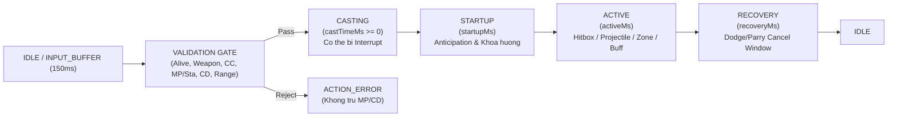
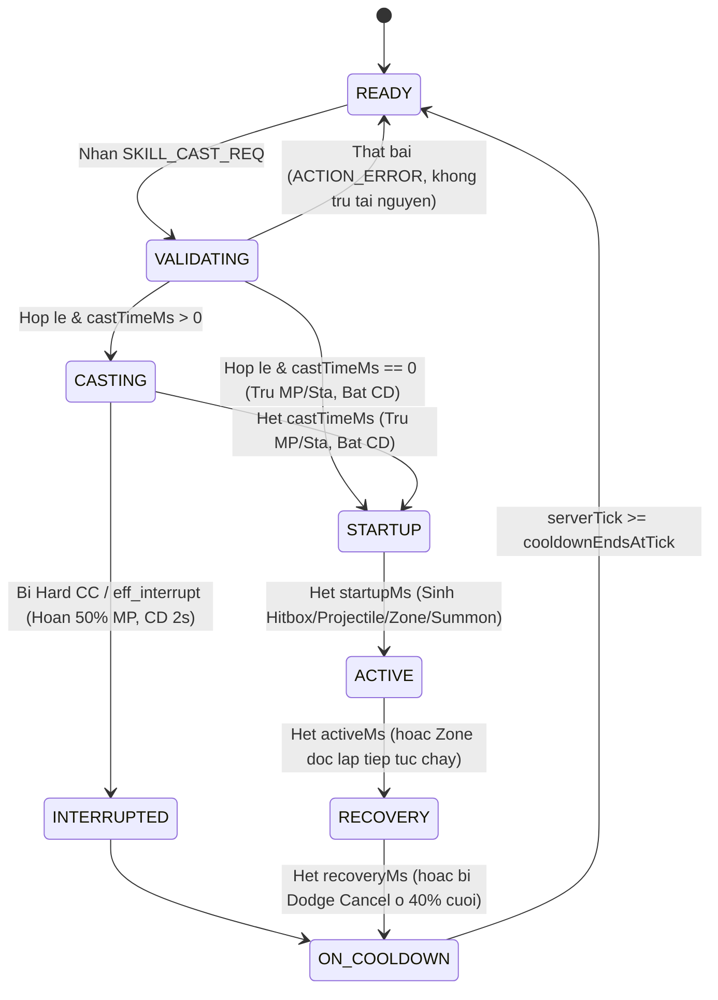

# 07 — Data-Driven Skill Engine & Complete 60-Skill Catalog: Eldoria: Forgotten Wilds

**Trạng thái**: Hoàn thiện (Design Baseline v1.0)  
**Chế độ**: `DESIGN_AND_PLANNING_ONLY`  
**Cập nhật lần cuối**: 2026-11-19  
**Nguồn chân lý dữ liệu (Single Source of Truth)**: [`game-data/skills.json`](../../game-data/skills.json) (60 kỹ năng độc bản), [`game-data/characters.json`](../../game-data/characters.json) (12 Basic Attacks)  
**Tham chiếu Chéo**: [`04-character-design.md`](./04-character-design.md), [`05-character-progression.md`](./05-character-progression.md), [`06-combat-system.md`](./06-combat-system.md), [`docs/balancing/combat-formulas.md`](../balancing/combat-formulas.md)  
**Tham chiếu Hiến pháp**: [`.specify/memory/constitution.md`](../../.specify/memory/constitution.md) (Nguyên tắc I, II, III, IV, V, VIII)

---

## 1. Kiến trúc Động cơ Kỹ năng Hướng dữ liệu (Data-Driven Skill Engine)

Hệ thống kỹ năng của **Eldoria: Forgotten Wilds** được thiết kế hoàn toàn theo nguyên tắc **Data-Driven (Nguyên tắc III)**: không hardcode chỉ số hay hitbox rải rác trong logic NestJS/Phaser. Toàn bộ **60 kỹ năng độc bản** (`12 nhân vật × 5 kỹ năng`, trong đó **15 kỹ năng MVP** thuộc `chr_kael_vanguard`, `chr_lyra_windrunner`, `chr_seraphina_dawn`) đều được định nghĩa tập trung tại `game-data/skills.json` và thực thi bởi `SkillExecutionEngine` trên server.

### 1.1 Chu kỳ Khung thời gian Kỹ năng (`castTimeMs → startupMs → activeMs → recoveryMs`)

Mỗi kỹ năng `ACTIVE` và `ULTIMATE` chạy qua một máy trạng thái thời gian thực xác định trên tick **`20 Hz` (`50 ms/tick`)** của NestJS server:



1. **`VALIDATION GATE` (0 ms — Tức thì tại Server)**:
   - Kiểm tra nhân vật còn sống (`requiresAlive`), đang điều khiển đúng `characterId` sở hữu kỹ năng và đạt cấp mở khóa (`unlockLevel`).
   - Kiểm tra loại vũ khí đang cầm khớp `validationRules.requiresWeaponTypes`.
   - Kiểm tra trạng thái khống chế hiện tại không nằm trong `validationRules.blockedWhileCrowdControlled` (ví dụ `STUN`, `FREEZE`, `KNOCKDOWN`, `SILENCE`, `ROOT`).
   - Kiểm tra đủ `manaCost(r)` và `staminaCost` (và `minRemainingHp: 1` với kỹ năng hy sinh HP như `Warlord Bellow`; `requiresMinActiveSummons >= 1` với `Void Detonation`).
   - Kiểm tra thời gian hồi chiêu server đã hết (cho phép `cooldownToleranceMs: 100 ms` bù jitter mạng, **không bao giờ giảm cooldown thực tế** mà chỉ cho phép xếp hàng vào bộ đệm `Input Buffer`).
   - Kiểm tra mục tiêu/điểm chỉ định nằm trong `rangePx + maxRangeTolerancePx`, kiểm tra `lineOfSightRequired` và `navmeshDestinationCheck` (cho kỹ năng dịch chuyển/nhảy như `Shadowstep Blink`, `Furious Leap`).
2. **`CASTING` (`castTimeMs`)**: Giai đoạn tụ lực / niệm phép (ví dụ `320 ms` của `Radiant Piercer`, `380 ms` của `Solar Judgment`). Hiển thị thanh cast ngắn dưới chân nhân vật; **có thể bị ngắt (`Interrupt`)** bởi Hard CC hoặc `Kinetic Uppercut` của Mira (khi bị ngắt, hoàn trả 50% MP và áp cooldown phạt ngắn `2,000 ms`).
3. **`STARTUP` (`startupMs`)**: Pha lấy đà hoạt ảnh (Anticipation, `60–380 ms`), khóa hướng tung chiêu (`aimAngle`), trừ tài nguyên MP/Stamina và bật đồng hồ hồi chiêu chính thức trên server.
4. **`ACTIVE` (`activeMs`)**: Server kích hoạt thực thi hiệu ứng thực sự theo `hitboxShape` (`ARC`, `CIRCLE`, `LINE`, `RECT`, `PROJECTILE`, `SELF`):
   - **Instant Hit / Multi-Hit**: Quét mục tiêu trong vùng hình học (giới hạn bởi `maxTargetsPerCast`, `maxHitsPerSingleTarget`, `singleTargetMultiHitDiminishing`).
   - **Projectile Spawn**: Tạo thực thể đạn đạo chạy trên simulation tick `20 Hz` với Swept Segment Collision.
   - **Zone / Summon Creation**: Tạo vùng mặt đất (`ZONE`, ví dụ `Cyclone Snare`, `Storm Dominion`, `Abyssal Eclipse`) hoặc Thực thể Triệu hồi (`SUMMON`, tối đa `3` với Nyx) có vòng đời quản lý bởi `ZoneInstance`.
5. **`RECOVERY` (`recoveryMs`) & Cancel Windows**:
   - Pha thu chiêu (`100–260 ms`), nhân vật tạm giảm tốc độ di chuyển hoặc đứng tại chỗ.
   - **Dodge / Parry Cancel Window**: Trong **`40%` cuối của `recoveryMs`** (ví dụ `72 ms` cuối của `180 ms`), người chơi được phép hủy Recovery bằng **`DODGE_REQ`** hoặc **`BLOCK_STATE`** (hoặc `Cinder Parry`/`Zephyr Vault`/`Volt Surge`), tạo cảm giác hành động cực nhạy kiểu *Hades* mà vẫn ngăn hủy pha Startup/Active để spam sát thương.
   - **Input Buffering (`150 ms`)**: Lệnh kỹ năng hoặc Basic Attack gửi sớm trong `150 ms` cuối pha Recovery được server giữ lại và tự động kích hoạt ngay tick tiếp theo khi Recovery kết thúc.

### 1.2 Công thức Nâng bậc Tuyến tính (`upgradeScalingPerRank`) & PvE / PvP Modifiers
Mọi kỹ năng nâng bậc hoàn toàn **tuyến tính** từ Rank `1` đến `maxRank` (`5` cho Passive/Ultimate, `10` cho Active) nhằm triệt tiêu exponential scaling:
- $\text{BaseDamage}(r) = \text{baseDamage} + \text{baseDamageFlat} \cdot (r - 1)$
- $\text{ScalingRatio}(r) = \text{scalingRatio} + \text{scalingRatioAdd} \cdot (r - 1)$
- $\text{PoiseDamage}(r) = \text{poiseDamage} + \text{poiseDamageAdd} \cdot (r - 1)$
- $\text{BaseCooldownMs}(r) = \max\left(1000,\; \text{cooldownMs} - \text{cooldownReductionMs} \cdot (r - 1)\right)$
- $\text{ManaCost}(r) = \text{manaCost} + \text{manaCostAdd} \cdot (r - 1)$
- $\text{EffectValue}(r) = \text{effectValue} + \text{effectValueAdd} \cdot (r - 1)$

**Tách biệt PvE vs PvP**: Mọi kỹ năng sở hữu cặp hệ số `pveModifier` (`1.00x – 1.20x`) và `pvpModifier` (`0.65x – 0.85x`) cùng giới hạn CC riêng trong PvP (ví dụ `pvpCcDurationCapMs: 1200` trên `Glacial Prison`), cho phép tinh chỉnh cân bằng PvP Arena (M4+) mà **không bao giờ làm yếu cảm giác đánh PvE**.

---

## 2. Phân tích Chiến thuật Chuyên sâu 8 Tuyệt kỹ Biểu tượng (8 Iconic Ultimates)

Dưới đây là hồ sơ chiến thuật chuyên sâu cho **8 Ultimate biểu tượng** định hình bản sắc chiến đấu của Eldoria (kèm tóm tắt 4 Ultimate còn lại để bao phủ đủ 12 nhân vật). Mọi Ultimate đều tuân thủ tuyệt đối **Quy tắc Bảo toàn Tầm nhìn Boss Telegraph** (`Layer 100–149`, `alpha <= 0.45`, không flash màn hình quá `3 Hz`).

### 2.1 `skl_kael_ult_crimson_crescent` — **Crimson Crescent** (`chr_kael_vanguard`, `FIRE`) **`[MVP]`**
- **Thông số cốt lõi**: `135 + 3.10×ATK`, `68` Poise | `45 MP / 20 Sta`, CD `28,000 ms` | Cast `240 ms` / Startup `260 ms` / Active `600 ms` / Recovery `260 ms` | `PROJECTILE 96x36 px`, tốc `480 px/s`, tầm `288 px`, xuyên `99` mục tiêu (`maxTargetsPerCast: 12`) | PvE `1.15x` / PvP `0.72x`.
- **Cơ chế & Server Validation**: Quét lưỡi kiếm phóng làn sóng kiếm khí lưỡi liềm đỏ rực xuyên qua toàn bộ tuyến kẻ địch, áp dụng 2 tầng `eff_burn` (`35% ATK/s`, `5s`) và trải vệt tro lửa `eff_cinder_trail_zone` (`40% ATK/s`, `4s`) dọc đường bay. Server kiểm tra hướng phóng tại cuối `260 ms` startup và sinh đối tượng `Zone` hình chữ nhật `288x96 px` với độ trong suốt `45%` dưới lớp Boss Telegraph.
- **Chuỗi Combo & Counterplay**: Tối ưu khi tung sau `Sunder Cleave` (`-20% DEF`) và lúc Boss đang dính `Chill` từ Freya (kích **Melt `x1.35`**) hoặc trong pha Break của `boss_thornback_elder`. Đối thủ có thể đọc `240 ms` tụ sáng + âm thanh rít thép để lướt vuông góc khỏi hành lang `96 px`.

### 2.2 `skl_vex_ult_phantom_sever` — **Phantom Sever** (`chr_vex_nightblade`, `SHADOW`)
- **Thông số cốt lõi**: `148 + 3.35×ATK`, `58` Poise | `48 MP / 22 Sta`, CD `30,000 ms` | Cast `160 ms` / Startup `160 ms` / Active `850 ms` / Recovery `240 ms` | `CIRCLE r=192 px` (`SELF_AOE`, `maxTargetsPerCast: 5`) | PvE `1.15x` / PvP `0.68x`.
- **Cơ chế & Server Validation**: Vex hóa hư ảnh nhận `eff_phantom_untargetable` (bất tử **`750 ms`**) thực hiện 5 nhát chém chớp nhoáng lên tối đa 5 mục tiêu trong `192 px`. Khi dồn cả 5 nhát vào **1 Boss duy nhất**, server áp dụng bắt buộc mảng `singleTargetMultiHitDiminishing: [1, 0.85, 0.75, 0.65, 0.6]` để sát thương tập trung cao nhưng không one-shot bất công. Sau `600 ms`, vết cắt `eff_sever_bleed_detonate` nổ thêm `45% ATK` (`+20%` khi mục tiêu `< 35% HP`).
- **Chuỗi Combo & Counterplay**: Mở bằng `Shadowstep Blink` (`+15%` sát thương Shadow) → `Dusk Shroud` → `Phantom Sever` giúp vừa né đòn quét 360° của Boss bằng `750 ms` bất tử, vừa kết liễu Boss ở ngưỡng máu thấp. Counterplay: thoát khỏi `192 px` trong `160 ms` khởi động hoặc dựng khiên ngay trước mốc nổ `0.6s`.

### 2.3 `skl_orin_ult_storm_dominion` — **Storm Dominion** (`chr_orin_stormcaller`, `LIGHTNING`)
- **Thông số cốt lõi**: `52 + 0.82×INT` mỗi đợt (`8` đợt = `16` tia sét ưu tiên địch trong `6s`), `64` Poise | `58 MP / 10 Sta`, CD `32,000 ms` | Cast `340 ms` / Startup `340 ms` / Active `6,000 ms` / Recovery `240 ms` | `CIRCLE r=160 px`, tầm `304 px` (`GROUND_TARGET`, `maxTargetsPerCast: 14`) | PvE `1.15x` / PvP `0.68x`.
- **Cơ chế & Server Validation**: Tạo vùng giông `eff_storm_dominion_zone` tồn tại `6s`, mỗi `0.75s` server chọn vị trí 2 thiên lôi có vòng dấu chạm trước `300 ms` (đảm bảo công bằng & giới hạn nhịp nhấp nháy dưới ngưỡng an toàn thị giác `<= 3 Hz`). Khi Orin đứng trong vòng bão, nhận `eff_tempest_conductor` (`-25% Cast Time`, `+15% CritRate`) giúp xả `Chain Lightning` liên hồi.
- **Chuỗi Combo & Counterplay**: Cực mạnh khi Rowan đặt `Tidebreaker Sanctuary` (`Wet` `8s`) + Lyra gom quái bằng `Cyclone Snare` tạo chuỗi **Electro-Shock** & **Swirl** dồn dập. Counterplay: kéo giao tranh ra khỏi vòng `160 px` hoặc né vòng báo chạm `300 ms`.

### 2.4 `skl_freya_ult_glacial_prison` — **Glacial Prison** (`chr_freya_frostveil`, `FROST`)
- **Thông số cốt lõi**: `132 + 2.95×INT`, `68` Poise | `56 MP / 10 Sta`, CD `32,000 ms` | Cast `360 ms` / Startup `360 ms` / Active `4,000 ms` / Recovery `240 ms` | `CIRCLE r=136 px`, tầm `288 px` (`GROUND_TARGET`, `maxTargetsPerCast: 14`) | PvE `1.15x` / PvP `0.65x`.
- **Cơ chế & Server Validation**: Khóa khu vực `136 px` trong `4s`: Đóng Băng quái thường `2.5s` (trên PvP kẹp cứng `pvpCcDurationCapMs: 1200`; trên Boss chuyển hóa thành Tê Lạnh + giảm `30%` tốc độ di chuyển), sau `4s` toàn bộ cột băng bán trong suốt kích nổ gây sát thương `FROST` cực đại.
- **Chuỗi Combo & Counterplay**: Đặt ngay trước khi Kael/Torvald xả Ultimate để kích **Melt (`x1.35`)** đúng pha nổ băng, hoặc dùng `Frost Lance` xuyên qua đám quái Đóng Băng kích **Shatter (`+45%`)**. Counterplay: nhìn vòng tinh thể `360 ms` để Dodge thoát khỏi `136 px`.

### 2.5 `skl_seraphina_ult_solar_judgment` — **Solar Judgment** (`chr_seraphina_dawn`, `LIGHT`) **`[MVP]`**
- **Thông số cốt lõi**: `110 + 2.45×INT` sát thương, `50` Poise + Hồi `120 + 2.40×INT` HP & Thanh tẩy 2 debuff | `55 MP / 8 Sta`, CD `32,000 ms` | Cast `380 ms` / Startup `380 ms` / Active `700 ms` / Recovery `260 ms` | `CIRCLE r=136 px`, tầm `288 px` (`GROUND_TARGET`, `maxTargetsPerCast: 14`) | PvE `1.10x` / PvP `0.72x`.
- **Cơ chế & Server Validation**: Tuyệt kỹ lưỡng dụng độc nhất trong game: đồng thời đánh sập sát thương `LIGHT` + gắn `eff_solar_weaken` (`-20% ATK` địch trong `6s`), và cứu sống toàn bộ đồng đội đứng trong vùng `136 px` bằng lượng hồi máu lớn + thanh tẩy 2 debuff (kích hoạt luôn khiên `Radiant Grace` cho đồng đội `< 50% HP`).
- **Chuỗi Combo & Counterplay**: Đặt ngay lên tâm giao tranh giữa Tank và Boss trong lúc Boss chuẩn bị tung đòn diện rộng để vừa cắt `20% ATK` Boss vừa đẩy đầy máu tổ đội; kích **Eclipse Burst (`x1.35`)** khi đặt chồng `Abyssal Eclipse` của Nyx. Counterplay: ngắt phép trong `380 ms` cast hoặc né ngoài `136 px`.

### 2.6 `skl_nyx_ult_abyssal_eclipse` — **Abyssal Eclipse** (`chr_nyx_voidcaller`, `SHADOW`)
- **Thông số cốt lõi**: `38 + 0.62×INT` mỗi `0.7s` (`10` nhịp trong `7s`), `56` Poise | `60 MP / 10 Sta`, CD `34,000 ms` | Cast `360 ms` / Startup `360 ms` / Active `7,000 ms` / Recovery `240 ms` | `CIRCLE r=160 px`, tầm `304 px` (`GROUND_TARGET`, `maxTargetsPerCast: 14`) | PvE `1.15x` / PvP `0.68x`.
- **Cơ chế & Server Validation**: Vùng Nhật Thực nền tối mờ (alpha thấp, viền trăng bạc mảnh giữ rõ Boss telegraph) tồn tại `7s`, gây DoT 10 nhịp, áp dụng `eff_eclipse_res_shred` (**`-20%` toàn bộ kháng nguyên tố**), làm mới đồng hồ tồn tại và cộng **`+35%` sát thương** cho cả 3 Thực Thể Hư Không đang hoạt động.
- **Chuỗi Combo & Counterplay**: Khởi động khi đã triệu hồi đủ `2 Shade Wisp + 1 Umbral Sentinel` → kích `Abyssal Eclipse` → kích `Void Detonation` để khuếch đại toàn bộ đội hình phép thuật. Counterplay: kéo mục tiêu ra ngoài vòng `160 px`.

### 2.7 `skl_aurelia_ult_celestial_rain` — **Celestial Rain** (`chr_aurelia_starbow`, `LIGHT`)
- **Thông số cốt lõi**: `50 + 0.72×ATK` mỗi đợt (`6` đợt trong `3s`), `64` Poise | `54 MP / 16 Sta`, CD `32,000 ms` | Cast `320 ms` / Startup `320 ms` / Active `3,000 ms` / Recovery `240 ms` | `CIRCLE r=152 px`, tầm `336 px` (`GROUND_TARGET`, `maxTargetsPerCast: 16`) | PvE `1.15x` / PvP `0.68x`.
- **Cơ chế & Server Validation**: Gọi 6 đợt mưa thiên thạch Ánh Sáng (hạt ánh sao sắc nét không gây lóa) trong `3s`, tự động gắn ngay tối đa **3 tầng `eff_constellation_mark`** (`+24%` sát thương chí mạng nhận vào trong `8s` — giúp toàn bộ DPS chí mạng trong party hưởng lợi!).
- **Chuỗi Combo & Counterplay**: Tung ngay đầu cửa sổ Boss Break → cắm `Prism Beacon` → bắn `Radiant Piercer` xuyên giáp `20%` với `+24%` khuếch đại chí mạng; cực kỳ hiệu quả trên `boss_malakor_abyss` (`1.7x` Poise hệ Light). Counterplay: né vòng chòm sao định vị `320 ms`.

### 2.8 `skl_torvald_ult_dragonheart_awakening` — **Dragonheart Awakening** (`chr_torvald_rageborn`, `FIRE`)
- **Thông số cốt lõi**: Sóng nổ `115 + 2.40×ATK`, `64` Poise + Trạng thái Thức Tỉnh `10s` | `45 MP / 20 Sta`, CD `36,000 ms` | Cast `240 ms` / Startup `240 ms` / Active `10,000 ms` / Recovery `200 ms` | `CIRCLE r=128 px` (`SELF_AOE`, `maxTargetsPerCast: 12`) | PvE `1.15x` / PvP `0.70x`.
- **Cơ chế & Server Validation**: Khác với 7 Ultimate dạng phóng chưởng/vùng, `Dragonheart Awakening` là **trạng thái biến hình chiến đấu 10 giây**: tung sóng đẩy lùi `80 px`, ban `+30% ATK`, `+20% Attack Speed`, `+15% Lifesteal` (server khóa cứng trần tổng Lifesteal `35%` cùng `Blood-Boiling Fury`) và biến mọi cú vung đại kiếm đánh thường phóng thêm sóng lửa tầm `144 px`.
- **Chuỗi Combo & Counterplay**: Bật `Warlord Bellow` (tạo Khiên 20% HP + hạ nhẹ HP để kích tầng `Blood-Boiling Fury`) → bật `Dragonheart Awakening` → xả combo đại kiếm liên hoàn. Counterplay: giữ cự ly ngoài `144 px` hoặc dùng `Freeze`/`Slow` làm trôi hết `10s` Thức Tỉnh.

### 2.9 Tóm tắt 4 Ultimate Còn lại (Hoàn thiện Đủ 12 Ultimate của Roster)
- **`skl_lyra_ult_tempest_arrowstorm` (`[MVP]`, `WIND`)**: 6 đợt mưa tên gió `r=128 px`, giảm `15%` toàn bộ kháng nguyên tố (`6s`) + buff `+15% MoveSpeed` cho tổ đội (`5s`).
- **`skl_bram_ult_earthshaker_citadel` (`EARTH`)**: Pháo Đài Đá Cổ `r=144 px` (`7s`), `74` Poise, Khiên `25% Max HP`, miễn nhiễm CC cứng và gánh hộ `30%` sát thương cho đồng đội đứng trong vòng.
- **`skl_rowan_ult_tidebreaker_sanctuary` (`WATER`)**: Sóng bảo hộ `r=160 px` (`6s`), thanh tẩy **100% debuff** cả party, giảm `35%` sát thương nhận trong `3s` đầu và phủ `Wet` `8s` diện rộng.
- **`skl_mira_ult_runeforge_overdrive` (`NEUTRAL`)**: Chuỗi 3 cú đấm quá tải `144x72 px` xuyên kháng nguyên tố, gây **`120` Poise gốc (`192` Poise lên Boss)** kích Break tức thì + buff `+15% Attack Speed` cho toàn đội (`6s`).

---

## 3. Danh mục Tham chiếu Toàn bộ 60 Kỹ năng Độc bản (100% Khớp `game-data/skills.json`)

Danh mục dưới đây liệt kê đầy đủ **60/60 kỹ năng** chia theo **12 nhân vật** (mỗi nhân vật đúng 5 kỹ năng: `1 PASSIVE + 3 ACTIVE + 1 ULTIMATE`, gắn kết với `12 Basic Attacks`). Đúng **15 kỹ năng MVP** được gắn thẻ **`[MVP]`** nổi bật.

### 3.1 Kael Ironbound (`chr_kael_vanguard` · `WARRIOR` / `BLADE_MASTER` · `FIRE` · `RARE`) — **`[MVP: 5 Kỹ năng]`**

- **Basic Attack liên kết**: `atk_kael_ember_combo` (*Ember Blade Combo*) — `3` đòn (`0.85/0.95/1.3`, scale `1.03×ATK`), Sta `6`, hồi `4 MP/hit`, Poise `[8, 10, 18]`, `ARC` tầm `68 px`, timing `120/110/170 ms`.

| # | Skill ID & Tên | Loại / Mở khóa / Max Rank | Sát thương & Scaling / Poise | Chi phí & CD | Cast / Startup / Active / Rec (ms) | Tầm, Hitbox & Targeting | PvE / PvP |
| :-: | :--- | :---: | :--- | :---: | :---: | :--- | :---: |
| 1 | `skl_kael_pas_forged_resolve`<br>**Forged Resolve** **`[MVP]`** | `PASSIVE`<br>Lv `1` · Max `5` | Hiệu ứng (`ATK`) · Poise `0` | `0 MP` / `0 Sta`<br>CD `500 ms` | `0` / `0` / `6000` / `0` | `160 px` · `SELF` (`auraRadiusPx:160`)<br>`PASSIVE_AUTO` | `1x` / `0.85x` |
| 2 | `skl_kael_act_blazing_lunge`<br>**Blazing Lunge** **`[MVP]`** | `ACTIVE`<br>Lv `1` · Max `10` | `42 + 1.35×ATK` · Poise `24` | `14 MP` / `12 Sta`<br>CD `5500 ms` | `0` / `140` / `220` / `180` | `160 px` · `LINE` (`lengthPx:160, widthPx:40`)<br>`DIRECTIONAL` | `1x` / `0.8x` |
| 3 | `skl_kael_act_cinder_parry`<br>**Cinder Parry** **`[MVP]`** | `ACTIVE`<br>Lv `3` · Max `10` | `56 + 1.55×ATK` · Poise `45` | `12 MP` / `10 Sta`<br>CD `8000 ms` | `0` / `60` / `550` / `180` | `84 px` · `CIRCLE` (`radiusPx:84`)<br>`SELF_AOE` | `1.1x` / `0.75x` |
| 4 | `skl_kael_act_sunder_cleave`<br>**Sunder Cleave** **`[MVP]`** | `ACTIVE`<br>Lv `6` · Max `10` | `64 + 1.75×ATK` · Poise `34` | `22 MP` / `16 Sta`<br>CD `9000 ms` | `0` / `220` / `130` / `220` | `92 px` · `ARC` (`radiusPx:92, angleDeg:135`)<br>`DIRECTIONAL` | `1.05x` / `0.78x` |
| 5 | `skl_kael_ult_crimson_crescent`<br>**Crimson Crescent** **`[MVP]`** | `ULTIMATE`<br>Lv `10` · Max `5` | `135 + 3.1×ATK` · Poise `68` | `45 MP` / `20 Sta`<br>CD `28000 ms` | `240` / `260` / `600` / `260` | `288 px` · `PROJECTILE` (`widthPx:96, heightPx:36, speedPxPerSec:480, pierceCount:99, projectileCount:1`)<br>`DIRECTIONAL` | `1.15x` / `0.72x` |

**Đặc tả Cơ chế, Status Effects, Nâng bậc, Server Validation & Counterplay:**
- **`skl_kael_pas_forged_resolve` — Forged Resolve**: Đánh trúng kẻ địch đang chịu hiệu ứng Thiêu Đốt tích 1 tầng Nhiệt Huyết (tối đa 5 tầng trong 6 giây), mỗi tầng tăng +4% ATK và +3% tốc độ đánh. Khi đạt 5 tầng, Kael tỏa hào quang tăng +6% ATK cho đồng minh trong bán kính 160 px.
  - *Status Effects*: `eff_forged_resolve_stack` (`BUFF`, target `SELF`, tỷ lệ `100%`, `6000 ms`, val `0.04`, tối đa 5 tầng); `eff_hearth_aura` (`BUFF`, target `ALLY_PARTY`, tỷ lệ `100%`, `6000 ms`, val `0.06`)
  - *Assets*: Animation `none` · VFX `vfx_kael_forged_resolve_ring` · SFX `sfx_kael_resolve_ignite`
  - *Upgrade Scaling / Rank*: `+0` flat dmg · `+0` ratio · `+0` Poise · `-0 ms` CD · `+0` MP · `+0.008` effectVal.
  - *Server Validation*: `serverAuthoritative`, `requiresAlive`, vũ khí `SWORD/AXE/GREATSWORD`, maxTargets `4`, rangeTol `0 px`, ICD `500 ms`.
  - *Counterplay*: Thanh tẩy Thiêu Đốt bằng kỹ năng hệ Nước hoặc giữ khoảng cách hơn 6 giây để làm rơi tầng Nhiệt Huyết của Kael.
- **`skl_kael_act_blazing_lunge` — Blazing Lunge**: Lao thẳng về phía trước 160 px bằng lưỡi kiếm bốc lửa, xuyên qua kẻ địch trên đường thẳng gây sát thương Lửa và áp dụng Thiêu Đốt (Burn) trong 4 giây.
  - *Status Effects*: `eff_burn` (`DOT`, target `ENEMY`, tỷ lệ `100%`, `4000 ms`, val `0.22`, tối đa 3 tầng)
  - *Assets*: Animation `kael_skill_blazing_lunge` · VFX `vfx_kael_blazing_lunge_trail` · SFX `sfx_kael_blazing_lunge`
  - *Upgrade Scaling / Rank*: `+10` flat dmg · `+0.06` ratio · `+2` Poise · `-120 ms` CD · `+1` MP · `+0.02` effectVal.
  - *Server Validation*: `serverAuthoritative`, `requiresAlive`, chặn khi `STUN/FREEZE/KNOCKDOWN/ROOT`, vũ khí `SWORD/AXE/GREATSWORD`, `lineOfSightRequired: true`, maxTargets `6`, rangeTol `16 px`, cdTol `100 ms`.
  - *Counterplay*: Đường lao thẳng có 140 ms lấy đà rõ ràng; né ngang vuông góc với hướng kiếm để tránh trọn sát thương và phản công ở pha recovery.
- **`skl_kael_act_cinder_parry` — Cinder Parry**: Dựng thế đỡ kiếm lửa trong 550 ms, giảm 70% sát thương đòn đánh tiếp theo. Nếu đỡ trúng đòn trong cửa sổ 300 ms đầu, Kael phản kích sóng lửa bán kính 84 px gây sát thương lớn, hồi 20 Stamina và gây lượng Poise cao.
  - *Status Effects*: `eff_parry_stance` (`BUFF`, target `SELF`, tỷ lệ `100%`, `550 ms`, val `0.7`); `eff_knockback_light` (`CC`, target `ENEMY`, tỷ lệ `100%`, `400 ms`, val `64`)
  - *Assets*: Animation `kael_skill_cinder_parry` · VFX `vfx_kael_cinder_parry_burst` · SFX `sfx_kael_cinder_parry_clang`
  - *Upgrade Scaling / Rank*: `+12` flat dmg · `+0.07` ratio · `+4` Poise · `-180 ms` CD · `+1` MP · `+0.01` effectVal.
  - *Server Validation*: `serverAuthoritative`, `requiresAlive`, chặn khi `STUN/FREEZE/KNOCKDOWN`, vũ khí `SWORD/AXE/GREATSWORD`, maxTargets `6`, rangeTol `12 px`, cdTol `100 ms`.
  - *Counterplay*: Đừng tấn công trực diện trong 550 ms khi thanh kiếm của Kael lóe sáng vàng cam; chờ thế thủ tắt hoặc dùng hiệu ứng vùng không kích hoạt parry.
- **`skl_kael_act_sunder_cleave` — Sunder Cleave**: Vung nhát chém bổ rực lửa theo hình quạt 135° phía trước gây sát thương Lửa nặng, phá 20% DEF của mục tiêu trong 6 giây và kích nổ thêm sát thương theo số tầng Thiêu Đốt hiện có.
  - *Status Effects*: `eff_armor_sunder` (`DEBUFF`, target `ENEMY`, tỷ lệ `100%`, `6000 ms`, val `0.2`)
  - *Assets*: Animation `kael_skill_sunder_cleave` · VFX `vfx_kael_sunder_cleave_arc` · SFX `sfx_kael_sunder_cleave`
  - *Upgrade Scaling / Rank*: `+14` flat dmg · `+0.08` ratio · `+3` Poise · `-180 ms` CD · `+2` MP · `+0.01` effectVal.
  - *Server Validation*: `serverAuthoritative`, `requiresAlive`, chặn khi `STUN/FREEZE/KNOCKDOWN`, vũ khí `SWORD/AXE/GREATSWORD`, `lineOfSightRequired: true`, maxTargets `8`, rangeTol `16 px`, cdTol `100 ms`.
  - *Counterplay*: Động tác vung kiếm có 220 ms anticipation rõ rệt; lướt vòng ra sau lưng Kael để tránh hoàn toàn góc quạt 135°.
- **`skl_kael_ult_crimson_crescent` — Crimson Crescent**: Tụ ngọn lửa tro tàn vào lưỡi kiếm rồi quét phóng làn sóng kiếm khí lưỡi liềm đỏ rực bay xa 288 px, xuyên phá mọi kẻ địch trên đường đi gây sát thương Lửa cực mạnh, áp dụng 2 tầng Thiêu Đốt và để lại vệt tro lửa cháy trong 4 giây.
  - *Status Effects*: `eff_burn` (`DOT`, target `ENEMY`, tỷ lệ `100%`, `5000 ms`, val `0.35`, tối đa 3 tầng); `eff_cinder_trail_zone` (`ZONE`, target `GROUND`, tỷ lệ `100%`, `4000 ms`, val `0.4`)
  - *Assets*: Animation `kael_ult_crimson_crescent` · VFX `vfx_kael_crimson_crescent_wave` · SFX `sfx_kael_crimson_crescent_slash`
  - *Upgrade Scaling / Rank*: `+30` flat dmg · `+0.22` ratio · `+8` Poise · `-1000 ms` CD · `+3` MP · `+0.04` effectVal.
  - *Server Validation*: `serverAuthoritative`, `requiresAlive`, chặn khi `STUN/FREEZE/KNOCKDOWN/SILENCE`, vũ khí `SWORD/AXE/GREATSWORD`, maxTargets `12`, rangeTol `24 px`, cdTol `100 ms`.
  - *Counterplay*: Kael tụ lực 240 ms kèm tiếng rít kim loại trước khi vung kiếm khí; né ngang khỏi hành lang 96 px và tránh đứng trên vệt tro lửa 4 giây.

### 3.2 Lyra Galeweaver (`chr_lyra_windrunner` · `ARCHER` / `GALE_RANGER` · `WIND` · `RARE`) — **`[MVP: 5 Kỹ năng]`**

- **Basic Attack liên kết**: `atk_lyra_swift_arrows` (*Gale Feather Volley*) — `3` đòn (`0.8/0.88/1.22`, scale `0.97×ATK`), Sta `5`, hồi `4 MP/hit`, Poise `[5, 5, 11]`, `PROJECTILE` tầm `288 px`, timing `110/90/160 ms`.

| # | Skill ID & Tên | Loại / Mở khóa / Max Rank | Sát thương & Scaling / Poise | Chi phí & CD | Cast / Startup / Active / Rec (ms) | Tầm, Hitbox & Targeting | PvE / PvP |
| :-: | :--- | :---: | :--- | :---: | :---: | :--- | :---: |
| 6 | `skl_lyra_pas_tailwind_stride`<br>**Tailwind Stride** **`[MVP]`** | `PASSIVE`<br>Lv `1` · Max `5` | `18 + 0.35×ATK` · Poise `6` | `0 MP` / `0 Sta`<br>CD `2000 ms` | `0` / `0` / `4000` / `0` | `72 px` · `CIRCLE` (`radiusPx:72`)<br>`PASSIVE_AUTO` | `1x` / `0.85x` |
| 7 | `skl_lyra_act_gale_volley`<br>**Gale Volley** **`[MVP]`** | `ACTIVE`<br>Lv `1` · Max `10` | `34 + 1.25×ATK` · Poise `18` | `14 MP` / `10 Sta`<br>CD `5000 ms` | `0` / `130` / `120` / `160` | `256 px` · `PROJECTILE` (`widthPx:14, heightPx:10, speedPxPerSec:580, pierceCount:0, projectileCount:5, spreadDeg:55`)<br>`DIRECTIONAL` | `1x` / `0.78x` |
| 8 | `skl_lyra_act_zephyr_vault`<br>**Zephyr Vault** **`[MVP]`** | `ACTIVE`<br>Lv `3` · Max `10` | `38 + 1.15×ATK` · Poise `16` | `16 MP` / `14 Sta`<br>CD `8500 ms` | `0` / `60` / `260` / `140` | `128 px` · `CIRCLE` (`radiusPx:72`)<br>`SELF_AOE` | `1x` / `0.8x` |
| 9 | `skl_lyra_act_cyclone_snare`<br>**Cyclone Snare** **`[MVP]`** | `ACTIVE`<br>Lv `6` · Max `10` | `24 + 0.55×ATK` · Poise `28` | `24 MP` / `10 Sta`<br>CD `12000 ms` | `150` / `160` / `3500` / `180` | `288 px` · `CIRCLE` (`radiusPx:104`)<br>`GROUND_TARGET` | `1.1x` / `0.7x` |
| 10 | `skl_lyra_ult_tempest_arrowstorm`<br>**Tempest Arrowstorm** **`[MVP]`** | `ULTIMATE`<br>Lv `10` · Max `5` | `46 + 0.68×ATK` · Poise `56` | `45 MP` / `18 Sta`<br>CD `30000 ms` | `260` / `260` / `3000` / `220` | `304 px` · `CIRCLE` (`radiusPx:128`)<br>`GROUND_TARGET` | `1.15x` / `0.7x` |

**Đặc tả Cơ chế, Status Effects, Nâng bậc, Server Validation & Counterplay:**
- **`skl_lyra_pas_tailwind_stride` — Tailwind Stride**: Sau khi Né (Dodge) hoặc sử dụng kỹ năng, Lyra nhận +15% tốc độ di chuyển và +12% tỷ lệ chí mạng trong 4 giây. Bắn trúng kẻ địch đang dính trạng thái nguyên tố kích hoạt cộng hưởng Gió (Swirl) gây thêm 35% ATK sát thương Gió diện hẹp 72 px.
  - *Status Effects*: `eff_tailwind_stride` (`BUFF`, target `SELF`, tỷ lệ `100%`, `4000 ms`, val `0.15`)
  - *Assets*: Animation `none` · VFX `vfx_lyra_tailwind_swirl` · SFX `sfx_lyra_swirl_proc`
  - *Upgrade Scaling / Rank*: `+6` flat dmg · `+0.05` ratio · `+1` Poise · `-100 ms` CD · `+0` MP · `+0.015` effectVal.
  - *Server Validation*: `serverAuthoritative`, `requiresAlive`, vũ khí `BOW/DAGGER`, maxTargets `5`, rangeTol `0 px`, ICD `2000 ms`.
  - *Counterplay*: Áp dụng hiệu ứng Khóa Chân (Root) hoặc Làm Chậm mạnh để hạn chế lợi thế di chuyển của Lyra.
- **`skl_lyra_act_gale_volley` — Gale Volley**: Bắn cùng lúc 5 mũi tên gió theo hình quạt 55° phía trước (tầm 256 px), gây sát thương Gió và đẩy lùi nhẹ kẻ địch ở cự ly gần (dưới 96 px).
  - *Status Effects*: `eff_knockback_light` (`CC`, target `ENEMY`, tỷ lệ `100%`, `300 ms`, val `48`)
  - *Assets*: Animation `lyra_skill_gale_volley` · VFX `vfx_lyra_gale_volley_fan` · SFX `sfx_lyra_gale_volley`
  - *Upgrade Scaling / Rank*: `+9` flat dmg · `+0.055` ratio · `+2` Poise · `-100 ms` CD · `+1` MP · `+0` effectVal.
  - *Server Validation*: `serverAuthoritative`, `requiresAlive`, chặn khi `STUN/FREEZE/KNOCKDOWN`, vũ khí `BOW/DAGGER`, `lineOfSightRequired: true`, maxTargets `5`, maxHits/1mục tiêu `2`, rangeTol `16 px`, cdTol `100 ms`.
  - *Counterplay*: Đứng cách xa để giảm số mũi tên trúng cùng lúc hoặc dùng vật cản môi trường chặn chùm tên.
- **`skl_lyra_act_zephyr_vault` — Zephyr Vault**: Nhảy lùi trên luồng gió 128 px với 260 ms bất tử (i-frame), đồng thời bắn mũi tên gió nổ xuống vị trí cũ bán kính 72 px gây sát thương Gió và làm chậm địch 35% trong 3 giây.
  - *Status Effects*: `eff_invulnerable_dash` (`BUFF`, target `SELF`, tỷ lệ `100%`, `260 ms`, val `1`); `eff_slow` (`CC`, target `ENEMY`, tỷ lệ `100%`, `3000 ms`, val `0.35`)
  - *Assets*: Animation `lyra_skill_zephyr_vault` · VFX `vfx_lyra_zephyr_vault_gust` · SFX `sfx_lyra_zephyr_vault`
  - *Upgrade Scaling / Rank*: `+8` flat dmg · `+0.05` ratio · `+1` Poise · `-200 ms` CD · `+1` MP · `+0.01` effectVal.
  - *Server Validation*: `serverAuthoritative`, `requiresAlive`, chặn khi `STUN/FREEZE/KNOCKDOWN/ROOT`, vũ khí `BOW/DAGGER`, maxTargets `6`, rangeTol `16 px`, cdTol `100 ms`.
  - *Counterplay*: Dự đoán hướng bật lùi ngược mặt của Lyra và giữ kỹ năng áp sát dùng ngay sau khi cô tiếp đất.
- **`skl_lyra_act_cyclone_snare` — Cyclone Snare**: Bắn mũi tên tạo lốc xoáy bán kính 104 px tại điểm chỉ định trong 3.5 giây, liên tục gây sát thương Gió mỗi 0.5 giây, kéo nhẹ quái thường về tâm và khuếch tán (Swirl) hiệu ứng Lửa/Nước/Băng/Sét sang toàn bộ kẻ địch trong vùng.
  - *Status Effects*: `eff_cyclone_pull` (`ZONE`, target `GROUND`, tỷ lệ `100%`, `3500 ms`, val `65`)
  - *Assets*: Animation `lyra_skill_cyclone_snare` · VFX `vfx_lyra_cyclone_snare_vortex` · SFX `sfx_lyra_cyclone_snare`
  - *Upgrade Scaling / Rank*: `+5` flat dmg · `+0.03` ratio · `+2` Poise · `-220 ms` CD · `+2` MP · `+0` effectVal.
  - *Server Validation*: `serverAuthoritative`, `requiresAlive`, chặn khi `STUN/FREEZE/KNOCKDOWN/SILENCE`, vũ khí `BOW/DAGGER`, `lineOfSightRequired: true`, maxTargets `10`, rangeTol `24 px`, cdTol `100 ms`.
  - *Counterplay*: Lốc xoáy không khóa kỹ năng di chuyển; lướt thoát khỏi vòng bán kính 104 px bằng Dodge hoặc dash.
- **`skl_lyra_ult_tempest_arrowstorm` — Tempest Arrowstorm**: Phóng mũi tên bão tố lên trời gọi cơn mưa tên gió cuộn xoáy trong vùng bán kính 128 px suốt 3 giây (6 đợt), gây sát thương Gió diện rộng, giảm 15% kháng nguyên tố kẻ địch và tăng +15% tốc độ di chuyển cho đồng đội đi qua.
  - *Status Effects*: `eff_elemental_shred` (`DEBUFF`, target `ENEMY`, tỷ lệ `100%`, `6000 ms`, val `0.15`); `eff_gale_haste_party` (`BUFF`, target `ALLY_PARTY`, tỷ lệ `100%`, `5000 ms`, val `0.15`)
  - *Assets*: Animation `lyra_ult_tempest_arrowstorm` · VFX `vfx_lyra_tempest_arrowstorm_zone` · SFX `sfx_lyra_tempest_arrowstorm`
  - *Upgrade Scaling / Rank*: `+10` flat dmg · `+0.06` ratio · `+6` Poise · `-1000 ms` CD · `+3` MP · `+0.02` effectVal.
  - *Server Validation*: `serverAuthoritative`, `requiresAlive`, chặn khi `STUN/FREEZE/KNOCKDOWN/SILENCE`, vũ khí `BOW/DAGGER`, maxTargets `14`, rangeTol `24 px`, cdTol `100 ms`.
  - *Counterplay*: Vòng gió định vị xuất hiện 260 ms trước đợt tên đầu tiên; di chuyển ra khỏi bán kính 128 px để giảm tối đa số đợt trúng.

### 3.3 Seraphina Solis (`chr_seraphina_dawn` · `HEALER` / `DAWN_CLERIC` · `LIGHT` · `RARE`) — **`[MVP: 5 Kỹ năng]`**

- **Basic Attack liên kết**: `atk_seraphina_sunmote_bolts` (*Sunmote Orbs*) — `3` đòn (`0.75/0.82/1.05`, scale `0.87×INT`), Sta `2`, hồi `6 MP/hit`, Poise `[4, 4, 9]`, `PROJECTILE` tầm `256 px`, timing `140/100/180 ms`.

| # | Skill ID & Tên | Loại / Mở khóa / Max Rank | Sát thương & Scaling / Poise | Chi phí & CD | Cast / Startup / Active / Rec (ms) | Tầm, Hitbox & Targeting | PvE / PvP |
| :-: | :--- | :---: | :--- | :---: | :---: | :--- | :---: |
| 11 | `skl_seraphina_pas_radiant_grace`<br>**Radiant Grace** **`[MVP]`** | `PASSIVE`<br>Lv `1` · Max `5` | `0 + 0.08×HP` · Poise `0` | `0 MP` / `0 Sta`<br>CD `10000 ms` | `0` / `0` / `5000` / `0` | `240 px` · `NONE`<br>`PASSIVE_AUTO` | `1x` / `0.8x` |
| 12 | `skl_seraphina_act_dawn_mend`<br>**Dawn Mend** **`[MVP]`** | `ACTIVE`<br>Lv `1` · Max `10` | `0 + 1.45×INT` · Poise `0` | `24 MP` / `4 Sta`<br>CD `7500 ms` | `220` / `180` / `4000` / `160` | `176 px` · `CIRCLE` (`radiusPx:176`)<br>`ALLY_OR_SELF_AOE` | `1x` / `0.75x` |
| 13 | `skl_seraphina_act_searing_halo`<br>**Searing Halo** **`[MVP]`** | `ACTIVE`<br>Lv `3` · Max `10` | `34 + 0.95×INT` · Poise `18` | `18 MP` / `4 Sta`<br>CD `7000 ms` | `120` / `140` / `700` / `160` | `240 px` · `PROJECTILE` (`widthPx:32, heightPx:32, speedPxPerSec:460, pierceCount:99, projectileCount:1, boomerang:true`)<br>`DIRECTIONAL` | `1x` / `0.8x` |
| 14 | `skl_seraphina_act_sanctuary_ward`<br>**Sanctuary Ward** **`[MVP]`** | `ACTIVE`<br>Lv `6` · Max `10` | Hiệu ứng (`INT`) · Poise `0` | `28 MP` / `4 Sta`<br>CD `14000 ms` | `200` / `180` / `6000` / `160` | `256 px` · `CIRCLE` (`radiusPx:128`)<br>`GROUND_TARGET` | `1x` / `0.8x` |
| 15 | `skl_seraphina_ult_solar_judgment`<br>**Solar Judgment** **`[MVP]`** | `ULTIMATE`<br>Lv `10` · Max `5` | `110 + 2.45×INT` · Poise `50` | `55 MP` / `8 Sta`<br>CD `32000 ms` | `380` / `380` / `700` / `260` | `288 px` · `CIRCLE` (`radiusPx:136`)<br>`GROUND_TARGET` | `1.1x` / `0.72x` |

**Đặc tả Cơ chế, Status Effects, Nâng bậc, Server Validation & Counterplay:**
- **`skl_seraphina_pas_radiant_grace` — Radiant Grace**: Hồi máu cho đồng minh dưới 50% HP tăng thêm +25% hiệu quả và tự động ban Khiên Rạng Đông hấp thụ sát thương bằng 8% HP tối đa của Seraphina trong 5 giây (hồi nội tại 10 giây trên mỗi mục tiêu).
  - *Status Effects*: `eff_dawn_emergency_shield` (`SHIELD`, target `ALLY_PARTY`, tỷ lệ `100%`, `5000 ms`, val `0.08`)
  - *Assets*: Animation `none` · VFX `vfx_seraphina_radiant_grace_shield` · SFX `sfx_seraphina_grace_chime`
  - *Upgrade Scaling / Rank*: `+0` flat dmg · `+0.015` ratio · `+0` Poise · `-500 ms` CD · `+0` MP · `+0.015` effectVal.
  - *Server Validation*: `serverAuthoritative`, `requiresAlive`, vũ khí `STAFF/WAND`, maxTargets `4`, rangeTol `0 px`, ICD `10000 ms`.
  - *Counterplay*: Áp dụng hiệu ứng Giảm Hồi Máu hoặc dồn sát thương sau khi Khiên Rạng Đông vừa kích hoạt nội tại 10 giây.
- **`skl_seraphina_act_dawn_mend` — Dawn Mend**: Tỏa làn sóng ánh sáng ấm áp bán kính 176 px quanh Seraphina, hồi tức thì (55 + 1.45×INT) HP cho bản thân và đồng đội, sau đó tiếp tục hồi 25% lượng này mỗi giây trong 4 giây.
  - *Status Effects*: `eff_dawn_heal_instant` (`HEAL`, target `ALLY_PARTY`, tỷ lệ `100%`, `0 ms`, val `55`); `eff_dawn_regen` (`HEAL`, target `ALLY_PARTY`, tỷ lệ `100%`, `4000 ms`, val `0.36`)
  - *Assets*: Animation `seraphina_skill_dawn_mend` · VFX `vfx_seraphina_dawn_mend_wave` · SFX `sfx_seraphina_dawn_mend`
  - *Upgrade Scaling / Rank*: `+0` flat dmg · `+0.08` ratio · `+0` Poise · `-150 ms` CD · `+2` MP · `+12` effectVal.
  - *Server Validation*: `serverAuthoritative`, `requiresAlive`, chặn khi `STUN/FREEZE/KNOCKDOWN/SILENCE`, vũ khí `STAFF/WAND`, maxTargets `8`, rangeTol `16 px`, cdTol `100 ms`.
  - *Counterplay*: Thời gian vận phép 220 ms có thể bị ngắt bởi đòn Interrupt hoặc Câm Lặng.
- **`skl_seraphina_act_searing_halo` — Searing Halo**: Phóng vòng sáng quay tròn bay tới 240 px rồi vòng trở về tay Seraphina, gây sát thương Ánh Sáng ở cả lượt đi và lượt về, đồng thời gắn Ấn Khai Sáng tăng +12% sát thương kẻ địch phải nhận từ toàn tổ đội trong 6 giây.
  - *Status Effects*: `eff_radiant_mark` (`DEBUFF`, target `ENEMY`, tỷ lệ `100%`, `6000 ms`, val `0.12`)
  - *Assets*: Animation `seraphina_skill_searing_halo` · VFX `vfx_seraphina_searing_halo_disc` · SFX `sfx_seraphina_searing_halo`
  - *Upgrade Scaling / Rank*: `+8` flat dmg · `+0.05` ratio · `+2` Poise · `-120 ms` CD · `+1` MP · `+0.008` effectVal.
  - *Server Validation*: `serverAuthoritative`, `requiresAlive`, chặn khi `STUN/FREEZE/KNOCKDOWN/SILENCE`, vũ khí `STAFF/WAND`, `lineOfSightRequired: true`, maxTargets `8`, maxHits/1mục tiêu `2`, rangeTol `16 px`, cdTol `100 ms`.
  - *Counterplay*: Bước ngang khỏi đường bay boomerang của vòng sáng, đặc biệt chú ý đường thu hồi khi Seraphina di chuyển.
- **`skl_seraphina_act_sanctuary_ward` — Sanctuary Ward**: Khắc vòng tròn Thánh Địa bán kính 128 px xuống mặt đất tồn tại 6 giây: đồng minh bên trong được giảm 15% sát thương nhận vào, tăng 20% tốc độ hồi Stamina và miễn nhiễm hiệu ứng Làm Chậm.
  - *Status Effects*: `eff_sanctuary_damage_reduction` (`ZONE`, target `ALLY_PARTY`, tỷ lệ `100%`, `6000 ms`, val `0.15`)
  - *Assets*: Animation `seraphina_skill_sanctuary_ward` · VFX `vfx_seraphina_sanctuary_ward_sigil` · SFX `sfx_seraphina_sanctuary_ward`
  - *Upgrade Scaling / Rank*: `+0` flat dmg · `+0` ratio · `+0` Poise · `-250 ms` CD · `+2` MP · `+0.01` effectVal.
  - *Server Validation*: `serverAuthoritative`, `requiresAlive`, chặn khi `STUN/FREEZE/KNOCKDOWN/SILENCE`, vũ khí `STAFF/WAND`, maxTargets `8`, rangeTol `24 px`, cdTol `100 ms`.
  - *Counterplay*: Đẩy hoặc dụ mục tiêu ra khỏi vòng tròn cố định trên mặt đất; vòng sáng hiển thị viền mảnh để không lấn át cảnh báo đòn của Boss.
- **`skl_seraphina_ult_solar_judgment` — Solar Judgment**: Triệu hồi cột ánh sáng mặt trời giáng xuống vùng chỉ định bán kính 136 px: gây sát thương Ánh Sáng lớn và giảm 20% ATK kẻ địch trong 6 giây, đồng thời hồi phục lượng lớn HP (120 + 2.4×INT) và thanh tẩy 2 hiệu ứng xấu cho mọi đồng minh trong vùng.
  - *Status Effects*: `eff_solar_weaken` (`DEBUFF`, target `ENEMY`, tỷ lệ `100%`, `6000 ms`, val `0.2`); `eff_solar_party_heal_cleanse` (`HEAL`, target `ALLY_PARTY`, tỷ lệ `100%`, `0 ms`, val `120`)
  - *Assets*: Animation `seraphina_ult_solar_judgment` · VFX `vfx_seraphina_solar_judgment_pillar` · SFX `sfx_seraphina_solar_judgment`
  - *Upgrade Scaling / Rank*: `+24` flat dmg · `+0.2` ratio · `+6` Poise · `-1200 ms` CD · `+4` MP · `+28` effectVal.
  - *Server Validation*: `serverAuthoritative`, `requiresAlive`, chặn khi `STUN/FREEZE/KNOCKDOWN/SILENCE`, vũ khí `STAFF/WAND`, maxTargets `14`, rangeTol `24 px`, cdTol `100 ms`.
  - *Counterplay*: Cột ánh sáng có 380 ms vòng tụ sáng mặt đất báo hiệu trước khi giáng xuống; có thể né khỏi bán kính 136 px hoặc ngắt phép Seraphina trong giai đoạn cast.

### 3.4 Bram Stoneheart (`chr_bram_bastion` · `KNIGHT` / `AEGIS_WARDEN` · `EARTH` · `EPIC`)

- **Basic Attack liên kết**: `atk_bram_shield_bash` (*Stonewall Mace & Shield*) — `3` đòn (`0.8/0.9/1.25`, scale `0.98×DEF`), Sta `7`, hồi `4 MP/hit`, Poise `[12, 14, 24]`, `ARC` tầm `60 px`, timing `150/120/200 ms`.

| # | Skill ID & Tên | Loại / Mở khóa / Max Rank | Sát thương & Scaling / Poise | Chi phí & CD | Cast / Startup / Active / Rec (ms) | Tầm, Hitbox & Targeting | PvE / PvP |
| :-: | :--- | :---: | :--- | :---: | :---: | :--- | :---: |
| 16 | `skl_bram_pas_granite_oath`<br>**Granite Oath** | `PASSIVE`<br>Lv `1` · Max `5` | `0 + 0.18×DEF` · Poise `0` | `0 MP` / `0 Sta`<br>CD `500 ms` | `0` / `0` / `8000` / `0` | `0 px` · `SELF` (`radiusPx:0`)<br>`PASSIVE_AUTO` | `1x` / `0.85x` |
| 17 | `skl_bram_act_aegis_charge`<br>**Aegis Charge** | `ACTIVE`<br>Lv `1` · Max `10` | `38 + 1.55×DEF` · Poise `38` | `14 MP` / `14 Sta`<br>CD `7000 ms` | `0` / `140` / `280` / `200` | `160 px` · `RECT` (`widthPx:48, heightPx:160`)<br>`DIRECTIONAL` | `1.05x` / `0.75x` |
| 18 | `skl_bram_act_taunting_roar`<br>**Taunting Roar** | `ACTIVE`<br>Lv `3` · Max `10` | `0 + 0.16×HP` · Poise `12` | `18 MP` / `8 Sta`<br>CD `11000 ms` | `0` / `120` / `160` / `160` | `160 px` · `CIRCLE` (`radiusPx:160`)<br>`SELF_AOE` | `1x` / `0.7x` |
| 19 | `skl_bram_act_tectonic_slam`<br>**Tectonic Slam** | `ACTIVE`<br>Lv `6` · Max `10` | `58 + 1.85×DEF` · Poise `46` | `22 MP` / `14 Sta`<br>CD `10000 ms` | `0` / `260` / `140` / `240` | `112 px` · `CIRCLE` (`radiusPx:112`)<br>`SELF_AOE` | `1.1x` / `0.78x` |
| 20 | `skl_bram_ult_earthshaker_citadel`<br>**Earthshaker Citadel** | `ULTIMATE`<br>Lv `10` · Max `5` | `105 + 2.6×DEF` · Poise `74` | `48 MP` / `18 Sta`<br>CD `34000 ms` | `280` / `280` / `7000` / `260` | `144 px` · `CIRCLE` (`radiusPx:144`)<br>`SELF_AOE` | `1.15x` / `0.72x` |

**Đặc tả Cơ chế, Status Effects, Nâng bậc, Server Validation & Counterplay:**
- **`skl_bram_pas_granite_oath` — Granite Oath**: Chuyển hóa 18% tổng DEF thành ATK cộng thêm. Mỗi khi Bram đỡ đòn hoặc hứng sát thương, anh tích 1 tầng Ý Chí Đá (+3% giảm sát thương nhận vào, tối đa 5 tầng trong 8 giây).
  - *Status Effects*: `eff_granite_will` (`BUFF`, target `SELF`, tỷ lệ `100%`, `8000 ms`, val `0.03`, tối đa 5 tầng)
  - *Assets*: Animation `none` · VFX `vfx_bram_granite_oath_aura` · SFX `sfx_bram_stone_stack`
  - *Upgrade Scaling / Rank*: `+0` flat dmg · `+0.03` ratio · `+0` Poise · `-0 ms` CD · `+0` MP · `+0.005` effectVal.
  - *Server Validation*: `serverAuthoritative`, `requiresAlive`, vũ khí `SHIELD/SWORD/AXE`, maxTargets `1`, rangeTol `0 px`, ICD `500 ms`.
  - *Counterplay*: Sử dụng kỹ năng phá giáp DEF (Armor Sunder) hoặc sát thương xuyên giáp để giảm trực tiếp cả phòng thủ lẫn ATK chuyển hóa của Bram.
- **`skl_bram_act_aegis_charge` — Aegis Charge**: Giơ đại khiên húc tới 160 px gây sát thương Đất theo tỷ lệ DEF, tạo gấp 2.5 lần điểm thù hận (Threat), đẩy lùi và làm choáng kẻ địch thường trong 1.2 giây.
  - *Status Effects*: `eff_stun` (`CC`, target `ENEMY`, tỷ lệ `100%`, `1200 ms`, val `1`)
  - *Assets*: Animation `bram_skill_aegis_charge` · VFX `vfx_bram_aegis_charge_earth` · SFX `sfx_bram_aegis_charge`
  - *Upgrade Scaling / Rank*: `+9` flat dmg · `+0.08` ratio · `+3` Poise · `-150 ms` CD · `+1` MP · `+0` effectVal.
  - *Server Validation*: `serverAuthoritative`, `requiresAlive`, chặn khi `STUN/FREEZE/KNOCKDOWN/ROOT`, vũ khí `SHIELD/SWORD/AXE`, `lineOfSightRequired: true`, maxTargets `6`, rangeTol `16 px`, cdTol `100 ms`.
  - *Counterplay*: Hướng húc cố định theo đường thẳng; né ngang khỏi hành lang rộng 48 px.
- **`skl_bram_act_taunting_roar` — Taunting Roar**: Gầm vang khiêu khích toàn bộ kẻ địch trong bán kính 160 px quay sang tấn công Bram trong 4 giây, đồng thời dựng lớp Khiên Thạch Anh hấp thụ sát thương bằng (60 + 0.16×Max HP) trong 6 giây.
  - *Status Effects*: `eff_taunt` (`CC`, target `ENEMY`, tỷ lệ `100%`, `4000 ms`, val `3`); `eff_quartz_shield` (`SHIELD`, target `SELF`, tỷ lệ `100%`, `6000 ms`, val `0.16`)
  - *Assets*: Animation `bram_skill_taunting_roar` · VFX `vfx_bram_taunting_roar_pulse` · SFX `sfx_bram_taunting_roar`
  - *Upgrade Scaling / Rank*: `+0` flat dmg · `+0.012` ratio · `+2` Poise · `-200 ms` CD · `+1` MP · `+14` effectVal.
  - *Server Validation*: `serverAuthoritative`, `requiresAlive`, chặn khi `STUN/FREEZE/SILENCE`, vũ khí `SHIELD/SWORD/AXE`, maxTargets `12`, rangeTol `16 px`, cdTol `100 ms`.
  - *Counterplay*: Trong PvP (Post-MVP), hiệu ứng Taunt chuyển thành giảm 20% sát thương gây lên đồng minh của Bram thay vì cướp điều khiển người chơi.
- **`skl_bram_act_tectonic_slam` — Tectonic Slam**: Nện đại khiên xuống đất tạo sóng địa chấn bán kính 112 px gây sát thương Đất theo DEF, phá Poise mạnh và để lại mặt đất nứt đá làm chậm kẻ địch 40% trong 4 giây.
  - *Status Effects*: `eff_fractured_ground_slow` (`ZONE`, target `GROUND`, tỷ lệ `100%`, `4000 ms`, val `0.4`)
  - *Assets*: Animation `bram_skill_tectonic_slam` · VFX `vfx_bram_tectonic_slam_cracks` · SFX `sfx_bram_tectonic_slam`
  - *Upgrade Scaling / Rank*: `+12` flat dmg · `+0.09` ratio · `+4` Poise · `-180 ms` CD · `+2` MP · `+0.01` effectVal.
  - *Server Validation*: `serverAuthoritative`, `requiresAlive`, chặn khi `STUN/FREEZE/KNOCKDOWN`, vũ khí `SHIELD/SWORD/AXE`, maxTargets `10`, rangeTol `16 px`, cdTol `100 ms`.
  - *Counterplay*: Thời gian giơ khiên lấy đà 260 ms cho phép kẻ địch nhanh nhẹn né khỏi vòng tròn 112 px.
- **`skl_bram_ult_earthshaker_citadel` — Earthshaker Citadel**: Đập khiên triệu hồi Pháo Đài Đá Cổ bán kính 144 px trong 7 giây: gây chấn động sát thương Đất + phá Poise lớn, tạo Khiên Pháo Đài (25% Max HP) cho Bram, chuyển 30% sát thương đồng đội trong vòng sang lớp khiên của Bram và ban miễn nhiễm Khống Chế cứng cho Bram.
  - *Status Effects*: `eff_citadel_guard_link` (`ZONE`, target `ALLY_PARTY`, tỷ lệ `100%`, `7000 ms`, val `0.3`); `eff_citadel_unstoppable` (`SHIELD`, target `SELF`, tỷ lệ `100%`, `7000 ms`, val `0.25`)
  - *Assets*: Animation `bram_ult_earthshaker_citadel` · VFX `vfx_bram_earthshaker_citadel_ring` · SFX `sfx_bram_earthshaker_citadel`
  - *Upgrade Scaling / Rank*: `+24` flat dmg · `+0.22` ratio · `+8` Poise · `-1200 ms` CD · `+3` MP · `+0.03` effectVal.
  - *Server Validation*: `serverAuthoritative`, `requiresAlive`, chặn khi `STUN/FREEZE/KNOCKDOWN/SILENCE`, vũ khí `SHIELD/SWORD/AXE`, maxTargets `12`, rangeTol `16 px`, cdTol `100 ms`.
  - *Counterplay*: Trụ đá viền thấp chỉ mang tính đánh dấu vùng phòng thủ, không chặn đạn hay che telegraph Boss; kẻ địch có thể rút khỏi vùng 144 px trong 7 giây.

### 3.5 Vex Duskveil (`chr_vex_nightblade` · `ASSASSIN` / `PHANTOM_STALKER` · `SHADOW` · `EPIC`)

- **Basic Attack liên kết**: `atk_vex_twin_fangs` (*Twin Dusk Fangs*) — `4` đòn (`0.68/0.72/0.85/1.25`, scale `0.88×ATK`), Sta `4`, hồi `3 MP/hit`, Poise `[5, 5, 7, 13]`, `ARC` tầm `56 px`, timing `80/80/120 ms`.

| # | Skill ID & Tên | Loại / Mở khóa / Max Rank | Sát thương & Scaling / Poise | Chi phí & CD | Cast / Startup / Active / Rec (ms) | Tầm, Hitbox & Targeting | PvE / PvP |
| :-: | :--- | :---: | :--- | :---: | :---: | :--- | :---: |
| 21 | `skl_vex_pas_backstab_ledger`<br>**Backstab Ledger** | `PASSIVE`<br>Lv `1` · Max `5` | Hiệu ứng (`ATK`) · Poise `0` | `0 MP` / `0 Sta`<br>CD `0 ms` | `0` / `0` / `0` / `0` | `0 px` · `NONE`<br>`PASSIVE_AUTO` | `1x` / `0.8x` |
| 22 | `skl_vex_act_shadowstep_blink`<br>**Shadowstep Blink** | `ACTIVE`<br>Lv `1` · Max `10` | `46 + 1.45×ATK` · Poise `18` | `16 MP` / `12 Sta`<br>CD `6500 ms` | `0` / `90` / `100` / `140` | `224 px` · `ARC` (`radiusPx:64, angleDeg:110`)<br>`SINGLE_LOCK` | `1x` / `0.78x` |
| 23 | `skl_vex_act_venom_fan`<br>**Venom Fan** | `ACTIVE`<br>Lv `3` · Max `10` | `32 + 1.15×ATK` · Poise `12` | `15 MP` / `10 Sta`<br>CD `5500 ms` | `0` / `100` / `100` / `140` | `208 px` · `PROJECTILE` (`widthPx:12, heightPx:12, speedPxPerSec:620, pierceCount:0, projectileCount:4, spreadDeg:45`)<br>`DIRECTIONAL` | `1x` / `0.78x` |
| 24 | `skl_vex_act_dusk_shroud`<br>**Dusk Shroud** | `ACTIVE`<br>Lv `6` · Max `10` | `0 + 0.3×ATK` · Poise `0` | `22 MP` / `10 Sta`<br>CD `13000 ms` | `0` / `80` / `3000` / `100` | `96 px` · `SELF` (`radiusPx:64`)<br>`SELF` | `1x` / `0.72x` |
| 25 | `skl_vex_ult_phantom_sever`<br>**Phantom Sever** | `ULTIMATE`<br>Lv `10` · Max `5` | `148 + 3.35×ATK` · Poise `58` | `48 MP` / `22 Sta`<br>CD `30000 ms` | `160` / `160` / `850` / `240` | `192 px` · `CIRCLE` (`radiusPx:192`)<br>`SELF_AOE` | `1.15x` / `0.68x` |

**Đặc tả Cơ chế, Status Effects, Nâng bậc, Server Validation & Counterplay:**
- **`skl_vex_pas_backstab_ledger` — Backstab Ledger**: Tấn công từ góc sau lưng 120° của mục tiêu hoặc khi đang Ẩn Thân tăng +25% tỷ lệ chí mạng và +20% sát thương chí mạng. Tiêu diệt kẻ địch lập tức giảm 3 giây hồi chiêu mọi kỹ năng Active.
  - *Status Effects*: `eff_backstab_crit_bonus` (`BUFF`, target `SELF`, tỷ lệ `100%`, `0 ms`, val `0.25`)
  - *Assets*: Animation `none` · VFX `vfx_vex_backstab_glint` · SFX `sfx_vex_backstab_crit`
  - *Upgrade Scaling / Rank*: `+0` flat dmg · `+0` ratio · `+0` Poise · `-0 ms` CD · `+0` MP · `+0.025` effectVal.
  - *Server Validation*: `serverAuthoritative`, `requiresAlive`, vũ khí `DAGGER/SWORD`, maxTargets `1`, rangeTol `0 px`, backstabCone `120°`.
  - *Counterplay*: Xoay mặt đón đầu hoặc tựa lưng vào địa hình để vô hiệu hóa góc đánh sau lưng của Vex.
- **`skl_vex_act_shadowstep_blink` — Shadowstep Blink**: Dịch chuyển tức thời ra sau lưng mục tiêu trong phạm vi 224 px (kiểm tra va chạm navmesh hợp lệ tại server) và tung nhát đâm Bóng Tối gắn Ấn Bóng Tối trong 6 giây.
  - *Status Effects*: `eff_shadow_mark` (`DEBUFF`, target `ENEMY`, tỷ lệ `100%`, `6000 ms`, val `0.15`)
  - *Assets*: Animation `vex_skill_shadowstep_blink` · VFX `vfx_vex_shadowstep_smoke` · SFX `sfx_vex_shadowstep_blink`
  - *Upgrade Scaling / Rank*: `+10` flat dmg · `+0.065` ratio · `+2` Poise · `-140 ms` CD · `+1` MP · `+0.01` effectVal.
  - *Server Validation*: `serverAuthoritative`, `requiresAlive`, chặn khi `STUN/FREEZE/KNOCKDOWN/ROOT`, vũ khí `DAGGER/SWORD`, `lineOfSightRequired: true`, `navmeshDestinationCheck: true`, maxTargets `1`, rangeTol `16 px`, cdTol `100 ms`.
  - *Counterplay*: Khói tím xuất hiện ngay sau lưng mục tiêu 90 ms trước nhát đâm; né thẳng về phía trước hoặc phản công AoE quanh thân.
- **`skl_vex_act_venom_fan` — Venom Fan**: Ném quạt 4 phi tiêu bóng tối tầm 208 px gây sát thương Bóng Tối và gắn Độc Hư Ảnh DoT trong 5 giây (sát thương Độc tăng +35% lên mục tiêu đang mang Ấn Bóng Tối).
  - *Status Effects*: `eff_umbral_poison` (`DOT`, target `ENEMY`, tỷ lệ `100%`, `5000 ms`, val `0.24`, tối đa 3 tầng)
  - *Assets*: Animation `vex_skill_venom_fan` · VFX `vfx_vex_venom_fan_blades` · SFX `sfx_vex_venom_fan`
  - *Upgrade Scaling / Rank*: `+8` flat dmg · `+0.05` ratio · `+1` Poise · `-120 ms` CD · `+1` MP · `+0.02` effectVal.
  - *Server Validation*: `serverAuthoritative`, `requiresAlive`, chặn khi `STUN/FREEZE/KNOCKDOWN`, vũ khí `DAGGER/SWORD`, `lineOfSightRequired: true`, maxTargets `4`, maxHits/1mục tiêu `2`, rangeTol `16 px`, cdTol `100 ms`.
  - *Counterplay*: Độc có thể thanh tẩy bằng Mist Bulwark của Rowan hoặc Solar Judgment của Seraphina.
- **`skl_vex_act_dusk_shroud` — Dusk Shroud**: Tung bom khói bóng tối vào trạng thái Ẩn Thân trong 3 giây (+35% tốc độ di chuyển, xóa aggro quái thường). Đòn đánh hoặc kỹ năng đầu tiên thoát ẩn thân chắc chắn chí mạng và gây thêm 30% ATK sát thương Bóng Tối.
  - *Status Effects*: `eff_stealth_shroud` (`BUFF`, target `SELF`, tỷ lệ `100%`, `3000 ms`, val `0.35`)
  - *Assets*: Animation `vex_skill_dusk_shroud` · VFX `vfx_vex_dusk_shroud_smoke` · SFX `sfx_vex_dusk_shroud`
  - *Upgrade Scaling / Rank*: `+0` flat dmg · `+0.04` ratio · `+0` Poise · `-280 ms` CD · `+1` MP · `+0.015` effectVal.
  - *Server Validation*: `serverAuthoritative`, `requiresAlive`, chặn khi `STUN/FREEZE/KNOCKDOWN`, vũ khí `DAGGER/SWORD`, maxTargets `1`, rangeTol `0 px`, cdTol `100 ms`, `breakStealthOnDamageTaken: true`.
  - *Counterplay*: Bất kỳ đòn AoE hoặc DoT đang cháy nào đều lập tức đánh lộ trạng thái Ẩn Thân của Vex.
- **`skl_vex_ult_phantom_sever` — Phantom Sever**: Tan vào bóng đêm lướt nhanh tung 5 nhát chém ảo ảnh liên hoàn lên tối đa 5 mục tiêu trong phạm vi 192 px (có khung bất tử khi đang chém); nếu chỉ có 1 Boss, cả 5 nhát chém tập trung dồn vào mục tiêu với hệ số giảm dần 100%/85%/75%/65%/60%, sau 0.6 giây kích nổ vết cắt gây sát thương kết liễu.
  - *Status Effects*: `eff_phantom_untargetable` (`BUFF`, target `SELF`, tỷ lệ `100%`, `750 ms`, val `1`); `eff_sever_bleed_detonate` (`DEBUFF`, target `ENEMY`, tỷ lệ `100%`, `600 ms`, val `0.45`)
  - *Assets*: Animation `vex_ult_phantom_sever` · VFX `vfx_vex_phantom_sever_slashes` · SFX `sfx_vex_phantom_sever`
  - *Upgrade Scaling / Rank*: `+32` flat dmg · `+0.24` ratio · `+6` Poise · `-1000 ms` CD · `+3` MP · `+0.05` effectVal.
  - *Server Validation*: `serverAuthoritative`, `requiresAlive`, chặn khi `STUN/FREEZE/KNOCKDOWN/SILENCE`, vũ khí `DAGGER/SWORD`, maxTargets `5`, rangeTol `16 px`, cdTol `100 ms`, singleTargetDR `[1/0.85/0.75/0.65/0.6]`.
  - *Counterplay*: Đứng tách ngoài phạm vi 192 px khi Vex khởi động 160 ms hoặc kích hoạt khiên/miễn nhiễm đúng lúc vết cắt kích nổ sau 0.6 giây.

### 3.6 Orin Voltspire (`chr_orin_stormcaller` · `MAGE` / `TEMPEST_ARCHMAGE` · `LIGHTNING` · `LEGENDARY`)

- **Basic Attack liên kết**: `atk_orin_arc_sparks` (*Arc Spark Discharge*) — `3` đòn (`0.78/0.85/1.15`, scale `0.93×INT`), Sta `2`, hồi `5 MP/hit`, Poise `[4, 5, 10]`, `PROJECTILE` tầm `272 px`, timing `120/90/170 ms`.

| # | Skill ID & Tên | Loại / Mở khóa / Max Rank | Sát thương & Scaling / Poise | Chi phí & CD | Cast / Startup / Active / Rec (ms) | Tầm, Hitbox & Targeting | PvE / PvP |
| :-: | :--- | :---: | :--- | :---: | :---: | :--- | :---: |
| 26 | `skl_orin_pas_static_conduit`<br>**Static Conduit** | `PASSIVE`<br>Lv `1` · Max `5` | `24 + 0.65×INT` · Poise `10` | `0 MP` / `0 Sta`<br>CD `3000 ms` | `0` / `0` / `10000` / `0` | `128 px` · `CIRCLE` (`radiusPx:128`)<br>`PASSIVE_AUTO` | `1x` / `0.8x` |
| 27 | `skl_orin_act_chain_lightning`<br>**Chain Lightning** | `ACTIVE`<br>Lv `1` · Max `10` | `44 + 1.4×INT` · Poise `20` | `20 MP` / `4 Sta`<br>CD `6000 ms` | `180` / `180` / `180` / `160` | `288 px` · `LINE` (`lengthPx:288, widthPx:32, chainCount:4, chainRadiusPx:112`)<br>`SINGLE_LOCK` | `1.05x` / `0.78x` |
| 28 | `skl_orin_act_volt_surge`<br>**Volt Surge** | `ACTIVE`<br>Lv `3` · Max `10` | `40 + 1.2×INT` · Poise `22` | `22 MP` / `10 Sta`<br>CD `9500 ms` | `0` / `60` / `500` / `140` | `176 px` · `LINE` (`lengthPx:176, widthPx:44`)<br>`DIRECTIONAL` | `1x` / `0.78x` |
| 29 | `skl_orin_act_fulmination_orb`<br>**Fulmination Orb** | `ACTIVE`<br>Lv `6` · Max `10` | `26 + 0.58×INT` · Poise `26` | `28 MP` / `4 Sta`<br>CD `11500 ms` | `220` / `220` / `3500` / `180` | `280 px` · `PROJECTILE` (`widthPx:80, heightPx:80, speedPxPerSec:80, pierceCount:99, projectileCount:1`)<br>`DIRECTIONAL` | `1.1x` / `0.72x` |
| 30 | `skl_orin_ult_storm_dominion`<br>**Storm Dominion** | `ULTIMATE`<br>Lv `10` · Max `5` | `52 + 0.82×INT` · Poise `64` | `58 MP` / `10 Sta`<br>CD `32000 ms` | `340` / `340` / `6000` / `240` | `304 px` · `CIRCLE` (`radiusPx:160`)<br>`GROUND_TARGET` | `1.15x` / `0.68x` |

**Đặc tả Cơ chế, Status Effects, Nâng bậc, Server Validation & Counterplay:**
- **`skl_orin_pas_static_conduit` — Static Conduit**: Mỗi kỹ năng trúng kẻ địch tích 1 tầng Điện Tích (tối đa 4 tầng trong 10 giây). Đạt 4 tầng, kỹ năng tiếp theo tự động phóng tia sét phụ nhảy sang 3 mục tiêu gây 65% INT sát thương Sét và hồi 12% MP tối đa cho Orin.
  - *Status Effects*: `eff_static_charge` (`BUFF`, target `SELF`, tỷ lệ `100%`, `10000 ms`, val `1`, tối đa 4 tầng)
  - *Assets*: Animation `none` · VFX `vfx_orin_static_conduit_arc` · SFX `sfx_orin_static_discharge`
  - *Upgrade Scaling / Rank*: `+8` flat dmg · `+0.06` ratio · `+2` Poise · `-150 ms` CD · `+0` MP · `+0.01` effectVal.
  - *Server Validation*: `serverAuthoritative`, `requiresAlive`, vũ khí `STAFF/WAND`, maxTargets `3`, rangeTol `0 px`, ICD `3000 ms`.
  - *Counterplay*: Đứng giãn cách hơn 128 px khỏi đồng đội khi thấy 4 quả cầu điện tích xoay quanh người Orin.
- **`skl_orin_act_chain_lightning` — Chain Lightning**: Phóng luồng sét đánh trúng mục tiêu trong 288 px rồi nhảy dây chuyền sang tối đa 4 kẻ địch lân cận trong 112 px, gây sát thương Sét (+25% nếu mục tiêu đang Ướt) và gắn Tích Điện trong 5 giây.
  - *Status Effects*: `eff_shocked` (`DEBUFF`, target `ENEMY`, tỷ lệ `100%`, `5000 ms`, val `0.1`)
  - *Assets*: Animation `orin_skill_chain_lightning` · VFX `vfx_orin_chain_lightning_bolt` · SFX `sfx_orin_chain_lightning`
  - *Upgrade Scaling / Rank*: `+10` flat dmg · `+0.065` ratio · `+2` Poise · `-120 ms` CD · `+2` MP · `+0.01` effectVal.
  - *Server Validation*: `serverAuthoritative`, `requiresAlive`, chặn khi `STUN/FREEZE/KNOCKDOWN/SILENCE`, vũ khí `STAFF/WAND`, `lineOfSightRequired: true`, maxTargets `5`, rangeTol `20 px`, cdTol `100 ms`.
  - *Counterplay*: Tách đội hình xa hơn 112 px để cắt chuỗi sét nhảy hoặc dùng kháng Đất/Sét.
- **`skl_orin_act_volt_surge` — Volt Surge**: Biến thành tia chớp lướt nhanh 176 px vượt qua kẻ địch (có 220 ms i-frame), để lại vệt điện áp phát nổ sau 0.5 giây gây sát thương Sét và làm tê liệt (Stun) quái thường 0.8 giây.
  - *Status Effects*: `eff_invulnerable_dash` (`BUFF`, target `SELF`, tỷ lệ `100%`, `220 ms`, val `1`); `eff_paralyze_micro` (`CC`, target `ENEMY`, tỷ lệ `100%`, `800 ms`, val `1`)
  - *Assets*: Animation `orin_skill_volt_surge` · VFX `vfx_orin_volt_surge_streak` · SFX `sfx_orin_volt_surge`
  - *Upgrade Scaling / Rank*: `+9` flat dmg · `+0.055` ratio · `+2` Poise · `-200 ms` CD · `+1` MP · `+0` effectVal.
  - *Server Validation*: `serverAuthoritative`, `requiresAlive`, chặn khi `STUN/FREEZE/KNOCKDOWN/ROOT/SILENCE`, vũ khí `STAFF/WAND`, maxTargets `6`, rangeTol `16 px`, cdTol `100 ms`.
  - *Counterplay*: Vệt điện nổ trễ 0.5 giây; bước khỏi vệt sáng xanh ngay sau khi Orin lướt qua.
- **`skl_orin_act_fulmination_orb` — Fulmination Orb**: Triệu hồi quả cầu sấm sét bay chậm về trước trong 3.5 giây (280 px), phóng tia giật mỗi 0.5 giây vào mọi kẻ địch trong bán kính 80 px và phát nổ gây sát thương Sét nặng khi kết thúc hành trình.
  - *Status Effects*: `eff_shocked` (`DEBUFF`, target `ENEMY`, tỷ lệ `80%`, `4000 ms`, val `0.1`)
  - *Assets*: Animation `orin_skill_fulmination_orb` · VFX `vfx_orin_fulmination_orb_sphere` · SFX `sfx_orin_fulmination_orb`
  - *Upgrade Scaling / Rank*: `+6` flat dmg · `+0.035` ratio · `+2` Poise · `-200 ms` CD · `+2` MP · `+0` effectVal.
  - *Server Validation*: `serverAuthoritative`, `requiresAlive`, chặn khi `STUN/FREEZE/KNOCKDOWN/SILENCE`, vũ khí `STAFF/WAND`, `lineOfSightRequired: true`, maxTargets `10`, rangeTol `20 px`, cdTol `100 ms`.
  - *Counterplay*: Quả cầu di chuyển chậm 80 px/giây theo đường thẳng; dễ dàng di chuyển sang hai bên để né.
- **`skl_orin_ult_storm_dominion` — Storm Dominion**: Triệu hồi vùng giông sét diện rộng bán kính 160 px tồn tại 6 giây: mỗi 0.75 giây giáng 2 tia thiên lôi ưu tiên đánh trúng kẻ địch trong vùng gây sát thương Sét nặng và kích hoạt Quá Tải. Khi đứng trong vùng bão, Orin giảm 25% thời gian thi triển và nhận +15% tỷ lệ chí mạng.
  - *Status Effects*: `eff_storm_dominion_zone` (`ZONE`, target `GROUND`, tỷ lệ `100%`, `6000 ms`, val `0.82`); `eff_tempest_conductor` (`BUFF`, target `SELF`, tỷ lệ `100%`, `6000 ms`, val `0.25`)
  - *Assets*: Animation `orin_ult_storm_dominion` · VFX `vfx_orin_storm_dominion_field` · SFX `sfx_orin_storm_dominion`
  - *Upgrade Scaling / Rank*: `+12` flat dmg · `+0.075` ratio · `+7` Poise · `-1200 ms` CD · `+4` MP · `+0.02` effectVal.
  - *Server Validation*: `serverAuthoritative`, `requiresAlive`, chặn khi `STUN/FREEZE/KNOCKDOWN/SILENCE`, vũ khí `STAFF/WAND`, maxTargets `14`, rangeTol `24 px`, cdTol `100 ms`.
  - *Counterplay*: Mỗi tia thiên lôi có dấu điểm chạm sáng 300 ms trước khi giáng xuống; di chuyển liên tục hoặc kéo giao tranh ra ngoài bán kính 160 px.

### 3.7 Freya Glaciersong (`chr_freya_frostveil` · `MAGE` / `CRYOMANCER` · `FROST` · `EPIC`)

- **Basic Attack liên kết**: `atk_freya_icicle_darts` (*Glacier Note Darts*) — `3` đòn (`0.76/0.84/1.12`, scale `0.91×INT`), Sta `2`, hồi `5 MP/hit`, Poise `[5, 5, 11]`, `PROJECTILE` tầm `272 px`, timing `130/95/175 ms`.

| # | Skill ID & Tên | Loại / Mở khóa / Max Rank | Sát thương & Scaling / Poise | Chi phí & CD | Cast / Startup / Active / Rec (ms) | Tầm, Hitbox & Targeting | PvE / PvP |
| :-: | :--- | :---: | :--- | :---: | :---: | :--- | :---: |
| 31 | `skl_freya_pas_crystalline_resonance`<br>**Crystalline Resonance** | `PASSIVE`<br>Lv `1` · Max `5` | Hiệu ứng (`INT`) · Poise `14` | `0 MP` / `0 Sta`<br>CD `6000 ms` | `0` / `0` / `1800` / `0` | `0 px` · `NONE`<br>`PASSIVE_AUTO` | `1x` / `0.7x` |
| 32 | `skl_freya_act_frost_lance`<br>**Frost Lance** | `ACTIVE`<br>Lv `1` · Max `10` | `46 + 1.48×INT` · Poise `24` | `18 MP` / `4 Sta`<br>CD `5500 ms` | `180` / `180` / `140` / `160` | `288 px` · `PROJECTILE` (`widthPx:20, heightPx:16, speedPxPerSec:640, pierceCount:3, projectileCount:1`)<br>`DIRECTIONAL` | `1.05x` / `0.78x` |
| 33 | `skl_freya_act_rime_barrier`<br>**Rime Barrier** | `ACTIVE`<br>Lv `3` · Max `10` | `20 + 1.35×INT` · Poise `8` | `22 MP` / `4 Sta`<br>CD `12000 ms` | `0` / `80` / `6000` / `120` | `64 px` · `SELF` (`radiusPx:64`)<br>`SELF` | `1x` / `0.78x` |
| 34 | `skl_freya_act_blizzard_veil`<br>**Blizzard Veil** | `ACTIVE`<br>Lv `6` · Max `10` | `22 + 0.5×INT` · Poise `24` | `28 MP` / `4 Sta`<br>CD `11000 ms` | `240` / `240` / `4000` / `180` | `288 px` · `CIRCLE` (`radiusPx:112`)<br>`GROUND_TARGET` | `1.1x` / `0.72x` |
| 35 | `skl_freya_ult_glacial_prison`<br>**Glacial Prison** | `ULTIMATE`<br>Lv `10` · Max `5` | `132 + 2.95×INT` · Poise `68` | `56 MP` / `10 Sta`<br>CD `32000 ms` | `360` / `360` / `4000` / `240` | `288 px` · `CIRCLE` (`radiusPx:136`)<br>`GROUND_TARGET` | `1.15x` / `0.65x` |

**Đặc tả Cơ chế, Status Effects, Nâng bậc, Server Validation & Counterplay:**
- **`skl_freya_pas_crystalline_resonance` — Crystalline Resonance**: Kẻ địch tích đủ 3 tầng Lạnh Giá (Chill) lập tức bị Đóng Băng trong 1.8 giây. Đối với Boss miễn nhiễm Đóng Băng cứng, hiệu ứng chuyển hóa thành Tê Lạnh làm giảm 20% tốc độ đánh và tăng +15% sát thương Băng phải nhận trong 4 giây.
  - *Status Effects*: `eff_freeze_or_frostbite` (`CC`, target `ENEMY`, tỷ lệ `100%`, `1800 ms`, val `0.15`)
  - *Assets*: Animation `none` · VFX `vfx_freya_crystal_freeze_snap` · SFX `sfx_freya_freeze_proc`
  - *Upgrade Scaling / Rank*: `+0` flat dmg · `+0` ratio · `+3` Poise · `-300 ms` CD · `+0` MP · `+0.02` effectVal.
  - *Server Validation*: `serverAuthoritative`, `requiresAlive`, vũ khí `WAND/STAFF`, maxTargets `1`, rangeTol `0 px`, ICD `6000 ms`.
  - *Counterplay*: Thanh tẩy tầng Lạnh Giá trước khi đạt tầng thứ 3 hoặc sử dụng trang bị kháng Băng.
- **`skl_freya_act_frost_lance` — Frost Lance**: Phóng thương băng xuyên thẳng 288 px gây sát thương Băng và gắn 1 tầng Lạnh Giá. Nếu mục tiêu đang bị Đóng Băng hoặc Tê Lạnh, kích hoạt Vỡ Băng (Shatter) gây thêm +45% sát thương và Poise mạnh.
  - *Status Effects*: `eff_chill` (`DEBUFF`, target `ENEMY`, tỷ lệ `100%`, `4500 ms`, val `0.12`, tối đa 3 tầng)
  - *Assets*: Animation `freya_skill_frost_lance` · VFX `vfx_freya_frost_lance_spear` · SFX `sfx_freya_frost_lance`
  - *Upgrade Scaling / Rank*: `+11` flat dmg · `+0.068` ratio · `+2` Poise · `-110 ms` CD · `+1` MP · `+0` effectVal.
  - *Server Validation*: `serverAuthoritative`, `requiresAlive`, chặn khi `STUN/FREEZE/KNOCKDOWN/SILENCE`, vũ khí `WAND/STAFF`, `lineOfSightRequired: true`, maxTargets `4`, rangeTol `20 px`, cdTol `100 ms`.
  - *Counterplay*: Thương băng bay theo đường thẳng hẹp 20 px sau 180 ms niệm; bước chéo sang bên để né.
- **`skl_freya_act_rime_barrier` — Rime Barrier**: Bao bọc bản thân trong lớp Giáp Tinh Thể Băng tồn tại 6 giây hấp thụ (50 + 1.35×INT) sát thương. Kẻ địch đánh cận chiến vào giáp bị phản 40% INT sát thương Băng và nhận 1 tầng Lạnh Giá.
  - *Status Effects*: `eff_rime_shield` (`SHIELD`, target `SELF`, tỷ lệ `100%`, `6000 ms`, val `50`)
  - *Assets*: Animation `freya_skill_rime_barrier` · VFX `vfx_freya_rime_barrier_shell` · SFX `sfx_freya_rime_barrier`
  - *Upgrade Scaling / Rank*: `+4` flat dmg · `+0.08` ratio · `+1` Poise · `-220 ms` CD · `+1` MP · `+12` effectVal.
  - *Server Validation*: `serverAuthoritative`, `requiresAlive`, chặn khi `STUN/FREEZE/SILENCE`, vũ khí `WAND/STAFF`, maxTargets `1`, rangeTol `0 px`, cdTol `100 ms`.
  - *Counterplay*: Phá lớp giáp băng bằng đòn tầm xa hoặc sát thương Lửa (+25% phá giáp băng) để không bị phản Lạnh Giá.
- **`skl_freya_act_blizzard_veil` — Blizzard Veil**: Triệu hồi bão tuyết cục bộ bán kính 112 px tại vùng chỉ định trong 4 giây, gây sát thương Băng mỗi 0.5 giây và nhanh chóng tích tầng Lạnh Giá lên mọi kẻ địch đứng trong vùng.
  - *Status Effects*: `eff_chill` (`DEBUFF`, target `ENEMY`, tỷ lệ `65%`, `4000 ms`, val `0.12`, tối đa 3 tầng)
  - *Assets*: Animation `freya_skill_blizzard_veil` · VFX `vfx_freya_blizzard_veil_snow` · SFX `sfx_freya_blizzard_veil`
  - *Upgrade Scaling / Rank*: `+5` flat dmg · `+0.03` ratio · `+2` Poise · `-200 ms` CD · `+2` MP · `+0` effectVal.
  - *Server Validation*: `serverAuthoritative`, `requiresAlive`, chặn khi `STUN/FREEZE/KNOCKDOWN/SILENCE`, vũ khí `WAND/STAFF`, maxTargets `12`, rangeTol `24 px`, cdTol `100 ms`.
  - *Counterplay*: Lập tức thoát khỏi vòng bão tuyết bán kính 112 px trước khi tích đủ 3 tầng Lạnh Giá.
- **`skl_freya_ult_glacial_prison` — Glacial Prison**: Dựng vòng cột băng tinh thể bao vây khu vực bán kính 136 px trong 4 giây: đóng băng toàn bộ kẻ địch thường 2.5 giây, làm chậm Boss 30% + gắn Tê Lạnh, sau đó kích nổ toàn bộ tinh thể băng gây sát thương Băng cực đại và Poise cao.
  - *Status Effects*: `eff_glacial_freeze` (`CC`, target `ENEMY`, tỷ lệ `100%`, `2500 ms`, val `0.3`); `eff_glacial_shatter_nova` (`ZONE`, target `GROUND`, tỷ lệ `100%`, `4000 ms`, val `2.95`)
  - *Assets*: Animation `freya_ult_glacial_prison` · VFX `vfx_freya_glacial_prison_pillars` · SFX `sfx_freya_glacial_prison`
  - *Upgrade Scaling / Rank*: `+28` flat dmg · `+0.22` ratio · `+8` Poise · `-1200 ms` CD · `+4` MP · `+0.03` effectVal.
  - *Server Validation*: `serverAuthoritative`, `requiresAlive`, chặn khi `STUN/FREEZE/KNOCKDOWN/SILENCE`, vũ khí `WAND/STAFF`, maxTargets `14`, rangeTol `24 px`, cdTol `100 ms`, PvP CC cap `1200 ms`.
  - *Counterplay*: Vòng tinh thể mặt đất lộ rõ 360 ms trước khi khóa băng; dùng Dodge hoặc kỹ năng dịch chuyển thoát khỏi bán kính 136 px.

### 3.8 Torvald Bloodforge (`chr_torvald_rageborn` · `BERSERKER` / `DRAGON_REAVER` · `FIRE` · `LEGENDARY`)

- **Basic Attack liên kết**: `atk_torvald_greatsword_cleave` (*Bloodforge Heavy Cleave*) — `3` đòn (`1/1.15/1.55`, scale `1.23×ATK`), Sta `10`, hồi `4 MP/hit`, Poise `[14, 16, 28]`, `ARC` tầm `84 px`, timing `200/140/240 ms`.

| # | Skill ID & Tên | Loại / Mở khóa / Max Rank | Sát thương & Scaling / Poise | Chi phí & CD | Cast / Startup / Active / Rec (ms) | Tầm, Hitbox & Targeting | PvE / PvP |
| :-: | :--- | :---: | :--- | :---: | :---: | :--- | :---: |
| 36 | `skl_torvald_pas_blood_boiling_fury`<br>**Blood-Boiling Fury** | `PASSIVE`<br>Lv `1` · Max `5` | Hiệu ứng (`ATK`) · Poise `0` | `0 MP` / `0 Sta`<br>CD `0 ms` | `0` / `0` / `0` / `0` | `0 px` · `SELF` (`radiusPx:0`)<br>`PASSIVE_AUTO` | `1x` / `0.8x` |
| 37 | `skl_torvald_act_molten_rend`<br>**Molten Rend** | `ACTIVE`<br>Lv `1` · Max `10` | `54 + 1.62×ATK` · Poise `34` | `14 MP` / `16 Sta`<br>CD `6000 ms` | `0` / `220` / `140` / `220` | `100 px` · `ARC` (`radiusPx:100, angleDeg:150`)<br>`DIRECTIONAL` | `1.05x` / `0.78x` |
| 38 | `skl_torvald_act_furious_leap`<br>**Furious Leap** | `ACTIVE`<br>Lv `3` · Max `10` | `62 + 1.75×ATK` · Poise `44` | `18 MP` / `18 Sta`<br>CD `9500 ms` | `0` / `260` / `220` / `240` | `224 px` · `CIRCLE` (`radiusPx:96`)<br>`GROUND_TARGET` | `1.1x` / `0.75x` |
| 39 | `skl_torvald_act_warlord_bellow`<br>**Warlord Bellow** | `ACTIVE`<br>Lv `6` · Max `10` | `0 + 0.2×HP` · Poise `10` | `16 MP` / `8 Sta`<br>CD `13500 ms` | `0` / `100` / `6000` / `140` | `96 px` · `SELF` (`radiusPx:96`)<br>`SELF` | `1x` / `0.78x` |
| 40 | `skl_torvald_ult_dragonheart_awakening`<br>**Dragonheart Awakening** | `ULTIMATE`<br>Lv `10` · Max `5` | `115 + 2.4×ATK` · Poise `64` | `45 MP` / `20 Sta`<br>CD `36000 ms` | `240` / `240` / `10000` / `200` | `128 px` · `CIRCLE` (`radiusPx:128`)<br>`SELF_AOE` | `1.15x` / `0.7x` |

**Đặc tả Cơ chế, Status Effects, Nâng bậc, Server Validation & Counterplay:**
- **`skl_torvald_pas_blood_boiling_fury` — Blood-Boiling Fury**: Cứ mỗi 10% HP đã mất, Torvald nhận thêm +5% ATK và +3% hút máu (Lifesteal), tối đa tại mốc 30% HP còn lại (+35% ATK và +21% hút máu). Cơ chế giới hạn trần rõ ràng giúp không tạo build bất tử vô hạn.
  - *Status Effects*: `eff_blood_fury_scaling` (`BUFF`, target `SELF`, tỷ lệ `100%`, `0 ms`, val `0.05`, tối đa 7 tầng)
  - *Assets*: Animation `none` · VFX `vfx_torvald_blood_fury_embers` · SFX `sfx_torvald_fury_pulse`
  - *Upgrade Scaling / Rank*: `+0` flat dmg · `+0` ratio · `+0` Poise · `-0 ms` CD · `+0` MP · `+0.005` effectVal.
  - *Server Validation*: `serverAuthoritative`, `requiresAlive`, vũ khí `GREATSWORD/AXE`, maxTargets `1`, rangeTol `0 px`, lifestealCap `35%`.
  - *Counterplay*: Dồn sát thương kết liễu nhanh khi Torvald xuống dưới 35% HP hoặc áp dụng hiệu ứng Giảm Hồi Máu.
- **`skl_torvald_act_molten_rend` — Molten Rend**: Quét trọng kiếm nung đỏ theo vòng cung 150° rộng 100 px gây sát thương Lửa nặng và Chảy Máu/Thiêu Đốt 4 giây. Nếu trúng từ 2 kẻ địch trở lên hoặc 1 Boss, hồi 5% HP đã mất.
  - *Status Effects*: `eff_molten_bleed` (`DOT`, target `ENEMY`, tỷ lệ `100%`, `4000 ms`, val `0.25`, tối đa 2 tầng)
  - *Assets*: Animation `torvald_skill_molten_rend` · VFX `vfx_torvald_molten_rend_arc` · SFX `sfx_torvald_molten_rend`
  - *Upgrade Scaling / Rank*: `+12` flat dmg · `+0.075` ratio · `+3` Poise · `-120 ms` CD · `+1` MP · `+0.02` effectVal.
  - *Server Validation*: `serverAuthoritative`, `requiresAlive`, chặn khi `STUN/FREEZE/KNOCKDOWN`, vũ khí `GREATSWORD/AXE`, `lineOfSightRequired: true`, maxTargets `8`, rangeTol `16 px`, cdTol `100 ms`.
  - *Counterplay*: Đòn vung trọng kiếm có 220 ms lấy đà; lướt vòng ra sau lưng Torvald để né trọn góc 150°.
- **`skl_torvald_act_furious_leap` — Furious Leap**: Bật nhảy mạnh tới vị trí chỉ định trong phạm vi 224 px rồi bổ đại kiếm xuống tạo vụ nổ nham thạch bán kính 96 px, gây sát thương Lửa lớn, phá Poise mạnh và làm choáng quái thường 1 giây.
  - *Status Effects*: `eff_stun` (`CC`, target `ENEMY`, tỷ lệ `100%`, `1000 ms`, val `1`)
  - *Assets*: Animation `torvald_skill_furious_leap` · VFX `vfx_torvald_furious_leap_crater` · SFX `sfx_torvald_furious_leap`
  - *Upgrade Scaling / Rank*: `+13` flat dmg · `+0.08` ratio · `+4` Poise · `-200 ms` CD · `+1` MP · `+0` effectVal.
  - *Server Validation*: `serverAuthoritative`, `requiresAlive`, chặn khi `STUN/FREEZE/KNOCKDOWN/ROOT`, vũ khí `GREATSWORD/AXE`, `navmeshDestinationCheck: true`, maxTargets `10`, rangeTol `20 px`, cdTol `100 ms`.
  - *Counterplay*: Vòng nham thạch báo điểm đáp đất hiện trước 260 ms; Dodge ra khỏi bán kính 96 px để phạt pha hồi chiêu 240 ms của Torvald.
- **`skl_torvald_act_warlord_bellow` — Warlord Bellow**: Gầm chiến trận hy sinh 10% HP hiện tại (luôn giữ tối thiểu 1 HP) để chuyển hóa thành lớp Khiên Nham Thạch bằng 20% HP tối đa trong 6 giây, xóa Làm Chậm và tăng +25% tốc độ đánh.
  - *Status Effects*: `eff_magma_shield` (`SHIELD`, target `SELF`, tỷ lệ `100%`, `6000 ms`, val `0.2`); `eff_warlord_frenzy` (`BUFF`, target `SELF`, tỷ lệ `100%`, `6000 ms`, val `0.25`)
  - *Assets*: Animation `torvald_skill_warlord_bellow` · VFX `vfx_torvald_warlord_bellow_roar` · SFX `sfx_torvald_warlord_bellow`
  - *Upgrade Scaling / Rank*: `+0` flat dmg · `+0.015` ratio · `+1` Poise · `-250 ms` CD · `+1` MP · `+0.015` effectVal.
  - *Server Validation*: `serverAuthoritative`, `requiresAlive`, chặn khi `STUN/FREEZE`, vũ khí `GREATSWORD/AXE`, maxTargets `1`, rangeTol `0 px`, cdTol `100 ms`, selfHpCost `10%` (giữ tối thiểu `1 HP`).
  - *Counterplay*: Thả diều hoặc khống chế cứng Torvald trong 6 giây để làm trôi thời gian lớp khiên và tốc đánh.
- **`skl_torvald_ult_dragonheart_awakening` — Dragonheart Awakening**: Thức tỉnh huyết mạch Long Tâm trong 10 giây: tung sóng xung kích lửa bán kính 128 px đẩy lùi và gây sát thương Lửa nặng, tăng +30% ATK, +20% Attack Speed, +15% Lifesteal và cường hóa mọi nhát đánh thường phóng thêm sóng lửa tầm 144 px (VFX dạng viền lửa sắc nét không che khuất telegraph Boss).
  - *Status Effects*: `eff_dragonheart_state` (`BUFF`, target `SELF`, tỷ lệ `100%`, `10000 ms`, val `0.3`); `eff_knockback_heavy` (`CC`, target `ENEMY`, tỷ lệ `100%`, `450 ms`, val `80`)
  - *Assets*: Animation `torvald_ult_dragonheart_awakening` · VFX `vfx_torvald_dragonheart_aura` · SFX `sfx_torvald_dragonheart_awakening`
  - *Upgrade Scaling / Rank*: `+24` flat dmg · `+0.18` ratio · `+6` Poise · `-1200 ms` CD · `+3` MP · `+0.03` effectVal.
  - *Server Validation*: `serverAuthoritative`, `requiresAlive`, chặn khi `STUN/FREEZE/KNOCKDOWN/SILENCE`, vũ khí `GREATSWORD/AXE`, maxTargets `12`, rangeTol `16 px`, cdTol `100 ms`.
  - *Counterplay*: Giữ khoảng cách ngoài 144 px hoặc dùng Đóng Băng/Làm Chậm kéo dài để lãng phí 10 giây trạng thái Thức Tỉnh của Torvald.

### 3.9 Nyx Umbramancer (`chr_nyx_voidcaller` · `SUMMONER` / `ECLIPSE_CONJURER` · `SHADOW` · `MYTHIC`)

- **Basic Attack liên kết**: `atk_nyx_umbral_needle` (*Umbral Command Needles*) — `3` đòn (`0.74/0.82/1.08`, scale `0.88×INT`), Sta `2`, hồi `5 MP/hit`, Poise `[4, 4, 9]`, `PROJECTILE` tầm `280 px`, timing `120/90/165 ms`.

| # | Skill ID & Tên | Loại / Mở khóa / Max Rank | Sát thương & Scaling / Poise | Chi phí & CD | Cast / Startup / Active / Rec (ms) | Tầm, Hitbox & Targeting | PvE / PvP |
| :-: | :--- | :---: | :--- | :---: | :---: | :--- | :---: |
| 41 | `skl_nyx_pas_eclipse_pact`<br>**Eclipse Pact** | `PASSIVE`<br>Lv `1` · Max `5` | Hiệu ứng (`INT`) · Poise `0` | `0 MP` / `0 Sta`<br>CD `0 ms` | `0` / `0` / `0` / `0` | `320 px` · `SELF` (`auraRadiusPx:320`)<br>`PASSIVE_AUTO` | `1x` / `0.8x` |
| 42 | `skl_nyx_act_summon_shade_wisp`<br>**Summon Shade Wisp** | `ACTIVE`<br>Lv `1` · Max `10` | `24 + 0.55×INT` · Poise `8` | `22 MP` / `4 Sta`<br>CD `7000 ms` | `200` / `200` / `16000` / `160` | `192 px` · `CIRCLE` (`radiusPx:48`)<br>`GROUND_TARGET` | `1x` / `0.78x` |
| 43 | `skl_nyx_act_umbral_sentinel`<br>**Umbral Sentinel** | `ACTIVE`<br>Lv `3` · Max `10` | `36 + 0.8×INT` · Poise `18` | `28 MP` / `4 Sta`<br>CD `12500 ms` | `260` / `260` / `14000` / `180` | `176 px` · `CIRCLE` (`radiusPx:72`)<br>`GROUND_TARGET` | `1.05x` / `0.75x` |
| 44 | `skl_nyx_act_void_detonation`<br>**Void Detonation** | `ACTIVE`<br>Lv `6` · Max `10` | `48 + 1.35×INT` · Poise `22` | `20 MP` / `4 Sta`<br>CD `9000 ms` | `140` / `180` / `140` / `160` | `320 px` · `CIRCLE` (`radiusPx:96`)<br>`SELF_AOE` | `1.05x` / `0.75x` |
| 45 | `skl_nyx_ult_abyssal_eclipse`<br>**Abyssal Eclipse** | `ULTIMATE`<br>Lv `10` · Max `5` | `38 + 0.62×INT` · Poise `56` | `60 MP` / `10 Sta`<br>CD `34000 ms` | `360` / `360` / `7000` / `240` | `304 px` · `CIRCLE` (`radiusPx:160`)<br>`GROUND_TARGET` | `1.15x` / `0.68x` |

**Đặc tả Cơ chế, Status Effects, Nâng bậc, Server Validation & Counterplay:**
- **`skl_nyx_pas_eclipse_pact` — Eclipse Pact**: Nyx có thể duy trì đồng thời tối đa 3 Thực Thể Hư Không. Mỗi thực thể đang hoạt động tăng +6% INT cho Nyx và chia sẻ 15% sát thương Nyx phải gánh chịu (giới hạn tối đa 30% tổng chia sẻ để tránh bất tử).
  - *Status Effects*: `eff_eclipse_pact_link` (`BUFF`, target `SELF`, tỷ lệ `100%`, `0 ms`, val `0.06`, tối đa 3 tầng)
  - *Assets*: Animation `none` · VFX `vfx_nyx_eclipse_tether` · SFX `sfx_nyx_pact_whisper`
  - *Upgrade Scaling / Rank*: `+0` flat dmg · `+0` ratio · `+0` Poise · `-0 ms` CD · `+0` MP · `+0.01` effectVal.
  - *Server Validation*: `serverAuthoritative`, `requiresAlive`, vũ khí `WAND/STAFF`, maxTargets `3`, rangeTol `0 px`, maxSummons `3`, maxTransfer `30%`.
  - *Counterplay*: Dùng kỹ năng AoE dọn sạch các Thực Thể Hư Không để cắt ngay nguồn buff INT và chia sẻ sát thương của Nyx.
- **`skl_nyx_act_summon_shade_wisp` — Summon Shade Wisp**: Triệu hồi 1 Tinh Linh Bóng Đêm tồn tại 16 giây (tối đa 2 con cùng loại). Tinh linh tự động bắn tia Bóng Tối mỗi 1.2 giây gây (24 + 0.55×INT) sát thương vào mục tiêu Nyx vừa đánh dấu bằng đòn đánh thường.
  - *Status Effects*: `eff_summon_shade_wisp` (`SUMMON`, target `GROUND`, tỷ lệ `100%`, `16000 ms`, val `0.55`, tối đa 2 tầng)
  - *Assets*: Animation `nyx_skill_summon_wisp` · VFX `vfx_nyx_shade_wisp_spawn` · SFX `sfx_nyx_summon_wisp`
  - *Upgrade Scaling / Rank*: `+6` flat dmg · `+0.035` ratio · `+1` Poise · `-140 ms` CD · `+1` MP · `+0.035` effectVal.
  - *Server Validation*: `serverAuthoritative`, `requiresAlive`, chặn khi `STUN/FREEZE/KNOCKDOWN/SILENCE`, vũ khí `WAND/STAFF`, maxTargets `1`, rangeTol `20 px`, cdTol `100 ms`, maxSummons `3`.
  - *Counterplay*: Tinh linh có lượng HP bằng 35% HP của Nyx; có thể tiêu diệt nhanh bằng 1 kỹ năng AoE.
- **`skl_nyx_act_umbral_sentinel` — Umbral Sentinel**: Triệu hồi 1 Vệ Binh Nhật Thực cận chiến tồn tại 14 giây (tối đa 1 con). Vệ Binh sở hữu HP bằng 85% HP của Nyx, quét kiếm bóng tối mỗi 1.5 giây gây sát thương diện hẹp và giảm 12% kháng Bóng Tối của mục tiêu trong 4 giây.
  - *Status Effects*: `eff_summon_umbral_sentinel` (`SUMMON`, target `GROUND`, tỷ lệ `100%`, `14000 ms`, val `0.8`); `eff_shadow_shred` (`DEBUFF`, target `ENEMY`, tỷ lệ `100%`, `4000 ms`, val `0.12`)
  - *Assets*: Animation `nyx_skill_umbral_sentinel` · VFX `vfx_nyx_umbral_sentinel_spawn` · SFX `sfx_nyx_umbral_sentinel`
  - *Upgrade Scaling / Rank*: `+8` flat dmg · `+0.05` ratio · `+2` Poise · `-220 ms` CD · `+2` MP · `+0.05` effectVal.
  - *Server Validation*: `serverAuthoritative`, `requiresAlive`, chặn khi `STUN/FREEZE/KNOCKDOWN/SILENCE`, vũ khí `WAND/STAFF`, maxTargets `6`, rangeTol `20 px`, cdTol `100 ms`, maxSummons `3`.
  - *Counterplay*: Vệ Binh di chuyển chậm hơn nhân vật; có thể thả diều né nhát quét cận chiến và áp sát thẳng vào Nyx.
- **`skl_nyx_act_void_detonation` — Void Detonation**: Ra lệnh toàn bộ Thực Thể Hư Không đang hoạt động phát xung cộng hưởng bán kính 96 px quanh mỗi thực thể, gây sát thương Bóng Tối + DoT 4 giây và hồi 15 MP cho Nyx (sát thương đa vụ nổ lên cùng 1 mục tiêu giảm còn 55% từ vụ nổ thứ 2 trở đi).
  - *Status Effects*: `eff_void_burn_dot` (`DOT`, target `ENEMY`, tỷ lệ `100%`, `4000 ms`, val `0.22`, tối đa 2 tầng)
  - *Assets*: Animation `nyx_skill_void_detonation` · VFX `vfx_nyx_void_detonation_pulse` · SFX `sfx_nyx_void_detonation`
  - *Upgrade Scaling / Rank*: `+11` flat dmg · `+0.065` ratio · `+2` Poise · `-180 ms` CD · `+1` MP · `+0.02` effectVal.
  - *Server Validation*: `serverAuthoritative`, `requiresAlive`, chặn khi `STUN/FREEZE/KNOCKDOWN/SILENCE`, vũ khí `WAND/STAFF`, maxTargets `10`, rangeTol `24 px`, cdTol `100 ms`, minSummons `1`, overlapMult `0.55`.
  - *Counterplay*: Kỹ năng yêu cầu ít nhất 1 thực thể còn sống; giữ khoảng cách 96 px với các thực thể khi thấy chúng phát sáng tím.
- **`skl_nyx_ult_abyssal_eclipse` — Abyssal Eclipse**: Mở vùng Nhật Thực Hư Không bán kính 160 px tồn tại 7 giây: gây sát thương Bóng Tối theo thời gian mỗi 0.7 giây (10 nhịp), giảm 20% toàn bộ kháng nguyên tố của kẻ địch bên trong, làm mới thời gian tồn tại và tăng +35% sát thương cho mọi Thực Thể Hư Không của Nyx.
  - *Status Effects*: `eff_abyssal_eclipse_zone` (`ZONE`, target `GROUND`, tỷ lệ `100%`, `7000 ms`, val `0.62`); `eff_eclipse_res_shred` (`DEBUFF`, target `ENEMY`, tỷ lệ `100%`, `7000 ms`, val `0.2`)
  - *Assets*: Animation `nyx_ult_abyssal_eclipse` · VFX `vfx_nyx_abyssal_eclipse_domain` · SFX `sfx_nyx_abyssal_eclipse`
  - *Upgrade Scaling / Rank*: `+9` flat dmg · `+0.055` ratio · `+6` Poise · `-1200 ms` CD · `+4` MP · `+0.02` effectVal.
  - *Server Validation*: `serverAuthoritative`, `requiresAlive`, chặn khi `STUN/FREEZE/KNOCKDOWN/SILENCE`, vũ khí `WAND/STAFF`, maxTargets `14`, rangeTol `24 px`, cdTol `100 ms`.
  - *Counterplay*: Kéo giao tranh ra khỏi vòng tròn Nhật Thực bán kính 160 px để ngắt ngay cả DoT lẫn debuff giảm kháng.

### 3.10 Rowan Mistbreaker (`chr_rowan_tidewarden` · `KNIGHT` / `TIDE_LANCER` · `WATER` · `UNCOMMON`)

- **Basic Attack liên kết**: `atk_rowan_tide_thrust` (*Silver Shoal Thrusts*) — `3` đòn (`0.82/0.9/1.2`, scale `0.97×ATK`), Sta `6`, hồi `5 MP/hit`, Poise `[9, 10, 16]`, `LINE` tầm `88 px`, timing `130/110/170 ms`.

| # | Skill ID & Tên | Loại / Mở khóa / Max Rank | Sát thương & Scaling / Poise | Chi phí & CD | Cast / Startup / Active / Rec (ms) | Tầm, Hitbox & Targeting | PvE / PvP |
| :-: | :--- | :---: | :--- | :---: | :---: | :--- | :---: |
| 46 | `skl_rowan_pas_ebbing_current`<br>**Ebbing Current** | `PASSIVE`<br>Lv `1` · Max `5` | `0 + 0.025×HP` · Poise `0` | `0 MP` / `0 Sta`<br>CD `2000 ms` | `0` / `0` / `0` / `0` | `160 px` · `SELF` (`auraRadiusPx:160`)<br>`PASSIVE_AUTO` | `1x` / `0.8x` |
| 47 | `skl_rowan_act_riptide_pierce`<br>**Riptide Pierce** | `ACTIVE`<br>Lv `1` · Max `10` | `40 + 1.32×ATK` · Poise `24` | `14 MP` / `10 Sta`<br>CD `5500 ms` | `0` / `140` / `160` / `160` | `144 px` · `LINE` (`lengthPx:144, widthPx:36`)<br>`DIRECTIONAL` | `1.05x` / `0.8x` |
| 48 | `skl_rowan_act_mist_bulwark`<br>**Mist Bulwark** | `ACTIVE`<br>Lv `3` · Max `10` | `0 + 0.12×HP` · Poise `0` | `22 MP` / `8 Sta`<br>CD `11000 ms` | `0` / `100` / `6000` / `140` | `144 px` · `CIRCLE` (`radiusPx:144`)<br>`ALLY_OR_SELF_AOE` | `1x` / `0.78x` |
| 49 | `skl_rowan_act_undertow_sweep`<br>**Undertow Sweep** | `ACTIVE`<br>Lv `6` · Max `10` | `48 + 1.5×DEF` · Poise `32` | `20 MP` / `12 Sta`<br>CD `9500 ms` | `0` / `160` / `180` / `180` | `104 px` · `CIRCLE` (`radiusPx:104`)<br>`SELF_AOE` | `1.05x` / `0.75x` |
| 50 | `skl_rowan_ult_tidebreaker_sanctuary`<br>**Tidebreaker Sanctuary** | `ULTIMATE`<br>Lv `10` · Max `5` | `92 + 2.2×DEF` · Poise `56` | `50 MP` / `14 Sta`<br>CD `32000 ms` | `220` / `220` / `6000` / `220` | `160 px` · `CIRCLE` (`radiusPx:160`)<br>`ALLY_OR_SELF_AOE` | `1.15x` / `0.72x` |

**Đặc tả Cơ chế, Status Effects, Nâng bậc, Server Validation & Counterplay:**
- **`skl_rowan_pas_ebbing_current` — Ebbing Current**: Đánh trúng kẻ địch đang chịu trạng thái Ướt (Wet) giúp Rowan tự hồi 2.5% HP tối đa (hồi nội tại 2 giây). Đồng minh đứng trong bán kính 160 px quanh Rowan nhận thêm +15% độ bền cho mọi lớp Khiên hấp thụ.
  - *Status Effects*: `eff_tide_shield_amp` (`BUFF`, target `ALLY_PARTY`, tỷ lệ `100%`, `0 ms`, val `0.15`)
  - *Assets*: Animation `none` · VFX `vfx_rowan_ebbing_current_ripple` · SFX `sfx_rowan_water_heal`
  - *Upgrade Scaling / Rank*: `+0` flat dmg · `+0.004` ratio · `+0` Poise · `-100 ms` CD · `+0` MP · `+0.02` effectVal.
  - *Server Validation*: `serverAuthoritative`, `requiresAlive`, vũ khí `SPEAR/SHIELD`, maxTargets `4`, rangeTol `0 px`, ICD `2000 ms`.
  - *Counterplay*: Hiệu ứng Giảm Hồi Máu và kỹ năng hệ Sét khắc chế mạnh lối chơi duy trì bằng Ướt và Khiên của Rowan.
- **`skl_rowan_act_riptide_pierce` — Riptide Pierce**: Đâm trường thương tạo luồng nước xoáy dài 144 px gây sát thương Nước, gắn trạng thái Ướt (Wet) trong 6 giây để kích hoạt cộng hưởng Sét/Băng cho đồng đội và kéo nhẹ quái thường về gần Rowan.
  - *Status Effects*: `eff_wet` (`DEBUFF`, target `ENEMY`, tỷ lệ `100%`, `6000 ms`, val `1`)
  - *Assets*: Animation `rowan_skill_riptide_pierce` · VFX `vfx_rowan_riptide_pierce_jet` · SFX `sfx_rowan_riptide_pierce`
  - *Upgrade Scaling / Rank*: `+9` flat dmg · `+0.06` ratio · `+2` Poise · `-110 ms` CD · `+1` MP · `+0` effectVal.
  - *Server Validation*: `serverAuthoritative`, `requiresAlive`, chặn khi `STUN/FREEZE/KNOCKDOWN`, vũ khí `SPEAR/SHIELD`, `lineOfSightRequired: true`, maxTargets `6`, rangeTol `16 px`, cdTol `100 ms`.
  - *Counterplay*: Đường đâm thẳng rộng 36 px; né ngang để không bị gắn trạng thái Ướt tạo điều kiện cho pháp sư địch combo.
- **`skl_rowan_act_mist_bulwark` — Mist Bulwark**: Xoay trường thương dựng Màn Sương Nước quanh bán kính 144 px, ban cho bản thân và toàn bộ đồng đội lớp Khiên Nước bằng (45 + 0.12×Max HP của Rowan) trong 6 giây và lập tức dập tắt 1 hiệu ứng Thiêu Đốt hoặc Độc.
  - *Status Effects*: `eff_water_party_shield` (`SHIELD`, target `ALLY_PARTY`, tỷ lệ `100%`, `6000 ms`, val `0.12`)
  - *Assets*: Animation `rowan_skill_mist_bulwark` · VFX `vfx_rowan_mist_bulwark_dome` · SFX `sfx_rowan_mist_bulwark`
  - *Upgrade Scaling / Rank*: `+0` flat dmg · `+0.01` ratio · `+0` Poise · `-200 ms` CD · `+1` MP · `+10` effectVal.
  - *Server Validation*: `serverAuthoritative`, `requiresAlive`, chặn khi `STUN/FREEZE/SILENCE`, vũ khí `SPEAR/SHIELD`, maxTargets `8`, rangeTol `16 px`, cdTol `100 ms`.
  - *Counterplay*: Đợi lớp Khiên Nước 6 giây hết hạn hoặc phá nhanh bằng kỹ năng hệ Sét trước khi dồn DoT Lửa/Độc.
- **`skl_rowan_act_undertow_sweep` — Undertow Sweep**: Quét trường thương 360° bán kính 104 px tạo dòng chảy ngầm gây sát thương Nước, khiêu khích (Taunt) toàn bộ kẻ địch 3.5 giây, gắn Ướt và giảm 15% tốc độ đánh của kẻ địch trong 4 giây.
  - *Status Effects*: `eff_taunt` (`CC`, target `ENEMY`, tỷ lệ `100%`, `3500 ms`, val `2.5`); `eff_undertow_as_debuff` (`DEBUFF`, target `ENEMY`, tỷ lệ `100%`, `4000 ms`, val `0.15`)
  - *Assets*: Animation `rowan_skill_undertow_sweep` · VFX `vfx_rowan_undertow_sweep_ring` · SFX `sfx_rowan_undertow_sweep`
  - *Upgrade Scaling / Rank*: `+10` flat dmg · `+0.07` ratio · `+3` Poise · `-180 ms` CD · `+1` MP · `+0.01` effectVal.
  - *Server Validation*: `serverAuthoritative`, `requiresAlive`, chặn khi `STUN/FREEZE/KNOCKDOWN`, vũ khí `SPEAR/SHIELD`, maxTargets `10`, rangeTol `16 px`, cdTol `100 ms`.
  - *Counterplay*: Bước ra khỏi bán kính quét 104 px trong 160 ms khởi động vòng thương.
- **`skl_rowan_ult_tidebreaker_sanctuary` — Tidebreaker Sanctuary**: Cắm trường thương gọi sóng thủy triều bảo hộ bán kính 160 px trong 6 giây: thanh tẩy TOÀN BỘ hiệu ứng bất lợi (Burn/Poison/Slow/Shred) cho cả party, giảm 35% sát thương đồng đội nhận vào trong 3 giây đầu, hồi nhẹ HP mỗi giây và gắn Ướt + sát thương Nước lên mọi kẻ địch trong vùng.
  - *Status Effects*: `eff_tidebreaker_party_cleanse_dr` (`BUFF`, target `ALLY_PARTY`, tỷ lệ `100%`, `3000 ms`, val `0.35`); `eff_wet` (`DEBUFF`, target `ENEMY`, tỷ lệ `100%`, `8000 ms`, val `1`)
  - *Assets*: Animation `rowan_ult_tidebreaker_sanctuary` · VFX `vfx_rowan_tidebreaker_sanctuary_wave` · SFX `sfx_rowan_tidebreaker_sanctuary`
  - *Upgrade Scaling / Rank*: `+20` flat dmg · `+0.18` ratio · `+6` Poise · `-1200 ms` CD · `+3` MP · `+0.02` effectVal.
  - *Server Validation*: `serverAuthoritative`, `requiresAlive`, chặn khi `STUN/FREEZE/KNOCKDOWN/SILENCE`, vũ khí `SPEAR/SHIELD`, maxTargets `14`, rangeTol `16 px`, cdTol `100 ms`.
  - *Counterplay*: Đợi 3 giây giảm sát thương 35% trôi qua trước khi tung Ultimate dồn sát thương.

### 3.11 Mira Crankbolt (`chr_mira_ironfist` · `WARRIOR` / `RUNE_BRAWLER` · `NEUTRAL` · `COMMON`)

- **Basic Attack liên kết**: `atk_mira_piston_jabs` (*Runic Piston Combo*) — `4` đòn (`0.7/0.75/0.9/1.3`, scale `0.91×ATK`), Sta `5`, hồi `4 MP/hit`, Poise `[10, 10, 14, 24]`, `ARC` tầm `52 px`, timing `95/85/135 ms`.

| # | Skill ID & Tên | Loại / Mở khóa / Max Rank | Sát thương & Scaling / Poise | Chi phí & CD | Cast / Startup / Active / Rec (ms) | Tầm, Hitbox & Targeting | PvE / PvP |
| :-: | :--- | :---: | :--- | :---: | :---: | :--- | :---: |
| 51 | `skl_mira_pas_shatter_knuckles`<br>**Shatter Knuckles** | `PASSIVE`<br>Lv `1` · Max `5` | Hiệu ứng (`ATK`) · Poise `0` | `0 MP` / `0 Sta`<br>CD `0 ms` | `0` / `0` / `0` / `0` | `0 px` · `SELF` (`radiusPx:0`)<br>`PASSIVE_AUTO` | `1.1x` / `0.75x` |
| 52 | `skl_mira_act_kinetic_uppercut`<br>**Kinetic Uppercut** | `ACTIVE`<br>Lv `1` · Max `10` | `44 + 1.42×ATK` · Poise `48` | `12 MP` / `12 Sta`<br>CD `5500 ms` | `0` / `130` / `140` / `160` | `96 px` · `RECT` (`widthPx:44, heightPx:96`)<br>`DIRECTIONAL` | `1.1x` / `0.78x` |
| 53 | `skl_mira_act_runic_guard`<br>**Runic Guard** | `ACTIVE`<br>Lv `3` · Max `10` | `38 + 1.1×ATK` · Poise `36` | `16 MP` / `10 Sta`<br>CD `9500 ms` | `0` / `80` / `3000` / `160` | `96 px` · `CIRCLE` (`radiusPx:96`)<br>`SELF_AOE` | `1.05x` / `0.78x` |
| 54 | `skl_mira_act_concussive_slam`<br>**Concussive Slam** | `ACTIVE`<br>Lv `6` · Max `10` | `56 + 1.55×ATK` · Poise `54` | `20 MP` / `14 Sta`<br>CD `9500 ms` | `0` / `200` / `140` / `200` | `104 px` · `CIRCLE` (`radiusPx:104`)<br>`SELF_AOE` | `1.15x` / `0.78x` |
| 55 | `skl_mira_ult_runeforge_overdrive`<br>**Runeforge Overdrive** | `ULTIMATE`<br>Lv `10` · Max `5` | `124 + 2.85×ATK` · Poise `120` | `44 MP` / `22 Sta`<br>CD `30000 ms` | `200` / `200` / `720` / `240` | `144 px` · `RECT` (`widthPx:72, heightPx:144`)<br>`DIRECTIONAL` | `1.2x` / `0.72x` |

**Đặc tả Cơ chế, Status Effects, Nâng bậc, Server Validation & Counterplay:**
- **`skl_mira_pas_shatter_knuckles` — Shatter Knuckles**: Mọi đòn đánh và kỹ năng của Mira gây thêm +60% sát thương Poise/Stagger lên Elite Monster và Boss. Sát thương Trung Tính (NEUTRAL) của cô bỏ qua 100% kháng nguyên tố và tăng +15% sát thương lên mục tiêu đang bị Stagger/Break.
  - *Status Effects*: `eff_shatter_knuckles_poise` (`BUFF`, target `SELF`, tỷ lệ `100%`, `0 ms`, val `0.6`)
  - *Assets*: Animation `none` · VFX `vfx_mira_runic_knuckles_glow` · SFX `sfx_mira_poise_crack`
  - *Upgrade Scaling / Rank*: `+0` flat dmg · `+0` ratio · `+0` Poise · `-0 ms` CD · `+0` MP · `+0.04` effectVal.
  - *Server Validation*: `serverAuthoritative`, `requiresAlive`, vũ khí `GAUNTLET/AXE`, maxTargets `1`, rangeTol `0 px`, bossPoiseMult `1.6x`.
  - *Counterplay*: Giữ cự ly trên 80 px để tránh liên hoàn găng tay phá thanh Poise nhanh.
- **`skl_mira_act_kinetic_uppercut` — Kinetic Uppercut**: Lao ngắn 96 px tung cú đấm móc nạp áp suất cổ ngữ gây sát thương Trung Tính xuyên kháng nguyên tố, lượng Poise cực lớn (48 điểm gốc) và lập tức ngắt chiêu (Interrupt) kẻ địch đang vận phép.
  - *Status Effects*: `eff_interrupt` (`CC`, target `ENEMY`, tỷ lệ `100%`, `500 ms`, val `1`)
  - *Assets*: Animation `mira_skill_kinetic_uppercut` · VFX `vfx_mira_kinetic_uppercut_burst` · SFX `sfx_mira_kinetic_uppercut`
  - *Upgrade Scaling / Rank*: `+10` flat dmg · `+0.065` ratio · `+5` Poise · `-110 ms` CD · `+1` MP · `+0` effectVal.
  - *Server Validation*: `serverAuthoritative`, `requiresAlive`, chặn khi `STUN/FREEZE/KNOCKDOWN/ROOT`, vũ khí `GAUNTLET/AXE`, `lineOfSightRequired: true`, maxTargets `4`, rangeTol `16 px`, cdTol `100 ms`.
  - *Counterplay*: Tầm lao chỉ 96 px; giữ khoảng cách an toàn khi đang niệm phép.
- **`skl_mira_act_runic_guard` — Runic Guard**: Kích hoạt trường lực cổ ngữ trên cặp găng trong 3 giây, giảm 40% sát thương nhận vào và tích trữ 30% lượng sát thương đã chặn (giới hạn tối đa 180% ATK) để giải phóng thành sóng xung kích phản công bán kính 96 px khi kết thúc hoặc tái kích hoạt.
  - *Status Effects*: `eff_runic_guard_dr` (`BUFF`, target `SELF`, tỷ lệ `100%`, `3000 ms`, val `0.4`)
  - *Assets*: Animation `mira_skill_runic_guard` · VFX `vfx_mira_runic_guard_pulse` · SFX `sfx_mira_runic_guard`
  - *Upgrade Scaling / Rank*: `+9` flat dmg · `+0.055` ratio · `+4` Poise · `-180 ms` CD · `+1` MP · `+0.015` effectVal.
  - *Server Validation*: `serverAuthoritative`, `requiresAlive`, chặn khi `STUN/FREEZE/KNOCKDOWN`, vũ khí `GAUNTLET/AXE`, maxTargets `8`, rangeTol `16 px`, cdTol `100 ms`, maxStored `1.8×ATK`.
  - *Counterplay*: Ngừng đánh vào Mira trong 3 giây găng phát sáng vàng đồng để tránh nạp đầy sóng phản xung kích.
- **`skl_mira_act_concussive_slam` — Concussive Slam**: Đập mạnh hai găng tay xuống mặt đất tạo sóng chấn động bán kính 104 px gây sát thương Trung Tính, phá mạnh thanh Poise (54 điểm gốc) và làm nứt giáp giảm 25% DEF của kẻ địch trong 6 giây.
  - *Status Effects*: `eff_armor_crack` (`DEBUFF`, target `ENEMY`, tỷ lệ `100%`, `6000 ms`, val `0.25`)
  - *Assets*: Animation `mira_skill_concussive_slam` · VFX `vfx_mira_concussive_slam_ring` · SFX `sfx_mira_concussive_slam`
  - *Upgrade Scaling / Rank*: `+12` flat dmg · `+0.07` ratio · `+5` Poise · `-180 ms` CD · `+1` MP · `+0.01` effectVal.
  - *Server Validation*: `serverAuthoritative`, `requiresAlive`, chặn khi `STUN/FREEZE/KNOCKDOWN`, vũ khí `GAUNTLET/AXE`, maxTargets `10`, rangeTol `16 px`, cdTol `100 ms`.
  - *Counterplay*: Động tác giơ hai găng lên cao 200 ms báo hiệu rõ; né khỏi vòng 104 px để không dính debuff phá 25% DEF.
- **`skl_mira_ult_runeforge_overdrive` — Runeforge Overdrive**: Đẩy cặp găng cổ ngữ lên quá tải áp suất tung chuỗi 3 cú đấm cộng hưởng chấn động hình chữ nhật 144×72 px về phía trước: gây sát thương Trung Tính xuyên kháng nguyên tố và lượng Poise khổng lồ 120 điểm gốc (192 điểm lên Boss nhờ Shatter Knuckles) giúp kích Break tức thì, đồng thời tỏa luồng xung lực tăng +15% Attack Speed cho đồng đội quanh 160 px trong 6 giây.
  - *Status Effects*: `eff_overdrive_party_haste` (`BUFF`, target `ALLY_PARTY`, tỷ lệ `100%`, `6000 ms`, val `0.15`)
  - *Assets*: Animation `mira_ult_runeforge_overdrive` · VFX `vfx_mira_runeforge_overdrive_cones` · SFX `sfx_mira_runeforge_overdrive`
  - *Upgrade Scaling / Rank*: `+26` flat dmg · `+0.2` ratio · `+14` Poise · `-1000 ms` CD · `+3` MP · `+0.02` effectVal.
  - *Server Validation*: `serverAuthoritative`, `requiresAlive`, chặn khi `STUN/FREEZE/KNOCKDOWN/SILENCE`, vũ khí `GAUNTLET/AXE`, `lineOfSightRequired: true`, maxTargets `10`, rangeTol `16 px`, cdTol `100 ms`.
  - *Counterplay*: Hướng tung chuỗi 3 cú đấm khóa theo trục thẳng khi bắt đầu; lướt ra phía sau lưng Mira ngay ở cú đấm đầu tiên.

### 3.12 Aurelia Astralforge (`chr_aurelia_starbow` · `ARCHER` / `STAR_ARBALEST` · `LIGHT` · `MYTHIC`)

- **Basic Attack liên kết**: `atk_aurelia_starbolts` (*Astral Crossbow Bolts*) — `3` đòn (`0.86/0.92/1.28`, scale `1.02×ATK`), Sta `6`, hồi `4 MP/hit`, Poise `[6, 6, 14]`, `PROJECTILE` tầm `320 px`, timing `135/95/185 ms`.

| # | Skill ID & Tên | Loại / Mở khóa / Max Rank | Sát thương & Scaling / Poise | Chi phí & CD | Cast / Startup / Active / Rec (ms) | Tầm, Hitbox & Targeting | PvE / PvP |
| :-: | :--- | :---: | :--- | :---: | :---: | :--- | :---: |
| 56 | `skl_aurelia_pas_astral_cadence`<br>**Astral Cadence** | `PASSIVE`<br>Lv `1` · Max `5` | `22 + 0.4×ATK` · Poise `12` | `0 MP` / `0 Sta`<br>CD `2500 ms` | `0` / `0` / `8000` / `0` | `336 px` · `LINE` (`lengthPx:336, widthPx:20`)<br>`PASSIVE_AUTO` | `1x` / `0.8x` |
| 57 | `skl_aurelia_act_radiant_piercer`<br>**Radiant Piercer** | `ACTIVE`<br>Lv `1` · Max `10` | `52 + 1.62×ATK` · Poise `26` | `18 MP` / `12 Sta`<br>CD `6500 ms` | `320` / `320` / `120` / `180` | `352 px` · `LINE` (`lengthPx:352, widthPx:22`)<br>`DIRECTIONAL` | `1.05x` / `0.76x` |
| 58 | `skl_aurelia_act_starlight_salvo`<br>**Starlight Salvo** | `ACTIVE`<br>Lv `3` · Max `10` | `22 + 0.45×ATK` · Poise `18` | `18 MP` / `12 Sta`<br>CD `8000 ms` | `0` / `120` / `600` / `160` | `304 px` · `PROJECTILE` (`widthPx:14, heightPx:10, speedPxPerSec:640, pierceCount:0, projectileCount:4, burstIntervalMs:150`)<br>`DIRECTIONAL` | `1.05x` / `0.78x` |
| 59 | `skl_aurelia_act_prism_beacon`<br>**Prism Beacon** | `ACTIVE`<br>Lv `6` · Max `10` | `28 + 0.65×ATK` · Poise `12` | `24 MP` / `8 Sta`<br>CD `13000 ms` | `140` / `140` / `6000` / `140` | `288 px` · `CIRCLE` (`radiusPx:144`)<br>`GROUND_TARGET` | `1.1x` / `0.75x` |
| 60 | `skl_aurelia_ult_celestial_rain`<br>**Celestial Rain** | `ULTIMATE`<br>Lv `10` · Max `5` | `50 + 0.72×ATK` · Poise `64` | `54 MP` / `16 Sta`<br>CD `32000 ms` | `320` / `320` / `3000` / `240` | `336 px` · `CIRCLE` (`radiusPx:152`)<br>`GROUND_TARGET` | `1.15x` / `0.68x` |

**Đặc tả Cơ chế, Status Effects, Nâng bậc, Server Validation & Counterplay:**
- **`skl_aurelia_pas_astral_cadence` — Astral Cadence**: Mỗi phát bắn hoặc kỹ năng trúng mục tiêu tích 1 tầng Tinh Tượng (tối đa 5 tầng trong 8 giây). Khi đạt 5 tầng, phát bắn kế tiếp hóa thành Tia Tinh Tú xuyên đường thẳng 336 px gây thêm +40% ATK sát thương Ánh Sáng và hồi 15 Stamina.
  - *Status Effects*: `eff_astral_cadence_stack` (`BUFF`, target `SELF`, tỷ lệ `100%`, `8000 ms`, val `0.4`, tối đa 5 tầng)
  - *Assets*: Animation `none` · VFX `vfx_aurelia_astral_cadence_beam` · SFX `sfx_aurelia_astral_proc`
  - *Upgrade Scaling / Rank*: `+6` flat dmg · `+0.05` ratio · `+2` Poise · `-100 ms` CD · `+0` MP · `+0.04` effectVal.
  - *Server Validation*: `serverAuthoritative`, `requiresAlive`, vũ khí `CROSSBOW/BOW`, `lineOfSightRequired: true`, maxTargets `5`, rangeTol `0 px`, ICD `2500 ms`.
  - *Counterplay*: Quan sát 5 hạt sao sáng quanh nỏ của Aurelia để chuẩn bị né cú bắn xuyên Tia Tinh Tú.
- **`skl_aurelia_act_radiant_piercer` — Radiant Piercer**: Nạp nỏ hội tụ ánh sao trong 320 ms rồi bắn tia xuyên thẳng 352 px qua tối đa 5 kẻ địch, gây sát thương Ánh Sáng bỏ qua 20% DEF và tích 2 tầng Tinh Tượng nếu trúng ít nhất 1 mục tiêu.
  - *Status Effects*: `eff_armor_pen_hit` (`DEBUFF`, target `ENEMY`, tỷ lệ `100%`, `0 ms`, val `0.2`)
  - *Assets*: Animation `aurelia_skill_radiant_piercer` · VFX `vfx_aurelia_radiant_piercer_rail` · SFX `sfx_aurelia_radiant_piercer`
  - *Upgrade Scaling / Rank*: `+12` flat dmg · `+0.075` ratio · `+2` Poise · `-130 ms` CD · `+1` MP · `+0.01` effectVal.
  - *Server Validation*: `serverAuthoritative`, `requiresAlive`, chặn khi `STUN/FREEZE/KNOCKDOWN/SILENCE`, vũ khí `CROSSBOW/BOW`, `lineOfSightRequired: true`, maxTargets `5`, rangeTol `20 px`, cdTol `100 ms`.
  - *Counterplay*: Đường ngắm ánh sáng mảnh xuất hiện suốt 320 ms nạp nỏ; cắt ngang hướng ngắm hoặc áp sát ngắt chiêu.
- **`skl_aurelia_act_starlight_salvo` — Starlight Salvo**: Bắn liên thanh 4 mũi tên ánh sao tầm 304 px vào mục tiêu phía trước trong 0.6 giây; mỗi mũi tên gắn 1 tầng Dấu Ấn Chòm Sao tăng +8% sát thương chí mạng phải nhận trong 6 giây (cộng dồn tối đa 3 tầng = +24%).
  - *Status Effects*: `eff_constellation_mark` (`DEBUFF`, target `ENEMY`, tỷ lệ `100%`, `6000 ms`, val `0.08`, tối đa 3 tầng)
  - *Assets*: Animation `aurelia_skill_starlight_salvo` · VFX `vfx_aurelia_starlight_salvo_bolts` · SFX `sfx_aurelia_starlight_salvo`
  - *Upgrade Scaling / Rank*: `+5` flat dmg · `+0.025` ratio · `+2` Poise · `-150 ms` CD · `+1` MP · `+0.01` effectVal.
  - *Server Validation*: `serverAuthoritative`, `requiresAlive`, chặn khi `STUN/FREEZE/KNOCKDOWN`, vũ khí `CROSSBOW/BOW`, `lineOfSightRequired: true`, maxTargets `4`, rangeTol `20 px`, cdTol `100 ms`.
  - *Counterplay*: Dùng vật cản, khiên đỡ đòn hoặc di chuyển ngang nhanh trong 0.6 giây loạt bắn.
- **`skl_aurelia_act_prism_beacon` — Prism Beacon**: Bắn 1 Trụ Lăng Kính Ánh Sao cắm xuống điểm chỉ định trong 6 giây: tăng +18% Attack Speed cho Aurelia khi đứng trong 256 px và mỗi phát bắn/Radiant Piercer của cô bắn gần trụ sẽ phản xạ chùm sáng gây 35% sát thương sang tối đa 2 mục tiêu trong 144 px quanh trụ.
  - *Status Effects*: `eff_prism_beacon_construct` (`ZONE`, target `GROUND`, tỷ lệ `100%`, `6000 ms`, val `0.35`); `eff_prism_haste` (`BUFF`, target `SELF`, tỷ lệ `100%`, `6000 ms`, val `0.18`)
  - *Assets*: Animation `aurelia_skill_prism_beacon` · VFX `vfx_aurelia_prism_beacon_crystal` · SFX `sfx_aurelia_prism_beacon`
  - *Upgrade Scaling / Rank*: `+6` flat dmg · `+0.04` ratio · `+1` Poise · `-240 ms` CD · `+1` MP · `+0.02` effectVal.
  - *Server Validation*: `serverAuthoritative`, `requiresAlive`, chặn khi `STUN/FREEZE/KNOCKDOWN/SILENCE`, vũ khí `CROSSBOW/BOW`, `lineOfSightRequired: true`, maxTargets `6`, rangeTol `24 px`, cdTol `100 ms`, maxBeacons `1`.
  - *Counterplay*: Kéo giao tranh ra khỏi phạm vi 144 px quanh Trụ Lăng Kính hoặc ép Aurelia lùi quá 256 px.
- **`skl_aurelia_ult_celestial_rain` — Celestial Rain**: Bắn mũi tên tinh tú lên bầu trời triệu hồi 6 đợt mưa thiên thạch ánh sáng dội xuống khu vực bán kính 152 px trong 3 giây: gây sát thương Ánh Sáng diện rộng liên tiếp, phá Poise mạnh và lập tức gắn tối đa 3 tầng Dấu Ấn Chòm Sao lên mọi kẻ địch trúng đòn.
  - *Status Effects*: `eff_celestial_rain_zone` (`ZONE`, target `GROUND`, tỷ lệ `100%`, `3000 ms`, val `0.72`); `eff_constellation_mark` (`DEBUFF`, target `ENEMY`, tỷ lệ `100%`, `8000 ms`, val `0.08`, tối đa 3 tầng)
  - *Assets*: Animation `aurelia_ult_celestial_rain` · VFX `vfx_aurelia_celestial_rain_meteors` · SFX `sfx_aurelia_celestial_rain`
  - *Upgrade Scaling / Rank*: `+11` flat dmg · `+0.065` ratio · `+7` Poise · `-1200 ms` CD · `+4` MP · `+0.015` effectVal.
  - *Server Validation*: `serverAuthoritative`, `requiresAlive`, chặn khi `STUN/FREEZE/KNOCKDOWN/SILENCE`, vũ khí `CROSSBOW/BOW`, maxTargets `16`, rangeTol `24 px`, cdTol `100 ms`.
  - *Counterplay*: Vòng chòm sao định vị xuất hiện 320 ms trước đợt thiên thạch đầu tiên; rời khỏi bán kính 152 px hoặc dùng kỹ năng giảm sát thương.

---

## 4. Đặc tả 14 Tiêu chí Quality Gate (Section 27)

### 4.1 Mục tiêu Gameplay
- Kiến tạo 60 kỹ năng hoàn toàn độc bản (15 kỹ năng trong MVP) có sự khác biệt rõ rệt về hình học hitbox, nhịp thời gian (`startup/active/recovery`), điều kiện kích hoạt, phản ứng nguyên tố và cách khắc chế (counterplay).
- Vận hành toàn bộ kỹ năng từ nguồn dữ liệu tĩnh chuẩn duy nhất `game-data/skills.json` để có thể cân bằng lại thông số dễ dàng, không gây sai lệch giữa GDD, client và server.

### 4.2 User Stories
- **US-SKL-01**: Là người chơi, tôi muốn khi mở khóa kỹ năng mới ở các mốc Lv 1, Lv 3, Lv 6 và Lv 10 (Ultimate), kỹ năng tự động gán vào ô phím tắt (`1–4`) và có mô tả rõ ràng về sát thương, tầm đánh, chi phí MP/Stamina và tương tác nguyên tố.
- **US-SKL-02**: Là người chơi Action RPG, tôi muốn có thể bấm trước kỹ năng kế tiếp trong `150 ms` cuối pha thu chiêu (Input Buffering) hoặc hủy pha Recovery bằng Dodge để combo liền mạch không bị "khựng tay".
- **US-SKL-03**: Là người chơi nâng cấp kỹ năng bằng Skill Points, tôi muốn thấy rõ mức tăng tuyến tính chính xác ở Rank tiếp theo (`+baseDamageFlat`, `+scalingRatioAdd`, `+poiseDamageAdd`, `-cooldownReductionMs`) trước khi nhấn Upgrade.
- **US-SKL-04**: Là thành viên tổ đội Boss Raid, tôi muốn mọi kỹ năng vùng diện rộng và Ultimate của tôi lẫn đồng đội giữ độ trong suốt hợp lý để tôi luôn đọc rõ vùng telegraph của Boss.

### 4.3 Functional Requirements
- **FR-SKL-01**: `SkillCatalogLoader` nạp và kiểm chứng schema của 60 kỹ năng từ `game-data/skills.json` khi server khởi động; kiểm tra 100% ánh xạ khớp `characterId` và `skillIds` trong `game-data/characters.json`.
- **FR-SKL-02**: `SkillExecutionEngine` thực thi đầy đủ 6 dạng `hitboxShape` (`ARC`, `CIRCLE`, `LINE`, `RECT`, `PROJECTILE`, `SELF`/`NONE`) và 6 dạng `targetingMode` (`PASSIVE_AUTO`, `DIRECTIONAL`, `SELF_AOE`, `GROUND_TARGET`, `SINGLE_LOCK`, `ALLY_OR_SELF_AOE`, `SELF`).
- **FR-SKL-03**: Hệ thống quản lý tài nguyên kỹ năng đặc thù trên server: giới hạn `maxActiveSummons: 3` của Nyx, `maxActiveBeacons: 1` của Aurelia, `maxHitsPerSingleTarget: 2` của Lyra/Vex/Seraphina, `singleTargetMultiHitDiminishing` của Vex, `maxStoredDamageAtkRatio: 1.8` của Mira và `minRemainingHp: 1` của Torvald.
- **FR-SKL-04**: API nâng bậc kỹ năng (`POST /api/v1/characters/:id/skills/:skillId/upgrade`) xác thực đủ `skillPointsFree >= 1`, nhân vật đạt `unlockLevel` và `currentRank < maxRank` trong giao dịch khóa mutex trên `characters/<id>.json`.
- **FR-SKL-05**: Hệ thống `PassiveTriggerBus` lắng nghe các sự kiện nội bộ (`ON_HIT`, `ON_DODGE`, `ON_BLOCK`, `ON_HEAL`, `ON_KILL`, `ON_DAMAGE_TAKEN`) và thực thi đúng `internalCooldownMs` (ICD) của từng Passive trên server.

### 4.4 Business Rules
- **BR-SKL-01**: Một nhân vật chỉ được kích hoạt tối đa 5 kỹ năng thuộc `activeHeroId` hiện tại (`1 Passive + 3 Active + 1 Ultimate`); không cho phép trộn kỹ năng của Hero khác.
- **BR-SKL-02**: Trong giai đoạn MVP, chỉ `15` kỹ năng có cờ `"mvp": true` được phép thi triển trên server; mọi lệnh gửi `skillId` có `"mvp": false` đều bị từ chối với mã `ERR_SKILL_NOT_AVAILABLE_IN_MVP`.
- **BR-SKL-03**: Mọi nâng bậc kỹ năng đều tuyến tính theo `upgradeScalingPerRank` và không thể vượt `maxRank` (`5` cho Passive/Ultimate, `10` cho Active); hồi chiêu sau khi trừ theo Rank và áp `CDR` không bao giờ thấp hơn sàn cứng `400 ms` (hoặc `1,000 ms` trước CDR).
- **BR-SKL-04**: Khi đổi vũ khí sang loại không nằm trong `validationRules.requiresWeaponTypes`, biểu tượng kỹ năng trên HUD chuyển sang trạng thái khóa mờ và server bác bỏ mọi lệnh `SKILL_CAST_REQ`.
- **BR-SKL-05**: Khi kỹ năng có `castTimeMs > 0` bị ngắt bởi `Interrupt` hoặc Hard CC trước khi vào pha `STARTUP`, server hoàn trả `50%` MP và áp thời gian hồi phạt ngắn `2,000 ms` thay vì toàn bộ cooldown.

### 4.5 Input và Output
- **Input**:
  - WebSocket `SKILL_CAST_REQ`: `{ seq, requestId, skillId, aimAngle, targetX?, targetY?, targetEntityId? }` (rate limit `5/s`).
  - REST `POST /api/v1/characters/:id/skills/:skillId/upgrade`: `{ idempotencyKey }`.
  - REST `PATCH /api/v1/characters/:id/skills/hotbar`: `{ bindings: [{ slot: 1..4, skillId }] }`.
- **Output**:
  - WebSocket `WORLD_SNAPSHOT` cập nhật `animState`, `castingSkillId`, `cooldowns[]`; sự kiện `COMBAT_DAMAGE_EVENT`, `PROJECTILE_SPAWNED`, `ZONE_CREATED`, `SUMMON_SPAWNED`, hoặc `ACTION_ERROR`.
  - REST trả về `CharacterSkill[]` cập nhật cùng `skillPointsFree` và `combatRating`.

### 4.6 State Transitions (Vòng đời Thực thi Kỹ năng trên `SkillExecutionEngine`)



### 4.7 JSON Data Model (100% Local JSON Database — `JsonDatabaseEngine`)
- **Static Catalog (Read-Only)**: `game-data/skills.json` (60 đối tượng kỹ năng hoàn chỉnh).
- **Persistent Player Progress (`data/db/characters/<characterId>.json` → `data.skills[]`)**:
```json
{
  "skills": [
    { "skillId": "skl_kael_pas_forged_resolve", "rank": 3, "masteryExp": 840, "hotbarSlot": null },
    { "skillId": "skl_kael_act_blazing_lunge", "rank": 5, "masteryExp": 2150, "hotbarSlot": 1 },
    { "skillId": "skl_kael_act_cinder_parry", "rank": 3, "masteryExp": 1120, "hotbarSlot": 2 },
    { "skillId": "skl_kael_act_sunder_cleave", "rank": 3, "masteryExp": 960, "hotbarSlot": 3 },
    { "skillId": "skl_kael_ult_crimson_crescent", "rank": 2, "masteryExp": 620, "hotbarSlot": 4 }
  ]
}
```
- **Ephemeral Skill Runtime (RAM trong `ZoneInstance`)**: `cooldownEndsAtTick`, `activeCastState`, `activeZones[]`, `activeProjectiles[]`, `activeSummons[]` — không ghi xuống đĩa theo từng tick 20 Hz.

### 4.8 Dependencies
- **Đầu vào**: `game-data/skills.json`, `game-data/characters.json`, `05-character-progression.md` (Skill Points, Mastery, CDR), `06-combat-system.md` (công thức Damage/Hitbox/Reaction/CC DR).
- **Đầu ra**: `docs/art-direction/animation-standard.md`, `vfx-design.md`, `audio-design.md`, `docs/ui-ux/screen-inventory.md` (Skill Tree & Hotbar HUD), `docs/architecture/websocket-contracts.md`.

### 4.9 UI Interactions
- **Skill Hotbar (HUD Dưới màn hình)**: 4 ô phím tắt (`1`, `2`, `3`, `4` hoặc `Q/E/R/F` cấu hình được trong Settings) + 1 biểu tượng Passive thu nhỏ bên cạnh hiển thị số tầng stack hiện tại (ví dụ biểu tượng `5` rực cam cho `Forged Resolve`).
- **Targeting Indicator (Client Preview)**: Khi giữ hoặc chọn kỹ năng `GROUND_TARGET` (`Cyclone Snare`, `Solar Judgment`, `Storm Dominion`, `Glacial Prison`, `Abyssal Eclipse`, `Celestial Rain`), hiển thị vòng tròn tầm đánh `rangePx` và vòng bán kính `radiusPx` màu xanh lam/vàng mảnh; hỗ trợ chế độ Quick Cast (tung ngay tại vị trí con trỏ chuột).
- **Skill Tree Modal**: Hiển thị 5 thẻ kỹ năng của Hero, tiến độ `Skill Mastery` Rank I–V, nút nâng cấp với so sánh chỉ số `Rank hiện tại → Rank kế tiếp`, và trạng thái `disabled` rõ lý do khi chưa đủ cấp `unlockLevel` hoặc hết SP.

### 4.10 Edge Cases
- **EC-SKL-01 — `Shadowstep Blink` / `Furious Leap` nhắm vào tường hoặc vực thẳm**: `navmeshDestinationCheck: true` trên server tự động dò lùi theo tia (raycast pullback) tới ô đi bộ hợp lệ gần nhất; nếu không có ô hợp lệ (ví dụ mục tiêu ép sát góc kín), trả về `ACTION_ERROR { code: "ERR_INVALID_DESTINATION" }` và **không** trừ MP/CD.
- **EC-SKL-02 — `Void Detonation` tung khi thực thể cuối vừa chết trước đó 50 ms**: Server kiểm tra `activeSummons.length >= 1` tại tick xác thực; nếu bằng `0`, từ chối thi triển (`ERR_NO_ACTIVE_SUMMONS`), không trừ MP/CD.
- **EC-SKL-03 — `Warlord Bellow` tung khi HP còn `5` điểm**: Server tính `selfHpCost = Math.floor(currentHp * 0.10)` và kẹp `newHp = Math.max(1, currentHp - selfHpCost)` bảo đảm không bao giờ tự tử bằng kỹ năng của mình.
- **EC-SKL-04 — `Searing Halo` boomerang khi Seraphina dịch chuyển/chết giữa đường**: Nếu Seraphina di chuyển, quỹ đạo lượt về bám theo vị trí thực tế mới của cô; nếu Seraphina chết trước khi đĩa quay về, đĩa tự hủy sạch sẽ khỏi `ZoneInstance` ở tick kế tiếp.

### 4.11 Failure Behavior
- Nếu asset VFX/SFX (`vfxKey`/`sfxKey`) bị thiếu khi tải trên client, Phaser fallback về vòng tròn/hiệu ứng pixel dự phòng màu nguyên tố và ghi cảnh báo không chặn gameplay; mọi tính toán hitbox/sát thương trên server vẫn diễn ra bình thường.
- Nếu lệnh nâng bậc kỹ năng gặp lỗi ghi JSON, `JsonDatabaseEngine` giữ nguyên tệp gốc qua atomic temp+fsync+rename, client nhận `ERR_UPGRADE_FAILED` và giữ nguyên `skillPointsFree`.

### 4.12 Security Requirements
- **Cooldown Bypass Prevention**: Mọi thời điểm hết cooldown tính hoàn toàn theo `serverTick` của NestJS; trường `cooldownToleranceMs: 100` chỉ dùng để đệm lệnh (input buffer), không bao giờ cho phép kích hoạt sớm hơn `cooldownEndsAtTick`.
- **Range & Target Cap Enforcement**: Kiểm tra khoảng cách mục tiêu `<= rangePx + maxRangeTolerancePx` bằng tọa độ server; giới hạn cứng số mục tiêu trúng đòn mỗi lần cast (`maxTargetsPerCast`) và số hit trên 1 mục tiêu (`maxHitsPerSingleTarget`) chống khai thác nhân sát thương bất thường.
- **Cross-Hero / Cross-Weapon Skill Injection**: Bác bỏ lập tức và ghi cảnh báo anti-cheat nếu client gửi `skillId` không thuộc `activeHeroId` hoặc không thỏa mãn `requiresWeaponTypes`.

### 4.13 Acceptance Criteria
- **AC-SKL-01**: Toàn bộ **60/60 kỹ năng** trong tài liệu khớp `100%` từng trường (`id`, `name`, `characterId`, `skillType`, `mvp`, `unlockLevel`, `maxRank`, `baseDamage`, `scalingStat`, `scalingRatio`, `poiseDamage`, `manaCost`, `staminaCost`, `cooldownMs`, `castTimeMs`, `startupMs`, `activeMs`, `recoveryMs`, `rangePx`, `hitboxShape`, `targetingMode`, `pveModifier`, `pvpModifier`) với `game-data/skills.json`.
- **AC-SKL-02**: Đúng **15 kỹ năng MVP** (thuộc Kael, Lyra, Seraphina) có đầy đủ mapping animation, VFX, SFX, validation rules và sẵn sàng kiểm thử end-to-end trong Vertical Slice.
- **AC-SKL-03**: Cả **8 Ultimate biểu tượng** đều có phân tích cơ chế, khung thời gian, validation chống exploit, counterplay và tuân thủ quy tắc không che Boss Telegraph.
- **AC-SKL-04**: Không kỹ năng nào có công thức nâng cấp theo hàm mũ; nâng từ Rank 1 lên Max Rank luôn tuân theo tăng trưởng tuyến tính `upgradeScalingPerRank`.

### 4.14 Test Scenarios
| Mã Test | Kịch bản | Đầu vào | Kết quả Kỳ vọng |
| :--- | :--- | :--- | :--- |
| **TC-SKL-01** | Happy path — Nâng bậc & tung `Crimson Crescent` | Kael Lv 10 nâng Rank 2 (`1` SP), gửi `SKILL_CAST_REQ` hướng mục tiêu `160 px` | Trừ `48 MP` (`45+3`), `20 Sta`, CD `27,000 ms`, gây `165 + 3.32×ATK`, `76` Poise + 2 tầng Burn + vệt tro `4s`. |
| **TC-SKL-02** | Multi-hit Cap — Chống shotgun `Gale Volley` | Lyra bắn `Gale Volley` (5 mũi tên) ở cự ly sát `32 px` vào 1 Boss | Server chỉ tính tối đa `maxHitsPerSingleTarget: 2` mũi tên trúng Boss. |
| **TC-SKL-03** | Single-Target DR — `Phantom Sever` lên 1 Boss | Vex tung `Phantom Sever` khi chỉ có 1 Boss trong `192 px` | 5 nhát chém áp dụng chính xác hệ số `[1.0, 0.85, 0.75, 0.65, 0.60]`, kèm `750 ms` i-frame và nổ sau `600 ms`. |
| **TC-SKL-04** | Edge case — `Shadowstep Blink` lên mục tiêu đứng sát tường | Mục tiêu sát mép tường không đi được | Server dùng `navmeshDestinationCheck` đặt Vex tại ô hợp lệ sát nhất, không kẹt ngoài map. |
| **TC-SKL-05** | Security — Tiêm `skillId` của Hero khác / MVP lock | Tài khoản đang dùng Kael gửi `SKILL_CAST_REQ` với `skl_nyx_ult_abyssal_eclipse` | Server bác bỏ tức thì `ERR_SKILL_NOT_OWNED` / `ERR_SKILL_NOT_AVAILABLE_IN_MVP`, ghi sự kiện anti-cheat. |
| **TC-SKL-06** | Interrupt — Ngắt cast `Solar Judgment` | Seraphina đang ở `200 ms / 380 ms` cast bị trúng `Kinetic Uppercut` (`eff_interrupt`) | Hủy cột ánh sáng, hoàn `50%` MP, áp CD phạt `2,000 ms`, chuyển trạng thái hợp lệ. |
