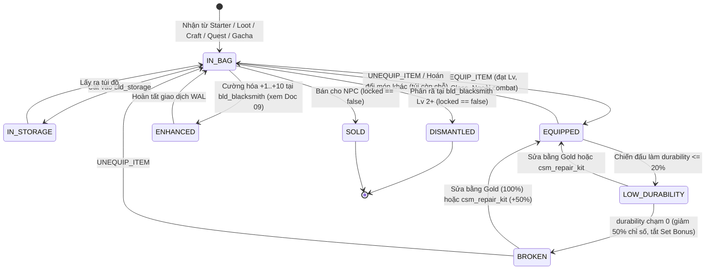

# 08 — Equipment & Weapon System Design: Eldoria: Forgotten Wilds

**Trạng thái**: Hoàn thiện (Design Baseline v1.0)  
**Chế độ**: `DESIGN_AND_PLANNING_ONLY`  
**Cập nhật lần cuối**: 2026-11-19  
**Nguồn dữ liệu chuẩn (Single Source of Truth)**: [`game-data/items.json`](../../game-data/items.json), [`game-data/characters.json`](../../game-data/characters.json), [`game-data/buildings.json`](../../game-data/buildings.json)  
**Tài liệu quản trị**: [Constitution](../../.specify/memory/constitution.md) · [00-game-vision.md](./00-game-vision.md) · [combat-formulas.md](../balancing/combat-formulas.md) · [database-design.md](../architecture/database-design.md) · [data-dictionary.md](../architecture/data-dictionary.md)

---

## 1. Mục tiêu Gameplay (Gameplay Objectives)

Hệ thống Vũ khí và Trang bị (Equipment & Weapon System) là trụ cột gắn kết vòng lặp **Explore → Gather → Combat → Loot → Craft → Upgrade → Boss Battle** trong **Eldoria: Forgotten Wilds** (thực thi Trụ cột 2, 3, 4 và Nguyên tắc III, VI của Hiến pháp):

1. **Bản sắc chiến đấu rõ rệt cho từng chủng loại vũ khí**: Toàn bộ **11 `WeaponType`** không chỉ khác nhau ở con số ATK mà mang nhịp đánh (`attackSpeed`), tầm với, khả năng phá giáp (`poiseBonus`), chỉ số chí mạng (`critRate`), xuyên giáp (`armorPenPct`) hoặc phòng ngự chủ động (`def`, `blockMitigationPct`) riêng biệt, định hình trực tiếp cảm giác chiến đấu Action RPG.
2. **Đa dạng nguồn thu thập — không độc quyền sau Gacha**: Người chơi có thể xây dựng trọn vẹn sức mạnh để chinh phục toàn bộ nội dung cốt lõi (bao gồm `dng_mossroot_hollow` và `boss_thornback_elder` ở MVP) bằng trang bị khởi đầu, chế tạo tại `bld_blacksmith` / `bld_workshop`, rơi từ quái/Elite/Boss hoặc đổi bằng `BOSS_TOKEN`. Vũ khí Gacha bổ sung lựa chọn lối chơi và tăng tốc tiến độ, không bao giờ là rào cản bắt buộc.
3. **Liên kết chặt chẽ giữa Kinh tế — Nông trại — Rèn đúc**: Độ bền (`durability`) tạo nhu cầu tiêu thụ nhẹ nhàng cho Gold và `csm_repair_kit` (sản phẩm chế tạo từ Đồng, Gỗ sồi và Sợi gai); cơ chế phân rã (Dismantling) tái chế trang bị dư thừa thành phôi kim loại và `mat_starlight_dust` phục vụ cường hóa `+1..+10`; 6 Bộ Trang bị (`equipmentSets`) theo 6 vùng đất chính tạo động lực khám phá và phối đồ chiến thuật.
4. **An toàn dữ liệu và công bằng tuyệt đối**: Mọi `ItemInstance` mang định danh duy nhất `UUIDv7`, gắn quyền sở hữu `ownerCharacterId`, khóa nhân vật (`bound: true` trong MVP) và lưu trữ 100% dưới dạng tệp JSON cục bộ tại `data/db/inventories/<characterId>.json` thông qua `JsonDatabaseEngine` có khóa bất đồng bộ và WAL nguyên tử.

---

## 2. User Stories

| ID | Vai trò | User Story | Milestone |
| :--- | :--- | :--- | :---: |
| **US-EQP-01** | Người chơi mới | Là chiến binh vừa tạo nhân vật (`chr_kael_vanguard`, `chr_lyra_windrunner` hoặc `chr_seraphina_dawn`), tôi muốn được cấp sẵn vũ khí khởi đầu phù hợp Class và bộ `set_greenhaven_novice` để sẵn sàng thu hoạch và chiến đấu ngay trong 5 phút đầu. | M1 (MVP) |
| **US-EQP-02** | Người chơi hành động | Là người chơi vừa nhặt hoặc rèn được vũ khí mới (như `wpn_elderwood_cleaver`), tôi muốn so sánh trực quan chênh lệch chỉ số (`ATK`, `DEF`, `Crit`, `Combat Rating`) với món đang mặc và trang bị nhanh chỉ bằng một cú nhấp. | M1 (MVP) |
| **US-EQP-03** | Người chơi săn hầm ngục | Là thành viên tổ đội đánh `dng_mossroot_hollow`, tôi muốn thu thập đủ 2 món rồi 4 món thuộc bộ `set_mossroot_guard` để kích hoạt kháng Thổ `+12%`, `+20 Poise` và hồi `+3 HP/giây` giúp trụ vững trước `boss_thornback_elder`. | M1 (MVP) |
| **US-EQP-04** | Người chơi thám hiểm | Là người chơi đi săn lâu trong rừng và thấy độ bền vũ khí xuống dưới 20%, tôi muốn dùng `csm_repair_kit` sửa nhanh `50%` độ bền ngay tại chỗ hoặc mang về `bld_blacksmith` sửa `100%` với mức giảm phí tới `30%` ở Lò Rèn Lv 4. | M1 (MVP) |
| **US-EQP-05** | Thợ rèn tự cung tự cấp | Là người chơi nhặt được nhiều giáp/vũ khí thừa không dùng, tôi muốn mang đến `bld_blacksmith` Lv 2+ phân rã thành phôi tinh luyện (`mat_copper_ingot`, `mat_iron_ingot`, `mat_steel_ingot`) và `mat_starlight_dust` để dồn vào cường hóa `+10`. | M1 (MVP) |
| **US-EQP-06** | Người chơi tối ưu build | Là người chơi giai đoạn M2+, tôi muốn khảm tối đa 1–2 viên Ngọc Nguyên tố/Chỉ số vào vũ khí và giáp tại `bld_blacksmith` Lv 3 / `bld_workshop` Lv 2, đồng thời có thể tháo ngọc an toàn mà không làm hỏng trang bị. | M2+ |
| **US-EQP-07** | Người chơi sưu tầm | Là người chơi mở khóa nhiều Hero trên cùng nhân vật, tôi muốn giữ và hoán đổi trang bị hợp lệ theo `weaponProficiencies` khi chuyển Hero ở Safe Zone mà không mất cấp cường hóa của vũ khí. | M1 (MVP) |

---

## 3. Hệ thống 11 Chủng loại Vũ khí (`WeaponType`) & 10 Ô Trang bị (`EquipmentSlot`)

### 3.1 Đặc tả 11 Chủng loại Vũ khí Chuẩn (`WeaponType`)

Khớp 100% enum trong `00-game-vision.md` và toàn bộ 40 vũ khí trong `game-data/items.json`:

| # | `WeaponType` | Số lượng (MVP / Tổng) | Ô trang bị (`slot`) | Nhịp tốc đánh chuẩn (`attackSpeed`) | Vai trò & Bản sắc chiến đấu | Class sử dụng chính (`allowedClasses`) | Hỗ trợ `OFF_HAND` (`SHIELD`) |
| :-: | :--- | :---: | :---: | :---: | :--- | :--- | :---: |
| 1 | `SWORD` | 1 / 4 | `MAIN_HAND` | `1.05–1.12` | Cân bằng công–thủ, combo 3 nhịp mượt, cancel dodge nhanh | `WARRIOR`, `KNIGHT`, *(một số `ASSASSIN`)* | **Có** |
| 2 | `GREATSWORD` | 1 / 4 | `MAIN_HAND` | `0.84–0.88` | Vũ khí hai tay hạng nặng, sát thương đơn nhát lớn, `poiseBonus` cao (`24–50`) chuyên phá giáp Boss | `WARRIOR`, `BERSERKER` | Không (Hai tay) |
| 3 | `DAGGER` | 1 / 4 | `MAIN_HAND` | `1.32–1.40` | Tốc đánh nhanh nhất game, `critRate` và `critDamage` cực cao, cơ động áp sát | `ASSASSIN`, `ARCHER` | Không (Song đoản đao) |
| 4 | `SPEAR` | 1 / 4 | `MAIN_HAND` | `0.98–1.05` | Tầm đâm xa tuyến tính, vừa giữ khoảng cách vừa cung cấp `def` & `poiseBonus` cho tuyến trước | `KNIGHT`, `WARRIOR` | **Có** |
| 5 | `AXE` | 1 / 3 | `MAIN_HAND` | `0.86–0.92` | Sát thương chém bổ uy lực, `poiseBonus` mạnh (`12–38`), hỗ trợ khai thác ở bậc khởi đầu | `WARRIOR`, `BERSERKER` | Chỉ với 1-hand (`wpn_woodcutter_handaxe`) |
| 6 | `BOW` | 1 / 4 | `MAIN_HAND` | `1.12–1.20` | Tầm xa linh hoạt, vừa di chuyển vừa bắn (kiting), tỷ lệ chí mạng tăng mạnh theo `DEX` | `ARCHER` | Không (Hai tay) |
| 7 | `CROSSBOW` | 0 / 3 | `MAIN_HAND` | `0.90–1.08` | Nỏ nặng hỏa lực cao, tích hợp sẵn xuyên giáp **`armorPenPct` (`8%–15%`)** khắc chế Boss giáp dày | `ARCHER` | Không (Hai tay) |
| 8 | `STAFF` | 1 / 4 | `MAIN_HAND` | `0.98–1.06` | Pháp trượng hai tay tối ưu `INT`, `MP`, `healingPowerPct` và `cooldownReduction` cho diện rộng | `HEALER`, `MAGE`, `SUMMONER` | Không (Hai tay) |
| 9 | `WAND` | 1 / 4 | `MAIN_HAND` | `1.14–1.18` | Đũa phép một tay ra đòn nhanh, tối ưu `critRate` phép thuật, nguyên tố và triệu hồi (`summonDamagePct`) | `MAGE`, `HEALER`, `SUMMONER` | **Có** *(nếu Class có proficiency `SHIELD`)* |
| 10 | `SHIELD` | 1 / 3 | `OFF_HAND` | — | Trang bị tay phụ tăng mạnh `DEF`, `HP`, `poiseBonus` (`26–65`) và `blockMitigationPct` (`12%–16%`) | `KNIGHT`, `WARRIOR`, `HEALER` | *(Chính là `OFF_HAND`)* |
| 11 | `GAUNTLET` | 1 / 3 | `MAIN_HAND` | `1.24–1.30` | Quyền giáp cận chiến tốc độ cao kèm `poiseBonus` & `staggerDamagePct` cực tốt để ép choáng Boss | `WARRIOR`, `BERSERKER` | Không (Cả hai tay) |

### 3.2 Đặc tả 10 Ô Trang bị (`EquipmentSlot`)

| # | `EquipmentSlot` | Loại vật phẩm hợp lệ (`item.slot`) | Quy tắc tương tác & Ràng buộc |
| :-: | :--- | :--- | :--- |
| 1 | `MAIN_HAND` | Vũ khí `slot: "MAIN_HAND"` (10 loại trừ `SHIELD`) | Quyết định bộ animation tấn công cơ bản (`basicAttack`), tầm đánh và công thức `WeaponATK(e)` (`+0..+10`). |
| 2 | `OFF_HAND` | Vũ khí `slot: "OFF_HAND"` (`SHIELD` — 3 món trong catalog) | Chỉ cộng chỉ số và kích hoạt hiệu ứng khiên khi `MAIN_HAND` trống hoặc là vũ khí 1 tay hợp lệ (`SWORD`, `SPEAR`, `WAND`, `wpn_woodcutter_handaxe`). Nếu người chơi trang bị vũ khí 2 tay (`GREATSWORD`, `BOW`, `CROSSBOW`, `STAFF`, `DAGGER`, `GAUNTLET`, rìu 2 tay), server tự động tháo `OFF_HAND` về túi đồ trong cùng giao dịch (hoặc từ chối nếu túi đồ đầy). |
| 3 | `HELMET` | Trang bị `slot: "HELMET"` (6 món) | Tham gia tính Set Bonus (1/4 mảnh bộ giáp). |
| 4 | `CHEST_ARMOR` | Trang bị `slot: "CHEST_ARMOR"` (7 món) | Đóng góp lớn nhất vào `DEF` & `HP`; tham gia Set Bonus (1/4 mảnh). |
| 5 | `GLOVES` | Trang bị `slot: "GLOVES"` (6 món) | Thường cung cấp thêm `ATK`, `Crit` hoặc `Stamina`; tham gia Set Bonus (1/4 mảnh). |
| 6 | `BOOTS` | Trang bị `slot: "BOOTS"` (6 món) | Cung cấp `moveSpeedPct` (`+3%..+12%`); tham gia Set Bonus (1/4 mảnh). |
| 7 | `RING_1` | Trang bị `slot: "RING"` (5 món) | Có thể đeo bất kỳ nhẫn nào trong nhóm `slot: "RING"`. |
| 8 | `RING_2` | Trang bị `slot: "RING"` (5 món) | Cho phép đeo 2 nhẫn khác `instanceId`; nếu đeo cùng một `itemId` ở cả hai ô, chỉ số nền vẫn cộng bình thường nhưng hiệu ứng đặc biệt trùng tên không cộng dồn quá trần `combat-formulas.md`. |
| 9 | `NECKLACE` | Trang bị `slot: "NECKLACE"` (5 món) | Chuyên cung cấp chỉ số tấn công, hồi chiêu (`cooldownReduction`) hoặc kháng nguyên tố. |
| 10 | `ACCESSORY` | Trang bị `slot: "ACCESSORY"` (5 món) | Bùa hộ mệnh, thắt lưng, la bàn, lông phượng hoàng hoặc huy hiệu thành tựu — cung cấp tiện ích đa dạng (`gatherSpeedPct`, `rareDropBonusPct`, `bossDamagePct`, `hpRegenPerSec`). |

---

## 4. Danh mục Toàn bộ 40 Vũ khí, 40 Giáp/Phụ kiện & 6 Bộ Trang bị (`game-data/items.json`)

Toàn bộ định danh, chỉ số, độ bền, giá bán và nguồn thu thập dưới đây được đối soát 100% với [`game-data/items.json`](../../game-data/items.json).

### 4.1 Toàn bộ 40 Vũ khí (10 Vũ khí MVP được đánh dấu **`✅ MVP`**)

| # | Weapon ID | Tên | Type / Slot | Elem | Rarity | Lv | MVP | Base Stats | Additional Stats | Dur | Bán | Class / Signature | Nguồn thu thập (`sources`) |
| :-: | :--- | :--- | :--- | :---: | :---: | :-: | :-: | :--- | :--- | :-: | :-: | :--- | :--- |
| 1 | **`wpn_iron_longsword`** | **Iron Longsword** | `SWORD` / `MAIN` | `NEUTRAL` | `UNCOMMON` | 1 | **✅ MVP** | `atk:26, atkSpd:1.05, crit:4%` | `str:3, vit:2` | 120 | 45G | `WAR/KNI` (`chr_kael_vanguard`) | `STARTER:chr_kael_vanguard`, `CRAFTING`, `NPC_SHOP:npc_smith_garrik` |
| 2 | `wpn_crimson_vanguard_blade` | Crimson Vanguard Blade | `SWORD` / `MAIN` | `FIRE` | `RARE` | 20 | Post | `atk:78, atkSpd:1.08, crit:6%` | `str:10, fireDmg:+10%` | 160 | 220G | `WAR/KNI` (`chr_kael_vanguard`) | `CRAFTING`, `REGION_DROP:reg_ironpeak_mountains`, `GACHA:bnr_perm_arsenal` |
| 3 | `wpn_runic_ruin_saber` | Runic Ruin Saber | `SWORD` / `MAIN` | `LIGHTNING` | `EPIC` | 50 | Post | `atk:172, atkSpd:1.12, crit:9%` | `agi:18, str:14, lightnDmg:+12%` | 210 | 780G | `WAR/KNI/ASN` | `CRAFTING`, `REGION_DROP:reg_forgotten_ruins`, `GACHA:bnr_perm_arsenal` |
| 4 | `wpn_solaris_eclipse_blade` | Solaris Eclipse Blade | `SWORD` / `MAIN` | `FIRE` | `LEGENDARY` | 85 | Post | `atk:302, atkSpd:1.12, crit:12%, poise:18` | `str:34, critDmg:+22%, fireDmg:+18%` | 270 | 2,400G | `WAR/KNI` | `CRAFTING`, `REGION_DROP:reg_ember_wasteland`, `GACHA:bnr_perm_arsenal` |
| 5 | **`wpn_elderwood_cleaver`** | **Elderwood Cleaver** | `GREATSWORD` / `MAIN` | `EARTH` | `EPIC` | 15 | **✅ MVP** | `atk:68, atkSpd:0.84, crit:5%, poise:28` | `str:12, vit:8, earthDmg:+10%` | 180 | 320G | `WAR/BER` | `BOSS_DROP:boss_thornback_elder`, `CRAFTING`, `GACHA:bnr_perm_arsenal` |
| 6 | `wpn_ironpeak_greatsword` | Ironpeak Steel Greatsword | `GREATSWORD` / `MAIN` | `NEUTRAL` | `RARE` | 25 | Post | `atk:104, atkSpd:0.85, crit:5%, poise:24` | `str:16, def:10` | 175 | 310G | `WAR/BER` | `CRAFTING`, `REGION_DROP:reg_ironpeak_mountains` |
| 7 | `wpn_bloodforge_colossus` | Bloodforge Colossus | `GREATSWORD` / `MAIN` | `FIRE` | `LEGENDARY` | 75 | Post | `atk:292, atkSpd:0.86, crit:10%, poise:42` | `str:36, critDmg:+25%, fireDmg:+18%` | 265 | 2,250G | `BER/WAR` (`chr_torvald_rageborn`) | `CRAFTING`, `REGION_DROP:reg_ember_wasteland`, `GACHA:bnr_perm_arsenal` |
| 8 | `wpn_abyssal_sovereign_claymore` | Abyssal Sovereign Claymore | `GREATSWORD` / `MAIN` | `SHADOW` | `MYTHIC` | 90 | Post | `atk:355, atkSpd:0.88, crit:14%, poise:50` | `str:44, critDmg:+30%, shadowDmg:+20%` | 300 | 4,200G | `BER/WAR` | `BOSS_DROP:boss_malakor_abyss`, `BOSS_TOKEN_SHOP`, `GACHA:bnr_perm_arsenal` |
| 9 | **`wpn_wolf_fang_dagger`** | **Wolf Fang Dagger** | `DAGGER` / `MAIN` | `NEUTRAL` | `RARE` | 8 | **✅ MVP** | `atk:36, atkSpd:1.32, crit:10%` | `agi:7, critDmg:+10%` | 135 | 135G | `ASN/ARC` | `ELITE_DROP:mob_elite_alpha_direwolf`, `CRAFTING`, `GACHA:bnr_perm_arsenal` |
| 10 | `wpn_crystal_stiletto` | Crystal Stiletto | `DAGGER` / `MAIN` | `FROST` | `RARE` | 35 | Post | `atk:102, atkSpd:1.35, crit:13%` | `agi:16, dex:12, frostDmg:+10%` | 165 | 460G | `ASN/ARC` | `CRAFTING`, `REGION_DROP:reg_crystal_caverns` |
| 11 | `wpn_duskveil_twinblade` | Duskveil Twinblade | `DAGGER` / `MAIN` | `SHADOW` | `EPIC` | 55 | Post | `atk:166, atkSpd:1.38, crit:16%` | `agi:26, critDmg:+22%, shadowDmg:+15%` | 210 | 980G | `ASN` (`chr_vex_nightblade`) | `CRAFTING`, `REGION_DROP:reg_forgotten_ruins`, `GACHA:bnr_perm_arsenal` |
| 12 | `wpn_phantom_eclipse_kris` | Phantom Eclipse Kris | `DAGGER` / `MAIN` | `SHADOW` | `LEGENDARY` | 85 | Post | `atk:268, atkSpd:1.40, crit:20%` | `agi:38, critDmg:+30%, shadowDmg:+18%` | 260 | 2,450G | `ASN` | `REGION_DROP:reg_abyssal_kingdom`, `CRAFTING`, `GACHA:bnr_perm_arsenal` |
| 13 | **`wpn_mossroot_pike`** | **Mossroot Pike** | `SPEAR` / `MAIN` | `EARTH` | `RARE` | 10 | **✅ MVP** | `atk:46, atkSpd:1.00, crit:5%, poise:14` | `vit:7, str:6, earthDmg:+8%` | 150 | 160G | `KNI/WAR` | `DUNGEON_DROP:dng_mossroot_hollow`, `CRAFTING`, `GACHA:bnr_perm_arsenal` |
| 14 | `wpn_tidebreaker_halberd` | Tidebreaker Halberd | `SPEAR` / `MAIN` | `WATER` | `UNCOMMON` | 25 | Post | `atk:84, atkSpd:0.98, def:14, poise:18` | `vit:12, waterDmg:+10%` | 165 | 240G | `KNI/WAR` (`chr_rowan_tidewarden`) | `CRAFTING`, `QUEST`, `REGION_DROP:reg_ironpeak_mountains` |
| 15 | `wpn_glacier_lance` | Glacier Lance | `SPEAR` / `MAIN` | `FROST` | `EPIC` | 65 | Post | `atk:218, atkSpd:1.02, def:24, poise:26` | `str:22, vit:20, frostDmg:+15%` | 230 | 1,350G | `KNI/WAR` | `BOSS_DROP:boss_boreas_frostking`, `CRAFTING`, `GACHA:bnr_perm_arsenal` |
| 16 | `wpn_dragonspine_partisan` | Dragonspine Partisan | `SPEAR` / `MAIN` | `FIRE` | `LEGENDARY` | 80 | Post | `atk:286, atkSpd:1.05, crit:11%, poise:32` | `str:30, vit:24, fireDmg:+18%` | 270 | 2,300G | `KNI/WAR` | `CRAFTING`, `REGION_DROP:reg_ember_wasteland`, `GACHA:bnr_perm_arsenal` |
| 17 | **`wpn_woodcutter_handaxe`** | **Woodcutter Handaxe** | `AXE` / `MAIN` | `NEUTRAL` | `COMMON` | 1 | **✅ MVP** | `atk:21, atkSpd:0.92, poise:12` | `str:2, gatherSpd:+8%` | 110 | 28G | `WAR/BER` | `CRAFTING`, `NPC_SHOP:npc_smith_garrik`, `QUEST` |
| 18 | `wpn_forgelord_waraxe` | Forgelord Waraxe | `AXE` / `MAIN` | `FIRE` | `EPIC` | 28 | Post | `atk:118, atkSpd:0.88, crit:8%, poise:28` | `str:18, fireDmg:+14%` | 195 | 490G | `BER/WAR` | `BOSS_DROP:boss_ignis_forgelord`, `CRAFTING`, `GACHA:bnr_perm_arsenal` |
| 19 | `wpn_frostbite_greataxe` | Frostbite Greataxe | `AXE` / `MAIN` | `FROST` | `LEGENDARY` | 68 | Post | `atk:264, atkSpd:0.86, crit:11%, poise:38` | `str:32, critDmg:+22%, frostDmg:+18%` | 255 | 1,950G | `BER/WAR` | `BOSS_DROP:boss_boreas_frostking`, `CRAFTING`, `GACHA:bnr_perm_arsenal` |
| 20 | **`wpn_ashwood_shortbow`** | **Ashwood Shortbow** | `BOW` / `MAIN` | `WIND` | `UNCOMMON` | 1 | **✅ MVP** | `atk:25, atkSpd:1.12, crit:6%` | `dex:4, agi:2` | 120 | 45G | `ARC` (`chr_lyra_windrunner`) | `STARTER:chr_lyra_windrunner`, `CRAFTING`, `NPC_SHOP:npc_smith_garrik` |
| 21 | `wpn_galeweaver_longbow` | Galeweaver Longbow | `BOW` / `MAIN` | `WIND` | `RARE` | 22 | Post | `atk:82, atkSpd:1.15, crit:9%` | `dex:12, windDmg:+12%` | 160 | 240G | `ARC` (`chr_lyra_windrunner`) | `CRAFTING`, `REGION_DROP:reg_ironpeak_mountains`, `GACHA:bnr_perm_arsenal` |
| 22 | `wpn_prism_recurve_bow` | Prism Recurve Bow | `BOW` / `MAIN` | `LIGHT` | `EPIC` | 40 | Post | `atk:144, atkSpd:1.16, crit:12%` | `dex:20, critDmg:+16%, lightDmg:+14%` | 200 | 680G | `ARC` | `BOSS_DROP:boss_prism_leviathan`, `CRAFTING`, `GACHA:bnr_perm_arsenal` |
| 23 | `wpn_tempest_horizon_bow` | Tempest Horizon Bow | `BOW` / `MAIN` | `WIND` | `LEGENDARY` | 75 | Post | `atk:265, atkSpd:1.20, crit:16%` | `dex:34, agi:20, windDmg:+20%` | 260 | 2,150G | `ARC` | `CRAFTING`, `REGION_DROP:reg_ember_wasteland`, `GACHA:bnr_perm_arsenal` |
| 24 | `wpn_iron_arbalest` | Iron Arbalest | `CROSSBOW` / `MAIN` | `NEUTRAL` | `UNCOMMON` | 18 | Post | `atk:72, atkSpd:0.90, crit:8%` | `dex:9, armorPen:+8%` | 150 | 190G | `ARC` | `CRAFTING`, `NPC_SHOP:npc_ironpeak_quartermaster` |
| 25 | `wpn_relic_repeater_crossbow` | Relic Repeater Crossbow | `CROSSBOW` / `MAIN` | `LIGHTNING` | `EPIC` | 52 | Post | `atk:184, atkSpd:1.05, crit:12%` | `dex:22, lightnDmg:+14%, armorPen:+12%` | 215 | 920G | `ARC` | `CRAFTING`, `REGION_DROP:reg_forgotten_ruins`, `GACHA:bnr_perm_arsenal` |
| 26 | `wpn_astralforge_starbow` | Astralforge Starbow | `CROSSBOW` / `MAIN` | `LIGHT` | `MYTHIC` | 90 | Post | `atk:342, atkSpd:1.08, crit:18%` | `dex:42, critDmg:+28%, lightDmg:+22%, armorPen:+15%` | 300 | 4,200G | `ARC` (`chr_aurelia_starbow`) | `BOSS_DROP:boss_malakor_abyss`, `BOSS_TOKEN_SHOP`, `GACHA:bnr_perm_arsenal` |
| 27 | **`wpn_oak_acolyte_staff`** | **Oak Acolyte Staff** | `STAFF` / `MAIN` | `LIGHT` | `UNCOMMON` | 1 | **✅ MVP** | `atk:20, int:14, atkSpd:0.98` | `mp:35, healPwr:+8%` | 120 | 45G | `HLR/MAG/SUM` (`chr_seraphina_dawn`) | `STARTER:chr_seraphina_dawn`, `CRAFTING`, `NPC_SHOP:npc_smith_garrik` |
| 28 | `wpn_crystal_conduit_staff` | Crystal Conduit Staff | `STAFF` / `MAIN` | `WATER` | `RARE` | 38 | Post | `atk:106, int:52, atkSpd:1.00` | `mp:110, waterDmg:+14%, cdr:+6%` | 175 | 540G | `MAG/HLR/SUM` | `CRAFTING`, `REGION_DROP:reg_crystal_caverns`, `GACHA:bnr_perm_arsenal` |
| 29 | `wpn_voltspire_stormstaff` | Voltspire Stormstaff | `STAFF` / `MAIN` | `LIGHTNING` | `LEGENDARY` | 60 | Post | `atk:182, int:94, atkSpd:1.04, crit:12%` | `mp:180, lightnDmg:+20%, cdr:+10%` | 245 | 1,680G | `MAG/SUM` (`chr_orin_stormcaller`) | `CRAFTING`, `REGION_DROP:reg_forgotten_ruins`, `GACHA:bnr_perm_arsenal` |
| 30 | `wpn_celestial_dawn_staff` | Celestial Dawn Staff | `STAFF` / `MAIN` | `LIGHT` | `MYTHIC` | 88 | Post | `atk:274, int:132, atkSpd:1.06, crit:14%` | `mp:260, lightDmg:+22%, healPwr:+25%, cdr:+12%` | 300 | 4,100G | `HLR/MAG` (`chr_seraphina_dawn`) | `BOSS_DROP:boss_malakor_abyss`, `BOSS_TOKEN_SHOP`, `GACHA:bnr_perm_arsenal` |
| 31 | **`wpn_starbloom_scepter`** | **Starbloom Scepter** | `WAND` / `MAIN` | `LIGHT` | `LEGENDARY` | 15 | **✅ MVP** | `atk:56, int:32, atkSpd:1.14, crit:8%` | `mp:75, lightDmg:+12%, cdr:+6%` | 200 | 520G | `MAG/HLR/SUM` | `GACHA:bnr_perm_arsenal`, `BOSS_TOKEN_SHOP`, `BOSS_DROP:boss_thornback_elder` |
| 32 | `wpn_glaciersong_wand` | Glaciersong Wand | `WAND` / `MAIN` | `FROST` | `EPIC` | 42 | Post | `atk:124, int:68, atkSpd:1.15, crit:10%` | `mp:135, frostDmg:+16%, cdr:+8%` | 205 | 760G | `MAG/SUM` (`chr_freya_frostveil`) | `BOSS_DROP:boss_prism_leviathan`, `CRAFTING`, `GACHA:bnr_perm_arsenal` |
| 33 | `wpn_cinder_rune_wand` | Cinder Rune Wand | `WAND` / `MAIN` | `FIRE` | `EPIC` | 76 | Post | `atk:218, int:108, atkSpd:1.16, crit:13%` | `mp:195, fireDmg:+18%, critDmg:+18%` | 240 | 1,820G | `MAG/SUM` | `CRAFTING`, `REGION_DROP:reg_ember_wasteland` |
| 34 | `wpn_umbramancer_void_wand` | Umbramancer Void Wand | `WAND` / `MAIN` | `SHADOW` | `MYTHIC` | 90 | Post | `atk:282, int:140, atkSpd:1.18, crit:16%` | `mp:280, shadowDmg:+24%, summonDmg:+25%, cdr:+12%` | 300 | 4,200G | `SUM/MAG` (`chr_nyx_voidcaller`) | `BOSS_DROP:boss_malakor_abyss`, `BOSS_TOKEN_SHOP`, `GACHA:bnr_perm_arsenal` |
| 35 | **`wpn_thornbark_bulwark`** | **Thornbark Bulwark** | `SHIELD` / `OFF` | `EARTH` | `RARE` | 10 | **✅ MVP** | `atk:16, def:36, poise:26` | `vit:8, hp:90, earthRes:+10%` | 170 | 175G | `KNI/WAR/HLR` | `DUNGEON_DROP:dng_mossroot_hollow`, `BOSS_DROP:boss_thornback_elder`, `CRAFTING`, `GACHA:bnr_perm_arsenal` |
| 36 | `wpn_stoneheart_aegis` | Stoneheart Aegis | `SHIELD` / `OFF` | `EARTH` | `EPIC` | 30 | Post | `atk:38, def:88, poise:44` | `vit:20, hp:240, blockMit:+12%` | 225 | 620G | `KNI/WAR` (`chr_bram_bastion`) | `BOSS_DROP:boss_ignis_forgelord`, `CRAFTING`, `GACHA:bnr_perm_arsenal` |
| 37 | `wpn_boreal_bastion_shield` | Boreal Bastion Shield | `SHIELD` / `OFF` | `FROST` | `LEGENDARY` | 70 | Post | `atk:84, def:182, poise:65` | `vit:36, hp:520, frostRes:+22%, blockMit:+16%` | 280 | 2,100G | `KNI/WAR` | `BOSS_DROP:boss_boreas_frostking`, `CRAFTING`, `GACHA:bnr_perm_arsenal` |
| 38 | **`wpn_copper_knuckle_gauntlet`** | **Copper Knuckle Gauntlet** | `GAUNTLET` / `MAIN` | `NEUTRAL` | `COMMON` | 3 | **✅ MVP** | `atk:22, atkSpd:1.28, crit:6%, poise:10` | `str:3, agi:3` | 115 | 35G | `WAR/BER` (`chr_mira_ironfist`) | `CRAFTING`, `QUEST`, `NPC_SHOP:npc_smith_garrik` |
| 39 | `wpn_obsidian_crusher_gauntlet` | Obsidian Crusher Gauntlet | `GAUNTLET` / `MAIN` | `EARTH` | `EPIC` | 48 | Post | `atk:154, atkSpd:1.24, crit:10%, poise:30` | `str:22, vit:16, staggerDmg:+18%` | 210 | 860G | `WAR/BER` | `CRAFTING`, `REGION_DROP:reg_forgotten_ruins`, `GACHA:bnr_perm_arsenal` |
| 40 | `wpn_embercore_titan_gauntlet` | Embercore Titan Gauntlet | `GAUNTLET` / `MAIN` | `FIRE` | `LEGENDARY` | 82 | Post | `atk:272, atkSpd:1.30, crit:14%, poise:38` | `str:36, critDmg:+24%, fireDmg:+18%` | 265 | 2,350G | `WAR/BER` | `CRAFTING`, `REGION_DROP:reg_ember_wasteland`, `GACHA:bnr_perm_arsenal` |

*(Toàn bộ 40/40 vũ khí có `maxEnhancement: 10`, `stackable: false`, `maxStack: 1`. Trong MVP `M1`, đúng **10 vũ khí** đánh dấu `✅ MVP` phủ 10/11 chủng loại vũ khí — chỉ `CROSSBOW` xuất hiện từ M2 ở Lv 18 trở lên.)*

---

### 4.2 Toàn bộ 40 Trang bị Giáp & Phụ kiện (12 Món MVP được đánh dấu **`✅ MVP`**)

Phân bổ chính xác theo ô: `HELMET` (6), `CHEST_ARMOR` (7), `GLOVES` (6), `BOOTS` (6), `RING` (5), `NECKLACE` (5), `ACCESSORY` (5) — tổng cộng **40 trang bị** (`12 MVP` + `28 Post-MVP`):

| # | Equipment ID | Tên | Slot | Rarity | Lv | MVP | Set ID | Base Stats | Additional Stats | Dur | Bán | Nguồn thu thập (`sources`) |
| :-: | :--- | :--- | :--- | :---: | :-: | :-: | :--- | :--- | :--- | :-: | :-: | :--- |
| 1 | **`eqp_novice_straw_hood`** | **Novice Straw Hood** | `HELMET` | `COMMON` | 1 | **✅ MVP** | `set_greenhaven_novice` | `def:6, hp:20` | `vit:1` | 90 | 15G | `STARTER`, `CRAFTING`, `NPC_SHOP:npc_village_tailor` |
| 2 | **`eqp_novice_linen_tunic`** | **Novice Linen Tunic** | `CHEST_ARMOR` | `COMMON` | 1 | **✅ MVP** | `set_greenhaven_novice` | `def:10, hp:35` | `vit:2` | 100 | 22G | `STARTER`, `CRAFTING`, `NPC_SHOP:npc_village_tailor` |
| 3 | **`eqp_novice_cloth_gloves`** | **Novice Cloth Gloves** | `GLOVES` | `COMMON` | 1 | **✅ MVP** | `set_greenhaven_novice` | `def:5, stamina:10` | `dex:1` | 90 | 14G | `STARTER`, `CRAFTING`, `NPC_SHOP:npc_village_tailor` |
| 4 | **`eqp_novice_traveler_boots`** | **Novice Traveler Boots** | `BOOTS` | `COMMON` | 1 | **✅ MVP** | `set_greenhaven_novice` | `def:5, moveSpd:+3%` | `agi:1` | 90 | 15G | `STARTER`, `CRAFTING`, `NPC_SHOP:npc_village_tailor` |
| 5 | **`eqp_hunter_tunic`** | **Whispering Hunter Tunic** | `CHEST_ARMOR` | `UNCOMMON` | 5 | **✅ MVP** | — | `def:18, hp:65` | `agi:4, dex:3, crit:+3%` | 130 | 75G | `CRAFTING`, `QUEST`, `REGION_DROP:reg_whispering_forest` |
| 6 | **`eqp_mossroot_helm`** | **Mossroot Guard Helm** | `HELMET` | `RARE` | 10 | **✅ MVP** | `set_mossroot_guard` | `def:24, hp:85` | `vit:5, earthRes:+6%` | 160 | 140G | `DUNGEON_DROP:dng_mossroot_hollow`, `BOSS_DROP:boss_thornback_elder`, `CRAFTING` |
| 7 | **`eqp_mossroot_breastplate`** | **Mossroot Guard Breastplate** | `CHEST_ARMOR` | `RARE` | 10 | **✅ MVP** | `set_mossroot_guard` | `def:36, hp:145` | `vit:8, str:4, poise:10` | 180 | 195G | `DUNGEON_DROP:dng_mossroot_hollow`, `BOSS_DROP:boss_thornback_elder`, `CRAFTING` |
| 8 | **`eqp_mossroot_gauntlets`** | **Mossroot Guard Gauntlets** | `GLOVES` | `RARE` | 10 | **✅ MVP** | `set_mossroot_guard` | `def:20, atk:8` | `str:5, crit:+3%` | 155 | 135G | `DUNGEON_DROP:dng_mossroot_hollow`, `CRAFTING` |
| 9 | **`eqp_mossroot_greaves`** | **Mossroot Guard Greaves** | `BOOTS` | `RARE` | 10 | **✅ MVP** | `set_mossroot_guard` | `def:22, hp:70, moveSpd:+5%` | `agi:4, vit:4` | 155 | 140G | `DUNGEON_DROP:dng_mossroot_hollow`, `CRAFTING` |
| 10 | **`eqp_copper_vitality_ring`** | **Copper Vitality Ring** | `RING` | `UNCOMMON` | 5 | **✅ MVP** | — | `hp:55, stamina:15` | `vit:4, luk:2` | 120 | 60G | `CRAFTING`, `QUEST`, `NPC_SHOP:npc_smith_garrik` |
| 11 | **`eqp_direwolf_fang_pendant`** | **Direwolf Fang Pendant** | `NECKLACE` | `RARE` | 10 | **✅ MVP** | — | `atk:14, crit:+5%` | `str:5, agi:5` | 150 | 165G | `ELITE_DROP:mob_elite_alpha_direwolf`, `CRAFTING` |
| 12 | **`eqp_thornback_heart_charm`** | **Thornback Heart Charm** | `ACCESSORY` | `EPIC` | 15 | **✅ MVP** | — | `hp:130, def:18, atk:12` | `vit:8, earthRes:+12%, hpRegen:+3/s` | 200 | 350G | `BOSS_DROP:boss_thornback_elder`, `BOSS_TOKEN_SHOP` |
| 13 | `eqp_ironpeak_helm` | Ironpeak Forge Helm | `HELMET` | `RARE` | 25 | Post | `set_ironpeak_forge` | `def:46, hp:165` | `str:8, fireRes:+8%` | 185 | 290G | `CRAFTING`, `REGION_DROP:reg_ironpeak_mountains` |
| 14 | `eqp_ironpeak_cuirass` | Ironpeak Forge Cuirass | `CHEST_ARMOR` | `RARE` | 25 | Post | `set_ironpeak_forge` | `def:68, hp:260` | `vit:12, str:10, fireRes:+10%` | 200 | 380G | `BOSS_DROP:boss_ignis_forgelord`, `CRAFTING` |
| 15 | `eqp_ironpeak_bracers` | Ironpeak Forge Bracers | `GLOVES` | `RARE` | 25 | Post | `set_ironpeak_forge` | `def:38, atk:18` | `str:10, critDmg:+8%` | 180 | 275G | `CRAFTING`, `REGION_DROP:reg_ironpeak_mountains` |
| 16 | `eqp_ironpeak_sabatons` | Ironpeak Forge Sabatons | `BOOTS` | `RARE` | 25 | Post | `set_ironpeak_forge` | `def:42, hp:140, moveSpd:+6%` | `vit:9, poise:14` | 180 | 280G | `CRAFTING`, `REGION_DROP:reg_ironpeak_mountains` |
| 17 | `eqp_crystal_circlet` | Crystal Arcanist Circlet | `HELMET` | `EPIC` | 40 | Post | `set_crystal_arcanist` | `def:56, mp:95` | `int:18, cdr:+4%` | 210 | 620G | `CRAFTING`, `REGION_DROP:reg_crystal_caverns` |
| 18 | `eqp_crystal_vestment` | Crystal Arcanist Vestment | `CHEST_ARMOR` | `EPIC` | 40 | Post | `set_crystal_arcanist` | `def:82, hp:310, mp:140` | `int:24, waterRes:+12%, lightRes:+12%` | 225 | 790G | `BOSS_DROP:boss_prism_leviathan`, `CRAFTING` |
| 19 | `eqp_crystal_handwraps` | Crystal Arcanist Handwraps | `GLOVES` | `EPIC` | 40 | Post | `set_crystal_arcanist` | `def:48, atk:24` | `int:16, crit:+6%` | 205 | 590G | `CRAFTING`, `REGION_DROP:reg_crystal_caverns` |
| 20 | `eqp_crystal_slippers` | Crystal Arcanist Slippers | `BOOTS` | `EPIC` | 40 | Post | `set_crystal_arcanist` | `def:52, mp:80, moveSpd:+8%` | `int:14, agi:10` | 205 | 600G | `CRAFTING`, `REGION_DROP:reg_crystal_caverns` |
| 21 | `eqp_frostbound_greathelm` | Frostbound Warden Greathelm | `HELMET` | `LEGENDARY` | 65 | Post | `set_frostbound_warden` | `def:108, hp:420` | `vit:24, frostRes:+14%` | 255 | 1,520G | `BOSS_DROP:boss_boreas_frostking`, `CRAFTING` |
| 22 | `eqp_frostbound_hauberk` | Frostbound Warden Hauberk | `CHEST_ARMOR` | `LEGENDARY` | 65 | Post | `set_frostbound_warden` | `def:156, hp:640` | `vit:32, str:22, frostRes:+18%` | 275 | 1,980G | `BOSS_DROP:boss_boreas_frostking`, `CRAFTING` |
| 23 | `eqp_frostbound_vambraces` | Frostbound Warden Vambraces | `GLOVES` | `LEGENDARY` | 65 | Post | `set_frostbound_warden` | `def:92, atk:46` | `str:22, poise:20` | 250 | 1,460G | `CRAFTING`, `REGION_DROP:reg_frostbound_highlands` |
| 24 | `eqp_frostbound_striders` | Frostbound Warden Striders | `BOOTS` | `LEGENDARY` | 65 | Post | `set_frostbound_warden` | `def:98, hp:360, moveSpd:+9%` | `agi:20, vit:18` | 250 | 1,480G | `CRAFTING`, `REGION_DROP:reg_frostbound_highlands` |
| 25 | `eqp_abyssal_crown` | Abyssal Sovereign Crown | `HELMET` | `MYTHIC` | 88 | Post | `set_abyssal_sovereign` | `def:148, hp:580, mp:180` | `str:28, int:28, crit:+8%` | 300 | 3,100G | `BOSS_DROP:boss_malakor_abyss`, `BOSS_TOKEN_SHOP`, `CRAFTING` |
| 26 | `eqp_abyssal_mantle` | Abyssal Sovereign Mantle | `CHEST_ARMOR` | `MYTHIC` | 88 | Post | `set_abyssal_sovereign` | `def:212, hp:860, mp:220` | `vit:40, shadowRes:+20%, allElemRes:+8%` | 320 | 3,800G | `BOSS_DROP:boss_malakor_abyss`, `BOSS_TOKEN_SHOP`, `CRAFTING` |
| 27 | `eqp_abyssal_claws` | Abyssal Sovereign Claws | `GLOVES` | `MYTHIC` | 88 | Post | `set_abyssal_sovereign` | `def:126, atk:72` | `crit:+7%, critDmg:+16%, atkSpd:+8%` | 300 | 3,050G | `BOSS_DROP:boss_malakor_abyss`, `CRAFTING` |
| 28 | `eqp_abyssal_treads` | Abyssal Sovereign Treads | `BOOTS` | `MYTHIC` | 88 | Post | `set_abyssal_sovereign` | `def:134, hp:520, moveSpd:+12%` | `agi:34, stamina:45` | 300 | 3,050G | `BOSS_DROP:boss_malakor_abyss`, `CRAFTING` |
| 29 | `eqp_forgelord_ember_ring` | Forgelord Ember Ring | `RING` | `RARE` | 28 | Post | — | `atk:24, crit:+5%` | `str:10, fireDmg:+10%` | 175 | 340G | `BOSS_DROP:boss_ignis_forgelord`, `CRAFTING` |
| 30 | `eqp_prism_resonance_ring` | Prism Resonance Ring | `RING` | `EPIC` | 42 | Post | — | `int:26, mp:110` | `elemDmg:+10%, cdr:+6%` | 205 | 690G | `BOSS_DROP:boss_prism_leviathan`, `CRAFTING` |
| 31 | `eqp_rimeheart_signet` | Rimeheart Signet | `RING` | `LEGENDARY` | 68 | Post | — | `atk:48, def:42, crit:+8%` | `frostDmg:+14%, frostRes:+15%` | 255 | 1,680G | `BOSS_DROP:boss_boreas_frostking`, `CRAFTING` |
| 32 | `eqp_eclipse_void_band` | Eclipse Void Band | `RING` | `MYTHIC` | 90 | Post | — | `atk:76, int:52, crit:+11%` | `critDmg:+20%, shadowDmg:+16%` | 300 | 3,400G | `BOSS_DROP:boss_malakor_abyss`, `BOSS_TOKEN_SHOP` |
| 33 | `eqp_ironpeak_forge_amulet` | Ironpeak Forge Amulet | `NECKLACE` | `RARE` | 26 | Post | — | `hp:190, def:30` | `vit:12, fireRes:+12%` | 175 | 310G | `CRAFTING`, `QUEST`, `REGION_DROP:reg_ironpeak_mountains` |
| 34 | `eqp_ancient_relic_medallion` | Ancient Relic Medallion | `NECKLACE` | `EPIC` | 52 | Post | — | `atk:40, int:36, mp:130` | `cdr:+8%, luk:14` | 220 | 940G | `CRAFTING`, `REGION_DROP:reg_forgotten_ruins` |
| 35 | `eqp_dragonscale_talisman` | Dragonscale Talisman | `NECKLACE` | `LEGENDARY` | 78 | Post | — | `hp:480, atk:62, def:56` | `str:24, vit:24, fireRes:+20%` | 270 | 2,150G | `CRAFTING`, `REGION_DROP:reg_ember_wasteland` |
| 36 | `eqp_abyssal_star_choker` | Abyssal Star Choker | `NECKLACE` | `MYTHIC` | 88 | Post | — | `atk:78, int:72, hp:520` | `cdr:+10%, allElemRes:+12%, critDmg:+18%` | 300 | 3,500G | `BOSS_DROP:boss_malakor_abyss`, `BOSS_TOKEN_SHOP` |
| 37 | `eqp_miner_lantern_belt` | Miner Lantern Belt | `ACCESSORY` | `UNCOMMON` | 20 | Post | — | `stamina:35, def:16` | `gatherSpd:+15%, luk:6` | 150 | 180G | `CRAFTING`, `QUEST`, `NPC_SHOP:npc_ironpeak_quartermaster` |
| 38 | `eqp_ruin_seeker_compass` | Ruin Seeker Compass | `ACCESSORY` | `EPIC` | 50 | Post | — | `crit:+8%, moveSpd:+8%` | `luk:18, dex:16, rareDrop:+10%` | 215 | 900G | `QUEST`, `REGION_DROP:reg_forgotten_ruins` |
| 39 | `eqp_cinder_phoenix_feather` | Cinder Phoenix Feather | `ACCESSORY` | `LEGENDARY` | 80 | Post | — | `hp:450, atk:54, int:46` | `fireDmg:+16%, fireRes:+22%, hpRegen:+8/s` | 270 | 2,250G | `REGION_DROP:reg_ember_wasteland`, `CRAFTING` |
| 40 | `eqp_crown_of_forgotten_wilds` | Emblem of Forgotten Wilds | `ACCESSORY` | `MYTHIC` | 90 | Post | — | `hp:620, mp:240, atk:82, def:74` | `allStats:+18, bossDmg:+12%, gatherSpd:+20%` | 320 | 4,500G | `ACHIEVEMENT:ach_master_of_eldoria`, `BOSS_DROP:boss_malakor_abyss` |

---

### 4.3 Toàn bộ 6 Bộ Trang bị (`equipmentSets`) — Hiệu ứng 2 Món & 4 Món

Khi nhân vật mặc đồng thời `>= 2` hoặc đủ `4` mảnh khác slot của cùng một `setId` (và các mảnh đều có `durability > 0`), `StatCalculator` trên server tự động cộng thưởng Bộ Trang bị trước khi áp dụng trần cứng `combat-formulas.md`:

| # | Set ID | Tên Bộ | Vùng đất (`regionId`) | Lv | Rarity | MVP | 4 Mảnh (`pieceIds`) | Thưởng 2 Món (`2-pc`) | Thưởng 4 Món (`4-pc`) |
| :-: | :--- | :--- | :--- | :-: | :---: | :-: | :--- | :--- | :--- |
| 1 | **`set_greenhaven_novice`** | **Greenhaven Novice Attire** | `reg_greenhaven_village` | 1 | `COMMON` | **✅ MVP** | `eqp_novice_straw_hood`, `eqp_novice_linen_tunic`, `eqp_novice_cloth_gloves`, `eqp_novice_traveler_boots` | `hp: +40`, `stamina: +15` (`eff_set_novice_2p`) | `def: +10`, `moveSpeedPct: +5%`, `gatherSpeedPct: +10%` (`eff_set_novice_4p`) |
| 2 | **`set_mossroot_guard`** | **Mossroot Guard Regalia** | `reg_whispering_forest` | 10 | `RARE` | **✅ MVP** | `eqp_mossroot_helm`, `eqp_mossroot_breastplate`, `eqp_mossroot_gauntlets`, `eqp_mossroot_greaves` | `def: +24`, `earthRes: +12%` (`eff_set_mossroot_2p`) | `hp: +140`, `poiseBonus: +20`, `hpRegenPerSec: +3` (`eff_set_mossroot_4p`) |
| 3 | `set_ironpeak_forge` | Ironpeak Forgeplate | `reg_ironpeak_mountains` | 25 | `RARE` | Post | `eqp_ironpeak_helm`, `eqp_ironpeak_cuirass`, `eqp_ironpeak_bracers`, `eqp_ironpeak_sabatons` | `atk: +22`, `fireRes: +15%` (`eff_set_ironpeak_2p`) | `def: +45`, `critDamage: +18%`, `staggerDamagePct: +15%` (`eff_set_ironpeak_4p`) |
| 4 | `set_crystal_arcanist` | Crystal Arcanist Vestments | `reg_crystal_caverns` | 40 | `EPIC` | Post | `eqp_crystal_circlet`, `eqp_crystal_vestment`, `eqp_crystal_handwraps`, `eqp_crystal_slippers` | `int: +32`, `mp: +120` (`eff_set_crystal_2p`) | `cooldownReduction: +12%`, `elementalDamagePct: +16%`, `mpRegenPerSec: +4` (`eff_set_crystal_4p`) |
| 5 | `set_frostbound_warden` | Frostbound Warden Aegis | `reg_frostbound_highlands` | 65 | `LEGENDARY` | Post | `eqp_frostbound_greathelm`, `eqp_frostbound_hauberk`, `eqp_frostbound_vambraces`, `eqp_frostbound_striders` | `def: +90`, `hp: +320`, `frostRes: +25%` (`eff_set_frostbound_2p`) | `atk: +65`, `frostDamagePct: +20%`, `blockMitigationPct: +12%` (`eff_set_frostbound_4p`) |
| 6 | `set_abyssal_sovereign` | Abyssal Sovereign Regalia | `reg_abyssal_kingdom` | 88 | `MYTHIC` | Post | `eqp_abyssal_crown`, `eqp_abyssal_mantle`, `eqp_abyssal_claws`, `eqp_abyssal_treads` | `atk: +95`, `int: +60`, `critRate: +8%` (`eff_set_abyssal_2p`) | `critDamage: +25%`, `cooldownReduction: +10%`, `shadowRes: +25%`, `bossDamagePct: +15%` (`eff_set_abyssal_4p`) |

*Mẹo phối đồ chiến thuật*: Người chơi hoàn toàn có thể phối **2+2** (ví dụ `2 mảnh set_ironpeak_forge` + `2 mảnh set_mossroot_guard` để lấy đồng thời ATK, DEF, kháng Hỏa và kháng Thổ) tùy cơ chế Boss.

---

## 5. Cơ chế Chỉ số, Độ bền & Sửa chữa, Phân rã, Khảm ngọc (M2+) & Quyền sở hữu

### 5.1 Độ hiếm (`Rarity`), Dòng phụ (`bonusRolls`) & Sức mạnh Trang bị

- **Base Stats & Additional Stats**: Định nghĩa tĩnh từ `game-data/items.json`, giống nhau 100% ở mọi bản thể cùng `itemId` để bảo đảm minh bạch.
- **Dòng phụ ngẫu nhiên có kiểm soát (`bonusRolls`)**: Khi trang bị được chế tạo hoặc rơi từ quái/Boss/Gacha, server dùng CSPRNG (`crypto.randomInt`) sinh thêm số dòng phụ nhỏ theo độ hiếm (không vượt quá biên độ hẹp để tránh RNG cực đoan):
  - `COMMON`: `0` dòng phụ.
  - `UNCOMMON`: `1` dòng phụ (`+1..+3` chỉ số cơ bản hoặc `+1%..+2%` chỉ số phụ).
  - `RARE`: `1–2` dòng phụ.
  - `EPIC`: `2–3` dòng phụ.
  - `LEGENDARY`: `3` dòng phụ.
  - `MYTHIC`: `3–4` dòng phụ.
  - Khi chế tạo tại `bld_workshop` Lv 3 (M2+), xác suất cuộn vào nửa trên biên độ tăng `+10%` (`game-data/buildings.json`).
- **Tích hợp Combat Rating**: Toàn bộ chỉ số trang bị, cường hóa `+0..+10` và Set Bonus được cộng dồn vào `Character.derivedSnapshot` và quy đổi sang `combatRating` theo công thức chuẩn tại [`05-character-progression.md`](./05-character-progression.md).

### 5.2 Hệ thống Độ bền & Sửa chữa (Durability & Repair)

1. **Quy tắc Hao mòn (Wear Rates — tính 100% tại Server)**:
   - Vũ khí (`MAIN_HAND`): Mất **`1` độ bền sau mỗi `12` đòn đánh trúng mục tiêu** (hoặc `1` điểm mỗi lần khai thác tài nguyên nếu dùng vũ khí thay công cụ). Không hao mòn khi đánh hình nộm tại `bld_training_ground`.
   - Giáp & Khiên (`OFF_HAND`, `HELMET`, `CHEST_ARMOR`, `GLOVES`, `BOOTS`): Mất **`1` độ bền sau mỗi `8` đòn nhận sát thương thực tế** (giảm một nửa nếu đỡ bằng Perfect Parry).
   - Trang sức (`RING_1`, `RING_2`, `NECKLACE`, `ACCESSORY`): Không hao mòn trong combat thường; chỉ mất **`8% durabilityMax`** khi nhân vật tử trận (`DEATH`).
   - Phạt khi tử trận ngoài làng: Mọi món đang mặc mất **`8% durabilityMax`** (làm tròn xuống, tối thiểu 1).
2. **Trạng thái Cảnh báo & Hỏng (Broken — KHÔNG mất đồ)**:
   - `durability > 20% durabilityMax`: Hoạt động `100%` hiệu suất.
   - `1 <= durability <= 20% durabilityMax`: Biểu tượng cảnh báo màu vàng cam hiện trên HUD; hiệu suất vẫn `100%`.
   - `durability === 0` (**`BROKEN`**): Trang bị **KHÔNG BAO GIỜ bị xóa hay biến mất**. Hiệu lực bị giảm **`50%` toàn bộ `baseStats` & `additionalStats`**, đồng thời tạm ngừng tính mảnh đó vào Set Bonus cho đến khi sửa (`durability > 0`).
3. **Hai Phương thức Sửa chữa**:
   - **Sửa tại Lò Rèn (`bld_blacksmith` hoặc `npc_smith_garrik`) bằng Gold**: Phục hồi ngay lên **`100% durabilityMax`** (hỗ trợ sửa 1 món hoặc nút *"Sửa tất cả đang mặc"*).
     $$\text{RepairGoldCost} = \left\lceil (\text{durabilityMax} - \text{durability}) \cdot \text{RarityRate} \cdot (1 - \text{BlacksmithDiscount}) \right\rceil$$
     Trong đó `RarityRate` = `0.4` (`COMMON`), `0.7` (`UNCOMMON`), `1.2` (`RARE`), `2.2` (`EPIC`), `3.6` (`LEGENDARY`), `5.5` (`MYTHIC`); `BlacksmithDiscount` lấy trực tiếp từ `bld_blacksmith.productionCapacity.repairCostDiscountPct` (`0%` ở Lv 1 / NPC công cộng, **`10%`** ở Lv 2, **`20%`** ở Lv 3, **`30%`** ở Lv 4).
   - **Sửa nhanh dã chiến bằng `csm_repair_kit`**: Sử dụng trực tiếp từ túi đồ (kể cả trong rừng/phụ bản khi ngoài giao tranh, hồi chiêu `3s`), tiêu hao `1 × csm_repair_kit` để phục hồi ngay **`+50% durabilityMax`** (không vượt quá `durabilityMax`). Giá mua tại `npc_smith_garrik` là `35G` hoặc tự chế tạo 2 bộ qua `rcp_craft_repair_kit`.

### 5.3 Phân rã Trang bị (Dismantling)

Mở khóa ngay trong MVP khi người chơi nâng **`bld_blacksmith` lên Lv 2** (hoặc dùng dịch vụ `npc_smith_garrik` thu phí phụ 10G/món cho đồ bậc `COMMON`/`UNCOMMON`):

- **Điều kiện phân rã**: Vật phẩm phải nằm trong túi/rương (`NOT EQUIPPED`), có `locked === false`, thuộc nhóm `WEAPON` hoặc `EQUIPMENT`, và không nằm trong danh sách vật phẩm khởi đầu cốt truyện duy nhất (nếu là món vũ khí duy nhất còn lại của nhân vật thì chặn để tránh nhân vật tay trắng không đánh được).
- **Bảng Tài nguyên Thu hồi Chuẩn**:

| Độ hiếm (`Rarity`) | Cấp yêu cầu (`levelReq`) | Phôi chính thu hồi | Bụi tinh tú (`mat_starlight_dust`) | Gold phụ hoàn trả |
| :--- | :---: | :--- | :---: | :---: |
| `COMMON` | 1–19 | `mat_copper_ingot ×1` + `mat_oak_wood ×2` | `0` | `5G` |
| `UNCOMMON` | 1–25 | `mat_copper_ingot ×2` hoặc `mat_iron_ingot ×1` | `0` | `15G` |
| `RARE` | 8–39 | `mat_iron_ingot ×2..3` (Lv 20+: `mat_steel_ingot ×1`) | `1` | `35G` |
| `EPIC` | 15–59 | `mat_steel_ingot ×2..4` (Lv 45+: `mat_mythril_ingot ×1`) | `2–3` | `90G` |
| `LEGENDARY` | 15–85 | `mat_steel_ingot ×4` hoặc `mat_mythril_ingot ×3` | `5–6` | `250G` |
| `MYTHIC` | 88–90 | `mat_mythril_ingot ×5` + `mat_void_crystal ×1` | `10` | `500G` |

- **Hoàn trả cường hóa khi phân rã vũ khí đã nâng (`enhancementLevel >= 1`)**: Hoàn lại **`50%`** tổng lượng phôi kim loại (`mat_copper_ingot`, `mat_iron_ingot`, `mat_steel_ingot`) và `mat_starlight_dust` đã đầu tư theo bảng `weapon-upgrade-costs.csv` (làm tròn xuống), giúp người chơi mạnh dạn nâng vũ khí giai đoạn đầu mà không sợ lãng phí khi đổi sang vũ khí xịn hơn.

### 5.4 Tinh luyện Vũ khí trùng (`Weapon Refinement 1..5`) & Lộ trình Khảm Ngọc (Socketing — M2+)

- **Weapon Refinement (Bậc `1..5` — khớp `gacha-banners.json` `maxWeaponRefinement: 5`)**: Khi sở hữu bản sao trùng `itemId` của vũ khí `RARE+`, người chơi có thể chọn giữ cho Hero khác, phân rã lấy phôi, hoặc dung hợp tại `bld_blacksmith` Lv 2+ để tăng bậc tinh luyện (`refinementRank: 1 → 5`). Mỗi bậc cộng thêm **`+2%`** hiệu lực dòng `additionalStats` đặc trưng (tối đa `+8%` ở R5) — đóng vai trò tối ưu nhẹ dài hạn, tuyệt đối không tạo hố sâu sức mạnh phá vỡ cân bằng.
- **Lộ trình Khảm Ngọc (`Socketing` — Milestone 2+)**:
  - Mở khóa ở **`bld_blacksmith` Lv 3** (khảm cơ bản vào vũ khí) và **`bld_workshop` Lv 2** (chế tác khung lỗ ngọc cho giáp & trang sức).
  - Số lỗ khảm (`sockets[]`): `0` (`COMMON`/`UNCOMMON`), `1` (`RARE`/`EPIC`), tối đa `2` (`LEGENDARY`/`MYTHIC`).
  - Các nhóm ngọc dự kiến: Ngọc Nguyên tố (`+3%..+6%` sát thương/kháng nguyên tố), Ngọc Chiến đấu (`+2% Crit`, `+15 HP`, `+10 DEF`), Ngọc Nông nghiệp (`+5% gatherSpeedPct`).
  - Tháo ngọc tại `bld_workshop` tốn một lượng nhỏ Gold, **giữ nguyên cả ngọc lẫn trang bị (không vỡ)**.

### 5.5 Quyền Sở hữu (`ownerCharacterId`, `bound`) & Nguồn Thu thập

- **Chính sách khóa nhân vật MVP (`bound: true`)**: Trong M1 (MVP), mọi vũ khí và trang bị đều mặc định `bound: true` và gắn cứng `ownerCharacterId`. Không mở giao dịch P2P hay chợ đấu giá ở MVP để loại bỏ sớm bề mặt tấn công nhân bản vật phẩm và RMT. Từ M3+, các trang bị `CRAFTING` chưa mặc có thể gắn `bound: false` (Bind-on-Equip) khi mở hệ thống giao dịch có thuế và nhật ký kiểm toán.
- **Tài khoản dùng chung (Account Shared Vault — M2+)**: Khi nâng `bld_storage` lên Lv 4 (`accountSharedSlots: 40`), các nhân vật cùng `accountId` có thể luân chuyển vật phẩm không khóa riêng lẻ thông qua giao dịch khóa đồng thời cả hai kho.

---

## 6. Functional Requirements & Business Rules

### 6.1 Functional Requirements (FR)

- **FR-EQP-01**: Cung cấp đầy đủ các hành động server-authoritative: `EQUIP_ITEM`, `UNEQUIP_ITEM`, `SWAP_EQUIPMENT`, `REPAIR_SINGLE`, `REPAIR_ALL_EQUIPPED`, `USE_REPAIR_KIT`, `DISMANTLE_ITEM`, `TOGGLE_ITEM_LOCK` và (M2+) `REFINE_WEAPON` / `SOCKET_GEM` / `UNSOCKET_GEM`.
- **FR-EQP-02**: Khi trạng thái trang bị thay đổi (mặc, tháo, đổi món, hỏng độ bền về `0`, sửa xong từ `0`), server **tính lại tức thì** toàn bộ `Character.stats.derivedSnapshot`, Set Bonus (`2-pc` / `4-pc`) và `combatRating`, đồng thời gửi gói đồng bộ ngoại hình vũ khí/giáp cho các client trong cùng zone.
- **FR-EQP-03**: Hỗ trợ chuyển đổi tự động khi trang bị vũ khí 2 tay trong lúc đang cầm `SHIELD` ở `OFF_HAND` (tự tháo khiên về đúng ô trống trong túi đồ trong cùng một giao dịch nguyên tử).
- **FR-EQP-04**: Cung cấp bộ so sánh chênh lệch chỉ số (`statDiffPreview`) và tự động kiểm tra điều kiện hiển thị lỗi rõ ràng trên client trước khi gửi request.

### 6.2 Business Rules (BR)

- **BR-EQP-01 (Kiểm tra điều kiện mặc)**: Nhân vật CHỈ được trang bị khi thỏa mãn đồng thời 4 điều kiện: (1) `item.ownerCharacterId === actorCharacterId`; (2) `character.level >= itemDef.levelReq`; (3) Với `WEAPON`: `activeHero.class` nằm trong `itemDef.allowedClasses` VÀ `itemDef.weaponType` nằm trong `activeHero.weaponProficiencies` (hoặc tương thích mở rộng khi chuyển hero); (4) Nhân vật không ở trạng thái `DEAD` hoặc `CASTING_SKILL`.
- **BR-EQP-02 (Quy tắc đổi trang bị trong chiến đấu)**: Trong MVP, cho phép đổi vũ khí/trang bị ngoài giao tranh (`outOfCombat >= 5s`) hoặc tại Safe Zone; trong khi đang chiến đấu (có quái trong threat table hoặc trong Boss Arena đang mở combat), khóa đổi giáp/vũ khí để chống exploit "đổi sang bộ phòng thủ đúng khung hình boss đánh rồi đổi lại bộ chí mạng" (*Armor Swapping Exploit*).
- **BR-EQP-03 (Chống phân rã/bán nhầm)**: Mọi vật phẩm đang mặc (`EQUIPPED`) hoặc có cờ `locked: true` (mở khóa bảo vệ ở `bld_storage` Lv 3 hoặc gắn khóa nhanh trên túi đồ) đều bị từ chối khi gọi `DISMANTLE` hoặc `NPC_SELL`.
- **BR-EQP-04 (Bảo đảm không trống ô khi tháo đồ)**: Nếu túi đồ đầy (`bagItems.length >= bagCapacity`), lệnh `UNEQUIP_ITEM` hoặc mặc vũ khí 2 tay cần tháo thêm `SHIELD` bị bác bỏ với `ERR_INVENTORY_FULL` — tuyệt đối không được ném trang bị xuống đất gây mất đồ.
- **BR-EQP-05 (Quy tắc đổi Hero khi đang mặc vũ khí không tương thích)**: Khi người chơi đổi `activeHeroId` tại Safe Zone (`POST /switch-hero`), mọi ô giáp/trang sức được giữ nguyên; nếu `MAIN_HAND` hoặc `OFF_HAND` hiện tại không hợp lệ với Hero mới, server tự động tháo về túi (hoặc từ chối đổi Hero nếu túi không đủ ô trống).

---

## 7. Input và Output (Protocol Contracts)

Mọi endpoint ghi bắt buộc truyền `Authorization: Bearer <accessToken>` và `X-Idempotency-Key: <UUIDv4>` (khớp [`api-contracts.md`](../architecture/api-contracts.md)):

| Method & Endpoint | Payload Input chính | Output Thành công (`ok: true`) | Mã lỗi chính |
| :--- | :--- | :--- | :--- |
| `POST /api/v1/characters/:charId/equipment/equip` | `{ itemInstanceId, targetSlot }` (`RING_1`/`RING_2` bắt buộc chỉ định rõ) | `{ equipment, bagDelta, activeSetBonuses, derivedSnapshot, combatRating }` + WS `entity.appearance_updated` | `ERR_FORBIDDEN_OWNERSHIP`, `ERR_LEVEL_REQUIREMENT_NOT_MET`, `ERR_CLASS_PROFICIENCY_MISMATCH`, `ERR_IN_COMBAT_SWAP_LOCKED`, `ERR_INVENTORY_FULL` |
| `POST /api/v1/characters/:charId/equipment/unequip` | `{ slot }` | `{ equipment, bagDelta, activeSetBonuses, derivedSnapshot, combatRating }` | `ERR_SLOT_EMPTY`, `ERR_INVENTORY_FULL`, `ERR_IN_COMBAT_SWAP_LOCKED` |
| `POST /api/v1/characters/:charId/equipment/repair` | `{ mode: "GOLD_SINGLE" \| "GOLD_ALL" \| "REPAIR_KIT", itemInstanceId?, repairKitInstanceId? }` | `{ repairedItems: [{ instanceId, durabilityBefore, durabilityAfter }], goldSpent, inventoryDelta, derivedSnapshot }` | `ERR_INSUFFICIENT_FUNDS`, `ERR_STATION_TOO_FAR`, `ERR_ITEM_FULL_DURABILITY`, `ERR_REPAIR_KIT_ON_COOLDOWN` |
| `POST /api/v1/characters/:charId/equipment/dismantle` | `{ itemInstanceIds: string[] }` (tối đa 20 món/lần) | `{ dismantledIds, materialsGained, goldGained, inventoryDelta }` | `ERR_BLACKSMITH_LEVEL_REQUIRED`, `ERR_ITEM_EQUIPPED_OR_LOCKED`, `ERR_LAST_WEAPON_PROTECTED`, `ERR_INVENTORY_FULL` |
| `PATCH /api/v1/characters/:charId/inventory/items/:instId/lock` | `{ locked: boolean }` | `{ instanceId, locked }` | `ERR_FORBIDDEN_OWNERSHIP`, `ERR_ITEM_NOT_FOUND` |

---

## 8. State Transitions (Vòng đời `ItemInstance` Trang bị)



---

## 9. JSON Data Model (100% Local JSON Storage via `JsonDatabaseEngine`)

Tuân thủ tuyệt đối Nguyên tắc I của Hiến pháp: **100% lưu trữ bằng hệ thống tệp JSON cục bộ qua `JsonDatabaseEngine` (không phụ thuộc hệ quản trị CSDL ngoài hay dịch vụ bên thứ ba)**. Mọi trạng thái bền vững nằm trong `data/db/**/*.json` bọc trong Envelope chuẩn (`$schemaVersion`, `revision`, `updatedAt`, `checksumSha256`).

### 9.1 `data/db/inventories/<characterId>.json` (Phần `ItemInstance` Trang bị)

```json
{
  "$schemaVersion": "1.0.0",
  "entityType": "InventoryAggregate",
  "entityId": "chr_inst_01J9X7K2M4",
  "revision": 84,
  "updatedAt": "2026-11-19T15:30:00.000Z",
  "checksumSha256": "9a4f8b21c0e7...",
  "data": {
    "characterId": "chr_inst_01J9X7K2M4",
    "bagCapacity": 40,
    "storageCapacity": 80,
    "bagItems": [
      {
        "instanceId": "itm_01J9X8A1001",
        "itemId": "wpn_elderwood_cleaver",
        "ownerCharacterId": "chr_inst_01J9X7K2M4",
        "quantity": 1,
        "slotIndex": 0,
        "enhancementLevel": 5,
        "refinementRank": 1,
        "durability": 142,
        "bonusRolls": [
          { "stat": "str", "value": 4 },
          { "stat": "critRate", "value": 0.015 }
        ],
        "sockets": [],
        "quality": "NORMAL",
        "locked": true,
        "bound": true,
        "acquiredSource": "BOSS_DROP:boss_thornback_elder",
        "acquiredAt": "2026-11-19T14:10:00.000Z"
      },
      {
        "instanceId": "itm_01J9X8A1009",
        "itemId": "eqp_mossroot_breastplate",
        "ownerCharacterId": "chr_inst_01J9X7K2M4",
        "quantity": 1,
        "slotIndex": 1,
        "enhancementLevel": 0,
        "refinementRank": 1,
        "durability": 180,
        "bonusRolls": [
          { "stat": "hp", "value": 25 }
        ],
        "sockets": [],
        "quality": "NORMAL",
        "locked": false,
        "bound": true,
        "acquiredSource": "CRAFTING:rcp_craft_mossroot_breastplate",
        "acquiredAt": "2026-11-19T14:45:00.000Z"
      }
    ],
    "storageItems": []
  }
}
```

### 9.2 `data/db/characters/<characterId>.json` (Phần `equipment` ánh xạ 10 Slot)

```json
{
  "equipment": {
    "MAIN_HAND": "itm_01J9X8A1001",
    "OFF_HAND": null,
    "HELMET": "itm_01J9X8A1008",
    "CHEST_ARMOR": "itm_01J9X8A1009",
    "GLOVES": "itm_01J9X8A1010",
    "BOOTS": "itm_01J9X8A1011",
    "RING_1": "itm_01J9X8A1012",
    "RING_2": null,
    "NECKLACE": "itm_01J9X8A1013",
    "ACCESSORY": "itm_01J9X8A1014"
  },
  "activeSetBonuses": [
    { "setId": "set_mossroot_guard", "equippedCount": 4, "tiersActive": [2, 4] }
  ]
}
```

### 9.3 `data/db/ledgers/currency-ledger-<YYYY-MM>.json` (Bút toán Sửa đồ / Phân rã / Bán đồ)

Mọi biến động Gold từ `EQUIPMENT_REPAIR`, `EQUIPMENT_DISMANTLE`, `NPC_SELL` đều ghi một bản ghi bất biến gắn `txId` của WAL (`balanceBefore + delta === balanceAfter`).

---

## 10. Dependencies (Phụ thuộc Liên Hệ thống)

- **[`04-character-design.md`](./04-character-design.md) & `game-data/characters.json`**: Cung cấp `class` và `weaponProficiencies[]` để xác thực quyền trang bị vũ khí cho từng Hero.
- **[`05-character-progression.md`](./05-character-progression.md) & [`combat-formulas.md`](../balancing/combat-formulas.md)**: Sử dụng tổng chỉ số trang bị, Set Bonus và `WeaponATK(e)` để tính `derivedSnapshot`, trần cứng (`Hard Caps`) và `combatRating`.
- **[`09-weapon-enhancement.md`](./09-weapon-enhancement.md)**: Quản lý thuộc tính `enhancementLevel` (`0..10`) trên chính `ItemInstance` vũ khí.
- **[`11-crafting-system.md`](./11-crafting-system.md) & [`14-building-system.md`](./14-building-system.md)**: Cung cấp nguồn chế tạo trang bị, `csm_repair_kit`, điều kiện `bld_blacksmith` Lv 2 cho Phân rã và mức giảm phí sửa đồ `10%/20%/30%`.
- **[`10-gacha-system.md`](./10-gacha-system.md)**: Cấp phát `ItemInstance` vũ khí từ `bnr_perm_arsenal` / `bnr_lim_dragonforge` và cho phép tinh luyện/phân rã vũ khí trùng lặp.

---

## 11. UI Interactions (Tương tác Giao diện Pixel Fantasy)

1. **Màn hình Equipment & Character Paperdoll (`C` / `I`)**:
   - Bố cục hai cột: Trái là hình nhân vật pixel (48×64 phóng integer 3x) bao quanh bởi **10 ô trang bị** có viền màu theo độ hiếm (`COMMON` xám gỗ, `UNCOMMON` lục ngọc, `RARE` lam sapphire, `EPIC` tím thạch anh, `LEGENDARY` vàng rực, `MYTHIC` đỏ thiên hà); Phải là túi đồ có bộ lọc tab (`Tất cả`, `Vũ khí`, `Giáp`, `Trang sức`, `Nguyên liệu`, `Tiêu hao`).
2. **Tooltip So sánh Trực quan (Comparison Card)**:
   - Khi di chuột vào trang bị trong túi, hiển thị song song thẻ món mới và món đang mặc kèm chênh lệch màu **xanh lá (`+`) / đỏ (`-`)**, huy hiệu Set Bonus (ví dụ `Mossroot Guard Regalia (3/4)` sáng đậm các dòng đã kích hoạt, mờ xám dòng chưa đủ), thanh độ bền và nhãn đỏ nếu chưa đủ `levelReq` hoặc sai `Class`.
3. **Cảnh báo Độ bền trên Main HUD**:
   - Khi bất kỳ món đang mặc tụt `<= 20%`, hiện biểu tượng cái đe nhỏ màu vàng gần góc minimap (chuyển màu đỏ kèm chữ *"Hỏng -50% chỉ số"* khi về `0`); bấm vào mở gợi ý dùng `csm_repair_kit` nếu có trong túi.
4. **Hộp thoại Phân rã Hàng loạt (Batch Dismantle tại `bld_blacksmith` Lv 2+)**:
   - Cho phép chọn tối đa 20 món cùng lúc (tự động ẩn/làm mờ đồ đang mặc hoặc đã khóa `locked: true`), xem trước bảng tổng phôi và `mat_starlight_dust` nhận được, yêu cầu xác nhận phụ khi trong danh sách có món `EPIC+` hoặc đã cường hóa `>= +1`.

---

## 12. Edge Cases, Failure Behavior & Security Requirements

### 12.1 Edge Cases

1. **Đeo vũ khí 2 tay (`wpn_elderwood_cleaver`) khi đang cầm `wpn_iron_longsword` + `wpn_thornbark_bulwark` và túi đồ còn đúng 0 ô trống**:
   - Tháo `wpn_iron_longsword` đổi chỗ với `wpn_elderwood_cleaver` là hòa 0 ô, nhưng tháo thêm `wpn_thornbark_bulwark` cần thêm 1 ô trống → Server kiểm tra trước khi thay đổi và trả về `ERR_INVENTORY_FULL` (yêu cầu giải phóng 1 ô).
2. **Món trang bị thứ 4 trong bộ `set_mossroot_guard` bị tụt độ bền về `0` ngay giữa trận đánh `boss_thornback_elder`**:
   - Server tự động tắt hiệu ứng `4-pc` (vẫn giữ hiệu ứng `2-pc` vì 3 mảnh còn lại còn độ bền `> 0`), tính lại `MaxHP` (không giết nhân vật nếu `currentHp` bị clamp về `MaxHP` mới) và gửi sự kiện `SET_BONUS_CHANGED` cho client.
3. **Người chơi đang mặc 2 nhẫn `eqp_copper_vitality_ring` tại `RING_1` và `RING_2` rồi tháo 1 chiếc**:
   - Server xác định chính xác theo `slot` (`RING_1` hoặc `RING_2`) kết hợp `instanceId` duy nhất, không bao giờ nhầm lẫn hay xóa nhầm chiếc còn lại.
4. **Phân rã vũ khí đang có `enhancementLevel: 6`**:
   - Hộp thoại xác nhận hiển thị rõ cấp `+6` và số phôi hoàn lại `50%`; server ghi log sự kiện phân rã vào `security-audit` (mức `INFO`) để hỗ trợ tra cứu nếu người chơi khiếu nại nhầm lẫn.

### 12.2 Failure Behavior

- **Lỗi ghi đĩa hoặc crash giữa lúc hoán đổi 2 món hoặc phân rã hàng loạt**: Do toàn bộ thao tác thay đổi cả `characters/<id>.json` (`equipment` + `currencies`) và `inventories/<id>.json` (`bagItems`) được bọc trong WAL hai pha (`data/db/wal/tx-<txId>.json`), khi server khởi động lại, `JsonDatabaseEngine` tự động hoàn tất đồng bộ (Roll-Forward) hoặc giữ nguyên bản trước giao dịch — không bao giờ xảy ra tình trạng vũ khí vừa ở ô `MAIN_HAND` vừa biến mất khỏi `bagItems`, hay ngược lại vừa xuất hiện ở cả hai nơi.
- **Lỗi hết thời gian chờ khóa (`ERR_CONCURRENT_LOCK_TIMEOUT` — HTTP `503`)**: Client hoàn trả trạng thái nút kéo-thả về vị trí cũ, hiển thị thông báo *"Hệ thống đang xử lý kho đồ, vui lòng thử lại sau giây lát"* và không làm sai lệch UI cache.

### 12.3 Security Requirements

- **Chống Nhân bản Vật phẩm (`Item Duplication`)**: Mỗi lần trang bị/tháo/phân rã đều khóa theo thứ tự bảng chữ cái (`character:<id>`, `inventory:<id>`, `ledger:<YYYY-MM>`), kiểm tra `revision` (OCC), xác minh `instanceId` không bao giờ tồn tại đồng thời ở hai container (`bagItems` & `storageItems`) và bắt buộc `idempotencyKey`.
- **Chống Giả mạo Chỉ số (`Fake Damage / Fake Stats`)**: Client không bao giờ gửi danh sách chỉ số trang bị lên server; mọi thuộc tính được server tự đọc từ `game-data/items.json` + `data/db/inventories/<id>.json` (đã xác thực `checksumSha256`).
- **Chống Armor Swapping / Durability Bypass**: Khóa đổi trang bị trong khi đang ở trạng thái combat; độ bền trừ 100% bởi `CombatService` trên server, bỏ qua mọi gói yêu cầu sửa độ bền nếu nhân vật đứng xa lò rèn (`> 96 px`) mà không dùng `csm_repair_kit`.
- **Chống Xâm phạm Quyền sở hữu (`ERR_FORBIDDEN_OWNERSHIP`)**: Kiểm tra `item.ownerCharacterId === session.characterId` trước mọi thao tác; mọi nỗ lực truyền `itemInstanceId` của nhân vật khác đều bị từ chối HTTP `403` và cộng `+35` điểm `suspicionScore` trong `security-audit`.

---

## 13. Acceptance Criteria & Test Scenarios

### 13.1 Acceptance Criteria (AC)

- **AC-EQP-01**: Toàn bộ 11 `WeaponType`, 10 `EquipmentSlot`, 40 vũ khí (10 MVP), 40 giáp/phụ kiện (12 MVP) và 6 `equipmentSets` (2-pc & 4-pc) khớp 100% về ID, chỉ số, cấp yêu cầu, độ bền và nguồn thu thập với `game-data/items.json`.
- **AC-EQP-02**: Server chặn 100% trường hợp mặc trang bị thiếu cấp, sai `allowedClasses`/`weaponProficiencies`, đổi đồ trong combat hoặc trang bị món của nhân vật khác.
- **AC-EQP-03**: Trang bị tụt độ bền về `0` giảm đúng `50%` chỉ số và tắt Set Bonus tương ứng mà không bị phá hủy; sửa tại `bld_blacksmith` áp dụng đúng chiết khấu `0%/10%/20%/30%` theo Lv 1..4; `csm_repair_kit` hồi chính xác `+50% durabilityMax`.
- **AC-EQP-04**: Phân rã trang bị chỉ khả dụng từ `bld_blacksmith` Lv 2+, chặn đồ đang mặc hoặc đang khóa, và hoàn trả nguyên liệu + Gold nguyên tử qua WAL.

### 13.2 Test Scenarios (Giai đoạn Thiết kế — Chưa thực thi Production)

| Test ID | Loại kiểm thử | Kịch bản kiểm tra | Kết quả mong đợi |
| :--- | :--- | :--- | :--- |
| **TS-EQP-01** | Unit / Proficiency | `chr_lyra_windrunner` (`ARCHER`) thử trang bị `wpn_elderwood_cleaver` (`GREATSWORD`) và `wpn_ashwood_shortbow` (`BOW`) | Từ chối `wpn_elderwood_cleaver` với `ERR_CLASS_PROFICIENCY_MISMATCH`; cho phép trang bị `wpn_ashwood_shortbow` và cập nhật `derivedSnapshot`. |
| **TS-EQP-02** | Integration / Two-Hand Auto-Unequip | `chr_kael_vanguard` đang mặc `wpn_iron_longsword` + `wpn_thornbark_bulwark`, túi còn 0 ô trống → gửi `EQUIP_ITEM` cho `wpn_elderwood_cleaver` | Server trả `ERR_INVENTORY_FULL`, không thay đổi trang bị hay làm rơi khiên; sau khi giải phóng 1 ô, lệnh thành công và khiên về đúng ô trống trong túi. |
| **TS-EQP-03** | Integration / Set Bonus & Broken | Mặc đủ 4 mảnh `set_mossroot_guard` (kích hoạt cả 2-pc & 4-pc), mô phỏng tụt độ bền `eqp_mossroot_helm` về `0`, sau đó dùng `csm_repair_kit` | Khi độ bền `= 0`, `eqp_mossroot_helm` giảm 50% stat, 4-pc tắt, 2-pc còn; sau `csm_repair_kit`, độ bền thành `80/160`, 4-pc tự bật lại ngay. |
| **TS-EQP-04** | Integration / Repair Discount | Sửa `wpn_elderwood_cleaver` (`durability: 80/180`) tại `bld_blacksmith` Lv 1 (`0%`) vs Lv 4 (`30%`) | Chi phí Gold ở Lv 1 là `220G` (`100 × 2.2`), ở Lv 4 giảm chính xác 30% còn `154G`, ghi đúng 1 bút toán `CurrencyLedger`. |
| **TS-EQP-05** | Concurrency / Anti-Dup | Gửi đồng thời 5 request `DISMANTLE_ITEM` và `EQUIP_ITEM` cùng `itemInstanceId` trong 1 mili-giây | Khóa `AsyncLockManager` xử lý tuần tự; chỉ đúng 1 hành động hợp lệ thành công, 4 lệnh sau bị từ chối (`ERR_ITEM_NOT_FOUND` hoặc `ERR_ITEM_EQUIPPED_OR_LOCKED`), không nhân bản nguyên liệu. |
| **TS-EQP-06** | Security / Ownership & Combat Lock | Gửi `EQUIP_ITEM` khi đang đánh `boss_thornback_elder` và gửi `DISMANTLE_ITEM` với `instanceId` của người chơi B | Lệnh 1 trả `ERR_IN_COMBAT_SWAP_LOCKED`; lệnh 2 trả HTTP `403 ERR_FORBIDDEN_OWNERSHIP` và ghi log vào `security-audit`. |
