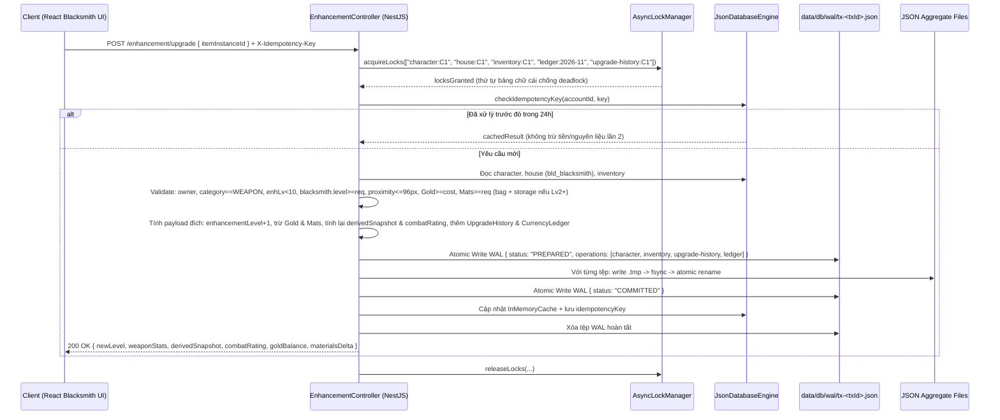
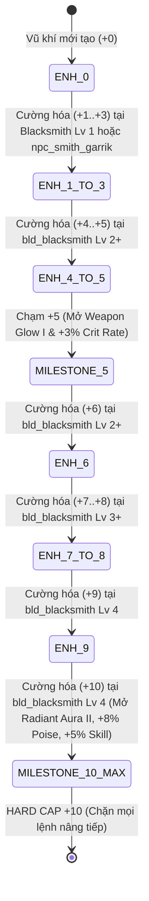

# 09 — Weapon Enhancement System Design (+0 → +10): Eldoria: Forgotten Wilds

**Trạng thái**: Hoàn thiện (Design Baseline v1.0)  
**Chế độ**: `DESIGN_AND_PLANNING_ONLY`  
**Cập nhật lần cuối**: 2026-11-19  
**Nguồn dữ liệu chuẩn (Single Source of Truth)**: [`docs/balancing/weapon-upgrade-costs.csv`](../balancing/weapon-upgrade-costs.csv), [`game-data/items.json`](../../game-data/items.json), [`game-data/buildings.json`](../../game-data/buildings.json)  
**Tài liệu quản trị**: [Constitution Principle VI](../../.specify/memory/constitution.md) · [ADR-005](../architecture/architecture-decisions/ADR-005-deterministic-enhancement-and-fair-gacha.md) · [combat-formulas.md](../balancing/combat-formulas.md) · [database-design.md](../architecture/database-design.md)

---

## 1. Mục tiêu Gameplay (Gameplay Objectives)

Hệ thống Cường hóa Vũ khí (`+0` đến tối đa `+10`) là động lực phát triển sức mạnh rõ ràng, công bằng và giàu cảm giác thành tựu nhất trong **Eldoria: Forgotten Wilds** (thực thi Trụ cột 3, 7, Nguyên tắc VI của Hiến pháp và `ADR-005`):

1. **Cường hóa Chắc chắn 100% trong MVP — KHÔNG vỡ đồ, KHÔNG tụt cấp**: Mọi vũ khí mới bắt đầu ở `+0` và có thể cường hóa tuần tự từng bậc từ **`+1` đến trần cứng `+10`**. Khi người chơi thu thập đủ Gold, nguyên liệu và nâng cấp `bld_blacksmith` đạt chuẩn, tỷ lệ thành công trong MVP là **`100%` (Deterministic)** — loại bỏ hoàn toàn trải nghiệm ức chế "xổ số phá vỡ công sức hàng tuần farm".
2. **Trần cứng `+10` bất biến trong thiết kế mặc định**: Mọi logic miền, kiểm tra API và JSON Schema ép cứng ràng buộc `0 <= enhancementLevel <= 10`. Cột mốc `+5` và **`+10`** mang lại bước nhảy thẩm mỹ pixel (hào quang vũ khí) và sức mạnh chiến thuật đáng tự hào.
3. **Liên kết chặt chẽ 4 vòng lặp gameplay vào lộ trình rèn `+10`**:
   - **Cấp thấp (`+1..+3`)**: Dùng quặng đồng/sắt cơ bản, gỗ sồi và drop quái rừng (`mat_slime_gel`, `mat_goblin_tooth`) — người chơi đạt `+2` chỉ trong 30 phút đầu.
   - **Cấp trung (`+4..+6`)**: Dùng phôi sắt/thép tinh luyện kết hợp nguyên liệu quái rừng sâu & tiền sảnh hầm ngục (`mat_wolf_pelt`, `mat_spore_cap_dust`, `mat_boar_tusk`, `mat_crawler_chitin`, `mat_shaman_totem`), gắn cổng **`bld_blacksmith` Lv 2**.
   - **Cấp cao (`+7..+10`)**: Yêu cầu phôi thép số lượng lớn (`mat_steel_ingot`), nguyên liệu Elite (`mat_alpha_fang`), bụi tinh tú (`mat_starlight_dust`) và nguyên liệu Boss hầm ngục (`mat_thornback_heart`), gắn cổng **`bld_blacksmith` Lv 3 (`+7..+8`) và Lv 4 (`+9..+10`)**.
4. **Tính toàn vẹn kinh tế tuyệt đối trên JSON Database**: Mọi thao tác cường hóa thực thi nguyên tử trên `JsonDatabaseEngine` thông qua `AsyncLockManager` + WAL hai pha + `idempotencyKey`, chặn triệt để double-spending, nhân bản vũ khí và gửi lặp yêu cầu.

---

## 2. User Stories

| ID | Vai trò | User Story | Milestone |
| :--- | :--- | :--- | :---: |
| **US-ENH-01** | Người chơi mới | Là chiến binh vừa hoàn thành nhiệm vụ rèn đầu tiên (`qst_004_sparks_of_the_forge`), tôi muốn cường hóa vũ khí khởi đầu từ `+0 → +2` với tỷ lệ 100% thành công để thấy ngay sát thương tăng mạnh khi đi săn trong `reg_whispering_forest`. | M1 (MVP) |
| **US-ENH-02** | Người chơi xây dựng | Là chủ lãnh địa đã đạt `+3` trên vũ khí, tôi muốn thấy rõ thông báo hướng dẫn nâng `bld_blacksmith` từ Lv 1 lên Lv 2/3/4 để mở khóa tiếp các ngưỡng `+4..+6`, `+7..+8` và `+9..+10`. | M1 (MVP) |
| **US-ENH-03** | Người chơi cột mốc | Là người chơi chạm mốc **`+5`** và **`+10`**, tôi muốn nhận được hiệu ứng hào quang pixel đẹp mắt (`Weapon Glow I` / `Radiant Aura II`) cùng dòng chỉ số thưởng cột mốc (`+3% Crit Rate` ở `+5`; `+8% Boss Poise Damage` & `+5% Skill Scaling` ở `+10`). | M1 (MVP) |
| **US-ENH-04** | Người chơi tích trữ | Là chủ nhà đã xây `bld_storage` Lv 2 (`autoCraftPull: true`), tôi muốn giao diện Cường hóa tự động tính gộp và rút nguyên liệu từ cả túi đồ lẫn kho chứa tại nhà khi bấm nút Rèn. | M1 (MVP) |
| **US-ENH-05** | Người chơi dài hạn | Là người chơi muốn lập kế hoạch farm lên `+10`, tôi muốn xem trước chính xác số Gold, từng loại nguyên liệu còn thiếu và nơi farm chính của từng bậc ngay trong giao diện Blacksmith. | M1 (MVP) |
| **US-ENH-06** | Người chơi kiểm tra lịch sử | Là người chơi muốn đối chiếu chi tiêu, tôi muốn xem lại danh sách lịch sử cường hóa (`upgrade-history`) ghi rõ thời điểm, vũ khí, Gold và nguyên liệu đã tiêu hao. | M1 (MVP) |

---

## 3. Bảng Thông số 10 Cấp Cường hóa (`+0 → +10`) — Khớp 100% `weapon-upgrade-costs.csv`

### 3.1 Bảng Chi tiết Từng Bậc Cường hóa (`+0` đến `+10`)

Mọi thông số dưới đây khớp chính xác từng chữ số với [`docs/balancing/weapon-upgrade-costs.csv`](../balancing/weapon-upgrade-costs.csv):

| Bậc nâng | Cổng `bld_blacksmith` | Tỷ lệ MVP | Vỡ / Tụt cấp | `% ATK` tích lũy (`EnhPct`) | `Flat ATK` tích lũy (`EnhFlat`) | Thưởng Cột mốc (`milestone_perk`) | Chi phí Gold | Nguyên liệu 1 | Nguyên liệu 2 | Nguyên liệu 3 | Nguồn Farm chính (`primary_farm_sources`) | Giờ Farm ước tính *(Casual / Regular / Hardcore)* |
| :---: | :---: | :---: | :---: | :---: | :---: | :--- | :---: | :--- | :--- | :--- | :--- | :---: |
| **`+0 → +1`** | **Lv 1** | `100%` | Không / Không | `+8%` | `+4` | — | `150G` | `mat_copper_ingot ×3` | `mat_oak_wood ×4` | — | Greenhaven Outskirts & Whispering Forest Edge | `0.20h / 0.12h / 0.08h` |
| **`+1 → +2`** | **Lv 1** | `100%` | Không / Không | `+16%` | `+8` | — | `300G` | `mat_copper_ingot ×5` | `mat_slime_gel ×4` | — | Whispering Forest Slimes & Copper Veins | `0.35h / 0.22h / 0.15h` |
| **`+2 → +3`** | **Lv 1** | `100%` | Không / Không | `+25%` | `+13` | — | `550G` | `mat_iron_ingot ×4` | `mat_goblin_tooth ×6` | — | Whispering Forest Goblins & Iron Veins | `0.55h / 0.35h / 0.22h` |
| **`+3 → +4`** | **Lv 2** | `100%` | Không / Không | `+35%` | `+19` | — | `900G` | `mat_iron_ingot ×7` | `mat_wolf_pelt ×6` | `mat_coal ×5` | Whispering Forest Wolves & Mining | `0.90h / 0.55h / 0.35h` |
| **`+4 → +5`** | **Lv 2** | `100%` | Không / Không | `+48%` | `+27` | **Milestone +5**: Weapon Glow I & **`+3% Crit Rate`** | `1,400G` | `mat_iron_ingot ×10` | `mat_spore_cap_dust ×8` | `mat_boar_tusk ×6` | Deep Whispering Forest & Mossroot Outskirts | `1.35h / 0.85h / 0.55h` |
| **`+5 → +6`** | **Lv 2** | `100%` | Không / Không | `+60%` | `+36` | — | `2,100G` | `mat_steel_ingot ×5` | `mat_crawler_chitin ×8` | `mat_shaman_totem ×4` | Mossroot Hollow Mob Packs & Smelting | `1.80h / 1.15h / 0.75h` |
| **`+6 → +7`** | **Lv 3** | `100%` | Không / Không | `+74%` | `+47` | — | `3,000G` | `mat_steel_ingot ×8` | `mat_alpha_fang ×3` | `mat_starlight_dust ×6` | Elite Alpha Direwolf & Deep Dungeon | `2.50h / 1.55h / 1.00h` |
| **`+7 → +8`** | **Lv 3** | `100%` | Không / Không | `+90%` | `+60` | — | `4,200G` | `mat_steel_ingot ×12` | `mat_alpha_fang ×5` | `mat_thornback_heart ×1` | Mossroot Hollow Boss Clear + Elite Hunts | `3.40h / 2.10h / 1.35h` |
| **`+8 → +9`** | **Lv 4** | `100%` | Không / Không | `+108%` | `+76` | — | `5,800G` | `mat_steel_ingot ×16` | `mat_thornback_heart ×2` | `mat_starlight_dust ×12` | Repeat Boss Raids + Alchemy Dust Refining | `4.80h / 2.95h / 1.90h` |
| **`+9 → +10`** | **Lv 4** | `100%` | Không / Không | **`+130%`** | **`+96`** | **Milestone +10**: Radiant Aura II & **`+8% Boss Poise Damage`** & **`+5% Skill Scaling`** | `8,000G` | `mat_steel_ingot ×22` | `mat_thornback_heart ×4` | `mat_starlight_dust ×20` | Co-op Boss Farm + Blacksmith Lv4 + Mastery Grind | `6.50h / 4.00h / 2.60h` |
| **TỔNG `+0 → +10`** | **Lv 1 → Lv 4** | **100%** | **0% / 0%** | **`+130%`** | **`+96`** | **Cả 2 Cột mốc (+5 & +10)** | **`26,400G`** | *(Xem bảng tổng hợp nguyên liệu bên dưới)* | — | — | **Greenhaven → Whispering Forest → Mossroot Hollow** | **`22.35h / 13.84h / 8.95h`** |

### 3.2 Tổng hợp Nguyên liệu Tích lũy cho 1 Vũ khí từ `+0 → +10` & Chi phí Cổng Lò Rèn

- **Tổng nguyên liệu trực tiếp nâng 1 vũ khí (`+0 → +10`)**:
  - **Phôi tinh luyện**: `mat_copper_ingot ×8`, `mat_iron_ingot ×21`, `mat_steel_ingot ×63` *(tương đương `mat_copper_ore ×24`, `mat_iron_ore ×441`, `mat_coal ×498`, `mat_rough_stone ×126` nếu tự luyện toàn bộ theo `game-data/recipes.json`, kèm thêm `mat_coal ×5` trực tiếp ở bậc `+4`)*.
  - **Tài nguyên thường & Quái rừng**: `mat_oak_wood ×4`, `mat_slime_gel ×4`, `mat_goblin_tooth ×6`, `mat_wolf_pelt ×6`, `mat_spore_cap_dust ×8`, `mat_boar_tusk ×6`, `mat_crawler_chitin ×8`, `mat_shaman_totem ×4`.
  - **Nguyên liệu Elite, Hầm ngục & Boss**: `mat_alpha_fang ×8` (từ `mob_elite_alpha_direwolf`), `mat_starlight_dust ×38`, **`mat_thornback_heart ×7`** (từ `boss_thornback_elder` — rơi bảo đảm `1–2` tim mỗi lần hạ Boss, tương đương ~4–6 lượt raid Boss).
  - **Tổng Gold trực tiếp**: **`26,400 Gold`**.
- **Chi phí một lần xây & nâng `bld_blacksmith` Lv 1 → Lv 4** (mở khóa vĩnh viễn cho mọi vũ khí sau này — khớp `game-data/buildings.json`):
  - **Lv 1** (`pLv 3`, `+1..+3`): `250G`, `mat_oak_wood ×20`, `mat_rough_stone ×25`, `mat_copper_ore ×15`, `mat_coal ×10` (`45s`).
  - **Lv 2** (`pLv 8`, `+4..+6`): `750G`, `mat_oak_wood ×30`, `mat_rough_stone ×35`, `mat_copper_ingot ×12`, `mat_iron_ingot ×10`, `mat_coal ×20` (`120s`).
  - **Lv 3** (`pLv 15`, `+7..+8`): `2,000G`, `mat_pine_wood ×35`, `mat_granite_block ×30`, `mat_iron_ingot ×20`, `mat_wolf_pelt ×12`, `mat_thornback_heart ×1` (`240s`).
  - **Lv 4** (`pLv 20`, `+9..+10`): `5,000G`, `mat_pine_wood ×45`, `mat_granite_block ×45`, `mat_steel_ingot ×18`, `mat_starlight_dust ×12`, `mat_thornback_heart ×3` (`360s`).
  - **Tổng đầu tư hạ tầng Lò Rèn (1 lần)**: **`8,000 Gold`** + `mat_thornback_heart ×4` + gỗ/đá/phôi xây dựng.

### 3.3 Công thức Tăng chỉ số & Ví dụ Thực tế trên Vũ khí MVP

Khớp tuyệt đối với [`docs/balancing/combat-formulas.md`](../balancing/combat-formulas.md):

$$\text{WeaponATK}(e) = \left\lfloor \text{WeaponBaseATK} \cdot \left(1 + \text{EnhPct}(e)\right) + \text{EnhFlat}(e) \right\rfloor, \quad e \in \{0..10\}$$

*Lưu ý với `SHIELD` (`OFF_HAND`)*: Khi cường hóa Khiên (ví dụ `wpn_thornbark_bulwark`), phần `EnhPct(e)` áp dụng cho cả `baseStats.atk` lẫn `baseStats.def`, và `EnhFlat(e)` cộng vào `DEF` thay vì chỉ `ATK`, giúp lớp nhân vật `KNIGHT` có động lực nâng Khiên lên `+10`.

| Vũ khí MVP mẫu | Base ATK (`+0`) | ATK tại `+3` (`+25% / +13`) | ATK tại `+5` (`+48% / +27` + `3% Crit`) | ATK tại `+8` (`+90% / +60`) | ATK tại **`+10`** (`+130% / +96` + `+8% Poise & +5% Skill`) | Tỷ lệ tăng (`+10` vs `+0`) |
| :--- | :---: | :---: | :---: | :---: | :---: | :---: |
| `wpn_iron_longsword` (`UNCOMMON`, Lv 1) | `26` | `45` | `65` | `109` | **`155`** | `5.96x` *(giữ giá trị lâu dài)* |
| `wpn_wolf_fang_dagger` (`RARE`, Lv 8) | `36` | `58` | `80` | `128` | **`178`** | `4.94x` |
| `wpn_starbloom_scepter` (`LEGENDARY`, Lv 15) | `56` | `83` | `109` | `166` | **`224`** | `4.00x` |
| `wpn_elderwood_cleaver` (`EPIC`, Lv 15) | `68` | `98` | `127` | `189` | **`252`** | `3.71x` |

*Phân tích cân bằng*: Phần cộng phẳng `EnhFlat (+96)` giúp vũ khí `UNCOMMON`/`RARE` khi lên `+10` vẫn đủ sức cạnh tranh rất tốt trong toàn bộ nội dung MVP (đạt `155–178 ATK` so với `224–252 ATK` của vũ khí `EPIC`/`LEGENDARY` Lv 15), đồng thời phần nhân `% (+130%)` đảm bảo vũ khí bậc cao ở vùng đất sau vẫn đáng để đầu tư lên `+10`.

---

## 4. Mô phỏng Thời gian Nâng cấp theo 3 Nhóm Người chơi (`proposed`)

*Ghi chú minh bạch theo Nguyên tắc VIII*: Các con số thời lượng farm dưới đây là ước tính mô hình cân bằng (`proposed`) tổng hợp trực tiếp từ `docs/balancing/weapon-upgrade-costs.csv` với giả định hiệu suất thu thập/đi phụ bản trung bình của từng nhóm người chơi; cần đối chiếu lại qua playtest thực tế.

| Giai đoạn Cường hóa | Cổng Lò Rèn | **Casual Player** *(1.0 giờ/ngày, chơi solo là chính)* | **Regular Player** *(2.5 giờ/ngày, có đi party)* | **Hardcore Player** *(5.0 giờ/ngày, tối ưu co-op & rotation)* | Trải nghiệm Cảm nhận |
| :--- | :---: | :---: | :---: | :---: | :--- |
| **`+0 → +3`** (Khởi động) | Lv 1 | `1.10 giờ` (~1.1 ngày) | `0.69 giờ` (~41 phút) | `0.45 giờ` (~27 phút) | Tăng sức mạnh tức thì ngay phiên đầu tiên |
| **`+3 → +5`** (Mốc Glow I) | Lv 2 | `2.25 giờ` (~2.3 ngày) | `1.40 giờ` (~0.6 ngày) | `0.90 giờ` (~54 phút) | Đạt mốc sáng vũ khí đầu tiên trong tuần 1 |
| **`+5 → +6`** (Đệm Hầm ngục) | Lv 2 | `1.80 giờ` (~1.8 ngày) | `1.15 giờ` (~0.5 ngày) | `0.75 giờ` (~45 phút) | Bắt đầu luyện thép & farm quái hầm ngục |
| **`+6 → +8`** (Vượt Boss lần đầu) | Lv 3 | `5.90 giờ` (~5.9 ngày) | `3.65 giờ` (~1.5 ngày) | `2.35 giờ` (~0.5 ngày) | Đột kích Elite Direwolf & Boss Thornback Elder |
| **`+8 → +10`** (Đỉnh cao MVP) | Lv 4 | `11.30 giờ` (~11.3 ngày) | `6.95 giờ` (~2.8 ngày) | `4.50 giờ` (~0.9 ngày) | Cột mốc danh giá Radiant Aura II & phá giáp Boss |
| **TỔNG CỘNG (`+0 → +10`)** | **Lv 1 → Lv 4** | **`22.35 giờ`** (**`~22.4 ngày`** ≈ 3.2 tuần) | **`13.84 giờ`** (**`~5.5 ngày`** ≈ 1 tuần) | **`8.95 giờ`** (**`~1.8 ngày`** ≈ 2 ngày) | **Khớp mục tiêu `00-game-vision.md` (1 tuần cho Regular!)** |

*(Nếu tính thêm thời gian farm nguyên liệu xây `bld_blacksmith` Lv 1→4 cho vũ khí `+10` đầu tiên: cộng thêm khoảng `+4.5h` Casual / `+2.8h` Regular / `+1.8h` Hardcore; từ vũ khí thứ 2 trở đi không mất lại chi phí hạ tầng Lò Rèn.)*

---

## 5. Đánh giá Nghiên cứu Cường hóa Xác suất cho Phiên bản Hậu MVP (Post-MVP Evaluation Note)

Theo `GAME_DESIGN_BRIEF.md` Mục 10 và Nguyên tắc VI của Hiến pháp:

- **Chính sách hiện hành (BẮT BUỘC cho MVP và mặc định toàn game)**: Hệ thống cường hóa `+0 → +10` vận hành **100% chắc chắn (deterministic)**, **KHÔNG có tỷ lệ thất bại, KHÔNG phá hủy vũ khí, KHÔNG giảm cấp**.
- **Đánh giá cho khả năng nghiên cứu mở rộng ở phiên bản tương lai (Post-MVP, ví dụ cơ chế phụ "Masterwork Over-tempering" hoặc tùy chọn thử nghiệm ở M4+)**:
  1. **Tại sao chưa áp dụng xác suất**: Kinh tế Eldoria đã có các sink lành mạnh và dự đoán được (chi phí xây 13 công trình, 36 công thức chế tạo, sửa độ bền, nâng nhiều vũ khí cho nhiều Hero/nguyên tố). Dùng RNG phá đồ để tạo sink sẽ trực tiếp làm giảm tỷ lệ giữ chân người chơi Casual/Regular.
  2. **4 Hàng rào Bảo vệ Bắt buộc nếu từng được đề xuất ở phiên bản sau**:
     - **Tuyệt đối không vỡ đồ & không tụt cấp**: Thất bại (nếu tồn tại ở hệ thống phụ tương lai) chỉ được phép tiêu hao một phần nguyên liệu và **phải** cộng điểm bảo đảm.
     - **Cơ chế Artisan Pity Energy (100% Guarantee)**: Mỗi lần thất bại tích lũy tối thiểu `+25%` đến `+34%` năng lượng rèn, bảo đảm tối đa 3–4 lần là thành công tuyệt đối `100%`.
     - **Không bán Đá bảo hộ bằng tiền thật**: Tránh tuyệt đối biến cường hóa thành pay-to-win.
     - **Cổng phê duyệt bắt buộc**: Mọi thay đổi từ deterministic sang probabilistic **KHÔNG ĐƯỢC phép tự ý triển khai**; phải lập báo cáo mô phỏng tác động kinh tế riêng và nhận **phê duyệt rõ ràng của chủ dự án (User Approval)** kèm quy trình sửa đổi `ADR-005` / Hiến pháp.

---

## 6. Kiến trúc Giao dịch Nguyên tử WAL trên `JsonDatabaseEngine`

Để triệt tiêu hoàn toàn nguy cơ nhân bản vũ khí, chi tiêu hai lần (`double spending`) hoặc kẹt trạng thái khi sập nguồn giữa lúc nâng cấp, mọi lệnh cường hóa đi qua luồng WAL hai pha chuẩn ([`database-design.md`](../architecture/database-design.md)):



---

## 7. Functional Requirements & Business Rules

### 7.1 Functional Requirements (FR)

- **FR-ENH-01**: Hỗ trợ truy vấn cấu hình bảng nâng cấp hiện hành (`GET /api/v1/catalog/enhancement-table` đọc từ `weapon-upgrade-costs.csv` / bundle chuẩn) để client hiển thị chính xác yêu cầu Gold, nguyên liệu, cấp `bld_blacksmith` và chênh lệch chỉ số trước khi người chơi bấm nút.
- **FR-ENH-02**: Thực thi nâng cấp tuần tự từng bậc `+N → +(N+1)` thông qua `POST /api/v1/characters/:charId/enhancement/upgrade` với `X-Idempotency-Key` bắt buộc.
- **FR-ENH-03**: Hỗ trợ rút nguyên liệu tự động (`autoCraftPull`) từ `storageItems` (ưu tiên trừ `bagItems` trước, phần thiếu rút tiếp từ `storageItems`) khi nhân vật đang đứng tại `bld_blacksmith` trong lãnh địa của mình và đã sở hữu `bld_storage` đạt Lv 2 trở lên.
- **FR-ENH-04**: Lưu vĩnh viễn mọi lượt nâng cấp vào `data/db/history/upgrade-history-<characterId>.json` và ghi bút toán giảm Gold vào `data/db/ledgers/currency-ledger-<YYYY-MM>.json` trong cùng giao dịch WAL.
- **FR-ENH-05**: Tự động kích hoạt cờ hiệu ứng hình ảnh (`vfxTier: 1` tại `+5` cho *Weapon Glow I*; `vfxTier: 2` tại `+10` cho *Radiant Aura II*) và broadcast tới người chơi xung quanh nếu vũ khí đang được trang bị trên tay.

### 7.2 Business Rules (BR)

- **BR-ENH-01 (Trần cứng `+10`)**: Không cho phép cường hóa nếu `enhancementLevel >= 10` (mã lỗi `ERR_MAX_ENHANCEMENT_REACHED`).
- **BR-ENH-02 (Chỉ áp dụng cho `WEAPON`)**: Trong MVP, chỉ 40 vật phẩm thuộc `category: "WEAPON"` (bao gồm cả `SHIELD` ở `OFF_HAND`) mới được cường hóa `+1..+10`; giáp và trang sức giữ `enhancementLevel: 0`.
- **BR-ENH-03 (Cổng Công trình `bld_blacksmith`)**:
  - Người chơi có thể cường hóa **`+1` đến `+3`** tại `bld_blacksmith` Lv 1 của bản thân **hoặc** tại lò rèn công cộng của `npc_smith_garrik` ở `reg_greenhaven_village` (phục vụ onboarding `qst_004_sparks_of_the_forge`).
  - Từ **`+4` trở lên** (`+4..+6` cần Lv 2, `+7..+8` cần Lv 3, `+9..+10` cần Lv 4) **BẮT BUỘC** thực hiện tại `bld_blacksmith` đang ở trạng thái `ACTIVE` trong lãnh địa của chính người chơi (công trình đang `UNDER_CONSTRUCTION` hoặc `UPGRADING` dùng cấp hoàn thành hiện tại).
- **BR-ENH-04 (Tầm tương tác)**: Khoảng cách Euclidean giữa nhân vật và điểm `ENHANCE_WEAPON` của `bld_blacksmith` (hoặc `npc_smith_garrik` cho `+1..+3`) phải `<= 96 px`.
- **BR-ENH-05 (Không vỡ / Không tụt / Không hỏng khi nâng)**: Vũ khí có độ bền thấp (kể cả `0`) vẫn có thể cường hóa, hoặc nếu nâng thành công vẫn giữ nguyên tỷ lệ độ bền hiện có và tuyệt đối không tụt cấp.

---

## 8. Input và Output (Protocol Contracts)

| Endpoint | Request Body / Params | Response Thành công (`200 OK`) | Mã lỗi chính |
| :--- | :--- | :--- | :--- |
| `POST /api/v1/characters/:charId/enhancement/upgrade` *(Header: `X-Idempotency-Key`)* | `{ itemInstanceId: string, stationType: "HOMESTEAD_BLACKSMITH" \| "PUBLIC_NPC", buildingInstanceId?: string, npcId?: string }` | `{ upgradeId, itemInstanceId, itemId, fromLevel, toLevel, result: "SUCCESS", milestoneUnlocked: null \| "MILESTONE_5" \| "MILESTONE_10", updatedWeaponStats, derivedSnapshot, combatRating, goldBalance, materialsConsumed, inventoryDelta }` | `ERR_MAX_ENHANCEMENT_REACHED`, `ERR_BLACKSMITH_LEVEL_REQUIRED`, `ERR_INSUFFICIENT_FUNDS`, `ERR_INSUFFICIENT_MATERIALS`, `ERR_STATION_TOO_FAR`, `ERR_ITEM_NOT_ENHANCEABLE`, `ERR_FORBIDDEN_OWNERSHIP`, `ERR_CONCURRENT_LOCK_TIMEOUT` |
| `GET /api/v1/characters/:charId/enhancement/history?limit=50&page=1` | Query phân trang | `{ items: UpgradeHistory[], total, page, limit }` | `ERR_FORBIDDEN_OWNERSHIP`, `ERR_UNAUTHORIZED` |

---

## 9. State Transitions (Máy Trạng Thái Cường hóa Vũ khí)



---

## 10. JSON Data Model (100% Local JSON Storage via `JsonDatabaseEngine`)

### 10.1 `data/db/history/upgrade-history-<characterId>.json`

```json
{
  "$schemaVersion": "1.0.0",
  "entityType": "UpgradeHistoryCollection",
  "entityId": "chr_inst_01J9X7K2M4",
  "revision": 10,
  "updatedAt": "2026-11-19T16:05:00.000Z",
  "checksumSha256": "4c8e12a9f3...",
  "data": {
    "characterId": "chr_inst_01J9X7K2M4",
    "entries": [
      {
        "upgradeId": "upg_01J9X9990010",
        "txId": "tx_01J9X9990009",
        "idempotencyKey": "c8b2f10a-7c4a-4e2b-9a81-112233445566",
        "characterId": "chr_inst_01J9X7K2M4",
        "itemInstanceId": "itm_01J9X8A1001",
        "itemId": "wpn_elderwood_cleaver",
        "fromLevel": 9,
        "toLevel": 10,
        "goldSpent": 8000,
        "materialsConsumed": [
          { "itemId": "mat_steel_ingot", "qty": 22, "source": "STORAGE_AUTO_PULL" },
          { "itemId": "mat_thornback_heart", "qty": 4, "source": "BAG" },
          { "itemId": "mat_starlight_dust", "qty": 20, "source": "STORAGE_AUTO_PULL" }
        ],
        "blacksmithLevel": 4,
        "result": "SUCCESS",
        "milestoneUnlocked": "MILESTONE_10",
        "createdAt": "2026-11-19T16:05:00.000Z"
      }
    ]
  }
}
```

### 10.2 `data/db/ledgers/currency-ledger-<YYYY-MM>.json` (Bút toán Sổ cái)

```json
{
  "ledgerEntryId": "ldg_01J9X9990011",
  "txId": "tx_01J9X9990009",
  "idempotencyKey": "c8b2f10a-7c4a-4e2b-9a81-112233445566",
  "characterId": "chr_inst_01J9X7K2M4",
  "currencyType": "GOLD",
  "delta": -8000,
  "balanceBefore": 12450,
  "balanceAfter": 4450,
  "reasonCode": "WEAPON_ENHANCE",
  "metadata": {
    "itemInstanceId": "itm_01J9X8A1001",
    "itemId": "wpn_elderwood_cleaver",
    "fromLevel": 9,
    "toLevel": 10
  },
  "createdAt": "2026-11-19T16:05:00.000Z"
}
```

### 10.3 `data/db/wal/tx-<txId>.json` (Nhật ký Giao dịch Nguyên tử Đa tệp)

Ghi nhận đầy đủ `status` (`PREPARED` → `COMMITTED`), `txId`, `idempotencyKey`, danh sách `operations[]` gồm `targetPath`, `beforeRevision` và `afterPayload` của cả 4 tệp (`characters/<id>.json`, `inventories/<id>.json`, `history/upgrade-history-<id>.json`, `ledgers/currency-ledger-<YYYY-MM>.json`).

---

## 11. Dependencies (Phụ thuộc Liên Hệ thống)

- **[`08-equipment-system.md`](./08-equipment-system.md)**: Quản lý vòng đời `ItemInstance` và chính sách hoàn trả `50%` phôi nếu phân rã vũ khí đã cường hóa.
- **[`14-building-system.md`](./14-building-system.md) & `game-data/buildings.json`**: Nguồn chân lý cho cấp `bld_blacksmith` (`Lv 1..4`) và cờ `autoCraftPull` của `bld_storage` (`Lv 2+`).
- **[`11-crafting-system.md`](./11-crafting-system.md)**: Cung cấp chuỗi nung `mat_copper_ingot`, `mat_iron_ingot`, `mat_steel_ingot` làm nguyên liệu bắt buộc cho mọi bậc cường hóa.
- **[`16-boss-design.md`](./16-boss-design.md) & `game-data/loot-tables.json`**: Cung cấp `mat_alpha_fang` (`mob_elite_alpha_direwolf`) và `mat_thornback_heart` (`boss_thornback_elder`) cho ngưỡng `+7..+10`.
- **[`docs/art-direction/vfx-design.md`](../art-direction/vfx-design.md)**: Quy chuẩn hào quang pixel *Weapon Glow I* (`+5`, ánh sáng ấm nhẹ 16-bit) và *Radiant Aura II* (`+10`, hạt tinh tú nhẹ không che khuất boss telegraph).

---

## 12. UI Interactions (Tương tác Giao diện Lò Rèn)

1. **Màn hình Weapon Enhancement (Mở tại `bld_blacksmith` hoặc `npc_smith_garrik`)**:
   - **Cột trái**: Danh sách toàn bộ vũ khí sở hữu (vũ khí đang mặc nổi trên cùng có nhãn `EQUIPPED` và huy hiệu `+N`).
   - **Trung tâm**: Đe rèn pixel hiển thị vũ khí mục tiêu, thanh tiến trình 10 nấc (`+1..+10` với 2 mốc sáng vàng nổi bật tại `+5` và `+10`), thẻ so sánh chỉ số `+N → +(N+1)`, và huy hiệu màu xanh lá **`100% Thành công · Không vỡ đồ`**.
   - **Cột phải**: Yêu cầu cấp `bld_blacksmith` (tích xanh nếu đạt, hiện nút tắt *"Cần Lò Rèn Lv X"* nếu chưa đạt), danh sách 2–3 loại nguyên liệu (hiển thị `Đang có (Túi + Kho) / Cần`, tooltip chỉ rõ khu vực farm từ cột `primary_farm_sources`) và tổng chi phí Gold.
2. **Phản hồi Giác quan (Juice & Feedback)**:
   - Khi bấm nút **CƯỜNG HÓA**, phát hoạt ảnh búa gõ đe ngắn (`0.6s`, có thể tắt rung màn hình trong Settings), tia lửa pixel vàng cam, tiếng rèn sắc gọn (`sfx_anvil_enhance_success`) và thẻ chúc mừng trang trọng khi chạm mốc `+5` hoặc **`+10`** (hiển thị dòng thưởng cột mốc mới mở khóa).
3. **Trạng thái Bất hoạt & Lỗi**: Nút Cường hóa tự động `disabled` khi đang gửi request (tránh double-click), khi thiếu tài nguyên, khi chưa đạt cấp Lò Rèn hoặc khi đã chạm `+10` (thay bằng huy hiệu **ĐÃ ĐẠT CẤP TỐI ĐA +10**).

---

## 13. Edge Cases, Failure Behavior & Security Requirements

### 13.1 Edge Cases

1. **Người chơi đang ở `+3` và bấm cường hóa tại `npc_smith_garrik` trong làng**: Server xác nhận NPC công cộng chỉ hỗ trợ tối đa `+3`, trả về `ERR_BLACKSMITH_LEVEL_REQUIRED` với `details: { requiredBlacksmithLevel: 2, mustUseHomestead: true }`.
2. **Công trình `bld_blacksmith` đang trong quá trình `UPGRADING` từ Lv 2 → Lv 3 (còn 100s)**: Cấp có hiệu lực tại server vẫn là Lv 2; lệnh cường hóa `+6 → +7` bị chặn cho đến khi `serverNow >= constructionCompletedAtMs`.
3. **Nguyên liệu rải rác ở 2 chồng trong túi đồ và 1 chồng trong `bld_storage` Lv 2**: `InventoryService` cộng dồn tổng tồn kho hợp lệ, trừ lần lượt từ `bagItems` (theo `slotIndex` tăng dần) trước, phần dư rút từ `storageItems`, tự động xóa stack về `0` một cách nguyên tử.
4. **Cường hóa vũ khí đang mặc trên tay (`MAIN_HAND`)**: `Character.derivedSnapshot` và `combatRating` được tính lại ngay trong cùng giao dịch WAL; nếu đang ở `+5` hoặc `+10`, hào quang pixel cập nhật lập tức trên Phaser mà không cần tháo ra mặc lại.

### 13.2 Failure Behavior

- **Mất mạng sau khi server đã commit WAL nhưng client chưa kịp nhận HTTP 200**: Client tự động thử lại bằng **đúng `X-Idempotency-Key` cũ**; `JsonDatabaseEngine` phát hiện key đã hoàn tất trong `indexes/idempotency-keys.json` và trả về đúng kết quả `+N+1` đã lưu mà không trừ Gold hay nguyên liệu lần thứ hai.
- **Server gặp sự cố sập điện khi mới ghi xong 2/4 tệp JSON**: Khi khởi động lại, `BootCrashRecovery` đọc tệp `data/db/wal/tx-<txId>.json` ở trạng thái `PREPARED` (có kiểm tra `checksumSha256` của WAL) và chạy Roll-Forward áp dụng đầy đủ cả 4 tệp đích, đảm bảo sổ cái Gold, kho nguyên liệu, cấp vũ khí và lịch sử cường hóa khớp 100%.

### 13.3 Security Requirements

- **Chống Bỏ qua Trần `+10` (`Cap Bypass`)**: Ràng buộc `enhancementLevel < 10` được kiểm tra cả ở lớp Domain Service lẫn JSON Schema Validator của `JsonDatabaseEngine` (cấm ghi bất kỳ `ItemInstance` nào có `enhancementLevel > 10`).
- **Chống Double Spending & Race Condition**: Khóa độc quyền trên `AsyncLockManager` theo thứ tự bảng chữ cái (`character:<id>`, `house:<id>`, `inventory:<id>`, `ledger:<YYYY-MM>`, `upgrade-history:<id>`); hai yêu cầu cường hóa song song cùng một vũ khí hoặc dùng chung khoản Gold sẽ bị tuần tự hóa hoàn toàn.
- **Chống Giả mạo Chi phí/Nguyên liệu (`Client Cost Tampering`)**: Payload API chỉ nhận `itemInstanceId` — **KHÔNG BAO GIỜ** nhận `goldCost`, `targetLevel` hay `materials` từ client; toàn bộ chi phí đọc duy nhất từ bảng chuẩn nạp trong RAM server (`weapon-upgrade-costs.csv` / config catalog).
- **Chống Rèn Từ Xa (`Remote Forge Exploit`)**: Xác thực tọa độ thực tế trong RAM server cách `bld_blacksmith` (hoặc `npc_smith_garrik`) `<= 96 px` và xác thực quyền sở hữu `house.ownerCharacterId === actorCharacterId`.

---

## 14. Acceptance Criteria & Test Scenarios

### 14.1 Acceptance Criteria (AC)

- **AC-ENH-01**: Toàn bộ 10 bậc nâng cấp (`+0 → +10`) khớp chính xác 100% Gold (`26,400G`), 15 loại nguyên liệu, cổng `bld_blacksmith` Lv 1..4, `% ATK`, `Flat ATK` và 2 cột mốc (`+5`, `+10`) với `docs/balancing/weapon-upgrade-costs.csv`.
- **AC-ENH-02**: Mọi lệnh nâng cấp trong MVP đạt tỷ lệ thành công `100%`, không bao giờ phá hủy hoặc giảm cấp vũ khí; mọi lệnh nâng khi đang ở `+10` đều bị từ chối với `ERR_MAX_ENHANCEMENT_REACHED`.
- **AC-ENH-03**: Công thức `WeaponATK(e)` phản ánh ngay lập tức vào `derivedSnapshot`, `combatRating` và sát thương thực tế trong `CombatService` (kèm `+3% Crit Rate` từ `+5` và `+8% Boss Poise Damage` + `+5% Skill Scaling` từ `+10`).
- **AC-ENH-04**: Giao dịch đa tệp WAL bảo đảm đồng nhất tuyệt đối giữa `inventories/<id>.json`, `characters/<id>.json`, `history/upgrade-history-<id>.json` và `ledgers/currency-ledger-<YYYY-MM>.json` dưới tải đồng thời và kịch bản crash recovery.

### 14.2 Test Scenarios (Giai đoạn Thiết kế — Chưa thực thi Production)

| Test ID | Loại kiểm thử | Kịch bản kiểm tra | Kết quả mong đợi |
| :--- | :--- | :--- | :--- |
| **TS-ENH-01** | Integration / Full +0→+10 | Trang bị `wpn_elderwood_cleaver` (`+0`, Base ATK `68`), nâng liên tiếp từ `+0` lên `+10` với `bld_blacksmith` Lv 4 và đủ nguyên liệu | Mỗi bậc thành công `100%`; tại `+5` ATK=`127` + kích hoạt `+3% Crit`; tại `+10` ATK=`252` + kích hoạt `+8% Poise` & `+5% Skill Scaling`; tổng Gold trừ đúng `26,400G`, tạo đúng 10 bản ghi `UpgradeHistory`. |
| **TS-ENH-02** | Boundary / Hard Cap +10 | Gửi tiếp lệnh `POST /enhancement/upgrade` cho vũ khí đang ở `+10` | Server trả HTTP `409 ERR_MAX_ENHANCEMENT_REACHED`, không trừ Gold/vật liệu, `enhancementLevel` giữ nguyên `10`. |
| **TS-ENH-03** | Integration / Blacksmith Gate | Nhân vật có `bld_blacksmith` Lv 2 thử nâng từ `+5 → +6` (hợp lệ) rồi `+6 → +7` (cần Lv 3) | `+5 → +6` thành công; `+6 → +7` trả `ERR_BLACKSMITH_LEVEL_REQUIRED` (`requiredLevel: 3`). |
| **TS-ENH-04** | Concurrency / Double Spend | Gửi đồng thời 10 request `POST /enhancement/upgrade` với `idempotencyKey` khác nhau khi Gold chỉ đủ nâng đúng 1 bậc (`+0 → +1`, `150G`) | Đúng 1 request thành công lên `+1`, 9 request còn lại thất bại với `ERR_INSUFFICIENT_FUNDS`; số dư Gold `>= 0` và khớp 100% sổ cái `CurrencyLedger`. |
| **TS-ENH-05** | Idempotency / Network Retry | Gửi lại y nguyên request `+4 → +5` với cùng `X-Idempotency-Key` sau khi lệnh đầu đã thành công | Server trả lại `200 OK` phản hồi đã lưu (`toLevel: 5`), KHÔNG nâng thành `+6` và KHÔNG trừ thêm `1,400G`. |
| **TS-ENH-06** | Crash Recovery / WAL Replay | Mô phỏng ngắt tiến trình server ngay sau khi ghi WAL `PREPARED` và ghi xong `inventories/<id>.json` nhưng chưa ghi `upgrade-history` và `currency-ledger`, sau đó khởi động lại | `JsonDatabaseEngine` phát hiện WAL `PREPARED`, tự động Roll-Forward hoàn tất cả 4 tệp khớp `checksumSha256` và xóa tệp WAL gọn gàng. |
| **TS-ENH-07** | Security / Remote & Non-Weapon | Gửi lệnh cường hóa cho `eqp_mossroot_breastplate` (giáp) và gửi lệnh cường hóa vũ khí khi nhân vật đang đứng trong `reg_whispering_forest` | Lệnh 1 trả `ERR_ITEM_NOT_ENHANCEABLE`; lệnh 2 trả `ERR_STATION_TOO_FAR` và ghi cảnh báo vào `security-audit`. |
