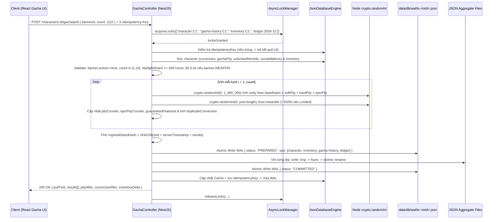
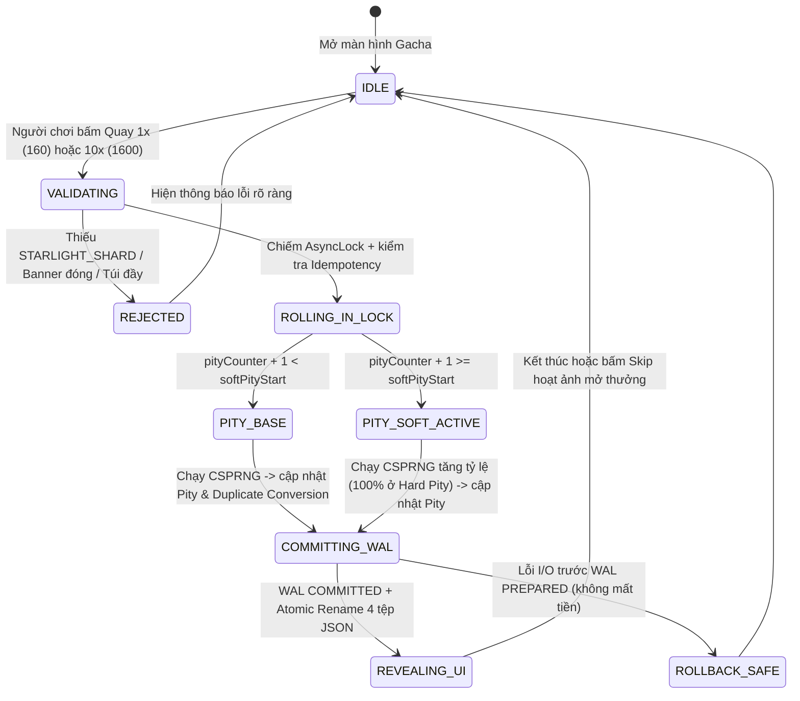

# 10 — Gacha & Collection System Design: Eldoria: Forgotten Wilds

**Trạng thái**: Hoàn thiện (Design Baseline v1.0)  
**Chế độ**: `DESIGN_AND_PLANNING_ONLY`  
**Cập nhật lần cuối**: 2026-11-19  
**Nguồn dữ liệu chuẩn (Single Source of Truth)**: [`game-data/gacha-banners.json`](../../game-data/gacha-banners.json), [`game-data/characters.json`](../../game-data/characters.json), [`game-data/items.json`](../../game-data/items.json), [`game-data/quests.json`](../../game-data/quests.json), [`game-data/bosses.json`](../../game-data/bosses.json)  
**Bằng chứng Kiểm chứng Xác suất**: [`docs/balancing/simulation-results.md`](../balancing/simulation-results.md), [`docs/balancing/gacha-probabilities.csv`](../balancing/gacha-probabilities.csv)  
**Tài liệu quản trị**: [Constitution Principle VI](../../.specify/memory/constitution.md) · [ADR-005](../architecture/architecture-decisions/ADR-005-deterministic-enhancement-and-fair-gacha.md) · [database-design.md](../architecture/database-design.md)

---

## 1. Mục tiêu Gameplay & Cam kết Đạo đức (Gameplay Objectives & Fair-Play Mandate)

Hệ thống Gacha và Bộ sưu tập (Gacha & Collection System) trong **Eldoria: Forgotten Wilds** được thiết kế như một động lực sưu tầm nhân vật, vũ khí và mở rộng đội hình chiến thuật — tuân thủ tuyệt đối Nguyên tắc VI của Hiến pháp và `ADR-005`:

1. **100% Tiền tệ Kiếm trong Gameplay ở MVP — KHÔNG Thanh toán Tiền thật**: Toàn bộ lượt quay trong MVP sử dụng duy nhất nội tệ **`STARLIGHT_SHARD`** (`realMoneyPurchaseEnabledInMvp: false`, `cashOutAllowed: false`) kiếm từ nhiệm vụ, khám phá thế giới, thành tựu, hạ Boss lần đầu và thưởng Boss hàng tuần.
2. **Không Dark Pattern, Không Xác suất Ẩn, Không Cổng Chặn Nội dung (Zero Paywall)**:
   - Công khai **100% bảng xác suất cơ sở** (tổng mỗi banner bằng đúng `1.000000`), công thức Soft Pity, trần Hard Pity, bộ đếm Pity cá nhân hiện tại (`pityCounter / hardPity`) và quy tắc chuyển đổi trùng lặp ngay trên giao diện Banner.
   - 3 nhân vật khởi đầu miễn phí (`chr_kael_vanguard`, `chr_lyra_windrunner`, `chr_seraphina_dawn`) cùng trang bị rèn/nhặt hoàn toàn vượt qua được **100% nội dung cốt lõi MVP** kể cả `dng_mossroot_hollow` và `boss_thornback_elder`.
   - Nhân vật `LEGENDARY`/`MYTHIC` KHÔNG làm vô hiệu hóa nhân vật `COMMON`/`UNCOMMON`/`RARE` (đã được kiểm chứng trong [`simulation-results.md`](../balancing/simulation-results.md) Mục 4.1: chênh lệch Sustained DPS giữa các độ hiếm nằm trong biên `±15%` đúng theo vai trò Tank/Support/DPS).
3. **Bảo vệ Chống Xui xẻo Hai lớp (Pity + Cửa hàng `STAR_ESSENCE`)**: Kết hợp Soft Pity tăng tuyến tính + Hard Pity cứng (`80` cho Nhân vật, `70` cho Vũ khí) + bảo đảm `50/50` trên Limited Banner + chuyển đổi trùng lặp thành **`STAR_ESSENCE`** để mua thẳng nhân vật/vũ khí mục tiêu trong cửa hàng cố định.
4. **CSPRNG Server-Authoritative & Giao dịch Nguyên tử WAL trên JSON DB**: Toàn bộ quá trình rút thăm sử dụng `crypto.randomInt` của Node.js trên server bên trong khóa `AsyncLockManager` và WAL hai pha trên `JsonDatabaseEngine`, loại bỏ hoàn toàn can thiệp xác suất phía client, spam quay song song hay mất dữ liệu khi mất mạng.

---

## 2. User Stories

| ID | Vai trò | User Story | Milestone |
| :--- | :--- | :--- | :---: |
| **US-GAC-01** | Người chơi mới | Là người chơi vừa hoàn thành chuỗi nhiệm vụ khởi đầu tại Greenhaven (`qst_001..qst_005`), tôi muốn tích đủ `1,600 STARLIGHT_SHARD` ngay trong khoảng 1 giờ chơi đầu tiên để thực hiện lượt quay 10 lần đầu tiên trên `bnr_perm_heroes` và chắc chắn nhận tối thiểu 1 nhân vật `EPIC+`. | M1 (MVP) |
| **US-GAC-02** | Người chơi minh bạch | Là người chơi trước khi bấm quay, tôi muốn mở bảng *Chi tiết Tỷ lệ & Pity* để xem chính xác bảng xác suất 6 bậc độ hiếm, danh sách toàn bộ pool, bộ đếm Pity hiện tại (`currentPity / 80` hoặc `70`) và số lượt còn lại tới mốc bảo đảm `EPIC+`. | M1 (MVP) |
| **US-GAC-03** | Người chơi sưu tầm | Là người chơi quay ra nhân vật đã sở hữu, tôi muốn bản sao tự động chuyển đổi minh bạch thành `1 Constellation Shard` (tối đa C6) + `STAR_ESSENCE` (và nếu đã C6 thì gấp đôi `STAR_ESSENCE` + `mat_starlight_dust`) để dùng trong Cửa hàng `STAR_ESSENCE`. | M1 (MVP) |
| **US-GAC-04** | Người chơi vũ khí | Là người chơi quay `bnr_perm_arsenal` và nhận vũ khí trùng lặp, tôi muốn vẫn được giữ bản thể `ItemInstance` trong kho (để trang bị cho Hero khác, tinh luyện tối đa bậc 5 hoặc phân rã tại `bld_blacksmith` Lv 2+) đồng thời nhận ngay `STAR_ESSENCE` và `CRAFTING_TOKEN`. | M1 (MVP) |
| **US-GAC-05** | Người chơi kiểm toán | Là người chơi muốn kiểm tra lịch sử vận may của mình, tôi muốn xem bảng Lịch sử Quay Gacha (`gacha-history`) được lưu bền vững, lọc theo từng Banner và hiển thị rõ dấu thời gian, kết quả, trạng thái Pity và quy đổi trùng lặp. | M1 (MVP) |
| **US-GAC-06** | Người chơi dài hạn | Là người chơi ở giai đoạn M2–M3+, tôi muốn tham gia các Limited Banner theo mùa (`bnr_lim_storm_sovereign`, `bnr_lim_dragonforge`) với cơ chế bảo đảm `50/50` Featured và giữ nguyên tiến độ Pity sang chu kỳ Limited Banner kế tiếp. | M2–M3+ |

---

## 3. Danh mục 4 Banner Chuẩn (`game-data/gacha-banners.json`)

| Banner ID | Tên / Tiêu đề tiếng Việt | Loại (`bannerType`) | Nhóm Pity dùng chung (`sharedPityGroup`) | MVP / Trạng thái | Chi phí (`1x / 10x`) | Soft Pity / Slope / Hard Pity | Epic Pity | Cơ chế 50/50 Featured | Quy mô Pool |
| :--- | :--- | :--- | :--- | :---: | :---: | :---: | :---: | :---: | :--- |
| **`bnr_perm_heroes`** | **Heroes of Eldoria**<br/>*(Lời Hiệu Triệu Eldoria)* | `PERMANENT_CHARACTER` | `PERMANENT_CHARACTER` | **✅ MVP** (`active: true`, Vĩnh viễn) | `160` / `1,600` `STARLIGHT_SHARD` | `65` / `+6.0%/lượt` / **`80`** | `10` | Không *(Pool thường trực đồng đều)* | **12 Nhân vật** (`2M, 2L, 3E, 3R, 1U, 1C`) |
| **`bnr_perm_arsenal`** | **Arsenal of the Wilds**<br/>*(Kho Binh Khí Cổ Xưa)* | `PERMANENT_WEAPON` | `PERMANENT_WEAPON` | **✅ MVP** (`active: true`, Vĩnh viễn) | `160` / `1,600` `STARLIGHT_SHARD` | `55` / `+6.5%/lượt` / **`70`** | `10` | Không *(Pool thường trực đồng đều)* | **40 Vũ khí** (`4M, 10L, 11E, 8R, 5U, 2C`) |
| `bnr_lim_storm_sovereign` | Sovereign of Storm & Void<br/>*(Ngôi Vương Bão Tố & Hư Không)* | `LIMITED_CHARACTER` | `LIMITED_CHARACTER` *(Bảo lưu giữa các kỳ)* | Post-MVP M2+ (`21 ngày/kỳ`) | `160` / `1,600` `STARLIGHT_SHARD` | `65` / `+6.0%/lượt` / **`80`** | `10` | **Có (`50%` → `100%` kỳ sau)** | Featured: `chr_nyx_voidcaller` (`M`), `chr_orin_stormcaller` (`L`), `chr_vex_nightblade` & `chr_freya_frostveil` (`E`) |
| `bnr_lim_dragonforge` | Dragonforge Astral Armory<br/>*(Lò Rèn Long Cốt & Tinh Tú)* | `LIMITED_WEAPON` | `LIMITED_WEAPON` *(Bảo lưu giữa các kỳ)* | Post-MVP M3+ (`21 ngày/kỳ`) | `160` / `1,600` `STARLIGHT_SHARD` | `55` / `+6.5%/lượt` / **`70`** | `10` | **Có (`50%` → `100%` kỳ sau)** | Featured: `wpn_astralforge_starbow` (`M`), `wpn_bloodforge_colossus` / `wpn_dragonspine_partisan` / `wpn_embercore_titan_gauntlet` (`L`), 3 món `EPIC` |

---

## 4. Xác suất Công khai, Cơ chế Soft/Hard Pity, 50/50 & Kiểm chứng Monte Carlo 100.000 Lượt

### 4.1 Bảng Tỷ lệ Cơ sở Công khai (`baseRates` — Tổng chính xác `1.000000`)

| Độ hiếm (`Rarity`) | Banner Nhân vật (`bnr_perm_heroes` & `bnr_lim_storm_sovereign`) | Banner Vũ khí (`bnr_perm_arsenal` & `bnr_lim_dragonforge`) | Phân bổ trong Pool Nhân vật | Phân bổ trong Pool Vũ khí |
| :--- | :---: | :---: | :--- | :--- |
| **`MYTHIC`** | `0.004000` (**`0.40%`**) | `0.005000` (**`0.50%`**) | 2 Hero (`chr_nyx_voidcaller`, `chr_aurelia_starbow`) | 4 Vũ khí (`wpn_abyssal_sovereign_claymore`, `wpn_astralforge_starbow`, `wpn_celestial_dawn_staff`, `wpn_umbramancer_void_wand`) |
| **`LEGENDARY`** | `0.012000` (**`1.20%`**) | `0.015000` (**`1.50%`**) | 2 Hero (`chr_orin_stormcaller`, `chr_torvald_rageborn`) | 10 Vũ khí Legendary |
| **`EPIC`** | `0.084000` (**`8.40%`**) | `0.090000` (**`9.00%`**) | 3 Hero (`chr_bram_bastion`, `chr_vex_nightblade`, `chr_freya_frostveil`) | 11 Vũ khí Epic |
| **`RARE`** | `0.300000` (**`30.00%`**) | `0.300000` (**`30.00%`**) | 3 Hero (`chr_kael_vanguard`, `chr_lyra_windrunner`, `chr_seraphina_dawn`) | 8 Vũ khí Rare |
| **`UNCOMMON`** | `0.350000` (**`35.00%`**) | `0.340000` (**`34.00%`**) | 1 Hero (`chr_rowan_tidewarden`) | 5 Vũ khí Uncommon |
| **`COMMON`** | `0.250000` (**`25.00%`**) | `0.250000` (**`25.00%`**) | 1 Hero (`chr_mira_ironfist`) | 2 Vũ khí Common |
| **TỔNG CỘNG** | **`1.000000` (`100.00%`)** | **`1.000000` (`100.00%`)** | **12 Nhân vật** | **40 Vũ khí** |

### 4.2 Công thức Toán học Chính xác cho Soft Pity, Hard Pity, Epic Pity & 50/50

Gọi $k = \text{pityCounter} + 1$ là thứ tự lượt quay kế tiếp kể từ lần nhận `MYTHIC`/`LEGENDARY` gần nhất ($k \in [1, \text{hardPity}]$), và $e = \text{epicPityCounter} + 1$ là thứ tự lượt quay kế tiếp kể từ lần nhận `EPIC+` gần nhất ($e \in [1, 10]$):

1. **Xác suất nhóm Top-Tier ($P_{\text{top}}(k) = P_{\text{MYTHIC}}(k) + P_{\text{LEGENDARY}}(k)$)**:
   $$P_{\text{top}}(k) = \begin{cases} P_{\text{base,top}} & \text{nếu } 1 \le k < \text{softPityStart} \\ \min\left(1.0,\; P_{\text{base,top}} + (k - \text{softPityStart} + 1) \cdot \text{softPitySlope}\right) & \text{nếu } \text{softPityStart} \le k < \text{hardPity} \\ 1.000000 & \text{nếu } k = \text{hardPity} \end{cases}$$
   - Trong đó $P_{\text{MYTHIC}}(k) = 0.25 \cdot P_{\text{top}}(k)$ và $P_{\text{LEGENDARY}}(k) = 0.75 \cdot P_{\text{top}}(k)$ (khớp `pityConditionalSplit`).
   - Phần xác suất còn lại $R(k) = 1 - P_{\text{top}}(k)$ được co tỷ lệ đều qua 4 bậc còn lại (`EPIC`, `RARE`, `UNCOMMON`, `COMMON`).
2. **Bảo đảm `EPIC+` mỗi 10 lượt (`epicPity = 10`)**:
   - Nếu $e = 10$ và lượt quay chưa trúng `MYTHIC` hay `LEGENDARY`: phần xác suất $R(k)$ dồn toàn bộ vào `EPIC` ($P_{\text{EPIC}} = 1 - P_{\text{top}}(k)$, $P_{\text{RARE}} = P_{\text{UNCOMMON}} = P_{\text{COMMON}} = 0$). Nhờ đó **mọi chuỗi 10 lượt quay liên tiếp** (kể cả 10 lần quay lẻ hoặc 1 lần bấm quay 10x) đều **bảo đảm 100%** có tối thiểu 1 phần thưởng `EPIC` trở lên.
   - Khi nhận `MYTHIC`/`LEGENDARY`: đặt lại `pityCounter = 0` và `epicPityCounter = 0`. Khi nhận `EPIC`: đặt lại `epicPityCounter = 0`, giữ nguyên `pityCounter`.
3. **Cơ chế `50/50` Featured Guarantee (trên Limited Banner hậu MVP)**:
   - Khi rút trúng `MYTHIC` hoặc `LEGENDARY`:
     - Nếu `guaranteedFeatured === true`: **100%** chọn ngẫu nhiên đều trong mảng `featured[rarity]`, sau đó đặt lại `guaranteedFeatured = false`.
     - Nếu `guaranteedFeatured === false`: `50%` chọn trong `featured[rarity]` (`guaranteedFeatured` giữ `false`); `50%` còn lại chọn trong pool không-featured (`pool[rarity] \ featured[rarity]`) và bật **`guaranteedFeatured = true`** (bảo lưu xuyên suốt các kỳ Limited cùng `sharedPityGroup`).
   - Khi rút trúng `EPIC`: có `50%` (`epicFeaturedChance: 0.5`) rơi vào `featured.EPIC`, `50%` còn lại rơi vào các phần tử `EPIC` khác trong pool.

### 4.3 Đối chiếu Kỳ vọng Giải tích (Theoretical) vs. Mô phỏng Monte Carlo 100.000 Lượt (Empirical)

Tuân thủ nghiêm ngặt Nguyên tắc VIII (tách bạch rõ **giá trị kỳ vọng lý thuyết giải tích** với **kết quả mô phỏng thực nghiệm** chạy trực tiếp tại [`docs/balancing/simulation-results.md`](../balancing/simulation-results.md)):

| Banner ID | Chỉ số | Giá trị Kỳ vọng Giải tích *(Toán học thuần từ JSON)* | Kết quả Mô phỏng Monte Carlo Thực tế *(100,000 lượt — `run-simulations.mjs`)* | Sai lệch & Đánh giá |
| :--- | :--- | :---: | :---: | :--- |
| **`bnr_perm_heroes`** *(Soft 65 / Hard 80)* | Tỷ lệ `MYTHIC` / `LEGENDARY` (hiệu dụng) | `0.597%` / `1.791%` (Tổng **`2.388%`**) | **`0.5440%`** / **`1.8400%`** (Tổng **`2.3840%`** — `2,384` lần) | Lệch `0.004%` (chuẩn thống kê) |
| | Tỷ lệ `EPIC` hiệu dụng (sau Epic Pity 10) | `~13.2%` | **`13.2890%`** | Khớp bảo đảm 10-pull |
| | Số lượt TB / Chi phí TB cho 1 Top-Tier | **`41.87 lượt`** (`6,699 Shards`) | **`41.95 lượt`** (`6,711 Shards`; P50=`44`, P90=`70`, Max=`75`) | Không vượt trần Hard Pity `80` |
| **`bnr_perm_arsenal`** *(Soft 55 / Hard 70)* | Tỷ lệ `MYTHIC` / `LEGENDARY` (hiệu dụng) | `0.721%` / `2.163%` (Tổng **`2.885%`**) | **`0.7170%`** / **`2.1530%`** (Tổng **`2.8700%`** — `2,870` lần) | Lệch `0.015%` (chuẩn thống kê) |
| | Tỷ lệ `EPIC` hiệu dụng | `~13.5%` | **`13.5360%`** | Khớp bảo đảm 10-pull |
| | Số lượt TB / Chi phí TB cho 1 Top-Tier | **`34.67 lượt`** (`5,547 Shards`) | **`34.84 lượt`** (`5,575 Shards`; P50=`35`, P90=`59`, Max=`66`) | Không vượt trần Hard Pity `70` |
| **`bnr_lim_storm_sovereign`** *(50/50 Guarantee)* | Tỷ lệ Top-Tier / Tỷ lệ trúng Featured | `2.388%` / `66.67%` *(chuỗi Markov 50/50)* | **`2.3760%`** (`42.09 lượt`, `6,734 Shards`) / **`67.80%` Featured** | Khớp lý thuyết `2/3` Featured |

*(Chi phí tối đa tuyệt đối trong trường hợp xấu nhất: `12,800 STARLIGHT_SHARD` tại Hard Pity 80 Nhân vật và `11,200 STARLIGHT_SHARD` tại Hard Pity 70 Vũ khí.)*

---

## 5. Chuyển đổi Trùng lặp Minh bạch, Cửa hàng `STAR_ESSENCE` & Bộ sưu tập (Collection Codex)

### 5.1 Quy tắc Chuyển đổi Nhân vật Trùng lặp (`duplicateConversion.CHARACTER`)

Khi quay ra `heroId` đã có trong `Character.unlockedHeroIds` (tối đa `maxCharacterConstellation: 6`):

| Độ hiếm Hero | Trong giới hạn C0 → C6 (`withinConstellationCap`) | Tràn sau khi đã đạt C6 (`overflowBeyondC6`) |
| :--- | :--- | :--- |
| `COMMON` | `+1 Constellation Shard` + **`2 STAR_ESSENCE`** | `0 Shard` + **`4 STAR_ESSENCE`** + `mat_starlight_dust ×1` |
| `UNCOMMON` | `+1 Constellation Shard` + **`5 STAR_ESSENCE`** | `0 Shard` + **`10 STAR_ESSENCE`** + `mat_starlight_dust ×1` |
| `RARE` | `+1 Constellation Shard` + **`12 STAR_ESSENCE`** | `0 Shard` + **`24 STAR_ESSENCE`** + `mat_starlight_dust ×2` |
| `EPIC` | `+1 Constellation Shard` + **`30 STAR_ESSENCE`** | `0 Shard` + **`60 STAR_ESSENCE`** + `mat_starlight_dust ×4` |
| `LEGENDARY` | `+1 Constellation Shard` + **`80 STAR_ESSENCE`** | `0 Shard` + **`160 STAR_ESSENCE`** + `mat_starlight_dust ×8` |
| `MYTHIC` | `+1 Constellation Shard` + **`150 STAR_ESSENCE`** | `0 Shard` + **`300 STAR_ESSENCE`** + `mat_starlight_dust ×15` |

*Nguyên tắc cân bằng Constellation (`C1..C6`)*: Mỗi bậc cộng tiện ích chiến thuật nhẹ (`+3%` chỉ số phụ, giảm nhẹ tiêu hao MP/Stamina, kéo dài `1s` hiệu ứng buff hoặc `+1` cấp kỹ năng Active/Ultimate) — tổng chênh lệch giữa `C0` và `C6` được khống chế **`<= +18%..+22%`**, tuyệt đối không khóa cơ chế cốt lõi của Hero sau Constellation cao.

### 5.2 Quy tắc Vũ khí Trùng lặp (`duplicateConversion.WEAPON`)

Mọi vũ khí quay ra đều được **giữ nguyên dưới dạng `ItemInstance` riêng trong túi đồ (`keepWeaponInstance: true`)** (dùng để trang bị cho Hero khác, tinh luyện tối đa `maxWeaponRefinement: 5` hoặc phân rã lấy phôi tại `bld_blacksmith` Lv 2+), đồng thời **tặng kèm ngay lập tức**:

| Độ hiếm Vũ khí | Giữ `ItemInstance` | Thưởng `STAR_ESSENCE` | Thưởng `CRAFTING_TOKEN` |
| :--- | :---: | :---: | :---: |
| `COMMON` | Có | **`+1`** | **`+1`** |
| `UNCOMMON` | Có | **`+3`** | **`+2`** |
| `RARE` | Có | **`+8`** | **`+4`** |
| `EPIC` | Có | **`+20`** | **`+8`** |
| `LEGENDARY` | Có | **`+60`** | **`+20`** |
| `MYTHIC` | Có | **`+120`** | **`+40`** |

### 5.3 Cửa hàng Tinh Hoa Ánh Sao (`starEssenceShop` — Đầy đủ 16 Gói từ `gacha-banners.json`)

| Offer ID | Loại | Phần thưởng (`rewardId × qty`) | Độ hiếm | Giá (`STAR_ESSENCE`) | Giới hạn/Tháng | MVP |
| :--- | :---: | :--- | :---: | :---: | :---: | :-: |
| `shop_ess_mira` | `CHARACTER` | `chr_mira_ironfist ×1` | `COMMON` | `40` | `2` | **✅ MVP** |
| `shop_ess_rowan` | `CHARACTER` | `chr_rowan_tidewarden ×1` | `UNCOMMON` | `75` | `2` | **✅ MVP** |
| `shop_ess_kael` | `CHARACTER` | `chr_kael_vanguard ×1` | `RARE` | `120` | `1` | **✅ MVP** |
| `shop_ess_lyra` | `CHARACTER` | `chr_lyra_windrunner ×1` | `RARE` | `120` | `1` | **✅ MVP** |
| `shop_ess_seraphina` | `CHARACTER` | `chr_seraphina_dawn ×1` | `RARE` | `120` | `1` | **✅ MVP** |
| `shop_ess_elderwood_cleaver` | `WEAPON` | `wpn_elderwood_cleaver ×1` | `EPIC` | `200` | `1` | **✅ MVP** |
| `shop_ess_starbloom_scepter` | `WEAPON` | `wpn_starbloom_scepter ×1` | `LEGENDARY` | `500` | `1` | **✅ MVP** |
| `shop_ess_starlight_dust` | `ITEM` | `mat_starlight_dust ×5` | `RARE` | `30` | `10` | **✅ MVP** |
| `shop_ess_revive_feather` | `ITEM` | `csm_revive_feather ×2` | `RARE` | `25` | `10` | **✅ MVP** |
| `shop_ess_bram` | `CHARACTER` | `chr_bram_bastion ×1` | `EPIC` | `240` | `1` | Post |
| `shop_ess_vex` | `CHARACTER` | `chr_vex_nightblade ×1` | `EPIC` | `240` | `1` | Post |
| `shop_ess_freya` | `CHARACTER` | `chr_freya_frostveil ×1` | `EPIC` | `240` | `1` | Post |
| `shop_ess_orin` | `CHARACTER` | `chr_orin_stormcaller ×1` | `LEGENDARY` | `600` | `1` | Post |
| `shop_ess_torvald` | `CHARACTER` | `chr_torvald_rageborn ×1` | `LEGENDARY` | `600` | `1` | Post |
| `shop_ess_forgelord_waraxe` | `WEAPON` | `wpn_forgelord_waraxe ×1` | `EPIC` | `200` | `1` | Post |
| `shop_ess_voltspire_stormstaff` | `WEAPON` | `wpn_voltspire_stormstaff ×1` | `LEGENDARY` | `500` | `1` | Post |

### 5.4 Bộ sưu tập Nhân vật & Vũ khí (Character & Weapon Collection Codex)

- **Character Codex**: Theo dõi toàn bộ 12 Hero (`unlockedHeroIds` & `heroConstellations`), hiển thị chân dung pixel, lore, bộ kỹ năng, nguyên tố và nguồn mở khóa (nhấn mạnh rằng các nhân vật như `chr_mira_ironfist`, `chr_rowan_tidewarden`, `chr_bram_bastion` ngoài Gacha còn có thể mở khóa qua Quest hoặc `STAR_ESSENCE` Shop!).
- **Weapon Codex**: Theo dõi toàn bộ 40 vũ khí đã từng sở hữu (`discoveredWeaponIds[]` lưu trong `characters/<id>.json` — không bị mất đánh dấu ngay cả khi đã phân rã vũ khí).
- **Mốc thưởng Codex phi-P2W**: Cứ mỗi 3 Hero mới hoặc 5 Vũ khí mới mở khóa trong Codex, trao thưởng danh hiệu và `+80 STARLIGHT_SHARD` (một lần duy nhất), **KHÔNG cộng chỉ số combat ẩn gây bất công** giữa người sưu tập nhiều và người mới.

---

## 6. Nguồn Thu `STARLIGHT_SHARD` Miễn phí 100% Từ Gameplay

Khớp chính xác với [`game-data/quests.json`](../../game-data/quests.json), [`game-data/bosses.json`](../../game-data/bosses.json) và mô phỏng kinh tế 30 ngày trong [`simulation-results.md`](../balancing/simulation-results.md):

| Nguồn Gameplay | Phạm vi MVP (`M1`) | Phạm vi Toàn bộ Roadmap (`M1–M5`) | Tần suất / Ghi chú |
| :--- | :---: | :---: | :--- |
| **1. Nhiệm vụ Cốt truyện & Khu vực** (`quests.json`) | **`2,400 STARLIGHT_SHARD`** *(12 nhiệm vụ `qst_001`..`qst_012`: `160–320`/quest)* | **`8,080 STARLIGHT_SHARD`** *(30 nhiệm vụ `qst_001`..`qst_030`)* | 1 lần/nhân vật. *(Lưu ý đối soát dữ liệu: chuỗi mô tả `freeStarlightShardSourcesVi` trong `gacha-banners.json` ghi 2.240; tổng cộng thực tế 12 quest MVP trong `quests.json` là `2,400` = đúng 15 lượt quay).* |
| **2. Hạ Boss Lần đầu (`starlightShardsFirstClear`)** | **`480`** (`boss_thornback_elder`) | **`4,480`** (`480 + 640 + 800 + 960 + 1,600`) | 1 lần/nhân vật cho từng Boss. |
| **3. Thưởng Boss Hàng tuần (`starlightShardsWeekly`)** | **`160 / tuần`** (`boss_thornback_elder`) | **`1,600 / tuần`** *(tổng cả 5 Boss)* | Làm mới 00:00 UTC Thứ Hai theo đồng hồ server. |
| **4. Khám phá Bản đồ, Waypoint & Rương bí mật** | **`~800`** *(Waypoint làng/rừng + 15–20 rương ẩn)* | **`~3,200`** *(trên cả 8 vùng đất)* | 20–40 `STARLIGHT_SHARD`/mốc khám phá. |
| **5. Thành tựu Gameplay & Collection Codex** | **`~1,600–1,800`** *(Nông trại, Chăn nuôi, Lò Rèn +5/+10, Xây nhà, Co-op)* | **`~4,500+`** | Khuyến khích trải nghiệm đa dạng mọi hệ thống. |
| **TỔNG THU 30 NGÀY ĐẦU MVP** *(Khớp `simulation-results.md`)* | **`~6,072 STARLIGHT_SHARD`** *(**`37.95 lượt quay`** miễn phí trong tháng 1!)* | — | Đủ vượt trung bình nhận Top-Tier Vũ khí (`34.84` lượt) và đạt `~90%` trung bình Top-Tier Nhân vật (`41.95` lượt) mà **tốn 0 đồng tiền thật**. |

---

## 7. Kiến trúc CSPRNG Server-Authoritative & Giao dịch WAL Nguyên tử



---

## 8. Functional Requirements & Business Rules

### 8.1 Functional Requirements (FR)

- **FR-GAC-01**: Cung cấp `GET /api/v1/gacha/banners` trả về toàn bộ banner đang `active`, bảng tỷ lệ công khai đầy đủ (`baseRates`, `softPityStart`, `hardPity`, `pool`, `featured`) và bộ đếm Pity cá nhân hiện tại của nhân vật.
- **FR-GAC-02**: Thực thi `POST /api/v1/characters/:charId/gacha/pull` hỗ trợ đúng 2 chế độ `count: 1` (`160 STARLIGHT_SHARD`) và `count: 10` (`1,600 STARLIGHT_SHARD`), xử lý toàn bộ trong một giao dịch WAL nguyên tử duy nhất.
- **FR-GAC-03**: Cung cấp `GET /api/v1/characters/:charId/gacha/history` phân trang từ `data/db/history/gacha-history-<characterId>.json`, lọc theo `bannerId` hoặc `sharedPityGroup`, lưu giữ tối thiểu 1.000 lượt quay gần nhất trên đĩa (tự động lưu trữ xoay vòng nếu vượt ngưỡng).
- **FR-GAC-04**: Cung cấp `POST /api/v1/characters/:charId/gacha/exchange` cho Cửa hàng `STAR_ESSENCE`, kiểm tra giới hạn hàng tháng (`limitPerMonth`, reset `00:00 UTC` ngày 01 hàng tháng theo đồng hồ server) và trừ `STAR_ESSENCE` nguyên tử.

### 8.2 Business Rules (BR)

- **BR-GAC-01 (Cấm tiền thật & đổi thưởng trong MVP)**: Không tồn tại bất kỳ endpoint nạp tiền thật, mua `STARLIGHT_SHARD` bằng tiền mặt hay rút vật phẩm thành tiền nào; trường `realMoneyPurchaseEnabledInMvp` luôn bị khóa cứng `false`.
- **BR-GAC-02 (Bảo lưu Pity theo `sharedPityGroup`)**: 4 nhóm Pity hoàn toàn độc lập (`PERMANENT_CHARACTER`, `PERMANENT_WEAPON`, `LIMITED_CHARACTER`, `LIMITED_WEAPON`). Khi một Limited Banner kết thúc sau 21 ngày, cả `pityCounter`, `epicPityCounter` lẫn cờ `guaranteedFeatured` đều giữ nguyên cho Limited Banner tiếp theo cùng nhóm.
- **BR-GAC-03 (Chống tràn túi đồ trước khi quay Weapon Banner)**: Trước khi trừ `STARLIGHT_SHARD` trên `bnr_perm_arsenal` hoặc `bnr_lim_dragonforge`, server kiểm tra `bagCapacity - bagItems.length >= count` (`>= 1` cho Single, `>= 10` cho Ten-pull). Nếu không đủ ô trống, từ chối sạch sẽ bằng `ERR_INVENTORY_FULL` trước khi chạy RNG để không bao giờ mất vũ khí quay ra.
- **BR-GAC-04 (Xác thực tổng xác suất lúc khởi động)**: Khi NestJS boot, `CatalogValidator` kiểm tra mọi banner trong `game-data/gacha-banners.json` phải có `|sum(baseRates) - 1.0| < 1e-6`, mọi ID trong `pool` và `featured` phải tồn tại trong `characters.json` / `items.json`; nếu sai, **chặn khởi động server** (Fail-Fast).

---

## 9. Input và Output (Protocol Contracts)

| Endpoint | Request Body / Query | Response Thành công (`200 OK`) | Mã lỗi chính |
| :--- | :--- | :--- | :--- |
| `GET /api/v1/gacha/banners` | — | `{ banners: [...], playerPityByGroup: { PERMANENT_CHARACTER: { totalPulls, pityCounter, epicPityCounter, guaranteedFeatured }, ... }, starlightShardBalance, starEssenceBalance }` | `ERR_UNAUTHORIZED` |
| `POST /api/v1/characters/:charId/gacha/pull` *(Header: `X-Idempotency-Key`)* | `{ bannerId: string, count: 1 \| 10 }` | `{ pullTxId, bannerId, count, currencySpent, pityBefore, pityAfter, results: [{ pullIndex, rewardType, rewardId, rarity, isFeatured, isNew, isDuplicate, conversionReward }], currenciesAfter, unlockedHeroIds, inventoryDelta }` | `ERR_INSUFFICIENT_FUNDS`, `ERR_BANNER_INACTIVE`, `ERR_INVALID_PULL_COUNT`, `ERR_INVENTORY_FULL`, `ERR_CONCURRENT_LOCK_TIMEOUT` |
| `GET /api/v1/characters/:charId/gacha/history` | `?bannerId=&page=1&limit=20` | `{ entries: GachaHistoryEntry[], total, page, limit }` | `ERR_FORBIDDEN_OWNERSHIP` |
| `POST /api/v1/characters/:charId/gacha/exchange` *(Header: `X-Idempotency-Key`)* | `{ offerId: string }` | `{ offerId, rewardType, rewardId, qty, starEssenceSpent, monthlyUsedAfter, currenciesAfter, inventoryDelta }` | `ERR_INSUFFICIENT_FUNDS`, `ERR_OFFER_MONTHLY_LIMIT_REACHED`, `ERR_OFFER_INACTIVE`, `ERR_INVENTORY_FULL` |

---

## 10. State Transitions (Máy Trạng Thái Giao dịch Quay Gacha & Pity)



---

## 11. JSON Data Model (100% Local JSON Storage via `JsonDatabaseEngine`)

### 11.1 `data/db/characters/<characterId>.json` (Phần `gachaPity`, `unlockedHeroIds`, `heroConstellations`, `starEssenceShopClaims`)

```json
{
  "unlockedHeroIds": ["chr_kael_vanguard", "chr_lyra_windrunner", "chr_seraphina_dawn", "chr_vex_nightblade"],
  "heroConstellations": {
    "chr_kael_vanguard": 1,
    "chr_lyra_windrunner": 0,
    "chr_seraphina_dawn": 0,
    "chr_vex_nightblade": 0
  },
  "discoveredWeaponIds": ["wpn_iron_longsword", "wpn_elderwood_cleaver", "wpn_starbloom_scepter"],
  "gachaPity": {
    "PERMANENT_CHARACTER": { "totalPulls": 30, "pityCounter": 30, "epicPityCounter": 4, "guaranteedFeatured": false },
    "PERMANENT_WEAPON": { "totalPulls": 10, "pityCounter": 10, "epicPityCounter": 2, "guaranteedFeatured": false },
    "LIMITED_CHARACTER": { "totalPulls": 0, "pityCounter": 0, "epicPityCounter": 0, "guaranteedFeatured": false },
    "LIMITED_WEAPON": { "totalPulls": 0, "pityCounter": 0, "epicPityCounter": 0, "guaranteedFeatured": false }
  },
  "starEssenceShopClaims": {
    "2026-11": { "shop_ess_starlight_dust": 2 }
  }
}
```

### 11.2 `data/db/history/gacha-history-<characterId>.json`

```json
{
  "$schemaVersion": "1.0.0",
  "entityType": "GachaHistoryCollection",
  "entityId": "chr_inst_01J9X7K2M4",
  "revision": 4,
  "updatedAt": "2026-11-19T16:15:00.000Z",
  "checksumSha256": "7b2e0c19d4...",
  "data": {
    "characterId": "chr_inst_01J9X7K2M4",
    "entries": [
      {
        "pullTxId": "gch_01J9XA100001",
        "txId": "tx_01J9XA100000",
        "idempotencyKey": "550e8400-e29b-41d4-a716-446655440000",
        "bannerId": "bnr_perm_heroes",
        "sharedPityGroup": "PERMANENT_CHARACTER",
        "pullCount": 10,
        "currencySpent": 1600,
        "pityBefore": 20,
        "pityAfter": 30,
        "rngAuditSeedHash": "sha256:9f86d081884c7d659a2feaa0c55ad015",
        "results": [
          {
            "pullIndex": 1,
            "rewardType": "CHARACTER",
            "rewardId": "chr_kael_vanguard",
            "rarity": "RARE",
            "isFeatured": false,
            "isNew": false,
            "isDuplicate": true,
            "conversionReward": { "constellationShards": 1, "starEssence": 12, "bonusItemId": null, "bonusItemQty": 0 }
          },
          {
            "pullIndex": 6,
            "rewardType": "CHARACTER",
            "rewardId": "chr_vex_nightblade",
            "rarity": "EPIC",
            "isFeatured": false,
            "isNew": true,
            "isDuplicate": false,
            "conversionReward": null
          }
        ],
        "createdAt": "2026-11-19T16:15:00.000Z"
      }
    ]
  }
}
```

### 11.3 `data/db/ledgers/currency-ledger-<YYYY-MM>.json`

Ghi đồng thời 1 bút toán trừ `STARLIGHT_SHARD` (`reasonCode: "GACHA_PULL"`, `delta: -160` hoặc `-1600`) và các bút toán cộng `STAR_ESSENCE` / `CRAFTING_TOKEN` (`reasonCode: "GACHA_DUPLICATE_CONVERSION"`) liên kết chung một `txId` của WAL.

---

## 12. Dependencies (Phụ thuộc Liên Hệ thống)

- **[`04-character-design.md`](./04-character-design.md)**: Định nghĩa 12 Hero, kỹ năng, vai trò chiến thuật và hiệu ứng Constellation `C1..C6`.
- **[`08-equipment-system.md`](./08-equipment-system.md)**: Quản lý `ItemInstance` cho 40 vũ khí nhận từ `bnr_perm_arsenal` / `bnr_lim_dragonforge`, tinh luyện bậc 1..5 và phân rã.
- **[`18-quest-and-npc.md`](./18-quest-and-npc.md) & [`16-boss-design.md`](./16-boss-design.md)**: Nguồn cung cấp chính `STARLIGHT_SHARD` miễn phí trong gameplay (`qst_001..qst_030` và 5 Boss).
- **[`docs/balancing/simulation-results.md`](../balancing/simulation-results.md)**: Xác nhận thực nghiệm Monte Carlo 100.000 lượt và dòng chảy `STARLIGHT_SHARD` 30 ngày.
- **[`docs/art-direction/art-bible.md`](../art-direction/art-bible.md)**: Quy định hoạt ảnh mở thưởng pixel 16-bit có ánh sao ấm áp nhưng **KHÔNG chớp nháy tần suất cao** (bảo vệ thị giác / chống kích ứng ánh sáng).

---

## 13. UI Interactions (Tương tác Giao diện Đền Ánh Sao)

1. **Màn hình Banner Gacha (`G` hoặc tương tác Đền Ánh Sao tại Greenhaven)**:
   - **Thanh tab trái**: Danh sách Banner đang mở (`Heroes of Eldoria`, `Arsenal of the Wilds`, và các Limited Banner khi mở).
   - **Khung chính**: Nghệ thuật pixel 16-bit của banner (`uiArtKey`), thanh hiển thị **Pity minh bạch** (`Pity Top-Tier: 30 / 80 · Soft Pity bắt đầu ở 65`, `Bảo đảm EPIC+: 4 / 10`), số dư `STARLIGHT_SHARD` & `STAR_ESSENCE` ở góc trên phải.
   - **Hai nút rõ ràng**: `Quay 1x (160)` và `Quay 10x (1,600 — Bảo đảm EPIC+)` — KHÔNG giấu nút, KHÔNG dùng pop-up thúc ép hay đếm ngược FOMO giả tạo.
2. **Modal "Chi tiết Tỷ lệ & Công thức Pity" (Bắt buộc 1 cú nhấp)**:
   - Hiển thị đầy đủ bảng xác suất `0.40%..35.00%` (Nhân vật) hoặc `0.50%..34.00%` (Vũ khí), danh sách toàn bộ pool có màu rarity, giải thích dễ hiểu Soft Pity / Hard Pity / 50-50 và bảng quy đổi trùng lặp.
3. **Hoạt ảnh Mở thưởng (Reveal Screen)**:
   - Viên tinh thể ánh sao tách tia màu theo độ hiếm cao nhất trong lượt (chuyển sắc mượt, tần suất sáng `< 3 Hz` theo Art Bible), có nút **`Bỏ qua (Skip)`** hiện sẵn từ giây đầu tiên và bảng tổng kết rõ ràng số `STAR_ESSENCE` / Constellation Shard nhận được.
4. **Tab Lịch sử Quay & Tab Cửa hàng `STAR_ESSENCE`**: Xem phân trang 20 dòng/trang đọc từ `gacha-history-<id>.json` và đổi trực tiếp nhân vật/vũ khí mục tiêu trong `starEssenceShop`.

---

## 14. Edge Cases, Failure Behavior, Security Requirements, Acceptance Criteria & Test Scenarios

### 14.1 Edge Cases

1. **Nhân vật đang ở `pityCounter = 75` trên `bnr_perm_heroes` bấm Quay 10 lần (`10x`)**:
   - Server chạy vòng lặp tuần tự `i = 1..10`: giả sử trúng `LEGENDARY` ở lượt thứ `4` (tức lượt `79`), `pityCounter` đặt lại `0` ngay sau lượt `4`, và 6 lượt còn lại (`i = 5..10`) tích lũy `pityCounter = 6` — không bao giờ bị "nuốt" số dư Pity của 10-pull.
2. **Nhân vật đã mở khóa `chr_kael_vanguard` ở `C5` và trong cùng một lượt Quay 10 lần ra thêm 2 bản `chr_kael_vanguard`**:
   - Bản thứ nhất nâng `C5 → C6` theo mức `withinConstellationCap` (`+1 Shard`, `+12 STAR_ESSENCE`); bản thứ hai trong chính lượt 10-pull đó tự động áp dụng mức `overflowBeyondC6` (`+24 STAR_ESSENCE`, `+2 mat_starlight_dust`).
3. **Bấm Quay 10x trên `bnr_perm_arsenal` khi túi đồ chỉ còn 7 ô trống**:
   - Server kiểm tra trước bước trừ tiền và trả `ERR_INVENTORY_FULL` (`requiredFreeSlots: 10, currentFreeSlots: 7`), giữ nguyên `STARLIGHT_SHARD` và Pity.
4. **Người chơi đang ở Limited Banner vào đúng giây kết thúc chu kỳ 21 ngày (`serverNow > banner.schedule.endAt`)**:
   - Server từ chối với `ERR_BANNER_INACTIVE` và trả danh sách banner mới nhất để client làm mới giao diện; toàn bộ Pity vẫn an toàn trong `gachaPity.LIMITED_CHARACTER`.

### 14.2 Failure Behavior

- **Mất kết nối đúng lúc hoạt ảnh quay đang chạy trên trình duyệt**: Vì giao dịch đã được commit nguyên tử trên server trước khi trả HTTP 200 (và lưu vĩnh viễn trong `gacha-history-<id>.json`), khi người chơi đăng nhập lại sẽ thấy đầy đủ Hero/Vũ khí đã nhận kèm bản ghi lịch sử — tuyệt đối không mất thưởng và không quay lại được để "reroll".
- **Trùng `X-Idempotency-Key` do mạng lag retry**: Server trả lại đúng kết quả `pullTxId` cũ đã lưu mà không trừ thêm `STARLIGHT_SHARD` và không chạy lại RNG.

### 14.3 Security Requirements

- **Chống Spam Quay Gacha Đồng thời (`Concurrent Gacha Requests` — Anti-Cheat #13)**: Mọi yêu cầu `POST /gacha/pull` khóa độc quyền trên `AsyncLockManager` (`character:<id>`, `gacha-history:<id>`, `inventory:<id>`, `ledger:<YYYY-MM>`). Nếu attacker bắn 20 request cùng 1 mili-giây khi chỉ có `1,600 STARLIGHT_SHARD`, chỉ đúng 1 request thành công và 19 request sau bị từ chối với `ERR_INSUFFICIENT_FUNDS`.
- **Chống Dự đoán / Can thiệp RNG**: Tuyệt đối KHÔNG dùng `Math.random()` hay seed gửi từ client; bắt buộc dùng `crypto.randomInt(0, 1_000_000)` của Node.js CSPRNG chạy hoàn toàn trên server và ghi `rngAuditSeedHash` để kiểm toán.
- **Chống Thao túng Số dư & Cửa hàng `STAR_ESSENCE`**: Kiểm tra `balanceBefore - cost >= 0` và `monthlyUsed < limitPerMonth` bên trong khóa aggregate; mọi biến động đều có bút toán đối chiếu trong `ledgers/currency-ledger-<YYYY-MM>.json`.

### 14.4 Acceptance Criteria (AC)

- **AC-GAC-01**: Toàn bộ 4 banner (2 Permanent MVP, 2 Limited Post-MVP), bảng `baseRates` (mỗi banner tổng đúng `1.000000`), Soft/Hard Pity (`65/80` và `55/70`), 50/50 Featured, bảng `duplicateConversion` và 16 gói `starEssenceShop` khớp 100% với `game-data/gacha-banners.json`.
- **AC-GAC-02**: Chế độ MVP 100% dùng `STARLIGHT_SHARD` kiếm từ gameplay (`realMoneyPurchaseEnabledInMvp === false`), không tồn tại thanh toán tiền thật hay dark pattern.
- **AC-GAC-03**: Kết quả mô phỏng 100.000 lượt trên `run-simulations.mjs` xác nhận không có lượt nào vượt Hard Pity (`max <= 80` / `<= 70`), tỷ lệ thực nghiệm hội tụ khớp công thức thiết kế và 10-pull bảo đảm 100% `EPIC+`.
- **AC-GAC-04**: Giao dịch quay gacha thực thi nguyên tử qua WAL trên `JsonDatabaseEngine`, chống tuyệt đối concurrent spam, replay attack và lỗi mất đồ khi đầy túi.

### 14.5 Test Scenarios (Giai đoạn Thiết kế — Chưa thực thi Production)

| Test ID | Loại kiểm thử | Kịch bản kiểm tra | Kết quả mong đợi |
| :--- | :--- | :--- | :--- |
| **TS-GAC-01** | Unit / Pity Boundary | Thiết lập `pityCounter = 79` trên `bnr_perm_heroes` và `pityCounter = 69` trên `bnr_perm_arsenal`, gọi 1 lượt quay | Cả hai trả về 100% `LEGENDARY` hoặc `MYTHIC` và đặt lại `pityCounter = 0`, `epicPityCounter = 0`. |
| **TS-GAC-02** | Unit / 10-Pull Epic Guarantee | Thiết lập `epicPityCounter = 9` và mô phỏng CSPRNG trả giá trị rơi vào nhóm `COMMON` | Công thức ép xác suất `EPIC = 1 - P_top`, bảo đảm 100% nhận `EPIC+` ở lượt thứ 10. |
| **TS-GAC-03** | Unit / C5→C6 Overflow | Nhân vật có `chr_kael_vanguard` ở `C5`, mô phỏng ra 2 bản `chr_kael_vanguard` liên tiếp trong 1 lần 10x | Bản 1 nâng `C6` + `12 STAR_ESSENCE`; bản 2 giữ `C6` + `24 STAR_ESSENCE` + `mat_starlight_dust ×2`. |
| **TS-GAC-04** | Unit / 50-50 Carryover | Trên `bnr_lim_storm_sovereign`, lần Top-Tier 1 lệch khỏi Featured (`guaranteedFeatured` chuyển `true`) → chuyển sang Limited Character Banner kỳ sau và chạm Top-Tier | Lần Top-Tier 2 chắc chắn `100%` ra Hero Featured của kỳ mới và đặt lại `guaranteedFeatured = false`. |
| **TS-GAC-05** | Concurrency / Spam 20 Requests | Tài khoản có `1,600 STARLIGHT_SHARD`, bắn đồng thời 20 request `POST /gacha/pull { count: 10 }` với 20 `idempotencyKey` khác nhau | Đúng 1 request `200 OK`, 19 request `409 ERR_INSUFFICIENT_FUNDS`, số dư cuối `= 0`, đúng 1 bản ghi trong `gacha-history` và `currency-ledger`. |
| **TS-GAC-06** | Integration / Weapon Bag Full | Túi đồ còn 5 ô trống, gọi `POST /gacha/pull { bannerId: "bnr_perm_arsenal", count: 10 }` | Server trả `409 ERR_INVENTORY_FULL` trước khi trừ `1,600 STARLIGHT_SHARD` và giữ nguyên `pityCounter`. |
| **TS-GAC-07** | Integration / Star Essence Shop | Mua `shop_ess_kael` (`120 STAR_ESSENCE`, `limitPerMonth: 1`) hai lần trong cùng tháng | Lần 1 thành công (tăng Constellation hoặc mở khóa Hero); lần 2 bị từ chối `ERR_OFFER_MONTHLY_LIMIT_REACHED`. |
