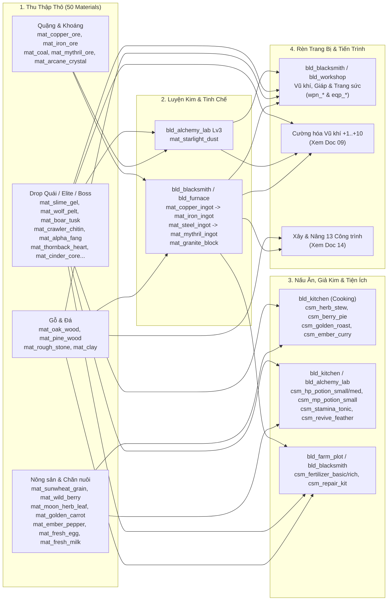
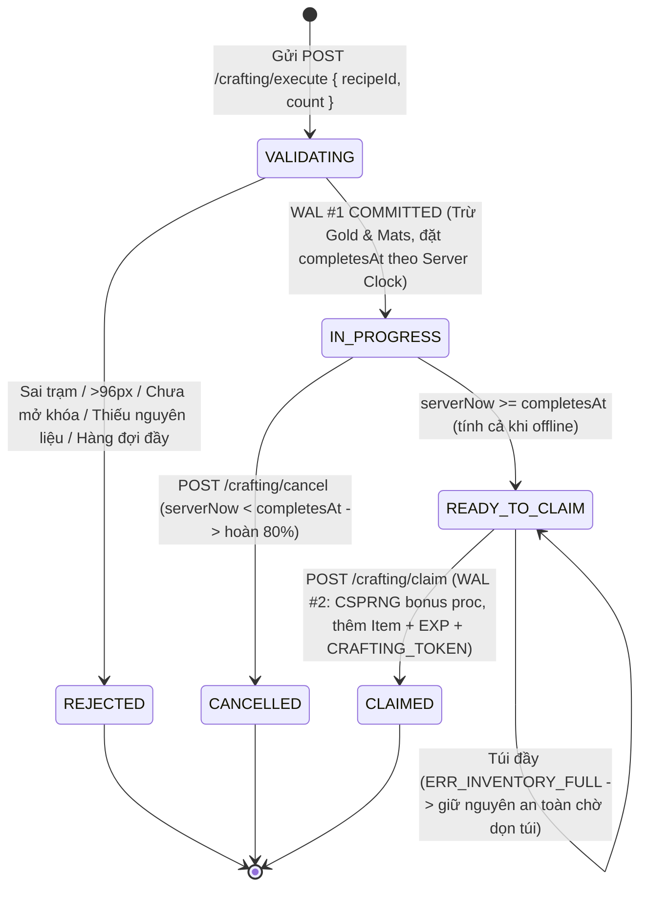

# 11 — Crafting, Smelting, Cooking & Alchemy System Design: Eldoria: Forgotten Wilds

**Trạng thái**: Hoàn thiện (Design Baseline v1.0)  
**Chế độ**: `DESIGN_AND_PLANNING_ONLY`  
**Cập nhật lần cuối**: 2026-11-19  
**Nguồn dữ liệu chuẩn (Single Source of Truth)**: [`game-data/recipes.json`](../../game-data/recipes.json), [`game-data/items.json`](../../game-data/items.json), [`game-data/buildings.json`](../../game-data/buildings.json)  
**Tài liệu quản trị**: [Constitution](../../.specify/memory/constitution.md) · [00-game-vision.md](./00-game-vision.md) · [database-design.md](../architecture/database-design.md) · [anti-cheat-design.md](../architecture/anti-cheat-design.md)

---

## 1. Mục tiêu Gameplay (Gameplay Objectives)

Hệ thống Chế tạo (Crafting System) là bộ máy trung tâm kết nối toàn bộ nền kinh tế tài nguyên của **Eldoria: Forgotten Wilds** — biến mọi hoạt động thu thập (chặt gỗ, đào đá, khai khoáng, trồng trọt, chăn nuôi, săn quái/Elite/Boss) thành giá trị sức mạnh thực chất (thực thi Trụ cột 3, 4 và Nguyên tắc III của Hiến pháp):

1. **Chuỗi sản xuất khép kín không tài nguyên thừa**: Mọi nguyên liệu thô trong 50 `mat_*` đều chảy vào một hoặc nhiều nhánh sản xuất rõ ràng: **Luyện kim & Tinh chế** (`SMELTING` / `REFINING`) → **Nấu ăn Buff chiến đấu** (`COOKING`) → **Giả kim Dược phẩm & Phân bón** (`ALCHEMY` / `UTILITY`) → **Rèn Vũ khí, Giáp & Phụ kiện** (`WEAPON_FORGING` / `ARMOR_CRAFTING` / `ACCESSORY_CRAFTING`), đồng thời nuôi trực tiếp lộ trình Cường hóa `+1..+10` và Xây dựng 13 công trình.
2. **Mở rộng quy mô công thức vượt chuẩn Catalog**: `game-data/recipes.json` định nghĩa đầy đủ **36 công thức chuẩn** *(vượt mức tối thiểu 30 công thức trong `GAME_DESIGN_BRIEF.md` Mục 16)*, trong đó **22 công thức MVP (`M1`)** khép kín hoàn toàn trải nghiệm Greenhaven Village → Whispering Forest → Mossroot Hollow và **14 công thức hậu MVP (`M2–M5`)** trải dài tới trang bị `MYTHIC` Lv 90.
3. **Liên kết mượt giữa Trạm Công cộng làng và Lãnh địa cá nhân**: Người chơi mới có thể dùng ngay lò công cộng của `npc_smith_garrik`, `npc_village_herbalist`, `npc_village_tailor` (với `publicStationFeeMultiplier: 1.0`) cho các công thức nhập môn, sau đó xây và nâng cấp công trình tại nhà (`bld_blacksmith`, `bld_kitchen`, `bld_farm_plot`, `bld_storage` Lv 2+ `autoCraftPull`, cùng `bld_furnace`, `bld_workshop`, `bld_alchemy_lab` ở M2+) để mở công thức cấp cao, tăng tốc nung (`+20%..+50%`), tiết kiệm nguyên liệu (`5%..15%`) và cơ hội nhân đôi thành phẩm (`5%..15%`).
4. **Chống Chế tạo Lậu tuyệt đối (`Anti-Invalid-Crafting`)**: Server xác thực 100% tầm tương tác trạm (`<= 96 px`), cấp công trình, điều kiện mở khóa công thức, Gold và nguyên liệu bên trong khóa `AsyncLockManager` + giao dịch WAL nguyên tử trên `JsonDatabaseEngine`.

---

## 2. User Stories

| ID | Vai trò | User Story | Milestone |
| :--- | :--- | :--- | :---: |
| **US-CRF-01** | Người chơi mới | Là người chơi ở Greenhaven Village, tôi muốn nung `mat_copper_ore` và `mat_coal` tại lò của `npc_smith_garrik` (hoặc `bld_blacksmith` Lv 1) thành `mat_copper_ingot` và nấu `csm_herb_stew` tại `bld_kitchen` Lv 1 để hồi Stamina và hoàn thành nhiệm vụ nhập môn trong 30 phút đầu. | M1 (MVP) |
| **US-CRF-02** | Người chơi chiến đấu | Là chiến binh chuẩn bị đột kích `boss_thornback_elder`, tôi muốn nấu `csm_golden_roast` (`+10% ATK, +8% DEF`), `csm_ember_curry` (`+8% Crit, +10% Fire DMG`) và pha `csm_hp_potion_med`, `csm_revive_feather` từ nông sản, sữa trứng và drop quái rừng. | M1 (MVP) |
| **US-CRF-03** | Thợ rèn | Là người chơi tích trữ tài nguyên trong `bld_storage` Lv 2 (`autoCraftPull: true`), tôi muốn chế tạo hàng loạt tới `50` thỏi `mat_steel_ingot` hoặc rèn `wpn_elderwood_cleaver` mà không cần tự tay chuyển từng chồng nguyên liệu từ rương vào ba lô. | M1 (MVP) |
| **US-CRF-04** | Nông dân | Là người chơi tập trung làm trang trại, tôi muốn trộn `csm_fertilizer_basic` ngay tại `bld_farm_plot` Lv 1 từ `mat_fiber_hemp`, `mat_slime_gel` và `mat_clay` để rút ngắn 20% thời gian trồng cây và tăng tỷ lệ nông sản `SILVER`/`GOLD`. | M1 (MVP) |
| **US-CRF-05** | Người chơi dã chiến | Là người chơi đi hầm ngục thường xuyên, tôi muốn tự lắp `csm_repair_kit` (`rcp_craft_repair_kit`) và nhận thêm `CRAFTING_TOKEN` từ các công thức trung–cao cấp để đổi bản vẽ hoặc nguyên liệu đặc biệt. | M1 (MVP) |
| **US-CRF-06** | Đại Nghệ nhân | Là người chơi giai đoạn M2–M5, tôi muốn xây `bld_furnace` Lv 3 (luyện 8 mẻ song song, `+50%` tốc độ, `12%` thỏi thưởng), `bld_workshop` Lv 3 (`-15%` nguyên liệu) và `bld_alchemy_lab` Lv 3 (`15%` nhân đôi bình thuốc) để chế tác trang bị `LEGENDARY`/`MYTHIC`. | M2–M5 |

---

## 3. Chuỗi Sản xuất Toàn diện (End-to-End Production Pipeline)



### 3.1 Vai trò Các Trạm Chế tạo & Hệ số Thưởng Theo Cấp Công trình (`game-data/buildings.json`)

| Trạm / Công trình | MVP | Vai trò Chế tạo chính | Hàng đợi (`queueSlots`) | Thưởng Sản xuất theo Cấp | Trạm NPC công cộng thay thế (MVP) |
| :--- | :---: | :--- | :---: | :--- | :--- |
| **`bld_blacksmith`** | **✅ MVP** | Nung cơ bản (Đồng/Sắt/Thép), tinh chế Granite, `csm_repair_kit`, rèn Vũ khí/Giáp/Trang sức MVP & Cường hóa `+1..+10` | `2 / 4 / 6 / 8` (Lv 1..4) | Mở khóa công thức theo Lv 1..4; giảm `0/10/20/30%` phí sửa đồ | `npc_smith_garrik` *(chỉ các công thức Lv 1 có gắn `publicStationNpcId`)* |
| **`bld_kitchen`** | **✅ MVP** | Nấu ăn (`COOKING`) & pha chế dược phẩm MVP (`ALCHEMY` Lv 1..2 trước khi có `bld_alchemy_lab`) | `2 / 4 / 6` (Lv 1..3) | Buff thức ăn `+0/+15/+25%` thời lượng; **`0/8/15%` khẩu phần đôi (`doublePortionChance`)**; Lv 3 mở Bàn Tiệc Party | `npc_village_herbalist` *(chỉ 5 công thức pha thuốc MVP)* |
| **`bld_farm_plot`** | **✅ MVP** | Ủ phân bón hữu cơ cơ bản (`rcp_craft_fertilizer_basic`) | `1` *(trực tiếp)* | Rút gọn thao tác ngay tại vườn | — |
| `bld_furnace` | Post (M2+) | Lò chuyên dụng luyện quặng song song & luyện `mat_mythril_ingot` (Lv 3) | `3 / 5 / 8` (Lv 1..3) | **`+20/+35/+50%` tốc độ nung**, Lv 2 giảm `15%` than, **`0/6/12%` thỏi thưởng (`bonusIngotChance`)** | — |
| `bld_workshop` | Post (M2+) | Chế tác cung/trượng gỗ, giáp vải/da tinh xảo và trang sức (`RING`/`NECKLACE`/`ACCESSORY`) | `3 / 5 / 8` (Lv 1..3) | **`5/10/15%` tiết kiệm nguyên liệu (`materialSavePct`)**, Lv 3 `+10%` dòng phụ bậc cao | `npc_village_tailor` *(chỉ `rcp_craft_hunter_tunic`)* |
| `bld_alchemy_lab` | Post (M2+) | Phòng giả kim chuyên sâu, phân bón cao cấp `csm_fertilizer_rich` và chuyển hóa `mat_starlight_dust` | `2 / 4 / 6` (Lv 1..3) | **`5/10/15%` nhân đôi bình thuốc (`doublePotionChance`)** | — |

---

## 4. Danh mục Toàn bộ 36 Công thức Chế tạo (`game-data/recipes.json`)

*(22 công thức đánh dấu **`✅ MVP`** phát hành ngay ở M1; 14 công thức đánh dấu `Post` mở rộng theo vùng đất M2–M5. Toàn bộ nguyên liệu, trạm, Gold, thời gian, EXP và `CRAFTING_TOKEN` khớp 100% với `game-data/recipes.json`.)*

### 4.1 Nhánh 1 — Luyện kim & Tinh chế (`SMELTING` & `REFINING` — 6 Công thức: 4 MVP, 2 Post-MVP)

| # | Recipe ID | Tên | MVP | Trạm chính (`alt` / `NPC`) | Thành phẩm (`out`) | Nguyên liệu (`ingredients`) | Gold | Thời gian | EXP | `CRAFTING_TOKEN` | Điều kiện mở (`unlockCondition`) |
| :-: | :--- | :--- | :-: | :--- | :--- | :--- | :-: | :-: | :-: | :-: | :--- |
| 1 | **`rcp_smelt_copper_ingot`** | Smelt Copper Ingot | **✅ MVP** | `bld_blacksmith Lv1` (`bld_furnace` / `npc_smith_garrik`) | `mat_copper_ingot ×1` | `mat_copper_ore ×3`, `mat_coal ×1` | `15G` | `5s` | `15` | `0` | `DEFAULT` |
| 2 | **`rcp_smelt_iron_ingot`** | Smelt Iron Ingot | **✅ MVP** | `bld_blacksmith Lv1` (`bld_furnace` / `npc_smith_garrik`) | `mat_iron_ingot ×1` | `mat_iron_ore ×3`, `mat_coal ×2` | `35G` | `8s` | `28` | `0` | `PLAYER_LEVEL: 3` |
| 3 | **`rcp_smelt_steel_ingot`** | Smelt Steel Ingot | **✅ MVP** | `bld_blacksmith Lv2` (`bld_furnace`) | `mat_steel_ingot ×1` | `mat_iron_ingot ×2`, `mat_coal ×3`, `mat_rough_stone ×2` | `80G` | `12s` | `55` | `1` | `PLAYER_LEVEL: 10` |
| 4 | **`rcp_refine_granite_block`** | Refine Granite Block | **✅ MVP** | `bld_blacksmith Lv2` (`bld_workshop`) | `mat_granite_block ×2` | `mat_rough_stone ×6`, `mat_clay ×2` | `40G` | `10s` | `35` | `0` | `PLAYER_LEVEL: 12` |
| 5 | `rcp_smelt_mythril_ingot` | Smelt Mythril Ingot | Post | `bld_furnace Lv3` (`bld_blacksmith`) | `mat_mythril_ingot ×1` | `mat_mythril_ore ×3`, `mat_coal ×5`, `mat_arcane_crystal ×1` | `280G` | `20s` | `160` | `2` | `PLAYER_LEVEL: 42` |
| 6 | `rcp_refine_starlight_dust` | Transmute Starlight Dust | Post | `bld_alchemy_lab Lv3` | `mat_starlight_dust ×3` | `mat_arcane_crystal ×2`, `mat_ancient_relic_frag ×2` | `320G` | `18s` | `180` | `2` | `PLAYER_LEVEL: 45` |

### 4.2 Nhánh 2 — Nấu ăn (`COOKING` — 4 Công thức: 4 MVP)

| # | Recipe ID | Tên | MVP | Trạm chính | Thành phẩm (`out`) | Nguyên liệu (`ingredients`) | Gold | Thời gian | EXP | `CRAFTING_TOKEN` | Điều kiện mở |
| :-: | :--- | :--- | :-: | :--- | :--- | :--- | :-: | :-: | :-: | :-: | :--- |
| 7 | **`rcp_cook_herb_stew`** | Cook Greenhaven Herb Stew | **✅ MVP** | `bld_kitchen Lv1` | `csm_herb_stew ×2` | `mat_sunwheat_grain ×2`, `mat_wild_berry ×2`, `mat_moon_herb_leaf ×1` | `20G` | `6s` | `20` | `0` | `DEFAULT` |
| 8 | **`rcp_cook_berry_pie`** | Bake Wild Berry Pie | **✅ MVP** | `bld_kitchen Lv1` | `csm_berry_pie ×2` | `mat_wild_berry ×4`, `mat_sunwheat_grain ×2`, `mat_fresh_egg ×1` | `35G` | `8s` | `32` | `0` | `PLAYER_LEVEL: 3` |
| 9 | **`rcp_cook_golden_roast`** | Cook Golden Carrot Roast | **✅ MVP** | `bld_kitchen Lv2` | `csm_golden_roast ×1` | `mat_golden_carrot ×3`, `mat_fresh_milk ×2`, `mat_boar_tusk ×1` | `75G` | `12s` | `60` | `1` | `PLAYER_LEVEL: 8` |
| 10 | **`rcp_cook_ember_curry`** | Cook Ember Pepper Curry | **✅ MVP** | `bld_kitchen Lv2` | `csm_ember_curry ×1` | `mat_ember_pepper ×2`, `mat_golden_carrot ×2`, `mat_fresh_milk ×2`, `mat_fresh_egg ×2` | `95G` | `14s` | `75` | `1` | `PLAYER_LEVEL: 12` |

### 4.3 Nhánh 3 — Giả kim & Tiện ích (`ALCHEMY` & `UTILITY` — 8 Công thức: 7 MVP, 1 Post-MVP)

| # | Recipe ID | Tên | Loại | MVP | Trạm chính (`alt` / `NPC`) | Thành phẩm (`out`) | Nguyên liệu (`ingredients`) | Gold | Thời gian | EXP | `CRAFTING_TOKEN` | Điều kiện mở |
| :-: | :--- | :--- | :---: | :-: | :--- | :--- | :--- | :-: | :-: | :-: | :-: | :--- |
| 11 | **`rcp_brew_hp_potion_small`** | Brew Small Healing Potion | `ALCHEMY` | **✅ MVP** | `bld_kitchen Lv1` (`bld_alchemy_lab` / `npc_village_herbalist`) | `csm_hp_potion_small ×3` | `mat_wild_berry ×3`, `mat_slime_gel ×2` | `25G` | `6s` | `18` | `0` | `DEFAULT` |
| 12 | **`rcp_brew_mp_potion_small`** | Brew Small Mana Potion | `ALCHEMY` | **✅ MVP** | `bld_kitchen Lv1` (`bld_alchemy_lab` / `npc_village_herbalist`) | `csm_mp_potion_small ×3` | `mat_moon_herb_leaf ×2`, `mat_spore_cap_dust ×2` | `30G` | `6s` | `22` | `0` | `PLAYER_LEVEL: 3` |
| 13 | **`rcp_brew_stamina_tonic`** | Brew Swiftwing Stamina Tonic | `ALCHEMY` | **✅ MVP** | `bld_kitchen Lv1` (`bld_alchemy_lab` / `npc_village_herbalist`) | `csm_stamina_tonic ×2` | `mat_sunwheat_grain ×2`, `mat_fresh_egg ×1`, `mat_bat_wing ×1` | `40G` | `8s` | `30` | `0` | `PLAYER_LEVEL: 6` |
| 14 | **`rcp_brew_hp_potion_med`** | Brew Medium Healing Potion | `ALCHEMY` | **✅ MVP** | `bld_kitchen Lv2` (`bld_alchemy_lab` / `npc_village_herbalist`) | `csm_hp_potion_med ×2` | `mat_moon_herb_leaf ×3`, `mat_golden_carrot ×2`, `mat_spore_cap_dust ×2` | `65G` | `10s` | `48` | `1` | `PLAYER_LEVEL: 10` |
| 15 | **`rcp_brew_revive_feather`** | Craft Dawnlight Revive Feather | `ALCHEMY` | **✅ MVP** | `bld_kitchen Lv2` (`bld_alchemy_lab` / `npc_village_herbalist`) | `csm_revive_feather ×1` | `mat_starlight_dust ×2`, `mat_shaman_totem ×1`, `mat_fresh_egg ×3` | `150G` | `15s` | `85` | `1` | `PLAYER_LEVEL: 12` |
| 16 | **`rcp_craft_fertilizer_basic`** | Mix Basic Organic Fertilizer | `UTILITY` | **✅ MVP** | `bld_farm_plot Lv1` (`bld_alchemy_lab`) | `csm_fertilizer_basic ×4` | `mat_fiber_hemp ×4`, `mat_slime_gel ×2`, `mat_clay ×2` | `20G` | `5s` | `16` | `0` | `DEFAULT` |
| 17 | **`rcp_craft_repair_kit`** | Assemble Field Repair Kit | `UTILITY` | **✅ MVP** | `bld_blacksmith Lv1` (`bld_workshop` / `npc_smith_garrik`) | `csm_repair_kit ×2` | `mat_copper_ingot ×1`, `mat_oak_wood ×3`, `mat_fiber_hemp ×2` | `35G` | `6s` | `24` | `0` | `DEFAULT` |
| 18 | `rcp_craft_fertilizer_rich` | Distill Rich Starlight Fertilizer | `ALCHEMY` | Post | `bld_alchemy_lab Lv2` | `csm_fertilizer_rich ×3` | `mat_starlight_dust ×2`, `mat_truffle_mushroom ×2`, `mat_spore_cap_dust ×4` | `180G` | `12s` | `95` | `1` | `PLAYER_LEVEL: 26` |

### 4.4 Nhánh 4 — Rèn Vũ khí (`WEAPON_FORGING` — 10 Công thức: 4 MVP, 6 Post-MVP)

| # | Recipe ID | Tên | MVP | Trạm chính (`alt` / `NPC`) | Thành phẩm (`out`) | Nguyên liệu (`ingredients`) | Gold | Thời gian | EXP | `CRAFTING_TOKEN` | Điều kiện mở |
| :-: | :--- | :--- | :-: | :--- | :--- | :--- | :-: | :-: | :-: | :-: | :--- |
| 19 | **`rcp_forge_iron_longsword`** | Forge Iron Longsword | **✅ MVP** | `bld_blacksmith Lv1` (`npc_smith_garrik`) | `wpn_iron_longsword ×1` | `mat_iron_ingot ×4`, `mat_oak_wood ×3`, `mat_goblin_tooth ×2` | `120G` | `12s` | `50` | `1` | `DEFAULT` |
| 20 | **`rcp_forge_wolf_fang_dagger`** | Forge Wolf Fang Dagger | **✅ MVP** | `bld_blacksmith Lv2` | `wpn_wolf_fang_dagger ×1` | `mat_iron_ingot ×5`, `mat_alpha_fang ×2`, `mat_wolf_pelt ×4` | `320G` | `18s` | `110` | `2` | `PLAYER_LEVEL: 8` |
| 21 | **`rcp_forge_mossroot_pike`** | Forge Mossroot Pike | **✅ MVP** | `bld_blacksmith Lv2` | `wpn_mossroot_pike ×1` | `mat_iron_ingot ×6`, `mat_pine_wood ×6`, `mat_crawler_chitin ×5` | `380G` | `20s` | `125` | `2` | `PLAYER_LEVEL: 10` |
| 22 | **`rcp_forge_elderwood_cleaver`** | Forge Elderwood Cleaver | **✅ MVP** | `bld_blacksmith Lv3` | `wpn_elderwood_cleaver ×1` | `mat_steel_ingot ×8`, `mat_thornback_heart ×2`, `mat_pine_wood ×10`, `mat_starlight_dust ×4` | `950G` | `30s` | `260` | `4` | `BOSS_CLEAR: boss_thornback_elder` |
| 23 | `rcp_forge_crimson_vanguard_blade` | Forge Crimson Vanguard Blade | Post | `bld_blacksmith Lv3` | `wpn_crimson_vanguard_blade ×1` | `mat_steel_ingot ×10`, `mat_silver_ore ×6`, `mat_cinder_core ×1` | `1,200G` | `30s` | `320` | `4` | `PLAYER_LEVEL: 20` |
| 24 | `rcp_forge_galeweaver_longbow` | Craft Galeweaver Longbow | Post | `bld_workshop Lv2` (`bld_blacksmith`) | `wpn_galeweaver_longbow ×1` | `mat_pine_wood ×16`, `mat_steel_ingot ×5`, `mat_soft_wool ×8`, `mat_bat_wing ×6` | `1,100G` | `28s` | `300` | `4` | `PLAYER_LEVEL: 22` |
| 25 | `rcp_forge_forgelord_waraxe` | Forge Forgelord Waraxe | Post | `bld_blacksmith Lv3` | `wpn_forgelord_waraxe ×1` | `mat_steel_ingot ×14`, `mat_cinder_core ×2`, `mat_granite_block ×10` | `1,850G` | `35s` | `440` | `5` | `BOSS_CLEAR: boss_ignis_forgelord` |
| 26 | `rcp_forge_crystal_conduit_staff` | Craft Crystal Conduit Staff | Post | `bld_workshop Lv2` | `wpn_crystal_conduit_staff ×1` | `mat_arcane_crystal ×6`, `mat_silver_ore ×8`, `mat_prism_scale ×2` | `2,400G` | `40s` | `560` | `6` | `PLAYER_LEVEL: 38` |
| 27 | `rcp_forge_runic_ruin_saber` | Forge Runic Ruin Saber | Post | `bld_blacksmith Lv4` | `wpn_runic_ruin_saber ×1` | `mat_mythril_ingot ×8`, `mat_ancient_relic_frag ×10`, `mat_shadow_thread ×4` | `4,200G` | `45s` | `850` | `8` | `PLAYER_LEVEL: 50` |
| 28 | `rcp_forge_bloodforge_colossus` | Forge Bloodforge Colossus | Post | `bld_blacksmith Lv4` | `wpn_bloodforge_colossus ×1` | `mat_mythril_ingot ×14`, `mat_dragon_scale ×6`, `mat_obsidian_shard ×12`, `mat_cinder_core ×3` | `8,500G` | `60s` | `1,500` | `12` | `PLAYER_LEVEL: 75` |

### 4.5 Nhánh 5 — Chế tác Giáp & Trang sức (`ARMOR_CRAFTING` & `ACCESSORY_CRAFTING` — 8 Công thức: 3 MVP, 5 Post-MVP)

| # | Recipe ID | Tên | Loại | MVP | Trạm chính (`alt` / `NPC`) | Thành phẩm (`out`) | Nguyên liệu (`ingredients`) | Gold | Thời gian | EXP | `CRAFTING_TOKEN` | Điều kiện mở |
| :-: | :--- | :--- | :---: | :-: | :--- | :--- | :--- | :-: | :-: | :-: | :-: | :--- |
| 29 | **`rcp_craft_hunter_tunic`** | Sew Whispering Hunter Tunic | `ARMOR` | **✅ MVP** | `bld_blacksmith Lv1` (`bld_workshop` / `npc_village_tailor`) | `eqp_hunter_tunic ×1` | `mat_wolf_pelt ×4`, `mat_fiber_hemp ×8`, `mat_copper_ingot ×2` | `160G` | `12s` | `60` | `1` | `PLAYER_LEVEL: 5` |
| 30 | **`rcp_craft_copper_vitality_ring`** | Craft Copper Vitality Ring | `ACCESSORY` | **✅ MVP** | `bld_blacksmith Lv1` (`bld_workshop` / `npc_smith_garrik`) | `eqp_copper_vitality_ring ×1` | `mat_copper_ingot ×3`, `mat_slime_gel ×3`, `mat_monster_bone ×2` | `140G` | `10s` | `52` | `1` | `PLAYER_LEVEL: 5` |
| 31 | **`rcp_craft_mossroot_breastplate`** | Forge Mossroot Guard Breastplate | `ARMOR` | **✅ MVP** | `bld_blacksmith Lv2` | `eqp_mossroot_breastplate ×1` | `mat_iron_ingot ×8`, `mat_crawler_chitin ×6`, `mat_boar_tusk ×4` | `480G` | `22s` | `155` | `2` | `PLAYER_LEVEL: 10` |
| 32 | `rcp_craft_ironpeak_cuirass` | Forge Ironpeak Forge Cuirass | `ARMOR` | Post | `bld_blacksmith Lv3` | `eqp_ironpeak_cuirass ×1` | `mat_steel_ingot ×12`, `mat_granite_block ×8`, `mat_cinder_core ×1` | `1,400G` | `32s` | `380` | `4` | `PLAYER_LEVEL: 25` |
| 33 | `rcp_craft_crystal_vestment` | Weave Crystal Arcanist Vestment | `ARMOR` | Post | `bld_workshop Lv2` | `eqp_crystal_vestment ×1` | `mat_arcane_crystal ×6`, `mat_soft_wool ×12`, `mat_prism_scale ×2` | `2,600G` | `38s` | `620` | `6` | `PLAYER_LEVEL: 40` |
| 34 | `rcp_craft_ancient_relic_medallion` | Craft Ancient Relic Medallion | `ACCESSORY` | Post | `bld_workshop Lv3` | `eqp_ancient_relic_medallion ×1` | `mat_ancient_relic_frag ×10`, `mat_mythril_ingot ×4`, `mat_shadow_thread ×5` | `3,800G` | `40s` | `780` | `8` | `PLAYER_LEVEL: 52` |
| 35 | `rcp_craft_frostbound_hauberk` | Forge Frostbound Warden Hauberk | `ARMOR` | Post | `bld_blacksmith Lv4` | `eqp_frostbound_hauberk ×1` | `mat_mythril_ingot ×12`, `mat_rime_essence ×2`, `mat_moon_silk ×6` | `6,200G` | `50s` | `1,150` | `10` | `BOSS_CLEAR: boss_boreas_frostking` |
| 36 | `rcp_craft_abyssal_mantle` | Forge Abyssal Sovereign Mantle | `ARMOR` | Post | `bld_blacksmith Lv4` | `eqp_abyssal_mantle ×1` | `mat_void_crystal ×8`, `mat_eclipse_shard ×2`, `mat_moon_silk ×10`, `mat_dragon_scale ×4` | `14,500G` | `65s` | `2,400` | `18` | `BOSS_CLEAR: boss_malakor_abyss` |

### 4.6 Bảng Hiệu lực Thành phẩm Tiêu hao (`csm_*` từ `game-data/items.json`)

| Consumable ID | Tên | Nhóm | Hồi tức thì (`Hunger / Stam / HP / MP`) | Hiệu ứng Buff (`buffEffect`) | Thời lượng / Hồi chiêu |
| :--- | :--- | :---: | :---: | :--- | :---: |
| `csm_herb_stew` | Greenhaven Herb Stew | `FOOD` | `45 / 35 / 80 / 20` | `hpRegenPerSec: +4` | `300s` / `5s` |
| `csm_berry_pie` | Wild Berry Pie | `FOOD` | `40 / 50 / 50 / 40` | `moveSpeedPct: +8%` | `300s` / `5s` |
| `csm_golden_roast` | Golden Carrot Roast | `FOOD` | `75 / 60 / 150 / 30` | **`atkPct: +10%` & `defPct: +8%`** | `600s` / `5s` |
| `csm_ember_curry` | Ember Pepper Curry | `FOOD` | `70 / 55 / 120 / 50` | **`critRate: +8%` & `fireDamagePct: +10%`** | `600s` / `5s` |
| `csm_hp_potion_small` | Small Healing Potion | `POTION` | `0 / 0 / 120 / 0` | — | `0s` / `8s` |
| `csm_hp_potion_med` | Medium Healing Potion | `POTION` | `0 / 0 / 350 / 0` | `hpRegenPerSec: +6` | `10s` / `10s` |
| `csm_mp_potion_small` | Small Mana Potion | `POTION` | `0 / 0 / 0 / 80` | — | `0s` / `8s` |
| `csm_stamina_tonic` | Swiftwing Stamina Tonic | `POTION` | `5 / 90 / 0 / 20` | `staminaRegenPct: +25%` | `180s` / `12s` |
| `csm_revive_feather` | Dawnlight Revive Feather | `UTILITY` | — | Hồi sinh `50% HP/MP` + `3s` bất tử | `3s` / `120s` |
| `csm_fertilizer_basic` | Basic Organic Fertilizer | `FARMING` | — | `+20%` tốc độ lớn cây & `+15%` tỷ lệ phẩm chất cao | 1 vụ / `0s` |
| `csm_fertilizer_rich` | Rich Starlight Fertilizer | `FARMING` | — | `+35%` tốc độ lớn cây & `+35%` tỷ lệ phẩm chất `GOLD` | 1 vụ / `0s` |
| `csm_repair_kit` | Field Repair Kit | `UTILITY` | — | Phục hồi `+50% durabilityMax` cho 1 trang bị/vũ khí | `0s` / `3s` |

---

## 5. Functional Requirements & Business Rules

### 5.1 Functional Requirements (FR)

- **FR-CRF-01**: Cung cấp quy trình chế tạo 2 pha an toàn cho hàng đợi (`CRAFT_START` thông qua `POST /api/v1/characters/:charId/crafting/execute` → trừ nguyên liệu & Gold qua WAL, tạo job hẹn giờ theo đồng hồ server; và `CRAFT_CLAIM` thông qua `POST /api/v1/characters/:charId/crafting/claim` khi `serverNow >= completesAt` để nhận thành phẩm, EXP và `CRAFTING_TOKEN`).
- **FR-CRF-02**: Với công thức ngắn (`effectiveDurationSec <= 10s`) khi người chơi còn đứng tại trạm và túi còn ô trống, server tự động cho phép claim ngay khi bộ đếm kết thúc mà không cần đổi màn hình; nếu người chơi bỏ đi hoặc tắt game, thành phẩm vẫn nằm an toàn ở trạng thái `READY_TO_CLAIM` trong `data/db/houses/<id>.json` (hoặc mục `pendingCrafts` của `characters/<id>.json` nếu dùng trạm NPC công cộng).
- **FR-CRF-03**: Hỗ trợ chế tạo theo lô (`count: 1..50` đối với vật phẩm `stackable: true`, khớp `maxBatchCountPerRequest: 50`; giới hạn `count === 1` đối với `WEAPON`/`EQUIPMENT` không chồng để tránh tràn túi đột ngột).
- **FR-CRF-04**: Hỗ trợ tự động rút nguyên liệu từ kho nhà (`autoCraftPull` khi `bld_storage.level >= 2`, `autoPullFromStorageAtLevel: 2`) và tính thưởng xác suất sản lượng trên server bằng `crypto.randomInt` (`doublePortionChance` ở `bld_kitchen`, `doublePotionChance` ở `bld_alchemy_lab`, `bonusIngotChance` ở `bld_furnace`, `materialSavePct` ở `bld_workshop`).
- **FR-CRF-05**: Hỗ trợ `CANCEL_CRAFT_JOB` khi job vẫn đang `IN_PROGRESS` (chưa hoàn tất), hoàn trả **`80%`** nguyên liệu & Gold (làm tròn xuống; chống exploit lặp để kích hoạt `materialSavePct`).

### 5.2 Business Rules (BR)

- **BR-CRF-01 (Kiểm tra Tầm Tương tác `<= 96 px`)**: Nhân vật chỉ được khởi tạo lệnh chế tạo khi khoảng cách Euclidean giữa vị trí thực tế của nhân vật trong RAM server và điểm tương tác của trạm hợp lệ (`stationBuildingId` hoặc `altStationBuildingIds` trong lãnh địa, hoặc `publicStationNpcId` tại `reg_greenhaven_village`) **`<= 96 px`**.
- **BR-CRF-02 (Quy tắc Trạm Thay thế & Cấp tối thiểu)**:
  - Công trình chính hoặc `altStationBuildingIds` đều phải ở trạng thái `ACTIVE` (hoặc cấp hoàn thành hiện tại `>= stationLevelReq`).
  - Đối với trạm NPC công cộng (`npc_smith_garrik`, `npc_village_herbalist`, `npc_village_tailor`): chỉ chấp nhận các công thức có trường `publicStationNpcId` khác `null`, không áp dụng `autoCraftPull` từ kho nhà, và không được hưởng thưởng bonus của công trình lãnh địa.
- **BR-CRF-03 (Điều kiện Mở khóa Công thức `unlockCondition`)**:
  - `DEFAULT`: Mở sẵn từ Lv 1.
  - `PLAYER_LEVEL`: Kiểm tra `character.level >= value`.
  - `BOSS_CLEAR`: Kiểm tra `character.defeatedBossIds.includes(value)` (như `boss_thornback_elder` cho `rcp_forge_elderwood_cleaver`).
- **BR-CRF-04 (Phẩm chất Nông sản khi Nấu ăn)**: Nếu toàn bộ nguyên liệu nông sản đưa vào công thức `COOKING` đều đạt chất lượng `GOLD`, thành phẩm món ăn tự động mang `quality: "GOLD"` và kéo dài thêm `+10%` thời lượng buff (cộng dồn với thưởng `+15%/+25%` của `bld_kitchen` Lv 2/3).
- **BR-CRF-05 (Thứ tự Rút Nguyên liệu khi `autoCraftPull` bật)**: Trừ vật phẩm trong `bagItems` trước (theo thứ tự `slotIndex` tăng dần), phần thiếu rút tiếp từ `storageItems` — chỉ kích hoạt khi đang đứng trong chính lãnh địa `zon_player_homestead` của người chơi.

---

## 6. Input và Output (Protocol Contracts)

| Endpoint | Request Body (`X-Idempotency-Key` bắt buộc cho POST) | Response Thành công (`200 OK`) | Mã lỗi chính |
| :--- | :--- | :--- | :--- |
| `POST /api/v1/characters/:charId/crafting/execute` | `{ recipeId: string, count: integer (1..50), stationType: "HOMESTEAD" \| "PUBLIC_NPC", buildingInstanceId?: string, npcId?: string }` | `{ jobId, recipeId, count, status: "IN_PROGRESS", startedAt, completesAt, effectiveDurationSec, goldSpent, materialsConsumed, inventoryDelta }` | `ERR_STATION_TOO_FAR`, `ERR_STATION_LEVEL_TOO_LOW`, `ERR_RECIPE_LOCKED`, `ERR_INVALID_BATCH_COUNT`, `ERR_QUEUE_FULL`, `ERR_INSUFFICIENT_FUNDS`, `ERR_INSUFFICIENT_MATERIALS` |
| `POST /api/v1/characters/:charId/crafting/claim` | `{ jobId: string }` | `{ jobId, status: "CLAIMED", outputItems: [{ itemId, qty, bonusProcQty, quality, instanceId? }], expGained, craftingTokensGained, inventoryDelta }` | `ERR_CRAFT_NOT_READY`, `ERR_INVENTORY_FULL`, `ERR_JOB_NOT_FOUND`, `ERR_FORBIDDEN_OWNERSHIP` |
| `POST /api/v1/characters/:charId/crafting/cancel` | `{ jobId: string }` | `{ jobId, status: "CANCELLED", refundedGold, refundedMaterials, inventoryDelta }` | `ERR_JOB_ALREADY_COMPLETED`, `ERR_JOB_NOT_FOUND` |
| `GET /api/v1/characters/:charId/crafting/jobs` | `?stationInstanceId=` | `{ jobs: CraftingJob[] }` (server đánh dấu sẵn các job đã đủ thời gian là `READY_TO_CLAIM`) | `ERR_UNAUTHORIZED`, `ERR_FORBIDDEN_OWNERSHIP` |

---

## 7. State Transitions (Máy Trạng Thái Công việc Chế tạo)



---

## 8. JSON Data Model (100% Local JSON Storage via `JsonDatabaseEngine`)

### 8.1 `data/db/houses/<characterId>.json` (Phần `craftingQueues` trên Công trình)

```json
{
  "craftingQueues": [
    {
      "jobId": "job_01J9XB200001",
      "txId": "tx_01J9XB200000",
      "idempotencyKey": "d1a4e9f0-3b2c-4a1d-8e5f-998877665544",
      "ownerCharacterId": "chr_inst_01J9X7K2M4",
      "buildingInstanceId": "binst_smith_01",
      "stationBuildingId": "bld_blacksmith",
      "stationLevelAtStart": 2,
      "recipeId": "rcp_smelt_steel_ingot",
      "count": 10,
      "goldSpent": 800,
      "materialsConsumed": [
        { "itemId": "mat_iron_ingot", "qty": 20 },
        { "itemId": "mat_coal", "qty": 30 },
        { "itemId": "mat_rough_stone", "qty": 20 }
      ],
      "status": "IN_PROGRESS",
      "startedAt": "2026-11-19T16:20:00.000Z",
      "completesAt": "2026-11-19T16:22:00.000Z"
    }
  ]
}
```

### 8.2 `data/db/inventories/<characterId>.json` & `data/db/ledgers/currency-ledger-<YYYY-MM>.json`

- Khi bắt đầu (`WAL #1`): Khóa theo thứ tự bảng chữ cái `["character:<id>", "house:<id>", "inventory:<id>", "ledger:<YYYY-MM>"]`, trừ nguyên liệu trên `inventories/<id>.json`, trừ Gold trên `characters/<id>.json`, thêm `CraftingJob` vào `houses/<id>.json` (hoặc `characters/<id>.json#pendingPublicCrafts` nếu dùng trạm NPC), và ghi bút toán `reasonCode: "CRAFT_FEE"` vào `ledgers/currency-ledger-<YYYY-MM>.json`.
- Khi nhận thành phẩm (`WAL #2`): Khóa cùng bộ khóa, cộng `outputItemId × (outputQty * count + bonusProc)` vào `inventories/<id>.json`, cộng `expReward * count` và `craftingTokenReward * count` vào `characters/<id>.json` + bút toán `CRAFTING_TOKEN` (`reasonCode: "CRAFT_REWARD"`) vào `currency-ledger-<YYYY-MM>.json`, đồng thời chuyển job sang `CLAIMED` và dọn khỏi hàng đợi đang chạy.

---

## 9. Dependencies (Phụ thuộc Liên Hệ thống)

- **[`14-building-system.md`](./14-building-system.md) & `game-data/buildings.json`**: Xác định trạm hiện có, cấp độ, số ô hàng đợi (`queueSlots`), hệ số tốc độ/thưởng và `bld_storage` Lv 2+ `autoCraftPull`.
- **[`08-equipment-system.md`](./08-equipment-system.md) & [`09-weapon-enhancement.md`](./09-weapon-enhancement.md)**: Chế tạo vũ khí/giáp/trang sức mới, `csm_repair_kit`, và cung cấp toàn bộ phôi `mat_copper_ingot`, `mat_iron_ingot`, `mat_steel_ingot` nuôi chuỗi cường hóa `+1..+10`.
- **[`12-farming-system.md`](./12-farming-system.md) & [`13-animal-husbandry.md`](./13-animal-husbandry.md)**: Cung cấp 7 loại nông sản & 5 loại sản phẩm động vật cho Nấu ăn/Giả kim, đồng thời tiêu thụ `csm_fertilizer_basic` / `csm_fertilizer_rich`.
- **[`18-quest-and-npc.md`](./18-quest-and-npc.md)**: Chuỗi nhiệm vụ onboarding (`qst_003_hearth_and_stew`, `qst_004_sparks_of_the_forge`) dạy người chơi chế tạo qua hành động thực tế.

---

## 10. UI Interactions (Tương tác Giao diện Trạm Chế tạo)

1. **Bảng Chế tạo theo Trạm (Station Crafting Modal — Mở bằng phím `E` tại trạm)**:
   - **Tab Danh mục**: Tự lọc và nổi bật các công thức hợp lệ tại trạm đang đứng (`Luyện kim`, `Nấu ăn`, `Giả kim`, `Vũ khí`, `Giáp & Phụ kiện`, `Tiện ích`), kèm công tắc *"Chỉ hiện món đủ nguyên liệu"*.
   - **Thẻ Công thức Chi tiết**: Hiển thị icon pixel `32×32`, thông số vật phẩm thành phẩm, yêu cầu nguyên liệu (`Có / Cần` kèm biểu tượng rương kho nếu đang dùng `autoCraftPull`), thanh trượt chọn số lượng lô (`1..50` với nút nhanh `x1 / x5 / x10 / MAX`), tổng chi phí Gold, tổng thời gian chế tạo (đã áp dụng bonus tốc độ nếu là `bld_furnace`), lượng EXP & `CRAFTING_TOKEN` thưởng.
   - **Gợi ý Nguồn Farm**: Di chuột vào nguyên liệu còn thiếu (hiển thị màu đỏ) hiện ngay tooltip nguồn thu thập (*"Đào quặng ở Whispering Forest"*, *"Rơi từ `mob_root_crawler` trong `dng_mossroot_hollow`"*).
2. **Thanh Hàng đợi Chế tạo (Active Queue Bar & World Progress)**:
   - Hiển thị các ô hàng đợi đang chạy (ví dụ `2/4`) kèm đồng hồ đếm ngược đồng bộ theo server time, nút **Nhận (`Claim`)** sáng vàng khi xong và nút **Hủy (`Cancel — hoàn 80%`)** khi đang chạy. Trên bản đồ Phaser, lò rèn/bếp có hoạt ảnh ống khói bốc lửa pixel khi đang chạy mẻ và bong bóng biểu tượng thành phẩm nhấp nhẹ khi sẵn sàng nhận.

---

## 11. Edge Cases, Failure Behavior & Security Requirements

### 11.1 Edge Cases

1. **Bấm nhận (`CLAIM`) một mẻ chế tạo `mat_steel_ingot ×10` khi túi đồ đầy `40/40`, nhưng đã có sẵn một chồng `mat_steel_ingot ×50` (maxStack `999`)**:
   - Server kiểm tra logic gộp stack trước khi báo đầy túi: `50 + 10 = 60 <= 999` → **hợp lệ**, gộp thẳng vào chồng cũ mà không cần ô trống mới.
2. **Đang đứng ở `npc_smith_garrik` trong làng và muốn dùng nguyên liệu đang cất trong `bld_storage` Lv 2 ở nhà**:
   - Theo `BR-CRF-02` & `BR-CRF-05`, `autoCraftPull` chỉ hoạt động khi đứng trong lãnh địa `zon_player_homestead`; tại NPC làng, server chỉ tính nguyên liệu trong `bagItems` và UI hiển thị chú thích nhỏ *"Đang dùng lò công cộng — chỉ tính đồ trong túi"*.
3. **Nhân vật thoát game giữa lúc đang nung `20` thỏi `mat_steel_ingot` (tốn `240s`) và quay lại sau 2 tiếng**:
   - Khi gọi `GET /crafting/jobs` hoặc mở lò, server so sánh `serverNow >= completesAt` và chuyển ngay trạng thái sang `READY_TO_CLAIM` — tiến trình nung/nấu tiếp tục bình thường theo đồng hồ server.
4. **Cố phá dỡ (`DEMOLISH`) `bld_blacksmith` hoặc `bld_kitchen` khi vẫn còn job `IN_PROGRESS` hoặc `READY_TO_CLAIM`**:
   - Khớp `BR-BLD-02` trong `14-building-system.md`: Server chặn phá dỡ công trình bằng `ERR_BUILDING_HAS_ACTIVE_CRAFT_QUEUE` cho đến khi người chơi nhận hoặc hủy sạch hàng đợi.

### 11.2 Failure Behavior

- **Mất mạng lúc bấm `execute` hoặc `claim`**: Client lưu `X-Idempotency-Key`; khi kết nối lại và gửi lặp, server trả lại đúng `jobId` (không tạo 2 job trừ tiền 2 lần) hoặc đúng kết quả đã nhận thành phẩm (không nhân đôi vật phẩm).
- **Crash server giữa WAL #1 hoặc WAL #2**: `JsonDatabaseEngine` khôi phục nhất quán từ `data/db/wal/tx-<txId>.json` khi khởi động lại, bảo đảm không bao giờ trừ nguyên liệu mà không tạo job, hoặc xóa job mà không trao thành phẩm.

### 11.3 Security Requirements

- **Chống Chế tạo Lậu (`Invalid Crafting` — Anti-Cheat #9)**:
  1. Xác thực khoảng cách Euclidean `<= 96 px` tới trạm hợp lệ từ tọa độ trong RAM server (không tin `stationId` hay tọa độ client gửi).
  2. Xác thực `recipeId` tồn tại trong `game-data/recipes.json`, thỏa mãn `unlockCondition` (`DEFAULT` / `PLAYER_LEVEL` / `BOSS_CLEAR`) và `station.level >= recipe.stationLevelReq`.
  3. Xác thực `count` là số nguyên dương thỏa `1 <= count <= 50` (và `count === 1` với `stackable === false`); từ chối ngay số âm, số `0`, số thập phân hoặc vượt trần (`ERR_INVALID_BATCH_COUNT`) — chống lỗi tràn số / sinh tiền âm (`Currency Manipulation`).
- **Chống Hủy–Đặt Lặp để Rút Thưởng (`Cancel Refund Exploit`)**: Không cộng `expReward`, không cộng `craftingTokenReward` và không roll `materialSavePct`/`doublePortionChance` lúc tạo job; toàn bộ phần thưởng chỉ cấp ở bước `CLAIM` sau khi hết `effectiveDurationSec` theo đồng hồ server, còn hủy chỉ hoàn `80%` vốn.
- **Chống Tăng tốc Đồng hồ (`Clock Tampering`)**: Hoàn toàn bỏ qua thời gian máy client; mọi phép kiểm tra `serverNow >= completesAt` đọc trực tiếp từ `ServerClockService.utcNowMs()`.

---

## 12. Acceptance Criteria & Test Scenarios

### 12.1 Acceptance Criteria (AC)

- **AC-CRF-01**: Toàn bộ **36 công thức** (22 MVP + 14 Post-MVP) trên 8 danh mục và hiệu lực của 12 vật phẩm `csm_*` khớp 100% về ID, nguyên liệu, số lượng, trạm, cấp trạm, Gold, thời gian, EXP, `CRAFTING_TOKEN` và điều kiện mở khóa với `game-data/recipes.json` và `game-data/items.json`.
- **AC-CRF-02**: Server chặn 100% lệnh chế tạo khi đứng xa trạm `> 96 px`, chưa mở khóa công thức, thiếu cấp công trình, truyền `count <= 0` hoặc `> 50`, hoặc vượt giới hạn `queueSlots`.
- **AC-CRF-03**: Chế độ `autoCraftPull` tại lãnh địa với `bld_storage` Lv 2+ trừ đúng thứ tự `bagItems` trước → `storageItems` sau trong cùng giao dịch WAL nguyên tử.
- **AC-CRF-04**: Không phát sinh nhân bản vật phẩm hay mất nguyên liệu dưới thử nghiệm gửi đồng thời, gửi lặp `idempotencyKey`, túi đồ đầy khi claim và crash recovery WAL.

### 12.2 Test Scenarios (Giai đoạn Thiết kế — Chưa thực thi Production)

| Test ID | Loại kiểm thử | Kịch bản kiểm tra | Kết quả mong đợi |
| :--- | :--- | :--- | :--- |
| **TS-CRF-01** | Integration / Smelt→Forge Pipeline | Đứng cách `bld_blacksmith` Lv 1 `<= 96 px`, nung `rcp_smelt_iron_ingot` (`count: 4`), claim sau `32s`, rồi rèn `rcp_forge_iron_longsword` (`count: 1`) | Trừ đúng `12 mat_iron_ore`, `8 mat_coal`, `3 mat_oak_wood`, `2 mat_goblin_tooth`, `260G` (`140G + 120G`); nhận `1 wpn_iron_longsword` (`+0`, `durability: 120`), `+162 EXP`, `+1 CRAFTING_TOKEN`. |
| **TS-CRF-02** | Security / Proximity & Unlock | Nhân vật Lv 9 đứng trong `reg_whispering_forest` (cách lò `> 500 px`) gửi `rcp_smelt_steel_ingot` (yêu cầu Lv 10 & Blacksmith Lv 2) | Server trả `ERR_STATION_TOO_FAR` / `ERR_RECIPE_LOCKED`, không trừ tài nguyên, ghi cảnh báo `AuditLog`. |
| **TS-CRF-03** | Security / Negative & Overflow Qty | Gửi `POST /crafting/execute` với `count: -5`, `count: 0`, `count: 51` cho `rcp_smelt_copper_ingot`, và `count: 2` cho `rcp_forge_iron_longsword` | Toàn bộ 4 request bị từ chối với HTTP `400 ERR_INVALID_BATCH_COUNT`. |
| **TS-CRF-04** | Integration / Storage Auto-Pull | Đặt `20 mat_iron_ore` trong túi, `10 mat_iron_ore` + `20 mat_coal` trong `bld_storage` Lv 2; chạy `rcp_smelt_iron_ingot` `count: 10` tại `bld_blacksmith` trong nhà | Trừ hết `20` quặng ở túi + `10` quặng & `20` than trong kho trong cùng 1 WAL transaction thành công. |
| **TS-CRF-05** | Concurrency / Double Claim | Khi job đã ở `READY_TO_CLAIM`, bắn đồng thời 10 request `POST /crafting/claim` với cùng `jobId` và 10 `idempotencyKey` khác nhau | Đúng 1 request thành công trao thành phẩm; 9 request sau thất bại (`ERR_JOB_NOT_FOUND` / đã claim), không nhân bản vật phẩm. |
| **TS-CRF-06** | Edge / Bag Full On Claim | Đổ đầy 40/40 ô túi đồ bằng vật phẩm khác loại, sau đó gọi `POST /crafting/claim` cho `rcp_forge_elderwood_cleaver` | Server trả `409 ERR_INVENTORY_FULL`, giữ nguyên job ở trạng thái `READY_TO_CLAIM` trên `houses/<id>.json` cho đến khi người chơi giải phóng 1 ô và claim lại thành công. |
| **TS-CRF-07** | Integration / Boss-Gated Recipe | Nhân vật có `bld_blacksmith` Lv 3 nhưng chưa hạ `boss_thornback_elder` gọi `rcp_forge_elderwood_cleaver`, sau đó cập nhật đã hạ Boss và gọi lại | Lần 1 trả `ERR_RECIPE_LOCKED` (`requires: BOSS_CLEAR:boss_thornback_elder`); lần 2 thành công tạo job `30s`. |
