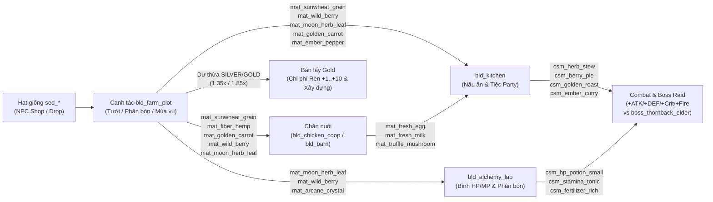
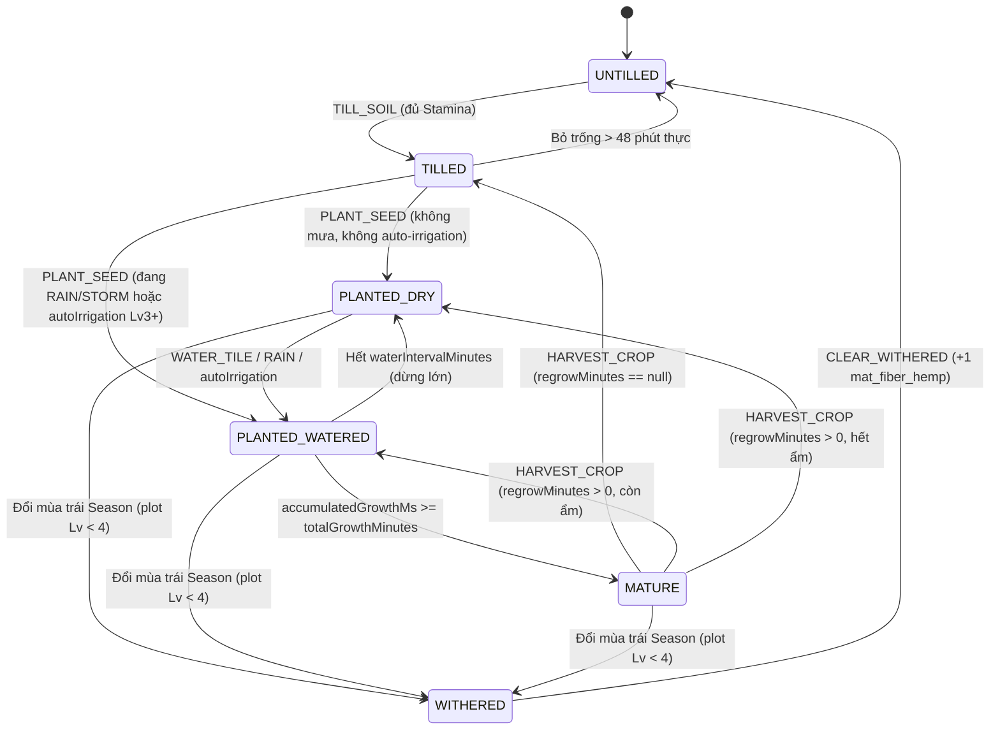

# 12 — Survival & Farming System Design: Eldoria: Forgotten Wilds

**Trạng thái**: Hoàn thiện (Design Baseline v1.0)  
**Chế độ**: `DESIGN_AND_PLANNING_ONLY`  
**Cập nhật lần cuối**: 2026-11-19  
**Nguồn dữ liệu chuẩn (Single Source of Truth)**: [`game-data/crops.json`](../../game-data/crops.json), [`game-data/items.json`](../../game-data/items.json), [`game-data/buildings.json`](../../game-data/buildings.json)  
**Tài liệu quản trị**: [Constitution](../../.specify/memory/constitution.md) · [00-game-vision.md](./00-game-vision.md) · [assumptions-and-decisions.md](../management/assumptions-and-decisions.md)

---

## 1. Mục tiêu Gameplay (Gameplay Objectives)

Hệ thống Sinh tồn (Survival) và Nông trại (Farming) thực thi trực tiếp **Trụ cột Thiết kế số 1** (*Thế giới sống động và có thể khám phá*) và **Trụ cột Thiết kế số 3** (*Mọi hoạt động farm đều có giá trị đối với tiến trình phát triển*) trong [00-game-vision.md](./00-game-vision.md):

1. **Biến nông trại thành hậu phương chiến đấu thực chất**: Nông sản thu hoạch từ `bld_farm_plot` không phải chỉ để bán lấy vàng một chiều mà là nguyên liệu bắt buộc để nấu các món ăn buff chiến đấu (`csm_herb_stew`, `csm_berry_pie`, `csm_golden_roast`, `csm_ember_curry`), nuôi đàn gia súc/gia cầm và điều chế bình dược tại `bld_alchemy_lab`.
2. **Nhịp sinh tồn ấm áp, không trừng phạt độc hại**: Các chỉ số `Hunger`, `Stamina`, thời tiết (`WeatherType`) và mùa vụ (`Season`) tạo động lực chuẩn bị trước mỗi chuyến thám hiểm hoặc boss raid, nhưng tuyệt đối không gây chết vĩnh viễn khi người chơi offline hoặc lơ là một buổi tối.
3. **Tôn trọng thời gian của người chơi online**: Quy ước 1 ngày trong game = `24 phút` thời gian thực (`ASM-007`) và cơ chế mô phỏng offline theo đồng hồ server tối đa `24 giờ` (`ASM-008`) giúp cả người chơi casual (30 phút/ngày) lẫn hardcore đều thấy luống rau trưởng thành hợp lý mà không thể gian lận bằng cách chỉnh giờ máy tính.
4. **Lộ trình tự động hóa có ý nghĩa**: Giai đoạn MVP (`M1`) tập trung vào thao tác canh tác thủ công giàu xúc giác (cuốc đất, gieo hạt, tưới nước, bón phân, nhờ bạn party phụ tưới). Giai đoạn `M2–M3` mở khóa tưới tự động (`bld_farm_plot` Lv 3) và thu hoạch tự động kèm nhà kính chống trái mùa (`bld_farm_plot` Lv 4) như phần thưởng nâng cấp lãnh địa.

---

## 2. User Stories

| ID | Vai trò | User Story | Milestone |
| :--- | :--- | :--- | :---: |
| **US-FRM-01** | Người chơi mới | Là một người chơi mới tại `reg_greenhaven_village`, tôi muốn cuốc đất, gieo `sed_sunwheat`, tưới nước và gặt `mat_sunwheat_grain` trong 15 phút đầu để tự nấu món ăn hồi Stamina đầu tiên. | M1 (MVP) |
| **US-FRM-02** | Người chơi chiến đấu | Là một chiến binh chuẩn bị vào `dng_mossroot_hollow`, tôi muốn trồng `crp_golden_carrot` và `crp_ember_pepper` để nấu `csm_golden_roast` và `csm_ember_curry`, nhận buff ATK/DEF/Crit/Fire Damage khi đối đầu `boss_thornback_elder`. | M1 (MVP) |
| **US-FRM-03** | Người chơi nông trại | Là một người chơi thích trồng trọt, tôi muốn bón `csm_fertilizer_basic` hoặc `csm_fertilizer_rich` để rút ngắn thời gian lớn và tăng tỷ lệ thu hoạch nông sản phẩm chất `SILVER`/`GOLD`, bán được giá cao hơn hoặc nấu món hiệu quả hơn. | M1 / M2 |
| **US-FRM-04** | Thành viên Party | Là một người bạn cùng party đến thăm lãnh địa của đồng đội, tôi muốn tưới nước giúp các luống cây trên `bld_farm_plot` có quyền `PARTY_ACCESS` để nhận điểm hữu nghị và giúp đồng đội tiết kiệm Stamina. | M1 (MVP) |
| **US-FRM-05** | Người chơi casual | Là một người chơi chỉ đăng nhập 1–2 lần/ngày, tôi muốn khi đăng nhập lại server tự tính chính xác tiến độ sinh trưởng trong khung tối đa 24 giờ (bao gồm mưa tự tưới hoặc hệ thống tưới tự động ở Lv 3) để tôi có nông sản thu hoạch ngay. | M1 / M2 |
| **US-FRM-06** | Người chơi trung-cuối game | Là một chủ lãnh địa đã nâng `bld_farm_plot` lên Lv 3 và Lv 4, tôi muốn kích hoạt hệ thống tưới tự động (`autoIrrigation`) và nhà kính tự thu hoạch (`autoHarvest`) vào `bld_storage` để rảnh tay tập trung vào các raid cấp cao. | M2 / M3 |

---

## 3. Nền tảng Sinh tồn (Survival Foundation)

### 3.1 Hệ thống Hunger (0–100) & Liên kết Stamina

Chỉ số `Hunger` đại diện cho thể trạng no/đói của nhân vật (phạm vi nguyên `0` đến `100`, khởi tạo `100` khi tạo nhân vật hoặc hồi sinh tại `bld_player_house`).

- **Tốc độ tiêu hao `Hunger` (trên server tick 20 Hz, tích lũy theo phút thực)**:
  - Đứng yên / ở trong Safe Zone (`reg_greenhaven_village`, `zon_player_homestead`): `-0.5 điểm/phút thực` (tương đương `-12 điểm` mỗi ngày trong game 24 phút).
  - Di chuyển, thu thập, canh tác hoặc chiến đấu ngoài vùng an toàn: `-1.2 điểm/phút thực`.
  - Khi thực hiện hành động nặng tiêu hao Stamina (chặt cây, đào quặng, cuốc đất, né đòn liên hoàn): mỗi `100 Stamina` tiêu hao cộng thêm `-0.8 điểm Hunger`.
  - Khi offline: `Hunger` **đóng băng hoàn toàn**, không giảm khi người chơi không kết nối.

| Ngưỡng `Hunger` | Trạng thái (`HungerState`) | Tác động lên Stamina & HP | Cảnh báo UI |
| :---: | :--- | :--- | :--- |
| `80 – 100` | `WELL_FED` | `+15%` tốc độ hồi Stamina tự nhiên; `+2 HP/giây` ngoài chiến đấu | Biểu tượng bánh mì vàng ấm |
| `35 – 79` | `NORMAL` | Hồi Stamina và HP ở mức chuẩn `100%` | Bình thường, không cảnh báo |
| `15 – 34` | `HUNGRY` | `-25%` tốc độ hồi Stamina tự nhiên; không hồi HP tự nhiên ngoài chiến đấu | Viền thanh Hunger chuyển cam |
| `1 – 14` | `STARVING` | `-50%` tốc độ hồi Stamina; `-10%` tốc độ di chuyển ngoài chiến đấu; tăng `+20%` Stamina cost khi Dodge/Sprint | Nhấp nháy nhẹ (<= 1 Hz, không flash gắt) kèm gợi ý ăn |
| `0` | `EXHAUSTED` | Stamina tối đa tạm thời giảm còn `60%`; **KHÔNG trừ HP về 0 và KHÔNG gây chết nhân vật** | Biểu tượng cảnh báo đói tĩnh |

- **Chi phí Stamina cho thao tác nông trại & sinh tồn (MVP)**:
  - Cuốc đất (`TILL_SOIL`): `6 Stamina` (giảm còn `4 Stamina` với cuốc Sắt trở lên).
  - Gieo hạt (`PLANT_SEED`): `2 Stamina`.
  - Tưới nước thủ công (`WATER_TILE`): `4 Stamina` (tưới 1 ô ở Lv 1; bình tưới Đồng/Sắt có thể tưới 1×3 ô với `8 Stamina`).
  - Bón phân (`APPLY_FERTILIZER`): `2 Stamina`.
  - Thu hoạch (`HARVEST_CROP`): `3 Stamina`.
  - Chặt cây / Đào quặng ngoài bản đồ: `8 Stamina/nhát`.
  - Phục hồi Stamina: Ăn thực phẩm (`csm_herb_stew`, `csm_berry_pie`, ...), uống `csm_stamina_tonic`, hoặc nghỉ tại giường trong `bld_player_house` (Lv 1 hồi `60%` Stamina; Lv 2–4 hồi `100%` Stamina kèm buff `Well-Rested`, cooldown `10 phút`).

### 3.2 Hệ thống Food Buff (Tối đa 2 Buff Thức ăn Đồng thời)

Mỗi nhân vật được duy trì đồng thời **tối đa 2 Food Buff** từ thực phẩm nấu nướng, chia làm 2 kênh tách biệt để khuyến khích kết hợp nông sản và tạo chiều sâu chuẩn bị trước boss raid:

1. **Kênh 1 — Combat Stat Buff (`FOOD_COMBAT`)**: Các món tăng chỉ số chiến đấu trực tiếp (ATK, DEF, Crit Rate, Elemental Damage) như `csm_golden_roast` hoặc `csm_ember_curry`.
2. **Kênh 2 — Survival / Utility Buff (`FOOD_UTILITY`)**: Các món tăng tốc độ di chuyển, tái tạo HP/MP hoặc hồi Stamina như `csm_herb_stew`, `csm_berry_pie`, `csm_stamina_tonic`.

**Quy tắc ghi đè & cộng dồn**:
- Nếu ăn một món thuộc cùng kênh đang có hiệu lực, buff mới **ghi đè** buff cũ trên kênh đó (không cộng dồn vô hạn 2 món ATK).
- Thời lượng buff được nhân thêm theo cấp `bld_kitchen`: Lv 1 (`+0%`), Lv 2 (`+15%`), Lv 3 (`+25%`), và cộng thêm theo phẩm chất nguyên liệu sử dụng khi nấu (`SILVER`: `+10%` giá trị buff hoặc thời lượng; `GOLD`: `+20%` giá trị buff — quy định chi tiết tại `11-crafting-system.md`).
- **Quy tắc chống spam**: Mọi món ăn đều có `cooldownSeconds` riêng (`5s` cho thức ăn, `8–12s` cho bình dược) được xác thực trên server. Buff thức ăn **vẫn giữ nguyên** nếu chuyển khu vực, nhưng **bị xóa** khi nhân vật chết hoàn toàn và hồi sinh (ngoại trừ hồi sinh bằng `csm_revive_feather`).

| Item ID | Tên món | Kênh Buff | Hunger | Stamina | HP / MP | Hiệu ứng Buff chuẩn (`items.json`) | Thời lượng gốc | Nguồn chính |
| :--- | :--- | :--- | :---: | :---: | :---: | :--- | :---: | :--- |
| `csm_herb_stew` | Greenhaven Herb Stew | `FOOD_UTILITY` | `+45` | `+35` | `+80 / +20` | `+4 HP/giây` (`hpRegenPerSec`) | `300s` (5p) | Cooking (`mat_sunwheat_grain` + `mat_moon_herb_leaf`) |
| `csm_berry_pie` | Wild Berry Pie | `FOOD_UTILITY` | `+40` | `+50` | `+50 / +40` | `+8% Move Speed` (`moveSpeedPct`) | `300s` (5p) | Cooking (`mat_wild_berry` + `mat_fresh_egg` + `mat_fresh_milk` + `mat_sunwheat_grain`) |
| `csm_golden_roast` | Golden Carrot Roast | `FOOD_COMBAT` | `+75` | `+60` | `+150 / +30` | `+10% ATK`, `+8% DEF` | `600s` (10p) | Cooking (`mat_golden_carrot` + `mat_fresh_milk` + `mat_moon_herb_leaf`) |
| `csm_ember_curry` | Ember Pepper Curry | `FOOD_COMBAT` | `+70` | `+55` | `+120 / +50` | `+8% Crit Rate`, `+10% Fire Damage` | `600s` (10p) | Cooking (`mat_ember_pepper` + `mat_sunwheat_grain` + `mat_fresh_egg`) |
| `csm_stamina_tonic` | Swiftwing Stamina Tonic | `FOOD_UTILITY` | `+5` | `+90` | `0 / +20` | `+25% Stamina Regen` | `180s` (3p) | Alchemy / Crafting (`mat_bat_wing` + `mat_wild_berry`) |

### 3.3 Chu kỳ Ngày/Đêm (24 phút), Thời tiết & 4 Mùa (14 ngày/mùa)

Theo quyết định `ASM-007` và quy tắc trong `game-data/crops.json`:

- **Chu kỳ 1 ngày trong game (`inGameDayRealMinutes = 24`)**:
  - `DAWN` (Bình minh): `00:00 – 01:00` (`1 phút` thực — chuyển màu ánh sáng ấm, cập nhật ngày mới và tính toán thời tiết ngày).
  - `DAY` (Ban ngày): `01:00 – 15:00` (`14 phút` thực — tầm nhìn tối đa, thương nhân làng mở cửa, cây trồng quang hợp chuẩn).
  - `DUSK` (Hoàng hôn): `15:00 – 18:00` (`3 phút` thực — sắc cam hoàng hôn, chuyển giao nhịp sinh thái).
  - `NIGHT` (Ban đêm): `18:00 – 24:00` (`6 phút` thực — quái hệ Shadow như `mob_hollow_bat` tăng `+15%` mật độ xuất hiện ở rừng; `crp_moon_herb` nhận `+10%` tốc độ lớn vào ban đêm).
- **Hệ thống 4 Mùa (`Season`)**: Mỗi mùa kéo dài chính xác **`14 ngày trong game`** (`daysPerSeason = 14`, tương đương `336 phút` = `5 giờ 36 phút` thời gian thực). Một năm đầy đủ gồm 4 mùa (`SPRING → SUMMER → AUTUMN → WINTER`) kéo dài `22 giờ 24 phút` thực — cho phép người chơi trải nghiệm đủ vòng tuần hoàn mùa vụ trong tuần mà không phải chờ nhiều tháng thực.
- **Hệ thống Thời tiết (`WeatherType`)**: Được server sinh theo seed đồng bộ cho từng `regionId` vào đầu mỗi ngày trong game (`DAWN`), lịch sử 24 giờ gần nhất được lưu lại trong `data/db/world/world-clock.json` để phục vụ mô phỏng offline chính xác.

| `WeatherType` | Mùa hay xuất hiện | Tác động Nông trại | Tác động Thế giới & Combat |
| :--- | :--- | :--- | :--- |
| `CLEAR` | Cả 4 mùa | Sinh trưởng và bay hơi nước ở mức chuẩn `1.0x` | Không có hiệu ứng môi trường đặc biệt |
| `RAIN` | `SPRING`, `SUMMER`, `AUTUMN` | **Tự động tưới ẩm 100% mọi ô đất ngoài trời** (`rainAutoWatersSoil: true`) suốt thời gian mưa | `+10%` sát thương `WATER` / `LIGHTNING`; `-10%` sát thương `FIRE` ngoài trời |
| `STORM` | `SUMMER`, `AUTUMN` | Tự động tưới ẩm 100%; tăng `+5%` tỷ lệ rơi hạt giống hoang khi dọn cỏ | Tầm nhìn giảm nhẹ; `+15%` sát thương `LIGHTNING`; sấm xa (không flash trắng gắt) |
| `FOG` | `SPRING`, `AUTUMN` | Giảm `20%` tốc độ khô đất | Phạm vi phát hiện aggro của quái giảm `15%`; thảo dược `mat_moon_herb_leaf` dễ gặp hơn |
| `SNOW` | `WINTER` | Giữ ẩm nhẹ nhưng **không tự tưới**; cây ngoài mùa `WINTER` bị héo nếu không có nhà kính Lv 4 | Gió lạnh nhẹ tại `reg_frostbound_highlands`; `+10%` sát thương `FROST` |
| `HEATWAVE` | `SUMMER` | Tăng `25%` tốc độ khô đất (`waterIntervalMinutes` giảm 20%); cây hệ lửa (`crp_ember_pepper`, `crp_ash_chili`) lớn nhanh hơn `+15%` | Tăng `20%` tốc độ tụt `Hunger` ngoài trời |

### 3.4 Tái tạo Tài nguyên (Resource Regeneration) & Sức chứa Kho đồ (Inventory Capacity)

- **Tái tạo tài nguyên thế giới (`ResourceNode`)**: Cây gỗ (`mat_oak_wood`, `mat_pine_wood`), mỏ đá/quặng (`mat_rough_stone`, `mat_copper_ore`, `mat_iron_ore`, `mat_coal`), đất sét bờ sông (`mat_clay`), sợi gai (`mat_fiber_hemp`) và bụi quả/thảo mộc hoang (`mat_wild_berry`, `mat_moon_herb_leaf`) đều có đồng hồ tái tạo riêng trên server theo bảng:
  - Tài nguyên sơ cấp tại `reg_greenhaven_village` (cỏ, gỗ sồi, đá thô, quả mọng): `180 – 300 giây`.
  - Tài nguyên trung cấp tại `reg_whispering_forest` (gỗ thông, quặng đồng/sắt, thảo mộc trăng): `300 – 480 giây`.
  - Tài nguyên cao cấp vùng Post-MVP (quặng bạc, mythril, tinh thể): `600 – 900 giây`.
  - Chống độc chiếm node: Khi node hết trữ lượng, server đặt trạng thái `DEPLETED` kèm `respawnAt` và chỉ kích hoạt respawn trong vùng có ít nhất 1 người chơi gần đó hoặc theo chu kỳ dọn dẹp zone (mỗi 60 giây).
- **Sức chứa hành lý (`Inventory Capacity`)**:
  - Ba lô nhân vật khởi đầu: **`40 ô`** cố định trong `data/db/inventories/<characterId>.json`.
  - Quy tắc gộp stack (`items.json`): Nguyên liệu phổ thông/trung cấp (`mat_*`): tối đa `999/ô`; Nguyên liệu Epic/Legendary (`mat_starlight_melon`, `mat_moon_silk`): `99/ô`; Hạt giống (`sed_*`) & Thức ăn/Phân bón (`csm_*`): `99/ô`; Trang bị/Vũ khí: `1/ô` (không stack).
  - Mở rộng lưu trữ: Xây và nâng cấp `bld_storage` (Lv 1: `+40 ô`, Lv 2: `+80 ô` + `autoCraftPull`, Lv 3: `+140 ô`, Lv 4: `+220 ô` + `40 ô` dùng chung tài khoản) và `bld_stable` Post-MVP (`+12` đến `+20 ô` túi yên).

---

## 4. Cơ chế Nông trại Chi tiết (Farming Mechanics)

### 4.1 Vòng đời 1 Ô đất Canh tác (`FarmTile`)

Toàn bộ canh tác của người chơi diễn ra trên các ô lưới `32×32 px` thuộc công trình `bld_farm_plot` trong lãnh địa (`zon_player_homestead`) hoặc khu ruộng mở rộng (`zon_greenhaven_farmland`):

1. **Làm đất (`Preparing Soil`)**: Người chơi đứng cạnh ô đất trạng thái `UNTILLED`, dùng cuốc tiêu hao `6 Stamina` → chuyển thành `TILLED`. Nếu để trống không gieo hạt quá `2 ngày trong game` (`48 phút` thực), đất `TILLED` tự hoàn nguyên về `UNTILLED` (trừ khi đã bón phân chờ gieo).
2. **Gieo hạt (`Planting Seeds`)**: Chọn hạt giống `sed_*` từ thanh hotbar/túi đồ lên ô `TILLED`. Server kiểm tra:
   - Nhân vật đạt `unlockFarmingLevel` của loại cây tương ứng.
   - Mùa hiện tại nằm trong danh sách `seasons` của cây (hoặc công trình `bld_farm_plot` đạt **Lv 4** có mái kính ma pháp cho phép trồng trái mùa với hệ số giảm tốc `0.75x`).
   - Trừ nguyên tử `1` hạt giống trong kho, khởi tạo thực thể cây tại `stage = 0` (`SEED`), ghi `plantedAt = serverNow`, `accumulatedGrowthMs = 0`.
3. **Bón phân (`Fertilizer`)**: Áp dụng 1 lần duy nhất cho mỗi chu kỳ trồng (trên ô `TILLED` hoặc ô đang ở `stage = 0`). Hai loại phân bón chuẩn trong `items.json`:
   - **`csm_fertilizer_basic`** (*Basic Organic Fertilizer*, `MVP`, mua `20 Gold` hoặc chế tạo từ `mat_slime_gel` + `mat_monster_bone`): Áp dụng đúng bộ `fertilizerBonus` chuẩn của từng loại cây trong `crops.json` (mức chuẩn `+20%` đến `+30%` tốc độ sinh trưởng tùy giống, cộng tỷ lệ `SILVER`/`GOLD` và `extraYieldChance` `15%–30%`).
   - **`csm_fertilizer_rich`** (*Rich Starlight Fertilizer*, `Post-MVP M2`, mua `85 Gold` hoặc pha chế tại `bld_alchemy_lab` Lv 2): Nâng hệ số tốc độ lên `1.35x` (`+35%`), tăng mạnh xác suất phẩm chất `SILVER`/`GOLD` (`+35%` trọng số chuyển dịch lên phẩm chất cao, cụ thể cộng `1.5×` phần `silverQualityBonus` và `2.0×` phần `goldQualityBonus` của cây), đồng thời cộng thêm `+10%` cơ hội sản lượng phụ (`extraYieldChance`).
4. **Tưới nước (`Watering`)**:
   - Mỗi loại cây có chu kỳ giữ ẩm `waterIntervalMinutes` riêng (`6` đến `18 phút` thực). Khi được tưới thủ công (hoặc trời `RAIN`/`STORM`, hoặc `bld_farm_plot` Lv 3 `autoIrrigation` đang bật), trạng thái nước chuyển thành `WATERED` với thời hạn:
     $$T_{\text{wet}} = \text{waterIntervalMinutes} \times M_{\text{plot}} \times M_{\text{weather}}$$
     Trong đó: $M_{\text{plot}} = 1.0$ (Lv 1), $1.25$ (Lv 2+ nhờ mương giữ ẩm giảm `25%` hao nước); $M_{\text{weather}} = 0.8$ khi `HEATWAVE`, $1.2$ khi `FOG`, $1.0$ mặc định.
   - **Hình phạt thiếu nước (`unwateredGrowthPenalty: PAUSED_UNTIL_WATERED`)**: Khi hết ẩm (`DRY`), bộ đếm sinh trưởng **tạm dừng** tại chỗ. Cây **KHÔNG bị chết khô** do quên tưới, chỉ không tiến sang giai đoạn tiếp theo cho đến khi được tưới lại.
5. **Giai đoạn sinh trưởng (`Growth Stages` — 4 đến 5 giai đoạn)**:
   - Mỗi cây có mảng `growthStages` định nghĩa trong `crops.json` (gồm 4 giai đoạn cho cây ngắn/trung ngày và 5 giai đoạn cho cây bụi/cây lâu ngày như `crp_berry_bush`, `crp_ember_pepper`, `crp_silver_pumpkin`, `crp_crimson_tomato`, `crp_honey_melon`, `crp_crystal_lotus`, `crp_ash_chili`, `crp_starlight_melon`).
   - Tiến trình thực tế tính bằng giây ẩm tích lũy nhân hệ số tốc độ (`fertilizerSpeed × weatherMod × offSeasonMod`). Khi đạt tổng `totalGrowthMinutes`, cây đạt giai đoạn cuối `MATURE` (phát sáng nhẹ bằng hạt pixel lấp lánh không gây chói).
6. **Thu hoạch (`Harvesting`) & Tái sinh (`Regrow`)**:
   - Server kiểm tra `stage === MATURE`, xác thực quyền sở hữu (`OWNER_ONLY` hoặc `PARTY_ACCESS` nếu chủ nhà bật quyền phụ thu hoạch — mặc định chỉ chủ sở hữu thu hoạch để chống trộm, thành viên party chỉ được tưới nước giúp).
   - Tính sản lượng ngẫu nhiên trong `[yieldMin, yieldMax]` bằng PRNG server; nếu có bón phân thì tung thêm xác suất `extraYieldChance` để cộng `+1` đơn vị.
   - Tính phẩm chất (`NORMAL` / `SILVER` / `GOLD`) cho sản phẩm thu hoạch, cộng `farmingExp` vào kỹ năng Farming của nhân vật.
   - **Cây 1 vụ (`regrowMinutes === null`)**: Ô đất trở về `TILLED`, xóa lớp phân bón cũ.
   - **Cây nhiều vụ (`regrowMinutes > 0`)**: Gốc cây được giữ lại và lùi về giai đoạn sát cuối (`stage = maxStage - 1`), bắt đầu đếm `regrowMinutes` cho lần hái kế tiếp (áp dụng cho 6 giống: `crp_berry_bush`, `crp_ember_pepper`, `crp_clover_hay`, `crp_crimson_tomato`, `crp_crystal_lotus`, `crp_ash_chili`).
7. **Quy tắc đổi mùa (`witherOnSeasonChange: true`)**:
   - Khi đồng hồ thế giới chuyển sang ngày 1 của mùa mới, mọi cây trồng ngoài trời không hỗ trợ mùa mới sẽ chuyển trạng thái `WITHERED` (cần dùng cuốc dọn gốc, nhận lại `1 mat_fiber_hemp` an ủi, không rơi hạt).
   - **Ngoại lệ Nhà kính (`greenhouseMitigatesOffSeasonAtFarmPlotLv4: true`)**: Tại `bld_farm_plot` Lv 4, cây trái mùa **không bị héo** khi đổi mùa mà vẫn tiếp tục sinh trưởng với tốc độ `0.75x`.

### 4.2 Hệ thống Phẩm chất Nông sản (`Crop Quality`)

Theo `crops.json`, mọi nông sản thu hoạch đều mang một trong 3 bậc phẩm chất:

| Phẩm chất (`QualityTier`) | Hệ số giá bán (`qualitySellPriceMultiplier`) | Lợi ích khi Nấu ăn / Chế tạo | Nguồn tăng xác suất |
| :--- | :---: | :--- | :--- |
| `NORMAL` | `1.00x` | Giá trị gốc chuẩn | Tỷ lệ nền theo từng giống |
| `SILVER` | `1.35x` | `+10%` thời lượng Food Buff hoặc `+10%` sản lượng tinh chế | Phân bón (`+8%..+13%`), `bld_farm_plot` Lv 3 (`+5%`), Farming Level (`+0.4%/Lv`, trần `+10%`) |
| `GOLD` | `1.85x` | `+20%` hiệu quả Food Buff & tăng `+50%` khả năng ra khẩu phần đôi | Phân bón (`+5%..+12%` hoặc `2x` với Rich), `bld_farm_plot` Lv 4 (`+10%`), Farming Level (`+0.2%/Lv`, trần `+5%`) |

**Công thức xác suất phẩm chất trên server (chuẩn hóa tổng = `1.0`)**:
```text
rawGold   = clamp(crop.qualityRates.GOLD   + fertGoldBonus   + plotLv4GoldBonus   + min(0.05, farmingLv * 0.002), 0, 0.65)
rawSilver = clamp(crop.qualityRates.SILVER + fertSilverBonus + plotLv3SilverBonus + min(0.10, farmingLv * 0.004), 0, 0.85 - rawGold)
rawNormal = max(0, 1.0 - rawGold - rawSilver)
```

### 4.3 Lộ trình Tưới tiêu & Tự động hóa Nông trại (M1 → M3)

| Cấp `bld_farm_plot` | Milestone | Số ô đất | Cơ chế Tưới nước | Tự động hóa & Đặc quyền |
| :---: | :---: | :---: | :--- | :--- |
| **Lv 1** | M1 (MVP) | `12 ô` | Thủ công bằng bình tưới hoặc mưa (`RAIN`/`STORM`) | Bạn cùng party được phụ tưới nước (`PARTY_ACCESS`) |
| **Lv 2** | M1 (MVP) | `20 ô` | Thủ công + Mương giữ ẩm (`-25%` tốc độ khô đất) | Mở khóa Bãi Chăn Thả Khởi Đầu (`starterPastureSlots: 2` cho `anm_clover_cow`) |
| **Lv 3** | M2 | `28 ô` | **Tưới Tự Động (`autoIrrigation: true`)** kích hoạt liên tục cả khi offline (tối đa `24 giờ`) | `+5%` xác suất nông sản `SILVER`/`GOLD`; công tắc bật/tắt `TOGGLE_IRRIGATION` |
| **Lv 4** | M3 | `36 ô` | **Tưới Tự Động + Nhà Kính Ma Pháp** | **Tự động thu hoạch (`autoHarvest: true`)** chuyển thẳng vào `bld_storage` (khi còn ô trống); chống héo trái mùa; `+10%` tỷ lệ `GOLD`; `3` ô bãi chăn thả |

---

## 5. Danh mục Toàn bộ 15 Loại Cây Trồng (Khớp 100% `game-data/crops.json`)

Toàn bộ 15 giống cây trồng chuẩn — trong đó **5 giống đầu tiên là phạm vi MVP (`M1`)** và 10 giống sau là lộ trình mở rộng (`M2–M5`):

| # | Crop ID | Tên | MVP | Lv mở | Seed ID (Giá mua) | Harvest ID (Giá bán gốc) | Sản lượng | Mùa vụ (`seasons`) | Số giai đoạn | Thời gian lớn (phút) | Chu kỳ tưới (phút) | Tái sinh (`regrow`) | Tỷ lệ N / S / G | Bonus Phân bón (Tốc độ / S / G / +1) | EXP | Vùng gợi ý |
| :-: | :--- | :--- | :-: | :-: | :--- | :--- | :-: | :--- | :-: | :-: | :-: | :-: | :-: | :-: | :-: | :--- |
| 1 | `crp_sunwheat` | **Sunwheat** | **Có** | 1 | `sed_sunwheat` (12G) | `mat_sunwheat_grain` (10G) | 2–4 | `SPRING`, `SUMMER`, `AUTUMN` | 4 (`3→4→5→0`) | **12** | 6 | — | 72 / 20 / 8% | `1.25x` / +10% / +6% / 20% | 12 | `reg_greenhaven_village` |
| 2 | `crp_berry_bush` | **Wild Berry Bush** | **Có** | 1 | `sed_berry_bush` (18G) | `mat_wild_berry` (8G) | 3–5 | `SPRING`, `SUMMER` | 5 (`4→6→7→7→0`) | **24** | 8 | **12m** | 70 / 22 / 8% | `1.20x` / +10% / +7% / 25% | 18 | `reg_greenhaven_village` |
| 3 | `crp_moon_herb` | **Moon Herb** | **Có** | 3 | `sed_moon_herb` (28G) | `mat_moon_herb_leaf` (18G) | 2–3 | `SPRING`, `AUTUMN`, `WINTER` | 4 (`8→12→16→0`) | **36** | 12 | — | 68 / 22 / 10% | `1.25x` / +12% / +8% / 20% | 24 | `reg_whispering_forest` |
| 4 | `crp_golden_carrot` | **Golden Carrot** | **Có** | 5 | `sed_golden_carrot` (35G) | `mat_golden_carrot` (22G) | 2–4 | `SPRING`, `AUTUMN` | 4 (`10→16→22→0`) | **48** | 12 | — | 65 / 25 / 10% | `1.25x` / +12% / +8% / 25% | 30 | `reg_greenhaven_village` |
| 5 | `crp_ember_pepper` | **Ember Pepper** | **Có** | 8 | `sed_ember_pepper` (55G) | `mat_ember_pepper` (35G) | 2–3 | `SUMMER`, `AUTUMN` | 5 (`10→14→18→18→0`) | **60** | 15 | **24m** | 64 / 25 / 11% | `1.20x` / +12% / +9% / 20% | 38 | `reg_whispering_forest` |
| 6 | `crp_clover_hay` | Clover Hay | Không | 6 | `sed_clover_hay` (10G) | `mat_fiber_hemp` (3G) | 3–6 | `SPRING`, `SUMMER`, `AUTUMN` | 4 (`4→6→8→0`) | **18** | 9 | **12m** | 75 / 18 / 7% | `1.30x` / +8% / +5% / 30% | 16 | `reg_greenhaven_village` |
| 7 | `crp_frost_turnip` | Frost Turnip | Không | 10 | `sed_frost_turnip` (52G) | `mat_frost_turnip` (38G) | 2–4 | `AUTUMN`, `WINTER` | 4 (`10→16→22→0`) | **48** | 16 | — | 65 / 24 / 11% | `1.25x` / +12% / +8% / 25% | 36 | `reg_frostbound_highlands` |
| 8 | `crp_crimson_tomato` | Crimson Tomato | Không | 10 | `sed_crimson_tomato` (30G) | `mat_wild_berry` (8G) | 3–5 | `SUMMER`, `AUTUMN` | 5 (`8→10→11→11→0`) | **40** | 10 | **16m** | 66 / 24 / 10% | `1.20x` / +11% / +8% / 25% | 32 | `reg_whispering_forest` |
| 9 | `crp_storm_radish` | Storm Radish | Không | 12 | `sed_storm_radish` (48G) | `mat_ember_pepper` (35G) | 2–4 | `SPRING`, `SUMMER` | 4 (`12→18→24→0`) | **54** | 14 | — | 62 / 26 / 12% | `1.25x` / +12% / +9% / 20% | 42 | `reg_ironpeak_mountains` |
| 10 | `crp_silver_pumpkin` | Silver Pumpkin | Không | 14 | `sed_silver_pumpkin` (42G) | `mat_golden_carrot` (22G) | 3–5 | `AUTUMN` | 5 (`16→24→28→28→0`) | **96** | 16 | — | 60 / 27 / 13% | `1.25x` / +12% / +10% / 25% | 55 | `reg_ironpeak_mountains` |
| 11 | `crp_honey_melon` | Honey Melon | Không | 16 | `sed_honey_melon` (60G) | `mat_starlight_melon` (95G) | 1–3 | `SUMMER` | 5 (`12→18→20→22→0`) | **72** | 12 | — | 60 / 27 / 13% | `1.25x` / +12% / +10% / 20% | 52 | `reg_crystal_caverns` |
| 12 | `crp_shadow_garlic` | Shadow Garlic | Không | 18 | `sed_shadow_garlic` (58G) | `mat_moon_herb_leaf` (18G) | 2–4 | `AUTUMN`, `WINTER` | 4 (`12→20→28→0`) | **60** | 15 | — | 60 / 28 / 12% | `1.25x` / +13% / +9% / 25% | 48 | `reg_forgotten_ruins` |
| 13 | `crp_crystal_lotus` | Crystal Lotus | Không | 20 | `sed_crystal_lotus` (110G) | `mat_arcane_crystal` (42G) | 1–2 | `SPRING`, `WINTER` | 5 (`20→30→35→35→0`) | **120** | 12 | **48m** | 58 / 28 / 14% | `1.20x` / +12% / +10% / 15% | 80 | `reg_crystal_caverns` |
| 14 | `crp_ash_chili` | Ash Chili | Không | 22 | `sed_ash_chili` (120G) | `mat_ember_pepper` (35G) | 3–5 | `SUMMER` | 5 (`14→20→25→25→0`) | **84** | 14 | **30m** | 56 / 29 / 15% | `1.20x` / +12% / +11% / 25% | 68 | `reg_ember_wasteland` |
| 15 | `crp_starlight_melon` | Starlight Melon | Không | 25 | `sed_starlight_melon` (220G) | `mat_starlight_melon` (95G) | 1–2 | `SPRING`, `SUMMER`, `AUTUMN`, `WINTER` | 5 (`24→36→42→42→0`) | **144** | 18 | — | 55 / 30 / 15% | `1.25x` / +12% / +12% / 20% | 100 | `reg_abyssal_kingdom` |

> **Lưu ý nhất quán dữ liệu**: Tất cả 15 giống đều có `irrigationCompatible: true` theo `game-data/crops.json`. Các giống Post-MVP như `crp_clover_hay`, `crp_crimson_tomato`, `crp_storm_radish`, `crp_silver_pumpkin`, `crp_honey_melon`, `crp_shadow_garlic`, `crp_crystal_lotus`, `crp_ash_chili` ánh xạ trực tiếp sang các vật liệu chuẩn trong 50 material gốc của `game-data/items.json` (tối ưu hóa không gian kho và thanh khoản kinh tế).

---

## 6. Toán học Tiến trình Offline Theo Server Timestamp & Chống Gian lận Đồng hồ

Theo Nguyên tắc II của Hiến pháp và quyết định `ASM-008`, tiến trình nông trại **tuyệt đối không** dựa vào đồng hồ máy client và không chạy tick mô phỏng cho hàng nghìn lãnh địa đang offline trong RAM. Thay vào đó, server thực hiện **Catch-up Simulation theo yêu cầu (Lazy Evaluation)** khi chủ lãnh địa hoặc thành viên party bước vào `zon_player_homestead`:

### 6.1 Thuật toán Catch-up (Giới hạn trần `24 giờ = 86,400,000 ms`)

```text
1. serverNow = ServerClockService.utcNowMs()          // Nguồn thời gian duy nhất trên server
2. rawElapsedMs = max(0, serverNow - plot.lastSimulatedAtMs)
3. cappedElapsedMs = min(rawElapsedMs, 24 * 3600 * 1000)   // Trần offlineCapHours = 24
4. Chia [plot.lastSimulatedAtMs, plot.lastSimulatedAtMs + cappedElapsedMs] thành các đoạn theo lịch thời tiết & ranh giới chuyển mùa lưu trong data/db/world/world-clock.json:
   Với mỗi đoạn [t_i, t_{i+1}] có mùa S_i và thời tiết W_i:
     a. Nếu S_i không nằm trong crop.seasons:
        - Nếu plot.level < 4: chuyển tile.state = WITHERED, dừng mô phỏng ô này.
        - Nếu plot.level === 4: đặt offSeasonSpeed = 0.75.
     b. Tính khoảng thời gian đất có nước (wetDurationMs) trong đoạn [t_i, t_{i+1}]:
        - Nếu plot.level >= 3 && plot.autoIrrigationEnabled: wetDurationMs = (t_{i+1} - t_i).
        - Else nếu W_i là RAIN hoặc STORM: wetDurationMs = (t_{i+1} - t_i) và nạp lại waterRemainingMs = T_wet.
        - Else: wetDurationMs = min(tile.waterRemainingMs, t_{i+1} - t_i); giảm tile.waterRemainingMs tương ứng.
     c. effectiveGrowthMs = wetDurationMs * fertSpeedMult * weatherSpeedMult * offSeasonSpeed
     d. tile.accumulatedGrowthMs = min(crop.totalGrowthMinutes * 60000, tile.accumulatedGrowthMs + effectiveGrowthMs)
     e. Nếu tile.accumulatedGrowthMs >= totalGrowthMs:
        - Đánh dấu tile.state = MATURE.
        - Nếu plot.level === 4 && plot.autoHarvestEnabled && storageHasSpace():
          Thực hiện thu hoạch tự động nguyên tử vào bld_storage (tối đa 10 chu kỳ regrow/24h để chống bùng nổ lạm phát offline) và nếu crop.regrowMinutes != null thì reset bộ đếm regrow cho phần thời gian dư.
5. Cập nhật plot.lastSimulatedAtMs = serverNow và ghi nguyên tử vào data/db/houses/<ownerId>.json.
```

- **Ví dụ kiểm chứng (MVP — `bld_farm_plot` Lv 1)**: Người chơi gieo `crp_sunwheat` (`12 phút`, `waterInterval = 6 phút`), tưới 1 lần lúc 22:00 rồi tắt máy (trời `CLEAR`). Sáng hôm sau 08:00 đăng nhập lại (`10 giờ` offline, dưới trần 24h):
  - Nếu suốt đêm trời `CLEAR`: cây dùng hết `6 phút` ẩm → đạt `6/12 phút` (`stage 1: SPROUT`) rồi tạm dừng (`DRY`), không chết; người chơi tưới thêm 1 lần và đợi 6 phút nữa là thu hoạch.
  - Nếu có ít nhất 1 đợt `RAIN` kéo dài ≥ `6 phút` trong đêm: cây tự hút nước mưa, hoàn thành đủ `12/12 phút` và chờ sẵn ở trạng thái `MATURE` ngay khi đăng nhập.
  - Nếu đã nâng `bld_farm_plot` Lv 3 (`autoIrrigation: true`): mọi cây trồng trong mùa chắc chắn trưởng thành đạt `MATURE` trong suốt 24 giờ offline.

---

## 7. Chuỗi Sản xuất Kinh tế & Chiến đấu (Production Chain)



- **Chứng minh giá trị kinh tế MVP**:
  - `1 sed_golden_carrot` giá `35 Gold` → trung bình ra `3 mat_golden_carrot` (giá bán thẳng `66 Gold` ở NORMAL, `89 Gold` ở SILVER, `122 Gold` ở GOLD → lợi nhuận ròng `31–87 Gold` mỗi ô sau 48 phút).
  - Nếu dùng để nấu `csm_golden_roast` tại `bld_kitchen` kết hợp `mat_fresh_milk` và `mat_moon_herb_leaf`, người chơi nhận buff `+10% ATK` & `+8% DEF` trong `10 phút`, rút ngắn thời gian hạ `boss_thornback_elder` ~12–15% và giảm tiêu hao bình máu `csm_hp_potion_med` (trị giá `75 Gold`/bình).

---

## 8. Functional Requirements & Business Rules

### 8.1 Functional Requirements (FR)

- **FR-FRM-01**: Server duy trì đồng hồ thế giới toàn cục (`WorldClockService`) chạy chu kỳ 24 phút/ngày, 14 ngày/mùa, phát sự kiện `world.clock.sync` mỗi phút thực hoặc khi chuyển pha ngày/thời tiết.
- **FR-FRM-02**: Hệ thống hỗ trợ đầy đủ 6 hành động canh tác xác thực tại server: `TILL_SOIL`, `PLANT_SEED`, `WATER_TILE`, `APPLY_FERTILIZER`, `HARVEST_CROP`, `CLEAR_WITHERED`.
- **FR-FRM-03**: Hệ thống tính toán và đồng bộ `Hunger` (0–100), `Stamina` và tối đa 2 slot `FoodBuff` (`FOOD_COMBAT`, `FOOD_UTILITY`) gắn liền với Combat Stat Pipeline.
- **FR-FRM-04**: Hệ thống áp dụng đúng thông số 15 giống cây trồng đọc từ `game-data/crops.json` khi khởi động server (không hardcode).
- **FR-FRM-05**: Hệ thống chạy Lazy Offline Catch-up theo đồng hồ server tối đa `24 giờ` cho mọi ô đất trên `bld_farm_plot` khi lãnh địa được tải vào RAM.
- **FR-FRM-06**: Hệ thống hỗ trợ `PARTY_ACCESS` cho phép thành viên cùng party tưới nước hộ trên `bld_farm_plot` nhưng giữ quyền thu hoạch cho chủ sở hữu.

### 8.2 Business Rules (BR)

- **BR-FRM-01**: Không cho phép gieo hạt vượt quá `unlockFarmingLevel` hoặc trái `seasons` (ngoại trừ `bld_farm_plot` Lv 4).
- **BR-FRM-02**: Một ô đất chỉ chứa tối đa 1 cây trồng và 1 loại phân bón tại cùng một thời điểm; bón phân lần 2 lên ô đã có phân bị từ chối với mã `ERR_TILE_ALREADY_FERTILIZED`.
- **BR-FRM-03**: Trời `RAIN`/`STORM` tự động đặt mọi ô đất ngoài trời đang có cây thành `WATERED`; người chơi không thể lãng phí Stamina tưới thêm lên ô đã đầy nước (`waterRemainingPct >= 95%`).
- **BR-FRM-04**: Quên tưới nước làm tạm dừng sinh trưởng (`PAUSED_UNTIL_WATERED`), tuyệt đối không phá hủy cây; chỉ sự kiện chuyển mùa (`witherOnSeasonChange`) mới làm héo cây ngoài mùa ở `bld_farm_plot` Lv 1–3.
- **BR-FRM-05**: Thu hoạch khi túi đồ đầy không được làm mất nông sản: giao dịch bị chặn trước khi thay đổi trạng thái ô đất và trả về `ERR_INVENTORY_FULL` (riêng `autoHarvest` ở Lv 4 chỉ thu hoạch khi `bld_storage` còn sức chứa).
- **BR-FRM-06**: Mọi hành động tiêu hao hạt giống, phân bón hoặc tạo nông sản đều chạy trong khóa per-aggregate của `JsonDatabaseEngine` kèm `idempotencyKey`.

---

## 9. Input và Output (Protocol Contracts)

| Endpoint / Event | Hướng | Payload Input chính | Output / Broadcast chính |
| :--- | :---: | :--- | :--- |
| `ws: farm.action` | Client → Server | `{ idempotencyKey, houseId, buildingInstanceId, tileX, tileY, action: "TILL"\|"PLANT"\|"WATER"\|"FERTILIZE"\|"HARVEST"\|"CLEAR", itemId? }` | Ack `{ ok, tileState, staminaLeft, inventoryDelta, farmingExpDelta }` + Broadcast `farm.tile.updated` cho mọi client trong homestead |
| `ws: farm.irrigation.toggle` | Client → Server | `{ houseId, buildingInstanceId, enabled: boolean }` | Ack `{ ok, autoIrrigationEnabled }` (yêu cầu `bld_farm_plot` Lv >= 3 & `OWNER_ONLY`) |
| `ws: survival.consume` | Client → Server | `{ idempotencyKey, itemId, qualityTier }` | Ack `{ ok, hunger, stamina, hp, mp, activeFoodBuffs[0..2], cooldownEndsAt }` |
| `ws: world.clock.sync` | Server → Client | (Server push định kỳ 60s / khi đổi pha) | `{ dayNumber, season, dayPhase, minuteOfDay, weatherByRegion, serverTimestampMs }` |
| `GET /api/v1/houses/:houseId/farm` | Client → Server | JWT session header | Trả về snapshot toàn bộ `FarmTile[]` đã chạy catch-up offline theo server clock |

---

## 10. State Transitions (Máy Trạng Thái Ô Đất Canh Tác)



---

## 11. JSON Data Model (100% Local JSON Storage)

Tuân thủ tuyệt đối **Nguyên tắc I của Hiến pháp** (100% cơ sở dữ liệu tệp JSON cục bộ, không dùng DBMS ngoài hay dịch vụ bên thứ ba), dữ liệu nông trại và sinh tồn lưu trong các tệp JSON phân mảnh cục bộ do `JsonDatabaseEngine` quản lý:

### 11.1 `data/db/houses/<ownerCharacterId>.json` (Phần `farmPlots`)

```json
{
  "schemaVersion": "1.0.0",
  "houseId": "hse_chr_001042",
  "ownerCharacterId": "chr_inst_001042",
  "farmPlots": [
    {
      "buildingInstanceId": "binst_farm_01",
      "buildingId": "bld_farm_plot",
      "level": 2,
      "autoIrrigationEnabled": false,
      "autoHarvestEnabled": false,
      "lastSimulatedAtMs": 1795092000000,
      "tiles": [
        {
          "tileX": 0,
          "tileY": 0,
          "state": "PLANTED_WATERED",
          "cropId": "crp_sunwheat",
          "currentStage": 2,
          "plantedAtMs": 1795091520000,
          "accumulatedGrowthMs": 480000,
          "waterRemainingMs": 270000,
          "fertilizerItemId": "csm_fertilizer_basic",
          "regrowCount": 0,
          "lastWateredBy": "chr_inst_001042"
        }
      ]
    }
  ]
}
```

### 11.2 `data/db/characters/<characterId>.json` (Phần `survivalState`) & `data/db/world/world-clock.json`

```json
// Trích data/db/characters/chr_inst_001042.json
{
  "survivalState": {
    "hunger": 82,
    "stamina": 94,
    "maxStamina": 120,
    "farmingLevel": 5,
    "farmingExp": 410,
    "activeFoodBuffs": [
      {
        "channel": "FOOD_COMBAT",
        "itemId": "csm_golden_roast",
        "qualityTier": "SILVER",
        "modifiers": { "atkPct": 0.11, "defPct": 0.088 },
        "expiresAtMs": 1795092600000
      },
      {
        "channel": "FOOD_UTILITY",
        "itemId": "csm_berry_pie",
        "qualityTier": "NORMAL",
        "modifiers": { "moveSpeedPct": 0.08 },
        "expiresAtMs": 1795092300000
      }
    ]
  }
}
```

```json
// Trích data/db/world/world-clock.json (lưu 60 bản ghi thời tiết gần nhất cho cửa sổ offline 24h)
{
  "schemaVersion": "1.0.0",
  "epochStartMs": 1794000000000,
  "currentDay": 7,
  "currentSeason": "SPRING",
  "weatherHistory24h": [
    {
      "dayNumber": 6,
      "season": "SPRING",
      "startedAtMs": 1795089600000,
      "endedAtMs": 1795091040000,
      "regionWeather": {
        "reg_greenhaven_village": "RAIN",
        "reg_whispering_forest": "RAIN"
      }
    }
  ]
}
```

> **Lưu ý hiệu năng (`proposed / unverified`)**: Lịch sử thời tiết 24 giờ chỉ chứa tối đa `60 ngày trong game` (`24h × 60m / 24m = 60` bản ghi, kích thước `< 18 KB`), giữ thời gian chạy catch-up cho `36 ô đất` dưới mục tiêu đề xuất `< 2 ms` trong RAM (cần đo thực tế ở giai đoạn implementation).

---

## 12. Dependencies (Phụ thuộc Liên Hệ thống)

- **`11-crafting-system.md` & `bld_kitchen` / `bld_alchemy_lab`**: Tiêu thụ toàn bộ 15 sản phẩm nông trại thành thực phẩm, thuốc và phân bón.
- **`13-animal-husbandry.md`**: Nhận nguồn thức ăn yêu thích (`mat_sunwheat_grain`, `mat_fiber_hemp`, `mat_golden_carrot`, `mat_wild_berry`, `mat_moon_herb_leaf`) từ nông trại.
- **`14-building-system.md`**: `bld_farm_plot` cấp 1–4 quyết định số ô đất (`12/20/28/36`), mương giữ ẩm, tưới tự động, nhà kính và `bld_storage` làm đích nhận cho `autoHarvest`.
- **`06-combat-system.md` & `16-boss-design.md`**: Tiêu thụ Food Buff (`FOOD_COMBAT`, `FOOD_UTILITY`) và Stamina/HP từ nông sản.
- **`docs/architecture/database-design.md`**: Dùng `JsonDatabaseEngine` với per-aggregate lock trên `houses/<id>.json` + `inventories/<id>.json` + `wal/tx-journal.json`.

---

## 13. UI Interactions (Tương tác Giao diện)

1. **Con trỏ ô lưới canh tác (Grid Highlight)**: Khi cầm Cuốc, Hạt giống, Bình tưới hoặc Phân bón và đứng trong `bld_farm_plot`, ô đất `32×32 px` mục tiêu phát sáng viền xanh (hợp lệ) hoặc viền đỏ kèm tooltip lý do (ví dụ: *"Trái mùa — cần Mùa Xuân/Thu"* hoặc *"Không đủ Stamina"*).
2. **Tooltip trực quan trên cây đang lớn**: Di chuột hoặc nhấn `E` kiểm tra hiển thị tên giống, giai đoạn (`2/4 — Trổ bông non`), thanh ẩm (`còn 4p 30s`), biểu tượng phân bón đã rắc và thời gian còn lại tới khi chín.
3. **HUD Đồng hồ & Thời tiết**: Góc trên bên phải cạnh Minimap hiển thị biểu tượng Mùa (`SPRING/SUMMER/AUTUMN/WINTER`), Ngày `07/14`, Thời tiết và biểu tượng chu kỳ ngày/đêm.
4. **HUD Sinh tồn & Food Buff**: Thanh `Hunger` nhỏ gọn đặt cạnh `HP/MP/Stamina`; 2 icon Food Buff hiển thị đếm ngược rõ ràng với viền phân màu chất lượng (`NORMAL` xám sáng, `SILVER` xanh bạc, `GOLD` vàng kim).
5. **Màn hình Quản lý Luống trồng (`MANAGE_FARM`)**: Tổng quan toàn bộ ô đất, nút bật/tắt `Auto-Irrigation` (Lv 3+), `Auto-Harvest` (Lv 4+), và lịch mùa vụ 15 giống cây trồng.

---

## 14. Edge Cases, Failure Behavior & Security Requirements

### 14.1 Edge Cases

1. **Đổi mùa ngay khoảnh khắc người chơi đang bấm thu hoạch**: Server xử lý theo thứ tự timestamp trong lock của `houses/<id>.json`; nếu `HARVEST_CROP` vào trước thời điểm `seasonRolloverMs`, người chơi nhận đủ nông sản; nếu sau đó, cây đã chuyển `WITHERED` và trả mã `ERR_CROP_WITHERED`.
2. **Offline vượt quá 24 giờ (ví dụ 7 ngày)**: Catch-up chỉ mô phỏng đúng `24 giờ` đầu tiên kể từ `lastSimulatedAtMs` (bảo vệ cân bằng kinh tế), sau đó cập nhật `lastSimulatedAtMs = serverNow` để tránh cộng dồn nhiều lần khi re-login.
3. **Túi đồ đầy khi thu hoạch cây nhiều vụ (`crp_berry_bush`)**: Transaction bị từ chối hoàn toàn trước khi trừ Stamina hoặc chuyển trạng thái cây; ô đất vẫn giữ nguyên `MATURE`.
4. **Hai thành viên party cùng bấm tưới 1 ô đất trong cùng 50ms**: Per-aggregate async mutex của `houses/<id>.json` tuần tự hóa 2 yêu cầu; người đầu tiên tưới thành công, người thứ hai nhận `ERR_TILE_ALREADY_WATERED` và không mất Stamina.
5. **Nâng cấp `bld_farm_plot` từ Lv 1 lên Lv 2 trong khi đang có cây trồng**: Toàn bộ `12 ô` cũ giữ nguyên trạng thái sinh trưởng, `8 ô` mới mở rộng ở trạng thái `UNTILLED`.

### 14.2 Failure Behavior

- **Mất kết nối giữa lúc gửi `farm.action`**: Client hiển thị trạng thái chờ đồng bộ tối đa `3 giây`, sau đó gửi lại đúng `idempotencyKey`; server trả kết quả đã lưu trong cache idempotency thay vì thực thi hai lần.
- **Lỗi ghi đĩa JSON khi thu hoạch**: Nhờ giao thức WAL hai pha + atomic rename (`temp → fsync → rename`), nếu quá trình ghi giữa `houses/<id>.json` và `inventories/<id>.json` gặp lỗi I/O, server rollback cả hai file theo WAL, không để xảy ra trường hợp cây đã gặt nhưng nông sản biến mất (hoặc ngược lại).

### 14.3 Security Requirements

- **Chống chỉnh đồng hồ hệ thống (Clock Tampering)**: `plantedAtMs`, `lastSimulatedAtMs` và `expiresAtMs` chỉ được gán bằng đồng hồ UTC nội bộ của NestJS server; bỏ qua hoàn toàn mọi timestamp từ client.
- **Chống nhân bản nông sản (Harvest Duplication)**: Mọi lệnh `HARVEST_CROP` khóa đồng thời aggregate `houses/<ownerId>` và `inventories/<ownerId>`, kiểm tra `idempotencyKey` và đổi trạng thái ô đất trước khi cộng vật phẩm trong cùng WAL transaction.
- **Chống trộm cắp tài nguyên trong lãnh địa**: Kiểm tra `house.ownerCharacterId === actorId` cho `HARVEST_CROP`, `CLEAR_WITHERED`, `PLANT_SEED`; thành viên cùng Party (`PARTY_ACCESS`) chỉ được cấp quyền `WATER_TILE`.
- **Rate Limiting**: Giới hạn tối đa `4` thao tác nông trại/giây/người chơi và xác thực khoảng cách tọa độ thực của nhân vật với ô đất (`distance <= 64 px` = `2 tiles`) trên server để ngăn bot thu hoạch từ xa khắp bản đồ.

---

## 15. Acceptance Criteria & Test Scenarios

### 15.1 Acceptance Criteria (AC)

- **AC-FRM-01**: Toàn bộ 15 giống cây trong `game-data/crops.json` (đặc biệt 5 giống MVP) có đầy đủ các giai đoạn sinh trưởng, mùa vụ, chu kỳ tưới, sản lượng và tỷ lệ phẩm chất khớp 100% với đặc tả và có thể kiểm chứng tự động.
- **AC-FRM-02**: Chỉnh giờ máy client tiến trước 10 giờ tuyệt đối không làm thay đổi tiến độ sinh trưởng hay thời gian hồi Food Buff trên server.
- **AC-FRM-03**: Mưa (`RAIN`/`STORM`) tự động chuyển 100% ô đất ngoài trời sang `WATERED`; quên tưới chỉ dừng sinh trưởng (`PAUSED_UNTIL_WATERED`) chứ không làm chết cây.
- **AC-FRM-04**: Mô phỏng offline sau 30 giờ chỉ cộng tối đa đúng `24 giờ` tiến độ theo lịch thời tiết lưu trên server.
- **AC-FRM-05**: Hai yêu cầu `HARVEST_CROP` đồng thời trên cùng 1 ô chín chỉ sinh vật phẩm đúng 1 lần duy nhất trong `data/db/inventories/<id>.json`.

### 15.2 Test Scenarios (Giai đoạn Thiết kế — Chưa thực thi Production)

| Test ID | Loại kiểm thử | Kịch bản kiểm tra | Kết quả mong đợi |
| :--- | :--- | :--- | :--- |
| **TS-FRM-01** | Unit / Simulation | Gieo `crp_sunwheat` (`12m`, `waterInterval 6m`), tưới 1 lần, mô phỏng 12 phút trời `CLEAR` | Dừng tại `6m` (`stage 1: SPROUT`, `PLANTED_DRY`); tưới lần 2 và chạy thêm 6m → đạt `stage 3: MATURE`. |
| **TS-FRM-02** | Unit / Quality Math | Bón `csm_fertilizer_basic` lên `crp_golden_carrot` ở `bld_farm_plot` Lv 3, Farming Lv 10; chạy 10,000 mẫu thu hoạch | Tỷ lệ `NORMAL/SILVER/GOLD` hội tụ sát công thức chuẩn hóa, giá bán `SILVER = 1.35x`, `GOLD = 1.85x`. |
| **TS-FRM-03** | Integration / Offline | Gieo `crp_ember_pepper` (`60m`, `regrow 24m`) trên `bld_farm_plot` Lv 4 bật `autoIrrigation` + `autoHarvest`; giả lập offline 48h | Server chỉ mô phỏng trần `24h`, chuyển tối đa 10 vụ thu hoạch vào `bld_storage` trong JSON DB, không tràn kho. |
| **TS-FRM-04** | Concurrency / Anti-Dupe | Bắn song song 10 gói `farm.action: HARVEST` với 10 `idempotencyKey` khác nhau vào cùng ô `MATURE` | Đúng 1 gói trả `ok: true` và cộng vật phẩm; 9 gói còn lại trả `ERR_CROP_NOT_MATURE`. |
| **TS-FRM-05** | Security / AuthZ | Thành viên Party gửi `WATER_TILE` và `HARVEST_CROP` trên `bld_farm_plot` của chủ nhà | `WATER_TILE` thành công; `HARVEST_CROP` bị từ chối với `ERR_FORBIDDEN_NOT_OWNER`. |
| **TS-FRM-06** | Integration / Survival | Để nhân vật tụt `Hunger` về `0` ngoài rừng trong 20 phút; sau đó ăn `csm_golden_roast` và `csm_berry_pie` | HP không bị tụt về 0 khi `Hunger = 0`; sau khi ăn, `activeFoodBuffs` có đủ 2 kênh `FOOD_COMBAT` + `FOOD_UTILITY`, ăn thêm `csm_ember_curry` ghi đè kênh `FOOD_COMBAT`. |
| **TS-FRM-07** | Edge / Season Rollover | Chuyển từ ngày 14 `SUMMER` sang ngày 1 `AUTUMN` với `crp_berry_bush` (chỉ SPRING/SUMMER) ở plot Lv 2 và plot Lv 4 | Ô ở plot Lv 2 chuyển `WITHERED`; ô ở plot Lv 4 tiếp tục sống và lớn với tốc độ `0.75x`. |
