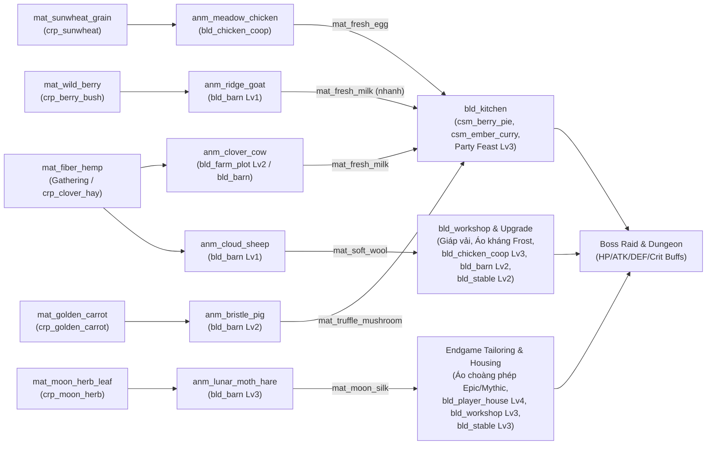
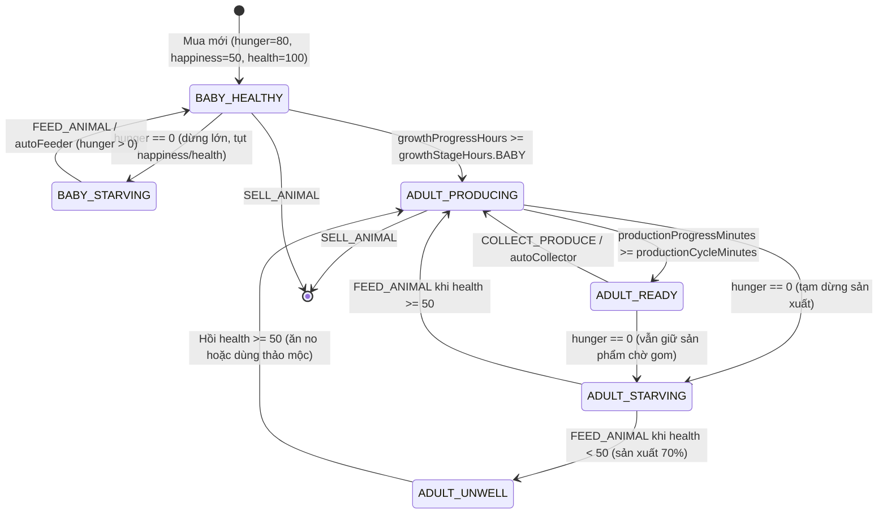

# 13 — Animal Husbandry System Design: Eldoria: Forgotten Wilds

**Trạng thái**: Hoàn thiện (Design Baseline v1.0)  
**Chế độ**: `DESIGN_AND_PLANNING_ONLY`  
**Cập nhật lần cuối**: 2026-11-19  
**Nguồn dữ liệu chuẩn (Single Source of Truth)**: [`game-data/animals.json`](../../game-data/animals.json), [`game-data/items.json`](../../game-data/items.json), [`game-data/buildings.json`](../../game-data/buildings.json)  
**Tài liệu quản trị**: [Constitution](../../.specify/memory/constitution.md) · [00-game-vision.md](./00-game-vision.md) · [12-farming-system.md](./12-farming-system.md)

---

## 1. Mục tiêu Gameplay (Gameplay Objectives)

Hệ thống Chăn nuôi (Animal Husbandry) kết nối trực tiếp đầu ra của Nông trại (`12-farming-system.md`) với Bếp ăn (`bld_kitchen`), Xưởng thủ công (`bld_workshop`) và Phòng giả kim (`bld_alchemy_lab`), hoàn thiện vòng lặp kinh tế sống động của Eldoria:

1. **Gắn kết cảm xúc và chăm sóc nhẹ nhàng**: Động vật có hoạt ảnh pixel dễ thương, chỉ số Hạnh phúc (`Happiness`), Đói (`Hunger`) và Sức khỏe (`Health`). Chăm sóc bằng thức ăn yêu thích và vuốt ve hằng ngày mang lại phần thưởng rõ rệt (tỷ lệ sản phẩm phẩm chất `GOLD` tăng từ `0%` lên tới `22%–33%`).
2. **Không trừng phạt độc hại khi bận rộn**: Theo quy tắc cố định trong `game-data/animals.json` (`permanentDeathAllowed: false`, `starvationBehavior: PAUSE_PRODUCTION_AND_DECAY_HAPPINESS`), động vật **TUYỆT ĐỐI KHÔNG BAO GIỜ CHẾT VĨNH VIỄN** khi người chơi offline dài ngày. Thay vào đó, chúng chỉ tạm dừng sản xuất và giảm Hạnh phúc cho đến khi được cho ăn và vỗ về trở lại.
3. **Cầu nối kinh tế liên ngành**: Nông dân trồng `mat_sunwheat_grain`, `mat_fiber_hemp`, `mat_golden_carrot`, `mat_wild_berry` và `mat_moon_herb_leaf` để làm thức ăn yêu thích nuôi 6 loài vật, đổi lại 5 nhóm nguyên liệu độc quyền không thể trồng trọt (`mat_fresh_egg`, `mat_fresh_milk`, `mat_soft_wool`, `mat_truffle_mushroom`, `mat_moon_silk`) phục vụ nấu ăn buff raid, may giáp vải/kháng lạnh và nâng cấp biệt thự/thú cưỡi.
4. **Mở rộng mượt từ MVP sang Endgame**: Trong MVP (`M1`), người chơi tiếp cận ngay 2 loài cốt lõi là `anm_meadow_chicken` (nuôi trong `bld_chicken_coop`) và `anm_clover_cow` (chăn thả tại Bãi Chăn Thả Khởi Đầu của `bld_farm_plot` Lv 2). Từ `M2–M3`, `bld_barn` mở rộng quy mô chăn nuôi sang Cừu, Dê, Heo săn nấm và Linh thú huyền ảo `anm_lunar_moth_hare`.

---

## 2. User Stories

| ID | Vai trò | User Story | Milestone |
| :--- | :--- | :--- | :---: |
| **US-ANM-01** | Người chơi mới | Là người chơi vừa xây `bld_chicken_coop` Lv 1 ở cấp 2, tôi muốn mua `anm_meadow_chicken` bằng 150 Gold, cho ăn `mat_sunwheat_grain` từ ruộng nhà và thu `mat_fresh_egg` mỗi 48 phút để nấu `csm_berry_pie` và `csm_ember_curry`. | M1 (MVP) |
| **US-ANM-02** | Người chơi MVP | Là người chơi đạt cấp 5 và nâng `bld_farm_plot` lên Lv 2, tôi muốn nuôi 2 con `anm_clover_cow` ngay tại bãi chăn thả khởi đầu để lấy `mat_fresh_milk` nấu `csm_golden_roast` chuẩn bị đánh `boss_thornback_elder`. | M1 (MVP) |
| **US-ANM-03** | Người chơi chăm chỉ | Là chủ trang trại, tôi muốn vuốt ve động vật mỗi ngày và cho ăn đúng thức ăn yêu thích để đẩy `Happiness` lên ngưỡng `80–100`, qua đó nhận được nhiều sản phẩm phẩm chất `SILVER` và `GOLD`. | M1 (MVP) |
| **US-ANM-04** | Người chơi bận rộn | Là người chơi bận việc 3 ngày không đăng nhập, tôi muốn đàn gà và bò của mình vẫn còn sống nguyên vẹn khi quay lại (chỉ đang đói và tạm ngưng đẻ) để tôi không bị mất trắng tài sản đã đầu tư. | M1 (MVP) |
| **US-ANM-05** | Thợ thủ công M2–M3 | Là người chơi đã xây `bld_barn` Lv 1–3, tôi muốn nuôi `anm_cloud_sheep`, `anm_ridge_goat`, `anm_bristle_pig` và `anm_lunar_moth_hare` với máng ăn tự động (`autoFeeder`) và gom hàng tự động (`autoCollector`) để cung cấp `mat_soft_wool`, `mat_truffle_mushroom` và `mat_moon_silk` cho giáp và tiệc party. | M2 / M3 |
| **US-ANM-06** | Bạn cùng Party | Là thành viên cùng party đến thăm lãnh địa bạn bè, tôi muốn vuốt ve và bỏ cỏ vào máng giúp đàn thú của bạn (quyền `PARTY_ACCESS`) mà không ảnh hưởng quyền thu hoạch độc quyền của chủ nhà. | M1 (MVP) |

---

## 3. Danh mục Toàn bộ 6 Loài Động Vật (Khớp 100% `game-data/animals.json`)

| # | Animal ID | Tên | Loài (`species`) | Fantasy | MVP | Công trình yêu cầu (Nâng cấp) | Giá mua (Gold) | Cấp mở | Lớn `BABY→ADULT` | Đói/giờ (`hungerDecay`) | Thức ăn ưa thích (`favoriteFeedItemId`) | Chu kỳ sản xuất | Sản phẩm (`produceItemId`) | SL/lần |
| :-: | :--- | :--- | :--- | :-: | :-: | :--- | :-: | :-: | :-: | :-: | :--- | :-: | :--- | :-: |
| 1 | `anm_meadow_chicken` | **Meadow Chicken** | `CHICKEN` | Không | **Có** | `bld_chicken_coop` Lv 1 | **150** | 1 | **6 giờ** | `4.0/h` | `mat_sunwheat_grain` | **48 phút** | `mat_fresh_egg` (12G) | 1–2 |
| 2 | `anm_clover_cow` | **Clover Cow** | `COW` | Không | **Có** | `bld_farm_plot` Lv 2 *(chuyển sang `bld_barn` Lv 1+)* | **450** | 5 | **12 giờ** | `4.2/h` | `mat_fiber_hemp` | **72 phút** | `mat_fresh_milk` (18G) | 1–2 |
| 3 | `anm_cloud_sheep` | Cloud Sheep | `SHEEP` | Không | Không | `bld_barn` Lv 1 | **650** | 12 | **14 giờ** | `3.8/h` | `mat_fiber_hemp` | **96 phút** | `mat_soft_wool` (24G) | 2–3 |
| 4 | `anm_ridge_goat` | Ridge Goat | `GOAT` | Không | Không | `bld_barn` Lv 1 | **780** | 15 | **15 giờ** | `3.5/h` | `mat_wild_berry` | **60 phút** | `mat_fresh_milk` (18G) | 2–3 |
| 5 | `anm_bristle_pig` | Bristle Pig | `PIG` | Không | Không | `bld_barn` Lv 2 | **900** | 18 | **18 giờ** | `4.5/h` | `mat_golden_carrot` | **120 phút** | `mat_truffle_mushroom` (58G) | 1–2 |
| 6 | `anm_lunar_moth_hare` | **Lunar Silkhare** | `FANTASY_SILKHARE` | **Có** | Không | `bld_barn` Lv 3 | **2,400** | 30 | **24 giờ** | `3.0/h` | `mat_moon_herb_leaf` | **144 phút** | `mat_moon_silk` (88G) | 1–2 |

> **Ghi chú chuyển tiếp mượt từ MVP sang M2**: Khi người chơi đã nuôi 1–2 con `anm_clover_cow` tại Bãi Chăn Thả của `bld_farm_plot` Lv 2 trong MVP và sau đó xây `bld_barn` ở M2, giao diện quản lý cho phép **di dời miễn phí (Reassign)** bò sang `bld_barn` mà giữ nguyên `growthStage`, `happiness` và tên đặt riêng của con vật.

---

## 4. Các Chỉ số Sinh học & Cơ chế Chăm sóc

### 4.1 Bốn Trục Chỉ số Cốt lõi

Mỗi cá thể động vật (`AnimalInstance`) do server mô phỏng có 4 trạng thái sinh học:

1. **Độ no (`hunger`: `0 – 100`)**:
   - Mua mới khởi tạo tại `hunger = 80`.
   - Suy giảm liên tục theo tốc độ `hungerDecayPerHour` của từng loài (`3.0` đến `4.5` điểm mỗi giờ thời gian thực). Như vậy một con `anm_meadow_chicken` ăn no `100` sẽ đủ no khoảng `25 giờ` thực trước khi tụt về `0`.
   - Khi `hunger > 20`: động vật ở trạng thái khỏe mạnh, trưởng thành bình thường và tích lũy tiến trình tạo sản phẩm.
   - Khi `hunger === 0`: chuyển trạng thái `STARVING_PAUSED` — **tạm ngưng tăng trưởng `BABY→ADULT` và tạm ngưng tích lũy chu kỳ sản xuất** (`PAUSE_PRODUCTION_AND_DECAY_HAPPINESS`).
2. **Hạnh phúc (`happiness`: `0 – 100`, `maxHappiness = 100`)**:
   - Mua mới khởi tạo tại `happiness = 50`.
   - **Các nguồn tăng Hạnh phúc** (khớp `animals.json`):
     - Cho ăn **Thức ăn yêu thích** (`favoriteFeedItemId`): `+15 Happiness` (`favoriteFeedHappinessBonus: 15`) và phục hồi `+60 Hunger`.
     - Cho ăn **Thức ăn tiêu chuẩn** (mọi nông sản ăn được khác ngoài loại ưa thích hoặc cỏ khô cơ bản): `+6 Happiness` (`standardFeedHappinessBonus: 6`) và phục hồi `+40 Hunger`.
     - **Vuốt ve hằng ngày** (`PET_ANIMAL`, giới hạn 1 lần mỗi ngày trong game = `24 phút` thực, hoặc tối đa `+10` mỗi 24 phút): `+10 Happiness` (`dailyPettingHappinessBonus: 10`). Tại `bld_barn` Lv 3, mọi nguồn tăng Hạnh phúc được cộng thêm `+15%`.
   - **Suy giảm Hạnh phúc**:
     - Khi no (`hunger > 0`): không tụt nếu được chăm trong 12 giờ gần nhất; tụt rất chậm `-1 điểm/giờ` nếu không được vuốt ve trên 12 giờ (dừng ở sàn `40`).
     - Khi đói (`hunger === 0`): tụt `-4 điểm/giờ` (dừng ở sàn `0`).
3. **Sức khỏe (`health`: `0 – 100`, `maxHealth = 100`)**:
   - Mua mới khởi tạo `health = 100`.
   - Chỉ giảm `-3 điểm/giờ` khi bị bỏ đói liên tục ở mức `hunger === 0`, và **chặn cứng ở sàn tối thiểu `health = 20`** (`permanentDeathAllowed: false`).
   - Khi `health < 50`, trạng thái hiển thị `UNWELL` (tốc độ sản xuất giảm `30%` ngay cả sau khi vừa ăn lại). Chỉ cần giữ `hunger > 50`, `health` tự hồi `+10 điểm/giờ`, hoặc dùng `csm_herb_stew` / thảo mộc `mat_moon_herb_leaf` hồi ngay `+40 Health`.
4. **Giai đoạn trưởng thành (`growthStage`: `BABY → ADULT`)**:
   - Mọi con vật mua mới đều bắt đầu ở `BABY` với `growthProgressHours = 0`.
   - Chỉ tích lũy `growthProgressHours` trong những khoảng thời gian `hunger > 0`. Khi đạt `growthStageHours.BABY` (`6h` đến `24h` tùy loài), server chuyển vĩnh viễn sang `ADULT` và bắt đầu chu kỳ tạo sản phẩm đầu tiên.

### 4.2 Bảng Tỷ lệ Phẩm chất Sản phẩm Theo Ngưỡng Hạnh phúc (`qualityScalingByHappiness`)

Bảng sau khớp chính xác từng số thập phân trong `game-data/animals.json`:

| Animal ID | `LOW_0_39` (`N / S / G`) | `MEDIUM_40_79` (`N / S / G`) | `HIGH_80_100` (`N / S / G`) | Sản phẩm |
| :--- | :---: | :---: | :---: | :--- |
| `anm_meadow_chicken` | `90% / 10% / 0%` | `65% / 27% / 8%` | **`35% / 43% / 22%`** | `mat_fresh_egg` |
| `anm_clover_cow` | `90% / 10% / 0%` | `62% / 28% / 10%` | **`32% / 44% / 24%`** | `mat_fresh_milk` |
| `anm_cloud_sheep` | `88% / 12% / 0%` | `60% / 30% / 10%` | **`30% / 45% / 25%`** | `mat_soft_wool` |
| `anm_ridge_goat` | `85% / 15% / 0%` | `58% / 30% / 12%` | **`28% / 44% / 28%`** | `mat_fresh_milk` |
| `anm_bristle_pig` | `85% / 15% / 0%` | `56% / 32% / 12%` | **`25% / 45% / 30%`** | `mat_truffle_mushroom` |
| `anm_lunar_moth_hare` | `82% / 18% / 0%` | `52% / 34% / 14%` | **`22% / 45% / 33%`** | `mat_moon_silk` |

- **Hệ số giá trị phẩm chất**: Dùng chung hệ chuẩn với Nông trại (`NORMAL = 1.00x`, `SILVER = 1.35x`, `GOLD = 1.85x` giá bán, đồng thời tăng hiệu quả nấu ăn và xác suất nhận chỉ số phụ tốt hơn khi may giáp).
- **Lợi ích tốc độ sản xuất theo công trình**: `bld_chicken_coop` Lv 2 (`+5%` tốc độ đẻ trứng), Lv 3 (`+10%` tốc độ đẻ trứng).

---

## 5. Mô phỏng Offline Theo Server Timestamp (Trần 24 Giờ)

Tương tự Nông trại, mọi biến thiên của đàn vật nuôi được tính bằng **Lazy Catch-up Simulation** theo đồng hồ UTC trên server (`offlineCapHours = 24`) khi lãnh địa được mở hoặc khi gọi API kiểm tra chuồng:

```text
1. cappedHours = min(max(0, (serverNow - animal.lastSimulatedAtMs) / 3_600_000), 24)
2. Phân chia cappedHours theo từng bước nhỏ (step = 0.25 giờ = 15 phút) để xử lý chính xác thời điểm đói/nạp thức ăn tự động:
   Với mỗi bước dt:
     a. Nếu animal.hunger <= 30 && housingBuilding.autoFeeder === true:
        - Tự động rút 1 đơn vị favoriteFeedItemId (ưu tiên) hoặc thức ăn hợp lệ từ bld_storage (qua lock nguyên tử).
        - Nếu rút thành công: cộng Hunger (+60 hoặc +40) và Happiness (+15 hoặc +6, trần 100).
     b. Giảm animal.hunger = max(0, animal.hunger - animal.hungerDecayPerHour * dt).
     c. Nếu animal.hunger > 0:
        - Hồi animal.health = min(100, animal.health + 10 * dt).
        - Nếu animal.growthStage === "BABY":
            tăng growthProgressHours += dt; nếu đạt growthStageHours.BABY -> chuyển "ADULT".
        - Nếu animal.growthStage === "ADULT":
            speedMod = (animal.health < 50 ? 0.7 : 1.0) * (1 + housingSpeedBonusPct / 100)
            tăng productionProgressMinutes += (dt * 60) * speedMod.
            Trong khi productionProgressMinutes >= animal.productionCycleMinutes:
              productionProgressMinutes -= animal.productionCycleMinutes
              Nếu housingBuilding.autoCollector === true && storageHasSpace():
                Sinh sản phẩm theo bảng qualityScalingByHappiness và cất thẳng vào bld_storage (trần tối đa 12 lượt thu/con/24h).
              Else nếu animal.pendingProduceCount < MAX_PENDING_PER_ANIMAL (mặc định = 3):
                Tăng pendingProduceCount += 1 (chờ chủ nhà đến gom).
              Else:
                Dừng tích lũy thêm ở productionProgressMinutes = 0 để chờ dọn khay.
     d. Nếu animal.hunger === 0:
        - Giảm animal.happiness = max(0, animal.happiness - 4 * dt).
        - Giảm animal.health = max(20, animal.health - 3 * dt). // Không bao giờ về 0!
3. Cập nhật animal.lastSimulatedAtMs = serverNow và ghi nguyên tử vào data/db/houses/<ownerId>.json.
```

- **Chống bùng nổ tài nguyên khi vắng mặt**: Giới hạn trần khay chờ thủ công là **`3 chu kỳ/con`** (`MAX_PENDING_PER_ANIMAL = 3`) và giới hạn trần gom tự động (`autoCollector` Lv 3) là **`24 giờ`** offline. Người chơi không thể bỏ game 1 tháng rồi quay lại nhận hàng nghìn quả trứng hay cuộn tơ ánh trăng.

---

## 6. Chuỗi Sản xuất Liên ngành (Feed & Produce Chains)



---

## 7. Functional Requirements & Business Rules

### 7.1 Functional Requirements (FR)

- **FR-ANM-01**: Cho phép mua động vật tại thương nhân nông trại (`npc_farm_merchant`) hoặc bảng quản lý chuồng, kiểm tra `unlockLevel`, số dư `GOLD`, `requiredBuildingId`/`requiredBuildingMinLevel` và chỗ trống (`currentAnimals < capacity`).
- **FR-ANM-02**: Hỗ trợ 5 hành động chăm sóc xác thực server: `FEED_ANIMAL`, `PET_ANIMAL`, `COLLECT_PRODUCE`, `RENAME_ANIMAL`, `REASSIGN_HOUSING`, và `SELL_ANIMAL` (bán lại nhận `50%` giá mua gốc nếu là `BABY`, `80%` nếu là `ADULT` có `happiness >= 80`).
- **FR-ANM-03**: Thực thi tự động rút thức ăn (`autoFeeder` tại `bld_chicken_coop` Lv 2 & `bld_barn` Lv 2) và tự động thu gom sản phẩm (`autoCollector` tại `bld_chicken_coop` Lv 3 & `bld_barn` Lv 3) kết nối trực tiếp `bld_storage`.
- **FR-ANM-04**: Chạy mô phỏng AI di chuyển nhẹ cục bộ trên client (đi loanh quanh trong khuôn viên chuồng/bãi rào, hiện bong bóng tim khi được vuốt ve, bong bóng đĩa thức ăn khi đói) trong khi toàn bộ số liệu sinh học do server quyết định.

### 7.2 Business Rules (BR)

- **BR-ANM-01**: **Cấm chết vĩnh viễn**: `health` tối thiểu luôn được kẹp tại `20`, `permanentDeathAllowed = false`.
- **BR-ANM-02**: **Sức chứa công trình**:
  - `bld_chicken_coop`: Lv 1 (`4` gà), Lv 2 (`8` gà), Lv 3 (`12` gà) — chỉ nhận loài `CHICKEN`.
  - `bld_farm_plot` Lv 2–3 (`2` ô bãi chăn thả), Lv 4 (`3` ô) — chỉ nhận `anm_clover_cow` để phục vụ MVP trước khi mở `bld_barn`.
  - `bld_barn`: Lv 1 (`4` ô: Cow/Sheep/Goat), Lv 2 (`8` ô: thêm Pig), Lv 3 (`12` ô: thêm `FANTASY_SILKHARE` `anm_lunar_moth_hare`).
- **BR-ANM-03**: **Giới hạn vuốt ve**: Mỗi con vật chỉ nhận thưởng `+10 Happiness` từ `PET_ANIMAL` tối đa 1 lần trong mỗi ngày trong game (`24 phút` thực). Vuốt ve thêm vẫn chạy animation vui vẻ nhưng không cộng thêm Hạnh phúc.
- **BR-ANM-04**: **Chống bỏ đói rồi ép ăn liên tục để cày Happiness**: Khi `hunger >= 90`, người chơi không thể cho ăn thêm (`ERR_ANIMAL_ALREADY_FULL`), ngăn lạm dụng tiêu hao thức ăn rẻ để bơm `happiness` từ `0` lên `100` trong 5 giây.
- **BR-ANM-05**: **Quyền Party (`PARTY_ACCESS`)**: Thành viên party được phép `PET_ANIMAL` và `FEED_ANIMAL` (bằng vật phẩm của chính họ), nhưng chỉ chủ nhà mới được `COLLECT_PRODUCE`, `BUY_ANIMAL` hoặc `SELL_ANIMAL`.

---

## 8. Input và Output (Protocol Contracts)

| Endpoint / Event | Hướng | Payload Input chính | Output / Broadcast chính |
| :--- | :---: | :--- | :--- |
| `POST /api/v1/houses/:houseId/animals/buy` | Client → Server | `{ idempotencyKey, animalId, targetBuildingInstanceId, nickname? }` | `{ ok, animalInstance, goldBalance, currencyLedgerId }` |
| `ws: animal.action` | Client → Server | `{ idempotencyKey, houseId, animalInstanceId, action: "FEED"\|"PET"\|"COLLECT"\|"HEAL", feedItemId? }` | Ack `{ ok, animalState, inventoryDelta }` + Broadcast `animal.state.updated` |
| `POST /api/v1/houses/:houseId/animals/:instanceId/reassign` | Client → Server | `{ idempotencyKey, targetBuildingInstanceId }` | `{ ok, animalInstance }` (di dời `anm_clover_cow` từ `bld_farm_plot` sang `bld_barn`) |
| `POST /api/v1/houses/:houseId/animals/:instanceId/sell` | Client → Server | `{ idempotencyKey }` | `{ ok, goldRefunded, currencyLedgerId }` |

---

## 9. State Transitions (Máy Trạng Thái Cá Thể Động Vật)



---

## 10. JSON Data Model (100% Local JSON Storage)

Lưu trực tiếp trong aggregate `data/db/houses/<ownerCharacterId>.json` do `JsonDatabaseEngine` cục bộ quản lý (không dùng DBMS ngoài hay dịch vụ bên thứ ba):

```json
{
  "schemaVersion": "1.0.0",
  "houseId": "hse_chr_001042",
  "ownerCharacterId": "chr_inst_001042",
  "animals": [
    {
      "animalInstanceId": "ainst_001",
      "animalId": "anm_meadow_chicken",
      "nickname": "Bông Vàng",
      "housingBuildingInstanceId": "binst_coop_01",
      "growthStage": "ADULT",
      "growthProgressHours": 6.0,
      "hunger": 74.5,
      "happiness": 86,
      "health": 100,
      "productionProgressMinutes": 31.5,
      "pendingProduce": [
        { "itemId": "mat_fresh_egg", "qty": 2, "qualityTier": "GOLD" }
      ],
      "lastPettedGameDay": 7,
      "lastSimulatedAtMs": 1795092000000,
      "purchasedAtMs": 1794900000000
    }
  ]
}
```

- **Độ bền ghi**: Giao dịch mua/bán động vật và thu hoạch sản phẩm ghi nguyên tử kèm WAL (`data/db/wal/tx-journal.json`) và ghi bút toán vàng vào `data/db/ledgers/currency-ledger-<YYYY-MM>.json`. Thay đổi vị trí đi lại của động vật trong chuồng là trạng thái trình diễn thuần túy trên client, **không bao giờ** ghi xuống ổ đĩa.

---

## 11. Dependencies (Phụ thuộc Liên Hệ thống)

- **`12-farming-system.md`**: Cung cấp nguồn thức ăn yêu thích (`mat_sunwheat_grain`, `mat_fiber_hemp`, `mat_golden_carrot`, `mat_wild_berry`, `mat_moon_herb_leaf`) và đồng hồ ngày trong game (`lastPettedGameDay`).
- **`14-building-system.md`**: `bld_chicken_coop`, `bld_farm_plot` Lv 2+, `bld_barn` và `bld_storage` cung cấp sức chứa, `autoFeeder` và `autoCollector`.
- **`11-crafting-system.md` & `19-game-economy.md`**: Tiêu thụ 5 sản phẩm chăn nuôi trong nấu ăn, may giáp, nâng cấp công trình và cân bằng dòng Gold.
- **Lưu ý rà soát liên tệp**: Trong `game-data/items.json`, trường mô tả nguồn (`sources`) của `mat_truffle_mushroom` và `mat_moon_silk` cần được đồng bộ dùng chính xác ID chuẩn từ `game-data/animals.json` là `anm_bristle_pig` và `anm_lunar_moth_hare` (sẽ được xác nhận ở Phase Cross-Audit).

---

## 12. UI Interactions (Tương tác Giao diện)

1. **Biểu tượng trạng thái trên đầu con vật (World Diegetic Bubbles)**:
   - Bong bóng quả trứng / bình sữa / cuộn len / nấm / tơ phát sáng: có sản phẩm sẵn sàng gom (`pendingProduce.length > 0`).
   - Bong bóng đĩa trống màu cam: đói (`hunger < 30`).
   - Bong bóng trái tim hồng: chưa được vuốt ve hôm nay (`lastPettedGameDay < currentDay`).
   - Bong bóng băng cá nhân màu xanh lam: sức khỏe thấp (`health < 50`).
2. **Bảng Quản lý Chuồng trại (`TEND_COOP` / `MANAGE_BARN`)**: Danh sách toàn bộ con vật trong chuồng, thanh `Hunger / Happiness / Health`, tiến độ lớn `BABY → ADULT`, đồng hồ đếm ngược chu kỳ kế tiếp, nút **Gom tất cả (`Collect All`)**, nút **Cho ăn nhanh (`Feed All`)** và công tắc bật/tắt `Auto-Feeder` / `Auto-Collector` ở cấp mở khóa.
3. **Phản hồi xúc giác**: Khi vuốt ve phát SFX tiếng kêu dễ thương nhẹ nhàng và 3 hạt trái tim pixel bay lên; khi thu gom sản phẩm `GOLD` phát âm thanh leng keng đặc trưng.

---

## 13. Edge Cases, Failure Behavior & Security Requirements

### 13.1 Edge Cases

1. **Hạ cấp hoặc phá dỡ `bld_chicken_coop` / `bld_barn` khi đang có vật nuôi bên trong**: Server từ chối phá dỡ (`ERR_BUILDING_HAS_ANIMALS`) cho đến khi người chơi di dời sang chuồng khác hoặc bán hết con vật trong công trình đó.
2. **Máng tự động (`autoFeeder`) nhưng `bld_storage` hết sạch thức ăn**: Máng tự động chuyển sang trạng thái cảnh báo `FEED_EMPTY`, không báo lỗi crash; động vật giảm `hunger` bình thường rồi tạm dừng sản xuất ở `hunger = 0`.
3. **Bấm `Collect All` khi túi đồ chỉ còn trống 1 ô nhưng có 3 loại phẩm chất (`NORMAL`, `SILVER`, `GOLD`)**: Server gom phần vừa đủ vào ô trống (hoặc từ chối toàn phần kèm thông báo `ERR_INVENTORY_INSUFFICIENT_SLOTS` — chọn phương án **từ chối nguyên tử toàn phần** để giao dịch sạch, không làm rách state).
4. **Động vật có `pendingProduce` sẵn sàng nhưng sau đó bị bỏ đói**: Phần sản phẩm đã đẻ sẵn trong khay **không bị biến mất hay hư hỏng**, vẫn chờ chủ nhà thu hoạch.

### 13.2 Failure Behavior

- **Mất mạng khi đang mua động vật**: Client giữ nguyên `idempotencyKey` khi thử lại; server kiểm tra sổ cái giao dịch trước khi trừ `GOLD` lần hai.
- **Lỗi đồng bộ ổ đĩa khi `autoCollector` chạy trong catch-up**: Giao dịch kết hợp `houses/<id>.json` + `inventories/<id>.json` rollback hoàn toàn theo WAL; trạng thái quay về thời điểm `lastSimulatedAtMs` cũ và sẽ chạy lại an toàn ở lần mở chuồng kế tiếp.

### 13.3 Security Requirements

- **Chống mua vượt sức chứa (Race Condition Buy)**: Mọi yêu cầu `POST /animals/buy` khóa đồng thời `houses/<id>` và `characters/<id>` (ví vàng), xác thực `currentSlotCount < maxCapacity` bên trong mutex.
- **Chống nhân bản sản phẩm khi thu hoạch (`COLLECT_PRODUCE`)**: Xóa mảng `pendingProduce` và cộng vật phẩm vào kho trong cùng giao dịch nguyên tử WAL với `idempotencyKey`.
- **Chống spam vuốt ve / ăn gian Hạnh phúc**: Kiểm tra `lastPettedGameDay` theo đồng hồ server và chặn `FEED_ANIMAL` khi `hunger >= 90`.
- **Kiểm tra khoảng cách & quyền sở hữu**: Xác thực nhân vật đang đứng trong lãnh địa hợp lệ (`zon_player_homestead`) và đúng phân quyền (`OWNER_ONLY` cho mua/bán/thu hoạch; `PARTY_ACCESS` chỉ cho vuốt ve/cho ăn).

---

## 14. Acceptance Criteria & Test Scenarios

### 14.1 Acceptance Criteria (AC)

- **AC-ANM-01**: Toàn bộ 6 loài động vật (`anm_meadow_chicken`, `anm_clover_cow`, `anm_cloud_sheep`, `anm_ridge_goat`, `anm_bristle_pig`, `anm_lunar_moth_hare`) hoạt động khớp 100% giá mua, chu kỳ sản xuất, thức ăn ưa thích và ma trận phẩm chất trong `game-data/animals.json`.
- **AC-ANM-02**: Bỏ đói động vật liên tục 72 giờ offline không bao giờ làm xóa bỏ hay giết chết con vật; `health` dừng ở sàn `20`, sản xuất tạm dừng và hồi phục bình thường sau khi được cho ăn.
- **AC-ANM-03**: `anm_clover_cow` có thể được mua và nuôi ngay trong MVP bằng `bld_farm_plot` Lv 2 (tối đa 2 con) và di dời sang `bld_barn` mà không mất dữ liệu ở M2.
- **AC-ANM-04**: Mô phỏng offline tôn trọng tuyệt đối trần `24 giờ` và lấy mốc thời gian duy nhất từ đồng hồ server.

### 14.2 Test Scenarios (Giai đoạn Thiết kế — Chưa thực thi Production)

| Test ID | Loại kiểm thử | Kịch bản kiểm tra | Kết quả mong đợi |
| :--- | :--- | :--- | :--- |
| **TS-ANM-01** | Unit / Lifecycle | Mua `anm_meadow_chicken` (`BABY 6h`, `48m/cycle`), giữ no suốt 8 giờ mô phỏng | Sau đúng 6h chuyển `ADULT`; sau giờ thứ 8 sinh đủ 2 lượt `mat_fresh_egg` chờ thu. |
| **TS-ANM-02** | Unit / Starvation Safety | Bỏ đói `anm_clover_cow` trong 48 giờ offline (không có `autoFeeder`) | `hunger` về `0`, `health` kẹp tại `20` (không chết), `happiness` giảm dần theo trần 24h, không sinh sản phẩm trong thời gian đói. |
| **TS-ANM-03** | Simulation / Quality | Chạy 10,000 lượt thu `mat_moon_silk` từ `anm_lunar_moth_hare` ở 3 mức `Happiness` (`20`, `60`, `95`) | Phân phối `N/S/G` hội tụ về `82/18/0%`, `52/34/14%`, và `22/45/33%`. |
| **TS-ANM-04** | Concurrency / Slot Cap | `bld_chicken_coop` Lv 1 đang có `3/4` gà; gửi song song 3 lệnh mua `anm_meadow_chicken` | Đúng 1 lệnh thành công (lên `4/4` gà, trừ 150G); 2 lệnh còn lại trả `ERR_HOUSING_FULL` và không trừ Gold. |
| **TS-ANM-05** | Integration / Auto-Feeder | Đặt 10 `mat_sunwheat_grain` trong `bld_storage`, bật `autoFeeder` ở `bld_chicken_coop` Lv 2 và `autoCollector` ở Lv 3; mô phỏng offline 24h | Server tự rút thức ăn hợp lệ khi `hunger <= 30`, giữ `happiness` cao và cất đúng số trứng thu trong 24h vào `bld_storage`. |
| **TS-ANM-06** | Security / Anti-Exploit | Thành viên Party gửi `COLLECT_PRODUCE` trên `bld_chicken_coop`; chủ nhà gửi `PET_ANIMAL` 2 lần trong cùng 1 ngày game | Party bị từ chối `ERR_FORBIDDEN_NOT_OWNER`; chủ nhà chỉ nhận `+10 Happiness` ở lần vuốt ve thứ 1. |
