# 14 — Building & Housing System Design: Eldoria: Forgotten Wilds

**Trạng thái**: Hoàn thiện (Design Baseline v1.0)  
**Chế độ**: `DESIGN_AND_PLANNING_ONLY`  
**Cập nhật lần cuối**: 2026-11-19  
**Nguồn dữ liệu chuẩn (Single Source of Truth)**: [`game-data/buildings.json`](../../game-data/buildings.json), [`game-data/items.json`](../../game-data/items.json)  
**Tài liệu quản trị**: [Constitution](../../.specify/memory/constitution.md) · [00-game-vision.md](./00-game-vision.md) · [assumptions-and-decisions.md](../management/assumptions-and-decisions.md)

---

## 1. Mục tiêu Gameplay (Gameplay Objectives)

Hệ thống Xây dựng và Lãnh địa (Building & Housing) là xương sống gắn kết toàn bộ hoạt động kinh tế — sinh tồn — chiến đấu trong **Eldoria: Forgotten Wilds** (thực thi Trụ cột số 3 & số 4 trong [00-game-vision.md](./00-game-vision.md)):

1. **Căn cứ cá nhân có công năng thực sự, không chỉ để trang trí**: Mọi công trình trong lãnh địa đều mở khóa trực tiếp sức mạnh hoặc tiện ích chơi game cốt lõi — điển hình là **`bld_blacksmith` cấp 1 đến cấp 4 mở khóa lần lượt các bậc cường hóa vũ khí `+1..+3`, `+4..+6`, `+7..+8` và mốc tối đa `+9..+10`** (`ASM-010`), `bld_player_house` cấp buff `Well-Rested`, `bld_kitchen` tạo buff combat và `bld_farm_plot` cung cấp nguồn nguyên liệu ổn định.
2. **Tạo cảm giác sở hữu lãnh địa (Homestead Ownership) và tiến triển thị giác 16-bit**: Mỗi người chơi được cấp miễn phí một mảnh đất lãnh địa riêng (`zon_player_homestead`, kích thước `32×24 tiles` = `1024×768 px` trong MVP) liền kề `reg_greenhaven_village` với sẵn `bld_player_house` Lv 1. Mỗi cấp nâng cấp công trình đều có **biến thể đồ họa pixel riêng (`assetVariantKey`)** giúp căn cứ chuyển mình rõ rệt từ túp lều gỗ thành dinh thự đá cổ ngữ.
3. **Đặt công trình tự do theo lưới nhưng an toàn tuyệt đối**: Người chơi sắp xếp căn cứ theo phong cách cá nhân qua Building Placement System (`32×32 px` grid snapping, ghost preview, xoay hướng), nhưng server kiểm định nghiêm ngặt va chạm, lối đi khả thông (reachability BFS) và vùng cấm để loại bỏ hoàn toàn hành vi chặn đường, bít cổng spawn hay phá hoại đất người khác.
4. **Mở rộng quy mô theo 13 công trình chuẩn (`ASM-012`)**: Bao gồm **6 công trình MVP (`M1`)** đủ khép kín vòng lặp sống–nông–rèn–chiến và **7 công trình hậu MVP (`M2–M5`)** mở rộng sang chăn nuôi lớn, chế tác phụ kiện, nung luyện song song, giả kim, luyện tập DPS, thú cưỡi và hội quán bang hội.

---

## 2. User Stories

| ID | Vai trò | User Story | Milestone |
| :--- | :--- | :--- | :---: |
| **US-BLD-01** | Người chơi mới | Là người chơi vừa tạo nhân vật tại `reg_greenhaven_village`, tôi muốn bước ngay vào khu lãnh địa riêng có sẵn `bld_player_house` Lv 1 để nghỉ ngơi hồi 60% Stamina, đặt điểm hồi sinh và xây `bld_farm_plot` đầu tiên. | M1 (MVP) |
| **US-BLD-02** | Người chơi chiến đấu | Là một chiến binh muốn nâng vũ khí chủ lực lên `+10`, tôi muốn xây và nâng cấp `bld_blacksmith` từ Lv 1 đến Lv 4 (bằng gỗ, đá, quặng và `mat_thornback_heart` từ boss) để lần lượt mở khóa ngưỡng `+3`, `+6`, `+8`, `+10` và giảm tới 30% phí sửa đồ. | M1 (MVP) |
| **US-BLD-03** | Người chơi kiến trúc | Là chủ lãnh địa, tôi muốn di chuyển bóng mờ công trình (Ghost Preview) bám lưới `32×32 px`, xoay hướng đối với các công trình cho phép xoay (`bld_storage`, `bld_farm_plot`, ...) và thấy rõ lý do màu đỏ nếu vị trí bị vướng đường đi. | M1 (MVP) |
| **US-BLD-04** | Người chơi sưu tầm | Là người chơi tích trữ nhiều nguyên liệu, tôi muốn nâng `bld_storage` lên Lv 2 (`80 ô` + `autoCraftPull`) để mọi thao tác rèn, nấu ăn và xây dựng trong nhà tự động rút nguyên liệu từ kho mà không cần chuyển tay vào ba lô. | M1 (MVP) |
| **US-BLD-05** | Chủ sở hữu & Party | Là chủ lãnh địa mời bạn vào nhà, tôi muốn phân quyền công trình rõ ràng (`OWNER_ONLY` cho Kho/Lò Rèn, `PARTY_ACCESS` cho Nông trại/Chuồng Gà/Bếp) để bạn bè cùng phụ tưới cây, nấu tiệc mà không lo bị lấy mất trang bị. | M1 (MVP) |
| **US-BLD-06** | Thủ lĩnh Bang hội | Là thành viên giai đoạn M3+, tôi muốn góp tài nguyên cùng bang xây `bld_guild_hall` Lv 1–3 tại `zon_guild_sanctuary` để mở khóa kho bang hội 60–200 ô và Cổng Tập Kết Đột Kích (`raidStagingPortal`). | M3–M5 |

---

## 3. Quyền Sở hữu & Mở rộng Lãnh địa (Homestead Ownership & Zoning)

### 3.1 Phân vùng Xây dựng (`allowedZones`)

| Zone ID | Phạm vi sử dụng | Kiến trúc đồng thời | Công trình cho phép |
| :--- | :--- | :--- | :--- |
| `zon_player_homestead` | Lãnh địa riêng của từng nhân vật (nối trực tiếp từ cổng tây `reg_greenhaven_village`, kích thước `32×24 tiles`, trong đó vùng xây dựng hợp lệ là `26×18 tiles` bọc quanh hành lang lối vào rộng `4 tiles`) | Instanced per-owner (chủ nhà và tối đa 3 thành viên cùng party có thể vào đồng thời); lưu tại `data/db/houses/<ownerCharacterId>.json` | 12/13 công trình cá nhân (`bld_player_house` đến `bld_stable`) |
| `zon_greenhaven_farmland` | Lô đất canh tác mở rộng (M2) nằm tại vùng nông nghiệp ven làng | Phân lô theo `plotOwnerId` trong `data/db/world/reg_greenhaven_village.json` | Chỉ `bld_farm_plot` |
| `zon_guild_sanctuary` | Khu vực thánh địa bang hội (M3+) | Instanced per-guild lưu tại `data/db/guilds/<guildId>.json` | Chỉ `bld_guild_hall` |

### 3.2 Giới hạn Số lượng Công trình theo Cấp Nhà Chính (`bld_player_house`)

Tổng số công trình phụ được phép đặt trong `zon_player_homestead` (không tính `bld_player_house` sẵn có) bị ràng buộc bởi `maxHomesteadBuildings`:
- `bld_player_house` **Lv 1**: tối đa **`5` công trình phụ** (đủ đặt cả 5 công trình MVP còn lại: Storage, Farm Plot, Chicken Coop, Blacksmith, Kitchen).
- `bld_player_house` **Lv 2**: tối đa **`8` công trình phụ**.
- `bld_player_house` **Lv 3**: tối đa **`11` công trình phụ**.
- `bld_player_house` **Lv 4**: tối đa **`13` công trình phụ** (đủ chứa toàn bộ 11 công trình phụ khác nhau + tối đa 2 `bld_farm_plot` hoặc 2 `bld_storage` bổ sung).

---

## 4. Đặc tả Chi tiết Toàn bộ 13 Công trình (Khớp 100% `game-data/buildings.json`)

### 4.1 Bảng Tổng quan 13 Công trình (6 MVP + 7 Post-MVP)

| # | Building ID | Tên | MVP | Danh mục | Footprint (Tiles) | Xoay | Cấp tối đa | Quyền mặc định | Khu vực hợp lệ | Điểm tương tác (`interactionPoints`) |
| :-: | :--- | :--- | :-: | :--- | :---: | :-: | :-: | :--- | :--- | :--- |
| 1 | `bld_player_house` | **Player House** *(Prebuilt Lv1)* | **Có** | `RESIDENTIAL` | `5×4` | Không | 4 | `OWNER_ONLY` | `zon_player_homestead` | `ENTER_HOUSE @(2,4)`, `REST_BED @(1,4)` |
| 2 | `bld_storage` | **Storage Warehouse** | **Có** | `UTILITY` | `3×2` | Có | 4 | `OWNER_ONLY` | `zon_player_homestead` | `OPEN_STORAGE @(1,2)` |
| 3 | `bld_farm_plot` | **Homestead Farm Plot** | **Có** | `FARMING` | `4×4` | Có | 4 | `PARTY_ACCESS` | `zon_player_homestead`, `zon_greenhaven_farmland` | `MANAGE_FARM @(1,4)`, `TOGGLE_IRRIGATION @(2,4)` |
| 4 | `bld_chicken_coop` | **Chicken Coop** | **Có** | `HUSBANDRY` | `3×3` | Không | 3 | `PARTY_ACCESS` | `zon_player_homestead` | `TEND_COOP @(1,3)`, `COLLECT_EGGS @(2,3)` |
| 5 | `bld_blacksmith` | **Blacksmith Forge** | **Có** | `CRAFTING` | `4×3` | Không | 4 | `OWNER_ONLY` | `zon_player_homestead` | `ENHANCE_WEAPON @(1,3)`, `FORGE_GEAR @(2,3)` |
| 6 | `bld_kitchen` | **Homestead Kitchen** | **Có** | `CRAFTING` | `3×3` | Không | 3 | `PARTY_ACCESS` | `zon_player_homestead` | `OPEN_COOKING @(1,3)` |
| 7 | `bld_barn` | Livestock Barn | Không | `HUSBANDRY` | `5×4` | Không | 3 | `PARTY_ACCESS` | `zon_player_homestead` | `MANAGE_BARN @(2,4)`, `COLLECT_PRODUCE @(3,4)` |
| 8 | `bld_workshop` | Artisan Workshop | Không | `CRAFTING` | `4×3` | Có | 3 | `OWNER_ONLY` | `zon_player_homestead` | `OPEN_WORKSHOP @(1,3)` |
| 9 | `bld_furnace` | Smelting Furnace | Không | `PROCESSING` | `3×3` | Có | 3 | `OWNER_ONLY` | `zon_player_homestead` | `OPEN_SMELTING @(1,3)` |
| 10 | `bld_alchemy_lab` | Alchemy Laboratory | Không | `CRAFTING` | `3×3` | Không | 3 | `OWNER_ONLY` | `zon_player_homestead` | `OPEN_ALCHEMY @(1,3)` |
| 11 | `bld_training_ground` | Training Ground | Không | `COMBAT_UTILITY` | `5×4` | Có | 3 | `PARTY_ACCESS` | `zon_player_homestead` | `START_TRAINING @(2,4)`, `INSPECT_DPS_DUMMY @(4,2)` |
| 12 | `bld_stable` | Mount Stable | Không | `MOBILITY` | `4×3` | Không | 3 | `OWNER_ONLY` | `zon_player_homestead` | `MANAGE_MOUNTS @(2,3)` |
| 13 | `bld_guild_hall` | Guild Hall | Không | `SOCIAL` | `7×6` | Không | 3 | `GUILD_ACCESS` | `zon_guild_sanctuary` | `ENTER_GUILD_HALL @(3,6)`, `OPEN_GUILD_BOARD @(1,6)`, `OPEN_GUILD_VAULT @(5,6)` |

---

### 4.2 Chi tiết Từng Cấp Nâng cấp — 6 Công trình MVP (`M1`)

#### 1. `bld_player_house` — Player House (`5×4`, `OWNER_ONLY`, Prebuilt Lv 1)
| Cấp | Lv yêu cầu | Vàng | Nguyên liệu (`materials`) | Thời gian xây | Năng lực (`productionCapacity`) & Lợi ích nâng cấp | Asset Variant |
| :-: | :-: | :-: | :--- | :-: | :--- | :--- |
| **Lv 1** | 1 | `0G` | *(Cấp sẵn miễn phí)* | `0s` | `maxHomesteadBuildings: 5`, nghỉ hồi `60% Stamina`, buff `Well-Rested +5% EXP` (20p), đặt điểm hồi sinh. | `bld_player_house_lv1` |
| **Lv 2** | 5 | `350G` | `mat_oak_wood ×30`, `mat_rough_stone ×20`, `mat_clay ×10` | `60s` | `maxHomesteadBuildings: 8`, hồi `100% Stamina` (CD 10p), buff `Well-Rested +10% EXP` (30p). | `bld_player_house_lv2` |
| **Lv 3** | 15 | `1,200G` | `mat_pine_wood ×40`, `mat_granite_block ×25`, `mat_iron_ingot ×12`, `mat_wolf_pelt ×8` | `180s` | `maxHomesteadBuildings: 11`, `Well-Rested +15% EXP & +5% Max HP` (45p), tủ trưng bày bộ giáp. | `bld_player_house_lv3` |
| **Lv 4** | 35 | `4,500G` | `mat_ancient_heartwood ×35`, `mat_granite_block ×50`, `mat_steel_ingot ×20`, `mat_arcane_crystal ×6`, `mat_moon_silk ×6` | `360s` | `maxHomesteadBuildings: 13`, `Well-Rested +20% EXP & +8% Max HP/MP` (60p), trụ Fast Travel thẳng về nhà. | `bld_player_house_lv4` |

#### 2. `bld_storage` — Storage Warehouse (`3×2`, Rotatable, `OWNER_ONLY`)
| Cấp | Lv yêu cầu | Vàng | Nguyên liệu | Thời gian xây | Năng lực & Lợi ích nâng cấp | Asset Variant |
| :-: | :-: | :-: | :--- | :-: | :--- | :--- |
| **Lv 1** | 1 | `100G` | `mat_oak_wood ×15`, `mat_rough_stone ×8` | `15s` | `storageSlots: 40`, gộp stack & lọc danh mục. | `bld_storage_lv1` |
| **Lv 2** | 8 | `400G` | `mat_oak_wood ×30`, `mat_copper_ingot ×8`, `mat_iron_ingot ×6` | `60s` | `storageSlots: 80`, **kích hoạt `autoCraftPull: true`** (tự rút nguyên liệu từ kho khi rèn/nấu/xây trong lãnh địa). | `bld_storage_lv2` |
| **Lv 3** | 20 | `1,500G` | `mat_pine_wood ×40`, `mat_granite_block ×20`, `mat_steel_ingot ×12` | `180s` | `storageSlots: 140`, khóa vật phẩm chống bán nhầm, lưu 3 ngăn phân loại bộ trang bị. | `bld_storage_lv3` |
| **Lv 4** | 40 | `4,800G` | `mat_ancient_heartwood ×30`, `mat_mythril_ingot ×10`, `mat_arcane_crystal ×5` | `300s` | `storageSlots: 220` + **`accountSharedSlots: 40`** dùng chung giữa các nhân vật cùng tài khoản. | `bld_storage_lv4` |

#### 3. `bld_farm_plot` — Homestead Farm Plot (`4×4`, Rotatable, `PARTY_ACCESS`)
| Cấp | Lv yêu cầu | Vàng | Nguyên liệu | Thời gian xây | Năng lực & Lợi ích nâng cấp | Asset Variant |
| :-: | :-: | :-: | :--- | :-: | :--- | :--- |
| **Lv 1** | 1 | `80G` | `mat_oak_wood ×12`, `mat_rough_stone ×6`, `mat_fiber_hemp ×8` | `15s` | `cropTiles: 12`, canh tác thủ công, bạn party phụ tưới nước. | `bld_farm_plot_lv1` |
| **Lv 2** | 5 | `320G` | `mat_oak_wood ×24`, `mat_clay ×16`, `mat_copper_ingot ×6` | `45s` | `cropTiles: 20`, mương giữ ẩm `-25%` hao nước, **`starterPastureSlots: 2`** nuôi `anm_clover_cow` ngay trong MVP. | `bld_farm_plot_lv2` |
| **Lv 3** | 15 | `1,100G` | `mat_pine_wood ×30`, `mat_granite_block ×15`, `mat_iron_ingot ×12`, `mat_slime_gel ×15` | `120s` | `cropTiles: 28`, **`autoIrrigation: true`** (hoạt động cả 24h offline), `+5%` tỷ lệ `SILVER`/`GOLD`, `starterPastureSlots: 2`. | `bld_farm_plot_lv3` |
| **Lv 4** | 30 | `3,600G` | `mat_ancient_heartwood ×25`, `mat_steel_ingot ×15`, `mat_arcane_crystal ×6`, `mat_starlight_dust ×10` | `240s` | `cropTiles: 36`, nhà kính chống héo trái mùa, **`autoHarvest: true`** vào Kho, `+10%` tỷ lệ `GOLD`, `starterPastureSlots: 3`. | `bld_farm_plot_lv4` |

#### 4. `bld_chicken_coop` — Chicken Coop (`3×3`, `PARTY_ACCESS`)
| Cấp | Lv yêu cầu | Vàng | Nguyên liệu | Thời gian xây | Năng lực & Lợi ích nâng cấp | Asset Variant |
| :-: | :-: | :-: | :--- | :-: | :--- | :--- |
| **Lv 1** | 2 | `180G` | `mat_oak_wood ×20`, `mat_fiber_hemp ×12`, `mat_rough_stone ×8` | `30s` | `animalSlots: 4` (`anm_meadow_chicken`), máng ăn thủ công. | `bld_chicken_coop_lv1` |
| **Lv 2** | 10 | `600G` | `mat_oak_wood ×35`, `mat_copper_ingot ×8`, `mat_clay ×12` | `90s` | `animalSlots: 8`, **`autoFeeder: true`** (rút hạt từ `bld_storage`), `+5%` tốc độ đẻ trứng. | `bld_chicken_coop_lv2` |
| **Lv 3** | 22 | `1,800G` | `mat_pine_wood ×40`, `mat_iron_ingot ×12`, `mat_soft_wool ×10` | `180s` | `animalSlots: 12`, **`autoFeeder: true` + `autoCollector: true`**, `+10%` tốc độ đẻ trứng. | `bld_chicken_coop_lv3` |

#### 5. `bld_blacksmith` — Blacksmith Forge (`4×3`, `OWNER_ONLY` — **Trục Khóa Cường hóa Vũ khí `+1..+10`**)

> **Cổng tiến trình quan trọng (`blacksmithEnhancementGate` & `ASM-010`)**: Trong MVP, cường hóa vũ khí tại Lò Rèn đạt tỷ lệ thành công **100% chắc chắn** (không vỡ đồ, không tụt cấp), nhưng mốc cấp độ tối đa phụ thuộc trực tiếp vào cấp công trình `bld_blacksmith` trong lãnh địa người chơi:

| Cấp | Lv yêu cầu | Vàng | Nguyên liệu | Thời gian xây | Ngưỡng Cường hóa mở khóa | Hàng đợi & Giảm phí sửa | Asset Variant |
| :-: | :-: | :-: | :--- | :-: | :---: | :--- | :--- |
| **Lv 1** | 3 | `250G` | `mat_oak_wood ×20`, `mat_rough_stone ×25`, `mat_copper_ore ×15`, `mat_coal ×10` | `45s` | **`+1` đến `+3`** (`maxEnhancementLevel: 3`) | `forgeQueueSlots: 2`, giảm `0%` sửa đồ; rèn đồ cơ bản | `bld_blacksmith_lv1` |
| **Lv 2** | 8 | `750G` | `mat_oak_wood ×30`, `mat_rough_stone ×35`, `mat_copper_ingot ×12`, `mat_iron_ingot ×10`, `mat_coal ×20` | `120s` | **`+4` đến `+6`** (`maxEnhancementLevel: 6`) | `forgeQueueSlots: 4`, giảm `10%` phí sửa đồ; rèn đồ Sắt/Tinh anh, mở phân rã phôi | `bld_blacksmith_lv2` |
| **Lv 3** | 15 | `2,000G` | `mat_pine_wood ×35`, `mat_granite_block ×30`, `mat_iron_ingot ×20`, `mat_wolf_pelt ×12`, `mat_thornback_heart ×1` | `240s` | **`+7` đến `+8`** (`maxEnhancementLevel: 8`) | `forgeQueueSlots: 6`, giảm `20%` phí sửa đồ; rèn trang bị dungeon, khảm ngọc cơ bản | `bld_blacksmith_lv3` |
| **Lv 4** | 20 | `5,000G` | `mat_pine_wood ×45`, `mat_granite_block ×45`, `mat_steel_ingot ×18`, `mat_starlight_dust ×12`, `mat_thornback_heart ×3` | `360s` | **`+9` đến `+10` (MAX)** (`maxEnhancementLevel: 10`) | `forgeQueueSlots: 8`, giảm `30%` phí sửa đồ; rèn vũ khí bậc tối đa trong MVP | `bld_blacksmith_lv4` |

#### 6. `bld_kitchen` — Homestead Kitchen (`3×3`, `PARTY_ACCESS`)
| Cấp | Lv yêu cầu | Vàng | Nguyên liệu | Thời gian xây | Năng lực & Lợi ích nâng cấp | Asset Variant |
| :-: | :-: | :-: | :--- | :-: | :--- | :--- |
| **Lv 1** | 2 | `150G` | `mat_oak_wood ×18`, `mat_rough_stone ×15`, `mat_clay ×10` | `30s` | `cookQueueSlots: 2`, nấu thức ăn sinh tồn & buff bậc 1. | `bld_kitchen_lv1` |
| **Lv 2** | 10 | `650G` | `mat_oak_wood ×28`, `mat_copper_ingot ×10`, `mat_iron_ingot ×8`, `mat_coal ×15` | `90s` | `cookQueueSlots: 4`, thực đơn buff nguyên tố bậc 2, `+15%` thời lượng buff, `8%` khẩu phần đôi. | `bld_kitchen_lv2` |
| **Lv 3** | 20 | `1,900G` | `mat_pine_wood ×35`, `mat_granite_block ×25`, `mat_steel_ingot ×10`, `mat_spore_cap_dust ×10` | `180s` | `cookQueueSlots: 6`, **`partyFeastUnlocked: true`** (Bàn Tiệc buff cả party 4 người), `+25%` thời lượng buff, `15%` khẩu phần đôi. | `bld_kitchen_lv3` |

---

### 4.3 Chi tiết Từng Cấp Nâng cấp — 7 Công trình Post-MVP (`M2–M5`)

| Công trình (Footprint / Perm) | Cấp | Lv | Vàng | Nguyên liệu | Thời gian | Năng lực chính (`productionCapacity`) & Lợi ích | Asset Variant |
| :--- | :-: | :-: | :-: | :--- | :-: | :--- | :--- |
| **`bld_barn`**<br/>Livestock Barn (`5×4`, `PARTY_ACCESS`) | Lv 1 | 12 | `900G` | `mat_oak_wood ×45`, `mat_pine_wood ×25`, `mat_rough_stone ×30`, `mat_iron_ingot ×10` | `120s` | `animalSlots: 4` (Cow/Sheep/Goat), kho cỏ tích hợp. | `bld_barn_lv1` |
| | Lv 2 | 18 | `2,200G` | `mat_pine_wood ×50`, `mat_granite_block ×35`, `mat_steel_ingot ×12`, `mat_soft_wool ×12` | `240s` | `animalSlots: 8`, mở `anm_bristle_pig`, **`autoFeeder: true`**. | `bld_barn_lv2` |
| | Lv 3 | 30 | `5,200G` | `mat_ancient_heartwood ×30`, `mat_granite_block ×50`, `mat_steel_ingot ×20`, `mat_arcane_crystal ×8` | `360s` | `animalSlots: 12`, mở `anm_lunar_moth_hare` (`fantasyAnimalSupported: true`), **`autoCollector: true`**, `+15%` tốc độ hồi Hạnh phúc. | `bld_barn_lv3` |
| **`bld_workshop`**<br/>Artisan Workshop (`4×3`, Rot, `OWNER_ONLY`) | Lv 1 | 10 | `600G` | `mat_oak_wood ×35`, `mat_copper_ingot ×12`, `mat_fiber_hemp ×20`, `mat_wolf_pelt ×8` | `90s` | `craftQueueSlots: 3`, `materialSavePct: 5%`, `accessoryTierUnlocked: 1`; công cụ, ống tưới, giáp vải/da. | `bld_workshop_lv1` |
| | Lv 2 | 22 | `1,800G` | `mat_pine_wood ×40`, `mat_iron_ingot ×16`, `mat_soft_wool ×15`, `mat_prism_scale ×2` | `180s` | `craftQueueSlots: 5`, `materialSavePct: 10%`, `accessoryTierUnlocked: 2`; chế tác Ring/Necklace/Accessory. | `bld_workshop_lv2` |
| | Lv 3 | 38 | `4,600G` | `mat_ancient_heartwood ×35`, `mat_mythril_ingot ×12`, `mat_moon_silk ×12`, `mat_arcane_crystal ×8` | `300s` | `craftQueueSlots: 8`, `materialSavePct: 15%`, `accessoryTierUnlocked: 3`; mô-đun tự động hóa & `+10%` tỷ lệ dòng phụ cao. | `bld_workshop_lv3` |
| **`bld_furnace`**<br/>Smelting Furnace (`3×3`, Rot, `OWNER_ONLY`) | Lv 1 | 10 | `550G` | `mat_rough_stone ×40`, `mat_clay ×25`, `mat_copper_ore ×20`, `mat_coal ×15` | `75s` | `parallelSmeltSlots: 3`, `+20%` tốc độ nung (Đồng/Sắt/Bạc), miễn phí thuê lò. | `bld_furnace_lv1` |
| | Lv 2 | 22 | `1,700G` | `mat_granite_block ×35`, `mat_iron_ingot ×18`, `mat_coal ×35`, `mat_cinder_core ×2` | `180s` | `parallelSmeltSlots: 5`, `+35%` tốc độ, luyện `mat_steel_ingot` hàng loạt, `-15%` than, `6%` thỏi thưởng. | `bld_furnace_lv2` |
| | Lv 3 | 40 | `4,800G` | `mat_granite_block ×55`, `mat_steel_ingot ×22`, `mat_obsidian_shard ×18`, `mat_cinder_core ×4` | `300s` | `parallelSmeltSlots: 8`, `+50%` tốc độ, luyện `mat_mythril_ingot`, **`12%` bonus ingot**. | `bld_furnace_lv3` |
| **`bld_alchemy_lab`**<br/>Alchemy Lab (`3×3`, `OWNER_ONLY`) | Lv 1 | 12 | `750G` | `mat_oak_wood ×25`, `mat_clay ×20`, `mat_slime_gel ×15`, `mat_moon_herb_leaf ×15` | `90s` | `brewQueueSlots: 2`, `5%` nhân đôi bình, `elixirTierUnlocked: 1`; bình HP/MP trung & phân bón. | `bld_alchemy_lab_lv1` |
| | Lv 2 | 26 | `2,100G` | `mat_pine_wood ×30`, `mat_silver_ore ×18`, `mat_spore_cap_dust ×16`, `mat_arcane_crystal ×6` | `210s` | `brewQueueSlots: 4`, `10%` nhân đôi, `elixirTierUnlocked: 2`; thuốc kháng nguyên tố & `csm_fertilizer_rich`. | `bld_alchemy_lab_lv2` |
| | Lv 3 | 45 | `5,400G` | `mat_ancient_heartwood ×25`, `mat_starlight_dust ×20`, `mat_rime_essence ×3`, `mat_void_crystal ×6` | `360s` | `brewQueueSlots: 6`, `15%` nhân đôi, `elixirTierUnlocked: 3`; linh dược đột kích Boss bậc cao. | `bld_alchemy_lab_lv3` |
| **`bld_training_ground`**<br/>Training Ground (`5×4`, Rot, `PARTY_ACCESS`) | Lv 1 | 12 | `800G` | `mat_oak_wood ×35`, `mat_rough_stone ×25`, `mat_fiber_hemp ×20`, `mat_iron_ingot ×8` | `90s` | `trainingDummies: 2`, đo DPS xác thực server, không mòn vũ khí, reset CD nhanh. | `bld_training_ground_lv1` |
| | Lv 2 | 25 | `2,200G` | `mat_pine_wood ×40`, `mat_granite_block ×30`, `mat_steel_ingot ×12`, `mat_wolf_pelt ×16` | `180s` | `trainingDummies: 4`, mô phỏng kháng nguyên tố & thanh Poise, `+5%` Skill Mastery EXP (60p). | `bld_training_ground_lv2` |
| | Lv 3 | 42 | `5,000G` | `mat_ancient_heartwood ×30`, `mat_granite_block ×45`, `mat_mythril_ingot ×10`, `mat_prism_scale ×3` | `300s` | `trainingDummies: 6`, **`bossTelegraphDrill: true`** (luyện Dodge/Parry), `+10%` Skill Mastery EXP, đổi Talent preset. | `bld_training_ground_lv3` |
| **`bld_stable`**<br/>Mount Stable (`4×3`, `OWNER_ONLY`) | Lv 1 | 16 | `1,200G` | `mat_oak_wood ×40`, `mat_pine_wood ×25`, `mat_fiber_hemp ×25`, `mat_iron_ingot ×12` | `120s` | `mountSlots: 2`, `+25%` tốc độ di chuyển ngoài combat. | `bld_stable_lv1` |
| | Lv 2 | 30 | `2,800G` | `mat_pine_wood ×50`, `mat_steel_ingot ×15`, `mat_soft_wool ×15`, `mat_wolf_pelt ×15` | `240s` | `mountSlots: 4`, `+35%` tốc độ, **`saddlebagSlots: 12`** ô hành lý mở rộng. | `bld_stable_lv2` |
| | Lv 3 | 48 | `6,000G` | `mat_ancient_heartwood ×35`, `mat_mythril_ingot ×12`, `mat_moon_silk ×12`, `mat_rime_essence ×3` | `360s` | `mountSlots: 6` (gồm Thú cưỡi Huyền bí), `+45%` tốc độ, `-30%` Stamina phi nước đại, **`saddlebagSlots: 20`**. | `bld_stable_lv3` |
| **`bld_guild_hall`**<br/>Guild Hall (`7×6`, `GUILD_ACCESS`, `zon_guild_sanctuary`) | Lv 1 | 25 | `5,000G` | `mat_pine_wood ×100`, `mat_granite_block ×80`, `mat_steel_ingot ×30`, `mat_thornback_heart ×5` | `600s` | `maxGuildMembers: 20`, `guildVaultSlots: 60`, bảng nhiệm vụ tuần bang hội. | `bld_guild_hall_lv1` |
| | Lv 2 | 45 | `12,000G` | `mat_ancient_heartwood ×80`, `mat_granite_block ×120`, `mat_mythril_ingot ×25`, `mat_cinder_core ×5`, `mat_prism_scale ×5` | `1,200s` | `maxGuildMembers: 35`, `guildVaultSlots: 120`, **`raidStagingPortal: true`**, `+5%` Gold/EXP party cùng bang. | `bld_guild_hall_lv2` |
| | Lv 3 | 70 | `25,000G` | `mat_ancient_heartwood ×140`, `mat_obsidian_shard ×60`, `mat_void_crystal ×25`, `mat_rime_essence ×6`, `mat_eclipse_shard ×4` | `1,800s` | `maxGuildMembers: 50`, `guildVaultSlots: 200`, `+8%` sát thương PvE lên Boss tuần, `-15%` phí sửa đồ cho thành viên. | `bld_guild_hall_lv3` |

---

## 5. Hệ thống Đặt Công trình (Building Placement System)

### 5.1 Trải nghiệm Đặt trên Client (Phaser + React)

1. **Chế độ Ghost Preview**: Khi người chơi chọn bản vẽ công trình từ thanh Build Menu (`B`), Phaser hiển thị bóng mờ bán trong suốt (`alpha = 0.65`) của đúng `assetVariantKey` kèm khung lưới `footprintTiles` (`W × H` ô `32×32 px`) và mũi tên đánh dấu rõ các điểm tương tác (`interactionPoints`).
2. **Grid Snapping bắt buộc (`gridSnappingRequired: true`)**: Tọa độ chuột thế giới luôn được làm tròn xuống gốc tile: `tileX = Math.floor(worldX / 32)`, `tileY = Math.floor(worldY / 32)`. Không bao giờ tồn tại công trình lệch nửa pixel hoặc nửa tile.
3. **Xoay hướng (`Rotation`)**: Nhấn phím `R` để chuyển đổi giữa `0°` (`W × H`) và `90°` (`H × W`, đồng thời xoay ma trận tọa độ tương đối của `interactionPoints`) đối với 5 công trình có `rotatable: true` (`bld_storage`, `bld_farm_plot`, `bld_workshop`, `bld_furnace`, `bld_training_ground`).
4. **Phản hồi hợp lệ tức thì (Client Pre-check)**: Mỗi ô trong footprint được tô **xanh ngọc** nếu hợp lệ hoặc **đỏ san hô** ngay tại đúng các ô vi phạm kèm chú thích ngắn (*"Đè lên lối đi bắt buộc"*, *"Bít điểm tương tác của Lò Rèn"*, *"Ngoài ranh giới lãnh địa"*). Kết quả trên client chỉ mang tính gợi ý UX — **server luôn xác thực lại 100%**.

### 5.2 Quy trình Xác thực Đặt Công trình trên Server (7 Lớp Kiểm định Bắt buộc)

Khi nhận gói lệnh đặt hoặc di dời công trình, `BuildingPlacementService` chạy tuần tự 7 bước trong khóa aggregate `houses/<ownerId>.json`:

1. **Authentication & Ownership**: Xác thực `actorId === house.ownerCharacterId` (hoặc `GUILD_LEADER`/`OFFICER` cho `bld_guild_hall`).
2. **Zone & Unlock Gate**: Kiểm tra `currentZoneId` thuộc `building.allowedZones`, cấp nhân vật `>= level1.unlockPlayerLevel`, và tổng công trình phụ hiện tại `< playerHouse.maxHomesteadBuildings`.
3. **Forbidden Corridor & Spawn Check (`NO_BLOCK_MANDATORY_PATH_OR_SPAWN_POINT` & `NO_OVERLAP_QUEST_OR_SAFE_ZONE_CORRIDOR`)**: Đối chiếu mọi ô `(x, y)` trong footprint với lớp bản đồ tĩnh từ Tiled (`collision_layer`, `no_build_mask`, `spawn_points`, `quest_corridor_mask`, `mandatory_road_tiles`). Mọi ô trùng vào đường đi làng, điểm spawn nhân vật, đất người khác hoặc vùng quest lập tức bị bác bỏ (`ERR_PLACEMENT_FORBIDDEN_ZONE`).
4. **Overlap Check (`NO_OVERLAP_EXISTING_BUILDING_COLLISION`)**: Kiểm tra footprint mới không giao cắt bất kỳ ô collision nào của các công trình đang tồn tại (kể cả công trình đang xây dở) hoặc đứng trùng lên vị trí hiện tại của người chơi/động vật khác.
5. **Reachability Pathfinding Check (BFS Flood-Fill)**: Server dựng lưới đi lại giả lập với công trình mới và chạy BFS từ `homesteadEntranceSpawnTile` (`(16, 23)`). Công trình **CHỈ hợp lệ** nếu sau khi đặt:
   - Mọi `interactionPoints` của **tất cả công trình hiện có VÀ công trình mới** đều tiếp cận được từ cổng vào lãnh địa;
   - Không có nhân vật nào đang ở trong homestead bị nhốt kín (trapped) trong vòng vây kín.
6. **Atomic Resource & Gold Deduction (`SERVER_ATOMIC_DEDUCT_GOLD_AND_MATERIALS`)**: Kiểm tra và trừ đồng thời `goldCost` + toàn bộ `materials` (hỗ trợ tự động rút từ `bld_storage` nếu đã đạt Lv 2 `autoCraftPull: true`) trong giao dịch WAL hai pha.
7. **Khởi tạo Trạng thái Xây dựng (`UNDER_CONSTRUCTION`)**: Ghi công trình mới kèm `constructionCompletedAtMs = serverNow + constructionSeconds * 1000` (nếu `constructionSeconds === 0` thì chuyển thẳng sang `ACTIVE`), sau đó broadcast `building.placed` cho mọi client trong zone.

---

## 6. Functional Requirements & Business Rules

### 6.1 Functional Requirements (FR)

- **FR-BLD-01**: Hỗ trợ 6 thao tác quản lý công trình: `PLACE_BUILDING`, `UPGRADE_BUILDING`, `COMPLETE_CONSTRUCTION` (tự động kích hoạt khi `serverNow >= constructionCompletedAtMs` hoặc khi người chơi tương tác), `MOVE_BUILDING` (di dời miễn phí trong lãnh địa kèm chạy lại đủ 7 lớp kiểm định), `CANCEL_CONSTRUCTION`, và `SET_PERMISSION`.
- **FR-BLD-02**: Mọi cấp nâng cấp công trình đọc thông số trực tiếp từ `game-data/buildings.json` và tự động mở khóa tính năng tương ứng ở các module phụ thuộc (`EnhancementService` đọc `bld_blacksmith.level`, `FarmingService` đọc `bld_farm_plot.level`, `CraftingService` đọc `bld_kitchen`/`bld_workshop`/`bld_furnace`/`bld_alchemy_lab`).
- **FR-BLD-03**: Hỗ trợ thay đổi quyền truy cập (`OWNER_ONLY`, `PARTY_ACCESS`, `GUILD_ACCESS`) trong phạm vi cho phép của từng loại công trình.
- **FR-BLD-04**: Khi công trình nâng cấp lên cấp mới, sprite hiển thị chuyển sang `assetVariantKey` tương ứng kèm hiệu ứng pháo giấy/bụi gỗ pixel nhẹ nhàng.

### 6.2 Business Rules (BR)

- **BR-BLD-01**: **Không thể phá hủy `bld_player_house`** (là công trình neo lãnh địa; chỉ được nâng cấp từ Lv 1 đến Lv 4).
- **BR-BLD-02**: **Chính sách Hủy xây / Phá dỡ**:
  - Hủy khi đang `UNDER_CONSTRUCTION`: hoàn trả **`80%`** nguyên liệu (làm tròn xuống) và **`80%`** vàng; không hoàn trả nếu thời gian đã hoàn tất 100%.
  - Phá dỡ công trình đã hoàn thành (`ACTIVE`): hoàn trả `50%` nguyên liệu của cấp hiện tại, nhưng **bị chặn** nếu bên trong còn đồ (`bld_storage`), còn cây đang sống (`bld_farm_plot`), còn động vật (`bld_chicken_coop`, `bld_barn`) hoặc đang có hàng đợi chế tạo chưa nhận.
- **BR-BLD-03**: **Không thể vượt cấp**: Nâng cấp luôn đi tuần tự `Lv 1 → Lv 2 → Lv 3 → Lv 4`; công trình đang ở trạng thái `UNDER_CONSTRUCTION` hoặc `UPGRADING` tạm thời không thể sử dụng tính năng mới cho đến khi hết `constructionSeconds`, nhưng đối với `UPGRADING` vẫn giữ các dữ liệu hiện có (cây trồng, kho đồ) an toàn.
- **BR-BLD-04**: **Chống ép hoàn thành thời gian xây**: Thời gian xây dựng (`15s` đến `1800s`) do đồng hồ server tính tuyệt đối; trong MVP **KHÔNG có** cơ chế trả tiền thật để skip timer (tuân thủ Nguyên tắc VI).

---

## 7. Input và Output (Protocol Contracts)

| Endpoint / Event | Hướng | Payload Input chính | Output / Broadcast chính |
| :--- | :---: | :--- | :--- |
| `POST /api/v1/houses/:houseId/buildings/place` | Client → Server | `{ idempotencyKey, buildingId, tileX, tileY, rotationDeg: 0\|90 }` | `{ ok, buildingInstance, goldBalance, inventoryDelta }` + WS `building.updated` |
| `POST /api/v1/houses/:houseId/buildings/:instanceId/upgrade` | Client → Server | `{ idempotencyKey }` | `{ ok, buildingInstance (status: UPGRADING, completedAtMs), goldBalance, inventoryDelta }` |
| `POST /api/v1/houses/:houseId/buildings/:instanceId/move` | Client → Server | `{ idempotencyKey, newTileX, newTileY, newRotationDeg }` | `{ ok, buildingInstance }` + WS `building.updated` |
| `PATCH /api/v1/houses/:houseId/buildings/:instanceId/permission` | Client → Server | `{ permission: "OWNER_ONLY"\|"PARTY_ACCESS"\|"GUILD_ACCESS" }` | `{ ok, permission }` |
| `DELETE /api/v1/houses/:houseId/buildings/:instanceId` | Client → Server | `{ idempotencyKey, mode: "CANCEL"\|"DEMOLISH" }` | `{ ok, refundedGold, refundedMaterials }` + WS `building.removed` |
| `ws: building.interact` | Client → Server | `{ houseId, buildingInstanceId, actionKey }` | Server xác thực khoảng cách (`<= 64 px` tới `interactionPoints`) & quyền truy cập, sau đó mở UI/trả snapshot dữ liệu trạm tương ứng |

---

## 8. State Transitions (Máy Trạng Thái Công Trình)

```mermaid
stateDiagram-v2
    [*] --> GHOST_PREVIEW : Chọn bản vẽ trên Client
    GHOST_PREVIEW --> UNDER_CONSTRUCTION : Server xác thực 7 lớp & constructionSeconds > 0
    GHOST_PREVIEW --> ACTIVE : Server xác thực & constructionSeconds == 0 (prebuilt)
    UNDER_CONSTRUCTION --> ACTIVE : serverNow >= constructionCompletedAtMs
    UNDER_CONSTRUCTION --> DEMOLISHED : CANCEL_CONSTRUCTION (hoàn 80%)
    ACTIVE --> UPGRADING : UPGRADE_BUILDING (đủ Lv, Gold, Mats)
    UPGRADING --> ACTIVE : serverNow >= constructionCompletedAtMs (tăng level, đổi assetVariantKey)
    UPGRADING --> ACTIVE : CANCEL_UPGRADE (hoàn 80% chi phí nâng cấp, giữ nguyên level cũ)
    ACTIVE --> ACTIVE : MOVE_BUILDING (chạy lại 7 lớp kiểm định)
    ACTIVE --> DEMOLISHED : DEMOLISH (không còn đồ/vật nuôi/hàng đợi; hoàn 50%)
    DEMOLISHED --> [*]
```



---

## 9. JSON Data Model (100% Local JSON Storage)

Lưu trữ bền vững hoàn toàn qua `JsonDatabaseEngine` cục bộ (100% tệp JSON, không phụ thuộc DBMS ngoài hay dịch vụ bên thứ ba):

### 9.1 `data/db/houses/<ownerCharacterId>.json` (Phần `buildings` & `homesteadMeta`)

```json
{
  "schemaVersion": "1.0.0",
  "houseId": "hse_chr_001042",
  "ownerCharacterId": "chr_inst_001042",
  "regionId": "reg_greenhaven_village",
  "zoneId": "zon_player_homestead",
  "gridWidth": 32,
  "gridHeight": 24,
  "buildings": [
    {
      "buildingInstanceId": "binst_house_01",
      "buildingId": "bld_player_house",
      "level": 2,
      "status": "ACTIVE",
      "tileX": 13,
      "tileY": 5,
      "rotationDeg": 0,
      "permission": "OWNER_ONLY",
      "assetVariantKey": "bld_player_house_lv2",
      "constructionStartedAtMs": 1795000000000,
      "constructionCompletedAtMs": 1795000060000,
      "lastRestedAtMs": 1795088000000
    },
    {
      "buildingInstanceId": "binst_smith_01",
      "buildingId": "bld_blacksmith",
      "level": 3,
      "status": "ACTIVE",
      "tileX": 20,
      "tileY": 7,
      "rotationDeg": 0,
      "permission": "OWNER_ONLY",
      "assetVariantKey": "bld_blacksmith_lv3",
      "constructionStartedAtMs": 1795050000000,
      "constructionCompletedAtMs": 1795050240000
    }
  ]
}
```

### 9.2 `data/db/world/reg_greenhaven_village.json` (Lô đất mở rộng & Bản đồ vùng cấm)

```json
{
  "schemaVersion": "1.0.0",
  "regionId": "reg_greenhaven_village",
  "staticNoBuildMaskRef": "assets/maps/reg_greenhaven_village.tmj#no_build_mask",
  "farmlandLeases": [
    {
      "plotSlotId": "fl_east_04",
      "ownerCharacterId": "chr_inst_001042",
      "buildingInstanceId": "binst_ext_farm_01",
      "tileX": 44,
      "tileY": 18,
      "level": 3
    }
  ]
}
```

---

## 10. Dependencies (Phụ thuộc Liên Hệ thống)

- **`09-weapon-enhancement.md`**: Kiểm tra trực tiếp `bld_blacksmith.level` trước mọi yêu cầu cường hóa `+1..+10`.
- **`12-farming-system.md` & `13-animal-husbandry.md`**: Đọc cấu hình ô đất, sức chứa chuồng và cờ `autoIrrigation`, `autoHarvest`, `autoFeeder`, `autoCollector` từ `bld_farm_plot`, `bld_chicken_coop`, `bld_barn`, `bld_storage`.
- **`11-crafting-system.md`**: Đọc hàng đợi chế tạo, giảm nguyên liệu và mở khóa bậc công thức từ `bld_kitchen`, `bld_workshop`, `bld_furnace`, `bld_alchemy_lab`.
- **`docs/art-direction/tileset-standard.md`**: Khớp `32×32 px` base tile, hệ thống Y-sorting cho công trình có mái cao hơn footprint collision và 43 biến thể sprite (`assetVariantKey`) của 13 công trình.

---

## 11. UI Interactions (Tương tác Giao diện)

1. **Build Menu Overlay (`B`)**: Nhóm theo 6 danh mục (`RESIDENTIAL`, `FARMING`, `HUSBANDRY`, `CRAFTING`, `UTILITY/PROCESSING`, `COMBAT/MOBILITY/SOCIAL`); hiển thị thẻ bản vẽ gồm ảnh thu nhỏ pixel, kích thước lưới (`4×3`), tài nguyên đang có/cần (tính gộp cả `bld_storage` nếu đã Lv 2) và giới hạn công trình hiện tại (`4/5`).
2. **Thanh Tiến độ Xây dựng trên World (Diegetic Construction Scaffold)**: Khi công trình ở trạng thái `UNDER_CONSTRUCTION` hoặc `UPGRADING`, hiển thị giàn giáo gỗ pixel kèm thanh tiến độ và đồng hồ đếm ngược; nhấn `E` có thể xem chi tiết hoặc hủy xây.
3. **Bảng Nâng cấp Công trình (Upgrade Modal)**: So sánh trực quan cột **Cấp Hiện Tại** vs **Cấp Kế Tiếp** (highlight đậm các mốc quan trọng như `Max Enhancement: +6 → +8` ở Blacksmith Lv 3 hoặc `Auto-Irrigation: OFF → ON` ở Farm Plot Lv 3).
4. **Cài đặt Quyền (`Permission Toggle`)**: Công tắc nhanh chọn `OWNER_ONLY` / `PARTY_ACCESS` / `GUILD_ACCESS` (ẩn các tùy chọn không được công trình hỗ trợ).

---

## 12. Edge Cases, Failure Behavior & Security Requirements

### 12.1 Edge Cases

1. **Di dời công trình (`MOVE_BUILDING`) trong khi người bạn cùng Party đang đứng ngay trên ô đích**: Server kiểm tra danh sách vị trí người chơi đang có mặt trong homestead; nếu ô đích có người chơi đứng, server tự động đẩy nhẹ người chơi sang ô trống hợp lệ gần nhất bên ngoài footprint mới (hoặc từ chối bằng `ERR_TILE_OCCUPIED_BY_ENTITY`).
2. **Đặt `bld_storage` xoay `90°` sát tường rào khiến `interactionPoint` nằm quay mặt vào tường không đi tới được**: Bước 5 (BFS Reachability Check) phát hiện `interactionPoint` bị cô lập và từ chối đặt với mã `ERR_INTERACTION_POINT_UNREACHABLE`.
3. **Người chơi có 1200 Gold nhưng bấm đặt 2 công trình cùng lúc bằng 2 tab trình duyệt**: Per-aggregate mutex khóa đồng thời `houses/<id>.json` và `characters/<id>.json`; giao dịch thứ nhất chạy xong mới tới giao dịch thứ hai, giao dịch thứ hai tự động thất bại vì thiếu vàng/vật liệu hoặc trùng tọa độ.
4. **Nhân vật cố cường hóa vũ khí lên `+7` khi `bld_blacksmith` mới Lv 2**: `EnhancementService` truy vấn trạng thái thật trong `data/db/houses/<id>.json` và từ chối với mã `ERR_BLACKSMITH_LEVEL_TOO_LOW` (yêu cầu Lv 3).

### 12.2 Failure Behavior

- **Mất kết nối giữa lúc đặt công trình**: Client giữ `idempotencyKey`; khi reconnect, server trả về trạng thái `houses/<id>.json` chuẩn (đã đặt thành công hoặc chưa đặt), tránh vẽ công trình "ma" chỉ tồn tại ở client.
- **Crash server giữa lúc trừ vật liệu và thêm công trình**: Giao dịch đa tệp (`houses/<id>.json` + `inventories/<id>.json` + `characters/<id>.json` + `currency-ledger.json`) được bọc trong WAL hai pha; khi NestJS khởi động lại, `JsonDatabaseEngine` tự động replay hoàn chỉnh hoặc rollback nguyên trạng.

### 12.3 Security Requirements

- **Chống đặt công trình trái phép (`Unauthorized Building Placement`)**: Tuyệt đối không tin cờ `isValidPlacement` từ client. Server luôn tự kiểm tra vùng cho phép, `no_build_mask`, va chạm, BFS reachability và quyền sở hữu.
- **Chống gian lận hoàn nguyên liệu (Cancel Exploit)**: Tỷ lệ hoàn trả khi hủy xây luôn là `80%` (nhỏ hơn `100%`), không cộng EXP xây dựng cho đến khi công trình chuyển `ACTIVE`, ngăn vòng lặp đặt–hủy để cày EXP hoặc hoàn 100% nguyên liệu từ kho party.
- **Chống truy cập kho trái phép**: `bld_storage` và `bld_blacksmith` bị ép cứng `OWNER_ONLY` trong MVP; mọi gói `building.interact` đến `OPEN_STORAGE` từ người khác đều bị server bác bỏ và ghi `AuditLog`.
- **Chống ép tốc độ xây dựng**: Hoàn thành xây dựng dựa duy nhất trên so sánh `ServerClockService.utcNowMs() >= constructionCompletedAtMs`.

---

## 13. Acceptance Criteria & Test Scenarios

### 13.1 Acceptance Criteria (AC)

- **AC-BLD-01**: Toàn bộ 13 công trình và mọi cấp độ nâng cấp khớp 100% footprint, chi phí vàng, nguyên liệu, thời gian xây, `productionCapacity` và `assetVariantKey` với `game-data/buildings.json`.
- **AC-BLD-02**: Hệ thống đặt công trình chặn thành công 100% trường hợp đè đường đi bắt buộc, đè điểm spawn, chồng chéo công trình khác hoặc bít kín điểm tương tác (BFS check).
- **AC-BLD-03**: Cổng mở khóa `bld_blacksmith` Lv 1/2/3/4 giới hạn chính xác ngưỡng cường hóa vũ khí `+3 / +6 / +8 / +10`.
- **AC-BLD-04**: Toàn bộ giao dịch đặt/nâng cấp/hủy công trình đảm bảo tính nguyên tử trên `JsonDatabaseEngine` (không mất vật liệu, không nhân bản công trình).

### 13.2 Test Scenarios (Giai đoạn Thiết kế — Chưa thực thi Production)

| Test ID | Loại kiểm thử | Kịch bản kiểm tra | Kết quả mong đợi |
| :--- | :--- | :--- | :--- |
| **TS-BLD-01** | Unit / Placement | Đặt `bld_blacksmith` (`4×3`) đè lên 1 ô của `mandatory_road_tiles` hoặc chồng 1 ô lên `bld_player_house` | Server trả `ERR_PLACEMENT_FORBIDDEN_ZONE` / `ERR_PLACEMENT_OVERLAP`, không trừ tài nguyên. |
| **TS-BLD-02** | Unit / BFS Reachability | Xếp 4 công trình quây kín lối vào điểm tương tác `OPEN_STORAGE` của `bld_storage` | Server BFS phát hiện `OPEN_STORAGE` không thông ra cổng lãnh địa, bác bỏ bằng `ERR_INTERACTION_POINT_UNREACHABLE`. |
| **TS-BLD-03** | Integration / Enhancement Gate | Nhân vật có `bld_blacksmith` Lv 1 thử cường hóa vũ khí từ `+3` lên `+4`, sau đó nâng Lò Rèn lên Lv 2 và thử lại | Lần 1 bị chặn `ERR_BLACKSMITH_LEVEL_TOO_LOW`; sau khi Lv 2 hoàn tất (`120s` theo server clock), lần 2 thành công lên `+4`. |
| **TS-BLD-04** | Concurrency / Double Spend | Gửi đồng thời 5 lệnh `PLACE_BUILDING` cho `bld_kitchen` với số nguyên liệu chỉ đủ xây 1 cái | Đúng 1 lệnh thành công, 4 lệnh còn lại thất bại do thiếu nguyên liệu hoặc trùng vị trí; sổ cái khớp 100%. |
| **TS-BLD-05** | Security / AuthZ | Thành viên Party gửi `POST /upgrade` hoặc `building.interact: OPEN_STORAGE` trên lãnh địa chủ nhà | Cả hai bị từ chối với HTTP `403` / `ERR_FORBIDDEN_NOT_OWNER` và ghi nhận cảnh báo `AuditLog`. |
| **TS-BLD-06** | Integration / Storage Pull | Để toàn bộ `mat_oak_wood` trong `bld_storage` Lv 2 (`autoCraftPull: true`), ba lô trống, tiến hành nâng `bld_kitchen` lên Lv 2 | Server tự rút nguyên liệu từ `bld_storage` và trừ vàng nguyên tử thành công. |
