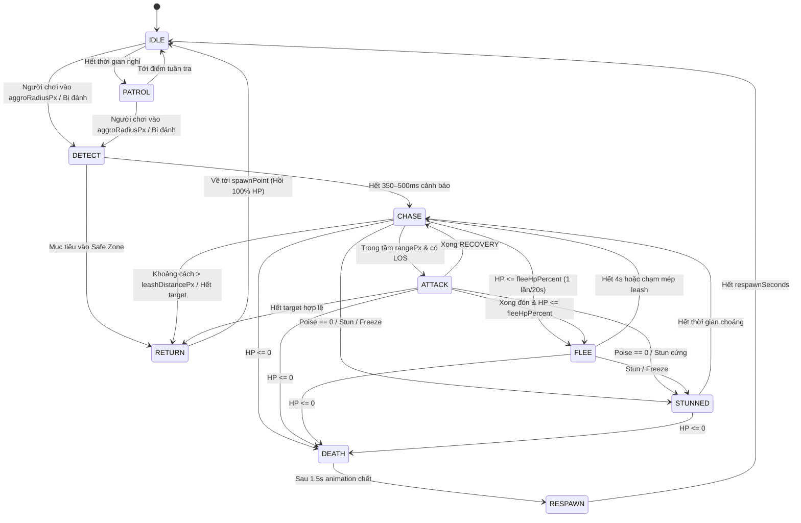

# 15 — Monster AI & World Roster Design: Eldoria: Forgotten Wilds

**Trạng thái**: Hoàn thiện (Design Baseline v1.0)  
**Chế độ**: `DESIGN_AND_PLANNING_ONLY`  
**Cập nhật lần cuối**: 2026-11-19  
**Nguồn dữ liệu chuẩn (Single Source of Truth)**: [`game-data/monsters.json`](../../game-data/monsters.json), [`game-data/characters.json`](../../game-data/characters.json)  
**Tài liệu quản trị**: [Constitution](../../.specify/memory/constitution.md) · [00-game-vision.md](./00-game-vision.md) · [GAME_DESIGN_BRIEF.md](../../GAME_DESIGN_BRIEF.md)

---

## 1. Mục tiêu Gameplay (Gameplay Objectives)

Hệ thống AI Quái vật (Monster AI) định hình trực tiếp cảm giác chiến đấu Action RPG 2.5D thời gian thực (**Trụ cột Thiết kế số 2 & số 6**):

1. **Hành vi có bản sắc sinh thái rõ ràng**: Thay vì mọi quái vật đều lao thẳng và chém giống nhau, mỗi loài trong danh mục **30 Regular Monster + 8 Elite Monster** sở hữu `targetPriority`, `fleeHpPercent`, tầm phát hiện (`aggroRadiusPx`), dây buộc lãnh thổ (`leashDistancePx`) và 2–3 `attackPatterns` có hình dạng hitbox + telegraph riêng biệt (ví dụ: `mob_forest_goblin` bỏ chạy khi còn 20% HP, `mob_timber_wolf` ưu tiên con mồi thấp máu `LOWEST_HP`, `mob_goblin_shaman` nhắm thẳng Healer `HEALER_FIRST`).
2. **Đọc đòn rõ ràng, phản ứng công bằng**: Mọi đòn tấn công của quái đều trải qua pha cảnh báo (`telegraphMs` từ `420ms` đến `1450ms`) hiển thị rõ vùng nguy hiểm trên mặt đất để người chơi chủ động Dodge (i-frame), Block hoặc Parry thay vì bị sát thương bất ngờ không rõ nguyên nhân.
3. **Khuyến khích phối hợp vai trò (Tank / DPS / Healer) trong Co-op**: Hệ thống Bảng Đe Dọa (`Threat Table`) trao giá trị chiến thuật thực sự cho Tank (`chr_bram_bastion`, `chr_rowan_tidewarden`) giữ aggro, bảo vệ Ranged DPS (`chr_lyra_windrunner`) và Healer (`chr_seraphina_dawn`), đồng thời cân bằng HP/Poise linh hoạt khi nhiều người cùng săn.
4. **100% Server-Authoritative & Chống lợi dụng địa hình**: Toàn bộ vòng đời AI, đường dẫn A*, quyết định chọn mục tiêu, kiểm tra tầm đánh và phân phối loot đều chạy trong simulation loop `20 Hz` trên NestJS server — không tin bất kỳ trạng thái nào từ client.

---

## 2. User Stories

| ID | Vai trò | User Story | Milestone |
| :--- | :--- | :--- | :---: |
| **US-AI-01** | Người chơi mới | Là người chơi cấp 1 ở bìa `reg_greenhaven_village`, tôi muốn `mob_moss_slime` có pha telegraph chậm (`600ms–800ms`) và không đuổi quá xa (`leash 384 px`) để tôi dễ dàng luyện nhịp combo và né đòn đầu tiên. | M1 (MVP) |
| **US-AI-02** | Người chơi Action RPG | Là người chơi khám phá `reg_whispering_forest`, tôi muốn đọc trước đường lao húc hình chữ nhật (`900ms`) của `mob_briar_boar` hay vòng nổ độc (`950ms`) của `mob_spore_cap` để né chuẩn hoặc parry phản công. | M1 (MVP) |
| **US-AI-03** | Tổ đội Co-op (Tank/Healer) | Là thành viên tổ đội săn `mob_elite_alpha_direwolf`, tôi muốn Tank hút được aggro ổn định bằng sát thương/kỹ năng khiêu khích trong khi Healer không bị quái bất ngờ quay sang hạ gục chỉ sau 1 lần hồi máu nhỏ. | M1 / M2 |
| **US-AI-04** | Người chơi săn đồ chung | Là hai người chơi cùng đánh 1 con Elite ngoài thế giới mở, tôi muốn cả hai đều nhận phần thưởng EXP và bảng rơi đồ cá nhân nếu đóng góp hợp lệ thay vì bị "ks" (kill-steal) mất trắng công sức. | M1 (MVP) |
| **US-AI-05** | Người chơi bảo vệ làng | Là người chơi đang giao dịch ở làng, tôi muốn quái vật bị kéo ra quá `leashDistancePx` tự động bỏ đuổi và chạy về tổ trong trạng thái miễn sát thương để không có ai kéo Elite vào phá Safe Zone. | M1 (MVP) |

---

## 3. Máy Trạng Thái AI 10 Trạng Thái (10-State Monster AI FSM)

Mọi thực thể quái vật trên server vận hành một Finite State Machine gồm đúng **10 trạng thái chuẩn**:

| # | Trạng thái (`AIState`) | Hành vi chi tiết trên Server (Tick 20 Hz) | Điều kiện Chuyển trạng thái (Transitions) |
| :-: | :--- | :--- | :--- |
| 1 | **`IDLE`** | Đứng nghỉ quanh `spawnPoint` trong `2–5 giây`, tự hồi `10% Max HP/giây` nếu chưa đầy máu, quét mục tiêu trong `aggroRadiusPx` mỗi `250ms` (5 ticks). | → `PATROL` (hết thời gian nghỉ)<br/>→ `DETECT` (phát hiện người chơi trong `aggroRadiusPx` hoặc bị đánh trúng) |
| 2 | **`PATROL`** | Chọn ngẫu nhiên 1 điểm đi lại hợp lệ trong bán kính `patrolRadiusPx` quanh `spawnPoint`, di chuyển với `60% moveSpeed`. | → `IDLE` (tới điểm đích hoặc kẹt > 2s)<br/>→ `DETECT` (phát hiện người chơi trong `aggroRadiusPx` hoặc nhận sát thương) |
| 3 | **`DETECT`** | Pha chuyển tiếp nhận diện ngắn (`350ms` với quái thường, `500ms` với Elite): quay mặt về mục tiêu, bật icon `!` phía trên đầu, phát âm thanh cảnh báo và kích hoạt Social Aggro cho đồng loại cùng bầy (ví dụ `mob_timber_wolf`) trong bán kính `160 px`. | → `CHASE` (hết pha `DETECT` và mục tiêu vẫn hợp lệ)<br/>→ `RETURN` (mục tiêu chạy vào Safe Zone hoặc tàng hình/chết ngay lập tức) |
| 4 | **`CHASE`** | Bám đuổi `currentTarget` bằng lưới A* + steering với `100% moveSpeed`, cập nhật đường dẫn mỗi `300ms` (6 ticks) hoặc khi mục tiêu lệch > `48 px`. | → `ATTACK` (khoảng cách <= `selectedPattern.rangePx` & có đường ngắm thông thoáng)<br/>→ `RETURN` (khoảng cách tới `spawnPoint` > `leashDistancePx` hoặc `threatTable` trống)<br/>→ `FLEE` (`hpPct <= fleeHpPercent` & chưa từng flee trong 20s)<br/>→ `STUNNED` (bị Stun/Freeze/Poise Break) |
| 5 | **`ATTACK`** | Khóa một `attackPattern` sẵn sàng cooldown; chạy đủ 3 pha con: **`STARTUP/TELEGRAPH`** (`telegraphMs`, phát gói `mob.telegraph` tới client) → **`ACTIVE`** (server tính va chạm hitbox thực + áp dụng damage & status effect) → **`RECOVERY`** (`350–650ms`). | → `CHASE` (kết thúc `RECOVERY`, đánh giá lại `threatTable`)<br/>→ `FLEE` (kết thúc đòn & `hpPct <= fleeHpPercent`)<br/>→ `STUNNED` (bị ngắt bởi Poise Break/Stun cứng; quái thường bị ngắt cả khi đang telegraph, Elite chỉ ngắt khi vỡ Poise) |
| 6 | **`RETURN`** | Dây buộc lãnh thổ kích hoạt: xóa sạch `threatTable`, bật cờ `leashingInvulnerable = true`, chạy tốc độ `135% moveSpeed` về `spawnPoint`, hồi `+20% Max HP/giây` và xóa mọi debuff. | → `IDLE` (về cách `spawnPoint <= 24 px`, hồi đầy `100% HP` & `100% Poise`, tắt cờ bất tử) |
| 7 | **`FLEE`** | Áp dụng cho loài có `fleeHpPercent > 0` (`mob_forest_goblin` 20%, `mob_hollow_bat` 15%, `mob_goblin_shaman` 20%, `mob_ironhide_kobold` 15%, `mob_cursed_acolyte` 15%, `mob_pyroclast_cultist` 10%): bỏ chạy ngược hướng người tấn công với `110% moveSpeed` trong tối đa `4 giây` hoặc tới góc ẩn nấp/đồng loại gần nhất (nhưng không vượt `leashDistancePx`), sau đó quay lại đánh liều chết (không lặp vô hạn). | → `CHASE` (hết `4 giây` bỏ chạy hoặc chạm giới hạn `leashDistancePx`)<br/>→ `STUNNED` / `DEATH` |
| 8 | **`STUNNED`** | Bất động hoàn toàn do CC cứng (`STUN`, `FREEZE`, `KNOCKDOWN`) hoặc **Poise Break** (`poise <= 0`, kéo dài `2.5s` cho Regular, `4.0s` cho Elite, nhận thêm `+25%` sát thương trong lúc choáng). | → `CHASE` (hết thời gian choáng; nếu là Poise Break thì hồi lại `100% Poise`)<br/>→ `DEATH` (nếu HP tụt về 0) |
| 9 | **`DEATH`** | `hp <= 0`: khóa nhận thêm sát thương, hủy mọi projectile/telegraph chưa nổ, tính thưởng EXP/Gold/Loot cá nhân theo bảng đóng góp, chạy animation chết trong `1.5s` rồi xóa thực thể hoạt động khỏi spatial grid. | → `RESPAWN` (sau khi kết thúc animation chết `1.5s`) |
| 10 | **`RESPAWN`** | Thực thể ẩn chờ tại `SpawnPoint` đến khi `serverNow >= diedAtMs + respawnSeconds * 1000` (từ `25s` đến `600s` tùy loài). Kiểm tra không có người chơi đang đứng kẹt đúng ô spawn rồi hồi sinh đầy `100% HP/Poise` với `1.5s` hòa nhập. | → `IDLE` (tái sinh hoàn tất) |

### 3.1 Thứ tự Ưu tiên Ngắt Trạng thái (Priority Override Hierarchy)

```text
DEATH (cao nhất) > STUNNED > RETURN (Leash/SafeZone) > FLEE > ATTACK (không bị ngắt giữa chừng bởi đổi target) > CHASE > DETECT > PATROL > IDLE
```

### 3.2 Sơ đồ Chuyển trạng thái (Mermaid State Diagram)



---

## 4. Các Hệ thống Cốt lõi của AI (Aggro, Threat, Pathfinding, Spawn & Scaling)

### 4.1 Bảng Đe Dọa (Threat Table) & Chọn Mục Tiêu (`targetPriority`)

Mỗi quái vật trong trạng thái giao chiến duy trì `threatTable: Map<characterId, ThreatEntry>` trong RAM:

- **Công thức tích lũy Threat**:
  $$\Delta \text{Threat}_{\text{dmg}} = \text{EffectiveDamage} \times M_{\text{role}} \times M_{\text{skill}}$$
  $$\Delta \text{Threat}_{\text{heal}} = \frac{\text{EffectiveHealing} \times 0.50}{\text{Count(EngagedMobsInRange)}}$$
  Trong đó:
  - $M_{\text{role}}$: `1.0` cho DPS/Support mặc định; **`1.6`** cho nhân vật vai trò `TANK` (`chr_bram_bastion`, `chr_rowan_tidewarden`).
  - $M_{\text{skill}}$: Kỹ năng Khiêu khích (như `skl_bram_act_taunting_roar`) có **`M_skill = 3.0`** đồng thời nâng ngay threat của Tank lên `maxThreat * 1.15` và áp dụng hiệu ứng `TAUNTED` bắt buộc nhắm Tank trong `4.0 giây`.
  - **Hồi máu dư (Overheal)** sinh `0 Threat` để Healer (`chr_seraphina_dawn`) không bị phạt oan khi duy trì khiên hoặc regen.
- **Chống dao động mục tiêu (Anti-Ping-Pong Hysteresis)**: Mục tiêu mới chỉ cướp được aggro nếu vượt ít nhất **`+10%`** (cận chiến) hoặc **`+20%`** (tầm xa) tổng điểm của `currentTarget` hiện tại.
- **6 Chế độ `targetPriority` trong `monsters.json`**:
  1. `NEAREST`: Ưu tiên mục tiêu đứng gần nhất trong nhóm có threat > 0 (trọng số khoảng cách chiếm 60%, threat 40%).
  2. `HIGHEST_THREAT`: Tuân thủ nghiêm ngặt bảng Threat (đặc trưng của hầu hết Elite & Tank-buster như `mob_briar_boar`, `mob_elite_alpha_direwolf`).
  3. `LOWEST_HP`: Nhắm thành viên có `% HP` thấp nhất trong bán kính `aggroRadiusPx` (đặc trưng của thú săn mồi: `mob_timber_wolf`, `mob_amethyst_stalker`, `mob_frostbite_hound`, `mob_ash_hound`).
  4. `RANGED_FIRST`: Ưu tiên người chơi thuộc role `RANGED_DPS` / `MAGIC_DPS` đứng cách boss `> 128 px` (ví dụ `mob_hollow_bat`, `mob_elite_crystal_matriarch`, `mob_elite_cinder_wyvern`).
  5. `HEALER_FIRST`: Ưu tiên người chơi vừa thi triển kỹ năng hồi máu trong 8 giây gần nhất (ví dụ `mob_goblin_shaman`, `mob_cursed_acolyte`, `mob_pyroclast_cultist`, `mob_elite_dread_harbinger`).
  6. `LAST_ATTACKER`: Phản công trực tiếp người vừa gây sát thương cuối cùng (`mob_ice_valkyrie_shade`).
  - *Quy tắc ghi đè*: Hiệu ứng `TAUNTED` của Tank **luôn ghi đè tạm thời** cả 6 chế độ trên trong thời gian hiệu lực.

### 4.2 Tìm Đường (Grid A* Pathfinding), Steering & Chống Kẹt

- **Bản đồ điều hướng (NavGrid `32×32 px`)**: Biên dịch trực tiếp từ lớp `collision_layer` của Tiled Map (`.tmj`) khi zone khởi động vào RAM dưới dạng mảng `Uint8Array` phẳng (1 byte/tile).
- **A* Có giới hạn Ngân sách (Budgeted A*)**:
  - Sử dụng heuristic Octile (cho phép đi chéo khi 2 ô kề không bị tường chắn để tránh cắt góc kẹt tường).
  - Giới hạn mở tối đa `120 nodes` mỗi lần truy vấn, tần suất tính lại tối đa `3 lần/giây/quái` (`repathIntervalMs = 333ms`).
  - Nếu mục tiêu nằm trong tầm nhìn thẳng (`Line-of-Sight` sạch vật cản), bỏ qua A* và dùng vector truy đuổi trực tiếp cộng lực tách nhóm (`separation force`, bán kính `28 px`) để đàn quái không xếp chồng thành 1 điểm pixel duy nhất.
- **Khôi phục kẹt (`Stuck Recovery`)**: Nếu trong `CHASE` hoặc `RETURN` quái di chuyển `< 8 px` sau `1.5 giây`, server lập tức ép `repath`; nếu kẹt quá `3.0 giây` trong `CHASE`, chuyển sang đòn tầm xa (nếu có) hoặc kích hoạt `RETURN` (kèm dịch chuyển ngắn an toàn về `spawnPoint` nếu `RETURN` bị kẹt > `4.0 giây`).
- **Mục tiêu ngân sách CPU (`proposed / unverified`)**: Tối đa `60 quái hoạt động đồng thời/zone` tiêu tốn mục tiêu `< 6 ms` mỗi tick `50 ms` (cần đo benchmark thực tế ở giai đoạn implementation).

### 4.3 Quản lý Spawn, Quyền Nhận Loot & Cân bằng Multiplayer

- **Spawn Management**:
  - Mỗi `SpawnPoint` trong Tiled map định nghĩa `{ spawnId, monsterId, tileX, tileY, maxAlive, respawnSeconds }`.
  - Ban đêm (`NIGHT`, 6 phút trong chu kỳ 24 phút), các điểm spawn của quái hệ `SHADOW` (như `mob_hollow_bat`) giảm `20%` thời gian `respawnSeconds`.
  - Quái ở vùng không có người chơi nào trong bán kính `1024 px` đi vào trạng thái ngủ đông (`SLEEPING` — bỏ qua vòng lặp AI cho đến khi có người tới gần) để tiết kiệm CPU server.
- **Loot Eligibility (Phân phối thưởng công bằng, chống Kill-Steal)**:
  - Người chơi (hoặc cả Party nếu ít nhất 1 thành viên hợp lệ đứng trong phạm vi `640 px`) đủ điều kiện nhận EXP, Gold và một lượt roll **Personal Loot** riêng biệt từ `lootTableId` khi đạt ít nhất một trong các ngưỡng:
    1. Gây tối thiểu **`>= 5%`** tổng HP tối đa của quái (hoặc `>= 1` đòn với quái yếu cấp 1–3 có HP < 200);
    2. Chặn/chịu sát thương (`Tank Mitigation`) >= `5%` tổng sát thương quái gây ra;
    3. Hồi máu hiệu quả cho người đang chiến đấu với quái đó >= `5%` Max HP của mục tiêu.
  - Vật phẩm rơi hiển thị độc lập cho từng người đủ điều kiện (không thể bị người lạ nhặt mất — chống ninja-loot tuyệt đối).
- **Multiplayer Dynamic Scaling (`multiplayerScaling`)**:
  - Khi số người chơi hợp lệ ($N \in [1, 4+]$) tham gia đánh một quái trong bán kính `640 px` (tính theo công thức từ `monsters.json`):
    $$\text{ScaledHP} = \text{BaseHP} \times \bigl(1 + (N - 1) \times \text{hpPerExtraPlayer}\bigr)$$
    $$\text{ScaledPoise} = \text{BasePoise} \times \bigl(1 + (N - 1) \times \text{poisePerExtraPlayer}\bigr)$$
  - Trong `monsters.json`: quái thường tăng `+0.45` đến `+0.55` HP và `+0.25` đến `+0.35` Poise mỗi người thêm; Elite tăng `+0.65` đến `+0.75` HP và `+0.40` đến `+0.50` Poise mỗi người thêm (vẫn nhanh hơn đánh solo khi party phối hợp tốt). Khi $N$ tăng giữa trận, server giữ nguyên tỷ lệ `% HP` hiện tại để tránh cảm giác quái đột ngột hồi máu vô lý.

---

## 5. Danh mục Toàn bộ 30 Regular Monsters & 8 Elite Monsters (Khớp 100% `game-data/monsters.json`)

### 5.1 Nhóm MVP (`M1`: 8 Regular + 1 Elite — `reg_greenhaven_village` & `reg_whispering_forest`)

| # | Monster ID | Tên | Tier | Vùng | Lv | Hệ (Yếu) | Sprite | HP / ATK / DEF / Poise / SPD | Aggro / Leash / Flee / Ưu tiên | Attack Patterns (`key: shape, ratio, telegraph`) | Respawn | EXP / Gold | Scale (+HP/+Poise) | Loot Table |
| :-: | :--- | :--- | :-: | :--- | :-: | :--- | :-: | :--- | :--- | :--- | :-: | :-: | :-: | :--- |
| 1 | `mob_moss_slime` | **Moss Slime** | `REG` | Greenhaven | 1 | `EARTH` (`FIRE`) | 64×64 | 90 / 12 / 4 / 35 / 72 | 160 / 384 / 0% / `NEAREST` | `moss_lunge` (CIRCLE, 1.0x, 600ms); `sticky_splatter` (LINE, 0.85x, 800ms, Slow) | 25s | 25 / 6–12G | +0.45 / +0.25 | `ltb_mob_moss_slime` |
| 2 | `mob_forest_goblin` | **Forest Goblin** | `REG` | Whispering | 3 | `NEUTRAL` (`FIRE`) | 48×64 | 155 / 18 / 8 / 45 / 118 | 192 / 448 / 20% / `NEAREST` | `rusty_shiv_slash` (CONE, 1.0x, 450ms); `pebble_toss` (LINE, 0.8x, 650ms) | 30s | 46 / 11–19G | +0.45 / +0.25 | `ltb_mob_forest_goblin` |
| 3 | `mob_timber_wolf` | **Timber Wolf** | `REG` | Whispering | 5 | `WIND` (`FIRE`) | 64×64 | 230 / 25 / 10 / 55 / 148 | 224 / 512 / 0% / `LOWEST_HP` | `fang_bite` (CONE, 1.0x, 420ms); `predator_pounce` (RECT, 1.35x, 700ms) | 35s | 72 / 16–26G | +0.45 / +0.25 | `ltb_mob_timber_wolf` |
| 4 | `mob_spore_cap` | **Spore Cap** | `REG` | Whispering | 7 | `WATER` (`FIRE`) | 64×64 | 325 / 29 / 14 / 68 / 78 | 176 / 416 / 0% / `NEAREST` | `cap_headbutt` (CIRCLE, 0.95x, 550ms); `toxic_spore_burst` (SELF_AOE, 1.15x, 950ms) | 35s | 98 / 20–34G | +0.45 / +0.30 | `ltb_mob_spore_cap` |
| 5 | `mob_briar_boar` | **Briar Boar** | `REG` | Whispering | 9 | `EARTH` (`WIND`) | 64×64 | 490 / 38 / 20 / 95 / 124 | 208 / 480 / 0% / `HIGHEST_THREAT` | `tusk_gore` (CONE, 1.05x, 550ms); `bramble_charge` (RECT, 1.5x, 900ms) | 40s | 128 / 26–42G | +0.50 / +0.30 | `ltb_mob_briar_boar` |
| 6 | `mob_hollow_bat` | **Hollow Bat** | `REG` | Whispering | 11 | `SHADOW` (`LIGHT`) | 64×64 | 430 / 44 / 16 / 62 / 156 | 240 / 512 / 15% / `RANGED_FIRST` | `diving_fang` (RECT, 1.0x, 450ms); `sonic_screech` (CONE, 1.15x, 750ms) | 40s | 155 / 30–48G | +0.45 / +0.25 | `ltb_mob_hollow_bat` |
| 7 | `mob_root_crawler` | **Root Crawler** | `REG` | Whispering | 13 | `EARTH` (`FIRE`) | 64×64 | 820 / 50 / 28 / 115 / 88 | 192 / 448 / 0% / `NEAREST` | `vine_lash` (RECT, 1.05x, 600ms); `snaring_roots` (CIRCLE, 1.25x, 950ms) | 45s | 188 / 36–56G | +0.50 / +0.35 | `ltb_mob_root_crawler` |
| 8 | `mob_goblin_shaman` | **Goblin Shaman** | `REG` | Whispering | 14 | `LIGHTNING` (`EARTH`) | 48×64 | 680 / 62 / 20 / 78 / 106 | 256 / 512 / 20% / `HEALER_FIRST` | `spark_bolt` (LINE, 1.0x, 650ms); `totem_lightning_ring` (CIRCLE, 1.4x, 1100ms) | 45s | 210 / 40–62G | +0.45 / +0.25 | `ltb_mob_goblin_shaman` |
| **E1** | **`mob_elite_alpha_direwolf`** | **Alpha Direwolf** | **`ELITE`** | Whispering | **12** | `WIND` (`FIRE`) | **96×96** | **2,550 / 64 / 28 / 265 / 162** | 272 / 640 / 0% / `HIGHEST_THREAT` | `savage_double_claw` (CONE, 1.15x, 550ms, Bleed); `gale_pounce_chain` (RECT, 1.65x, 900ms, KB); `pack_howl_burst` (SELF_AOE, 1.35x, 1250ms, Slow + gọi 2 Wolf) | **300s** | 620 / 135–210G | +0.65 / +0.40 | `ltb_mob_elite_alpha_direwolf` |

### 5.2 Nhóm Post-MVP — 22 Regular Monsters (`M2–M5`: Regions 3–8)

| # | Monster ID | Tên | Vùng (`regionId`) | Lv | Hệ (Yếu) | HP / ATK / DEF / Poise / SPD | Aggro / Leash / Flee / Ưu tiên | Attack Patterns | Resp | EXP / Gold | Loot Table |
| :-: | :--- | :--- | :--- | :-: | :--- | :--- | :--- | :--- | :-: | :-: | :--- |
| 9 | `mob_stone_golem` | Stone Golem | `reg_ironpeak_mountains` | 17 | `EARTH` (`WIND`) | 1480 / 72 / 46 / 165 / 74 | 192 / 448 / 0% / `HIGHEST_THREAT` | `granite_slam` (1.2x), `seismic_stomp` (1.55x) | 50s | 275 / 50–78G | `ltb_mob_stone_golem` |
| 10 | `mob_ironhide_kobold` | Ironhide Kobold | `reg_ironpeak_mountains` | 20 | `NEUTRAL` (`LIGHTNING`) | 1420 / 86 / 40 / 118 / 126 | 224 / 512 / 15% / `NEAREST` | `pickaxe_cleave` (1.05x), `blasting_ore_toss` (1.35x) | 45s | 335 / 60–92G | `ltb_mob_ironhide_kobold` |
| 11 | `mob_cinder_drake` | Cinder Drake | `reg_ironpeak_mountains` | 24 | `FIRE` (`WATER`) | 1920 / 108 / 46 / 140 / 138 | 240 / 544 / 0% / `LOWEST_HP` | `ember_claw` (1.0x), `flame_breath_cone` (1.45x) | 50s | 430 / 74–114G | `ltb_mob_cinder_drake` |
| 12 | `mob_slag_elemental` | Slag Elemental | `reg_ironpeak_mountains` | 28 | `FIRE` (`WATER`) | 2580 / 130 / 62 / 175 / 94 | 224 / 512 / 0% / `HIGHEST_THREAT` | `molten_fist` (1.1x), `slag_eruption` (1.6x) | 55s | 530 / 88–136G | `ltb_mob_slag_elemental` |
| 13 | `mob_quartz_beetle` | Quartz Beetle | `reg_crystal_caverns` | 32 | `EARTH` (`WIND`) | 3620 / 144 / 92 / 230 / 102 | 192 / 480 / 0% / `NEAREST` | `crystal_horn_ram` (1.15x), `shattering_roll` (1.5x) | 50s | 645 / 106–164G | `ltb_mob_quartz_beetle` |
| 14 | `mob_cavern_hydroid` | Cavern Hydroid | `reg_crystal_caverns` | 36 | `WATER` (`LIGHTNING`) | 3740 / 172 / 76 / 185 / 112 | 240 / 544 / 0% / `RANGED_FIRST` | `aqua_lance` (1.05x), `tidal_vortex` (1.45x) | 50s | 775 / 124–192G | `ltb_mob_cavern_hydroid` |
| 15 | `mob_amethyst_stalker` | Amethyst Stalker | `reg_crystal_caverns` | 40 | `SHADOW` (`LIGHT`) | 4180 / 212 / 82 / 190 / 162 | 256 / 576 / 0% / `LOWEST_HP` | `shard_rend` (1.1x), `shadow_blink_strike` (1.6x) | 55s | 920 / 144–222G | `ltb_mob_amethyst_stalker` |
| 16 | `mob_voltaic_jelly` | Voltaic Jelly | `reg_crystal_caverns` | 44 | `LIGHTNING` (`EARTH`) | 4950 / 236 / 94 / 225 / 108 | 240 / 544 / 0% / `NEAREST` | `arc_tentacle` (1.05x), `static_pulse_ring` (1.55x) | 55s | 1080 / 165–252G | `ltb_mob_voltaic_jelly` |
| 17 | `mob_ruin_sentinel` | Ruin Sentinel | `reg_forgotten_ruins` | 47 | `NEUTRAL` (`LIGHTNING`) | 6850 / 248 / 148 / 330 / 86 | 224 / 512 / 0% / `HIGHEST_THREAT` | `halberd_sweep` (1.15x), `aegis_shockwave` (1.6x) | 60s | 1220 / 182–280G | `ltb_mob_ruin_sentinel` |
| 18 | `mob_cursed_acolyte` | Cursed Acolyte | `reg_forgotten_ruins` | 51 | `SHADOW` (`LIGHT`) | 5720 / 298 / 112 / 235 / 110 | 272 / 576 / 15% / `HEALER_FIRST` | `hex_orb` (1.05x), `sigil_of_decay` (1.5x) | 55s | 1390 / 204–312G | `ltb_mob_cursed_acolyte` |
| 19 | `mob_sandstone_gargoyle` | Sandstone Gargoyle | `reg_forgotten_ruins` | 55 | `EARTH` (`WIND`) | 8450 / 312 / 168 / 380 / 122 | 240 / 576 / 0% / `HIGHEST_THREAT` | `stone_wing_gust` (1.1x), `meteor_dive` (1.65x) | 60s | 1580 / 230–348G | `ltb_mob_sandstone_gargoyle` |
| 20 | `mob_astral_wraith` | Astral Wraith | `reg_forgotten_ruins` | 59 | `LIGHT` (`SHADOW`) | 7980 / 356 / 140 / 300 / 142 | 272 / 608 / 0% / `RANGED_FIRST` | `radiant_beam` (1.15x), `starfall_ring` (1.65x) | 60s | 1790 / 255–388G | `ltb_mob_astral_wraith` |
| 21 | `mob_frostbite_hound` | Frostbite Hound | `reg_frostbound_highlands` | 62 | `FROST` (`FIRE`) | 9650 / 382 / 158 / 335 / 164 | 256 / 608 / 0% / `LOWEST_HP` | `rime_fang` (1.05x), `glacier_leap` (1.5x) | 55s | 1960 / 276–420G | `ltb_mob_frostbite_hound` |
| 22 | `mob_glacier_yeti` | Glacier Yeti | `reg_frostbound_highlands` | 66 | `FROST` (`FIRE`) | 13400 / 418 / 212 / 495 / 96 | 224 / 544 / 0% / `HIGHEST_THREAT` | `frost_club_smash` (1.25x), `avalanche_boulder` (1.65x) | 65s | 2180 / 304–460G | `ltb_mob_glacier_yeti` |
| 23 | `mob_ice_valkyrie_shade` | Ice Valkyrie Shade | `reg_frostbound_highlands` | 70 | `FROST` (`FIRE`) | 11900 / 468 / 192 / 410 / 148 | 256 / 608 / 0% / `LAST_ATTACKER` | `glacial_spear_thrust` (1.15x), `frost_lance_barrage` (1.6x) | 65s | 2410 / 334–506G | `ltb_mob_ice_valkyrie_shade` |
| 24 | `mob_blizzard_elemental` | Blizzard Elemental | `reg_frostbound_highlands` | 74 | `WIND` (`EARTH`) | 13100 / 495 / 198 / 430 / 136 | 272 / 608 / 0% / `RANGED_FIRST` | `gale_razor` (1.1x), `whiteout_cyclone` (1.65x) | 65s | 2650 / 366–552G | `ltb_mob_blizzard_elemental` |
| 25 | `mob_ash_hound` | Ash Hound | `reg_ember_wasteland` | 78 | `FIRE` (`WATER`) | 14600 / 556 / 222 / 470 / 168 | 272 / 640 / 0% / `LOWEST_HP` | `cinder_maul` (1.1x), `blazing_dash` (1.55x) | 60s | 2920 / 400–604G | `ltb_mob_ash_hound` |
| 26 | `mob_obsidian_brute` | Obsidian Brute | `reg_ember_wasteland` | 83 | `EARTH` (`WATER`) | 21200 / 592 / 318 / 720 / 92 | 224 / 576 / 0% / `HIGHEST_THREAT` | `basalt_cleave` (1.25x), `magma_fissure` (1.75x) | 70s | 3280 / 446–674G | `ltb_mob_obsidian_brute` |
| 27 | `mob_pyroclast_cultist` | Pyroclast Cultist | `reg_ember_wasteland` | 88 | `FIRE` (`FROST`) | 16900 / 678 / 248 / 520 / 116 | 288 / 640 / 10% / `HEALER_FIRST` | `brimstone_bolt` (1.1x), `caldera_pillar` (1.7x) | 65s | 3660 / 495–745G | `ltb_mob_pyroclast_cultist` |
| 28 | `mob_void_thrall` | Void Thrall | `reg_abyssal_kingdom` | 92 | `SHADOW` (`LIGHT`) | 19800 / 690 / 278 / 610 / 134 | 272 / 640 / 0% / `NEAREST` | `umbral_claw` (1.1x), `rift_tendril` (1.55x) | 65s | 3940 / 530–798G | `ltb_mob_void_thrall` |
| 29 | `mob_abyssal_knight` | Abyssal Knight | `reg_abyssal_kingdom` | 96 | `SHADOW` (`LIGHT`) | 26800 / 742 / 376 / 860 / 114 | 256 / 640 / 0% / `HIGHEST_THREAT` | `dread_greatsword_arc` (1.25x), `eclipse_wave_slash` (1.75x) | 75s | 4180 / 568–852G | `ltb_mob_abyssal_knight` |
| 30 | `mob_eclipse_weaver` | Eclipse Weaver | `reg_abyssal_kingdom` | 99 | `SHADOW` (`LIGHT`) | 22400 / 798 / 310 / 690 / 124 | 304 / 640 / 0% / `HEALER_FIRST` | `void_needle_volley` (1.15x), `eclipse_collapse` (1.8x) | 75s | 4420 / 600–900G | `ltb_mob_eclipse_weaver` |

### 5.3 Nhóm Post-MVP — 7 Elite Monsters (`M2–M5`, Sprite chuẩn `96×96 px`, 3 kỹ năng/con)

| # | Elite ID | Tên | Vùng (`regionId`) | Lv | Hệ (Yếu) | HP / ATK / DEF / Poise / SPD | Aggro / Leash / Ưu tiên | 3 Kỹ năng đặc trưng | Resp | EXP / Gold | Scale | Loot Table |
| :-: | :--- | :--- | :--- | :-: | :--- | :--- | :--- | :--- | :-: | :-: | :-: | :--- |
| E2 | `mob_elite_briar_stag` | Briar Stag | `reg_whispering_forest` | 15 | `EARTH` (`FIRE`) | 3,650 / 76 / 38 / 330 / 144 | 256 / 640 / `HIGHEST_THREAT` | `antler_sweep` (1.2x), `thorn_stampede` (1.7x), `verdant_shock_ring` (1.5x) | 360s | 860 / 180–275G | +0.65 / +0.40 | `ltb_mob_elite_briar_stag` |
| E3 | `mob_elite_magma_colossus` | Magma Colossus | `reg_ironpeak_mountains` | 27 | `FIRE` (`WATER`) | 10,200 / 158 / 82 / 540 / 88 | 256 / 608 / `HIGHEST_THREAT` | `anvil_slam` (1.3x), `molten_fissure_line` (1.75x), `furnace_overload` (1.9x) | 420s | 1,980 / 360–540G | +0.70 / +0.45 | `ltb_mob_elite_magma_colossus` |
| E4 | `mob_elite_crystal_matriarch` | Crystal Matriarch | `reg_crystal_caverns` | 43 | `LIGHTNING` (`EARTH`) | 20,800 / 292 / 124 / 740 / 122 | 288 / 640 / `RANGED_FIRST` | `prismatic_scythe` (1.2x), `refraction_beam` (1.75x), `resonant_crystal_ring` (1.9x) | 480s | 3,950 / 680–1,020G | +0.70 / +0.45 | `ltb_mob_elite_crystal_matriarch` |
| E5 | `mob_elite_sunstone_warden` | Sunstone Warden | `reg_forgotten_ruins` | 58 | `LIGHT` (`SHADOW`) | 34,800 / 438 / 204 / 1,080 / 112 | 288 / 640 / `HIGHEST_THREAT` | `solar_halberd_combo` (1.25x), `sunbeam_spear` (1.8x), `sanctuary_nova` (2.0x) | 540s | 6,650 / 1,080–1,620G | +0.75 / +0.45 | `ltb_mob_elite_sunstone_warden` |
| E6 | `mob_elite_permafrost_mammoth` | Permafrost Mammoth | `reg_frostbound_highlands` | 73 | `FROST` (`FIRE`) | 58,500 / 612 / 292 / 1,520 / 102 | 272 / 640 / `HIGHEST_THREAT` | `glacial_tusk_toss` (1.3x), `tundra_stampede` (1.85x), `permafrost_shatter` (2.05x) | 540s | 9,850 / 1,520–2,280G | +0.75 / +0.50 | `ltb_mob_elite_permafrost_mammoth` |
| E7 | `mob_elite_cinder_wyvern` | Cinder Wyvern | `reg_ember_wasteland` | 89 | `FIRE` (`WATER`) | 84,000 / 825 / 345 / 1,950 / 156 | 320 / 640 / `RANGED_FIRST` | `scorching_tail_whip` (1.25x), `napalm_strafe` (1.85x), `volcanic_divebomb` (2.15x) | 600s | 14,200 / 2,120–3,180G | +0.75 / +0.50 | `ltb_mob_elite_cinder_wyvern` |
| E8 | `mob_elite_dread_harbinger` | Dread Harbinger | `reg_abyssal_kingdom` | 98 | `SHADOW` (`LIGHT`) | 112,000 / 965 / 420 / 2,400 / 146 | 320 / 640 / `HEALER_FIRST` | `reaper_crescent` (1.3x), `abyss_rift_slash` (1.9x), `oblivion_ring` (2.2x) | 600s | 17,600 / 2,650–3,980G | +0.75 / +0.50 | `ltb_mob_elite_dread_harbinger` |

---

## 6. Functional Requirements & Business Rules

### 6.1 Functional Requirements (FR)

- **FR-AI-01**: Mọi hành vi quái vật đọc trực tiếp cấu hình từ `game-data/monsters.json` khi zone khởi tạo; không hardcode chỉ số hay cooldown đòn đánh.
- **FR-AI-02**: Vòng lặp AI chạy đồng bộ trong server tick `20 Hz` (chia lượt quét aggro/repath so le giữa các quái để giữ tải CPU phẳng).
- **FR-AI-03**: Gửi sự kiện telegraph tách biệt trước thời điểm nổ sát thương đúng `telegraphMs` để client dựng chỉ thị mặt đất pixel-art khớp đồng hồ server.
- **FR-AI-04**: Hỗ trợ đầy đủ cơ chế Poise Break, Elemental Weakness bonus (`-25%` đến `-35%` kháng nguyên tố yếu), Status Effects (`SLOW`, `BLEED`, `POISON`, `BURN`, `KNOCKBACK`, `ROOT`, `STUN`) và gọi đệ tử có giới hạn trần (như `mob_elite_alpha_direwolf` gọi tối đa `2 mob_timber_wolf`, không rơi loot lặp).

### 6.2 Business Rules (BR)

- **BR-AI-01**: Quái vật tuyệt đối không được bước qua ranh giới `Safe Zone` (ví dụ quảng trường `reg_greenhaven_village`); nếu mục tiêu chạy vào Safe Zone, quái ngay lập tức chuyển `RETURN`.
- **BR-AI-02**: Quái được triệu hồi bởi Elite (như 2 `mob_timber_wolf` từ `pack_howl_burst`) tự tan biến sau `30 giây` hoặc khi Elite chết, và `yieldsLoot = false` để chống farm EXP/Gold vô hạn bằng cách cố tình không giết Elite.
- **BR-AI-03**: Trong `RETURN`, quái miễn mọi sát thương và CC; người chơi không thể dùng kỹ năng kéo (pull) để giam quái vô hạn ngoài ranh giới `leashDistancePx`.

---

## 7. Input và Output (Protocol Contracts)

| Event (Server ↔ Client) | Hướng | Payload chính | Tần suất / Ghi chú |
| :--- | :---: | :--- | :--- |
| `ws: world.snapshot` | Server → Client | `{ serverTick, mobs: [{ instanceId, monsterId, x, y, facing, aiState, hp, maxHp, poise, maxPoise }] }` | `10 Hz` delta-compressed theo spatial grid interest management |
| `ws: mob.telegraph` | Server → Client | `{ instanceId, patternKey, hitboxShape, originX, originY, angleDeg, radiusOrSize, startsAtMs, executesAtMs }` | Phát 1 lần ngay khi quái bước vào pha `STARTUP` |
| `ws: mob.action.execute` | Server → Client | `{ instanceId, patternKey, affectedTargets: [{ targetId, damage, isCrit, statusApplied }] }` | Phát tại frame active được server xác thực |
| `ws: mob.death.loot` | Server → Client | `{ instanceId, expAwarded, goldAwarded, personalLootDrops: [{ dropId, itemId, qty, x, y }] }` | Gửi riêng cho từng người chơi đạt điều kiện đóng góp |

---

## 8. JSON Data Model (Ephemeral RAM vs Persistent JSON)

Theo **Nguyên tắc I & IV của Hiến pháp**, trạng thái chiến đấu `20 Hz` của quái (vị trí hiện tại, `hp`, `threatTable`, đường A*) **KHÔNG BAO GIỜ ghi xuống đĩa mỗi tick** mà nằm 100% trong RAM (`ZoneRuntimeState`). Chỉ cấu hình điểm spawn và đồng hồ respawn của các **Elite Monster** (để tránh reset thời gian chờ 5–10 phút khi khởi động lại server) được lưu định kỳ vào `data/db/world/<regionId>.json`:

```json
// Trích data/db/world/reg_whispering_forest.json
{
  "schemaVersion": "1.0.0",
  "regionId": "reg_whispering_forest",
  "eliteRespawnTimers": [
    {
      "spawnPointId": "sp_wf_elite_wolf_01",
      "monsterId": "mob_elite_alpha_direwolf",
      "lastKilledAtMs": 1795091800000,
      "nextRespawnAtMs": 1795092100000
    }
  ]
}
```

```typescript
// Cấu trúc Ephemeral trong RAM của NestJS ZoneService (không lưu đĩa theo tick)
interface ActiveMonsterRuntime {
  instanceId: string;
  monsterId: string;
  spawnPoint: { x: number; y: number };
  pos: { x: number; y: number };
  aiState: 'IDLE'|'PATROL'|'DETECT'|'CHASE'|'ATTACK'|'RETURN'|'FLEE'|'STUNNED'|'DEATH'|'RESPAWN';
  hp: number; maxHp: number; poise: number; maxPoise: number;
  threatTable: Map<string, { threat: number; damageDealt: number; healContribution: number; lastSeenMs: number }>;
  activePartyScalers: Set<string>;
  fleeCooldownUntilMs: number;
  isSummonedMinion: boolean;
}
```

---

## 9. Dependencies, UI Interactions, Edge Cases, Failure Behavior & Security

### 9.1 Dependencies
- **`06-combat-system.md` & `07-skill-system.md`**: Công thức sát thương, kháng nguyên tố, Poise damage, Taunt và Status Effects.
- **`16-boss-design.md` & `17-dungeon-design.md`**: Kế thừa nền tảng Threat Table, Telegraph và Pathfinding, đồng thời mở rộng thêm Phase/Arena/Enrage cho Boss.
- **`docs/art-direction/animation-standard.md`**: Khớp animation keys (`idle`, `walk`, `attack`, `hit`, `stun`, `death`) cho 3 kích thước sprite `48×64`, `64×64`, `96×96 px`.

### 9.2 UI Interactions
- **Thanh máu nổi gọn gàng**: Quái thường chỉ hiện thanh HP nhỏ phía trên đầu khi bị mất máu hoặc đang được chọn mục tiêu; Elite hiện viền khung vàng đồng kèm thanh **Poise** mảnh phía dưới HP và biểu tượng hệ nguyên tố yếu điểm (`FIRE`, `LIGHT`, ...).
- **Telegraph đọc ngay trong 0.2s**: Vùng báo đòn vẽ viền màu sắc tương phản rõ trên nền cỏ/đá (đỏ cam mờ cho đòn vật lý, tím cho Shadow, vàng lam cho Lightning) với lớp phủ đổ đầy dần từ tâm ra viền khớp đúng `telegraphMs` (tuyệt đối không nhấp nháy > 3 Hz).
- **Biểu tượng trạng thái AI**: Dấu `!` đỏ ngắn khi `DETECT`, biểu tượng lá chắn gãy khi `STUNNED` (Poise Break), biểu tượng chân chạy khi `FLEE`, biểu tượng xích xám khi `RETURN`.

### 9.3 Edge Cases & Failure Behavior
- **Người chơi rút khỏi tầm đánh khi Elite còn 5% HP làm giảm `activePartyScalers`**: Tỷ lệ `% HP` được bảo toàn; nếu `threatTable` cạn sạch, Elite chuyển `RETURN` về hồi 100% HP.
- **Hai người chơi đứng ở hai bên một hòn đá khiến quái đi lòng vòng**: A* kết hợp đường ngắm xác định lối ngắn hơn; nếu kẹt quá `1.5s` tự đổi đường, quá `3s` bắn chiêu tầm xa hoặc `RETURN`.
- **Restart đột ngột game server**: Quái thường tái sinh sạch tại `spawnPoint`; thời gian respawn Elite được phục hồi từ `data/db/world/<regionId>.json` ngăn exploit crash-server để cày Elite liên tục.

### 9.4 Security Requirements
- **Chống Fake Position / Out-of-Range Kiting**: Server tự đo khoảng cách hitbox thực giữa người chơi và quái; đòn đánh vượt quá `weaponRange + tolerance` bị hủy.
- **Chống Bot Farm AFK 1 chỗ**: Quái có cơ chế đa dạng hình dạng AoE yêu cầu né tránh, kết hợp giới hạn tốc độ nhặt loot và theo dõi chuỗi mẫu di chuyển lặp tuyệt đối vào `AuditLog` (nhắc lại: không tuyên bố chống bot tuyệt đối 100%).
- **Chống Summon Farm Exploit**: Đệ tử gọi bởi Elite không rơi EXP/Gold/Loot và có trần tối đa `2` cá thể sống song song.

---

## 10. Acceptance Criteria & Test Scenarios

### 10.1 Acceptance Criteria (AC)
- **AC-AI-01**: Toàn bộ 30 Regular Monster và 8 Elite Monster được tải từ `game-data/monsters.json` mà không thiếu trường stats, `aiProfile`, `attackPatterns`, `rewards` hay `multiplayerScaling`.
- **AC-AI-02**: Đủ 10 trạng thái FSM hoạt động đúng thứ tự ưu tiên; quái luôn `RETURN` khi vượt `leashDistancePx` hoặc chạm Safe Zone.
- **AC-AI-03**: Kỹ năng Taunt của Tank (`skl_bram_act_taunting_roar`) giữ được aggro của `mob_elite_alpha_direwolf` ngay cả khi DPS và Healer đang hoạt động liên tục.
- **AC-AI-04**: Đánh chung giữa 2 người chơi mở rộng HP/Poise đúng hệ số `hpPerExtraPlayer`/`poisePerExtraPlayer` và phát loot cá nhân công bằng cho mọi người đạt >= 5% đóng góp.

### 10.2 Test Scenarios (Giai đoạn Thiết kế — Chưa thực thi Production)

| Test ID | Loại kiểm thử | Kịch bản kiểm tra | Kết quả mong đợi |
| :--- | :--- | :--- | :--- |
| **TS-AI-01** | Unit / FSM Leash | Kéo `mob_briar_boar` (`leash 480 px`) chạy ra `500 px` khỏi `spawnPoint` rồi tiếp tục bắn cung vào nó | Quái lập tức chuyển `RETURN`, bật miễn sát thương, hồi `+20% HP/s` về `spawnPoint` rồi về `IDLE` với 100% HP. |
| **TS-AI-02** | Unit / Flee Rule | Đánh `mob_forest_goblin` (`fleeHpPercent: 20%`) từ 100% xuống 18% HP | Quái chuyển sang `FLEE` bỏ chạy tối đa `4s`, sau đó quay lại `CHASE` và không `FLEE` lần 2 trong `20s`. |
| **TS-AI-03** | Integration / Threat | Party 3 người (`chr_bram_bastion`, `chr_kael_vanguard`, `chr_seraphina_dawn`) đánh `mob_elite_alpha_direwolf`; Kael gây 500 dmg, Seraphina hồi 400 HP, Bram dùng `Taunting Roar` (200 dmg) | Bram giữ đầu bảng Threat (`M_role 1.6 × M_skill 3.0` + `TAUNTED 4s`), Elite quay mặt đánh Bram ổn định. |
| **TS-AI-04** | Integration / Scaling | 1 người vào đánh `mob_elite_alpha_direwolf` (2,550 HP); sau đó 2 đồng đội bước vào tham chiến | HP tối đa tăng theo công thức `2,550 × (1 + 2 × 0.65) = 5,865 HP` (giữ nguyên tỷ lệ `% HP`), Poise tăng lên `265 × (1 + 2 × 0.40) = 477`. |
| **TS-AI-05** | Integration / Loot Fairness | 2 người chơi không cùng party đánh 1 `mob_elite_alpha_direwolf`: A gây 70% sát thương, B gây 30% sát thương, C đánh 1 hit 2% rồi đứng nhìn | A và B đều nhận đầy đủ EXP + Personal Loot roll riêng; C (< 5%) không đủ điều kiện nhận loot. |
| **TS-AI-06** | Security / Anti-Exploit | Ép `mob_elite_alpha_direwolf` hú `pack_howl_burst` 3 lần liên tiếp để thử cày đệ tử `mob_timber_wolf` | Tổng đệ tử sống không bao giờ vượt quá `2`, và đệ tử chết không rơi EXP/Gold/Item. |
