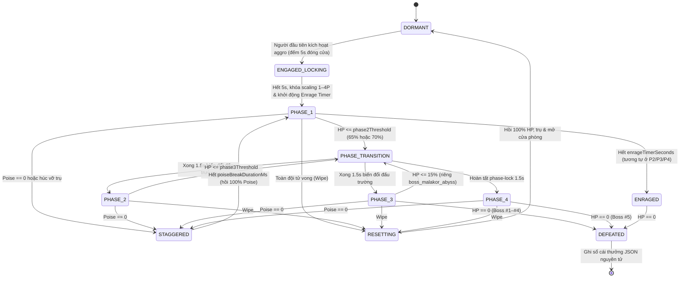

# 16 — Boss Combat & Multi-Phase Encounter Design: Eldoria: Forgotten Wilds

**Trạng thái**: Hoàn thiện (Design Baseline v1.0)  
**Chế độ**: `DESIGN_AND_PLANNING_ONLY`  
**Cập nhật lần cuối**: 2026-11-19  
**Nguồn dữ liệu chuẩn (Single Source of Truth)**: [`game-data/bosses.json`](../../game-data/bosses.json), [`game-data/characters.json`](../../game-data/characters.json), [`game-data/skills.json`](../../game-data/skills.json)  
**Tài liệu quản trị**: [Constitution](../../.specify/memory/constitution.md) · [00-game-vision.md](./00-game-vision.md) · [15-monster-ai.md](./15-monster-ai.md)

---

## 1. Mục tiêu Gameplay & Triết lý Thiết kế Boss (Gameplay Objectives & Philosophy)

Hệ thống Boss Raid là đỉnh cao của vòng lặp cốt lõi `Explore → Gather → Combat → Loot → Craft → Upgrade → Build → Unlock → Boss Battle → New Region`:

> **Triết lý tối thượng**: *"Boss trong Eldoria khó vì cơ chế chiến đấu, nhịp đọc đòn (telegraph), tận dụng nguyên tố và tương tác địa hình — TUYỆT ĐỐI KHÔNG vì biến boss thành bao cát khổng lồ (damage sponge) hay tung đòn không thể né."*

1. **Mọi kỹ năng Boss đều có Counterplay rõ ràng**: Mỗi đòn đánh trong cả 5 bộ hồ sơ Boss đều đi kèm tín hiệu thị giác rõ ràng (`telegraphMs` từ `850ms` đến `2600ms`), độ tương phản pixel sạch trên nền đấu trường và ít nhất 1–2 cách hóa giải cụ thể (Dodge i-frame, Parry, nấp trụ đá, kích hoạt van nước, thanh tẩy cột ánh sáng, hoặc phá Poise ngắt chiêu).
2. **Đấu trường là công cụ chiến thuật (Interactive Arena)**: Các trụ (`safePillars`) và mối nguy hiểm (`hazards`) không phải đồ trang trí mà là phần cốt lõi của trận chiến — dụ `boss_thornback_elder` húc vỡ trụ để tự choáng, mở van làm mát để gây phản ứng Bốc Hơi lên `boss_ignis_forgelord`, phá Mảnh Tinh Thể của `boss_prism_leviathan`, thắp Chậu Lửa Cổ chống rét trước `boss_boreas_frostking`, hay thanh tẩy Cột Ấn Mặt Trời mở vòm bảo vệ trước `boss_malakor_abyss`.
3. **Cân bằng Solo & Co-op 1–4 người**: Toàn bộ 5 boss đều có bảng mở rộng chỉ số đồng nhất (`1P: 1.0x HP`, `2P: 1.75x`, `3P: 2.45x`, `4P: 3.10x` kèm thưởng thêm `+10%/+20%/+30%`), đảm bảo người chơi solo lành nghề vẫn vượt qua được nội dung cốt lõi (nguyên tắc công bằng VI) đồng thời khuyến khích lập party phối hợp Tank–DPS–Healer.
4. **Đọc chiến trường sạch tuyệt đối (Constitution Principle V)**: Layer VFX Ultimate của người chơi tự động giảm độ mờ (`opacity <= 0.45`) khi chồng lên layer Boss Telegraph; cấm tuyệt đối hiệu ứng nhấp nháy toàn màn hình > 3 Hz khi chuyển phase hay kích hoạt Enrage.

---

## 2. User Stories

| ID | Vai trò | User Story | Milestone |
| :--- | :--- | :--- | :---: |
| **US-BSS-01** | Người chơi MVP | Là một người chơi cấp 14–15 lần đầu đối đầu `boss_thornback_elder`, tôi muốn quan sát rõ vòng đỏ/quạt gai/đường húc để học cách dụ boss đâm vào 4 trụ đá làm choáng và dùng kỹ năng Fire của `chr_kael_vanguard` ngắt pha hồi máu của boss. | M1 (MVP) |
| **US-BSS-02** | Tổ đội Co-op 4 người | Là một nhóm bạn gồm Tank, Healer và 2 DPS cùng săn boss, tôi muốn thanh Poise và phần thưởng tăng hợp lý theo số thành viên (+30% reward ở 4 người) để phối hợp ăn ý luôn cho hiệu quả farm tốt hơn đánh lẻ. | M1 (MVP) |
| **US-BSS-03** | Người chơi chiến thuật | Là một người chơi ở vùng M2–M5, tôi muốn mỗi boss mở khóa vùng mới có cơ chế môi trường độc đáo (hạ nhiệt giáp dung nham, cắt tia laser khúc xạ, giữ ấm chống Hypothermia, thanh tẩy cột ánh sáng) thay vì lặp lại cùng một khuôn mẫu. | M2–M5 |
| **US-BSS-04** | Người chơi công bằng | Là một người chơi đóng góp đầy đủ trong trận đấu, tôi muốn phần thưởng Boss Token, `STARLIGHT_SHARD` (First Clear & Weekly) và bảng rơi đồ cá nhân được server trao minh bạch mà không sợ đồng đội AFK hay ăn gian bug tường. | M1 (MVP) |

---

## 3. Bảng Tổng quan 5 Multi-Phase Bosses & Quy tắc Scaling Chung

### 3.1 So sánh 5 Boss Toàn cục (Khớp 100% `game-data/bosses.json`)

| # | Boss ID | Tên & Danh hiệu | MVP | Vùng / Dungeon | Lv | Hệ (Yếu `-35%`) | Sprite | Arena (Tiles) | HP / ATK / DEF / Poise | Số Phase | Enrage | Phần thưởng (EXP / Gold / Boss Token / First Clear / Weekly Shards) | Respawn (Inst / World) |
| :-: | :--- | :--- | :-: | :--- | :-: | :--- | :-: | :-: | :--- | :-: | :-: | :--- | :-: |
| 1 | **`boss_thornback_elder`** | **Thornback Elder**<br/>*Ancient Guardian of Mossroot Hollow* | **Có** | `reg_whispering_forest`<br/>`dng_mossroot_hollow` | **15** | `EARTH` (`FIRE`) | 128×128 | 26×20 | 10,500 / 82 / 34 / 520 | **3** (`100/65/30%`) | 360s | 1,650 / 450–680G / **5** / **480** / **160** | 15m / 60m |
| 2 | `boss_ignis_forgelord` | **Ignis Forgelord**<br/>*Tyrant of the Slag Foundry* | Không | `reg_ironpeak_mountains`<br/>`dng_slag_foundry` | **30** | `FIRE` (`WATER`) | 160×160 | 28×22 | 36,000 / 185 / 84 / 1,150 | **3** (`100/65/30%`) | 420s | 4,800 / 1,250–1,850G / **8** / **640** / **240** | 20m / 90m |
| 3 | `boss_prism_leviathan` | **Prism Leviathan**<br/>*Sovereign of the Refracted Deep* | Không | `reg_crystal_caverns`<br/>`dng_prism_sanctum` | **50** | `LIGHTNING` (`EARTH`) | 192×192 | 30×24 | 98,000 / 355 / 158 / 2,100 | **3** (`100/65/30%`) | 450s | 12,800 / 3,200–4,600G / **12** / **800** / **320** | 30m / 120m |
| 4 | `boss_boreas_frostking` | **Boreas Frostking**<br/>*Eternal Monarch of Glacial Citadel* | Không | `reg_frostbound_highlands`<br/>`dng_glacial_citadel` | **75** | `FROST` (`FIRE`) | 192×192 | 32×24 | 235,000 / 640 / 285 / 3,600 | **3** (`100/65/30%`) | 480s | 28,500 / 6,800–9,600G / **16** / **960** / **400** | 45m / 180m |
| 5 | `boss_malakor_abyss` | **Malakor, Sovereign of the Abyss**<br/>*Usurper of the Eclipse Throne* | Không | `reg_abyssal_kingdom`<br/>`dng_eclipse_throne` | **100** | `SHADOW` (`LIGHT`) | 256×256 | 36×28 | 460,000 / 980 / 430 / 5,400 | **4** (`100/70/40/15%`) | 540s | 62,000 / 14,500–21,000G / **25** / **1,600** / **480** | 60m / 240m |

### 3.2 Quy tắc Party Scaling (1–4 Người) & Fair Reward Distribution

Tất cả 5 boss sử dụng cùng hệ số chuẩn trong `bosses.json` (khóa cố định tại thời điểm cổng phòng Boss đóng sau `lockDelayMs = 5000ms`):

| Quy mô Party | `hpMultiplier` | `atkMultiplier` | `poiseMultiplier` | `rewardBonusPercent` (Gold & tỷ lệ drop hiếm) |
| :---: | :---: | :---: | :---: | :---: |
| **1 Người (Solo)** | `1.00x` | `1.00x` | `1.00x` | `+0%` |
| **2 Người (Duo)** | `1.75x` | `1.05x` | `1.45x` | `+10%` |
| **3 Người (Trio)** | `2.45x` | `1.10x` | `1.85x` | `+20%` |
| **4 Người (Full Co-op)** | `3.10x` | `1.15x` | `2.25x` | `+30%` |

**Phân phối Phần thưởng Công bằng (Fair Reward Distribution)**:
- **Loot cá nhân 100% (Personal Instanced Loot)**: Mỗi thành viên đủ điều kiện (có mặt từ lúc khóa phòng `entryLockRule` và đạt tối thiểu **`>= 5%`** tổng đóng góp sát thương, hồi máu hiệu quả hoặc sát thương chặn/tank) nhận rương phần thưởng riêng từ `lootTableId`, EXP, Gold và `BOSS_TOKEN` riêng (tuyệt đối không tranh giật roll đồ).
- **Bảo hộ nguyên liệu Boss cốt lõi**: Boss MVP `boss_thornback_elder` luôn bảo đảm rơi tối thiểu `1 mat_thornback_heart` cho mỗi thành viên hợp lệ khi hạ gục, giúp lộ trình nâng `bld_blacksmith` Lv 3–4 và cường hóa `+7..+10` minh bạch, không bị khóa bởi RNG xui rủi.
- **Thưởng `STARLIGHT_SHARD` (Gacha nội tệ)**:
  - **First Clear** (`480` đến `1,600` Shards): trao duy nhất 1 lần theo `accountId` (ghi bất biến trong `data/db/accounts/<accountId>.json` và `currency-ledger`).
  - **Weekly Clear** (`160` đến `480` Shards): reset mỗi thứ Hai 00:00 UTC theo đồng hồ server.

---

## 4. Hồ sơ Chi tiết 5 Boss (Dedicated Boss Dossiers)

---

### 4.1 BOSS #1 (MVP DEEP DIVE): `boss_thornback_elder` — Thornback Elder

- **Danh hiệu**: *Ancient Guardian of Mossroot Hollow* · **Phạm vi**: **M1 (MVP)** · **Cấp đề xuất**: `15`
- **Vị trí**: `reg_whispering_forest` / `dng_mossroot_hollow` (Phòng 7) · **Nguyên tố**: `EARTH` (Yếu: `FIRE -35%`, `FROST -10%`; Kháng: `EARTH +40%`, `WATER +15%`)
- **Truyền thuyết (Lore)**: Từng là Thụ Thần bảo hộ biên giới giữa Greenhaven Village và Whispering Forest, Thornback Elder bị nhiễm nguồn nhựa hư hóa rỉ ra từ khe nứt cổ dưới đáy Mossroot Hollow. Hắn xem mọi sinh linh đặt chân vào thánh điện rễ cây là kẻ phá rừng và sẵn sàng chôn vùi cả ngôi làng dưới lớp gai cổ thụ.
- **Ý tưởng Hình ảnh (Visual Concept — `128×128 px`)**: Thân hình cổ thụ khổng lồ chuẩn 16-bit với bộ vỏ sồi rêu phong đậm, lưng mọc bờm gai tầm gửi uốn cong tạo silhouette sừng vương miện rõ rệt. Lõi ngực mang khối nhựa phát quang xanh lục chuyển dần sang cam đỏ ở Phase 3; hai cánh tay rễ lớn có độ tương phản sáng tối sắc nét giúp người chơi đọc ngay hướng vung đòn.

#### Đấu trường (`26×20 tiles` = `832×640 px`)
```text
+--------------------------------------------------+ (26 tiles)
|### Vành Đai Gai Rừng (hz_briar_perimeter - P2) ##|
|#                                                #|
|#      [P_NW (7,6)]            [P_NE (18,6)]     #|
|#       (Phá hủy)               (Phá hủy)        #|
|#                                                #|
|#                 (BOSS SPAWN)                   #|
|#                 (13, 9)                        #|
|#                                                #|
|#      [P_SW (7,13)]           [P_SE (18,13)]    #|
|#       (Phá hủy)               (Phá hủy)        #|
|#                                                #|
|############### [CỔNG RỄ - 5s LOCK] ##############|
+--------------------------------------------------+ (20 tiles)
```
- **4 Trụ Đá Rêu Có thể Phá hủy (`safePillars`, `destructible: true`)**: `pil_moss_nw (7,6)`, `pil_moss_ne (18,6)`, `pil_moss_sw (7,13)`, `pil_moss_se (18,13)`. Chắn đạn `Spore Volley`, cung cấp bóng che khỏi làn sóng gai Phase 2, và **khi bị boss húc vỡ bằng `Heartwood Charge` ở Phase 3, boss lập tức bị choáng tự thân `2.5 giây` và chịu thêm `+25%` sát thương Poise**.
- **2 Mối nguy Đấu trường (`hazards`)**:
  - `hz_briar_perimeter` (*Vành Đai Gai Rừng*, kích hoạt từ Phase 2): Bụi gai mọc dọc mép tường đấu trường, gây `0.45x` ATK sát thương `EARTH` + `BLEED` mỗi `1000ms` nếu đứng sát tường.
  - `hz_toxic_sap_pool` (*Vũng Nhựa Độc Rỉ Máu*, kích hoạt từ Phase 3): Rơi lại sau `Canopy Thorn Rain`, tồn tại `12 giây`, làm chậm `30%` và gây `0.35x` ATK sát thương `POISON` mỗi `1000ms`.
- **Entry Lock**: Rào rễ đóng kín sau `5000ms` (`allowLateJoin: false`, `resetOnWipe: true` hồi 100% HP + 4 trụ đá + về Phase 1).

#### Chỉ số Gốc & Kháng Nguyên tố (`baseStats`)
- `HP: 10,500` (4P: `32,550`) · `ATK: 82` (4P: `94`) · `DEF: 34` · `maxPoise: 520` (4P: `1,170`) · `moveSpeed: 95 px/s`
- `elementalRes`: `FIRE: -0.35`, `FROST: -0.10`, `WIND: 0.00`, `SHADOW: 0.00`, `LIGHTNING: +0.05`, `LIGHT: +0.05`, `NEUTRAL: +0.10`, `WATER: +0.15`, `EARTH: +0.40`.

#### Chi tiết 3 Phase & 9 Kỹ năng (Khớp 100% `bosses.json`)

| Phase | Ngưỡng HP | Thay đổi Hành vi | Skill Key / Tên | Telegraph | Hệ số | Hitbox | CD | Tín hiệu thị giác & Counterplay chuẩn |
| :-: | :-: | :--- | :--- | :-: | :-: | :-: | :-: | :--- |
| **P1** | `100%` | *Gốc Rễ Thức Tỉnh*: Di chuyển chậm theo Highest Threat, luân phiên cận chiến dễ đọc & đạn tầm trung. | `thorn_root_slam` (*Root Slam*) | `900ms` | `1.35x` | `CIRCLE` | `3.8s` | Vòng đỏ cam + 2 tay rễ giơ cao phát sáng vàng đất. **Counter**: Dodge khỏi vòng hoặc Block/Parry (như `skl_kael_act_cinder_parry`) lấy cửa sổ phản công `1.2s`. |
| | | | `thorn_bramble_lash` (*Bramble Lash*) | `850ms` | `1.25x` | `CONE` | `4.5s` | Hình quạt `120°` phía trước với mũi gai nhú dần. **Counter**: Lướt qua sườn ra sau lưng xả combo. |
| | | | `thorn_spore_volley` (*Spore Volley*) | `1000ms` | `1.10x` | `LINE_PROJECTILE` | `6.5s` | 3 tia mảnh xanh rêu nan quạt nhắm mục tiêu xa. **Counter**: Nấp sau 1 trong 4 trụ đá (đạn không xuyên trụ) hoặc lách khe giữa. |
| **P2** | `<= 65%` | *Tán Gai Bùng Nổ*: Gầm vang kích hoạt `hz_briar_perimeter`, tăng `+15%` tốc độ đánh, thêm trói rễ & tụ nhựa hồi máu. | `thorn_creeping_roots` (*Creeping Root Prison*) | `1150ms` | `1.40x` | `MULTI_CIRCLE` | `8.5s` | 3 vòng rễ bám theo từng người, khóa cứng trước nổ `0.4s`. **Counter**: Chạy đều tay cho đến khi vòng khóa rồi mới Dodge thoát `Root 2s`. |
| | | | `thorn_canopy_rain` (*Canopy Thorn Rain*) | `1400ms` | `1.50x` | `MULTI_CIRCLE` | `11.0s` | 6 vòng rơi gai xen kẽ kèm bóng đổ đậm dần. **Counter**: Đứng khoảng trống hoặc sát góc an toàn trụ đá; tránh tụ tập. |
| | | | `thorn_regrowth_sap` (*Regrowth Sap Channel*) | `2200ms` | `0.90x` | `RING` | `18.0s` | Boss cắm 2 tay xuống đất, hiện thanh niệm chú hút hạt nhựa xanh. **Counter**: Dồn kỹ năng `FIRE` (`skl_kael_act_sunder_cleave`, `skl_kael_ult_crimson_crescent`) hoặc đòn nặng phá Poise trong `2.2s` để ngắt hoàn toàn hồi `6% HP`. |
| **P3** | `<= 30%` | *Cơn Thịnh Nộ Cổ Thụ*: Lõi ngực nứt đỏ, giảm `20%` CD toàn bộ kỹ năng, để lại `hz_toxic_sap_pool`, mở khóa cú húc phá trụ. | `thorn_heartwood_charge` (*Heartwood Charge*) | `1200ms` | `1.85x` | `RECTANGLE` | `9.5s` | Đường băng chữ nhật đỏ dài khóa người chơi xa nhất, boss cúi vai dậm chân. **Counter**: Canh trụ đá còn nguyên trên đường húc rồi lướt ngang phút chót để boss đâm vỡ trụ và tự choáng `2.5s`! |
| | | | `thorn_mossroot_quake` (*Mossroot Quake Waves*) | `1300ms` | `1.65x` | `RING` | `10.5s` | 2 đợt sóng đồng tâm tách rõ vòng trong và ngoài. **Counter**: Dodge xuyên vòng 1 vào sát tâm, sau đó lùi nhẹ né vòng 2. |
| | | | `thorn_sylvan_tempest` (*Sylvan Tempest*) | `1600ms` | `1.75x` | `CROSS_LINE` | `14.0s` | 4 luồng gai chữ thập xoay chậm `90°` có mũi tên hướng xoay. **Counter**: Chạy vòng cung cùng chiều xoay ở cự ly trung bình rồi xả Ultimate cuối chiêu. |

- **Stagger / Poise Break**: Khi Poise về `0`, khuỵu gối **`6000ms`**, hủy chiêu đang niệm, nhận **`1.40x`** sát thương và giảm `100%` kháng `EARTH` (từ `+40%` về `0%`). Kỹ năng `FIRE` gây **`1.50x`** sát thương Poise (`recoveryPoisePercent: 100%`).
- **Enrage (`360 giây` = 6 phút)**: `ATK ×1.65`, `Attack Speed ×1.30`; vỏ cây tỏa khói đỏ trầm ổn định, cảnh báo tĩnh không nhấp nháy trên thanh HP boss.
- **Rewards & Respawn**: `1,650 EXP`, `450–680 Gold`, `5 BOSS_TOKEN`, `480` First Clear / `160` Weekly `STARLIGHT_SHARD`, `ltb_boss_thornback_elder` (bảo đảm `mat_thornback_heart`); Instance CD `15 phút`, World Respawn `60 phút`.
- **Anti-Exploit Rules**: (1) Niêm phong phòng trên server sau 5s, hủy mọi đòn/projectile từ ngoài tọa độ phòng; (2) Kẹt pathfinding > 2s tự động chuyển `Creeping Root Prison` triệt tiêu điểm mù; (3) Đóng góp tối thiểu 5% sát thương/hồi máu/chặn đòn mới nhận loot & Boss Token; (4) Disconnect không giữ bất tử quá 2s, wipe reset sạch toàn phòng.
- **Animation Keys (11)**: `boss_thornback_idle`, `boss_thornback_walk`, `boss_thornback_attack_slam`, `boss_thornback_attack_lash`, `boss_thornback_telegraph_charge`, `boss_thornback_skill_channel`, `boss_thornback_phase_shift`, `boss_thornback_stagger`, `boss_thornback_recover`, `boss_thornback_enrage`, `boss_thornback_death`.
- **VFX Keys (8)**: `vfx_boss_thornback_slam_dust`, `vfx_boss_thornback_bramble_arc`, `vfx_boss_thornback_spore_bolt`, `vfx_boss_thornback_root_snare`, `vfx_boss_thornback_thorn_rain`, `vfx_boss_thornback_sap_heal`, `vfx_boss_thornback_quake_ring`, `vfx_boss_thornback_enrage_embers`.

---

### 4.2 BOSS #2 (M2): `boss_ignis_forgelord` — Ignis Forgelord

- **Danh hiệu**: *Tyrant of the Slag Foundry* · **Cấp**: `30` · **Vị trí**: `reg_ironpeak_mountains` / `dng_slag_foundry` · **Sprite**: `160×160 px`
- **Nguyên tố**: `FIRE` (Yếu: `WATER -35%`, `FROST -15%`; Kháng: `FIRE +45%`, `EARTH +15%`, `NEUTRAL +15%`)
- **Lore & Visual**: Đại Thợ Rèn cổ đại tự rèn linh hồn vào lò vĩnh cửu để chống mùa đông nhưng bị ngọn lửa tham vọng thiêu rụi lý trí. Giáp sắt nung vai rộng mang hai ống khói tỏa tro đỏ và chiến chùy rực lửa; khe giáp tự chuyển sang xanh thép nguội khi bị làm mát bằng nguyên tố `WATER` để đọc trạng thái yếu giáp tức thì.
- **Arena (`28×22 tiles`)**:
  - *Hazards*: `hz_molten_trough` (P2: 2 rãnh sắt đổ dung nham luân phiên mỗi `18s`, gây `0.60x` Fire + Burn trong 6s); `hz_superheated_floor` (P3: ô gạch quanh lò sáng cam `3s` rồi bùng lửa `0.55x`).
  - *4 Trụ Ống Làm Mát (`destructible: false`)*: `pil_coolant_nw (8,6)`, `pil_coolant_ne (19,6)`, `pil_coolant_sw (8,15)`, `pil_coolant_se (19,15)` — đánh vào van trụ hoặc dùng kỹ năng `WATER` (như `chr_rowan_tidewarden`) phun sương lạnh bán kính `3 tiles` (CD server `25s`), tắt giáp Quá Nhiệt và giảm `40%` sát thương `Crucible Nova`.
- **Base Stats**: `HP 36,000` · `ATK 185` · `DEF 84` · `maxPoise 1,150` · `moveSpeed 105`.
- **3 Phases & 9 Kỹ năng**:
  - **P1 (`100%` — Búa Rèn Nóng Chảy)**: Tích nhiệt giáp mỗi 3 đòn — `ignis_molten_cleave` (CONE 150°, 950ms, 1.45x, CD 4.2s), `ignis_slag_wave` (RECT 3 tiles, 1000ms, 1.35x, CD 5.5s), `ignis_anvil_drop` (CIRCLE nhảy tới Highest Threat, 1150ms, 1.6x, CD 8s — dụ nhảy gần trụ làm mát).
  - **P2 (`<= 65%` — Lò Luyện Quá Tải)**: Bật rãnh dung nham + lớp giáp Quá Nhiệt giảm `25%` sát thương vật lý cho đến khi bị làm nguội — `ignis_ember_orbs` (4 cầu lửa, LINE_PROJECTILE, 1200ms, 1.3x, CD 7.8s), `ignis_quench_overload` (RING áp suất, 1800ms, 1.7x, CD 14s — **mở van nước biến thành phản ứng Bốc Hơi vỡ ngay 35% Poise boss**), `ignis_trough_surge` (ARENA_WAVE xả 2 rãnh sắt, 1400ms, 1.55x, CD 18s).
  - **P3 (`<= 30%` — Lõi Mặt Trời Nhân Tạo)**: Giảm `20%` CD, sàn quá nhiệt — `ignis_cross_eruption` (CROSS_LINE chữ thập rồi chữ X sau 1.5s, 1250ms, 1.75x, CD 9.5s), `ignis_hammer_chain` (MULTI_CIRCLE 3 nhịp bổ liên hoàn, 900ms, 1.45x, CD 8.5s), `ignis_crucible_nova` (ARENA_WAVE toàn sân, 2200ms, 2.35x, CD 22s — nấp bóng mát xanh lam sau trụ làm mát hoặc phá Poise ngắt chiêu).
- **Stagger & Enrage**: Poise Break **`6500ms`**, tắt giáp lửa hoàn toàn, nhận **`1.45x`** sát thương (`WATER` gây **`1.60x`** Poise dmg). Enrage **`420s`**: khóa cứng cả 4 van nước, `ATK ×1.75`, `ASPD ×1.35`.
- **Rewards & Respawn**: `4,800 EXP`, `1,250–1,850G`, `8 BOSS_TOKEN`, `640` First Clear / `240` Weekly Shards, `ltb_boss_ignis_forgelord` (`mat_cinder_core`); CD `20m` / `90m`.
- **Anti-Exploit**: Trụ chỉ cản sóng nhiệt/projectile chứ không cản `Anvil Drop`; van nước theo đồng hồ server (25s CD, khóa chống spam 1 tick); phản ứng làm mát tính theo khoảng cách thực trên server; yêu cầu >= 5% đóng góp.
- **Animation Keys (11)** & **VFX Keys (7)**: `boss_ignis_{idle,walk,attack_cleave,attack_slam,telegraph_nova,skill_cooled,phase_shift,stagger,recover,enrage,death}` · `vfx_boss_ignis_{hammer_arc,slag_wave,ember_orb,coolant_steam,cross_fissure,crucible_nova,enrage_blaze}`.

---

### 4.3 BOSS #3 (M3): `boss_prism_leviathan` — Prism Leviathan

- **Danh hiệu**: *Sovereign of the Refracted Deep* · **Cấp**: `50` · **Vị trí**: `reg_crystal_caverns` / `dng_prism_sanctum` · **Sprite**: `192×192 px`
- **Nguyên tố**: `LIGHTNING` (Yếu: `EARTH -35%`; Kháng: `LIGHTNING +50%`, `WATER +20%`, `LIGHT +15%`)
- **Lore & Visual**: Hải xà tinh thể cổ đại bị đánh thức khỏi hồ ngầm tích điện tại Crystal Caverns. Thân kết từ mảng pha lê lam ngọc–tím thạch anh nối bằng hồ quang điện mềm mại; đầu mang mào lăng kính 3 cạnh báo trước hướng laser (tuyệt đối không flash trắng gắt).
- **Arena (`30×24 tiles`)**:
  - *Hazards*: `hz_electrified_pool` (P1+: nước nông quanh rìa bệ đá dẫn điện gây `0.50x` Lightning + Shock); `hz_resonant_shards` (P2+: 3 cột pha lê nhỏ khúc xạ laser góc `90°`, `0.85x` nếu không phá kịp).
  - *4 Trụ Thạch Anh Tiếp Đất (`destructible: false`)*: `pil_quartz_nw (8,7)`, `pil_quartz_ne (21,7)`, `pil_quartz_sw (8,16)`, `pil_quartz_se (21,16)` — hút sét quá tải bán kính 2 tiles, cắt tia `Refracted Laser` và tạo vùng bóng tiếp địa tránh `Cataclysmic Discharge`.
- **Base Stats**: `HP 98,000` · `ATK 355` · `DEF 158` · `maxPoise 2,100` · `moveSpeed 125`.
- **3 Phases & 9 Kỹ năng**:
  - **P1 (`100%` — Thủy Triều Điện Quang)**: `prism_tail_whip` (CONE sau/hông, 850ms, 1.35x, CD 3.8s), `prism_static_surge` (RECT tới người xa nhất, 950ms, 1.45x, CD 5.6s — dẫn đập trụ thạch anh triệt tiêu), `prism_needle_fan` (5 đường LINE_PROJECTILE, 900ms, 1.15x, CD 6.4s).
  - **P2 (`<= 65%` — Khúc Xạ Quang Phổ)**: Lặn (`1.8s` max invuln) và gọi 3 Mảnh Tinh Thể — `prism_dive_breach` (CIRCLE trồi lên, dừng 1.5s lộ điểm yếu Earth, 1250ms, 1.65x, CD 9.5s), `prism_refracted_laser` (CROSS_LINE nảy qua các Mảnh Tinh Thể còn sống, 1450ms, 1.75x, CD 11.5s — ưu tiên phá >= 2 mảnh bằng Earth), `prism_overcharge_conduit` (MULTI_CIRCLE 4 nút điện, 1700ms, 1.5x, CD 15s — phá để chặn buff `+25% ASPD`).
  - **P3 (`<= 30%` — Cơn Bão Cộng Hưởng)**: `prism_polarity_rings` (RING vòng trong trước, vòng ngoài sau `1.1s`, 1200ms, 1.7x, CD 9s), `prism_dual_beams` (CROSS_LINE 2 tia đối xứng xoay `270°`, 1500ms, 1.85x, CD 13.5s — áp sát tâm chạy cùng chiều xoay), `prism_cataclysm_discharge` (ARENA_WAVE toàn sân, 2200ms, 2.4x, CD 22s — đứng bóng tiếp địa 4 trụ hoặc phá Poise ngắt).
- **Stagger & Enrage**: Poise Break **`6500ms`**, nhận **`1.45x`** sát thương và tự hủy mọi Mảnh Tinh Thể (`EARTH` gây **`1.60x`** Poise dmg). Enrage **`450s`**: hồ điện dâng thu hẹp vĩnh viễn mép bệ đá, `ATK ×1.80`, `ASPD ×1.35`.
- **Rewards & Respawn**: `12,800 EXP`, `3,200–4,600G`, `12 BOSS_TOKEN`, `800` First Clear / `320` Weekly Shards, `ltb_boss_prism_leviathan` (`mat_prism_scale`); CD `30m` / `120m`.
- **Anti-Exploit**: Raycast laser tính 100% trên server; bất tử khi lặn kẹp cứng `1.8s`; đứng mép ngoài bệ đá > `3s` chịu điện giật tăng dần chống đứng ngoài tầm AI.
- **Animation Keys (12)** & **VFX Keys (7)**: `boss_prism_{idle,slither,attack_tail,dive,breach,telegraph_laser,skill_discharge,phase_shift,stagger,recover,enrage,death}` · `vfx_boss_prism_{tail_arc,needle_fan,breach_splash,laser_beam,polarity_ring,discharge_storm,enrage_aura}`.

---

### 4.4 BOSS #4 (M4): `boss_boreas_frostking` — Boreas Frostking

- **Danh hiệu**: *Eternal Monarch of Glacial Citadel* · **Cấp**: `75` · **Vị trí**: `reg_frostbound_highlands` / `dng_glacial_citadel` · **Sprite**: `192×192 px`
- **Nguyên tố**: `FROST` (Yếu: `FIRE -35%`; Kháng: `FROST +55%`, `WATER +25%`, `WIND +15%`, `NEUTRAL +15%`)
- **Lore & Visual**: Quân vương phương Bắc lập khế ước với cơn bão tuyết để cản quân đoàn Abyssal nhưng bị đóng băng trái tim vĩnh viễn. Giáp băng uy nghi, áo choàng rách viền tuyết, trọng kiếm pha lê băng dài; tương phản sắc cam ấm với 4 Chậu Lửa Cổ bốn góc điện thờ.
- **Arena (`32×24 tiles`)**:
  - *Hazards*: `hz_creeping_hypothermia` (P1+: ngoài vùng ấm tích `1` cộng dồn `Hypothermia` mỗi `6s`, đạt `5` cộng dồn → `Freeze 2.5s`, kèm `0.40x` Frost mỗi `2s`); `hz_blizzard_gale` (P2+: gió tuyết ngang mỗi `20s` đẩy người chơi và có thể dập tắt 1 Chậu Lửa nếu không che chắn, `0.35x`).
  - *4 Chậu Lửa Cổ (`destructible: false`)*: `pil_brazier_nw (9,7)`, `pil_brazier_ne (22,7)`, `pil_brazier_sw (9,16)`, `pil_brazier_se (22,16)` — vùng ấm bán kính `3 tiles` xóa sạch `Hypothermia`; nếu bị đóng băng, đánh `3 đòn` hoặc 1 kỹ năng `FIRE` để thắp sáng lại ngay.
- **Base Stats**: `HP 235,000` · `ATK 640` · `DEF 285` · `maxPoise 3,600` · `moveSpeed 115`.
- **3 Phases & 9 Kỹ năng**:
  - **P1 (`100%` — Băng Quyền Ngự Trị)**: `boreas_glacial_arc` (CONE 160°, 900ms, 1.45x, CD 4s — Parry nhát 1 ngắt nhát 2 + Poise dmg lớn), `boreas_permafrost_trail` (RECT vệt băng trơn, 1000ms, 1.4x, CD 5.8s — không dẫn xuyên Chậu Lửa), `boreas_frostbite_crown` (MULTI_CIRCLE 6 vòng, 1200ms, 1.5x, CD 8.2s).
  - **P2 (`<= 65%` — Bão Tuyết Vĩnh Hằng)**: Đóng băng luân phiên Chậu Lửa + tạo trụ băng làm lá chắn — `boreas_ice_impalement` (MULTI_CIRCLE 4 vòng để lại 2 cột băng bền, 1150ms, 1.55x, CD 10.5s), `boreas_snuff_hearth` (LINE_PROJECTILE bọc băng Chậu Lửa 15s, 1400ms, 1.3x, CD 16s), `boreas_throne_decree` (ARENA_WAVE quét toàn sân, 2200ms, 2.3x, CD 21s — **chạy nấp sau cột băng vừa sinh từ `Ice Pillar Impalement`**).
  - **P3 (`<= 30%` — Tuyệt Đối Không Độ)**: Gọi 2 phân thân băng mờ (server-side ngắn hạn, không loot) — `boreas_twin_clones` (CROSS_LINE 3 đường cắt giao nhau tạo góc tam giác an toàn, 1300ms, 1.75x, CD 11s), `boreas_hailstorm_judgment` (RING ngoài-vào rồi trong-ra, 1350ms, 1.8x, CD 12.5s), `boreas_absolute_zero` (ARENA_WAVE kết tinh, 2300ms, 2.5x, CD 24s — dồn Ultimate `FIRE` phá giáp băng trong `2.3s` kích hoạt Tan Chảy).
- **Stagger & Enrage**: Poise Break **`7000ms`**, nhận **`1.50x`** sát thương và **tự thắp sáng lại toàn bộ Chậu Lửa Cổ** (`FIRE` gây **`1.65x`** Poise dmg). Enrage **`480s`**: đóng băng vĩnh viễn cả 4 Chậu Lửa, tốc độ tích `Hypothermia ×2`, `ATK ×1.85`, `ASPD ×1.35`.
- **Rewards & Respawn**: `28,500 EXP`, `6,800–9,600G`, `16 BOSS_TOKEN`, `960` First Clear / `400` Weekly Shards, `ltb_boss_boreas_frostking` (`mat_rime_essence`); CD `45m` / `180m`.
- **Anti-Exploit**: Hypothermia và vùng ấm tính 100% trên tick 20 Hz server; nấp sau cột băng kiểm định bằng raycast từ tâm boss tới hitbox thực; phân thân không rơi loot hay tính quest.
- **Animation Keys (11)** & **VFX Keys (7)**: `boss_boreas_{idle,walk,attack_cleave,attack_thrust,telegraph_decree,skill_clones,phase_shift,stagger,recover,enrage,death}` · `vfx_boss_boreas_{glacial_arc,permafrost_line,ice_pillar,blizzard_wave,clone_slash,absolute_zero,hearth_warmth}`.

---

### 4.5 BOSS #5 (M5 ENDGAME LV 100): `boss_malakor_abyss` — Malakor, Sovereign of the Abyss

- **Danh hiệu**: *Usurper of the Eclipse Throne* · **Cấp**: `100` · **Vị trí**: `reg_abyssal_kingdom` / `dng_eclipse_throne` · **Sprite**: `256×256 px`
- **Nguyên tố**: `SHADOW` (Yếu: `LIGHT -35%`; Kháng: `SHADOW +60%`, `NEUTRAL +15%`, các hệ khác `+10%`)
- **Lore & Visual**: Cựu Tổng Quản Ánh Sao mở vết nứt Nhật Thực chiếm đoạt bất tử, nhấn chìm vương triều cổ vào Abyssal Kingdom. Đế vương Hư Không siêu lớn lơ lửng phía trên sàn đá nhật thực, cánh dệt từ mảnh sao vỡ tím sẫm viền vàng ánh trăng, phía sau lưng mang Vầng Nhật Thực chuyển sắc rõ theo 4 phase; mọi đường telegraph dùng viền sáng tương phản cao trên nền tối.
- **Arena (`36×28 tiles`)**:
  - *Hazards*: `hz_eclipse_void_edge` (P3 vỡ mất vành ngoài `3 tiles`, P4 vỡ thêm `2 tiles` — đẩy ngược & gây `0.90x` Shadow nếu bước ra mép vỡ); `hz_abyssal_eclipse_pool` (P2+: vùng bóng tối tồn tại `14s`, gây `0.65x` Shadow + `Corrupt` giảm `30%` hiệu quả hồi máu).
  - *4 Cột Ấn Mặt Trời (`destructible: false`)*: `pil_sunseal_nw (11,8)`, `pil_sunseal_ne (24,8)`, `pil_sunseal_sw (11,19)`, `pil_sunseal_se (24,19)` — khi bị Malakor nhuộm đen ở P2+, đánh kỹ năng `LIGHT` (`chr_seraphina_dawn`, `chr_aurelia_starbow`) hoặc tương tác giữ `1.5s` để thanh tẩy, xóa `Corrupt` và mở **Vòm Ánh Sáng bảo vệ khỏi `Final Eclipse Collapse`**.
- **Base Stats**: `HP 460,000` · `ATK 980` · `DEF 430` · `maxPoise 5,400` · `moveSpeed 135`.
- **4 Phases & 12 Kỹ năng (Khớp 100% `bosses.json`)**:
  - **P1 (`100%` — Bóng Đêm Giáng Thế)**: `malakor_abyssal_sweep` (CONE 180°, 850ms, 1.45x, CD 3.6s), `malakor_rift_piercer` (RECT 2 đường song song tạo khe giữa an toàn, 950ms, 1.55x, CD 5.4s), `malakor_gravity_well` (CIRCLE hút về tâm rồi nổ, 1200ms, 1.6x, CD 9.2s).
  - **P2 (`<= 70%` — Nhật Thực Phân Tách)**: Nhuộm đen 2/4 Cột Ấn Mặt Trời + dây xích nối cặp — `malakor_mirror_slash` (CROSS_LINE từ Malakor & ảnh ảo đối diện, 1050ms, 1.65x, CD 7.5s), `malakor_void_tether` (LINE_PROJECTILE dây xích nối 2 người — kéo giãn `> 7 tiles` trong `2s` để cắt đứt; solo kéo cách trụ tâm `7 tiles`, 1300ms, 1.5x, CD 12.5s), `malakor_corrupt_obelisk` (MULTI_CIRCLE nhuộm 2 cột, 1600ms, 1.4x, CD 18s).
  - **P3 (`<= 40%` — Vực Thẳm Nuốt Chửng)**: Sụp mép sàn 3 tiles — `malakor_dimensional_cross` (CROSS_LINE chữ thập rồi chữ X sau 1.2s, 1150ms, 1.85x, CD 8.8s), `malakor_abyssal_eclipse` (MULTI_CIRCLE 3 vùng Nhật Thực — dẫn ra mép ngoài, 1350ms, 1.7x, CD 11.5s), `malakor_sovereign_meteors` (RING 8 thiên thạch xoắn ốc ngoài-vào-tâm, 1500ms, 1.9x, CD 15s).
  - **P4 (`<= 15%` — Hoàng Hôn Vĩnh Cửu — Phase-Lock 1.5s chống skip)**: Sụp thêm 2 tiles, bật khiên Hư Không — `malakor_void_execution` (RECT 3 vệt lướt chém liên tiếp, 850ms, 1.75x, CD 6.8s), `malakor_eclipse_pulse` (RING 3 vòng xung liên tiếp cách nhau `0.9s`, 1100ms, 1.85x, CD 9.5s — lướt ngược vào tâm), `malakor_final_collapse` (ARENA_WAVE toàn điện, **2600ms**, **`2.90x`**, CD 26s — **toàn đội tập trung trong Vòm Ánh Sáng của Cột Ấn Mặt Trời đã thanh tẩy rồi xả toàn bộ Ultimate `LIGHT`**).
- **Stagger & Enrage**: Poise Break **`7000ms`**, tắt khiên Hư Không, nhận **`1.50x`** sát thương và **tự thanh tẩy ngay 1 Cột Ấn Mặt Trời gần nhất** (`LIGHT` gây **`1.70x`** Poise dmg). Enrage **`540s` (9 phút)**: Vầng Nhật Thực đỏ tía cố định, vỡ vụn toàn bộ 4 Cột Ấn Mặt Trời, `ATK ×2.00`, `ASPD ×1.40`.
- **Rewards & Respawn**: `62,000 EXP`, `14,500–21,000G`, `25 BOSS_TOKEN`, `1,600` First Clear / `480` Weekly Shards, `ltb_boss_malakor_abyss` (`mat_eclipse_shard`, `mat_void_crystal`); CD `60m` / `240m`.
- **Anti-Exploit**: Lưới va chạm sụp đổ P3–P4 kiểm định nghiêm ngặt trên server (kéo về vị trí hợp lệ nếu vượt biên); trạng thái thanh tẩy 4 cột & vòm miễn nhiễm khóa nguyên tử trên server; khóa HP tối thiểu `15%` trong `1.5s` chuyển Phase 4 chống skip 1-hit; First Clear ghi bất biến theo `accountId` trong JSON ledger.
- **Animation Keys (12)** & **VFX Keys (8)**: `boss_malakor_{idle,float,attack_sweep,attack_pierce,telegraph_collapse,skill_tether,skill_meteors,phase_shift,stagger,recover,enrage,death}` · `vfx_boss_malakor_{blade_arc,rift_beam,gravity_well,void_tether,eclipse_zone,meteor_rain,sunseal_dome,final_collapse}`.

---

## 5. Functional Requirements, Business Rules, I/O & State Transitions

### 5.1 Functional Requirements & Business Rules
- **FR-BSS-01**: Mọi chỉ số, phase, kỹ năng, trụ đấu trường, stagger, enrage và scaling đọc trực tiếp từ `game-data/bosses.json`.
- **FR-BSS-02**: Chuyển pha (`Phase Transition`) có cửa sổ bất tử/miễn CC ngắn (`1.5s`) để phát hoạt ảnh biến đổi đấu trường (mọc gai viền, mở rãnh dung nham, sụp sàn) đồng bộ trên mọi client.
- **BR-BSS-01**: Không cho phép vào trễ sau `5000ms` khóa phòng (`allowLateJoin: false`); wipe toàn đội luôn đặt lại boss về `100% HP`, `Phase 1`, khôi phục toàn bộ trụ/van/chậu lửa/cột ấn và xóa đồng hồ Enrage.
- **BR-BSS-02**: Thưởng First Clear theo `accountId` và Weekly Clear theo `characterId` reset mỗi `Monday 00:00 UTC`.

### 5.2 Protocol Input/Output & State Transitions

| WebSocket Event | Hướng | Payload chính |
| :--- | :---: | :--- |
| `ws: boss.encounter.start` | Server → Client | `{ bossId, instanceId, scaledStats, arenaPillars, lockAtMs, enrageAtMs }` |
| `ws: boss.telegraph` | Server → Client | `{ bossId, phaseNumber, skillKey, hitboxShape, geometry, startsAtMs, impactAtMs }` |
| `ws: boss.phase.changed` | Server → Client | `{ bossId, newPhase, hazardsActivated, arenaGeometryDelta }` |
| `ws: boss.mechanic.interact` | Client → Server | `{ instanceId, pillarId, action: "PULL_VALVE"\|"RELIGHT_BRAZIER"\|"CLEANSE_OBELISK" }` |
| `ws: boss.staggered` | Server → Client | `{ bossId, durationMs, damageTakenMultiplier, bonusEffect }` |
| `ws: boss.defeated` | Server → Client | `{ bossId, clearTimeMs, personalRewards: { exp, gold, bossTokens, starlightShards, items[] }, isFirstClear }` |



---

## 6. JSON Data Model, Dependencies, UI, Edge Cases, Failure & Security

### 6.1 JSON Data Model (100% Local JSON Storage & In-Process RAM)

Trạng thái trận đánh Boss (HP, Poise, Phase, Hazard timers, Pillar states) tồn tại **100% trong RAM** của `DungeonInstance`. Dữ liệu bền vững sau khi hạ Boss ghi nguyên tử vào `data/db/accounts/<accountId>.json`, `data/db/characters/<characterId>.json`, `data/db/inventories/<characterId>.json` và `data/db/ledgers/currency-ledger-<YYYY-MM>.json` kèm WAL:

```json
// Trích data/db/accounts/acc_001042.json (First Clear bất biến theo Account)
{
  "bossFirstClears": {
    "boss_thornback_elder": { "clearedAtMs": 1795092500000, "characterId": "chr_inst_001042", "shardsAwarded": 480 }
  }
}

// Trích data/db/characters/chr_inst_001042.json (Weekly Lockout & Cooldown)
{
  "bossProgress": {
    "boss_thornback_elder": {
      "totalKills": 4,
      "lastInstanceClearAtMs": 1795092500000,
      "weeklyShardClaimedWeekIso": "2026-W47",
      "fastestClearSeconds": 186
    }
  }
}
```

### 6.2 Dependencies & UI Interactions
- **Dependencies**: `06-combat-system.md` (damage/parry/poise), `09-weapon-enhancement.md` (tiêu thụ `mat_thornback_heart` & Boss Tokens), `10-gacha-system.md` (nhận nguồn `STARLIGHT_SHARD` First Clear/Weekly), `17-dungeon-design.md` (quản lý vòng đời instance).
- **UI Interactions**: Thanh HP Boss cố định sát mép trên màn hình kèm vạch chia mốc Phase (`65%`, `30%`), thanh **Poise** vàng phía dưới, huy hiệu nguyên tố yếu điểm, đồng hồ đếm ngược Enrage (chỉ sáng cam khi còn `< 60s`), và thanh niệm chú nổi rõ khi Boss dùng đòn cần ngắt (`Regrowth Sap Channel`, `Crucible Nova`, `Absolute Zero Shatter`). Màn hình **Boss Reward Screen** hiện bảng tổng kết rõ thời gian hạ gục, % đóng góp, EXP/Gold/Boss Token/Shards và danh sách đồ rơi cá nhân.

### 6.3 Edge Cases, Failure Behavior & Security Requirements
- **Edge Case 1 — Giao tranh đồng thời chết cùng Boss (Mutual Kill)**: Nếu Boss tụt về `0 HP` trước hoặc cùng tick server với thành viên cuối cùng ngã xuống, server ưu tiên tính **Chiến Thắng (`DEFEATED`)** để bảo vệ cảm xúc người chơi và trao đủ phần thưởng.
- **Edge Case 2 — Đổi giai đoạn trong lúc Boss đang Staggered**: Boss hoàn tất thời gian Stagger còn lại hoặc giữ mốc HP chuyển pha rồi lập tức phát hoạt ảnh chuyển pha ngay khi đứng dậy, tránh mất cửa sổ thưởng sát thương của người chơi.
- **Failure Behavior**: Nếu game server gặp sự cố giữa lúc ghi thưởng cho party 4 người, WAL đa tệp bảo đảm mỗi thành viên đều được phát thưởng đầy đủ 1 lần khi phục hồi (không xảy ra trường hợp 2 người có đồ, 2 người mất lượt weekly).
- **Security Requirements**: (1) Xác thực tọa độ mọi đòn đánh nằm bên trong phòng Boss đã niêm phong; (2) Raycast server-side cho mọi cơ chế nấp trụ/cột băng/vòm ánh sáng; (3) Khóa per-account `bossFirstClears` bằng mutex chống tạo nhân vật mới hoặc spam reset để farm `STARLIGHT_SHARD` vô hạn; (4) Chống damage hack qua kiểm định trần DPS hợp lý trên server kèm `AuditLog`.

---

## 7. Acceptance Criteria & Test Scenarios

### 7.1 Acceptance Criteria (AC)
- **AC-BSS-01**: Toàn bộ 5 boss (`boss_thornback_elder` đến `boss_malakor_abyss`) khớp 100% chỉ số, số phase, kỹ năng, telegraph, pillar, hazard, stagger, enrage, scaling và phần thưởng trong `game-data/bosses.json`.
- **AC-BSS-02**: Toàn bộ 5 boss đều có thể vượt qua khi chơi **Solo 1 người** đúng cấp và trang bị chuẩn (không bắt buộc có nhân vật Legendary/Mythic từ gacha).
- **AC-BSS-03**: Mọi cơ chế tương tác trụ (`Heartwood Charge` húc vỡ trụ, van làm mát, cột thạch anh tiếp đất, Chậu Lửa Cổ, Cột Ấn Mặt Trời) đều được server kiểm định chính xác bằng hình học/raycast.
- **AC-BSS-04**: Thưởng First Clear `STARLIGHT_SHARD` chỉ có thể nhận đúng 1 lần duy nhất cho mỗi `accountId`.

### 7.2 Test Scenarios (Giai đoạn Thiết kế — Chưa thực thi Production)

| Test ID | Loại kiểm thử | Kịch bản kiểm tra | Kết quả mong đợi |
| :--- | :--- | :--- | :--- |
| **TS-BSS-01** | Integration / Pillar | Ở Phase 3 `boss_thornback_elder`, dụ `Heartwood Charge` đâm thẳng qua trụ `pil_moss_nw` còn nguyên | Trụ vỡ trên server & client, boss dừng húc lập tức, nhận choáng `2.5s` và `+25%` sát thương Poise. |
| **TS-BSS-02** | Integration / Interrupt | Ở Phase 2 `boss_thornback_elder`, boss niệm `thorn_regrowth_sap` (`2200ms`); Kael dùng combo `FIRE` phá Poise về `0` ở giây `1.8` | Hồi `6% HP` bị hủy hoàn toàn; boss khuỵu gối `6000ms`, nhận `1.4x` sát thương và kháng Earth giảm về `0%`. |
| **TS-BSS-03** | Unit / Phase-Lock | Dùng sát thương thử nghiệm cực đại đánh `boss_malakor_abyss` từ 20% HP xuống 0% trong 1 hit | HP khóa tại `15%` trong `1.5s` để kích hoạt đúng Phase 4 (*Hoàng Hôn Vĩnh Cửu*), không skip pha. |
| **TS-BSS-04** | Integration / Wipe Reset | Party 4 người chết toàn bộ khi `boss_thornback_elder` đang ở Phase 3 (2 trụ đã vỡ) | Boss reset về Phase 1 `100% HP`, cả 4 trụ đá phục hồi nguyên vẹn, cửa rào mở lại. |
| **TS-BSS-05** | Security / Anti-Exploit | 1 người đứng ngoài cửa phòng bắn cung sau giây thứ 6; thành viên AFK (0% đóng góp) chờ nhận thưởng; tạo nhân vật phụ cùng account đánh lại lấy First Clear | Đạn ngoài phòng bị hủy; người AFK không nhận loot/Boss Token; nhân vật phụ cùng account không nhận lại `480` First Clear `STARLIGHT_SHARD`. |
| **TS-BSS-06** | Integration / Raycast | Đứng sau cột băng khi `boss_boreas_frostking` tung `Frozen Throne Decree` vs đứng lệch khỏi bóng chắn `16 px` | Đứng trong vùng raycast che chắn nhận `0` sát thương; đứng lệch nhận đủ `2.3x` sát thương. |
