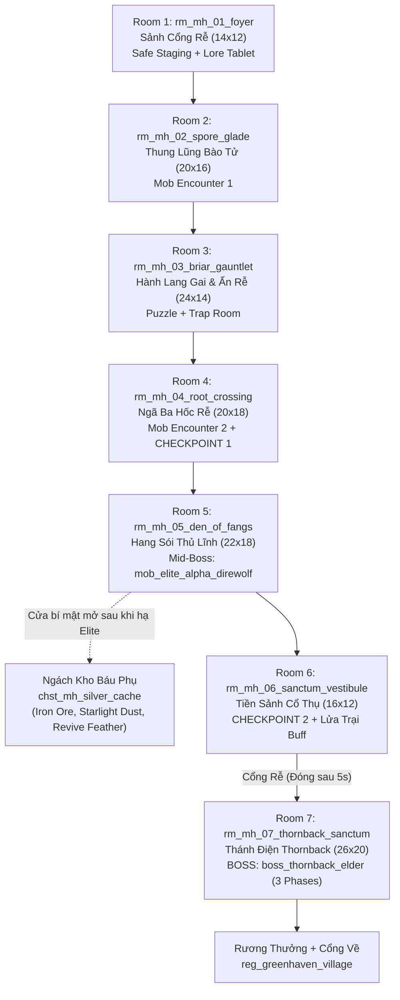
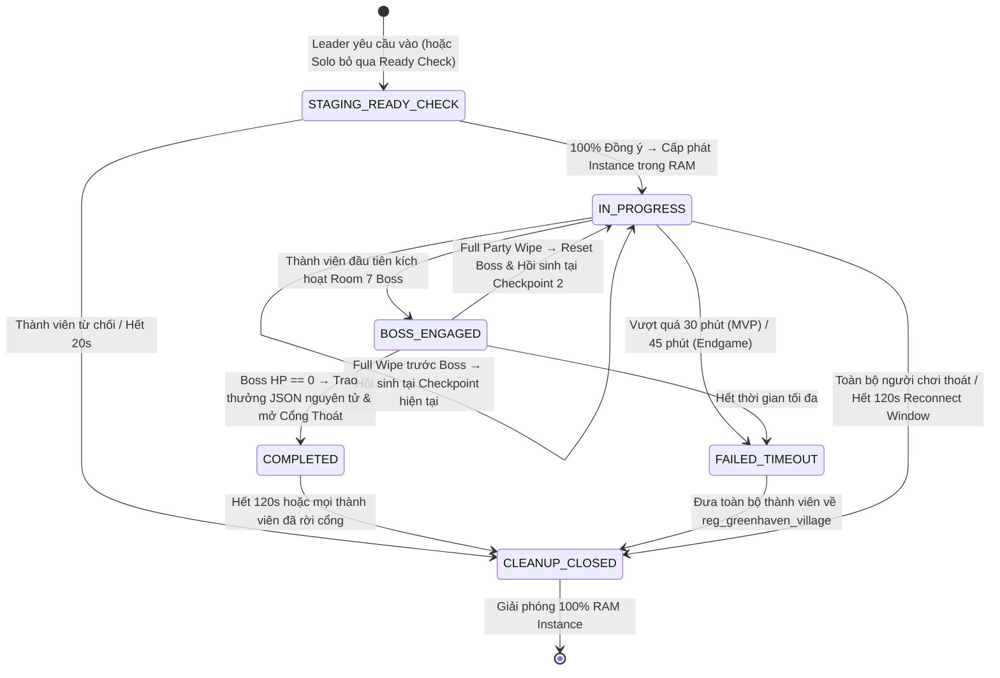

# 17 — Instanced Dungeon & Level Blueprint Design: Eldoria: Forgotten Wilds

**Trạng thái**: Hoàn thiện (Design Baseline v1.0)  
**Chế độ**: `DESIGN_AND_PLANNING_ONLY`  
**Cập nhật lần cuối**: 2026-11-19  
**Nguồn dữ liệu chuẩn (Single Source of Truth)**: [`game-data/bosses.json`](../../game-data/bosses.json), [`game-data/monsters.json`](../../game-data/monsters.json), [`game-data/items.json`](../../game-data/items.json)  
**Tài liệu quản trị**: [Constitution](../../.specify/memory/constitution.md) · [00-game-vision.md](./00-game-vision.md) · [15-monster-ai.md](./15-monster-ai.md) · [16-boss-design.md](./16-boss-design.md)

---

## 1. Mục tiêu Gameplay (Gameplay Objectives)

Hệ thống Hầm ngục Phân bản (Instanced Dungeons) là đấu trường kiểm nghiệm tổng hòa mọi kỹ năng của người chơi từ chiến đấu, sử dụng thực phẩm nông trại, phối hợp Party đến rèn vũ khí `+1..+10`:

1. **Hành trình phiêu lưu cô đặc 12–20 phút**: Một lượt đi hầm ngục không chỉ là "chạy thẳng vào đánh boss" mà là trải nghiệm có cao trào nhịp điệu rõ ràng: *Khởi động (Mob Room 1) → Tương tác môi trường/Giải đố bẫy (Puzzle/Trap Room) → Thử thách chiến thuật (Mob Room 2) → Cao trào phụ & Kho báu (Elite Mid-Boss + Chest) → Chuẩn bị Food Buff (Safe Vestibule) → Đỉnh cao 3 Phase (Boss Arena)*.
2. **Trải nghiệm công bằng cho cả Solo (1P) lẫn Co-op Party (2–4P)**: Mọi câu đố môi trường, ngưỡng sát thương và độ khó đều được thiết kế để 1 người chơi có kỹ năng hoàn toàn vượt qua được, đồng thời thưởng thêm `+10% / +20% / +30%` khi phối hợp cùng 2–4 bạn bè.
3. **Ổn định mạng & Tôn trọng công sức người chơi**: Cơ chế **Checkpoint giữa hầm ngục** giúp một pha wipe trước Boss không bắt người chơi đi lại toàn bộ các phòng quái thường, và **Cửa sổ Reconnect 120 giây** bảo vệ người chơi bị rớt mạng đột xuất khỏi mất lượt đi hay mất phần thưởng.
4. **Kiến trúc `DungeonInstance` gọn nhẹ trong RAM**: Chạy hoàn toàn trong tiến trình Modular Monolith NestJS (`DungeonInstanceManager` in-memory) với giới hạn tuổi thọ sạch, chỉ ghi kết quả cuối cùng (loot, Boss Token, EXP, cooldown) xuống cơ sở dữ liệu JSON cục bộ (`data/db/**/*.json`) mà không cần dịch vụ lưu trữ hay điều phối bên thứ ba nào.

---

## 2. User Stories

| ID | Vai trò | User Story | Milestone |
| :--- | :--- | :--- | :---: |
| **US-DNG-01** | Người chơi Solo MVP | Là một người chơi cấp 13 chơi một mình, tôi muốn bước vào cổng `dng_mossroot_hollow` tại `reg_whispering_forest`, vượt qua phòng bẫy gai, hạ Mid-Boss, mở rương phụ và đánh bại `boss_thornback_elder` để lấy `mat_thornback_heart` nâng cấp `bld_blacksmith` Lv 3. | M1 (MVP) |
| **US-DNG-02** | Đội trưởng Party | Là Party Leader của nhóm 4 người, tôi muốn khởi tạo Ready Check 20 giây ngay trước cổng hầm ngục để cả 4 thành viên cùng bước vào chung 1 `DungeonInstance` tách biệt khỏi người chơi ngoài bản đồ thế giới. | M1 (MVP) |
| **US-DNG-03** | Người chơi gặp sự cố mạng | Là một thành viên đang đánh đến phòng Mid-Boss nhưng bị đứt Wi-Fi 45 giây, tôi muốn khi đăng nhập lại trong vòng 120 giây hệ thống tự đưa tôi về đúng `DungeonInstance` đang chạy cùng đồng đội thay vì đá tôi về làng mất trắng. | M1 (MVP) |
| **US-DNG-04** | Người chơi thử thách | Là người chơi bị hạ gục trước Phase 3 của Boss, tôi muốn cả nhóm hồi sinh ngay tại Checkpoint tiền sảnh (Room 6) để ăn lại Food Buff, bàn lại chiến thuật phá trụ và thử lại ngay trong 30 giây. | M1 (MVP) |
| **US-DNG-05** | Người chơi dài hạn | Là người chơi đã vượt qua MVP, tôi muốn các hầm ngục tiếp theo (`dng_slag_foundry`, `dng_prism_sanctum`, `dng_glacial_citadel`, `dng_eclipse_throne`) mang tới cơ chế giải đố và môi trường ngày càng sâu sắc gắn với từng vùng đất. | M2–M5 |

---

## 3. Kiến trúc `DungeonInstance` & Vòng đời Hệ thống

### 3.1 Quản lý Vòng đời Instance trong RAM (`DungeonInstanceManager`)

Mỗi khi 1 người chơi Solo hoặc 1 Party (2–4 người) xác nhận vào hầm ngục, NestJS cấp phát một đối tượng `DungeonInstance` độc lập trong `Map<instanceId, DungeonInstance>`:

- **Tách biệt hoàn toàn (Spatial & Entity Isolation)**: Instance sở hữu riêng lưới va chạm (tham chiếu read-only tới NavGrid của Tiled Map `assets/maps/dng_*.tmj` dùng chung toàn server để tiết kiệm RAM), danh sách quái/elite/boss riêng, trạng thái cửa/bẫy/rương riêng và kênh broadcast WebSocket riêng (`room: dng:<instanceId>`).
- **Thời gian sống & Dọn dẹp (Lifecycle & Garbage Collection)**:
  - Giới hạn thời gian tối đa mỗi lượt đi: **`30 phút`** cho MVP (`dng_mossroot_hollow`), **`45 phút`** cho hầm ngục cấp cao (`M2–M5`).
  - Sau khi hạ Boss thành công (`COMPLETED`), mở Cổng Thoát về `reg_greenhaven_village` và giữ instance thêm **`120 giây`** để người chơi nhặt đồ/xem bảng tổng kết rồi đóng và giải phóng 100% RAM.
  - Nếu toàn bộ người chơi rời instance hoặc hết thời gian 120s reconnect mà không còn ai online (`activePlayers === 0`), instance tự động chuyển `CLEANUP_CLOSED` sau **`120 giây`** để không rò rỉ bộ nhớ.
- **Giả thuyết sức chứa RAM (`proposed / unverified`)**: Mỗi `DungeonInstance` chỉ lưu trạng thái động (vị trí ~25 thực thể + trạng thái bẫy/cửa, không nhân bản bản đồ tile tĩnh) ước tính tốn `< 1.5 MB RAM`; mục tiêu đề xuất hỗ trợ tối đa `50` instance song song trên 1 node NestJS (cần đo thực tế khi load test).

### 3.2 Quy tắc Nhập Hầm ngục (1–4 Player Entry), Scaling & Cooldown

1. **Điều kiện vào cổng**:
   - Đạt cấp độ tối thiểu (`minLevel = recommendedLevel - 3`, ví dụ `dng_mossroot_hollow` yêu cầu cấp tối thiểu `Lv 12`, gợi ý `Lv 15`).
   - Không còn thời gian chờ `instanceCooldownMinutes` của hầm ngục đó (`15m` cho `dng_mossroot_hollow`, `20m` Slag Foundry, `30m` Prism Sanctum, `45m` Glacial Citadel, `60m` Eclipse Throne — chỉ tính cooldown khi **hoàn thành hạ Boss**, đi thất bại/thoát giữa chừng KHÔNG bị khóa cooldown!).
   - **Ready Check (Party 2–4 người)**: Khi trưởng nhóm bấm *Vào Hầm Ngục*, toàn bộ thành viên đứng trong bán kính `256 px` quanh cổng nhận hộp thoại Ready Check `20 giây`. Chỉ khởi tạo instance khi `100%` thành viên nhấn Đồng ý và hợp lệ điều kiện.
2. **Chống Vào trễ (Late-Join Policy)**:
   - Không cho phép thêm thành viên mới vào Party rồi kéo vào giữa chừng khi `DungeonInstance` đã chuyển sang `IN_PROGRESS` (tức đã mở cửa Room 2 trở đi) để giữ chặt độ chính xác của bảng Scaling.
3. **Difficulty & Reward Scaling (Đồng nhất với `bosses.json`)**:
   - Mọi quái thường, Mid-Boss Elite và Boss trong hầm ngục đồng bộ theo quy mô Party tại lúc khởi tạo:
     - `1P`: `HP 1.00x`, `ATK 1.00x`, `Poise 1.00x`, `Reward Bonus +0%`
     - `2P`: `HP 1.75x`, `ATK 1.05x`, `Poise 1.45x`, `Reward Bonus +10%`
     - `3P`: `HP 2.45x`, `ATK 1.10x`, `Poise 1.85x`, `Reward Bonus +20%`
     - `4P`: `HP 3.10x`, `ATK 1.15x`, `Poise 2.25x`, `Reward Bonus +30%`

### 3.3 Checkpoint, Revive & Xử lý Wipe

- **Checkpoint tự động**: Mỗi hầm ngục có **2 điểm Checkpoint** (sau Room 4 và tại Room 6 trước cửa Boss). Khi ít nhất 1 thành viên bước vào vùng Checkpoint, máy chủ cập nhật `instance.activeCheckpointRoomId`, phát SFX chuông cổ nhẹ và hiện thông báo *"Đã kích hoạt Điểm Tập Kết"*.
- **Hồi sinh giữa trận (In-Combat Revive)**:
  - Thành viên tụt `0 HP` chuyển sang trạng thái `DOWNED` (nằm bất động, xem góc nhìn đồng đội, không thể di chuyển).
  - Đồng đội có thể đứng cạnh (`<= 48 px`) giữ phím `F` trong **`3.0 giây`** (bị ngắt nếu nhận sát thương) hoặc dùng `csm_revive_feather` (tức thì, hồi `50% HP/MP` + `3s` miễn sát thương, CD `120s`).
  - Trong phòng Boss, mỗi người chỉ được dùng tối đa **`1` lần tự hồi sinh (`self-revive`) bằng `csm_revive_feather`** mỗi lượt thử để giữ đúng độ căng thẳng cơ chế.
- **Full Party Wipe (Toàn đội gục ngã)**:
  - Khi `100%` thành viên trong phòng ở trạng thái `DOWNED` hoặc `DISCONNECTED`, sau `3 giây` server tự động đưa toàn bộ thành viên về **`activeCheckpointRoomId`** với `100% HP/MP/Stamina`, xóa Food Buff cũ (khuyến khích chuẩn bị thêm khẩu phần dự phòng) và **reset hoàn toàn phòng hiện tại** (nếu wipe ở Boss thì Boss về 100% HP + Phase 1 + đủ 4 trụ đá; các phòng quái đã dọn sạch trước Checkpoint vẫn giữ nguyên trạng thái đã dọn!).

### 3.4 Cửa sổ Kết nối lại 120 Giây (120-Second Disconnect Reconnect Window)

Đây là yêu cầu then chốt bảo vệ trải nghiệm online multiplayer thực tế:

1. **Khi Socket mất kết nối (`t = 0s`)**:
   - `DungeonInstance` KHÔNG loại bỏ người chơi ngay lập tức mà gắn trạng thái `DISCONNECTED_HOLD` và tạo bộ đếm `reconnectDeadlineMs = serverNow + 120_000`.
   - Trong `2 giây` đầu (tránh rớt mạng chớp nhoáng), nhân vật đứng yên; sau `2 giây`, để ngăn **Disconnect Exploit** (rút dây mạng giả bất tử né Boss Wipe), nhân vật mất khả năng miễn sát thương và nếu không có đồng đội bảo vệ vẫn có thể chuyển sang `DOWNED`.
2. **Khi Người chơi đăng nhập lại trong `<= 120 giây`**:
   - `AuthSessionService` phát hiện `character.activeDungeonInstanceId` vẫn còn hợp lệ trên RAM.
   - Client tự động tải lại đúng bản đồ hầm ngục, đồng bộ toàn bộ trạng thái phòng (cửa nào đã mở, rương nào đã nhận, Checkpoint hiện tại, Boss đang ở Phase mấy) và đưa nhân vật trở lại chính xác vị trí hợp lệ trong instance.
3. **Khi Quá `120 giây` không kết nối lại**:
   - Server gỡ `characterId` khỏi `DungeonInstance`, đặt tọa độ an toàn của nhân vật về điểm hồi sinh tại cổng làng `reg_greenhaven_village` (lưu vào `data/db/characters/<id>.json`), không trừ cooldown hầm ngục. Các phòng **chưa kích hoạt** phía trước tự điều chỉnh Scaling theo số thành viên còn lại (phòng đang đánh giữ nguyên scaling để tránh biến động HP đột ngột).

---

## 4. Bản thiết kế Chi tiết Hầm ngục MVP: `dng_mossroot_hollow` (Mossroot Hollow)

- **Tên tiếng Việt**: *Hốc Rễ Rêu Cổ* · **Milestone**: **M1 (MVP)**
- **Lối vào**: Cổng rễ cổ thụ phía Đông Nam `reg_whispering_forest` (tọa độ world `(142, 88)`)
- **Cấp độ**: Yêu cầu tối thiểu `Lv 12`, đề xuất `Lv 14–15`, trang bị gợi ý vũ khí `+4` đến `+6` (Blacksmith Lv 2)
- **Chủ đề Art Direction 16-bit**: Rễ cây cổ thụ khổng lồ đan vòm trần để lộ vài tia nắng xuyên sương, nền đá rêu ẩm tối dịu (`#243528` → `#3C5941`) giúp các vòng Telegraph đỏ cam của quái và Boss nổi bật tuyệt đối; các đốm bào tử phát sáng xanh lam dịu dẫn hướng mắt người chơi.
- **Thời lượng hoàn thành mục tiêu**: `12 – 18 phút`.

### 4.1 Sơ đồ Tô-pô 7 Phòng (Topological Layout)



### 4.2 Đặc tả Chi tiết Từng Phòng (`rm_mh_01` → `rm_mh_07`)

| Phòng | Kích thước | Thành phần Quái / Bẫy / Tương tác | Mục tiêu Thiết kế & Cách vượt qua (Solo & Co-op) |
| :--- | :---: | :--- | :--- |
| **Room 1**<br/>`rm_mh_01_foyer`<br/>*Sảnh Cổng Rễ* | `14×12 tiles` | • Bia đá Lore (*Lời Khẩn Cầu của Greenhaven*)<br/>• Lửa trại khởi hành (ăn Food Buff)<br/>• Cổng gỗ mở ngay khi bước qua vạch khởi động | Tạo không khí nhập vai, cho phép kiểm tra túi đồ/thuốc trước khi chính thức bước vào `IN_PROGRESS`. |
| **Room 2**<br/>`rm_mh_02_spore_glade`<br/>*Thung Lũng Bào Tử* | `20×16 tiles` | **Wave 1**: `2 × mob_spore_cap` (Lv 7) + `2 × mob_forest_goblin` (Lv 3)<br/>**Wave 2** (khi còn <= 1 quái Wave 1): `2 × mob_timber_wolf` (Lv 5) + `1 × mob_spore_cap`<br/>• 2 bụi bào tử tĩnh trên sàn tự nổ khi bị đánh trúng (có thể đánh nổ trúng cả quái!) | Làm nóng tay, dạy người chơi giữ khoảng cách với `toxic_spore_burst`, tận dụng bụi bào tử môi trường gây sát thương lan lên đàn sói và chặn `mob_forest_goblin` bỏ chạy (`FLEE`). Dọn xong 2 wave tự mở rào dây leo sang Room 3. |
| **Room 3**<br/>`rm_mh_03_briar_gauntlet`<br/>*Hành Lang Gai & Ấn Rễ* | `24×14 tiles` | • **Bẫy Gai Định kỳ (`trap_floor_briar`)**: 3 dải gai mọc theo nhịp `1.5s cảnh báo → 1.5s sát thương → 2.0s nghỉ` (`18% Max HP` + Bleed nếu dính)<br/>• **Câu đố 3 Bệ Ấn Rễ (`pzl_root_seals`)**: 3 bệ đá phát sáng ở Bắc, Trung, Nam. Khi giẫm lên hoặc đánh kỹ năng `FIRE`/`LIGHT` vào 1 bệ, bệ sáng trong **`14 giây`** — đủ thời gian cho **1 người chơi Solo** chạy/lướt kích hoạt cả 3 bệ theo tuyến ngắn, hoặc **Party 3 người** kích hoạt đồng thời trong 2 giây!<br/>• `2 × mob_hollow_bat` (Lv 11) xuất hiện quấy rối sau khi kích hoạt bệ thứ 2 | Chuyển nhịp từ chiến đấu sang di chuyển tinh tế & quan sát; tuyệt đối không khóa người chơi Solo nhờ bộ đếm `14 giây` công bằng. Khi cả 3 bệ cùng sáng, rào gai khóa cửa Room 4 rút xuống vĩnh viễn và toàn bộ bẫy sàn trong Room 3 tắt để việc quay lại an toàn. |
| **Room 4**<br/>`rm_mh_04_root_crossing`<br/>*Ngã Ba Hốc Rễ* | `20×18 tiles` | **Tổ hợp chiến thuật**: `2 × mob_root_crawler` (Lv 13, hàng trước) + `2 × mob_goblin_shaman` (Lv 14, bục sau, `HEALER_FIRST`) + `1 × mob_hollow_bat` (Lv 11, `RANGED_FIRST`)<br/>• **CHECKPOINT 1** kích hoạt ở cuối phòng ngay khi dọn sạch quái | Kiểm tra kỹ năng chọn mục tiêu ưu tiên: nếu để `mob_goblin_shaman` tự do bắn `totem_lightning_ring` vào Healer (`chr_seraphina_dawn`) trong khi `mob_root_crawler` trói rễ, party sẽ chịu áp lực lớn. Chiến thuật chuẩn: `chr_lyra_windrunner` hoặc `chr_kael_vanguard` bứt tốc hạ Shaman trước. |
| **Room 5**<br/>`rm_mh_05_den_of_fangs`<br/>*Hang Sói Thủ Lĩnh* | `22×18 tiles` | **Mid-Boss (Elite)**: `1 × mob_elite_alpha_direwolf` (Lv 12, `HP 2,550` solo / `7,905` 4P, gọi tối đa `2 × mob_timber_wolf` khi hú `pack_howl_burst`)<br/>• **Kho báu phụ (`chst_mh_silver_cache`)**: Ngách phía Bắc mở khóa ngay khi Alpha Direwolf bị hạ — chứa thưởng cá nhân cho mỗi thành viên: `6–10 mat_iron_ore`, `2–4 mat_starlight_dust`, `2 csm_hp_potion_med`, `1 csm_revive_feather`, và `120–180 Gold` | Đóng vai trò bài kiểm tra thực hành trước Boss chính: luyện đọc `gale_pounce_chain`, phá Poise (`265` solo) ngắt tiếng hú gọi bầy, đồng thời tiếp tế ngay `csm_revive_feather` và bình máu trước khi gặp `boss_thornback_elder`. |
| **Room 6**<br/>`rm_mh_06_sanctum_vestibule`<br/>*Tiền Sảnh Cổ Thụ* | `16×12 tiles` | • **CHECKPOINT 2** (tự động kích hoạt khi bước vào)<br/>• Lửa trại hồi phục 100% HP/MP/Stamina ngoài chiến đấu<br/>• Đe dã chiến (dùng `csm_repair_kit` sửa độ bền trang bị)<br/>• Tấm bảng gợi ý chiến thuật tinh tế (*"Nhựa cổ thụ sợ lửa; những cột đá rêu đủ cứng để làm chấn động cả gã khổng lồ"*) | Khoảng lặng giảm nhịp (pacing breather) giúp người chơi ăn `csm_golden_roast` / `csm_ember_curry`, kiểm tra hồi chiêu Ultimate và chuẩn bị tinh thần bước vào phòng Boss. |
| **Room 7**<br/>`rm_mh_07_thornback_sanctum`<br/>*Thánh Điện Thornback* | `26×20 tiles` | • **BOSS**: `boss_thornback_elder` (Lv 15, 3 Phases, `10,500 HP` solo / `32,550 HP` 4P)<br/>• 4 trụ đá phá hủy `pil_moss_nw/ne/sw/se`, `hz_briar_perimeter` (P2), `hz_toxic_sap_pool` (P3)<br/>• Sau khi hạ Boss: xuất hiện **Rương Chiến Thắng** + **Cổng Dịch Chuyển** về `reg_greenhaven_village` (đếm ngược đóng instance `120s`) | Đỉnh cao Vertical Slice MVP: kiểm nghiệm toàn bộ hệ thống Dodge, Parry, Fire Elemental Weakness, Poise Break, dụ đâm trụ đá và phối hợp Party. |

---

## 5. Lộ trình 4 Hầm ngục Post-MVP (`M2 – M5` Roadmap Summaries)

| Dungeon ID | Tên & Vùng | Milestone | Cấp | Mid-Boss (Elite) | Boss Chính | Cơ chế Phòng & Giải đố Đặc trưng | Thời lượng / CD |
| :--- | :--- | :---: | :-: | :--- | :--- | :--- | :---: |
| **`dng_slag_foundry`** | *Xưởng Đúc Xỉ Nung*<br/>(`reg_ironpeak_mountains`) | **M2** | 26–30 | `mob_elite_magma_colossus` (Lv 27) | `boss_ignis_forgelord` (Lv 30, `FIRE`) | 7 phòng dọc dây chuyền đúc quặng: cầu trượt qua rãnh dung nham luân phiên; phòng giải đố **gạt cần đổi hướng xe goòng quặng** phá tường xỉ bịt lối; phòng thử thách kết hợp `mob_cinder_drake` & `mob_slag_elemental` với các van sương làm mát dạy sẵn cơ chế Boss. | `15–22p`<br/>CD `20m` |
| **`dng_prism_sanctum`** | *Thánh Điện Lăng Kính*<br/>(`reg_crystal_caverns`) | **M3** | 45–50 | `mob_elite_crystal_matriarch` (Lv 43) | `boss_prism_leviathan` (Lv 50, `LIGHTNING`) | 7 phòng hang tinh thể ngập nước nông: phòng giải đố **xoay 3 lăng kính dẫn tia sáng** mở phong ấn cửa (điều khiển 1 người được); bệ đá cách điện xen kẽ hồ nhiễm điện định kỳ; giao chiến với `mob_cavern_hydroid`, `mob_amethyst_stalker`, `mob_voltaic_jelly`. | `18–25p`<br/>CD `30m` |
| **`dng_glacial_citadel`** | *Thành Lũy Băng Giá*<br/>(`reg_frostbound_highlands`) | **M4** | 70–75 | `mob_elite_permafrost_mammoth` (Lv 73) | `boss_boreas_frostking` (Lv 75, `FROST`) | 8 phòng thành cổ tuyết trắng: áp dụng cơ chế **`Hypothermia`** xuyên suốt hành lang ngoài trời, buộc party hộ tống/thắp chuỗi **Chậu Lửa Cổ** mở đường qua cầu gió tuyết (`hz_blizzard_gale`); đụng độ `mob_glacier_yeti`, `mob_ice_valkyrie_shade`, `mob_blizzard_elemental`. | `20–28p`<br/>CD `45m` |
| **`dng_eclipse_throne`** | *Ngai Vàng Nhật Thực*<br/>(`reg_abyssal_kingdom`) | **M5** | 95–100 | `mob_elite_dread_harbinger` (Lv 98) | `boss_malakor_abyss` (Lv 100, `SHADOW`, **4 Phases**) | 8 phòng điện thờ Hư Không đỉnh cao endgame: hành lang nền đá vỡ theo nhịp thời gian; **Phòng Thử Thách 4 Cột Ấn Mặt Trời** giới thiệu sớm cơ chế thanh tẩy bằng `LIGHT` hoặc tương tác; trận tuyến `mob_void_thrall`, `mob_abyssal_knight`, `mob_eclipse_weaver` trước khi tiến lên ngai vàng 4 Phase. | `25–35p`<br/>CD `60m` |

---

## 6. Functional Requirements, Business Rules, I/O & State Transitions

### 6.1 Functional Requirements & Business Rules
- **FR-DNG-01**: Hỗ trợ khởi tạo, quản lý và dọn dẹp đồng thời nhiều `DungeonInstance` trong RAM NestJS với sự cô lập tuyệt đối về thực thể, va chạm, chat kênh party và loot.
- **FR-DNG-02**: Thực thi Ready Check `20s`, đồng bộ Checkpoint, cơ chế `DOWNED` / Revive, Wipe Reset và cửa sổ Reconnect `120s`.
- **FR-DNG-03**: Ghi nhận nguyên tử phần thưởng rương phụ (`chst_*`), rương Boss, EXP, Gold, `BOSS_TOKEN`, `STARLIGHT_SHARD` và thời điểm hoàn thành xuống JSON DB qua `JsonDatabaseEngine`.
- **BR-DNG-01**: Mỗi rương kho báu phụ (`chst_mh_silver_cache`) chỉ có thể mở **1 lần duy nhất cho mỗi thành viên trong 1 instance**, chống tạo vòng lặp rời-vào để mở rương nhiều lần (người chơi thoát giữa chừng tạo instance mới bị giới hạn tối đa `3` rương phụ/giờ theo `characterId` để chống chỉ farm Room 5 mà không đánh Boss!).
- **BR-DNG-02**: Chỉ kích hoạt `instanceCooldownMinutes` khi Boss cuối bị hạ gục (`COMPLETED`); thoát sớm hoặc hết giờ không khóa lượt.

### 6.2 Input và Output (Protocol Contracts)

| Endpoint / Event | Hướng | Payload Input chính | Output / Broadcast chính |
| :--- | :---: | :--- | :--- |
| `POST /api/v1/dungeons/:dungeonId/enter` | Client → Server | `{ partyId?, idempotencyKey }` | `{ ok, readyCheckId, expiresAtMs }` (hoặc trả ngay `{ instanceId }` nếu Solo) |
| `ws: dungeon.ready.respond` | Client → Server | `{ readyCheckId, accept: boolean }` | Broadcast `dungeon.instance.ready` `{ instanceId, mapAssetKey, spawnRoomId, partyScaling }` |
| `ws: dungeon.interact` | Client → Server | `{ instanceId, objectId, action: "ACTIVATE_SEAL"\|"OPEN_CHEST"\|"USE_CAMPFIRE"\|"EXIT_PORTAL" }` | Ack + Broadcast `dungeon.object.updated` (và `inventoryDelta` khi mở rương) |
| `ws: dungeon.revive` | Client → Server | `{ instanceId, targetCharacterId, mode: "CHANNEL_HELP"\|"REVIVE_FEATHER" }` | Broadcast `dungeon.member.revived` `{ targetId, hp, mp, invulnMs }` |
| `ws: dungeon.reconnect.restore` | Server → Client | (Tự động đẩy sau khi xác thực lại socket trong `<= 120s`) | Full snapshot `{ instanceId, currentRoomId, activeCheckpointRoomId, clearedRooms, doorsState, bossState }` |

### 6.3 State Transitions (`DungeonInstance` Lifecycle)



---

## 7. JSON Data Model, Dependencies, UI, Edge Cases, Failure & Security

### 7.1 JSON Data Model (100% Local JSON Storage + RAM Ephemeral Instance)

Trạng thái thực thi của `DungeonInstance` (phòng đã mở, bẫy, quái đang sống, bộ đếm 120s reconnect) nằm hoàn toàn trong RAM của `DungeonInstanceManager` (tự chủ 100% trong tiến trình NestJS, không ghi đĩa mỗi tick). Chỉ kết quả bền vững (rương phụ/giờ, cooldown hoàn thành, kỷ lục tốc độ, rương thưởng) ghi vào `data/db/characters/<characterId>.json` & `data/db/inventories/<characterId>.json` qua WAL:

```json
// Trích data/db/characters/chr_inst_001042.json
{
  "dungeonHistory": {
    "dng_mossroot_hollow": {
      "completions": 5,
      "lastCompletedAtMs": 1795092500000,
      "cooldownUntilMs": 1795093400000,
      "sideChestsOpenedLastHourMs": [1795091200000],
      "bestClearSeconds": 842
    }
  },
  "lastSafeOverworldPos": {
    "regionId": "reg_whispering_forest",
    "x": 4544,
    "y": 2816
  }
}
```

### 7.2 Dependencies & UI Interactions
- **Dependencies**: `15-monster-ai.md` (AI mob & Elite trong Room 2/4/5), `16-boss-design.md` (phòng Boss cuối), `20-multiplayer-design.md` (Party, Ready Check, Session Recovery), `docs/art-direction/tileset-standard.md` (Tiled `.tmj` layers: `ground`, `decor`, `collision`, `traps`, `room_triggers`, `checkpoints`).
- **UI Interactions**:
  - **Cổng Hầm Ngục**: Hiển thị modal thông tin rõ ràng (Cấp đề xuất, Boss đại diện, Trạng thái thưởng Weekly `STARLIGHT_SHARD`, nút *Vào Solo* hoặc *Gọi Party Ready Check*).
  - **HUD Tiến độ Hầm Ngục (Dungeon Tracker)**: Thay thế tạm khu vực Quest Tracker góc phải bằng mục tiêu phòng hiện tại (*"Phòng 3/7: Kích hoạt 3 Bệ Ấn Rễ (2/3)"*), đồng hồ đếm thời gian còn lại (`24:12`) và thanh trạng thái đồng đội (hiển thị icon *Mất kết nối — còn 98s* nếu có bạn rớt mạng).
  - **Màn hình Tổng kết (`Dungeon Clear Summary`)**: Hiển thị thời gian hoàn thành, hạng đóng góp công bằng, danh sách vật phẩm nhận được và nút *Rời về Làng*.

### 7.3 Edge Cases, Failure Behavior & Security Requirements
- **Edge Case 1 — Đội trưởng bị rớt mạng trong hầm ngục**: Quyền điều khiển Party tạm chuyển cho thành viên online lâu nhất mà không đóng instance; đội trưởng vẫn giữ nguyên quyền quay lại trong `120 giây`.
- **Edge Case 2 — Đang mở rương phụ `chst_mh_silver_cache` thì hết giờ 30 phút**: Server hoàn tất giao dịch mở rương nếu vào lock trước mốc `timeoutMs`, sau đó mới đóng instance an toàn.
- **Edge Case 3 — 1 người chơi đứng ngoài Room 3 khi đồng đội kích hoạt câu đố**: Cổng Room 3 chỉ đóng chiều tiến lên Room 4 (không khóa nhốt chiều đi vào từ Room 2), tránh tách rời thành viên vô tình đi chậm.
- **Failure Behavior**: Nếu NestJS restart đột xuất trong khi các `DungeonInstance` đang chạy trên RAM, khi người chơi kết nối lại `AuthSessionService` phát hiện `instanceId` không còn tồn tại trong RAM → lập tức đặt người chơi trở về `lastSafeOverworldPos` tại cửa hầm ngục (không khóa cooldown, giữ nguyên mọi vật phẩm đã nhặt từ rương phụ trước lúc crash vì rương đã flush WAL tức thì!).
- **Security Requirements**:
  - **Chống Farm Rương Phụ Lặp (`Side-Chest Reset Exploit`)**: Giới hạn tối đa `3` lần mở rương phụ mỗi giờ theo `characterId` lưu bền vững trong JSON.
  - **Chống Xuyên Tường / Skip Phòng (Room Sequence Enforcement)**: Cửa khóa giữa các phòng là lớp va chạm thực trên server; kích hoạt `Boss Arena` bị chặn hoàn toàn trên server nếu cờ `room5EliteCleared !== true` (dù client có gửi gói tọa độ giả vào Room 7).
  - **Chống Nhân bản Instance / Spam RAM**: Mỗi `characterId` hoặc `partyId` chỉ được sở hữu tối đa **`1`** `DungeonInstance` đang hoạt động tại một thời điểm, kèm rate-limit tạo instance `1 lần / 15 giây`.

---

## 8. Acceptance Criteria & Test Scenarios

### 8.1 Acceptance Criteria (AC)
- **AC-DNG-01**: Toàn bộ 7 phòng của `dng_mossroot_hollow` vận hành trọn vẹn từ vào cổng, giải đố 3 bệ ấn (cả Solo lẫn Party), Checkpoint 1–2, hạ Mid-Boss `mob_elite_alpha_direwolf`, mở rương phụ đến hạ `boss_thornback_elder` và thoát về làng.
- **AC-DNG-02**: Ngắt kết nối mạng và đăng nhập lại trong vòng `120 giây` khôi phục chính xác người chơi vào đúng `DungeonInstance` và trạng thái phòng hiện hành; vượt `120 giây` trả nhân vật an toàn về `reg_greenhaven_village`.
- **AC-DNG-03**: Full Party Wipe tại Room 7 đưa cả đội về Checkpoint 2 (`rm_mh_06_sanctum_vestibule`) và reset sạch Boss về Phase 1 mà không bắt đánh lại Room 2–5.
- **AC-DNG-04**: Không thể kích hoạt Boss Room nếu chưa hoàn thành chuỗi điều kiện mở cửa các phòng trước đó trên server.

### 8.2 Test Scenarios (Giai đoạn Thiết kế — Chưa thực thi Production)

| Test ID | Loại kiểm thử | Kịch bản kiểm tra | Kết quả mong đợi |
| :--- | :--- | :--- | :--- |
| **TS-DNG-01** | E2E / Solo Flow | 1 người chơi Lv 15 đi toàn bộ 7 phòng `dng_mossroot_hollow`, giải đố 3 bệ ấn trong khung `14s`, hạ Elite và Boss | Vượt qua toàn bộ không cần đồng đội, nhận đúng thưởng 1P, khóa cooldown `15 phút` trong JSON DB. |
| **TS-DNG-02** | Integration / Reconnect | Party 2 người vào đến Room 5; ngắt socket Người 2 trong `60s` rồi kết nối lại; lặp lại phép thử ngắt `130s` | Lần 1 (`60s`): Người 2 phục hồi đúng vào Room 5 cùng instance; Lần 2 (`130s`): Người 2 bị chuyển an toàn về `reg_greenhaven_village`, instance vẫn chạy cho Người 1. |
| **TS-DNG-03** | Integration / Wipe | Party 4 người đã qua Checkpoint 2, wipe toàn bộ tại Phase 2 `boss_thornback_elder` | Cả 4 hồi sinh tại Room 6 với 100% HP/MP; Boss reset Phase 1 100% HP; Room 2–5 giữ nguyên trạng thái đã dọn. |
| **TS-DNG-04** | Security / Room Skip | Client giả mạo gửi tọa độ trực tiếp vào Room 7 (`rm_mh_07_thornback_sanctum`) khi mới ở Room 1 | Server bác bỏ gói di chuyển (teleport violation), giữ nhân vật tại Room 1 và từ chối kích hoạt Boss. |
| **TS-DNG-05** | Security / Chest Farm | Người chơi vào Room 5 mở `chst_mh_silver_cache`, thoát ra reset làm lại 4 lần trong 30 phút | 3 lần đầu mở rương bình thường; lần thứ 4 rương hiển thị đã đạt giới hạn `3/giờ` (`ERR_CHEST_HOURLY_LIMIT`). |
| **TS-DNG-06** | Failure / Crash Recovery | Khởi động lại đột ngột game server khi có 3 `DungeonInstance` đang chạy ở Room 4 | Khi người chơi đăng nhập lại, tất cả được đặt an toàn tại `lastSafeOverworldPos`, không bị kẹt bản đồ hỏng và không bị phạt cooldown `15 phút`. |
