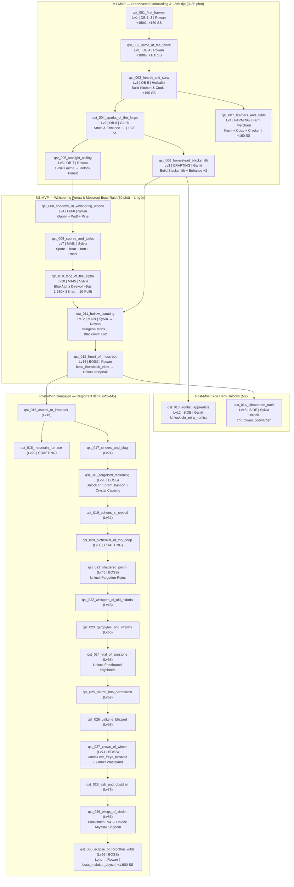
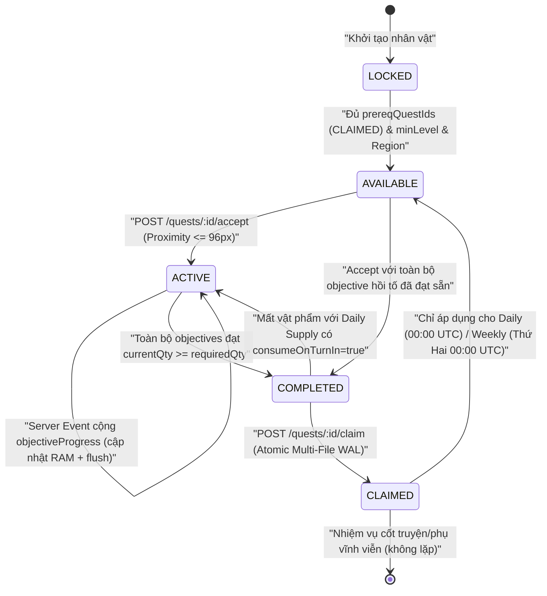

# 18 — Quest & NPC System Design: Eldoria: Forgotten Wilds

**Trạng thái**: Hoàn thiện (Design Baseline v1.0)  
**Chế độ**: `DESIGN_AND_PLANNING_ONLY`  
**Cập nhật lần cuối**: 2026-11-19  
**Nguồn dữ liệu chuẩn (Single Source of Truth)**: [`game-data/quests.json`](../../game-data/quests.json), [`game-data/recipes.json`](../../game-data/recipes.json), [`game-data/items.json`](../../game-data/items.json), [`game-data/bosses.json`](../../game-data/bosses.json), [`game-data/gacha-banners.json`](../../game-data/gacha-banners.json)  
**Tài liệu quản trị**: [Constitution](../../.specify/memory/constitution.md) · [00-game-vision.md](./00-game-vision.md) · [02-core-gameplay-loop.md](./02-core-gameplay-loop.md) · [03-world-building.md](./03-world-building.md) · [database-design.md](../architecture/database-design.md) · [api-contracts.md](../architecture/api-contracts.md)

---

## 1. Mục tiêu Gameplay (Gameplay Objectives)

Hệ thống Nhiệm vụ (Quest) và Nhân vật Không phải Người chơi (NPC) đóng vai trò sợi chỉ đỏ dẫn dắt trải nghiệm người chơi xuyên suốt vòng lặp `Explore → Gather → Combat → Loot → Craft → Upgrade → Build → Unlock → Boss Battle → New Region` của **Eldoria: Forgotten Wilds**:

1. **Dạy gameplay bằng hành động, không tường chữ (Gameplay-First Onboarding)**: Chuỗi **12 nhiệm vụ MVP** (`qst_001_first_harvest` đến `qst_012_heart_of_mossroot`) dẫn dắt người chơi từ phút 0 tại sân trước `bld_player_house` ở `reg_greenhaven_village` qua mọi cơ chế cốt lõi (chặt gỗ, nông trại, chiến đấu, nấu ăn, luyện quặng, cường hóa `+1..+2`, quay Gacha nội tệ mẫu, nuôi gà, thám hiểm `reg_whispering_forest`, săn Elite `mob_elite_alpha_direwolf` và đột kích `boss_thornback_elder`) chỉ bằng hội thoại súc tích 1–2 câu và chỉ dẫn trực quan trong thế giới.
2. **Bảo đảm trải nghiệm F2P lành mạnh thông qua lộ trình phần thưởng minh bạch**: Toàn bộ **12 nhiệm vụ MVP** trao **`2,400 STARLIGHT_SHARD` gộp** (**`2,240 STARLIGHT_SHARD` ròng** sau khi tiêu thụ `160` shard làm nhiệm vụ mẫu `qst_005_starlight_calling`), giúp người chơi chắc chắn chạm mốc **`1,600+ STARLIGHT_SHARD`** cho lượt quay 10 lần (10-pull) đầu tiên ngay khi hạ `mob_elite_alpha_direwolf` (`qst_010_fang_of_the_alpha`) mà không cần nạp tiền.
3. **Liên kết tự nhiên giữa cốt truyện 8 khu vực và tiến trình mở khóa**: Toàn bộ **30 nhiệm vụ** (`12` MVP + `18` Post-MVP) phủ kín đủ **8 vùng đất** từ `reg_greenhaven_village` đến `reg_abyssal_kingdom`, đóng vai trò cổng mở khóa khu vực (`unlockRegionId`) và chiêu mộ miễn phí 4 nhân vật qua gameplay (`chr_mira_ironfist`, `chr_rowan_tidewarden`, `chr_bram_bastion`, `chr_freya_frostveil`).
4. **Thế giới NPC sống động, đáng tin cậy và thân thiện**: Mỗi NPC sở hữu bản sắc nghề nghiệp, giọng thoại đặc trưng, lịch sinh hoạt theo chu kỳ Ngày/Đêm 24 phút (`ASM-007`), danh mục cửa hàng/trạm chế tạo công cộng hoặc đổi `BOSS_TOKEN` rõ ràng — nhưng **không bao giờ khóa dịch vụ hoặc làm gián đoạn nhiệm vụ vào ban đêm**.
5. **Toàn vẹn máy chủ & lưu trữ 100% JSON cục bộ**: Mọi thao tác nhận nhiệm vụ, cập nhật tiến độ mục tiêu và trả thưởng đều được xác thực hoàn toàn trên NestJS server (bao gồm khoảng cách tương tác `<= 96 px`), ghi nguyên tử bằng Multi-File WAL xuống `data/db/characters/<characterId>.json`, `data/db/inventories/<characterId>.json` và `data/db/ledgers/currency-ledger-<YYYY-MM>.json` (Constitution Principle I & II).

---

## 2. User Stories

| ID | Vai trò | User Story | Milestone |
| :--- | :--- | :--- | :---: |
| **US-QST-01** | Người chơi mới | Là người chơi vừa bước ra khỏi `bld_player_house`, tôi muốn thấy dấu `!` vàng trên đầu `npc_elder_rowan` và hoàn thành ngay `qst_001_first_harvest` trong 5 phút đầu để hiểu cách chặt gỗ, thu hoạch, gieo hạt và nhận thưởng đầu tay. | M1 (MVP) |
| **US-QST-02** | Người chơi Craft & Farm | Là người chơi yêu thích xây dựng và nông trại, tôi muốn `npc_smith_garrik`, `npc_village_herbalist` và `npc_farm_merchant` giao các nhiệm vụ nhánh song song (`qst_006`, `qst_007`) gắn với việc dựng `bld_blacksmith`, `bld_farm_plot`, `bld_chicken_coop` và nuôi `anm_meadow_chicken`. | M1 (MVP) |
| **US-QST-03** | Người chơi F2P | Là người chơi không nạp tiền, tôi muốn lộ trình nhiệm vụ chính đến `qst_010_fang_of_the_alpha` cung cấp đủ `STARLIGHT_SHARD` để thực hiện lượt 10-pull đầu tiên và các nhiệm vụ Post-MVP cho phép mở khóa thêm nhân vật miễn phí như `chr_mira_ironfist` và `chr_bram_bastion`. | M1–M4 |
| **US-QST-04** | Thành viên Party | Là thành viên tổ đội 4 người cùng vào `dng_mossroot_hollow`, tôi muốn khi cả đội hạ `boss_thornback_elder`, mọi thành viên đủ điều kiện tham chiến đều được cập nhật mục tiêu `obj_012_boss` đồng thời mà không tranh giành đòn kết liễu. | M1 (MVP) |
| **US-QST-05** | Người chơi bận rộn | Là người chơi có 30–60 phút/ngày sau khi xong chuỗi 12 nhiệm vụ MVP, tôi muốn có các Đơn Đặt Hàng Hàng Ngày (Daily Commissions) và Truy Nã Boss Hàng Tuần (Weekly Bounties) tại làng để tiếp tục kiếm `GOLD`, `CRAFTING_TOKEN`, `BOSS_TOKEN` và `STARLIGHT_SHARD` ổn định. | M1 (MVP) |
| **US-QST-06** | Người chơi khám phá 8 vùng | Là người chơi chinh phục dài hạn, tôi muốn mỗi vùng đất mới từ `reg_ironpeak_mountains` đến `reg_abyssal_kingdom` có NPC chỉ huy/học giả riêng kể tiếp câu chuyện Rạn Nứt Nhật Thực của Malakor và dẫn lối tới Boss cuối `boss_malakor_abyss`. | M2–M5 |

---

## 3. Functional Requirements — Danh mục NPC & Catalog Đầy đủ 30 Nhiệm vụ

### 3.1 Phân loại Vai trò NPC & Quy ước Lịch Sinh hoạt

Mọi NPC trong **Eldoria: Forgotten Wilds** được phân nhóm chức năng rõ ràng (một NPC có thể kiêm nhiệm nhiều thẻ vai trò):

| Vai trò (`NpcRoleTag`) | Chức năng Hệ thống | Ràng buộc Xác thực Server |
| :--- | :--- | :--- |
| `QUEST_GIVER` | Giao nhiệm vụ (`AVAILABLE → ACTIVE`) và tiếp nhận trả nhiệm vụ (`COMPLETED → CLAIMED`) khớp `giverNpcId` / `turnInNpcId` trong `game-data/quests.json`. | Khoảng cách Euclidean `<= 96 px` (`3 tiles`), đúng `zoneId`, kiểm tra `prereqQuestIds` & `minLevel`. |
| `MERCHANT` | Bán vật phẩm tiêu hao (`csm_*`), hạt giống (`sed_*`), động vật (`anm_*`) theo bảng giá cố định; thu mua vật phẩm không bị khóa theo `sellPriceGold` trong `items.json`. | Kiểm tra quyền sở hữu `ItemInstance`, `bound`/`locked` flag, giao dịch nguyên tử WAL + `CurrencyLedger`. |
| `PUBLIC_CRAFT_STATION` | Cung cấp trạm chế tạo công cộng bậc cơ bản (nêu tại `recipes.json[].publicStationNpcId`) và cường hóa tối đa `+2` (tại `npc_smith_garrik`) trước khi người chơi xây trạm riêng. | Áp dụng `publicStationFeeMultiplier = 1.0`, khóa cứng trần cường hóa công cộng `+2` (`BR-LOOP-06`). |
| `SERVICE_PROVIDER` | Cung cấp dịch vụ chuyên biệt: sửa trang bị bằng Gold (`npc_smith_garrik`), tẩy điểm thuộc tính Respec `250 × Level` Gold (`npc_elder_rowan`), cứu trợ hạt giống tân thủ (`npc_farm_merchant`). | Kiểm tra số dư `GOLD`, ghi sổ cái `reasonCode` riêng biệt. |
| `TOKEN_EXCHANGE` | Đổi `BOSS_TOKEN` lấy mảnh giáp bộ/lõi Boss (Bad-Luck Protection) hoặc đổi `CRAFTING_TOKEN` lấy bản vẽ hậu MVP. | Xác thực số dư token, giới hạn đổi theo tài khoản/tuần nếu có. |
| `LORE_AMBIENT` | Cung cấp truyền thuyết vùng đất, gợi ý khắc chế nguyên tố Boss và không khí sống động tại tiền đồn. | Chỉ đọc thoại, không phát sinh ghi đĩa JSON. |

- **Quy tắc Lịch Sinh hoạt (Schedule & 24/7 Accessibility)**:
  - Theo chu kỳ Ngày/Đêm `24 phút` thực (`ASM-007`: `DAWN 1p`, `DAY 14p`, `DUSK 3p`, `NIGHT 6p`), NPC ở `reg_greenhaven_village` có chuyển đổi trạng thái hình ảnh sinh động (ban ngày làm việc ngoài sân/quầy; hoàng hôn thắp đèn lồng; ban đêm đứng gần lò rèn/hiên nhà ấm sáng).
  - **Quy tắc chống khóa trải nghiệm (Zero Soft-Lock Schedule)**: Toàn bộ NPC có thẻ `QUEST_GIVER`, `MERCHANT`, `PUBLIC_CRAFT_STATION` hoặc `SERVICE_PROVIDER` **luôn duy trì phạm vi tương tác hoạt động 24/24 giờ trong game**, không bao giờ đóng cửa biến mất vào ban đêm gây gián đoạn người chơi online múi giờ khác nhau.

---

### 3.2 Hồ sơ Chi tiết 6 NPC MVP (`reg_greenhaven_village` & `reg_whispering_forest`)

Toàn bộ 6 NPC dưới đây được liên kết trực tiếp với `game-data/quests.json` và `game-data/recipes.json` trong Vertical Slice MVP (`M1`):

| NPC ID | Tên & Danh hiệu | Vùng & Zone (`zon_*`) | Vai trò | Lịch Sinh hoạt (24p/ngày) | Giọng thoại & Cá tính | Menu Cửa hàng / Dịch vụ Chính | Móc Nhiệm vụ (`quests.json`) |
| :--- | :--- | :--- | :--- | :--- | :--- | :--- | :--- |
| **`npc_elder_rowan`** | **Elder Rowan** — Trưởng Làng Greenhaven | `reg_greenhaven_village` (`zon_greenhaven_square`, gần Đài phun nước & lối ra `zon_player_homestead`) | `QUEST_GIVER`, `SERVICE_PROVIDER` | `DAY`: Đứng trước Đài phun nước đón tân thủ.<br/>`DUSK/NIGHT`: Cầm đèn lồng đứng cạnh Bảng Tin Làng (cách 2 tile). | Ấm áp, điềm đạm, khích lệ hành động ngắn gọn (tối đa 2 câu), am hiểu lịch sử Trục Ấn Ánh Sao. | - Bảng **Daily Commissions** (Mở sau `qst_005`).<br/>- Dịch vụ **Tẩy điểm Thuộc tính (Respec)**: `250 × Level` `GOLD`.<br/>- Đổi quà thành tựu khám phá & chỉ dẫn Đền Ánh Sao. | **Giao**: `qst_001`, `qst_002`, `qst_005`, `qst_012`.<br/>**Nhận trả**: `qst_001`, `qst_002`, `qst_005`, `qst_011`, `qst_012`, `qst_030`. |
| **`npc_smith_garrik`** | **Blacksmith Garrik** — Đại Thợ Rèn Làng | `reg_greenhaven_village` (`zon_greenhaven_square`, Khu Lò Rèn Đông Nam) | `QUEST_GIVER`, `PUBLIC_CRAFT_STATION`, `MERCHANT`, `SERVICE_PROVIDER` | `DAWN/DAY`: Đập búa tại đe sắt ngoài mái hiên.<br/>`DUSK/NIGHT`: Đứng canh lò than rực lửa, vẫn phục vụ 100%. | Hào sảng, thẳng thắn, tự hào nghề rèn; nhấn mạnh nguyên tắc cường hóa chắc chắn không vỡ đồ. | - **Lò công cộng**: `rcp_smelt_copper_ingot`, `rcp_smelt_iron_ingot`, `rcp_craft_repair_kit`, `rcp_forge_iron_longsword`, `rcp_craft_copper_vitality_ring`.<br/>- **Cường hóa công cộng**: Tối đa **`+2`** (`+3..+10` cần `bld_blacksmith` riêng).<br/>- **Sửa độ bền** bằng Gold & Bán `csm_repair_kit` (`35G`).<br/>- Thu mua vũ khí/khoáng sản dư. | **Giao**: `qst_004`, `qst_006`, `qst_013` *(Post-MVP)*.<br/>**Nhận trả**: `qst_004`, `qst_006`, `qst_013`, `qst_016`. |
| **`npc_village_herbalist`** | **Herbalist Maren** — Thảo Dược Sư Greenhaven | `reg_greenhaven_village` (`zon_greenhaven_square`, Vườn Thảo Mộc Tây Bắc) | `QUEST_GIVER`, `PUBLIC_CRAFT_STATION`, `MERCHANT` | `DAY`: Phơi lá thảo mộc trước sạp thuốc.<br/>`NIGHT`: Đứng cạnh nồi sắc dược phát sáng lục dịu. | Ân cần, tinh tế, hay nhắc người chơi ăn Food Buff và giữ đầy bình hồi phục trước khi vào rừng. | - **Quầy Dược công cộng**: `rcp_brew_hp_potion_small`, `rcp_brew_mp_potion_small`, `rcp_brew_stamina_tonic`, `rcp_brew_hp_potion_med`, `rcp_brew_revive_feather`.<br/>- **Bán tiêu hao**: `csm_hp_potion_small` (`25G`), `csm_mp_potion_small` (`28G`), `csm_stamina_tonic` (`60G`), `csm_hp_potion_med` (`75G`), `csm_revive_feather` (`220G`), `csm_herb_stew` (`45G`), `csm_berry_pie` (`65G`). | **Giao & Nhận trả**: `qst_003`. |
| **`npc_farm_merchant`** | **Merchant Bramwell** — Thương Nhân Nông Trại & Vật Nuôi | `reg_greenhaven_village` (`zon_greenhaven_farmland`, Giáp Quảng Trường & Cánh Đồng Lúa) | `QUEST_GIVER`, `MERCHANT`, `SERVICE_PROVIDER` | `DAY`: Đứng cạnh xe gỗ đầy hạt giống & chuồng gà mẫu.<br/>`NIGHT`: Treo đèn dầu bên sạp hạt giống. | Vui vẻ, thực tế, am hiểu mùa vụ 4 mùa và mẹo nâng phẩm chất `SILVER`/`GOLD`. | - **Bán Hạt giống (`sed_*`)**: 5 loại MVP (`sed_sunwheat` `12G`, `sed_berry_bush` `18G`, `sed_moon_herb` `28G`, `sed_golden_carrot` `35G`, `sed_ember_pepper` `55G`) + 10 loại Post-MVP mở theo cấp.<br/>- **Bán Phân bón**: `csm_fertilizer_basic` (`20G`), `csm_fertilizer_rich` (`85G`, M2+).<br/>- **Bán Vật nuôi (`anm_*`)**: `anm_meadow_chicken` (`150G`), `anm_clover_cow` (`450G`) + 4 loài Post-MVP.<br/>- **Thu mua nông sản/chăn nuôi** theo `sellPriceGold` (nhân `1.25x` `SILVER`, `1.6x` `GOLD`).<br/>- **Cứu trợ Onboarding**: Tặng miễn phí `2 sed_sunwheat` nếu kẹt `qst_001` với `0` hạt và `< 20G`. | **Giao & Nhận trả**: `qst_007`. |
| **`npc_village_tailor`** | **Tailor Linnea** — Thợ May Trang Bị Làng | `reg_greenhaven_village` (`zon_greenhaven_square`, Cửa tiệm Vải Phía Tây) | `PUBLIC_CRAFT_STATION`, `MERCHANT`, `LORE_AMBIENT` | `DAY`: Dệt vải bên khung cửi ngoài hiên.<br/>`NIGHT`: Đứng dưới mái đèn lồng xem sổ mẫu giáp. | Tỉ mỉ, nhẹ nhàng, chuyên hướng dẫn bộ hiệu ứng Set Bonus (`2/4` và `4/4` mảnh). | - **Xưởng may công cộng**: `rcp_craft_hunter_tunic` (`recipes.json`).<br/>- Thu mua giáp vải/da dư theo `sellPriceGold`.<br/>- Hiển thị bản xem trước bộ trang bị (`set_mossroot_guard` đến `set_abyssal_sovereign`). | *(Không giữ Main Quest trong `quests.json`; hỗ trợ chế tạo giáp MVP và Daily Supply Commission).* |
| **`npc_ranger_sylvia`** | **Ranger Captain Sylvia** — Đội Trưởng Kiểm Lâm Rừng Thì Thầm | `reg_whispering_forest` (`zon_forest_west`, Trạm Kiểm Lâm An Toàn đầu rừng) | `QUEST_GIVER`, `TOKEN_EXCHANGE`, `MERCHANT` | `DAY`: Đứng quan sát bản đồ trinh sát đầu trạm.<br/>`NIGHT`: Đứng cạnh đống lửa trại an toàn cảnh báo `mob_timber_wolf` ban đêm. | Sắc sảo, dứt khoát, giàu kinh nghiệm săn quái Tinh Anh & đọc telegraph Boss. | - **Đổi `BOSS_TOKEN` (MVP — `boss_thornback_elder`)**: Mảnh `set_mossroot_guard` (`10` token/món), `wpn_thornbark_bulwark` (`12` token), `wpn_elderwood_cleaver` (`18` token), `mat_thornback_heart` (`6` token).<br/>- Bán vật tư dã chiến cơ bản (`csm_hp_potion_small`, `csm_repair_kit`).<br/>- Giao **Weekly Boss Bounty** cho `dng_mossroot_hollow`. | **Giao**: `qst_008`, `qst_009`, `qst_010`, `qst_011`, `qst_014` *(Post-MVP)*.<br/>**Nhận trả**: `qst_008`, `qst_009`, `qst_010`, `qst_014`. |

---

### 3.3 Danh mục NPC Toàn lục địa — Các Khu vực Post-MVP (Regions 3–8, M2–M5)

Tuân thủ **Constitution Principle III (Data-Driven Single Source of Truth)**, 6 NPC đầu tiên trong bảng dưới là **Canonical Quest Giver NPCs** khớp chính xác 100% với `game-data/quests.json`; cột cuối đồng thời ánh xạ minh bạch các NPC hỗ trợ lore/thương nhân bổ sung đã nêu trong `03-world-building.md` để không xảy ra sai lệch định danh giữa các tài liệu:

| Khu vực (`regionId`) | Milestone | Canonical Quest NPC (`quests.json`) | Vai trò & Dịch vụ Cốt lõi | Nhiệm vụ Liên kết (`quests.json`) | NPC Hỗ trợ / Môi trường Bổ sung (`03-world-building.md`) |
| :--- | :---: | :--- | :--- | :--- | :--- |
| **`reg_whispering_forest`** | M1–M2 | `npc_ranger_sylvia` *(đã mô tả mục 3.2)* | Chỉ huy kiểm lâm, tuyến chính Rừng Thì Thầm, đổi `BOSS_TOKEN` Mossroot. | `qst_008`..`qst_011`, `qst_014` | `npc_ranger_kellan` *(Tuần tra phó tại rìa `zon_forest_deep`, `LORE_AMBIENT`)*; `npc_moss_scholar_elara` *(Tiền đồn khảo cổ trước `dng_mossroot_hollow` — cùng nhân vật Elara trước khi di chuyển xuống `reg_crystal_caverns` ở M3 với ID `npc_cavern_scholar_elara`)*. |
| **`reg_ironpeak_mountains`** | M2 | **`npc_ironpeak_quartermaster`** — Quân Nhu Tiền Đồn Đỉnh Sắt | `QUEST_GIVER`, `MERCHANT`, `TOKEN_EXCHANGE`: Bán vật tư khai mỏ, đổi `BOSS_TOKEN` (`boss_ignis_forgelord`) lấy `set_ironpeak_forge`, `mat_cinder_core` và vũ khí núi lửa. | **Giao**: `qst_015`, `qst_016`, `qst_017`, `qst_018`.<br/>**Nhận trả**: `qst_015`, `qst_017`, `qst_018`. | `npc_forgemaster_durn` *(Cựu đồ đệ của Ignis tại cửa `dng_slag_foundry`, hướng dẫn cơ chế 4 van làm mát Boss, `LORE_AMBIENT`)*. |
| **`reg_crystal_caverns`** | M3 | **`npc_cavern_scholar_elara`** — Học Giả Hang Pha Lê Elara | `QUEST_GIVER`, `TOKEN_EXCHANGE`, `MERCHANT`: Thu thập mẫu tinh thể, hướng dẫn giả kim, đổi `BOSS_TOKEN` (`boss_prism_leviathan`) lấy bộ `set_crystal_arcanist` & `mat_prism_scale`. | **Giao & Nhận trả**: `qst_019`, `qst_020`, `qst_021`. | `npc_crystal_geologist_lysa` *(Chuyên gia khảm ngọc `sockets`, M3)*; `npc_deep_cartographer_toren` *(Bản đồ hang ngầm & Waypoint, `LORE_AMBIENT`)*. |
| **`reg_forgotten_ruins`** | M3 | **`npc_ruin_warden_kaelen`** — Hộ Vệ Phế Tích Kaelen | `QUEST_GIVER`, `SERVICE_PROVIDER`, `MERCHANT`: Giải mã lịch sử Rạn Nứt Nhật Thực, hướng dẫn thử thách `dng_sunstone_vault` & bán la bàn/vật tư sa mạc. | **Giao & Nhận trả**: `qst_022`, `qst_023`, `qst_024`. | `npc_ruin_archivist_verin` *(Học giả giải mã 4 bia đá cổ ngữ, `LORE_AMBIENT`)*; `npc_relic_broker_sela` *(Đổi `mat_ancient_relic_frag` + `CRAFTING_TOKEN` lấy bản vẽ vũ khí di tích)*. |
| **`reg_frostbound_highlands`** | M4 | **`npc_frost_captain_sigrid`** — Đội Trưởng Tuần Tra Băng Giá Sigrid | `QUEST_GIVER`, `TOKEN_EXCHANGE`, `MERCHANT`: Chỉ huy đồn tuyết, bán thực phẩm chống rét, đổi `BOSS_TOKEN` (`boss_boreas_frostking`) lấy `set_frostbound_warden` & `mat_rime_essence`. | **Giao & Nhận trả**: `qst_025`, `qst_026`, `qst_027`. | `npc_hearthkeeper_astrid` *(Người giữ lửa trạm dừng chân, bán đồ sưởi ấm)*; `npc_northern_scout_bjorn` *(Trinh sát chỉ đường săn `mob_elite_permafrost_mammoth`)*. |
| **`reg_ember_wasteland`** | M4 | **`npc_ember_forgemaster_drak`** — Đại Thợ Rèn Hắc Diện Thạch Drak | `QUEST_GIVER`, `PUBLIC_CRAFT_STATION`, `MERCHANT`: Trực chiến tiền tuyến núi lửa, kiểm định vũ khí `+10` & `bld_blacksmith` Lv 4, truyền công thức vũ khí Legendary rồng lửa. | **Giao & Nhận trả**: `qst_028`, `qst_029`. | `npc_ashwarden_kaia` *(Chỉ huy phòng tuyến chống giáo phái Hỏa Diệm)*; `npc_obsidian_smith_vok` *(Phụ tá tinh chế mảnh Obsidian & vảy rồng)*. |
| **`reg_abyssal_kingdom`** | M5 | **`npc_abyss_watcher_lyris`** — Người Gác Vực Thẳm Lyris | `QUEST_GIVER`, `TOKEN_EXCHANGE`: Canh giữ Thánh Địa Ánh Sao cuối cùng trước `dng_eclipse_throne`, giao chiến dịch tối thượng hạ `boss_malakor_abyss` và đổi `BOSS_TOKEN` lấy mảnh `set_abyssal_sovereign` & vũ khí `MYTHIC`. | **Giao**: `qst_030` *(Trả về `npc_elder_rowan` khép vòng sử thi)*. | `npc_starlight_envoy_orion` *(Sứ giả Ánh Sao quản lý quầy đổi vật phẩm Mythic đột kích)*; `npc_eclipse_chronicler_lyraen` *(Ghi chép bảng thành tích Raid & lịch sử Malakor)*. |

> **Ghi chú đối chiếu kiến trúc (Catalog Binding Rule)**: Mọi trường `giverNpcId` và `turnInNpcId` trong `game-data/quests.json` (11 NPC) và `publicStationNpcId` trong `game-data/recipes.json` (3 NPC, bổ sung `npc_village_tailor`) tạo thành **12 Canonical Functional NPCs** bắt buộc có bản ghi hoạt động khi kích hoạt từng Milestone. Các NPC bổ sung ở cột cuối là NPC mở rộng thế giới (`LORE_AMBIENT` / dịch vụ chuyên hóa M2–M5) không ghi đè bất kỳ Quest ID nào.

---

### 3.4 Sơ đồ Phụ thuộc Nhiệm vụ (Quest Dependency DAG — Phi chu trình 100%)

Sơ đồ dưới đây thể hiện chính xác quan hệ `prereqQuestIds` của toàn bộ **30 nhiệm vụ** trong `game-data/quests.json`, làm nổi bật cung đường **MVP Onboarding (0–5 phút → 1 giờ → Boss Raid)** và các nhánh mở rộng Post-MVP:



---

### 3.5 Catalog Đầy đủ 12 Nhiệm vụ MVP (`qst_001`..`qst_012` — Khớp 100% `game-data/quests.json`)

| # | Quest ID & Tên (VN / EN) | Loại & OB Ref | Vùng & Lv | Giver → Turn-In | Tiên quyết (`prereqQuestIds`) | Mục tiêu (`objectives`) | Phần thưởng (`rewards`: EXP / Gold / Shards / Tokens / Items / Unlock) |
| :-: | :--- | :--- | :--- | :--- | :--- | :--- | :--- |
| 1 | **`qst_001_first_harvest`**<br/>*Vụ Mùa Đầu Tiên Tại Greenhaven* | `ONBOARDING`<br/>(`OB-1..OB-3`) | `reg_greenhaven_village`<br/>Lv `1` | `npc_elder_rowan` → `npc_elder_rowan` | *(Không)* | - `GATHER_ITEM`: `mat_oak_wood` ×3<br/>- `HARVEST_CROP`: `crp_sunwheat` ×3<br/>- `PLANT_CROP`: `crp_sunwheat` ×2 | `60 EXP`, `150 GOLD`, `160 STARLIGHT_SHARD`, `0 CT`, `0 BT`<br/>Items: `sed_sunwheat ×4` |
| 2 | **`qst_002_slime_at_the_fence`**<br/>*Bầy Slime Quấy Phá Hàng Rào* | `ONBOARDING`<br/>(`OB-4`) | `reg_greenhaven_village`<br/>Lv `1` | `npc_elder_rowan` → `npc_elder_rowan` | `qst_001_first_harvest` | - `KILL_MONSTER`: `mob_moss_slime` ×3<br/>- `GATHER_ITEM`: `mat_slime_gel` ×2 | `95 EXP`, `180 GOLD`, `160 STARLIGHT_SHARD`, `0 CT`, `0 BT`<br/>Items: `csm_hp_potion_small ×3` |
| 3 | **`qst_003_hearth_and_stew`**<br/>*Bếp Lửa Ấm & Nồi Súp Thảo Mộc* | `ONBOARDING`<br/>(`OB-5`) | `reg_greenhaven_village`<br/>Lv `2` | `npc_village_herbalist` → `npc_village_herbalist` | `qst_002_slime_at_the_fence` | - `BUILD_STRUCTURE`: `bld_kitchen` ×1 (Lv 1)<br/>- `CRAFT_RECIPE`: `rcp_cook_herb_stew` ×1 | `120 EXP`, `200 GOLD`, `160 STARLIGHT_SHARD`, `2 CT`, `0 BT`<br/>Items: `sed_golden_carrot ×3` |
| 4 | **`qst_004_sparks_of_the_forge`**<br/>*Tia Lửa Đầu Tiên Từ Lò Rèn* | `ONBOARDING`<br/>(`OB-6`) | `reg_greenhaven_village`<br/>Lv `2` | `npc_smith_garrik` → `npc_smith_garrik` | `qst_003_hearth_and_stew` | - `GATHER_ITEM`: `mat_copper_ore` ×4<br/>- `CRAFT_RECIPE`: `rcp_smelt_copper_ingot` ×2<br/>- `ENHANCE_WEAPON`: `ANY_WEAPON` ×1 (`+1`) | `160 EXP`, `260 GOLD`, `320 STARLIGHT_SHARD`, `3 CT`, `0 BT`<br/>Items: `csm_repair_kit ×2` |
| 5 | **`qst_005_starlight_calling`**<br/>*Tiếng Gọi Từ Đền Ánh Sao* | `ONBOARDING`<br/>(`OB-7`) | `reg_greenhaven_village`<br/>Lv `3` | `npc_elder_rowan` → `npc_elder_rowan` | `qst_004_sparks_of_the_forge` | - `GACHA_PULL`: `bnr_perm_heroes` ×1 *(chi 160 SS)*<br/>- `TALK_NPC`: `npc_elder_rowan` ×1 | `150 EXP`, `220 GOLD`, `160 STARLIGHT_SHARD`, `0 CT`, `0 BT`<br/>Items: `wpn_woodcutter_handaxe ×1`<br/>Unlock Region: **`reg_whispering_forest`** |
| 6 | **`qst_006_homestead_blacksmith`**<br/>*Xây Dựng Lò Rèn Của Riêng Mình* | `CRAFTING` | `reg_greenhaven_village`<br/>Lv `3` | `npc_smith_garrik` → `npc_smith_garrik` | `qst_004_sparks_of_the_forge` | - `BUILD_STRUCTURE`: `bld_blacksmith` ×1 (Lv 1)<br/>- `CRAFT_RECIPE`: `rcp_smelt_iron_ingot` ×2<br/>- `ENHANCE_WEAPON`: `ANY_WEAPON` ×1 (`+2`) | `240 EXP`, `350 GOLD`, `160 STARLIGHT_SHARD`, `5 CT`, `0 BT`<br/>Items: `eqp_copper_vitality_ring ×1`, `wpn_copper_knuckle_gauntlet ×1` |
| 7 | **`qst_007_feathers_and_fields`**<br/>*Chuồng Gà & Cánh Đồng Cà Rốt Vàng* | `FARMING` | `reg_greenhaven_village`<br/>Lv `4` | `npc_farm_merchant` → `npc_farm_merchant` | `qst_003_hearth_and_stew` | - `BUILD_STRUCTURE`: `bld_farm_plot` ×1 (Lv 1)<br/>- `BUILD_STRUCTURE`: `bld_chicken_coop` ×1 (Lv 1)<br/>- `RAISE_ANIMAL`: `anm_meadow_chicken` ×1<br/>- `GATHER_ITEM`: `mat_fresh_egg` ×3<br/>- `HARVEST_CROP`: `crp_golden_carrot` ×3 | `260 EXP`, `380 GOLD`, `160 STARLIGHT_SHARD`, `4 CT`, `0 BT`<br/>Items: `csm_fertilizer_basic ×4` |
| 8 | **`qst_008_shadows_in_whispering_woods`**<br/>*Bóng Dáng Trong Rừng Thì Thầm* | `MAIN`<br/>(`OB-8`) | `reg_whispering_forest`<br/>Lv `4` | `npc_ranger_sylvia` → `npc_ranger_sylvia` | `qst_005_starlight_calling` | - `KILL_MONSTER`: `mob_forest_goblin` ×6<br/>- `KILL_MONSTER`: `mob_timber_wolf` ×5<br/>- `GATHER_ITEM`: `mat_pine_wood` ×8 | `380 EXP`, `480 GOLD`, `160 STARLIGHT_SHARD`, `3 CT`, `0 BT`<br/>Items: `eqp_hunter_tunic ×1` |
| 9 | **`qst_009_spores_and_tusks`**<br/>*Bào Tử Độc, Nanh Rừng & Mỏ Sắt* | `MAIN` | `reg_whispering_forest`<br/>Lv `7` | `npc_ranger_sylvia` → `npc_ranger_sylvia` | `qst_008_shadows_in_whispering_woods` | - `KILL_MONSTER`: `mob_spore_cap` ×5<br/>- `KILL_MONSTER`: `mob_briar_boar` ×4<br/>- `GATHER_ITEM`: `mat_iron_ore` ×8<br/>- `CRAFT_RECIPE`: `rcp_cook_golden_roast` ×1 | `520 EXP`, `620 GOLD`, `160 STARLIGHT_SHARD`, `5 CT`, `0 BT`<br/>Items: `csm_hp_potion_med ×3` |
| 10 | **`qst_010_fang_of_the_alpha`**<br/>*Răng Nanh Của Sói Đầu Đàn* | `MAIN` | `reg_whispering_forest`<br/>Lv `10` | `npc_ranger_sylvia` → `npc_ranger_sylvia` | `qst_009_spores_and_tusks` | - `KILL_MONSTER`: `mob_elite_alpha_direwolf` ×1<br/>- `GATHER_ITEM`: `mat_alpha_fang` ×1<br/>- `CRAFT_RECIPE`: `rcp_smelt_iron_ingot` ×4 | `850 EXP`, `950 GOLD`, `240 STARLIGHT_SHARD`, `6 CT`, `0 BT`<br/>Items: `csm_stamina_tonic ×3` |
| 11 | **`qst_011_hollow_scouting`**<br/>*Trinh Sát Cửa Hang Mossroot Hollow* | `MAIN` | `reg_whispering_forest`<br/>Lv `12` | `npc_ranger_sylvia` → `npc_elder_rowan` | `qst_010_fang_of_the_alpha`, `qst_006_homestead_blacksmith` | - `KILL_MONSTER`: `mob_hollow_bat` ×5<br/>- `KILL_MONSTER`: `mob_root_crawler` ×4<br/>- `KILL_MONSTER`: `mob_goblin_shaman` ×3<br/>- `UPGRADE_STRUCTURE`: `bld_blacksmith` ×1 (Lv 2) | `1,100 EXP`, `1,200 GOLD`, `240 STARLIGHT_SHARD`, `8 CT`, `0 BT`<br/>Items: `csm_revive_feather ×2`, `sed_ember_pepper ×2` |
| 12 | **`qst_012_heart_of_mossroot`**<br/>*Trái Tim Cổ Thụ Mossroot* | `BOSS` | `reg_whispering_forest`<br/>Lv `14` | `npc_elder_rowan` → `npc_elder_rowan` | `qst_011_hollow_scouting` | - `KILL_BOSS`: `boss_thornback_elder` ×1<br/>- `GATHER_ITEM`: `mat_thornback_heart` ×1 | `2,200 EXP`, `2,000 GOLD`, `320 STARLIGHT_SHARD`, `10 CT`, `5 BT`<br/>Items: `eqp_mossroot_helm ×1`<br/>Unlock Region: **`reg_ironpeak_mountains`** |

> **Tổng kết Kinh tế 12 Nhiệm vụ MVP (Kiểm chứng tự động từ `game-data/quests.json`)**:
> - Tổng EXP: **`6,135 EXP`** | Tổng Gold: **`6,990 GOLD`** | Tổng `CRAFTING_TOKEN`: **`46`** | Tổng `BOSS_TOKEN`: **`5`**.
> - Tổng `STARLIGHT_SHARD` gộp (`sum(rewards.starlightShard)`): **`2,400 STARLIGHT_SHARD`**. Sau khi trừ **`160 STARLIGHT_SHARD`** bắt buộc tiêu thụ để hoàn thành mục tiêu `obj_005_pull` tại `qst_005_starlight_calling`, người chơi tích lũy ròng đúng **`2,240 STARLIGHT_SHARD`** *(lưu ý minh bạch: trường metadata `rules.mvpTotalQuestStarlightShards` trong `quests.json` ghi giá trị ròng `2240`; riêng mốc `qst_001..qst_010` đạt `1,840` gộp / `1,680` ròng — vừa vặn cho lượt **10-pull** đầu tiên trị giá `1,600 STARLIGHT_SHARD`!)*.

---

### 3.6 Catalog Đầy đủ 18 Nhiệm vụ Post-MVP (`qst_013`..`qst_030` — Khớp 100% `game-data/quests.json`)

| # | Quest ID & Tên (VN) | Loại | Vùng & Lv | Giver → Turn-In | Tiên quyết (`prereqQuestIds`) | Mục tiêu (`objectives`) | Phần thưởng (`rewards`) |
| :-: | :--- | :--- | :--- | :--- | :--- | :--- | :--- |
| 13 | **`qst_013_ironfist_apprentice`**<br/>*Đệ Tử Thiết Quyền Của Lò Rèn* | `SIDE` | `reg_greenhaven_village`<br/>Lv `12` | `npc_smith_garrik` → `npc_smith_garrik` | `qst_006_homestead_blacksmith` | - `BUILD_STRUCTURE`: `bld_workshop` ×1 (Lv 1)<br/>- `ENHANCE_WEAPON`: `ANY_WEAPON` ×1 (`+4`) | `900 EXP`, `900 GOLD`, `160 SS`, `8 CT`, `0 BT`<br/>Items: `csm_repair_kit ×3`<br/>Unlock Hero: **`chr_mira_ironfist`** |
| 14 | **`qst_014_tidewarden_oath`**<br/>*Lời Thề Hộ Vệ Ven Hồ* | `SIDE` | `reg_whispering_forest`<br/>Lv `15` | `npc_ranger_sylvia` → `npc_ranger_sylvia` | `qst_012_heart_of_mossroot` | - `KILL_MONSTER`: `mob_elite_briar_stag` ×1<br/>- `CRAFT_RECIPE`: `rcp_cook_ember_curry` ×1 | `1,600 EXP`, `1,400 GOLD`, `160 SS`, `6 CT`, `0 BT`<br/>Items: `wpn_tidebreaker_halberd ×1`<br/>Unlock Hero: **`chr_rowan_tidewarden`** |
| 15 | **`qst_015_ascent_to_ironpeak`**<br/>*Hành Quân Lên Đỉnh Núi Sắt* | `MAIN` | `reg_ironpeak_mountains`<br/>Lv `16` | `npc_ironpeak_quartermaster` → `npc_ironpeak_quartermaster` | `qst_012_heart_of_mossroot` | - `KILL_MONSTER`: `mob_stone_golem` ×6<br/>- `KILL_MONSTER`: `mob_ironhide_kobold` ×6<br/>- `GATHER_ITEM`: `mat_silver_ore` ×6 | `2,400 EXP`, `2,100 GOLD`, `160 SS`, `6 CT`, `0 BT`<br/>Items: `eqp_miner_lantern_belt ×1` |
| 16 | **`qst_016_mountain_furnace`**<br/>*Lò Cao Nhiệt & Mở Rộng Trang Trại* | `CRAFTING` | `reg_ironpeak_mountains`<br/>Lv `20` | `npc_ironpeak_quartermaster` → `npc_smith_garrik` | `qst_015_ascent_to_ironpeak` | - `BUILD_STRUCTURE`: `bld_furnace` ×1 (Lv 1)<br/>- `BUILD_STRUCTURE`: `bld_barn` ×1 (Lv 1)<br/>- `CRAFT_RECIPE`: `rcp_smelt_steel_ingot` ×5<br/>- `HARVEST_CROP`: `crp_silver_pumpkin` ×3 | `3,000 EXP`, `2,600 GOLD`, `160 SS`, `10 CT`, `0 BT`<br/>Items: `sed_storm_radish ×4` |
| 17 | **`qst_017_cinders_and_slag`**<br/>*Lửa Than & Cự Nhân Dung Nham* | `MAIN` | `reg_ironpeak_mountains`<br/>Lv `24` | `npc_ironpeak_quartermaster` → `npc_ironpeak_quartermaster` | `qst_015_ascent_to_ironpeak` | - `KILL_MONSTER`: `mob_cinder_drake` ×5<br/>- `KILL_MONSTER`: `mob_slag_elemental` ×5<br/>- `KILL_MONSTER`: `mob_elite_magma_colossus` ×1 | `3,800 EXP`, `3,200 GOLD`, `240 SS`, `8 CT`, `0 BT`<br/>Items: `eqp_ironpeak_forge_amulet ×1` |
| 18 | **`qst_018_forgelord_reckoning`**<br/>*Phán Quyết Tại Lò Dung Nham* | `BOSS` | `reg_ironpeak_mountains`<br/>Lv `28` | `npc_ironpeak_quartermaster` → `npc_ironpeak_quartermaster` | `qst_017_cinders_and_slag` | - `KILL_BOSS`: `boss_ignis_forgelord` ×1<br/>- `GATHER_ITEM`: `mat_cinder_core` ×1 | `5,400 EXP`, `4,500 GOLD`, `320 SS`, `12 CT`, `8 BT`<br/>Unlock Hero: **`chr_bram_bastion`**<br/>Unlock Region: **`reg_crystal_caverns`** |
| 19 | **`qst_019_echoes_in_crystal`**<br/>*Tiếng Vang Hang Động Pha Lê* | `MAIN` | `reg_crystal_caverns`<br/>Lv `32` | `npc_cavern_scholar_elara` → `npc_cavern_scholar_elara` | `qst_018_forgelord_reckoning` | - `KILL_MONSTER`: `mob_quartz_beetle` ×6<br/>- `KILL_MONSTER`: `mob_cavern_hydroid` ×6<br/>- `GATHER_ITEM`: `mat_arcane_crystal` ×6 | `6,200 EXP`, `4,800 GOLD`, `160 SS`, `8 CT`, `0 BT`<br/>Items: `sed_honey_melon ×3` |
| 20 | **`qst_020_alchemist_of_the_deep`**<br/>*Giả Kim Sư Tầng Hang Sâu* | `CRAFTING` | `reg_crystal_caverns`<br/>Lv `38` | `npc_cavern_scholar_elara` → `npc_cavern_scholar_elara` | `qst_019_echoes_in_crystal` | - `UPGRADE_STRUCTURE`: `bld_alchemy_lab` ×1 (Lv 2)<br/>- `KILL_MONSTER`: `mob_amethyst_stalker` ×5<br/>- `KILL_MONSTER`: `mob_voltaic_jelly` ×5<br/>- `CRAFT_RECIPE`: `rcp_craft_fertilizer_rich` ×2 | `7,800 EXP`, `5,800 GOLD`, `240 SS`, `12 CT`, `0 BT`<br/>Items: `mat_starlight_dust ×6` |
| 21 | **`qst_021_shattered_prism`**<br/>*Phá Vỡ Lăng Kính Thủy Quái* | `BOSS` | `reg_crystal_caverns`<br/>Lv `45` | `npc_cavern_scholar_elara` → `npc_cavern_scholar_elara` | `qst_020_alchemist_of_the_deep` | - `KILL_MONSTER`: `mob_elite_crystal_matriarch` ×1<br/>- `KILL_BOSS`: `boss_prism_leviathan` ×1<br/>- `GATHER_ITEM`: `mat_prism_scale` ×1 | `11,500 EXP`, `8,200 GOLD`, `320 SS`, `14 CT`, `12 BT`<br/>Unlock Region: **`reg_forgotten_ruins`** |
| 22 | **`qst_022_whispers_of_old_eldoria`**<br/>*Dư Âm Đế Chế Cổ Eldoria* | `MAIN` | `reg_forgotten_ruins`<br/>Lv `48` | `npc_ruin_warden_kaelen` → `npc_ruin_warden_kaelen` | `qst_021_shattered_prism` | - `KILL_MONSTER`: `mob_ruin_sentinel` ×6<br/>- `KILL_MONSTER`: `mob_cursed_acolyte` ×6<br/>- `GATHER_ITEM`: `mat_ancient_relic_frag` ×8 | `12,000 EXP`, `8,600 GOLD`, `160 SS`, `10 CT`, `0 BT`<br/>Items: `eqp_ruin_seeker_compass ×1` |
| 23 | **`qst_023_gargoyles_and_wraiths`**<br/>*Tượng Đá Hắc Ám & Oan Hồn Tinh Tú* | `MAIN` | `reg_forgotten_ruins`<br/>Lv `55` | `npc_ruin_warden_kaelen` → `npc_ruin_warden_kaelen` | `qst_022_whispers_of_old_eldoria` | - `KILL_MONSTER`: `mob_sandstone_gargoyle` ×5<br/>- `KILL_MONSTER`: `mob_astral_wraith` ×5<br/>- `GATHER_ITEM`: `mat_ancient_heartwood` ×10 | `14,500 EXP`, `9,800 GOLD`, `240 SS`, `12 CT`, `0 BT`<br/>Items: `sed_shadow_garlic ×4` |
| 24 | **`qst_024_trial_of_sunstone`**<br/>*Thử Thách Của Hộ Vệ Thái Dương* | `MAIN` | `reg_forgotten_ruins`<br/>Lv `58` | `npc_ruin_warden_kaelen` → `npc_ruin_warden_kaelen` | `qst_023_gargoyles_and_wraiths` | - `KILL_MONSTER`: `mob_elite_sunstone_warden` ×1<br/>- `CRAFT_RECIPE`: `rcp_craft_ancient_relic_medallion` ×1 | `17,500 EXP`, `11,500 GOLD`, `320 SS`, `16 CT`, `0 BT`<br/>Unlock Region: **`reg_frostbound_highlands`** |
| 25 | **`qst_025_march_into_permafrost`**<br/>*Tiến Vào Vùng Băng Vĩnh Cửu* | `MAIN` | `reg_frostbound_highlands`<br/>Lv `62` | `npc_frost_captain_sigrid` → `npc_frost_captain_sigrid` | `qst_024_trial_of_sunstone` | - `KILL_MONSTER`: `mob_frostbite_hound` ×6<br/>- `KILL_MONSTER`: `mob_glacier_yeti` ×5<br/>- `HARVEST_CROP`: `crp_frost_turnip` ×4 | `19,000 EXP`, `12,500 GOLD`, `160 SS`, `12 CT`, `0 BT`<br/>Items: `csm_ember_curry ×3` |
| 26 | **`qst_026_valkyrie_blizzard`**<br/>*Xuyên Qua Bão Tuyết Nữ Thần* | `MAIN` | `reg_frostbound_highlands`<br/>Lv `68` | `npc_frost_captain_sigrid` → `npc_frost_captain_sigrid` | `qst_025_march_into_permafrost` | - `KILL_MONSTER`: `mob_ice_valkyrie_shade` ×5<br/>- `KILL_MONSTER`: `mob_blizzard_elemental` ×5<br/>- `KILL_MONSTER`: `mob_elite_permafrost_mammoth` ×1<br/>- `GATHER_ITEM`: `mat_mythril_ore` ×10 | `23,000 EXP`, `14,800 GOLD`, `240 SS`, `16 CT`, `0 BT`<br/>Items: `mat_mythril_ingot ×4` |
| 27 | **`qst_027_crown_of_winter`**<br/>*Đập Tan Vương Miện Mùa Đông* | `BOSS` | `reg_frostbound_highlands`<br/>Lv `74` | `npc_frost_captain_sigrid` → `npc_frost_captain_sigrid` | `qst_026_valkyrie_blizzard` | - `KILL_BOSS`: `boss_boreas_frostking` ×1<br/>- `GATHER_ITEM`: `mat_rime_essence` ×1 | `30,000 EXP`, `18,500 GOLD`, `480 SS`, `18 CT`, `16 BT`<br/>Unlock Hero: **`chr_freya_frostveil`**<br/>Unlock Region: **`reg_ember_wasteland`** |
| 28 | **`qst_028_ash_and_obsidian`**<br/>*Cánh Đồng Tro Tàn & Hắc Diện Thạch* | `MAIN` | `reg_ember_wasteland`<br/>Lv `78` | `npc_ember_forgemaster_drak` → `npc_ember_forgemaster_drak` | `qst_027_crown_of_winter` | - `KILL_MONSTER`: `mob_ash_hound` ×6<br/>- `KILL_MONSTER`: `mob_obsidian_brute` ×6<br/>- `KILL_MONSTER`: `mob_pyroclast_cultist` ×5<br/>- `GATHER_ITEM`: `mat_obsidian_shard` ×10 | `34,000 EXP`, `21,000 GOLD`, `240 SS`, `16 CT`, `0 BT`<br/>Items: `sed_ash_chili ×3` |
| 29 | **`qst_029_wings_of_cinder`**<br/>*Đôi Cánh Phi Long Tro Tàn* | `MAIN` | `reg_ember_wasteland`<br/>Lv `86` | `npc_ember_forgemaster_drak` → `npc_ember_forgemaster_drak` | `qst_028_ash_and_obsidian` | - `KILL_MONSTER`: `mob_elite_cinder_wyvern` ×1<br/>- `GATHER_ITEM`: `mat_dragon_scale` ×4<br/>- `UPGRADE_STRUCTURE`: `bld_blacksmith` ×1 (Lv 4) | `42,000 EXP`, `26,000 GOLD`, `320 SS`, `20 CT`, `0 BT`<br/>Items: `sed_starlight_melon ×2`<br/>Unlock Region: **`reg_abyssal_kingdom`** |
| 30 | **`qst_030_eclipse_of_forgotten_wilds`**<br/>*Nhật Thực Của Vùng Hoang Dã Lãng Quên* | `BOSS` | `reg_abyssal_kingdom`<br/>Lv `95` | `npc_abyss_watcher_lyris` → `npc_elder_rowan` | `qst_029_wings_of_cinder` | - `KILL_MONSTER`: `mob_void_thrall` ×6<br/>- `KILL_MONSTER`: `mob_abyssal_knight` ×5<br/>- `KILL_MONSTER`: `mob_eclipse_weaver` ×4<br/>- `KILL_MONSTER`: `mob_elite_dread_harbinger` ×1<br/>- `KILL_BOSS`: `boss_malakor_abyss` ×1 | `65,000 EXP`, `40,000 GOLD`, `1,600 SS`, `30 CT`, `25 BT`<br/>Items: `eqp_crown_of_forgotten_wilds ×1` |

> **Tổng kết Toàn bộ 30 Nhiệm vụ (`game-data/quests.json`)**: **`305,735 EXP`** · **`203,190 GOLD`** · **`8,080 STARLIGHT_SHARD`** *(gộp)* · **`280 CRAFTING_TOKEN`** · **`66 BOSS_TOKEN`** · **4 Hero mở khóa miễn phí** · **7 cổng mở khóa Region**.

---

### 3.7 Nhiệm vụ Lặp lại Hàng ngày & Hàng tuần (Daily Commissions & Weekly Bounties)

Sau khi người chơi mở cổng rừng (`qst_005_starlight_calling`), bảng tin cạnh `npc_elder_rowan` và các trạm kiểm lâm mở khóa hệ thống **Recurring Quests** (lưu tách biệt trong trường `recurringQuests` của `characters/<id>.json`, không làm xáo trộn 30 nhiệm vụ cốt truyện tĩnh):

| Chu kỳ | Reset theo Đồng hồ Server (UTC) | Số suất tối đa | Nội dung Mẫu (MVP) | Phần thưởng Chuẩn (Khớp mô hình kinh tế 30 ngày) |
| :--- | :--- | :---: | :--- | :--- |
| **Daily Commissions** *(3 nhóm)* | `00:00 UTC` hằng ngày | `3` nhiệm vụ/ngày (1 Farm/Cook, 1 Gather/Craft, 1 Combat) | - Giao `6 mat_sunwheat_grain` hoặc `2 csm_herb_stew` cho `npc_farm_merchant`.<br/>- Luyện `3 mat_iron_ingot` cho `npc_smith_garrik`.<br/>- Dẹp `8` quái tại `reg_whispering_forest` cho `npc_ranger_sylvia`. | Mỗi đơn: `60 GOLD` + `20 STARLIGHT_SHARD` + `1 CRAFTING_TOKEN` + `120 EXP`.<br/>**Thưởng hoàn thành đủ 3/3 đơn trong ngày**: `+20 STARLIGHT_SHARD` → Tổng ngày: **`180 GOLD`**, **`80 STARLIGHT_SHARD`**, **`3 CRAFTING_TOKEN`** *(cấp tài khoản cho `STARLIGHT_SHARD` chống tạo alt farm)*. |
| **Weekly Boss Bounty** | `00:00 UTC` Thứ Hai hằng tuần | `1` thưởng tuần/Boss (M1: `boss_thornback_elder`; M2–M5: 5 Boss) | Đánh bại Boss khu vực trong hầm ngục tương ứng (Solo hoặc Party 2–4 người) và báo cáo NPC vùng. | Khớp trực tiếp `game-data/bosses.json`:<br/>- `boss_thornback_elder`: **`160 STARLIGHT_SHARD`** + `5 BOSS_TOKEN` + `450–680 GOLD`.<br/>- `boss_ignis_forgelord`: `240 SS`; `boss_prism_leviathan`: `320 SS`; `boss_boreas_frostking`: `400 SS`; `boss_malakor_abyss`: `480 SS`. |
| **Weekly Homestead Supply** | `00:00 UTC` Thứ Hai hằng tuần | `1` đơn/tuần | Nộp gói hậu cần gồm `10` nông sản phẩm chất `SILVER+` và `3` món ăn chiến đấu cho `npc_elder_rowan`. | `400 GOLD`, **`80 STARLIGHT_SHARD`** *(cấp tài khoản)*, `5 CRAFTING_TOKEN` → Bảo đảm tổng thưởng tuần (`160 + 80 = 240 STARLIGHT_SHARD/tuần`) khớp chính xác mô phỏng kinh tế 30 ngày (`last-sim-output.json`). |

---

## 4. Business Rules (Quy tắc Nghiệp vụ Bắt buộc)

- **BR-QST-01 (Kiểm tra Khoảng cách NPC `<= 96 px`)**: Mọi thao tác mở thoại, nhận nhiệm vụ (`accept`), trả nhiệm vụ (`claim`), mua/bán hàng hoặc dùng trạm công cộng NPC đều yêu cầu tọa độ hiện tại của nhân vật trong RAM server nằm trong cùng `zoneId` với NPC và khoảng cách Euclidean $\sqrt{(x_p - x_{npc})^2 + (y_p - y_{npc})^2} \le 96\text{ px}$ (`3 tiles`).
- **BR-QST-02 (Ràng buộc DAG Tiên quyết & Cấp độ)**: Một nhiệm vụ chỉ chuyển sang `AVAILABLE` khi **toàn bộ** ID trong `prereqQuestIds` đã ở trạng thái `CLAIMED` VÀ `character.level >= minLevel` (và vùng tương ứng đã có trong `unlockedRegionIds` đối với nhiệm vụ ngoài làng).
- **BR-QST-03 (Quy tắc Tiêu thụ Vật phẩm Mục tiêu)**:
  - Nhóm mục tiêu `GATHER_ITEM` trong chuỗi cốt truyện mặc định là **kiểm đếm tích lũy không thu hồi** (tránh làm người chơi mất gỗ/quặng/lõi Boss đang cần xây nhà hoặc cường hóa `+10`), **ngoại trừ** các Daily/Weekly Supply Commissions gắn cờ `consumeOnTurnIn: true` (hiển thị biểu tượng chiếc hộp mũi tên đỏ rõ ràng trên UI trước khi bấm trả).
  - Nhóm mục tiêu `BUILD_STRUCTURE`, `UPGRADE_STRUCTURE` và `ENHANCE_WEAPON` áp dụng **kiểm tra hồi tố (retroactive check)**: nếu người chơi đã xây sẵn `bld_blacksmith` Lv 2 hoặc đã cường hóa vũ khí đạt `+4` trước khi nhận quest, mục tiêu tự động hoàn thành ngay khi nhận (`ACTIVE → COMPLETED`) để tránh ép đập bỏ xây lại.
- **BR-QST-04 (Chia sẻ Tiến độ Tổ đội — Party Kill Credit)**: Khi đang trong cùng `Party` và cùng `ZoneInstance` / `DungeonInstance`, mọi thành viên đứng trong bán kính `<= 640 px` (`20 tiles`) lúc quái thường/Elite bị hạ — hoặc có mặt trong phòng Boss với đóng góp `>= 5%` sát thương/hồi máu/chặn đòn — đều được cộng tiến độ `KILL_MONSTER` / `KILL_BOSS`.
- **BR-QST-05 (Xử lý Trùng lặp Hero Mở khóa từ Quest)**: Nếu nhân vật đã sở hữu hero thưởng của `qst_013` (`chr_mira_ironfist`), `qst_014` (`chr_rowan_tidewarden`), `qst_018` (`chr_bram_bastion`) hoặc `qst_027` (`chr_freya_frostveil`) từ quay Gacha trước khi trả quest, server **không làm mất thưởng** mà tự động chuyển đổi theo đúng quy tắc `duplicateConversion.CHARACTER` trong `game-data/gacha-banners.json` (cộng `+1` Constellation Shard + `STAR_ESSENCE`, hoặc thưởng tràn C6 kèm `mat_starlight_dust`).
- **BR-QST-06 (Bảo vệ Hòm Tràn Thưởng — Overflow Claim Box)**: Nếu túi đồ `bagItems` không đủ ô trống để nhận `rewards.items[]` khi trả nhiệm vụ, server vẫn cho phép `claim` an toàn và đưa các vật phẩm vượt sức chứa vào `overflowClaimBox[]` trong `data/db/inventories/<characterId>.json` (tối đa `20` ô tạm, lưu giữ `7 ngày` theo đồng hồ server) để người chơi nhận sau khi dọn túi.
- **BR-QST-07 (Giới hạn Theo dõi HUD)**: Hệ thống cho phép nhận đồng thời tối đa `10` nhiệm vụ `ACTIVE`, nhưng chỉ ghim tối đa **`1` nhiệm vụ** trên HUD (`rules.maxActiveTrackedOnHud: 1`) để giữ màn hình chiến đấu 16-bit thoáng sạch.

---

## 5. Input & Output (Hợp đồng REST API & WebSocket)

Tuân thủ chuẩn hợp đồng tại [`docs/architecture/api-contracts.md`](../architecture/api-contracts.md):

| Luồng Thao tác | Giao thức & Đường dẫn | Input (Client → Server) | Output (Server → Client) |
| :--- | :--- | :--- | :--- |
| Tương tác NPC trong thế giới | WS `INTERACT_REQ` | `{ requestId, targetType: "NPC", targetId: "npc_elder_rowan" }` | WS `NPC_INTERACT_RES`: `{ npcId, greetingVi, availableQuestIds[], completableQuestIds[], serviceTabs[], shopOfferIds[] }` |
| Lấy sổ nhiệm vụ hiện tại | `GET /api/v1/characters/:charId/quests` | Header `Authorization: Bearer <token>` | `{ active: CharacterQuestState[], available: string[], claimed: string[], trackedQuestId, dailyCommissions[], weeklyBounties[] }` |
| Nhận nhiệm vụ | `POST /api/v1/characters/:charId/quests/:questId/accept` | Header `X-Idempotency-Key`, body `{ npcId }` | `200 { questState: { status: "ACTIVE"|"COMPLETED", objectiveProgress[] }, trackedQuestId }` |
| Ghim nhiệm vụ lên HUD | `PATCH /api/v1/characters/:charId/quests/track` | `{ questId: string \| null }` | `200 { trackedQuestId }` |
| Trả nhiệm vụ & Nhận thưởng | `POST /api/v1/characters/:charId/quests/:questId/claim` | Header `X-Idempotency-Key`, body `{ npcId }` | `200 { questId, status: "CLAIMED", rewardsGranted: { exp, levelAfter, gold, starlightShard, craftingToken, bossToken, items[], overflowItems[], unlockedCharacterId, duplicateConversion?, unlockedRegionId }, currenciesAfter, newlyAvailableQuestIds[] }` |
| Đồng bộ tiến độ tự động | WS `QUEST_PROGRESS_SYNC` *(Server Push)* | *(Kích hoạt nội bộ bởi Combat/Gather/Craft/Build/Gacha Event)* | `{ questId, objectiveId, currentQty, requiredQty, questStatus }` |
| Mua / Bán vật phẩm tại NPC | `POST /api/v1/characters/:charId/npcs/:npcId/trade` | Header `X-Idempotency-Key`, `{ mode: "BUY"|"SELL", itemId?, itemInstanceId?, qty }` | `200 { inventoryPatch, currenciesAfter, ledgerEntryId }` |
| Đổi `BOSS_TOKEN` tại NPC | `POST /api/v1/characters/:charId/npcs/:npcId/exchange-token` | Header `X-Idempotency-Key`, `{ offerId, qty }` | `200 { grantedItems[], currenciesAfter, ledgerEntryId }` |

---

## 6. State Transitions (Sơ đồ Trạng thái Nhiệm vụ)



### Quy tắc Chuyển trạng thái Trọng yếu
1. Không tồn tại nút hủy bỏ làm mất tiến trình đối với 12 nhiệm vụ `ONBOARDING` / `MAIN` / `BOSS`; chỉ các nhiệm vụ phụ (`SIDE`) hoặc `Daily Commissions` mới cho phép chuyển `ACTIVE → AVAILABLE` nếu người chơi chọn bỏ nhận.
2. Trạng thái `CLAIMED` của 30 nhiệm vụ chính trong `game-data/quests.json` là **trạng thái kết thúc bất biến (terminal state)** — server tuyệt đối từ chối mọi nỗ lực chuyển ngược về `ACTIVE` hay `COMPLETED`.

---

## 7. JSON Data Model (100% Local JSON Database — `data/db/`)

Tuân thủ **Constitution Principle I**, toàn bộ tiến trình nhiệm vụ và giao dịch thưởng lưu dưới dạng tệp JSON cục bộ quản lý bởi `JsonDatabaseEngine` (KHÔNG dùng cơ sở dữ liệu quan hệ hay dịch vụ bên thứ ba):

### 7.1 Tiến độ Nhiệm vụ trong `data/db/characters/<characterId>.json`
```json
{
  "$schemaVersion": "1.0.0",
  "entityType": "CharacterAggregate",
  "entityId": "chr_01J9X7K2M4N8P0Q2R4S6T8U0",
  "revision": 87,
  "updatedAt": "2026-11-19T16:05:12.400Z",
  "checksumSha256": "7f9c12ab44d8e2019c87f003...",
  "data": {
    "characterId": "chr_01J9X7K2M4N8P0Q2R4S6T8U0",
    "accountId": "acc_01J9X7J00001...",
    "level": 14,
    "exp": 24800,
    "onboardingStep": "COMPLETED",
    "unlockedRegionIds": ["reg_greenhaven_village", "reg_whispering_forest"],
    "trackedQuestId": "qst_012_heart_of_mossroot",
    "currencies": {
      "gold": 4820,
      "starlightShard": 1120,
      "craftingToken": 36,
      "bossToken": 5,
      "starEssence": 235
    },
    "quests": [
      {
        "questId": "qst_011_hollow_scouting",
        "status": "CLAIMED",
        "objectiveProgress": [
          { "objectiveId": "obj_011_bat", "currentQty": 5, "requiredQty": 5, "done": true },
          { "objectiveId": "obj_011_crawler", "currentQty": 4, "requiredQty": 4, "done": true },
          { "objectiveId": "obj_011_shaman", "currentQty": 3, "requiredQty": 3, "done": true },
          { "objectiveId": "obj_011_smith2", "currentQty": 1, "requiredQty": 1, "done": true }
        ],
        "acceptedAt": "2026-11-19T14:10:00.000Z",
        "completedAt": "2026-11-19T15:02:11.000Z",
        "claimedAt": "2026-11-19T15:05:44.000Z",
        "claimIdempotencyKey": "f81d4fae-7dec-11d0-a765-00a0c91e6bf6"
      },
      {
        "questId": "qst_012_heart_of_mossroot",
        "status": "ACTIVE",
        "objectiveProgress": [
          { "objectiveId": "obj_012_boss", "currentQty": 0, "requiredQty": 1, "done": false },
          { "objectiveId": "obj_012_heart", "currentQty": 0, "requiredQty": 1, "done": false }
        ],
        "acceptedAt": "2026-11-19T15:06:00.000Z",
        "completedAt": null,
        "claimedAt": null,
        "claimIdempotencyKey": null
      }
    ],
    "recurringQuests": {
      "dailyResetDateUtc": "2026-11-19",
      "dailyCommissionSlots": [
        { "commissionId": "dly_20261119_farm_01", "npcId": "npc_farm_merchant", "status": "CLAIMED", "consumeOnTurnIn": true },
        { "commissionId": "dly_20261119_craft_02", "npcId": "npc_smith_garrik", "status": "ACTIVE", "consumeOnTurnIn": false },
        { "commissionId": "dly_20261119_hunt_03", "npcId": "npc_ranger_sylvia", "status": "AVAILABLE", "consumeOnTurnIn": false }
      ],
      "dailyBonusClaimed": false,
      "weeklyResetMondayUtc": "2026-11-16",
      "weeklyClaimedBossIds": ["boss_thornback_elder"],
      "weeklySupplyClaimed": false
    }
  }
}
```

### 7.2 Bút toán Sổ cái Tiền tệ trong `data/db/ledgers/currency-ledger-2026-11.json`
Mỗi lần `POST /quests/:questId/claim` hoàn tất qua **Multi-File WAL**, hệ thống khóa đồng thời theo thứ tự bảng chữ cái `["character:<id>", "inventory:<id>", "ledger:2026-11"]` (thêm `"account:<accId>"` nếu liên quan hạn mức tài khoản) và ghi nhận 1 bút toán cho từng loại tiền tệ thay đổi (`delta != 0`):

```json
{
  "ledgerEntryId": "ldg_01J9X99K8M2P...",
  "txId": "tx_01J9X99K8M00...",
  "idempotencyKey": "c9a7b210-3f81-4e21-81a9-77d9e41b0022",
  "characterId": "chr_01J9X7K2M4N8P0Q2R4S6T8U0",
  "currencyType": "STARLIGHT_SHARD",
  "delta": 320,
  "balanceBefore": 1120,
  "balanceAfter": 1440,
  "reasonCode": "QUEST_REWARD",
  "metadata": {
    "questId": "qst_012_heart_of_mossroot",
    "turnInNpcId": "npc_elder_rowan",
    "regionId": "reg_whispering_forest"
  },
  "createdAt": "2026-11-19T16:12:08.155Z"
}
```

### 7.3 Hòm Tràn Thưởng trong `data/db/inventories/<characterId>.json`
- Bổ sung mảng `overflowClaimBox[]`: mỗi phần tử gồm `{ claimBoxId, sourceType: "QUEST_REWARD"|"BOSS_REWARD", sourceId, itemInstance, createdAt, expiresAt }` (tối đa `20` mục, tồn tại `7 ngày`).

---

## 8. Dependencies (Phụ thuộc Liên hệ thống)

- **Upstream (Hệ thống cung cấp dữ liệu & sự kiện đầu vào)**:
  - `JsonDatabaseEngine` (WAL hai pha, khóa bất đồng bộ theo aggregate, `idempotency-keys.json`).
  - Static Catalog Loader (`game-data/quests.json`, `items.json`, `recipes.json`, `buildings.json`, `gacha-banners.json`) + `validate-catalog.mjs` kiểm tra tính phi chu trình DAG và tham chiếu chéo 100%.
  - Event Bus nội bộ từ các module: `CombatService` (`KILL_MONSTER`, `KILL_BOSS`), `GatheringService` (`GATHER_ITEM`), `FarmingService` (`HARVEST_CROP`, `PLANT_CROP`), `AnimalService` (`RAISE_ANIMAL`), `BuildingService` (`BUILD_STRUCTURE`, `UPGRADE_STRUCTURE`), `CraftingService` (`CRAFT_RECIPE`), `EnhancementService` (`ENHANCE_WEAPON`), `GachaService` (`GACHA_PULL`).
- **Peer Modules**: `WorldZoneService` (tọa độ NPC trên bản đồ Tiled `NpcMarkers`, mở cổng `unlockedRegionIds`), `PartyService` (chia sẻ tiến độ tổ đội), `EconomyService` (cộng tiền tệ, cửa hàng NPC, kiểm toán sổ cái).
- **Downstream**: React/Phaser UI (`QuestJournalModal`, `NpcDialoguePanel`, `NpcShopModal`, `HudQuestTracker`, biểu tượng `?`/`!` trên sprite NPC).

---

## 9. UI Interactions (Tương tác Giao diện Pixel Fantasy & Accessibility)

1. **Dấu hiệu trên đầu NPC (World Overhead Markers)**:
   - `!` **Vàng kim (Main/Onboarding/Boss)** hoặc `!` **Lam ngọc (Side/Craft/Farm)**: NPC có nhiệm vụ `AVAILABLE`.
   - `?` **Xám bạc**: Nhiệm vụ đang `ACTIVE` (chưa hoàn thành).
   - `?` **Vàng rực kèm hiệu ứng lấp lánh nhẹ (<= 1 Hz)**: Nhiệm vụ đã `COMPLETED`, sẵn sàng bấm `[E]` để nhận thưởng.
2. **Hộp thoại NPC (`NpcDialoguePanel`)**:
   - Hiển thị chân dung pixel `64×64 px` có khung gỗ/đồng 16-bit, tên NPC, tối đa **2 câu hội thoại** (`dialogueStartVi` / `dialogueCompleteVi`), danh sách thẻ nhiệm vụ/cửa hàng/dịch vụ gọn gàng bên phải và nút xác nhận rõ ràng (`Nhận nhiệm vụ [Enter]`, `Nhận thưởng [Enter]`, `Mở Cửa hàng`, `Đóng [Esc]`).
3. **Sổ Nhiệm vụ (`QuestJournalModal` — Phím `J`)**:
   - Phân 3 tab: **Đang làm (Active)**, **Lặp lại (Daily/Weekly)**, **Đã hoàn thành (Completed)**; hiển thị đầy đủ thanh tiến độ từng mục tiêu, phần thưởng bằng icon sắc nét (kèm tooltip), nút **Ghim lên HUD** và nút **Đánh dấu trên World Map**.
4. **HUD Quest Tracker (Góc phải trên dưới Minimap)**:
   - Hiển thị tối đa `1` nhiệm vụ ghim với tên rút gọn và tối đa `4` dòng tiến độ (`Chặt gỗ sồi: 3/3 ✓`); khi hoàn thành đổi viền vàng nhạt kèm dòng *"Quay lại gặp Elder Rowan"*.
5. **Accessibility**: Hỗ trợ điều hướng bàn phím đầy đủ (`Tab`/`Enter`/`Esc`), màu sắc biểu tượng phân biệt bằng cả **hình dáng (`!` vs `?`) lẫn độ tương phản** (thân thiện người mù màu), và chữ có nền tối bán trong suốt đọc rõ trên mọi nền địa hình.

---

## 10. Edge Cases (Trường hợp Biên)

1. **Túi đồ đầy `40/40` khi trả nhiệm vụ có thưởng trang bị (`qst_008`, `qst_012`, `qst_030`)**: Server không làm mất vật phẩm; cộng tiền tệ/EXP ngay lập tức, chuyển vật phẩm dư vào `overflowClaimBox[]` trong `inventories/<id>.json` và hiển thị thông báo *"Vật phẩm thưởng đã gửi vào Hòm Thư Lãnh Địa (hạn 7 ngày)"*.
2. **Người chơi bán/tiêu hết hạt giống `sed_sunwheat` trước khi hoàn tất `qst_001_first_harvest`**: `npc_farm_merchant` mở tùy chọn thoại cứu trợ miễn phí `2 sed_sunwheat` (chỉ hiển thị khi `qst_001` đang `ACTIVE`, `obj_001_plant` chưa xong, túi/rương có `0 sed_sunwheat` và `gold < 20`).
3. **Hoàn thành mục tiêu công trình/cường hóa trước khi nhận nhiệm vụ (Retroactive Completion)**: Người chơi nâng `bld_blacksmith` lên Lv 2 trước khi nhận `qst_011_hollow_scouting` → `obj_011_smith2` lập tức được đánh dấu `1/1 (done: true)` ngay thời điểm `accept`.
4. **Mở khóa nhân vật thưởng (`qst_013`/`qst_014`/`qst_018`/`qst_027`) khi đã sở hữu từ Gacha**: Tự động cộng Constellation + `STAR_ESSENCE` (hoặc thưởng tràn C6) và hiển thị popup thông báo rõ ràng thay vì báo lỗi `ERR_HERO_ALREADY_OWNED`.
5. **Thành viên Party bị chết ở cuối trận `boss_thornback_elder` trong `qst_012_heart_of_mossroot`**: Nếu vẫn ở trong phòng Boss và đã đóng góp `>= 5%` trước khi gục, vẫn được tính hoàn thành `obj_012_boss` và nhận quyền nhặt `mat_thornback_heart` riêng.
6. **Giver NPC khác Turn-In NPC (`qst_011`: Sylvia → Rowan; `qst_016`: Quartermaster → Garrik; `qst_030`: Lyris → Rowan)**: Dấu `?` vàng và mũi tên dẫn hướng tự động chuyển sang đúng `turnInNpcId` ngay khi toàn bộ mục tiêu đạt `done: true`.
7. **Nhân vật rời xa khỏi bán kính `96 px` trong lúc đang mở hộp thoại (ví dụ bị đẩy nhẹ hoặc tự di chuyển)**: Client tự đóng hộp thoại khi vượt `128 px`; nếu vẫn gửi HTTP request từ khoảng cách xa, server từ chối `409 ERR_NPC_OUT_OF_RANGE`.

---

## 11. Failure Behavior (Hành vi Khi Có Lỗi / Sự cố)

- **Crash server giữa chừng khi `claim` nhiệm vụ (nhiều tệp JSON: `character` + `inventory` + `ledger`)**: Vì mọi lệnh `claim` đi qua **Multi-File WAL Two-Phase Commit** (`data/db/wal/tx-<txId>.json`), khi khởi động lại `CrashRecoveryService` sẽ:
  - Roll-Forward toàn bộ tệp đích nếu WAL đã đạt trạng thái `PREPARED` hợp lệ checksum → người chơi đăng nhập lại thấy đủ thưởng và quest ở trạng thái `CLAIMED`.
  - Xóa WAL bị cắt cụt nếu chưa ghi xong pha `PREPARED` → trạng thái giữ nguyên ở `COMPLETED`, người chơi chỉ cần bấm trả lại an toàn.
- **Tranh chấp khóa tạm thời (`503 ERR_CONCURRENT_LOCK_TIMEOUT`)**: Không trừ vật phẩm và không thay đổi trạng thái quest; client bật lại nút bấm sau `500 ms` kèm thông báo thân thiện.
- **Mất kết nối WebSocket ngay sau khi hạ quái mục tiêu cuối**: Tiến độ `KILL_MONSTER` đã ghi nhận trong RAM zone được flush xuống `characters/<id>.json` ngay tại sự kiện chuyển `ACTIVE → COMPLETED` (không chờ chu kỳ 30s) để người chơi reconnect vẫn giữ nguyên trạng thái sẵn sàng trả nhiệm vụ.

---

## 12. Security Requirements (Yêu cầu Bảo mật & Chống Gian lận)

1. **Chống nhận thưởng lặp (Double-Claim / Replay Attack)**:
   - Bắt buộc header `X-Idempotency-Key` (lưu trong `data/db/indexes/idempotency-keys.json` 24 giờ).
   - Khóa `character:<id>` độc quyền trước khi đọc kiểm tra `quest.status === "COMPLETED"`; nếu đã là `CLAIMED`, trả `409 ERR_QUEST_ALREADY_CLAIMED`.
   - Khóa thứ tự bảng chữ cái `["account:<accId>", "character:<charId>", "inventory:<charId>", "ledger:<YYYY-MM>"]` loại bỏ deadlock.
2. **Chống gian lận khoảng cách (Remote NPC Interaction / Teleport Exploit)**: Server xác thực vị trí nhân vật từ bộ nhớ mô phỏng `ZoneInstance` (không dùng tọa độ client gửi lên), buộc khoảng cách `<= 96 px` tới `NpcMarker` của Tiled map.
3. **Chống tự khai báo tiến độ mục tiêu (Client Objective Spoofing)**: Không có bất kỳ API nào cho phép client tự gửi `currentQty` hay đánh dấu `COMPLETED`. Mọi tiến độ chỉ được cập nhật nội bộ qua Event Bus khi các service server (`CombatService`, `FarmingService`, `CraftingService`, `GachaService`) xác nhận hành động hợp lệ.
4. **Chống tạo nhân vật phụ (Alt-Char Farming) cày vô hạn `STARLIGHT_SHARD`**:
   - Thưởng `STARLIGHT_SHARD` từ **Daily Commissions**, **Weekly Boss/Supply** và **First-Clear Boss** được kiểm soát hạn mức ở cấp **`Account`** (`data/db/accounts/<accountId>.json` lưu `claimedAccountMilestones[]` và `dailyShardClaimDateUtc`).
   - Nhân vật thứ 2 trở đi trong cùng tài khoản vẫn nhận đầy đủ `EXP`, `GOLD`, `CRAFTING_TOKEN`, `BOSS_TOKEN` và trang bị nhiệm vụ cốt truyện, còn tổng `STARLIGHT_SHARD` từ chuỗi cốt truyện giới hạn theo cấu hình chính sách chống tạo-xóa lặp (`accountClaimedStoryQuestShardIds[]` — ghi nhận từng `questId` đã từng phát `STARLIGHT_SHARD` cho tài khoản).
5. **Chống lỗi số lượng/tràn số khi mua bán NPC**: Xác thực `Number.isInteger(qty) && qty >= 1 && qty <= 999`; kiểm tra toàn vẹn `balanceBefore + delta === balanceAfter >= 0` trước khi ghi `CurrencyLedger`.

---

## 13. Acceptance Criteria (Tiêu chí Nghiệm thu)

- **AC-QST-01**: Toàn bộ **30 nhiệm vụ** trong `game-data/quests.json` vượt qua kiểm định tự động `tools/design-validation/validate-catalog.mjs` với 0 vòng lặp DAG, 0 tham chiếu lỗi tới `itemId`, `monsterId`, `bossId`, `cropId`, `animalId`, `buildingId`, `recipeId`, `bannerId`, `characterId` hoặc `regionId`.
- **AC-QST-02**: Người chơi mới hoàn thành trọn vẹn 12 nhiệm vụ MVP (`qst_001`..`qst_012`), nhận chính xác `6,135 EXP`, `6,990 GOLD`, `2,400 STARLIGHT_SHARD` gộp (`2,240` ròng sau 1-pull tại `qst_005`), `46 CRAFTING_TOKEN`, `5 BOSS_TOKEN`, mở khóa `reg_whispering_forest` (sau `qst_005`) và `reg_ironpeak_mountains` (sau `qst_012`).
- **AC-QST-03**: Mọi thao tác nhận/trả nhiệm vụ và mua bán NPC từ khoảng cách `> 96 px` đều bị server bác bỏ với mã lỗi `ERR_NPC_OUT_OF_RANGE`.
- **AC-QST-04**: Mọi giao dịch trả thưởng nhiệm vụ đều tạo bản ghi khớp tuyệt đối giữa `characters/<id>.json`, `inventories/<id>.json` và `ledgers/currency-ledger-<YYYY-MM>.json` trong một giao dịch WAL nguyên tử.
- **AC-QST-05**: Cả 6 NPC MVP tại `reg_greenhaven_village` và `reg_whispering_forest` hoạt động liên tục xuyên chu kỳ Ngày/Đêm 24 phút mà không làm kẹt chuỗi Onboarding hay nhiệm vụ chính.
- **AC-QST-06**: Tổ đội 4 người cùng đánh bại `boss_thornback_elder` cập nhật đồng thời `obj_012_boss` cho mọi thành viên đạt ngưỡng đóng góp `>= 5%`.

---

## 14. Test Scenarios (Kịch bản Kiểm thử Thiết kế)

| Mã Test | Loại | Kịch bản Kiểm thử | Kết quả Kỳ vọng |
| :--- | :--- | :--- | :--- |
| **TS-QST-01** | Happy Path (MVP Full Arc) | Nhân vật mới nhận và hoàn thành lần lượt `qst_001` → `qst_012` theo đúng chuỗi DAG. | Hoàn tất toàn bộ 12 nhiệm vụ; tổng tiền tệ nhận khớp tuyệt đối `6,990 GOLD`, `2,400 SS` gộp (`2,240` ròng), `46 CT`, `5 BT`; mở khóa `reg_whispering_forest` và cờ `reg_ironpeak_mountains`. |
| **TS-QST-02** | Business Rule (Retroactive) | Người chơi tự xây `bld_blacksmith` Lv 2 trước khi nói chuyện với `npc_ranger_sylvia` nhận `qst_011_hollow_scouting`. | Ngay khi `accept`, `obj_011_smith2` tự động là `1/1 (done: true)`; không yêu cầu đập đi xây lại. |
| **TS-QST-03** | Security (Double Claim) | Bắn đồng thời 10 HTTP request `POST /quests/qst_004_sparks_of_the_forge/claim` (5 trùng `X-Idempotency-Key`, 5 khác key) trong cùng 10 ms. | Đúng **1** giao dịch ghi vào `CurrencyLedger` (`+260 GOLD`, `+320 SS`, `+3 CT`); 4 lệnh trùng key nhận lại phản hồi đã lưu; 5 lệnh khác key bị bác bỏ `409 ERR_QUEST_ALREADY_CLAIMED`. |
| **TS-QST-04** | Security (Proximity Check) | Nhân vật đứng ở tọa độ cách `npc_elder_rowan` `150 px` gửi lệnh `POST /quests/qst_001_first_harvest/accept`. | Server bác bỏ `409 ERR_NPC_OUT_OF_RANGE`; không thay đổi trạng thái nhiệm vụ. |
| **TS-QST-05** | Edge Case (Overflow Box) | Lấp kín `40/40` ô ba lô rồi trả `qst_012_heart_of_mossroot` (thưởng `eqp_mossroot_helm ×1`). | Tiền tệ/EXP được cộng đầy đủ; `eqp_mossroot_helm` được lưu an toàn vào `overflowClaimBox[]` trong `inventories/<id>.json` với hạn `7 ngày`. |
| **TS-QST-06** | Edge Case (Hero Duplicate) | Nhân vật đã quay trúng `chr_bram_bastion` từ Gacha trước khi trả `qst_018_forgelord_reckoning`. | `qst_018` hoàn tất bình thường; `chr_bram_bastion` tự chuyển thành `+1` Constellation Shard + `30 STAR_ESSENCE` (hoặc `60 STAR_ESSENCE` + `4 mat_starlight_dust` nếu đã C6) kèm bút toán `CurrencyLedger`. |
| **TS-QST-07** | Party Co-op Credit | Party 3 người vào `dng_mossroot_hollow`; Người chơi A gây 55% sát thương, B gây 35%, C hồi máu 10% (nhưng C gục ở 5% HP cuối của Boss). | Cả 3 người chơi đều được cập nhật `obj_012_boss: 1/1` khi Boss ngã xuống; người chơi D đứng ngoài làng (không vào hầm ngục) không được cộng. |
| **TS-QST-08** | Failure Recovery (WAL Crash) | Giả lập ngắt tiến trình server ngay sau khi ghi tệp WAL `PREPARED` của `qst_010_fang_of_the_alpha/claim` nhưng trước khi rename `inventories/<id>.json`. | Khởi động lại server → `CrashRecoveryService` roll-forward hoàn tất đồng bộ cả 3 tệp `character`, `inventory` và `currency-ledger`; tổng số dư khớp 100% không mất hay nhân đôi `csm_stamina_tonic ×3`. |
