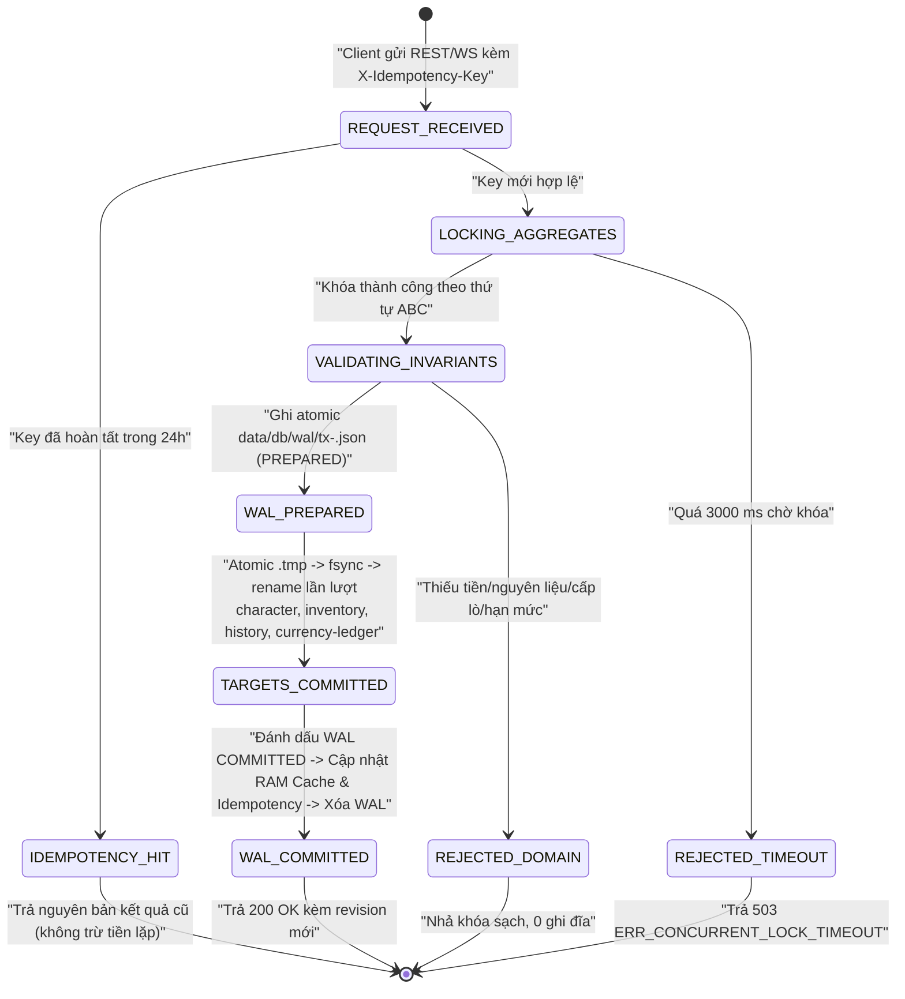

# 19 — Game Economy System Design: Eldoria: Forgotten Wilds

**Trạng thái**: Hoàn thiện (Design Baseline v1.0)  
**Chế độ**: `DESIGN_AND_PLANNING_ONLY`  
**Cập nhật lần cuối**: 2026-11-19  
**Nguồn dữ liệu chuẩn (Single Source of Truth)**: [`game-data/items.json`](../../game-data/items.json), [`game-data/recipes.json`](../../game-data/recipes.json), [`game-data/buildings.json`](../../game-data/buildings.json), [`game-data/crops.json`](../../game-data/crops.json), [`game-data/animals.json`](../../game-data/animals.json), [`game-data/loot-tables.json`](../../game-data/loot-tables.json), [`game-data/gacha-banners.json`](../../game-data/gacha-banners.json), [`game-data/quests.json`](../../game-data/quests.json), [`game-data/bosses.json`](../../game-data/bosses.json)  
**Tài liệu định lượng & kiến trúc liên kết**: [economy-analysis.md](../balancing/economy-analysis.md) · [weapon-upgrade-costs.csv](../balancing/weapon-upgrade-costs.csv) · [gacha-probabilities.csv](../balancing/gacha-probabilities.csv) · [Constitution](../../.specify/memory/constitution.md) · [database-design.md](../architecture/database-design.md) · [data-dictionary.md](../architecture/data-dictionary.md)

---

## 1. Mục tiêu Gameplay (Gameplay Objectives)

Nền kinh tế của **Eldoria: Forgotten Wilds** được thiết kế theo triết lý **Kinh tế Liên kết Đa nghề (Interconnected Multi-Profession Economy)** kết hợp **Tiến trình Công bằng Không Ép Nạp (Fair Non-Predatory Progression — Constitution Principle VI)**:

1. **Mọi hoạt động đều tạo ra giá trị thực chất**: Nông dân trồng `crp_golden_carrot` / `crp_ember_pepper`, người chăn nuôi thu `mat_fresh_egg` / `mat_fresh_milk` / `mat_moon_silk`, thợ mỏ luyện `mat_iron_ingot` / `mat_steel_ingot` và chiến binh săn `mat_alpha_fang` / `mat_thornback_heart` đều sản xuất đầu vào trực tiếp cho chuỗi nâng cấp vũ khí `+1..+10`, xây dựng 13 công trình và vượt Boss Raid.
2. **Tách bạch 5 loại tiền tệ để ngăn xung đột tiến trình**: Phân rõ tiền tệ vận hành (`GOLD`), tiền tệ triệu hồi nội tệ (`STARLIGHT_SHARD`), chứng chỉ thủ công (`CRAFTING_TOKEN`), bảo hiểm chống xui rơi đồ Boss (`BOSS_TOKEN`) và bảo hiểm chống xui Gacha (`STAR_ESSENCE`) giúp cân chỉnh từng vòng lặp độc lập mà không gây hiệu ứng domino lạm phát.
3. **Kiểm soát lạm phát chủ động dù MVP có 0% tỷ lệ vỡ vũ khí và chưa mở Chợ P2P**: Vì cường hóa `+0 → +10` thành công **100% chắc chắn** (`ASM-010`) và vật phẩm ở MVP khóa nhân vật (`bound: true`), nền kinh tế sử dụng hệ thống bể tiêu thụ vốn đa tầng (đa vũ khí, 13 công trình, tiêu hao Food Buff/Potion/Độ bền, chênh lệch giá bán NPC nghiêm ngặt và phân rã trang bị thành phôi thay vì Gold) để giữ tỷ lệ `Sink / Faucet` khỏe mạnh (`85% – 98%` trong 30 ngày đầu theo mô phỏng `last-sim-output.json`).
4. **Gacha 100% minh bạch, phi trục lợi trong MVP**: Toàn bộ `STARLIGHT_SHARD` đến từ gameplay (`realMoneyPurchaseEnabledInMvp: false`, `cashOutAllowed: false`), công khai đầy đủ tỷ lệ cơ bản, Soft/Hard Pity và bảng chuyển đổi trùng lặp sang `STAR_ESSENCE`.
5. **Kiểm toán 100% bằng Sổ cái JSON Cục bộ (`CurrencyLedger`)**: Mọi đồng tiền sinh ra hoặc biến mất trong game đều bắt buộc để lại dấu vết bất biến tại `data/db/ledgers/currency-ledger-<YYYY-MM>.json` trong cùng giao dịch Multi-File WAL nguyên tử với `data/db/characters/<characterId>.json` và `data/db/inventories/<characterId>.json` (Constitution Principle I & II).

---

## 2. User Stories

| ID | Vai trò | User Story | Milestone |
| :--- | :--- | :--- | :---: |
| **US-ECO-01** | Người chơi nông trại | Là người chơi thích canh tác và chăn nuôi, tôi muốn bán nông sản phẩm chất `SILVER`/`GOLD` hoặc nấu thành `csm_golden_roast` / `csm_ember_curry` để có nguồn `GOLD` ổn định tài trợ nâng cấp `bld_blacksmith` và cường hóa vũ khí. | M1 (MVP) |
| **US-ECO-02** | Người chơi chiến đấu | Là chiến binh farm `dng_mossroot_hollow`, tôi muốn ngay cả khi xui không rơi đúng món `wpn_elderwood_cleaver`, tôi vẫn tích lũy đủ `BOSS_TOKEN` sau vài lượt để đổi trực tiếp tại `npc_ranger_sylvia`. | M1 (MVP) |
| **US-ECO-03** | Người chơi Gacha F2P | Là người chơi quay Gacha bằng `STARLIGHT_SHARD` kiếm từ nhiệm vụ và Boss, tôi muốn mỗi nhân vật/vũ khí trùng lặp đều quy đổi rõ ràng sang `STAR_ESSENCE` (và `CRAFTING_TOKEN` với vũ khí) để đổi thẳng nhân vật hoặc vũ khí mục tiêu trong Star Essence Shop. | M1 (MVP) |
| **US-ECO-04** | Thợ thủ công | Là người chơi yêu thích chế tạo và luyện kim, tôi muốn việc rèn trang bị và luyện thép không chỉ phục vụ chiến đấu mà còn thưởng `CRAFTING_TOKEN` giúp mở khóa bản vẽ nâng cao và giảm chi phí rèn. | M1–M2 |
| **US-ECO-05** | Người chơi chuẩn bị M3 | Là người chơi kỳ cựu ở giai đoạn M3, tôi muốn cơ chế giao dịch an toàn (Safe Trade) có thuế sàn rõ ràng và giới hạn chống đầu cơ để công sức farm nguyên liệu của tôi không bị mất giá vì lạm phát. | M3 |
| **US-ECO-06** | Kỹ sư vận hành / Designer | Là Game Economy Designer, tôi muốn đọc trực tiếp tệp sổ cái `data/db/ledgers/currency-ledger-YYYY-MM.json` để kiểm chứng tỷ lệ Faucet/Sink, phát hiện bất thường dup tiền và cân chỉnh thông số ngay trong `game-data/*.json`. | M1–M5 |

---

## 3. Functional Requirements — Kiến trúc Kinh tế 5 Tiền tệ & Hệ sinh thái Tài nguyên

### 3.1 Hệ sinh thái 5 Loại Tiền tệ Chuẩn (`CurrencyType`)

Toàn bộ 5 loại tiền tệ đều lưu dạng **số nguyên không âm (`integer >= 0`)** trong `characters/<characterId>.json` (tuyệt đối không dùng số thực dấu phẩy động):

| `CurrencyType` | Bản chất & Vai trò | Phạm vi lưu trữ | Chuyển nhượng / Đổi ngược | Giá trị Neo Thiết kế (Anchor Value) |
| :--- | :--- | :---: | :--- | :--- |
| **`GOLD`** | Tiền tệ lưu thông phổ quát cho mọi hoạt động sinh tồn, nông trại, chế tạo, xây dựng và cường hóa. | Theo `Character` (`characters/<id>.json`) | Không giao dịch ở M1–M2; cho phép Safe Trade chịu thuế `5%` từ M3. | `1` lượt cường hóa `+0 → +10` = **`26,400 GOLD`**; 6 công trình MVP = **`31,230 GOLD`**; 13 công trình = **`121,830 GOLD`**. |
| **`STARLIGHT_SHARD`** | Tiền tệ triệu hồi Gacha (**100% nội tệ gameplay trong MVP**; cấm nạp tiền thật & cấm cash-out). | Theo `Character` *(hạn mức nguồn kiếm lớn kiểm soát theo `Account`)* | **Không bao giờ** giao dịch P2P; không bán lấy Gold. | `1-pull` = **`160 STARLIGHT_SHARD`**; `10-pull` = **`1,600 STARLIGHT_SHARD`**. |
| **`CRAFTING_TOKEN`** | Chứng chỉ nghề thủ công thưởng cho chế tạo, luyện kim bậc trung-cao, nhiệm vụ và vũ khí Gacha trùng lặp. | Theo `Character` | Khóa nhân vật (`bound: true`), không đổi sang Gold. | `1` bản vẽ giáp/vũ khí mở rộng hoặc phiếu giảm `20%` phí Gold rèn = **`10 – 40 CRAFTING_TOKEN`**. |
| **`BOSS_TOKEN`** | Huy hiệu Đột kích đóng vai trò **Bad-Luck Protection** cho bảng rơi đồ của 5 Boss nhiều phase. | Theo `Character` | Khóa nhân vật (`bound: true`), không giao dịch P2P. | `boss_thornback_elder` = `5`/lượt (mảnh `set_mossroot_guard` = `10` token, `mat_thornback_heart` = `6` token, `wpn_elderwood_cleaver` = `18` token). |
| **`STAR_ESSENCE`** | Tinh Hoa Ánh Sao thu từ trùng lặp Gacha (Nhân vật & Vũ khí), dùng tại **Star Essence Shop** (16 ưu đãi chuẩn trong `gacha-banners.json`). | Theo `Character` | Khóa nhân vật (`bound: true`), không đổi sang Gold. | Nhân vật `COMMON..LEGENDARY`: **`40..600`**; Vũ khí `EPIC`/`LEGENDARY`: **`200`/`500`**; `mat_starlight_dust ×5`: **`30`**; `csm_revive_feather ×2`: **`25`**. |

---

### 3.2 Ma trận Faucets (Nguồn phát) & Sinks (Bể hút) Toàn diện cho Cả 5 Tiền tệ

| Tiền tệ | Faucets — Nguồn Sinh Tiền (Chi tiết từ `game-data/*.json`) | Sinks — Bể Tiêu Thụ Tiền (Chi tiết từ `game-data/*.json`) | Cơ chế Chống Tràn / Kiểm soát |
| :--- | :--- | :--- | :--- |
| **`GOLD`** | - **62 Loot Tables (`loot-tables.json`)**: Quái thường (`6–12G` Slime → `600–900G` Eclipse Weaver), 8 Elite (`135–210G` → `2,650–3,980G`), 5 Boss (`450–680G` → `14,500–21,000G`), 5 Rương Dungeon (`220–360G` → `7,200–10,500G`), Câu cá `ltb_node_fishing_spot` (`12–30G`/lượt).<br/>- **30 Nhiệm vụ (`quests.json`)**: `6,990G` (12 MVP) / `203,190G` (tổng 30 quest) + Daily/Weekly (`180G`/ngày, `400G`/tuần).<br/>- **Bán NPC (`sellPriceGold`)**: Nông sản (`3–95G` × hệ số phẩm chất `1.0/1.25/1.6`), Chăn nuôi (`12–88G`), Nguyên liệu/Trang bị dư. | - **Cường hóa `+0 → +10`**: **`26,400G`/vũ khí** (`150G` → `8,000G`/bậc).<br/>- **Xây & nâng cấp 13 Công trình**: `31,230G` (6 MVP) / `121,830G` (cả 13 công trình).<br/>- **Phí Chế tạo 36 Công thức**: `15–95G` (nấu ăn/luyện đồng-sắt-thép), `120–950G` (rèn MVP), `1,100–14,500G` (rèn M2–M5).<br/>- **Hạt giống & Vật nuôi**: Hạt giống `10–220G`/hạt; 6 vật nuôi `150–2,400G`/con.<br/>- **Vận hành liên tục**: Sửa độ bền trang bị (giảm tối đa 30% tại `bld_blacksmith` Lv 4), mua Potion/Repair Kit/Revive Feather (`25–220G`), Fast Travel liên vùng (`20–100G`), Respec (`250 × Level` G), Thuế Safe Trade `5%` (M3). | Không có vòng mua–bán sinh lời (vendor spread `55–65%`); giới hạn Offline Cap 24h; trần tối đa ví `999,999,999 GOLD`; giám sát tỷ lệ `Sink/Faucet` trên `CurrencyLedger`. |
| **`STARLIGHT_SHARD`** | - **30 Nhiệm vụ**: `2,400` gộp (`2,240` ròng) ở 12 MVP / `8,080` gộp ở 30 quest.<br/>- **Boss First-Clear (Cấp Account)**: `480` (Thornback), `640` (Ignis), `800` (Prism), `960` (Boreas), `1,600` (Malakor) → Tổng **`4,480`**. <br/>- **Boss Weekly (Cấp Account)**: `160` → `480`/tuần/Boss.<br/>- **Daily Commissions & Exploration**: `80`/ngày + `80`/tuần Weekly Supply.<br/>- **Khám phá Thế giới**: Kích hoạt Waypoint (`40`/trụ) + 100% Fog of War (`160`/vùng) + Thành tựu. | - **Quay Gacha 2 Banner MVP** (`bnr_perm_heroes`, `bnr_perm_arsenal`) và **2 Banner Limited Post-MVP** (`bnr_lim_storm_sovereign`, `bnr_lim_dragonforge`): **`160`/1-pull** hoặc **`1,600`/10-pull**.<br/>- *(Cấm dùng `STARLIGHT_SHARD` để mua sức mạnh trực tiếp, bỏ qua thời gian xây nhà hoặc mua Gold)*. | Toàn bộ nguồn thưởng định kỳ & First-Clear khóa theo `Account` (chống tạo alt farm); tổng tốc độ phát miễn phí kiểm soát ở mức **`~6,000–6,400`/30 ngày** (`37–40` lượt quay/tháng đầu). |
| **`CRAFTING_TOKEN`** | - **30 Nhiệm vụ**: `46` (MVP) / `280` (toàn game).<br/>- **36 Công thức (`recipes.json`)**: Thưởng `+1..+18` token khi chế tác từ bậc thép/món buff Lv 2 trở lên.<br/>- **Daily/Weekly Commissions**: `3`/ngày + `5`/tuần.<br/>- **Vũ khí Gacha trùng lặp (`gacha-banners.json`)**: `+1` (`COMMON`), `+2` (`UNCOMMON`), `+4` (`RARE`), `+8` (`EPIC`), `+20` (`LEGENDARY`), `+40` (`MYTHIC`). | - Đổi bản vẽ chế tạo mở rộng tại NPC khu vực (`npc_smith_garrik`, `npc_relic_broker_sela`).<br/>- Đổi phiếu tinh luyện tăng `+10%` xác suất dòng phụ cao khi rèn trang bị bậc `EPIC+` (M2+).<br/>- Giảm `20%` phí `GOLD` khi chế tạo trang bị bậc cao (chuyển đổi nỗ lực thủ công thành tiết kiệm Gold). | Không thể bán lấy Gold; ngăn hành vi spam công thức rẻ bằng cách chỉ gắn token thưởng cho công thức bậc trung-cao tiêu tốn nguyên liệu hiếm/quặng luyện. |
| **`BOSS_TOKEN`** | - **Hạ 5 Boss (`bosses.json`)**: `boss_thornback_elder` (`+5`), `boss_ignis_forgelord` (`+8`), `boss_prism_leviathan` (`+12`), `boss_boreas_frostking` (`+16`), `boss_malakor_abyss` (`+25`).<br/>- **5 Nhiệm vụ Boss (`quests.json`)**: `qst_012` (`+5`), `qst_018` (`+8`), `qst_021` (`+12`), `qst_027` (`+16`), `qst_030` (`+25`) → Tổng `66` token 1 lần. | - Đổi mảnh giáp bộ tương ứng từng vùng (`10–35` token/mảnh).<br/>- Đổi Boss Core (`mat_thornback_heart` = `6` token, `mat_cinder_core` = `10` token, `mat_prism_scale` = `14` token, `mat_rime_essence` = `20` token, `mat_eclipse_shard` = `30` token).<br/>- Đổi vũ khí đặc trưng Boss (`12–60` token). | Mỗi Boss có giới hạn thưởng lượt theo nhịp hồi sinh / khóa lượt đột kích hợp lý; chỉ người chơi đóng góp `>= 5%` mới nhận token. |
| **`STAR_ESSENCE`** | - **Nhân vật trùng lặp (`gacha-banners.json`)**: Trong mốc C0–C6: `2/5/12/30/80/150`; tràn ngoài C6: `4/10/24/60/160/300` (+ `1..15 mat_starlight_dust`).<br/>- **Vũ khí trùng lặp**: `1/3/8/20/60/120` (vẫn giữ `ItemInstance`).<br/>- **Hero Quest trùng lặp**: Quy đổi cùng công thức nhân vật (`BR-QST-05`). | - **Star Essence Shop (`16` ưu đãi trong `gacha-banners.json`)**:<br/>  • Nhân vật: `40` (`COMMON`), `75` (`UNCOMMON`), `120` (`RARE`), `240` (`EPIC`), `600` (`LEGENDARY`).<br/>  • Vũ khí: `200` (`EPIC`), `500` (`LEGENDARY`).<br/>  • Vật tư: `mat_starlight_dust ×5` (`30`, tối đa 10/tháng), `csm_revive_feather ×2` (`25`, tối đa 10/tháng). | Mọi ưu đãi trong Star Essence Shop đều có **`limitPerMonth`** (`1–2` với nhân vật/vũ khí, `10` với vật tư), đặt lại ngày 01 hàng tháng `00:00 UTC`. |

---

### 3.3 Bể Tiêu thụ Tài nguyên (Resource Sinks) Xuyên suốt 8 Lĩnh vực Sản xuất

Để nguyên liệu không bị ứ đọng vô giá trị trong kho (`bld_storage`), mọi nguồn thu thập đều gắn với ít nhất 2 bể tiêu thụ thực chất:

| Lĩnh vực | Nguồn Cung Chính (`game-data/`) | Bể Tiêu thụ Bắt buộc (Resource Sinks) | Điểm Nghẽn Chủ đích (Intentional Bottleneck) |
| :--- | :--- | :--- | :--- |
| **1. Gathering (Khai thác)** | `14` Resource Node Loot Tables (`ltb_node_oak_tree`..`ltb_node_void_crystal_vein`, `ltb_node_fishing_spot`) | - Luyện kim (`3 ore + 1–2 coal → 1 ingot`).<br/>- Xây & nâng cấp 13 công trình (hàng trăm `mat_oak_wood`, `mat_pine_wood`, `mat_rough_stone`, `mat_granite_block`, `mat_ancient_heartwood`).<br/>- Rèn công cụ sửa đồ (`csm_repair_kit`) & cường hóa `+1` (`mat_oak_wood ×4`), `+4` (`mat_coal ×5`). | `mat_coal` (dùng xuyên suốt mọi công thức luyện Đồng/Sắt/Thép/Mythril) và `mat_ancient_heartwood` (công trình Lv 3–4). |
| **2. Farming (Nông trại)** | `15` loại cây (`crops.json`: 5 MVP + 10 Post-MVP) | - Nấu 4 món Food Buff (`csm_herb_stew`, `csm_berry_pie`, `csm_golden_roast`, `csm_ember_curry`) tiêu thụ liên tục mỗi 5–10 phút đi rừng/Boss.<br/>- Pha bình HP/MP/Stamina (`mat_wild_berry`, `mat_moon_herb_leaf`, `mat_golden_carrot`).<br/>- Làm thức ăn yêu thích (`favoriteFeedItemId`) nuôi 6 loài vật nuôi.<br/>- Giao Daily/Weekly Supply Commissions. | Giới hạn mùa vụ (`Season`), số ô đất (`12..36` ô theo cấp `bld_farm_plot`) và nhu cầu `csm_fertilizer_basic`/`rich` để nâng tỷ lệ `SILVER`/`GOLD`. |
| **3. Animal Husbandry (Chăn nuôi)** | `6` loài động vật (`animals.json`: 2 MVP + 4 Post-MVP) | - `mat_fresh_egg` & `mat_fresh_milk`: nguyên liệu lõi của `csm_berry_pie`, `csm_golden_roast`, `csm_ember_curry`, `csm_stamina_tonic` và `csm_revive_feather ×3 trứng`.<br/>- `mat_soft_wool`: nâng `bld_chicken_coop` Lv 3, rèn `wpn_galeweaver_longbow`, dệt `eqp_crystal_vestment`.<br/>- `mat_truffle_mushroom`: pha `csm_fertilizer_rich`.<br/>- `mat_moon_silk`: nâng `bld_player_house` Lv 4, rèn `eqp_frostbound_hauberk` & `eqp_abyssal_mantle`. | Tốc độ đẻ/sản xuất cố định (`48–144 phút`/chu kỳ), giới hạn chuồng và độ hạnh phúc (`happiness`) phụ thuộc vào chăm sóc & thức ăn. |
| **4. Smelting & Refining** | `6` công thức (`rcp_smelt_*`, `rcp_refine_*`) tại `bld_blacksmith` / `bld_furnace` / `bld_alchemy_lab` | - Nén nguyên liệu thô theo tỷ lệ tiêu hao cao: `1 mat_steel_ingot` tốn `2 mat_iron_ingot` (`= 6 mat_iron_ore + 4 mat_coal`) + `3 mat_coal` + `2 mat_rough_stone` + `150G` tổng phí nung (`2×35 + 80`)!<br/>- `rcp_refine_granite_block` hút `6 mat_rough_stone + 2 mat_clay` cho công trình bậc cao. | Phí `GOLD` luyện kim + thời gian hàng đợi lò (`forgeQueueSlots`) khuyến khích nâng `bld_furnace` ở M2. |
| **5. Cooking & Alchemy** | `10` công thức (`4` Cooking + `6` Alchemy) tại `bld_kitchen` / `bld_alchemy_lab` | - Tiêu hủy 100% vật phẩm vĩnh viễn khi ăn/uống (Permanent Consumable Sink): mỗi chuyến `dng_mossroot_hollow` trung bình tiêu thụ `1–2` món buff + `2–4` bình hồi máu/mana + `0–1 csm_revive_feather`.<br/>- Đốt `mat_slime_gel`, `mat_spore_cap_dust`, `mat_bat_wing`, `mat_shaman_totem`, `mat_starlight_dust`. | Thời lượng buff `5–10 phút` và mất buff khi chết hoàn toàn không dùng `csm_revive_feather`. |
| **6. Crafting & Utility** | `20` công thức (`10` Weapon + `6` Armor + `2` Accessory + `2` Utility) | - Hút lượng lớn kim loại tinh luyện, da/vảy quái, Boss Core và `120 – 14,500 GOLD`/món để tự chủ trang bị không lệ thuộc RNG rơi đồ.<br/>- `csm_repair_kit` & `csm_fertilizer_basic` tiêu thụ thường xuyên. | Đòi hỏi nâng cấp đồng bộ `bld_blacksmith`, `bld_workshop`, `bld_alchemy_lab` và cấp độ nhân vật. |
| **7. Building Upgrades** | `13` công trình (`buildings.json`: 6 MVP + 7 Post-MVP) | - **6 công trình MVP (`31,230 GOLD` tổng)**: `bld_player_house` (`6,050G`), `bld_storage` (`6,800G`), `bld_farm_plot` (`5,100G`), `bld_chicken_coop` (`2,580G`), `bld_blacksmith` (`8,000G`), `bld_kitchen` (`2,700G`).<br/>- **7 công trình Post-MVP (`90,600 GOLD` tổng)**: `bld_barn` (`8,300G`), `bld_workshop` (`7,000G`), `bld_furnace` (`7,050G`), `bld_alchemy_lab` (`8,250G`), `bld_training_ground` (`8,000G`), `bld_stable` (`10,000G`), `bld_guild_hall` (`42,000G` — góp chung bang hội). | `bld_blacksmith` Lv 3–4 đòi `4 mat_thornback_heart`; các công trình Lv 3–4 đòi `mat_arcane_crystal`, `mat_mythril_ingot`, Boss Core các vùng. |
| **8. Weapon Enhancement (`+0 → +10`)** | 10 bậc chắc chắn 100% (`docs/balancing/weapon-upgrade-costs.csv`) | **Tổng tiêu thụ cho MỖI cây vũ khí từ `+0` lên `+10`**: **`26,400 GOLD`** + **`8 mat_copper_ingot`** + **`4 mat_oak_wood`** + **`4 mat_slime_gel`** + **`21 mat_iron_ingot`** + **`6 mat_goblin_tooth`** + **`6 mat_wolf_pelt`** + **`5 mat_coal`** + **`8 mat_spore_cap_dust`** + **`6 mat_boar_tusk`** + **`63 mat_steel_ingot`** *(tương đương `378 mat_iron_ore + 441 mat_coal + 126 mat_rough_stone`!)* + **`8 mat_crawler_chitin`** + **`4 mat_shaman_totem`** + **`8 mat_alpha_fang`** + **`38 mat_starlight_dust`** + **`7 mat_thornback_heart`**. | Cổng `bld_blacksmith` Lv 1..4 (`+3/+6/+8/+10`) và lượng lớn `mat_steel_ingot ×63`, `mat_starlight_dust ×38`, `mat_thornback_heart ×7` trên từng cây vũ khí. |

---

### 3.4 Phân tầng Độ hiếm Vật phẩm (Item Scarcity Tiers — 157 Items trong `game-data/items.json`)

| Bậc Độ hiếm (`Rarity`) | Số lượng trong `items.json` | Màu nhận diện UI (Art Bible) | Nguồn Thu thập Chính | Vai trò Kinh tế & Giới hạn Stack |
| :--- | :---: | :--- | :--- | :--- |
| **`COMMON`** | **29** | Xám đá sáng (`#D5D8DC`) | Nút tài nguyên làng/rừng, quái Lv 1–7, mua tại NPC, Gacha `25%`. | Nguyên liệu nền (`maxStack: 999`), tiêu hao cơ bản (`99`), vũ khí khởi đầu (`1`). Lưu chuyển khối lượng lớn, làm đệm kinh tế đầu game. |
| **`UNCOMMON`** | **25** | Xanh lá ngọc (`#52BE80`) | Nút quặng sắt/thông, quái Whispering Forest, nấu ăn Lv 1–2, Gacha `34–35%`. | Phôi luyện kim (`mat_iron_ingot`), trang bị đầu rừng (`wpn_iron_longsword`, `eqp_hunter_tunic`), vật tư dã chiến. |
| **`RARE`** | **39** | Xanh dương lam (`#5DADE2`) | Rừng sâu, Elite Alpha Direwolf, Dungeon Mossroot, chế tạo Lv 2, Gacha `30%`. | Nhóm vật phẩm xương sống trung game: `mat_steel_ingot`, `mat_starlight_dust`, `csm_golden_roast`, `csm_ember_curry`, `csm_revive_feather`, vũ khí đặc trưng starter. |
| **`EPIC`** | **31** | Tím thạch anh (`#AF7AC5`) | Boss vùng 1–3 (`boss_thornback_elder`..`boss_prism_leviathan`), rương Dungeon, rèn Lv 3+, Gacha `8.4–9.0%` (bảo đảm mỗi 10-pull). | Mục tiêu chinh phục MVP & Mid-game: Boss Cores (`mat_thornback_heart`, `mat_cinder_core`, `mat_prism_scale`), bộ giáp set 4 món, `wpn_elderwood_cleaver`. |
| **`LEGENDARY`** | **21** | Vàng hổ phách (`#F5B041`) | Boss cấp cao (`boss_boreas_frostking`), Elite Ember Wasteland, rèn Lv 4, Gacha `1.2–1.5%` (Soft/Hard Pity), Star Essence Shop (`500–600`). | Trang bị & vật liệu đỉnh cao giai đoạn M3–M4 (`mat_rime_essence`, `mat_dragon_scale`, `mat_void_crystal`, 10 vũ khí Huyền Thoại). |
| **`MYTHIC`** | **12** | Đỏ ánh kim (`#EC7063`) | Boss cuối `boss_malakor_abyss` (`dng_eclipse_throne`), rèn Endgame Lv 4, Gacha `0.4–0.5%` (25% trong nhóm Top-Tier Pity). | Danh hiệu đỉnh cao Endgame Lv 90–100 (`mat_eclipse_shard`, `eqp_crown_of_forgotten_wilds`, 4 vũ khí Mythic và bộ `set_abyssal_sovereign`). |

*Tổng kiểm chứng từ `game-data/items.json`: `29 + 25 + 39 + 31 + 21 + 12 = 157` vật phẩm (`40 WEAPON`, `40 EQUIPMENT`, `50 MATERIAL`, `12 CONSUMABLE`, `15 SEED`). Trong MVP (M1–M2), toàn bộ trang bị và nguyên liệu có `bound: true` (chưa mở chợ P2P).*

---

### 3.5 Cơ chế Phòng chống Lạm phát (7 Lớp Phòng tuyến cho MVP 0% Vỡ đồ & Tiền M3)

Một rủi ro kinh tế điển hình của game RPG có **cường hóa 100% thành công không vỡ đồ (`break_risk_mvp: false`, `downgrade_risk_mvp: false`)** và **chưa có thị trường giao dịch P2P ở MVP** là hiện tượng **dư thừa Gold và trang bị (hyperinflation / mudflation)** sau 30–60 ngày chơi. Eldoria chủ động giải quyết rủi ro này bằng **7 lớp phòng tuyến kiến trúc**:

1. **Đa dạng hóa Bể hút Vốn theo Đội hình Nguyên tố (Multi-Weapon & Multi-Hero Capital Sink)**:
   - Mỗi Boss có điểm yếu nguyên tố khác nhau (`boss_thornback_elder` yếu `FIRE`, `boss_ignis_forgelord` yếu `WATER`, `boss_prism_leviathan` yếu `EARTH`, `boss_boreas_frostking` yếu `FIRE`, `boss_malakor_abyss` yếu `LIGHT`).
   - Do đó, người chơi có động lực tự nhiên cường hóa **3–4 vũ khí `+10`** cho các hero khác nhau (`3 × 26,400 = 79,200 GOLD` đến `4 × 26,400 = 105,600 GOLD`, kèm `189–252 mat_steel_ingot` và `21–28 mat_thornback_heart`).
2. **Bể hút Lãnh địa Dài hạn (Homestead & Guild Sink)**:
   - 6 công trình MVP hút **`31,230 GOLD`**, 6 công trình cá nhân Post-MVP hút thêm **`48,600 GOLD`**, và `bld_guild_hall` Lv 1–3 hút **`42,000 GOLD`** cùng hàng nghìn đơn vị tài nguyên chế biến.
3. **Bể hút Vận hành Liên tục (Permanent Recurring Sinks)**:
   - **Độ bền trang bị (`durability`)**: Mỗi đòn đánh/chặn đòn hao mòn độ bền; sửa chữa bằng Gold tại `npc_smith_garrik` / `bld_blacksmith` (tốn ~`2%–5%` giá trị vũ khí theo bậc mỗi phiên chiến đấu dài) hoặc chế tạo `csm_repair_kit`.
   - **Tiêu hao Thực phẩm & Dược phẩm**: Food Buff kéo dài `5–10 phút` và bình hồi máu/hồi sinh biến mất vĩnh viễn sau khi dùng.
   - **Tái đầu tư Nông trại**: Cây thu hoạch 1 lần (`crp_sunwheat`, `crp_moon_herb`, `crp_golden_carrot`, `crp_frost_turnip`, `crp_silver_pumpkin`, `crp_storm_radish`, `crp_honey_melon`, `crp_shadow_garlic`, `crp_starlight_melon`) đòi hỏi mua hạt giống và phân bón liên tục.
   - **Tiện ích có phí hợp lý**: Fast Travel liên vùng (`20–100G`) và Tẩy điểm Thuộc tính Respec (`250 × Level` Gold = `3,750G` ở Lv 15, `15,000G` ở Lv 60).
4. **Phân rã Trang bị Dư thành Phôi (Dismantle Over Vendor-Dump)**:
   - Mở tại `bld_blacksmith` Lv 2+: thay vì khuyến khích người chơi bán trang bị rơi thừa lấy Gold bơm vào lưu thông, phân rã trả lại **`35%–50%` nguyên liệu luyện kim** (`mat_iron_ingot`, `mat_steel_ingot`, `mat_starlight_dust`) với một khoản phí công nhỏ — vừa rút Gold, vừa hỗ trợ vòng cường hóa kế tiếp.
5. **Chênh lệch Giá Mua–Bán NPC Nghiêm ngặt (Anti-Arbitrage Vendor Spread)**:
   - Mọi vật phẩm vừa có `buyPriceGold` vừa có `sellPriceGold` đều tuân thủ `sellPriceGold <= 0.48 × buyPriceGold` (ví dụ `csm_hp_potion_small` mua `25G`/bán `10G`; `sed_sunwheat` mua `12G`/bán `5G`; `csm_revive_feather` mua `220G`/bán `85G`). Không tồn tại chuỗi mua → chế tạo → bán NPC sinh lời ròng không tốn công farm.
6. **Chặn Khai thác Tự động hóa & Chênh lệch Mùa vụ**:
   - Giới hạn tiến trình offline tối đa `24 giờ` (`ASM-008`), yêu cầu `Stamina` / `Hunger` cho mọi thao tác khai thác/canh tác thủ công, và thiết kế một số hạt giống bậc cao (`crp_shadow_garlic`, `crp_starlight_melon`) có lợi nhuận âm nếu chỉ mua hạt bán thô ở phẩm chất `NORMAL` (buộc người chơi săn hạt từ loot, dùng phân bón lên `GOLD` hoặc chế biến).
7. **Kiến trúc Sẵn sàng cho M3 Safe Trade (Pre-Trade Economic Firewall)**:
   - Trước khi kích hoạt P2P Safe Trade ở M3: bắt buộc giữ **Thuế Giao dịch `5% GOLD`** (trừ trực tiếp vào bể tiêu hủy sổ cái `TRADE_TAX`), chỉ cho phép giao dịch vật phẩm `bound: false` (nguyên liệu, nông sản, thực phẩm, phôi; **KHÔNG** cho giao dịch vũ khí đã cường hóa `+1..+10`, trang bị Mythic Boss hay `STARLIGHT_SHARD`), và bật hệ thống giám sát `CurrencyLedger` (chi tiết mục 3.8).

---

### 3.6 Vòng tuần hoàn Cung – Cầu Liên kết Mọi Nghề nghiệp

```mermaid
flowchart LR
    GATH["Khai thác & Khai khoáng<br/>(14 Resource Nodes)<br/>Wood, Stone, Copper/Iron/Coal"] -->|"Luyện kim & Đẽo đá"| SMELT["Lò Luyện & Xưởng<br/>(Smelting / Refining)<br/>Ingots, Granite Block"]
    FARM["Nông trại (15 Crops)<br/>Sunwheat, Golden Carrot,<br/>Ember Pepper, Herbs"] -->|"Thức ăn yêu thích"| HUSB["Chăn nuôi (6 Animals)<br/>Fresh Egg, Fresh Milk,<br/>Wool, Truffle, Moon Silk"]
    FARM -->|"Nấu ăn & Giả kim"| COOK["Bếp & Giả kim<br/>(bld_kitchen / bld_alchemy_lab)<br/>Food Buffs, Potions, Fertilizer"]
    HUSB -->|"Trứng, Sữa, Truffle"| COOK
    HUSB -->|"Len, Tơ Nguyệt Linh"| CRAFT["Lò Rèn & Chế tác<br/>(bld_blacksmith / bld_workshop)<br/>Weapons, Armor Sets, +1..+10"]
    SMELT -->|"Thỏi Kim loại & Đá"| BUILD["Xây dựng Lãnh địa<br/>(13 Buildings Lv 1..4)<br/>Mở cổng +3/+6/+8/+10 & Auto-Farm"]
    SMELT -->|"Phôi & Thép"| CRAFT
    BUILD -->|"Cổng cấp Lò Rèn & Bếp"| CRAFT
    COOK -->|"Food Buff (+ATK/+Crit/+Fire)<br/>& Revive Feather"| COMBAT["Chiến đấu, Elite & Boss Raid<br/>(30 Mobs, 8 Elites, 5 Bosses)<br/>62 Loot Tables"]
    CRAFT -->|"Vũ khí +1..+10 & Giáp Bộ"| COMBAT
    COMBAT -->|"Slime Gel, Spore Dust,<br/>Starlight Dust, Seeds"| FARM
    COMBAT -->|"Alpha Fang, Boss Cores<br/>(mat_thornback_heart...)"| CRAFT
    COMBAT -->|"Boss Cores cho Lv 3–4"| BUILD
    COMBAT -->|"STARLIGHT_SHARD & BOSS_TOKEN"| GACHA["Gacha Nội tệ & Shop<br/>(bnr_*, STAR_ESSENCE)<br/>Mở rộng Đội hình Nguyên tố"]
    GACHA -->|"Đội hình khắc chế Boss<br/>& CRAFTING_TOKEN"| COMBAT
```



---

### 3.7 Kinh tế Chuyển đổi Trùng lặp Gacha (`Duplicate Conversion` & `Star Essence Shop`)

Khớp chính xác 100% với `game-data/gacha-banners.json` (và kiểm chứng bằng mô phỏng Monte Carlo 100.000 lượt tại `tools/design-validation/last-sim-output.json`):

#### Bảng A: Quy đổi Trùng lặp Nhân vật (`CHARACTER`) & Vũ khí (`WEAPON`)
| Độ hiếm (`Rarity`) | Nhân vật Trùng (C0–C5 → C6) | Nhân vật Tràn ngoài C6 (`overflowBeyondC6`) | Vũ khí Trùng (`WEAPON` — luôn giữ `ItemInstance`) |
| :--- | :--- | :--- | :--- |
| **`COMMON`** | `+1` Constellation + **`2 STAR_ESSENCE`** | **`4 STAR_ESSENCE`** + `mat_starlight_dust ×1` | Giữ vũ khí + **`1 STAR_ESSENCE`** + **`1 CRAFTING_TOKEN`** |
| **`UNCOMMON`** | `+1` Constellation + **`5 STAR_ESSENCE`** | **`10 STAR_ESSENCE`** + `mat_starlight_dust ×1` | Giữ vũ khí + **`3 STAR_ESSENCE`** + **`2 CRAFTING_TOKEN`** |
| **`RARE`** | `+1` Constellation + **`12 STAR_ESSENCE`** | **`24 STAR_ESSENCE`** + `mat_starlight_dust ×2` | Giữ vũ khí + **`8 STAR_ESSENCE`** + **`4 CRAFTING_TOKEN`** |
| **`EPIC`** | `+1` Constellation + **`30 STAR_ESSENCE`** | **`60 STAR_ESSENCE`** + `mat_starlight_dust ×4` | Giữ vũ khí + **`20 STAR_ESSENCE`** + **`8 CRAFTING_TOKEN`** |
| **`LEGENDARY`** | `+1` Constellation + **`80 STAR_ESSENCE`** | **`160 STAR_ESSENCE`** + `mat_starlight_dust ×8` | Giữ vũ khí + **`60 STAR_ESSENCE`** + **`20 CRAFTING_TOKEN`** |
| **`MYTHIC`** | `+1` Constellation + **`150 STAR_ESSENCE`** | **`300 STAR_ESSENCE`** + `mat_starlight_dust ×15` | Giữ vũ khí + **`120 STAR_ESSENCE`** + **`40 CRAFTING_TOKEN`** |

*(Theo kết quả mô phỏng 100.000 lượt thực tế: trung bình mỗi `10-pull` trên `bnr_perm_heroes` tạo ra **`234.77 STAR_ESSENCE`** ở trạng thái dài hạn sau khi phủ bộ sưu tập cơ bản; mỗi `10-pull` trên `bnr_perm_arsenal` tạo ra **`83.03 STAR_ESSENCE`** ngay từ đầu vì mọi vũ khí đều tặng kèm Tinh Hoa Ánh Sao).*

#### Bảng B: Toàn bộ 16 Ưu đãi tại Cửa hàng Tinh Hoa Ánh Sao (`starEssenceShop` — `gacha-banners.json`)
| Offer ID | Loại | Vật phẩm / Nhân vật (`rewardId`) | Rarity | Số lượng | Giá (`STAR_ESSENCE`) | Giới hạn/Tháng | MVP |
| :--- | :--- | :--- | :--- | :---: | :---: | :---: | :-: |
| `shop_ess_mira` | `CHARACTER` | `chr_mira_ironfist` | `COMMON` | 1 | `40` | 2 | **Có** |
| `shop_ess_rowan` | `CHARACTER` | `chr_rowan_tidewarden` | `UNCOMMON` | 1 | `75` | 2 | **Có** |
| `shop_ess_kael` | `CHARACTER` | `chr_kael_vanguard` | `RARE` | 1 | `120` | 1 | **Có** |
| `shop_ess_lyra` | `CHARACTER` | `chr_lyra_windrunner` | `RARE` | 1 | `120` | 1 | **Có** |
| `shop_ess_seraphina` | `CHARACTER` | `chr_seraphina_dawn` | `RARE` | 1 | `120` | 1 | **Có** |
| `shop_ess_elderwood_cleaver` | `WEAPON` | `wpn_elderwood_cleaver` | `EPIC` | 1 | `200` | 1 | **Có** |
| `shop_ess_starbloom_scepter` | `WEAPON` | `wpn_starbloom_scepter` | `LEGENDARY` | 1 | `500` | 1 | **Có** |
| `shop_ess_starlight_dust` | `ITEM` | `mat_starlight_dust` | `RARE` | 5 | `30` | 10 | **Có** |
| `shop_ess_revive_feather` | `ITEM` | `csm_revive_feather` | `RARE` | 2 | `25` | 10 | **Có** |
| `shop_ess_bram` | `CHARACTER` | `chr_bram_bastion` | `EPIC` | 1 | `240` | 1 | Không |
| `shop_ess_vex` | `CHARACTER` | `chr_vex_nightblade` | `EPIC` | 1 | `240` | 1 | Không |
| `shop_ess_freya` | `CHARACTER` | `chr_freya_frostveil` | `EPIC` | 1 | `240` | 1 | Không |
| `shop_ess_orin` | `CHARACTER` | `chr_orin_stormcaller` | `LEGENDARY` | 1 | `600` | 1 | Không |
| `shop_ess_torvald` | `CHARACTER` | `chr_torvald_rageborn` | `LEGENDARY` | 1 | `600` | 1 | Không |
| `shop_ess_forgelord_waraxe` | `WEAPON` | `wpn_forgelord_waraxe` | `EPIC` | 1 | `200` | 1 | Không |
| `shop_ess_voltspire_stormstaff` | `WEAPON` | `wpn_voltspire_stormstaff` | `LEGENDARY` | 1 | `500` | 1 | Không |

---

### 3.8 Kiểm toán Sổ cái JSON (`CurrencyLedger`) & Quy tắc Giám sát Lạm phát

Mỗi tháng, `JsonDatabaseEngine` duy trì tệp nhật ký bất biến **`data/db/ledgers/currency-ledger-<YYYY-MM>.json`** (chỉ ghi nối thêm qua atomic write/WAL, không bao giờ xóa hoặc sửa ngược dòng cũ). Một công cụ kiểm toán nội bộ chạy định kỳ hàng ngày lúc `03:00 UTC` (chạy hoàn toàn cục bộ trên file JSON, không dùng hệ thống phân tích đám mây ngoài) tính toán 5 chỉ số sức khỏe kinh tế:

1. **Đối chiếu Toàn vẹn Sổ cái (Ledger Reconciliation Invariant)**: Với mọi nhân vật hoạt động, kiểm tra `initialBalance + sum(ledger.delta) === character.currencies[type]`. Bất kỳ sai lệch `!= 0` nào tự động ghi nhận sự kiện `CRITICAL (P0)` vào `data/db/audit/security-audit-<YYYY-MM-DD>.json` và tạm đóng băng giao dịch nhân vật đó để điều tra.
2. **Tỷ lệ `Sink / Faucet` Toàn Server (Gold Velocity Guard)**:
   - Vùng xanh lành mạnh (M1–M2): **`75% – 105%`** (`proposed`).
   - Cảnh báo vàng (Amber): **`< 65%`** kéo dài 7 ngày liên tiếp → báo hiệu lượng Gold dư thừa bắt đầu tích tụ.
   - Cảnh báo đỏ (Red): **`< 50%`** hoặc lượng Gold trung bình trên người chơi hoạt động tăng `> +25%/tuần` liên tiếp 2 tuần → kích hoạt cần gạt điều chỉnh trong `game-data/*.json` (xem chi tiết tại [`docs/balancing/economy-analysis.md`](../balancing/economy-analysis.md)).
3. **Giám sát Tốc độ Faucet Bất thường theo Tài khoản (Anomaly Velocity Alert)**: Phát hiện tài khoản kiếm vượt `> 3.5×` chuẩn Hardcore (`> 9,500 GOLD/ngày` ở MVP hoặc `> 600 STARLIGHT_SHARD/ngày` ngoài ngày hoàn thành chuỗi cốt truyện/Boss First-Clear) để ghi cảnh báo kiểm tra bot/exploit.
4. **Cảnh báo Quy mô Tệp Ledger JSON (`proposed / unverified`)**: Theo [`database-design.md`](../architecture/database-design.md), nếu tải thực tế vượt `100 CCU` khiến tệp `currency-ledger-<YYYY-MM>.json` tăng quá `25 MB/tháng` hoặc độ trễ khóa `ledger:<YYYY-MM>` p95 vượt `20 ms`, kiến trúc hỗ trợ chuyển sang xoay vòng theo ngày `currency-ledger-<YYYY-MM-DD>.json` mà không thay đổi schema bản ghi.

---

## 4. Business Rules (Quy tắc Nghiệp vụ Bắt buộc)

- **BR-ECO-01 (Bất biến Số nguyên Không âm)**: Mọi số dư tiền tệ và mức thay đổi `delta` PHẢI là số nguyên (`Number.isSafeInteger`), số dư sau giao dịch luôn `>= 0` và không vượt trần an toàn `999,999,999` (`GOLD`) / `9,999,999` (các tiền tệ khác).
- **BR-ECO-02 (Cấm Tiền thật & Cash-out trong MVP)**: Tuyệt đối không tích hợp cổng thanh toán, không bán `STARLIGHT_SHARD` hay `GOLD` bằng tiền thật, không cho phép đổi vật phẩm/tiền tệ ra tiền mặt dưới mọi hình thức (Constitution Principle VI).
- **BR-ECO-03 (Chống Nhân bản bằng Quyền sở hữu & Khóa Giao dịch)**: Mọi vật phẩm rơi từ 62 `loot-tables.json` đều tuân thủ `PERSONAL_INSTANCED` (`ownerCharacterId` gắn ngay khi sinh ra). Mọi giao dịch tiêu thụ vật phẩm + tiền tệ bắt buộc chạy trong một transaction Multi-File WAL duy nhất.
- **BR-ECO-04 (Bảo vệ Trang bị Quan trọng khỏi Bán nhầm)**: Server từ chối bán NPC (`ERR_ITEM_LOCKED_OR_EQUIPPED`) đối với: (a) vật phẩm đang mặc trên `Equipment`, (b) vũ khí có `enhancementLevel >= 1`, (c) vật phẩm người chơi bật cờ khóa (`locked: true`), hoặc (d) vật phẩm bậc `MYTHIC` nếu chưa có xác nhận kép. Trong cùng phiên kết nối, cửa hàng NPC giữ hàng đợi **Buyback** tối đa `10` vật phẩm vừa bán để mua lại đúng bằng `sellPriceGold` (hết hạn khi đổi zone hoặc đăng xuất).
- **BR-ECO-05 (Công thức Phí Sửa Độ bền)**: $\text{RepairCost} = \left\lceil (\text{durabilityMax} - \text{durability}) \times \text{RarityFactor} \times (1 + 0.08 \times \text{enhancementLevel}) \times (1 - \text{BlacksmithDiscount}) \right\rceil$, trong đó `RarityFactor` = `0.6 / 0.9 / 1.3 / 1.9 / 2.6 / 3.5` cho `COMMON..MYTHIC` và `BlacksmithDiscount` = `0% / 10% / 20% / 30%` theo cấp `bld_blacksmith` Lv 1..4.
- **BR-ECO-06 (Quy tắc Phân rã — Dismantle)**: Chỉ mở từ `bld_blacksmith` Lv 2+, không cho phân rã đồ đang trang bị hoặc bị khóa; hoàn trả `40%` phôi chính (làm tròn xuống, tối thiểu 1) + `1–4 mat_starlight_dust` đối với trang bị `RARE+`; tốn phí vận hành nhỏ (`5%` giá trị `sellPriceGold`).
- **BR-ECO-07 (Tiêu chuẩn Chuẩn hóa Bút toán `reasonCode`)**: Không một dịch vụ nào được cộng/trừ `character.currencies` trực tiếp ngoài `EconomyLedgerService`; mọi biến động bắt buộc có `reasonCode` nằm trong tập enum chuẩn (`MONSTER_LOOT`, `BOSS_REWARD`, `DUNGEON_CHEST`, `QUEST_REWARD`, `NPC_SELL`, `NPC_BUY`, `CRAFT_FEE`, `BUILDING_UPGRADE`, `WEAPON_ENHANCE`, `EQUIPMENT_REPAIR`, `DISMANTLE_FEE`, `GACHA_PULL`, `GACHA_DUP_CONVERSION`, `STAR_ESSENCE_EXCHANGE`, `BOSS_TOKEN_EXCHANGE`, `FAST_TRAVEL_FEE`, `STAT_RESPEC_FEE`, `TRADE_TAX`, `ADMIN_ADJUSTMENT`).

---

## 5. Input & Output (Hợp đồng Giao tiếp Kinh tế)

| Hành động Kinh tế | Endpoint / Event | Input (Client → Server) | Output (Server → Client) |
| :--- | :--- | :--- | :--- |
| Truy vấn Ví & Tóm tắt | `GET /api/v1/characters/:charId/inventory` | Auth Bearer | `{ currencies: { gold, starlightShard, craftingToken, bossToken, starEssence }, bagItems[], storageItems[], overflowClaimBox[] }` |
| Mua / Bán vật phẩm NPC | `POST /api/v1/characters/:charId/npcs/:npcId/trade` | `X-Idempotency-Key`, `{ mode: "BUY"|"SELL"|"BUYBACK", itemId?, itemInstanceId?, qty }` | `{ currenciesAfter, inventoryPatch, buybackQueue[], ledgerEntryId }` |
| Sửa độ bền trang bị | `POST /api/v1/characters/:charId/equipment/repair` | `X-Idempotency-Key`, `{ itemInstanceId, useRepairKit: boolean }` | `{ itemInstanceAfter, goldSpent, currenciesAfter, ledgerEntryId }` |
| Phân rã trang bị dư | `POST /api/v1/characters/:charId/blacksmith/dismantle` | `X-Idempotency-Key`, `{ itemInstanceIds: string[] }` | `{ yieldedMaterials[], goldFeeSpent, currenciesAfter, ledgerEntryId }` |
| Chế tạo / Nấu ăn / Luyện kim | `POST /api/v1/characters/:charId/crafting/execute` | `X-Idempotency-Key`, `{ recipeId, count: 1..50 }` | `{ outputItems[], craftingTokensGained, goldSpent, currenciesAfter, ledgerEntryIds[] }` |
| Cường hóa Vũ khí `+0 → +10` | `POST /api/v1/characters/:charId/enhancement/upgrade` | `X-Idempotency-Key`, `{ itemInstanceId }` | `{ fromLevel, toLevel, result: "SUCCESS", goldSpent, materialsConsumed[], currenciesAfter, upgradeId, ledgerEntryId }` |
| Quay Gacha Nội tệ | `POST /api/v1/characters/:charId/gacha/pull` | `X-Idempotency-Key`, `{ bannerId, count: 1|10 }` | `{ results[], pityAfter, starEssenceGained, craftingTokensGained, currenciesAfter, pullTxId, ledgerEntryIds[] }` |
| Đổi `STAR_ESSENCE` Shop | `POST /api/v1/characters/:charId/gacha/exchange` | `X-Idempotency-Key`, `{ offerId, qty }` | `{ grantedReward, monthlyRemaining, currenciesAfter, ledgerEntryId }` |
| Nhặt Loot Rơi trên Đất | WS `LOOT_PICKUP_REQ` | `{ requestId, groundLootId }` | WS `INVENTORY_PATCH` + cập nhật ví `GOLD` & `CurrencyLedger` |

---

## 6. State Transitions (Vòng đời Giao dịch Kinh tế Nguyên tử trên JSON DB)



---

## 7. JSON Data Model (100% Local JSON Database — `data/db/`)

### 7.1 Tệp Sổ cái Tiền tệ Theo Tháng — `data/db/ledgers/currency-ledger-2026-11.json`
```json
{
  "$schemaVersion": "1.0.0",
  "entityType": "CurrencyLedgerMonthlyArchive",
  "entityId": "ledger_2026-11",
  "revision": 1420,
  "updatedAt": "2026-11-19T16:40:02.115Z",
  "checksumSha256": "9b1a5e8f210cd49a...",
  "data": {
    "monthKey": "2026-11",
    "entryCount": 1420,
    "monthlyTotalsByCurrency": {
      "GOLD": { "totalFaucet": 248500, "totalSink": 221900 },
      "STARLIGHT_SHARD": { "totalFaucet": 38400, "totalSink": 32000 },
      "CRAFTING_TOKEN": { "totalFaucet": 412, "totalSink": 180 },
      "BOSS_TOKEN": { "totalFaucet": 95, "totalSink": 60 },
      "STAR_ESSENCE": { "totalFaucet": 1680, "totalSink": 740 }
    },
    "entries": [
      {
        "ledgerEntryId": "ldg_01J9XBD1001...",
        "txId": "tx_01J9XBD1000...",
        "idempotencyKey": "4e11a2bc-5190-4a8e-9b1f-9921c44012aa",
        "characterId": "chr_01J9X7K2M4N8P0Q2R4S6T8U0",
        "currencyType": "GOLD",
        "delta": -1400,
        "balanceBefore": 4820,
        "balanceAfter": 3420,
        "reasonCode": "WEAPON_ENHANCE",
        "metadata": {
          "itemInstanceId": "itm_01J9X8A1...",
          "itemId": "wpn_iron_longsword",
          "fromLevel": 4,
          "toLevel": 5,
          "blacksmithLevel": 2
        },
        "createdAt": "2026-11-19T16:39:10.020Z"
      },
      {
        "ledgerEntryId": "ldg_01J9XBD8002...",
        "txId": "tx_01J9XBD8000...",
        "idempotencyKey": "8b72c901-73d4-43c1-a055-1200df81e901",
        "characterId": "chr_01J9X7K2M4N8P0Q2R4S6T8U0",
        "currencyType": "STARLIGHT_SHARD",
        "delta": -1600,
        "balanceBefore": 1920,
        "balanceAfter": 320,
        "reasonCode": "GACHA_PULL",
        "metadata": {
          "bannerId": "bnr_perm_heroes",
          "pullCount": 10,
          "pullTxId": "gch_01J9XBD8001..."
        },
        "createdAt": "2026-11-19T16:40:02.115Z"
      }
    ]
  }
}
```

### 7.2 Kết nối với Các Tệp Aggregate Liên quan trong `data/db/`
- **`data/db/characters/<characterId>.json`**: Chứa `currencies: { gold, starlightShard, craftingToken, bossToken, starEssence }`, `gachaPity`, `starEssenceShopMonthlyPurchases: { [YYYY-MM]: { [offerId]: qty } }`.
- **`data/db/inventories/<characterId>.json`**: Chứa `bagItems[]`, `storageItems[]`, `overflowClaimBox[]`, bảo toàn `ItemInstance.enhancementLevel` (`0..10`), `durability`, `quality` (`NORMAL|SILVER|GOLD`), `locked`, `bound`.
- **`data/db/history/upgrade-history-<characterId>.json`** & **`data/db/history/gacha-history-<characterId>.json`**: Lưu bằng chứng chi tiết từng lần nâng cấp `+0..+10` và từng lượt quay Gacha liên kết ngược tới `txId` của `CurrencyLedger`.
- **`data/db/wal/tx-<txId>.json`**: Nhật ký tiền ghi cho mọi giao dịch đụng từ 2 tệp trở lên (đảm bảo tất cả cùng thành công hoặc không tệp nào bị lệch).

---

## 8. Dependencies (Phụ thuộc Liên hệ thống)

- **Upstream**: `JsonDatabaseEngine` (WAL, AsyncLockManager, Checksum SHA-256), `game-data/*.json` (nguồn giá trị chuẩn duy nhất, kiểm chứng bởi `validate-catalog.mjs`).
- **Peer Systems**: `CombatService` & `LootService` (sinh loot theo 62 `loot-tables.json`), `FarmingService` & `AnimalService` (sinh nông sản/chăn nuôi), `CraftingService` (`36` recipes), `EnhancementService` (`+0..+10`), `BuildingService` (`13` công trình), `GachaService` (`4` banners & `16` Star Essence offers), `QuestService` (`30` quests + Daily/Weekly).
- **Downstream**: `EconomyTelemetryBatchTool` (script cục bộ đọc `data/db/ledgers/*.json` xuất báo cáo lạm phát), React HUD/Inventory/Shop/Gacha/Blacksmith UI.

---

## 9. UI Interactions (Tương tác Giao diện & Minh bạch Kinh tế)

1. **Thanh Ví 5 Tiền tệ (Currency Bar)**: Góc trên khung Inventory / Shop hiển thị icon pixel sắc nét + số định dạng phân tách hàng nghìn cho `GOLD`, `STARLIGHT_SHARD`, `CRAFTING_TOKEN`, `BOSS_TOKEN`, `STAR_ESSENCE`; di chuột (hover/focus) hiện tooltip giải thích nguồn kiếm & nơi tiêu thụ từng loại.
2. **Xác nhận Minh bạch Trước Giao dịch (Pre-Commit Cost Preview)**:
   - Tại Blacksmith (`+0 → +10`), Crafting, Building Upgrade và Gacha Pull luôn hiển thị rõ: chi phí Gold/Shard/nguyên liệu, số lượng hiện có (`12/10` màu xanh, `4/10` màu đỏ tắt nút bấm), tỷ lệ thành công **`100% — Không vỡ đồ`** (MVP) hoặc **bảng xác suất Gacha công khai + bộ đếm Pity hiện tại**.
3. **Cửa hàng NPC & Tab Buyback**: Chia rõ tab **Mua**, **Bán** (hiển thị tổng Gold sẽ nhận trước khi xác nhận, tự động làm mờ item đang trang bị/cường hóa/khóa) và **Mua lại (Buyback)** chống thao tác nhầm.
4. **Thông báo Biến động Tiền tệ (Non-Intrusive Floating Delta)**: Khi nhặt Gold, trả quest hoặc nhận `STAR_ESSENCE`, hiển thị dòng nổi nhỏ `+160 STARLIGHT_SHARD` bên cạnh ví trong `2 giây`, không chặn thao tác combat.

---

## 10. Edge Cases (Trường hợp Biên)

1. **Chế tạo hàng loạt (`count = 50`) thiếu nguyên liệu ở mẻ thứ 37**: Server tính tổng chi phí toàn lô (`unitCost × count`) trước khi vào pha WAL; từ chối nguyên lô với `409 ERR_INSUFFICIENT_MATERIALS` (không chế dở 36 cái rồi báo lỗi mơ hồ).
2. **Bán một phần chồng vật phẩm (`mat_sunwheat_grain`: bán `40` trong stack `120`)**: Tách chính xác số lượng, cập nhật `quantity = 80`, cộng `40 × 10 = 400 GOLD` (hoặc nhân hệ số `SILVER`/`GOLD`), giữ nguyên `instanceId` của chồng còn lại.
3. **Hết hạn mức tháng tại `starEssenceShop` ngay khi 2 request chạm nhau**: Khóa `character:<id>` tuần tự hóa 2 request; lệnh đầu thành công đưa `purchasedCount` lên bằng `limitPerMonth`, lệnh thứ 2 nhận `409 ERR_SHOP_LIMIT_REACHED`.
4. **Hàng đợi Buyback vượt `10` món**: Món thứ 11 đẩy món cũ nhất ra khỏi hàng đợi bộ nhớ phiên (hiển thị cảnh báo nhẹ trên tab Buyback).
5. **Bán vật phẩm nhận Gold vượt trần `999,999,999 GOLD`**: Server chặn giao dịch bán với `409 ERR_CURRENCY_CAP_REACHED` để tránh tràn số dư và mất giá trị.
6. **Phân rã vũ khí đã cường hóa `+3` trở lên**: Mặc định bị khóa ở MVP (`ERR_ENHANCED_ITEM_PROTECTED`) trừ khi người chơi gõ xác nhận hủy bảo vệ riêng trên UI (tránh tai nạn phá vũ khí chủ lực).

---

## 11. Failure Behavior (Hành vi Khi Có Lỗi / Sự cố)

- **Sập máy chủ giữa lúc trừ `1,600 STARLIGHT_SHARD` và cộng kết quả 10-pull Gacha**: Nhờ **Multi-File WAL**, cả 4 tệp (`characters/<id>.json`, `inventories/<id>.json`, `history/gacha-history-<id>.json`, `ledgers/currency-ledger-YYYY-MM.json`) hoặc cùng được áp dụng khi khởi động lại (Roll-Forward), hoặc cùng giữ nguyên trạng thái trước khi bấm quay — **tuyệt đối không bao giờ mất Shard mà không có đồ**.
- **Lỗi hỏng checksum trên tệp `currency-ledger-YYYY-MM.json`**: `JsonDatabaseEngine` từ chối ghi đè làm hỏng thêm dữ liệu, phát cảnh báo `CRITICAL` vào nhật ký hệ thống, tạm khóa các giao dịch ghi tiền tệ và hỗ trợ khôi phục tự động từ bản chụp sạch gần nhất trong `data/backups/` kết hợp replay WAL.
- **Đứt mạng ngay sau khi client gửi lệnh mua/nâng cấp**: Client giữ nguyên `X-Idempotency-Key` trong trạng thái chờ; khi kết nối lại và gửi lại (hoặc tải lại `GET /inventory`), server trả kết quả nhất quán duy nhất đã commit.

---

## 12. Security Requirements (Yêu cầu Bảo mật Kinh tế)

1. **Chống Nhân bản Tiền tệ & Vật phẩm (Anti-Duplication)**:
   - Mọi thao tác kinh tế PHẢI dùng `AsyncLockManager` khóa tất cả các aggregate liên quan theo **Canonical Lock Ordering** (ví dụ: `["character:C1", "inventory:C1", "ledger:2026-11"]`).
   - Bắt buộc `X-Idempotency-Key` duy nhất trên mọi lệnh `POST` làm thay đổi ví hoặc kho đồ.
2. **Chống Giả mạo Giá & Số lượng Từ Client (Zero Client Trust)**:
   - Client chỉ gửi `{ itemId, qty }` hoặc `{ offerId, qty }`. Server tra cứu 100% đơn giá (`buyPriceGold`, `sellPriceGold`, `goldCost`, `costStarEssence`) từ bộ nhớ tĩnh đã nạp của `game-data/*.json`.
   - Bác bỏ ngay `400 ERR_VALIDATION_FAILED` nếu `qty <= 0`, số thập phân, `NaN`, hoặc vượt `maxBatchCountPerRequest` (`50`) / `maxStack`.
3. **Chống Rửa Tiền / Phá Hoại Kinh tế ở M3 Safe Trade**:
   - Mọi giao dịch P2P ở M3 đi qua trạng thái khóa hai chiều (Dual-Confirmation Trade Window), trừ thuế cứng `5% GOLD`, ghi rõ `counterpartyCharacterId` vào `CurrencyLedger` và áp giới hạn giá trần/sàn đối chiếu giá tham chiếu để phát hiện hành vi bơm Gold bất thường.
4. **Nhật ký Kiểm toán Bất biến (`AuditLog` & `CurrencyLedger`)**: Mọi sự kiện từ chối bất thường lặp lại (nhiều lần gửi `qty < 0`, replay key lạ, vượt ngưỡng kiếm Gold bất thường) tự động ghi vào `data/db/audit/security-audit-<YYYY-MM-DD>.json`.

---

## 13. Acceptance Criteria (Tiêu chí Nghiệm thu)

- **AC-ECO-01**: Mọi biến động của cả 5 tiền tệ (`GOLD`, `STARLIGHT_SHARD`, `CRAFTING_TOKEN`, `BOSS_TOKEN`, `STAR_ESSENCE`) từ tất cả các module đều tạo bút toán hợp lệ trong `data/db/ledgers/currency-ledger-<YYYY-MM>.json` và thỏa mãn tuyệt đối `sum(delta) === balance` cho 100% nhân vật.
- **AC-ECO-02**: Tổng chi phí cường hóa vũ khí từ `+0` lên `+10` khớp chính xác **`26,400 GOLD`** cùng đúng 15 loại nguyên liệu trong `docs/balancing/weapon-upgrade-costs.csv`, tỷ lệ thành công `100%`, không vỡ đồ, không tụt cấp và không vượt quá `+10`.
- **AC-ECO-03**: Trong MVP, `realMoneyPurchaseEnabledInMvp === false`, không có endpoint thanh toán tiền thật nào tồn tại, và người chơi kiếm được `>= 30` lượt quay miễn phí trong 30 ngày đầu hoàn toàn từ gameplay (đã kiểm chứng bằng `tools/design-validation/run-simulations.mjs`).
- **AC-ECO-04**: Mọi món hàng bán tại NPC đều thỏa mãn `sellPriceGold < buyPriceGold` (không tồn tại lỗ hổng vendor arbitrage sinh Gold vô hạn).
- **AC-ECO-05**: Cả 16 ưu đãi `starEssenceShop` và bảng quy đổi trùng lặp nhân vật/vũ khí hoạt động chính xác theo `game-data/gacha-banners.json`, tôn trọng tuyệt đối giới hạn mua theo tháng (`limitPerMonth`).
- **AC-ECO-06**: Kiểm thử concurrency (bắn đồng thời 20 request mua/nâng cấp/quay Gacha cùng lúc) không bao giờ tạo ra số dư âm, nhân bản vật phẩm hay sai lệch giữa ví và `CurrencyLedger`.

---

## 14. Test Scenarios (Kịch bản Kiểm thử Thiết kế)

| Mã Test | Loại | Kịch bản Kiểm thử | Kết quả Kỳ vọng |
| :--- | :--- | :--- | :--- |
| **TS-ECO-01** | Happy Path (Ledger Audit) | Thực hiện chuỗi 10 thao tác liên tiếp: bán nông sản → mua hạt giống → luyện sắt → cường hóa `+1` → sửa đồ → hạ Boss nhận `BOSS_TOKEN` → quay 10-pull Gacha → đổi `STAR_ESSENCE`. | Toàn bộ 5 số dư trong `characters/<id>.json` khớp chính xác từng đơn vị với tổng các dòng `delta` tương ứng trong `data/db/ledgers/currency-ledger-<YYYY-MM>.json`. |
| **TS-ECO-02** | Security (Race Condition) | Nhân vật có đúng `1,600 STARLIGHT_SHARD`; bắn đồng thời 5 request `POST /gacha/pull` (`count: 10`) với 5 `X-Idempotency-Key` khác nhau trong cùng 1 ms. | `AsyncLockManager` tuần tự hóa; đúng **1** request thành công (số dư về `0`), 4 request còn lại trả `409 ERR_INSUFFICIENT_FUNDS`; không bao giờ có số dư âm. |
| **TS-ECO-03** | Business Rule (Anti-Arbitrage) | Mua `10 csm_hp_potion_small` (`250G`) tại `npc_village_herbalist` rồi bán lại ngay `10` bình cho `npc_farm_merchant`. | Nhận lại `100G` (`sellPriceGold = 10G`), lỗ ròng `-150G`; chứng minh không thể farm Gold qua mua–bán NPC. |
| **TS-ECO-04** | Business Rule (Item Protection) | Gửi lệnh bán vũ khí `wpn_iron_longsword` đang trang bị hoặc đã cường hóa `+3` cho `npc_smith_garrik`. | Server bác bỏ `409 ERR_ITEM_LOCKED_OR_EQUIPPED`; vật phẩm vẫn nguyên vẹn trong túi/slot trang bị. |
| **TS-ECO-05** | Edge Case (Dismantle vs Lock) | Nâng `bld_blacksmith` lên Lv 2, phân rã `eqp_hunter_tunic` dư không khóa. | Trừ trang bị dư + phí vận hành nhỏ, cộng đúng phôi hoàn trả (`mat_wolf_pelt`, `mat_copper_ingot`) và ghi sổ cái `DISMANTLE_FEE`; thử phân rã khi `bld_blacksmith` Lv 1 bị từ chối. |
| **TS-ECO-06** | Business Rule (Monthly Limit) | Đổi `shop_ess_kael` (`limitPerMonth: 1`, giá `120 STAR_ESSENCE`) 2 lần liên tiếp trong cùng tháng dù có `300 STAR_ESSENCE`. | Lần 1 thành công (trừ `120`, cộng Constellation/nhân vật); lần 2 bị chặn `409 ERR_SHOP_LIMIT_REACHED`. |
| **TS-ECO-07** | Security (Negative Qty) | Gửi payload giả mạo `{ mode: "BUY", itemId: "sed_sunwheat", qty: -100 }` hòng cộng ngược `+1,200 GOLD`. | Server bác bỏ ngay ở tầng DTO/Schema Validation với `400 ERR_VALIDATION_FAILED` và ghi log vào `security-audit-YYYY-MM-DD.json`. |
| **TS-ECO-08** | Failure Recovery (WAL) | Ngắt đột ngột tiến trình server sau khi WAL `PREPARED` của giao dịch cường hóa `+9 → +10` (`-8,000 GOLD`, `-22 mat_steel_ingot`, `-4 mat_thornback_heart`, `-20 mat_starlight_dust`) đã ghi đĩa nhưng tệp `inventories/<id>.json` chưa rename. | Khởi động lại server → `CrashRecoveryService` roll-forward hoàn tất đồng bộ tất cả 4 tệp (`character`, `inventory`, `upgrade-history`, `currency-ledger`); vũ khí đạt `+10`, tiền/nguyên liệu trừ đúng 1 lần. |
