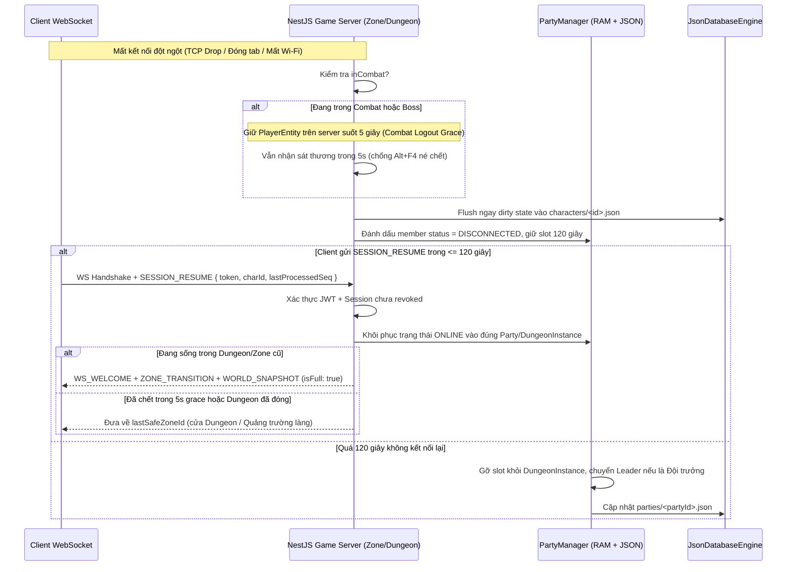
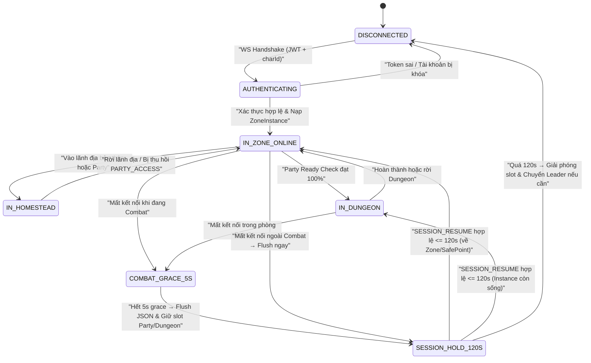

# 20 — Online Multiplayer, Co-op & Social System Design

**Trạng thái**: Hoàn thiện (Design Baseline v1.0)  
**Chế độ**: `DESIGN_AND_PLANNING_ONLY`  
**Cập nhật lần cuối**: 2026-11-19  
**Tham chiếu**: [Constitution](../../.specify/memory/constitution.md) | [Game Server Architecture](../architecture/game-server-architecture.md) | [Network Protocol](../architecture/network-protocol.md) | [WebSocket Contracts](../architecture/websocket-contracts.md) | [Anti-Cheat Design](../architecture/anti-cheat-design.md) | [ADR-006](../architecture/architecture-decisions/ADR-006-in-process-world-partitioning.md)

---

## 1. Mục tiêu Gameplay (Gameplay Objectives)

1. **Ưu tiên tuyệt đối trải nghiệm PvE & Co-op thân thiện (MVP)**: Tạo cảm giác thế giới pixel sống động nơi người chơi gặp gỡ nhau ở `reg_greenhaven_village`, trò chuyện, kết bạn, phụ nhau chăm sóc nông trại, cùng lập Party 2–4 người khám phá rừng sâu và hợp sức hạ gục các Boss nhiều giai đoạn như `boss_thornback_elder` mà **không bị phá rối (griefing) hay cướp đồ (ninja-looting)**.
2. **Mô hình Server-Authoritative công bằng & mượt mà**: Mọi chuyển động, đòn đánh, kỹ năng, hồi sinh, chia chiến lợi phẩm và giao dịch đều do máy chủ NestJS xác thực ở nhịp mô phỏng **`20 Hz`** (`proposed`), phát gói Delta Snapshot **`10 Hz`** (`proposed`) qua Spatial Hash Grid, kết hợp Client-Side Prediction + Entity Interpolation trên Phaser **`60 FPS`** (`proposed`).
3. **Kiên cường trước lỗi mạng và ngắt kết nối**: Bảo vệ công bằng chiến đấu bằng **`5 giây` Combat Logout Grace** (chống Alt+F4 né chết) và bảo vệ trải nghiệm tổ đội bằng **`120 giây` Session & Party/Dungeon Slot Hold** giúp người chơi rớt mạng quay lại trận đấu mượt mà không mất đồ hay hỏng tệp JSON.
4. **Kiến trúc 100% Tự chủ (JSON Local DB + In-Process State) & Trung thực về Sức chứa**: Toàn bộ trạng thái trực tuyến (Presence, Spatial Grid, Chat Ring-Buffer, Party Runtime) chạy hoàn toàn in-process trong Node.js và lưu bền vững tại `data/db/**/*.json`; tuyệt đối KHÔNG tuyên bố sức chứa MMO-scale khi chưa có số liệu load test thực tế.

---

## 2. User Stories

- **US-MP-01 (Gặp gỡ & Giao tiếp ở Làng)**: Là người chơi bước vào `zon_greenhaven_square`, tôi muốn nhìn thấy chuyển động, trang bị và hoạt ảnh của những người chơi khác mượt mà, đồng thời gửi tin nhắn `ZONE` chat để rủ mọi người đi săn Boss mà không lo mã độc XSS hay spam làm tràn màn hình.
- **US-MP-02 (Lập Party & Đi Dungeon Co-op)**: Là một người chơi muốn đánh `boss_thornback_elder`, tôi muốn mời 1–3 người bạn vào Party, nhìn thấy thanh HP/MP và vị trí của họ trên HUD góc trái, cùng bấm sẵn sàng (Ready Check) để bước vào `DungeonInstance` riêng tư và chia sẻ chiến lợi phẩm công bằng.
- **US-MP-03 (Co-op Farming an toàn)**: Là chủ sở hữu một lãnh địa (`zon_player_homestead`), tôi muốn bật quyền `PARTY_ACCESS` để đồng đội vào phụ tưới cây, chăm gà/bò và nấu ăn chung tại `bld_kitchen`, nhưng tôi hoàn toàn yên tâm vì khách không thể phá nhà, cướp nông sản hay lấy trộm đồ trong kho `bld_storage`.
- **US-MP-04 (Chống cướp Loot & Chống ăn bám)**: Là người chơi hỗ trợ (Healer `chr_seraphina_dawn`) hoặc DPS trong Party, tôi muốn mọi vật phẩm rơi ra từ Boss đều được chia theo quy tắc `PERSONAL_INSTANCED` riêng từng người khi tôi đóng góp hợp lệ (`>= 5%` sát thương, hồi máu hoặc chặn đòn), loại bỏ hoàn toàn cảnh tranh giành bấm nhặt.
- **US-MP-05 (Rớt mạng quay lại không mất trận)**: Là thành viên Party bị mất Wi-Fi 40 giây giữa trận đánh `dng_mossroot_hollow`, tôi muốn slot trong Party và Dungeon của mình được giữ suốt `120 giây` để khi mạng có lại tôi tự động kết nối (`SESSION_RESUME`) trở về đúng phiên chơi mà không bị mất đồ.

---

## 3. Đặc tả Chi tiết Các Phân hệ Multiplayer & Social (Functional Requirements)

### 3.1 Presence & Đồng bộ Zone Thời gian thực (20 Hz Sim / 10 Hz Delta + Spatial Grid)

1. **Quản lý Trạng thái Hiện diện (In-Process Online Presence)**:
   - Máy chủ duy trì `PresenceRegistry` (cấu trúc `Map<characterId, PresenceRecord>` hoàn toàn trong RAM, không cần bộ nhớ đệm ngoài) với 5 trạng thái: `ONLINE` (đang ở Open World), `IN_HOMESTEAD`, `IN_DUNGEON`, `AWAY` (tự động sau 5 phút không gửi input), `OFFLINE`.
   - Khi người chơi đăng nhập, đổi Zone, vào Dungeon hoặc thoát game, `PresenceRegistry` đẩy sự kiện nhẹ tới danh sách Bạn bè và thành viên Party đang online.
2. **Vòng lặp Mô phỏng `20 Hz` & Delta Snapshot `10 Hz` (`proposed`)**:
   - Server nhận `MOVE_INPUT` tối đa `20–25 gói/giây`, cập nhật tọa độ/va chạm/combat ở chu kỳ `50 ms` (`20 Hz`).
   - Mỗi `100 ms` (`10 Hz`), mỗi `ZoneInstance` truy vấn **`SpatialHashGrid`** (kích thước ô `256 × 256 px` = `8 × 8 tiles`) lấy tập thực thể trong cụm **`5 × 5` ô xung quanh người chơi** (`1280 × 1280 px`, tạo vùng đệm đủ lớn quanh viewport `640 × 360 px`).
   - Chỉ gửi các thay đổi (`entered[]`, `updated[]`, `left[]`) kèm `ackSeq` để giảm 60–80% băng thông.
3. **Prediction, Reconciliation, Interpolation & Animation Sync**:
   - **Bản thân người chơi**: Client Phaser chạy Client-Side Prediction ngay tại 60 FPS; khi nhận `WORLD_SNAPSHOT`, xóa các input `<= ackSeq` và replay phần dư. Sai lệch `< 6 px` bỏ qua, `6..48 px` nội suy mượt `100 ms`, `> 48 px` kéo cứng về vị trí chuẩn server.
   - **Người chơi khác & Quái**: Client giữ bộ đệm nội suy **`100 ms`** (tự tăng `150 ms` nếu RTT > 150 ms) để chuyển động không bị giật cục.
   - **Đồng bộ Hoạt ảnh (Animation State Sync)**: Server KHÔNG truyền số frame pixel; chỉ truyền `{ animState, facing, stateStartedAtTick }`. Client tự tính độ lệch thời gian và phát đúng khung hình từ `animation-standard.md`.

### 3.2 Hệ thống Chat An toàn (`ZONE`, `PARTY`, `SYSTEM`)

| Kênh Chat | Phạm vi Phát sóng | Phạm vi Milestone | Lưu trữ |
| :--- | :--- | :---: | :--- |
| **`ZONE`** | Toàn bộ người chơi đang hiện diện trong cùng `ZoneInstance` (hoặc `HomesteadInstance`) | **M1 (MVP)** | In-Memory Ring-Buffer `50` tin gần nhất/Zone (không ghi đĩa JSON liên tục) |
| **`PARTY`** | Toàn bộ thành viên trong cùng `partyId` (xuyên Zone/Dungeon) | **M1 (MVP)** | In-Memory Ring-Buffer `50` tin/Party |
| **`SYSTEM`** | Thông báo hệ thống từ server (Boss Phase, Loot hiếm, cảnh báo bảo trì, lỗi thao tác) | **M1 (MVP)** | Không cần lưu (chỉ gửi sự kiện) |
| **`WHISPER`** | Nhắn tin riêng 1-1 giữa 2 nhân vật đang online (có kiểm tra danh sách chặn) | M2 | In-Memory only |
| **`GUILD`** | Toàn bộ thành viên cùng Bang hội | M3 | In-Memory Ring-Buffer `100` tin/Guild |

- **Bảo mật & Chống Spam Chat**:
  - **Plain-Text XSS Sanitization**: Server chuẩn hóa loại bỏ ký tự điều khiển (`\x00-\x1F`), cắt khoảng trắng thừa, giới hạn cứng **`1..250` ký tự UTF-8** và escape/từ chối thẻ HTML; Client React bắt buộc render bằng text node thuần, **CẤM tuyệt đối `dangerouslySetInnerHTML`**.
  - **Rate Limit (In-Process Token Bucket)**: Tối đa **`5 tin nhắn / 10 giây`** cho mỗi kết nối; vượt ngưỡng trả `ACTION_ERROR { code: "ERR_CHAT_RATE_LIMITED", retryAfterSec }`; lặp lại 3 lần liên tiếp trong 1 phút tự động tạm cấm chat `60 giây`.
  - **Kiểm soát Người chơi**: Hỗ trợ danh sách chặn (`blockedCharacterIds[]` tối đa `100` người, lưu trong `characters/<id>.json`) ẩn toàn bộ tin nhắn và lời mời Party từ người bị chặn; lệnh báo cáo vi phạm (`/report <charName> <reason>`) lưu bằng chứng 10 dòng chat gần nhất từ RAM ring-buffer vào `data/db/audit/security-audit-YYYY-MM-DD.json`.

### 3.3 Hệ thống Bạn bè (Friends) & Tổ đội (Party 2–4 Người)

1. **Friends System (MVP cơ bản → M2 mở rộng)**:
   - Mỗi nhân vật duy trì danh sách `friendCharacterIds[]` (tối đa **`50` bạn bè** trong MVP) và `pendingFriendRequests[]` (tối đa `20` lời mời chờ, tự hết hạn sau `7 ngày`) lưu trong `data/db/characters/<characterId>.json`.
   - Khi 2 người đồng ý kết bạn, cập nhật nguyên tử hai chiều qua `JsonDatabaseEngine` WAL (khóa theo thứ tự bảng chữ cái `character:<idA>`, `character:<idB>` chống deadlock).
   - Cho phép xem trạng thái Presence (`ONLINE`/`IN_DUNGEON`/`OFFLINE`), khu vực hiện tại và mời nhanh vào Party bằng 1 cú bấm.
2. **Party System (2–4 Người chơi)**:
   - Quy mô: Tối thiểu `1` (có thể tạo sẵn để mời hoặc vào Dungeon Solo), tối đa **`4` thành viên**.
   - Tập hành động `PARTY_ACTION`:
     - `CREATE`: Khởi tạo `data/db/parties/<partyId>.json`, gán người tạo làm `leaderCharacterId`, `lootRule = "PERSONAL_INSTANCED"`.
     - `INVITE`: Chỉ Đội trưởng gửi lời mời tới nhân vật đang online chưa thuộc Party nào và chưa chặn mình; lời mời tồn tại trong RAM **`30 giây`** (`TTL`).
     - `ACCEPT` / `DECLINE`: Xác nhận gia nhập; nếu Party đã đủ `4/4` người khi bấm chấp nhận sẽ từ chối lịch sự (`ERR_PARTY_FULL`).
     - `LEAVE`: Tự rời Party; nếu là người cuối cùng → tự động giải tán Party & xóa tệp `parties/<partyId>.json`.
     - `KICK`: Chỉ Đội trưởng thực hiện; **bị cấm trong lúc đang giao chiến Boss** (tránh hành vi Đội trưởng đá đồng đội ngay ở 5% HP cuối để phá công sức).
     - `TRANSFER_LEADER`: Đội trưởng nhường quyền chủ động, hoặc server **tự động chuyển quyền** cho thành viên vào đội sớm nhất đang online nếu Đội trưởng rời đội hoặc mất kết nối quá `120 giây`.
     - `START_DUNGEON`: Đội trưởng kích hoạt **Ready Check (`30 giây`)** khi đứng cạnh cổng hầm ngục (ví dụ `dng_mossroot_hollow`). Khi mọi thành viên đều đạt cấp tối thiểu và bấm "Sẵn sàng", server cấp phát `DungeonInstance` riêng và chuyển cả đội vào cùng lúc.
   - **Chia sẻ EXP Tổ đội (Anti-AFK Leech)**: Trong Open World, khi thành viên Party hạ quái, các đồng đội đứng trong phạm vi **`<= 800 px`** cùng Zone nhận thưởng chia sẻ EXP (`100%` cơ bản + `+10%` thưởng co-op theo số đồng đội gần đó, tối đa `+30%` ở 4 người); người đứng AFK ở làng hoặc quá xa không nhận EXP.

### 3.4 Co-op Farming & Phân quyền Lãnh địa (Homestead Permissions)

Dựa trên trường `permissions` chuẩn trong `game-data/buildings.json`, mỗi `HomesteadInstance` áp dụng ma trận phân quyền nghiêm ngặt do server xác thực nhằm khuyến khích hợp tác mà **chặn tuyệt đối nạn phá hoại nhà cửa**:

| Hành động tại `homestead:<ownerId>` | Chủ sở hữu (`OWNER`) | Thành viên Party (khi bật `PARTY_ACCESS`) | Người lạ / Khi bật `OWNER_ONLY` |
| :--- | :---: | :---: | :---: |
| Bước vào tham quan lãnh địa | Được phép | Được phép | Bị từ chối (`ERR_FORBIDDEN_OWNERSHIP`) |
| Tưới nước (`WATER`) & Bón phân (`FERTILIZE`) trên `bld_farm_plot` | Được phép | **Được phép** (tặng `+5 EXP` nông trại hỗ trợ) | Bị từ chối |
| Cho thú ăn (`FEED`) & Vuốt ve tăng Happiness (`PET`) ở `bld_chicken_coop` / `bld_barn` | Được phép | **Được phép** | Bị từ chối |
| Nấu ăn trên `bld_kitchen` & tập luyện ở `bld_training_ground` | Được phép | **Được phép** (dùng nguyên liệu từ túi riêng của khách) | Bị từ chối |
| **Thu hoạch cây trồng (`HARVEST`) / Thu trứng sữa (`COLLECT`)** | Được phép | **BỊ CẤM** (chống ăn trộm nông sản) | Bị từ chối |
| **Đặt mới, Di chuyển, Nâng cấp, Phá công trình (`BUILD`/`DEMOLISH`)** | Được phép | **BỊ CẤM** (chống phá nhà) | Bị từ chối |
| **Mở Kho đồ (`bld_storage`) & Cường hóa (`bld_blacksmith`)** | Được phép | **BỊ CẤM** (`OWNER_ONLY`) | Bị từ chối |

- Nếu chủ nhà tắt `PARTY_ACCESS` hoặc đá khách khỏi Party trong khi khách đang ở bên trong `homestead:<ownerId>`, server lập tức gửi `ZONE_TRANSITION` đưa khách ra ngoài cổng `zon_greenhaven_square` một cách an toàn.

### 3.5 Co-op Boss Battle & Dungeon Instancing

- **Cách ly hoàn toàn bằng `DungeonInstance`**: Mỗi lượt chinh phục `dng_mossroot_hollow` (và 4 Dungeon sau) chạy trên một instance riêng (`dng:<instanceUuid>`) không bị người chơi ngoài Party chen ngang hay tranh giành Boss.
- **Niêm phong phòng Boss (`Entry Lock`)**: `5 giây` sau khi thành viên đầu tiên kích hoạt aggro Boss, hàng rào phòng Boss đóng kín (`allowLateJoin: false`). Mọi đòn đánh hoặc đạn bắn từ bên ngoài tọa độ phòng đều bị server loại bỏ.
- **Tỷ lệ cân bằng động theo số lượng người chơi (`partyScaling` chuẩn từ `bosses.json`)**:

| Quy mô Party | Hệ số HP Boss | Hệ số ATK Boss | Hệ số Poise Boss | Thưởng Thêm (`rewardBonusPercent`) |
| :---: | :---: | :---: | :---: | :---: |
| **1 người (Solo)** | `1.00x` | `1.00x` | `1.00x` | `+0%` |
| **2 người** | `1.75x` | `1.05x` | `1.45x` | `+10%` |
| **3 người** | `2.45x` | `1.10x` | `1.85x` | `+20%` |
| **4 người** | `3.10x` | `1.15x` | `2.25x` | `+30%` |

*(Hệ số scaling khóa cố định tại thời điểm đóng cửa phòng Boss để tránh người chơi cố tình rút bớt thành viên hòng hạ HP Boss giữa trận).*

- **Hồi sinh Đồng đội & Reset Khi Wipe**:
  - Khi 1 thành viên hết HP trong phòng Boss, họ chuyển sang trạng thái `DOWNED` (`30 giây` chờ cứu hoặc chờ hết trận) — đồng đội đứng sát (`<= 64 px`) có thể dùng **`csm_revive_feather`** (tụ lực `2.0 giây`, giới hạn tối đa **2 lần hồi sinh/người/trận** để tránh kéo dài bất tận).
  - Nếu toàn bộ thành viên trong phòng đều `DOWNED`/`DEAD` (**Party Wipe**): Boss hồi `100% HP`, khôi phục toàn bộ trụ đá/chậu lửa, đặt lại về **Phase 1** và đưa cả đội về điểm tập kết đầu phòng Boss để thử lại ngay (không mất trang bị).

### 3.6 Quyền Sở hữu Chiến lợi phẩm (Loot Ownership & Anti-Ninja-Loot)

- **Chế độ Mặc định MVP — `PERSONAL_INSTANCED` (Triệt tiêu 100% Ninja-Looting)**:
  - Khi quái vật, Elite hoặc Boss bị tiêu diệt, `LootService` xác định tập `eligibleCharacterIds[]` và **roll độc lập** bảng rơi đồ (`loot-tables.json`) cho từng người chơi đủ điều kiện.
  - Mỗi `GroundLootEntity` sinh ra trong RAM Zone gắn danh sách `ownerCharIds: [singleCharId]`; client chỉ vẽ vật phẩm thuộc quyền sở hữu của chính người chơi đó và server từ chối mọi `LOOT_PICKUP_REQ` từ nhân vật khác.
- **Chế độ Tùy chọn Party — `ROUND_ROBIN`**:
  - Áp dụng tùy chọn cho nguyên liệu thường từ quái Open World trong Party (luân phiên chỉ định người nhận theo thứ tự thành viên gần nhất), **nhưng** các vật phẩm `RARE`/`EPIC`+, `BOSS_TOKEN` và rương thưởng Boss luôn ép về `PERSONAL_INSTANCED` để giữ công bằng tuyệt đối.
- **Điều kiện Đủ tư cách Nhận Loot (Contribution Eligibility — Chống Ăn bám)**:
  - Phải ở trong phạm vi chiến đấu (`<= 960 px` ở Open World, hoặc bên trong phòng Boss khi trận bắt đầu).
  - Phải đóng góp tối thiểu **`5%`** trên ít nhất một trong ba tiêu chí: *(a)* Tổng sát thương gây lên mục tiêu, *(b)* Lượng hồi máu/khiên hiệu dụng cho đồng đội đang giao chiến (bảo vệ quyền lợi cho Healer như `chr_seraphina_dawn`), hoặc *(c)* Sát thương đã chặn/hút threat hợp lệ (bảo vệ Tank như `chr_bram_bastion`).
- **Vòng đời Nhặt đồ An toàn**: `GroundLootEntity` tồn tại **`120 giây`** (`TTL`). Khi nhận `LOOT_PICKUP_REQ`, server kiểm tra khoảng cách `<= 96 px`, kiểm tra `ownerCharIds`, **xóa nguyên tử thực thể loot khỏi RAM Zone TRƯỚC** rồi mới ghi vào `data/db/inventories/<charId>.json` qua WAL (nếu túi đầy thì hoàn lại thực thể loot vào RAM và trả `ERR_INVENTORY_FULL`).

### 3.7 Ngắt kết nối, Kết nối lại & Khôi phục Phiên (Disconnect, Reconnect & Session Recovery)

### 3.8 Luật Chống Phá hoại (Anti-Griefing Ruleset)

1. **Tắt va chạm giữa người chơi với người chơi (No Player Body-Blocking)**: Người chơi đi xuyên qua nhau để không ai có thể đứng chặn cửa NPC (`npc_smith_garrik`), cổng chuyển vùng hay lối vào `dng_mossroot_hollow`.
2. **Shared Tagging ngoài Thế giới mở (Anti-Kill-Steal)**: Ở Open World (`reg_whispering_forest`), mọi người chơi hoặc Party đạt ngưỡng đóng góp `>= 5%` lên cùng một con quái/Elite đều nhận trọn vẹn tiến độ quest và bảng loot cá nhân — loại bỏ việc tranh giành "đánh phát cuối ăn hết".
3. **Bảo vệ Safe Zone & Anti-Mob-Train**: Kéo quái vào khu vực `SafeZone` hoặc quá `leashDistancePx` lập tức ép quái `RETURN` và bất tử trên đường chạy về, không thể dùng quái hại người đang AFK ở làng.
4. **Chống phá hủy Party giữa trận**: Cấm `KICK` thành viên khi Boss đang active; cấm spam lời mời Party (cooldown `15 giây` sau khi bị người khác bấm `DECLINE`).

### 3.9 Lộ trình Mở rộng Hậu MVP & Tuyên bố Trung thực về Sức chứa (`proposed / unverified`)

| Tính năng Mở rộng | Milestone | Thiết kế Định hướng & Ràng buộc An toàn |
| :--- | :---: | :--- |
| **Safe Player-to-Player Trade** | **M3** | Chỉ mở sau khi kinh tế M1–M2 ổn định. Giao dịch trực tiếp 2 bước khóa xác nhận (`LOCK → CONFIRM`) trong phạm vi `<= 128 px`; toàn bộ trao đổi item/Gold thực thi trong **1 giao dịch Multi-File JSON WAL nguyên tử** (khóa `inventory:<A>`, `inventory:<B>`, `character:<A>`, `character:<B>` theo thứ tự chuẩn) và ghi sổ cái `CurrencyLedger`. Cấm giao dịch vật phẩm `bound: true` và `STARLIGHT_SHARD`. |
| **Guild System & `bld_guild_hall`** | **M3** | Tối đa `30` thành viên/Guild lưu tại `data/db/guilds/<guildId>.json`, mở khóa `zon_guild_sanctuary`, quyền `GUILD_ACCESS`, kênh chat `GUILD` và nhiệm vụ tuần bang hội. |
| **Opt-in Normalized PvP Arena** | **M4** | 100% **tự nguyện (Opt-in)** trong đấu trường riêng biệt, tách hoàn toàn khỏi Open World PvE & Farming; áp dụng hệ số `pvpModifier` từ `game-data/skills.json` và chuẩn hóa chỉ số trang bị nhằm tôn vinh kỹ năng điều khiển thay vì chênh lệch đồ; không rớt đồ khi thua. |
| **8-Player Raid & Multi-Zone Sharding** | **M5** | Phụ bản đột kích 8 người (ví dụ phiên bản Raid của `dng_eclipse_throne`) và phân tách kênh/tiến trình theo Region dựa trên dữ liệu benchmark thực tế. |

> **Tuyên bố Trung thực về Sức chứa (`proposed / unverified` — Nguyên tắc VIII)**:  
> Hệ thống **KHÔNG** tuyên bố hỗ trợ quy mô MMO hàng nghìn người chơi trên cùng một bản đồ hay một máy chủ JSON đơn nút. Các mốc năng lực dự kiến trên 1 máy chủ NVMe SSD là mục tiêu kiểm thử (`proposed / unverified`) cần đo đạc thực tế theo [`performance-test-plan.md`](../testing/performance-test-plan.md):
> - **20 CCU**: Baseline thử nghiệm nội bộ (`proposed`).
> - **50 CCU**: Mục tiêu ổn định của **Vertical Slice MVP** (`proposed / unverified`, tick p99 `< 25 ms`, JSON WAL commit p95 `< 15 ms`).
> - **100 CCU**: Mục tiêu mở rộng trung hạn (theo dõi lock contention của `currency-ledger` và xem xét tách ledger theo ngày).
> - **500 CCU**: Ngưỡng kiểm thử áp lực (`stress ceiling`, rủi ro cao về `fsync` I/O và tuần tự hóa snapshot — làm cơ sở quyết định kiến trúc sharding M5).

---

## 4. Business Rules (Quy tắc Nghiệp vụ)

- **BR-MP-01 (Một phiên hoạt động duy nhất mỗi nhân vật)**: Một `characterId` chỉ có tối đa 1 kết nối WebSocket gameplay cùng lúc. Kết nối mới hợp lệ sẽ flush phiên cũ và ngắt socket cũ bằng mã `ERR_SESSION_REPLACED`.
- **BR-MP-02 (Quyền quyết định Loot Rule)**: Chỉ Đội trưởng được đổi `lootRule` (`PERSONAL_INSTANCED` ↔ `ROUND_ROBIN`) và chỉ được đổi khi **ngoài combat** và không đang ở trong phòng Boss; mọi thay đổi phát thông báo `SYSTEM` công khai cho toàn bộ thành viên Party.
- **BR-MP-03 (Chống lợi dụng Scaling Boss)**: Nếu 1 thành viên disconnect giữa trận Boss, chỉ số HP/Poise Boss không giảm xuống để tránh gian lận giảm độ khó; đồng đội vẫn có thể hoàn thành trận hoặc thử lại sau wipe.
- **BR-MP-04 (Từ chối Phương án ngoài — Rejected Alternatives)**: Theo Nguyên tắc I & [`ADR-001`](../architecture/architecture-decisions/ADR-001-json-only-local-database.md) / [`ADR-006`](../architecture/architecture-decisions/ADR-006-in-process-world-partitioning.md), **KHÔNG** dùng Redis Pub/Sub hay cơ sở dữ liệu ngoài (PostgreSQL/MongoDB) để quản lý Presence, Party hay Chat trong kiến trúc này; toàn bộ điều phối chạy in-process trong Modular Monolith NestJS kết hợp lưu bền vững tại `data/db/**/*.json`.

---

## 5. Input & Output (Hợp đồng Giao tiếp WebSocket & REST)

| Nhóm Chức năng | Event / Endpoint | Input (Client → Server) | Output (Server → Client) |
| :--- | :--- | :--- | :--- |
| Kết nối & Khôi phục | WS Handshake / `SESSION_RESUME` | `{ token, characterId, protocolVersion: "1.0", lastProcessedSeq? }` | `WS_WELCOME` + `WORLD_SNAPSHOT (isFull: true)` hoặc `ACTION_ERROR` |
| Đồng bộ Thế giới | WS `MOVE_INPUT` / `SNAPSHOT_RESYNC_REQ` | `{ seq, dx, dy, sprint, facing }` | `WORLD_SNAPSHOT { tick, isFull, ackSeq, self, entered[], updated[], left[] }` |
| Trò chuyện | WS `CHAT_SEND` | `{ channel: "ZONE"|"PARTY", message }` | `CHAT_MESSAGE { msgId, channel, senderId, senderName, text, serverTs }` |
| Tổ đội & Dungeon | WS `PARTY_ACTION` | `{ action: "CREATE"|"INVITE"|"ACCEPT"|"DECLINE"|"LEAVE"|"KICK"|"TRANSFER_LEADER"|"START_DUNGEON", targetId?, dungeonId? }` | `PARTY_INVITE` / `PARTY_UPDATE` / `DUNGEON_READY_CHECK` / `ZONE_TRANSITION` |
| Nhặt chiến lợi phẩm | WS `LOOT_PICKUP_REQ` | `{ requestId, lootId }` | `LOOT_REMOVED` + `INVENTORY_PATCH` |
| Bạn bè & Chặn | `POST /api/v1/social/friends/*` & `/block` | `{ targetCharacterId }` + `X-Idempotency-Key` | `200 { friends[], pendingRequests[], blockedCharacterIds[] }` |
| Cấp quyền Homestead | `PATCH /api/v1/characters/:charId/homestead/permissions` | `{ permissionMode: "OWNER_ONLY"|"PARTY_ACCESS" }` | `200 { permissionMode }` (+ đá khách ra làng nếu chuyển về `OWNER_ONLY`) |

---

## 6. State Transitions (Vòng đời Phiên Kết nối & Party)

---

## 7. Data Model (Tham chiếu JSON Collections & In-Memory State)

1. **`data/db/parties/<partyId>.json`** (Persistent Snapshot + RAM Runtime):
   - `partyId`, `leaderCharacterId`, `memberIds[]` (`1..4`), `lootRule` (`"PERSONAL_INSTANCED" | "ROUND_ROBIN"`), `activeDungeonInstanceId`, `createdAt`.
2. **`data/db/characters/<characterId>.json`**:
   - `partyId`, `friendCharacterIds[]` (max 50), `pendingFriendRequests[]`, `blockedCharacterIds[]` (max 100), `position`.
3. **`data/db/houses/<characterId>.json`**:
   - `homesteadPermissionMode` (`"OWNER_ONLY" | "PARTY_ACCESS"`), `buildings[].permissionMode`.
4. **`data/db/sessions/<sessionId>.json`** & **`data/db/indexes/sessions-by-token-hash.json`**:
   - Phiên đăng nhập & kiểm soát thu hồi token cục bộ.
5. **`data/db/audit/security-audit-<YYYY-MM-DD>.json`**:
   - Ghi nhận báo cáo chat (`/report`), hành vi nhặt loot trái phép, nghi vấn speed/teleport, vi phạm rate limit.
6. **Ephemeral RAM Only (Không ghi đĩa theo tick)**:
   - `PresenceRegistry`, `SpatialHashGrid`, `ZoneChatRingBuffer (50)`, `PendingPartyInvites (30s TTL)`, `GroundLootEntity (120s TTL)`, `ReconnectHoldTimers (5s / 120s)`.

---

## 8. Dependencies

- **Upstream**: `001-foundation-game-engine` (WebSocket gateway, `JsonDatabaseEngine`), `002-auth-character` (JWT & Session), `003-world-movement` (Zone partitioning & Spatial Grid), `004-combat-skills` (Combat sync & Threat), `005-inventory-loot` (Atomic loot pickup).
- **Downstream**: `011-dungeon-boss` (Co-op scaling, Ready Check, Boss Loot), `008-housing-farming` (Co-op Homestead permissions), `012-game-ui-qa` (Party HUD, Chat Box, Friends modal, Reconnect overlay).

---

## 9. UI Interactions

- **Party HUD (Góc trái giữa màn hình)**: Hiển thị tối đa 3 đồng đội còn lại với chân dung pixel nhỏ, tên, biểu tượng vương miện Đội trưởng, thanh HP/MP thời gian thực, icon Zone/trạng thái mạng (chấm xám + đồng hồ đếm ngược `120s` khi đồng đội bị mất kết nối).
- **Khung Chat (Góc trái dưới)**: Các tab `Tất cả | Khu vực | Tổ đội | Hệ thống`, tự động mờ nền khi không gõ phím (`Enter` để mở nhập, `Esc` để đóng), bấm chuột phải vào tên người chơi mở menu ngữ cảnh (`Mời Party`, `Kết bạn`, `Chặn`, `Báo cáo`).
- **Ready Check Modal**: Hộp thoại nhỏ ở giữa trên màn hình đếm ngược `30 giây` hiển thị trạng thái dấu tích xanh của từng thành viên trước khi mở `DungeonInstance`.
- **Reconnect Overlay**: Khi rớt mạng, hiển thị biểu tượng mất kết nối không che toàn màn hình, tự thử kết nối lại theo backoff `1s → 2s → 4s → 8s` kèm thông báo đếm ngược thời gian giữ phiên `120 giây`.

---

## 10. Edge Cases

1. **Đội trưởng mất kết nối đúng lúc bảng Ready Check đang chạy**: Ready Check tự hủy sạch (`DUNGEON_READY_CANCELLED`), không trừ vé hay khóa cooldown của ai.
2. **Người chơi đang ở trong `homestead:<friendId>` thì chủ nhà bị mất kết nối**: `HomesteadInstance` vẫn hoạt động bình thường cho khách trong lúc giữ phiên, và khi tất cả rời khỏi sẽ tự flush JSON sau `60 giây`.
3. **Đồng đội đóng góp `4.8%` sát thương nhưng hồi `12%` tổng lượng máu cho cả đội trong trận Boss**: Vẫn **ĐẠT** điều kiện nhận loot vì đáp ứng tiêu chí đóng góp hồi máu `>= 5%`.
4. **Hai kết nối từ 2 trình duyệt đăng nhập cùng 1 `characterId` để cố tình nhân bản khi nhặt loot**: Kết nối thứ 2 kích hoạt Single Active Session Enforcement (`ERR_SESSION_REPLACED`), ngắt ngay socket cũ trước khi gắn socket mới vào Zone; mọi giao dịch đi qua `AsyncLockManager`.
5. **Mất gói liên tiếp làm client lệch `deltaBaseTick`**: Client phát hiện khuyết chuỗi tick, gửi `SNAPSHOT_RESYNC_REQ` (giới hạn `1 lần / 2 giây`) và nhận ngay 1 Full Snapshot đồng bộ lại toàn bộ thực thể.

---

## 11. Failure Behavior

- **Server gặp quá tải cục bộ (`tickDurationMs > 35 ms` kéo dài)**: Ghi cảnh báo `SIM_TICK_OVERLOAD`, ưu tiên giữ nguyên vòng lặp combat & collision `20 Hz`, tạm giảm tần suất broadcast snapshot không khẩn cấp (ví dụ chuyển từ `10 Hz` xuống `7 Hz` trong vùng quá đông) để tránh treo kết nối.
- **Lỗi ghi tệp `parties/<partyId>.json`**: Party vẫn giữ trạng thái đồng bộ an toàn trong RAM và thử ghi lại theo hàng đợi retry; nếu server khởi động lại đột ngột, mọi nhân vật trở về trạng thái solo sạch tại `lastSafeZoneId` mà không bị kẹt "kẹt trong Party ma".
- **Tấn công Flood WebSocket / Tin nhắn quá cỡ (`> 16 KB`)**: Gateway lập tức cắt khung tin, tăng `suspicionScore` và ngắt kết nối nếu vượt ngưỡng.

---

## 12. Security Requirements

- **Xác thực Handshake bắt buộc không lộ token**: Truyền JWT qua WebSocket `auth` payload (CẤM truyền qua URL query string); kiểm tra `Account.status === "ACTIVE"` và `Session.revoked === false`.
- **Phân quyền Cứng (Server-Side Authorization)**: Mọi `PARTY_ACTION`, tương tác `HomesteadInstance`, `LOOT_PICKUP_REQ` và `CHAT_SEND (PARTY)` đều kiểm tra tư cách sở hữu/thành viên trực tiếp từ trạng thái server.
- **Chống Giả mạo Vị trí, Sát thương & Loot**: Không nhận tọa độ đích, không nhận `DAMAGE_DEALT` từ client; khoảng cách nhặt loot `<= 96 px` và `ownerCharIds` xác thực 100% phía server.
- **Chống XSS & Prototype Pollution**: Mọi tin nhắn chat và tên nhân vật được sanitize plain-text, từ chối key `__proto__`/`constructor`/`prototype` trong mọi gói JSON WebSocket.
- **Kiểm toán Hành vi Xấu**: Toàn bộ báo cáo người chơi, kick bất thường, vi phạm tốc độ gói tin hoặc thử nhặt loot trái phép đều ghi vào `data/db/audit/security-audit-YYYY-MM-DD.json`.

---

## 13. Acceptance Criteria

- **AC-MP-01**: Hai client trên hai trình duyệt khác nhau cùng đăng nhập vào `reg_greenhaven_village`, nhìn thấy nhau di chuyển mượt (interpolation không giật hình), thấy đúng hướng mặt (`facing`) và hoạt ảnh (`animState`), gửi và nhận tin nhắn `ZONE` chat với độ trễ `< 200 ms` trên mạng nội bộ (`proposed`).
- **AC-MP-02**: Đội trưởng lập Party `2–4` người, hoàn thành Ready Check vào `dng_mossroot_hollow`, hệ số HP/Poise của `boss_thornback_elder` tăng đúng theo bảng `partyScaling` trong `bosses.json`.
- **AC-MP-03**: Khi đánh bại Boss trong Party 4 người, mỗi thành viên đủ điều kiện (`>= 5%` đóng góp) nhìn thấy và nhặt được gói loot `PERSONAL_INSTANCED` riêng của mình; cố gửi `LOOT_PICKUP_REQ` bằng `lootId` của đồng đội bị server từ chối `403/ERR_FORBIDDEN_OWNERSHIP`.
- **AC-MP-04**: Thành viên Party vào lãnh địa chủ nhà bật `PARTY_ACCESS` có thể tưới `bld_farm_plot` và nấu ăn ở `bld_kitchen`, nhưng mọi yêu cầu `HARVEST`, `DEMOLISH` hoặc mở `bld_storage` đều bị server chặn cứng.
- **AC-MP-05**: Ngắt mạng đột ngột 1 client trong lúc đang đánh Boss → thực thể vẫn đứng chịu đòn trong `5 giây` Combat Logout Grace → kết nối lại sau `30 giây` (`< 120s`) bằng `SESSION_RESUME` khôi phục đúng vị trí/Party và bảo toàn 100% kho đồ JSON.

---

## 14. Test Scenarios

| Mã Test | Loại | Kịch bản Kiểm thử | Kết quả Kỳ vọng |
| :--- | :--- | :--- | :--- |
| **TS-MP-01** | Happy Path (Co-op) | 3 client lập Party → vào `dng_mossroot_hollow` → phối hợp hạ `boss_thornback_elder` (Kael DPS, Lyra Ranged, Seraphina Healer chỉ hồi máu & buff). | Boss scale `2.45x HP / 1.85x Poise`; cả 3 người (kể cả Seraphina) đều đạt `>= 5%` đóng góp và nhận gói loot `PERSONAL_INSTANCED` + `+20%` reward bonus. |
| **TS-MP-02** | Security / Anti-Ninja-Loot | Client B bắt `lootId` rơi dành cho Client A và gửi trực tiếp gói WS `LOOT_PICKUP_REQ { lootId }` khi đứng sát cạnh. | Server từ chối với `ERR_FORBIDDEN_OWNERSHIP`, cộng `+35` vào `suspicionScore`, ghi `security-audit`, loot của Client A còn nguyên vẹn. |
| **TS-MP-03** | Security / Homestead Anti-Griefing | Chủ nhà bật `PARTY_ACCESS`; thành viên Party gửi REST `POST /farming/action { action: "HARVEST" }` và `DELETE /buildings/:id`. | Server từ chối cả hai với `403 ERR_FORBIDDEN_OWNERSHIP`; hành động `WATER` trên cùng ô đất vẫn thành công. |
| **TS-MP-04** | Security / Chat XSS & Spam | Client gửi `` vào kênh `ZONE`, sau đó gửi liên tục 8 tin nhắn trong 2 giây. | Ký tự HTML được vô hiệu hóa hoàn toàn (hiển thị chuỗi thuần hoặc từ chối), 5 tin đầu đi qua, từ tin thứ 6 bị chặn với `ERR_CHAT_RATE_LIMITED`. |
| **TS-MP-05** | Resilience / Combat Logout & Reconnect | Client A rút cáp mạng khi HP còn 20% trước mặt `mob_elite_alpha_direwolf`; sau 40 giây nối lại mạng gửi `SESSION_RESUME`. | Trong 5 giây đầu, quái vẫn đánh trúng Client A (nếu chết sẽ đưa về Safe Zone); slot Party giữ nguyên trong 120s; khi nối lại không nhân bản vật phẩm và tệp JSON nguyên vẹn. |
| **TS-MP-06** | Concurrency / Party Full Race | Party đang có `3/4` thành viên; Đội trưởng mời đồng thời Client D và Client E; cả D và E bấm `ACCEPT` trong cùng 10 ms. | Nhờ khóa `AsyncLockManager` trên `party:<partyId>`, chỉ 1 người gia nhập thành công (`4/4`), người còn lại nhận lỗi sạch `ERR_PARTY_FULL`. |
| **TS-MP-07** | Network Impairment | Giả lập mạng RTT `180 ms`, jitter `±40 ms`, packet loss `3%` khi 2 client di chuyển và đánh quái trong `zon_forest_west`. | Client tự tăng interpolation buffer lên `150 ms`; nếu mất chuỗi snapshot tự gửi `SNAPSHOT_RESYNC_REQ`; không treo client hay xuyên tường. |
