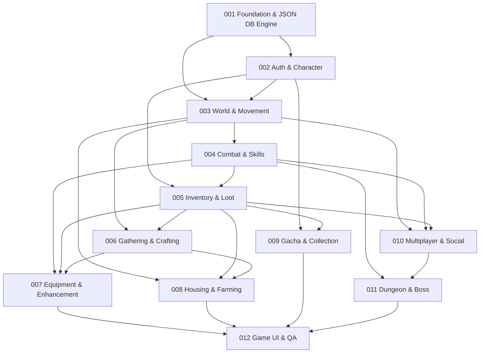

# Feature Roadmap & Spec Kit Dependency Map — Eldoria: Forgotten Wilds

**Trạng thái**: Baseline v2.0 (Cập nhật theo Hiến pháp v2.0.0 & `specs/013-local-infra-pixel-animation`)  
**Cập nhật lần cuối**: 2026-11-19

---

## 1. Chiến lược Phân chia Feature theo Spec Kit

Theo `GAME_DESIGN_BRIEF.md` (Mục 23) và Nguyên tắc VII của Hiến pháp v2.0.0, toàn bộ trò chơi được tách thành **13 Feature độc lập đã đặc tả** (`001..013`, kèm backlog `014-quests-onboarding` trước Sprint Quest) dưới thư mục `specs/`, sắp xếp theo thứ tự phụ thuộc nghiêm ngặt để triển khai từng lát cắt dọc (vertical slice).

---

## 2. Danh mục 13 Feature Ưu tiên & Đồ thị Phụ thuộc

| STT | Thư mục Spec Kit | Tên Feature | Phụ thuộc trực tiếp | Milestone | Độ phức tạp (Ước lượng) |
| :---: | :--- | :--- | :--- | :---: | :---: |
| 001 | `specs/001-foundation-game-engine` | Foundation, Monorepo, JSON DB Engine & Game Loop Shell | Không (Gốc) | M1 (MVP) | Cao (3 tuần) |
| 013 | `specs/013-local-infra-pixel-animation` | Local Docker Redis + MinIO (S3) & Glitch-Free 2D Pixel Multi-Animation Pipeline | `001` (chạy song song cuối Sprint 1) | M1 (MVP) | Cao (2 tuần) |
| 002 | `specs/002-auth-character` | Local Authentication, Session & Character Management | `001`, `013` (tùy chọn cache) | M1 (MVP) | Trung bình (1.5 tuần) |
| 003 | `specs/003-world-movement` | Open World Maps, Partitioning, Movement & Sync | `001`, `002` | M1 (MVP) | Cao (2.5 tuần) |
| 004 | `specs/004-combat-skills` | Action Combat, Hit Validation & 60-Skill Data Engine | `001`, `003` | M1 (MVP) | Rất cao (3 tuần) |
| 005 | `specs/005-inventory-loot` | Inventory, Item Instances, Loot Ownership & Currency Ledger | `001`, `002`, `004` | M1 (MVP) | Trung bình (2 tuần) |
| 006 | `specs/006-gathering-crafting` | Resource Gathering, Smelting, Refining & Crafting | `003`, `005` | M1 (MVP) | Trung bình (2 tuần) |
| 007 | `specs/007-equipment-enhancement` | Equipment Slots, Sets & Deterministic +1..+10 Enhancement | `004`, `005`, `006` | M1 (MVP) | Trung bình (1.5 tuần) |
| 008 | `specs/008-housing-farming` | Survival, Farming, Animal Husbandry & Housing Placement | `003`, `005`, `006` | M1 (MVP) | Cao (3 tuần) |
| 009 | `specs/009-gacha-collection` | Fair In-Game Gacha, Pity, Duplicate Conversion & Collection | `002`, `005` | M1 (MVP) | Trung bình (1.5 tuần) |
| 010 | `specs/010-multiplayer-social` | Presence, Chat, Friends, Party & Co-op Synchronization | `002`, `003`, `004`, `005` | M1 (MVP) | Cao (2 tuần) |
| 011 | `specs/011-dungeon-boss` | Instanced Dungeons, Monster AI & Multi-Phase Boss Raids | `003`, `004`, `005`, `010` | M1 (MVP) | Rất cao (3 tuần) |
| 012 | `specs/012-game-ui-qa` | Pixel Fantasy HUD/Screens, Responsive UI & QA Harness | `001`..`011` | M1 (MVP) | Cao (2.5 tuần) |

---

## 3. Lộ trình Các Milestone Phát hành (Release Milestones)

### Milestone 1 — Vertical Slice MVP (Tính năng `001` – `012` ở mức lõi)
- **Mục tiêu**: Chơi được trọn vẹn từ đăng nhập → làng → nông trại/xây dựng → rừng → rèn +10 → gacha nội tệ → co-op hạ `boss_thornback_elder`.
- **Phạm vi**: 2 khu vực, 1 dungeon, 3 nhân vật starter (hệ thống đọc đủ 12 nhân vật JSON), 15 kỹ năng hoạt động, 8 monster, 1 elite, 1 boss, 10 vũ khí, 5 cây trồng, 2 động vật, 6 công trình, 12 nhiệm vụ.
- **Độ tin cậy dữ liệu**: `JsonDatabaseEngine` hoàn chỉnh WAL, atomic write, backup xoay vòng và kiểm thử chịu tải mục tiêu 20–50 concurrent players (giả thuyết ban đầu, cần đo kiểm thực tế).

### Milestone 2 — Ironpeak Expansion & Roster Expansion
- **Nội dung**: Mở `reg_ironpeak_mountains` (Lv 15–30), `boss_ignis_forgelord`, nâng cấp trần level lên 45, mở khóa 4 nhân vật tiếp theo (`chr_bram_bastion`, `chr_vex_nightblade`, `chr_rowan_tidewarden`, `chr_mira_ironfist`), thêm 4 công trình (Barn, Furnace, Workshop, Alchemy Lab), hệ thống Equipment Socketing & Reforging.
- **Lý do đưa vào M2**: Kéo dài vòng đời mid-game bằng chuỗi khai khoáng luyện kim và vai trò Tank/Assassin trong party.

### Milestone 3 — Crystal Caverns, Forgotten Ruins & Social Economy
- **Nội dung**: Mở `reg_crystal_caverns` (Lv 30–45) và `reg_forgotten_ruins` (Lv 45–60), `boss_prism_leviathan`, mở thêm nhân vật (`chr_freya_frostveil`, `chr_orin_stormcaller`), hệ thống Guild Hall, Friends nâng cao, hệ thống giao dịch trực tiếp an toàn (Safe Trade có kiểm toán JSON ledger) và Auto-Farming Irrigation bậc cao.
- **Lý do đưa vào M3**: Chỉ mở giao dịch giữa người chơi sau khi hệ thống chống gian lận và theo dõi lạm phát ở M1–M2 đã được xác minh ổn định.

### Milestone 4 — Elemental Realms & Competitive Modes
- **Nội dung**: Mở `reg_frostbound_highlands` (Lv 60–75) và `reg_ember_wasteland` (Lv 75–90), `boss_boreas_frostking`, `chr_torvald_rageborn`, thêm công trình Stable & Training Ground, thử nghiệm chế độ PvP Arena chuẩn hóa chỉ số (opt-in, không ép buộc PvE player), Limited Banner xoay vòng dùng nội tệ và hỗ trợ Gamepad.
- **Lý do đưa vào M4**: Phân tách hoàn toàn PvP khỏi trải nghiệm sinh tồn/nông trại cốt lõi.

### Milestone 5 — Abyssal Kingdom Endgame & Cross-Device Polish
- **Nội dung**: Mở `reg_abyssal_kingdom` (Lv 90–100), `boss_malakor_abyss`, hoàn tất bộ 12 nhân vật (`chr_nyx_voidcaller`, `chr_aurelia_starbow`), Raid 8 người, hệ thống lưu trữ phân mảnh JSON đa zone nâng cao và tối ưu giao diện Mobile Touch (nếu kết quả load test và UX đạt ngưỡng).

---

## 4. Khuyến nghị Thứ tự Triển khai Kỹ thuật (Implementation Order)

Khi người dùng phê duyệt chuyển sang `IMPLEMENTATION MODE`, khuyến nghị triển khai theo đúng chuỗi:
1. **`001-foundation-game-engine`** (bắt buộc đầu tiên: monorepo, `JsonDatabaseEngine`, schema loader `game-data/*.json`, Phaser 3 + NestJS WebSocket skeleton).
2. **`002-auth-character`** → **`003-world-movement`** (có nhân vật di chuyển thấy nhau trên bản đồ Greenhaven).
3. **`004-combat-skills`** → **`005-inventory-loot`** (đánh quái rớt đồ an toàn, lưu JSON).
4. Song song nhánh A (**`006-gathering-crafting`** → **`007-equipment-enhancement`**) và nhánh B (**`008-housing-farming`** + **`009-gacha-collection`**).
5. **`010-multiplayer-social`** → **`011-dungeon-boss`** → **`012-game-ui-qa`** (chốt vòng lặp vertical slice & kiểm thử tự động toàn diện).
