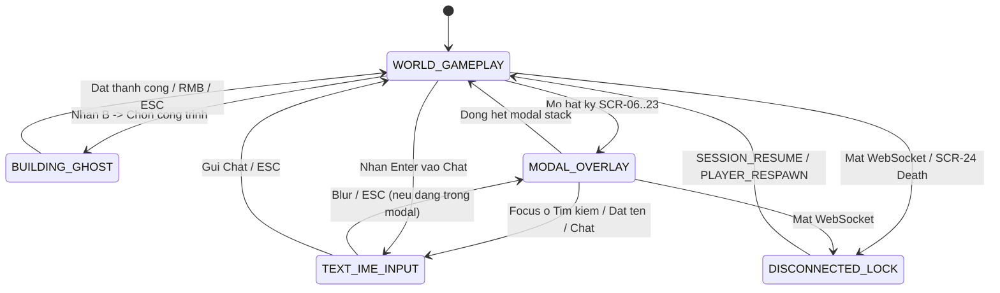

# Interaction Design & Control Scheme — Eldoria: Forgotten Wilds

**Trạng thái**: Design Baseline v1.0 (`DESIGN_AND_PLANNING_ONLY`)  
**Cập nhật lần cuối**: 2026-11-19  
**Tham chiếu**: [frontend-architecture.md](../architecture/frontend-architecture.md), [ADR-004](../architecture/architecture-decisions/ADR-004-phaser-react-zustand-bridge.md), [websocket-contracts.md](../architecture/websocket-contracts.md), [design-system.md](./design-system.md)

---

## 1. Hệ thống Điều khiển Desktop (Keyboard + Mouse — Ưu tiên MVP)

Toàn bộ phím bấm được tối ưu cho bố cục tay trái trên cụm `WASD` + tay phải trên Chuột, đồng thời hỗ trợ **chơi hoàn toàn bằng Bàn phím (Keyboard-Only Ergonomics)** qua mũi tên + `J`/`Space` để đảm bảo khả năng tiếp cận và chơi thoải mái trên laptop không có chuột rời.

### 1.1 Bảng Điều khiển Chiến đấu & Khám phá (`WORLD_GAMEPLAY`)

| Hành động Gameplay | Phím Mặc định (Chính) | Phím Phụ (Keyboard-Only / Alt) | Gói tin Mạng / Hệ thống | Ghi chú Cảm giác & Xác thực |
| :--- | :---: | :---: | :--- | :--- |
| **Di chuyển 4/8 hướng** | `W` `A` `S` `D` | `↑` `←` `↓` `→` | `MOVE_INPUT` (20 Hz) | Chuẩn hóa vector `hypot(dx,dy) <= 1.01`; client prediction + server reconciliation |
| **Chạy nhanh (Sprint)** | Giữ `Shift` (Trái) | — | `MOVE_INPUT (sprint: true)` | Tiêu hao Stamina theo server; tự tắt khi Stamina = 0 |
| **Đánh thường / Combo 3 nhát** | `Left-Click` (Chuột trái) | `J` | `BASIC_ATTACK_REQ` | Hướng theo con trỏ chuột (hoặc hướng mặt nhân vật khi dùng `J`); có input buffer `140ms` cho combo mượt |
| **Né tránh (Dodge i-frame)** | `Space` | `Right-Click` (Chuột phải) | `DODGE_REQ` | Tốn 20 Stamina, CD `1200ms`, server cấp `300ms` i-frame; ưu tiên hủy recovery animation |
| **Đỡ đòn / Phản đòn (Block & Parry)** | Giữ `Ctrl` (Trái) | `V` hoặc `Middle-Click` | `BLOCK_STATE` | Cửa sổ Perfect Parry `200ms` tính từ tick server kích hoạt |
| **Kỹ năng Chủ động 1, 2, 3** | `1`, `2`, `3` | Click ô trên Hotbar | `SKILL_CAST_REQ` | Hướng ngắm theo chuột; nếu đang dùng chuột trong vùng HUD không gửi nhầm đòn đánh |
| **Kỹ năng Tuyệt chiêu (Ultimate)** | `R` | Click ô Ultimate | `SKILL_CAST_REQ` | Có ngữ cảnh tách biệt: khi ở `BUILDING_GHOST`, `R` xoay công trình thay vì tung Ultimate! |
| **Dùng nhanh Bình máu / Món ăn** | `Q` | Click ô Quick Slot | `INVENTORY_QUICK_USE` | Cooldown bình máu `5000ms` do server xác thực; gắn `idempotencyKey` |
| **Chuyển Ô Nhanh / Khóa Mục tiêu** | `Tab` | — | Local UI / Aim Assist | Bấm nhanh chuyển ô tiêu hao kế tiếp trong thanh Quick Slot (`Q`); `Alt+Tab` hệ điều hành không bị chặn |
| **Tương tác Ngữ cảnh (NPC, Chặt, Đào, Ruộng, Nhặt đồ)** | `F` | `E` | `INTERACT_REQ` / `LOOT_PICKUP_REQ` | Tự chọn đối tượng ưu tiên trong bán kính `<= 96 px` |
| **Mở Khung Chat** | `Enter` | `/` (gõ lệnh nhanh) | `CHAT_SEND` | Chuyển `InputFocusManager` sang `TEXT_IME_INPUT` |

### 1.2 Bảng Phím tắt Hệ thống & Màn hình UI (Zero Conflict Guarantee)

| Phím tắt | Màn hình Mở/Đóng | Quy tắc Xử lý Ngữ cảnh |
| :---: | :--- | :--- |
| `I` | `SCR-06 Inventory` (Túi đồ) | Nhấn lại `I` hoặc `Esc` để đóng; hỗ trợ chuyển nhanh tab `SCR-07 Equipment` |
| `B` | `SCR-15 Building` (Xây dựng) | Hoạt động khi ở `zon_player_homestead`; ngoài lãnh địa hiển thị toast *"Hãy về Lãnh địa tại Greenhaven để mở chế độ Xây dựng"* (có thể tùy chỉnh trong Settings thành mở Túi đồ nếu người chơi quen `B = Bag`) |
| `C` | `SCR-08 Character Stats` | Xem 17 chỉ số, kháng nguyên tố & cộng điểm thuộc tính |
| `K` | `SCR-09 Skill Tree` | Xem bộ 5 kỹ năng và nâng bậc kỹ năng |
| `M` | `SCR-17 World Map` | Mở bản đồ thế giới 8 vùng & Fast Travel |
| `P` | `SCR-21 Party` | Quản lý tổ đội 2–4 người & vào phụ bản |
| `G` | `SCR-11 Gacha` | Triệu hồi Anh hùng / Vũ khí bằng `STARLIGHT_SHARD` |
| `L` | `SCR-19 Quest Journal` | Nhật ký nhiệm vụ (dùng `L` = Log để không đụng phím đánh `J`!) |
| `U` | `SCR-07 Equipment` | Mở thẳng giao diện 10 ô trang bị Paperdoll |
| `H` | `SCR-10 Character Collection` | Mở bộ sưu tập 12 Anh hùng & đổi Hero |
| `O` | `SCR-16 Farming` | Mở Sổ Nông Trại & Chăn Nuôi |
| `N` | `SCR-14 Crafting` | Mở Sổ Công thức Chế tạo ở chế độ tra cứu |
| `Esc` | Đóng lớp trên cùng / `SCR-23 Settings` | Đóng theo thứ tự LIFO: Đóng Tooltip ghim → Hủy kéo đồ → Thoát Building Ghost → Đóng Modal trên cùng → Nếu không có modal nào, mở `SCR-23 Settings` |

> **Chống xung đột phím**: Mọi phím đều có thể tùy biến trong `SCR-23 Settings` (`Điều khiển`). Khi gán đè phím đã tồn tại, hệ thống phát cảnh báo và cho phép **Hoán đổi tự động** thay vì để 2 tính năng tranh nhau 1 phím.

---

## 2. Cơ chế Phân xử Tập trung Input (`InputFocusManager`) & An toàn Bộ gõ Tiếng Việt (IME)

Theo `ADR-004`, toàn bộ phím và chuột đi qua một bộ phân xử trung tâm `apps/client/src/bridge/InputFocusManager.ts` hoạt động theo **Ngăn xếp 5 Tầng Ưu tiên (Priority State Machine)**:



### Quy tắc Hoạt động Từng Tầng & Bảo vệ Bộ gõ Tiếng Việt (Telex / VNI)
1. **`WORLD_GAMEPLAY`**: Phaser 3 nhận toàn bộ phím di chuyển, combat, chuột ngắm hướng (chỉ khi chuột không nằm trên vùng HUD có `pointer-events: auto`).
2. **`BUILDING_GHOST`**: Phaser 3 nhận `WASD` (để di chuyển nhân vật/camera), chuột di chuyển lưới 32x32, `LMB` đặt công trình, `R` xoay hướng, `RMB`/`Esc` hủy. **Khóa toàn bộ** đánh thường, Dodge, Skill `1..3`, Ultimate `R`.
3. **`MODAL_OVERLAY`**: **Khóa hoàn toàn** đầu vào gameplay Phaser (nhân vật tự gửi gói `MOVE_INPUT (dx:0, dy:0)` ngay khi mở modal để không bị trôi tiếp vào bầy quái!). React Modal nhận `Tab`, mũi tên duyệt lưới, `Enter`, `Esc` và chính phím tắt đóng modal đó.
4. **`TEXT_IME_INPUT`**: Khi con trỏ nằm trong `<input>` hoặc `<textarea>` (Chat, Tìm kiếm kho, Đặt tên nhân vật, Đăng nhập):
   - **Bắt buộc kiểm tra `event.isComposing || event.keyCode === 229`**: Khi người chơi đang gõ tiếng Việt bằng Telex (`s, f, r, x, j, w, a, e, o, d`) hoặc VNI (`1..9`), toàn bộ phím tắt toàn cục (`I, C, K, M, G, B, 1..3, R, F, Esc`) bị **chặn tuyệt đối** để không tự bật cửa sổ hay hủy câu đang gõ dở.
   - Nhấn `Esc` lần 1 hủy phiên IME (nếu đang tổ hợp); nhấn `Esc` lần 2 thoát focus ô chat trả về `WORLD_GAMEPLAY`.
5. **`DISCONNECTED_LOCK`**: Ngừng gửi `MOVE_INPUT` / `BASIC_ATTACK_REQ` / `SKILL_CAST_REQ` trong lúc đang chờ `SESSION_RESUME` để tránh hàng đợi gói tin lỗi thời gây dịch chuyển đột ngột sau khi kết nối lại.

---

## 3. Công thái học Kho Đồ & Trang Bị (Inventory & Equipment Ergonomics)

| Thao tác | Cách thực hiện (Chuột) | Cách thực hiện (Chỉ Bàn phím) | Phản hồi Trực quan |
| :--- | :--- | :--- | :--- |
| **Kéo & Thả (Drag & Drop)** | Nhấn giữ `LMB` kéo ô nguồn → thả vào ô đích / ô Equipment / ô Storage | Focus ô nguồn → bấm `Space` (nhấc lên, viền nét đứt vàng) → mũi tên tới ô đích → bấm `Space` thả | Sprite icon nổi theo con trỏ (`--z-drag-ghost`); các ô hợp lệ sáng viền xanh `#4ADE80`, ô cấm hiện viền đỏ `#F87171` |
| **Trang bị / Tháo nhanh** | `Right-Click` lên trang bị trong Túi (hoặc trong Paperdoll) | Focus ô → bấm `Enter` chọn *"Trang bị"* / *"Tháo"* | Gọi `/equipment/equip` (hoặc `/unequip`), phát SFX khóa kim loại `sfx_ui_equip` |
| **Tách chồng vật phẩm** | `Shift + Left-Click` lên ô nguyên liệu `qty > 1` | Focus ô → bấm `X` | Mở popover nhỏ trượt số lượng `1 .. qty-1` (nút nhanh `1`, `Một nửa`, nhập số) |
| **Chuyển nhanh Túi ↔ Rương** | `Ctrl + Left-Click` khi đang mở `bld_storage` | Focus ô → bấm `E` | Tự động gộp vào stack cùng loại trong Rương hoặc đặt vào ô trống đầu tiên |
| **So sánh Trang bị** | Hover món trong Túi (tự hiện chênh lệch `▲`/`▼` so với món đang mặc) | Focus ô bằng phím mũi tên | `PixelTooltip` tự đổi phía trái/phải để không che ô đang chọn; giữ `Alt` để mở 2 tooltip song song |
| **Xác nhận Hủy vật phẩm Hiếm** | Kéo ra ngoài khung hoặc bấm nút *"Bỏ"* | Focus nút *"Bỏ"* → `Enter` | Món từ `RARE` trở lên hoặc vũ khí `>= +1` **BẮT BUỘC** hiện hộp thoại xác nhận phụ tránh lỡ tay xóa đồ quý |

---

## 4. Hệ thống Đặt Công Trình Xem Trước (`BuildingGhostSystem` — Grid Snapping & Rotation)

Khi người chơi chọn công trình trong `SCR-15 Building` và bấm *"Chọn Vị Trí Đặt"*, React phát sự kiện `BUILDING_PLACE_START` qua `GameUiBridge` sang Phaser `BuildingGhostSystem`:

1. **Bắt lưới Chính xác (`32×32 px` Grid Snapping)**:
   - Tọa độ chuột trên world được làm tròn tức thì về chỉ số ô: `tileX = Math.floor(worldX / 32)`, `tileY = Math.floor(worldY / 32)`.
   - Vẽ lưới mảnh mờ (`rgba(247, 239, 224, 0.20)`) phạm vi vùng xây dựng cho phép (`zon_player_homestead`) và viền rõ kích thước `footprintTiles` (ví dụ `bld_blacksmith` là `4×3` ô) cùng dấu mũi tên vị trí `interactionPoints` (cửa ra vào/bệ đe) để người chơi không đặt quay mặt cửa vào tường!
2. **Mã hóa Hợp lệ Kép (Colorblind-Safe Validation)**:
   - **Vị trí Hợp lệ**: Toàn bộ footprint phủ màu xanh `#4ADE80` (alpha `0.38`), viền trắng nét đứt, biểu tượng `✓` ở góc.
   - **Vị trí Không Hợp lệ** (đè công trình khác, chặn đường đi bắt buộc, đè spawn point, đè vùng nhiệm vụ, ra ngoài đất sở hữu): Từng ô vi phạm phủ đỏ `#F87171` (alpha `0.45`) kèm **họa tiết gạch chéo 45° (`crosshatch`) + biểu tượng `✕`** và dòng nhãn ngắn sát con trỏ nêu đúng lý do (vd: *"Không thể chặn lối đi chính"*).
3. **Xoay Công Trình (`R` Key)**:
   - Nhấn `R` xoay theo chiều kim đồng hồ `0° → 90° → 180° → 270°` đối với công trình có `rotatable: true` (tự động đảo `width ↔ height` của footprint và xoay vị trí `interactionPoints`).
   - Với công trình cố định hướng (`rotatable: false`, như `bld_player_house`), nhấn `R` phát nhẹ âm thanh gõ gỗ + dòng gợi ý *"Công trình này luôn hướng cửa về phía Nam"*.
4. **Xác nhận & Chống Gian lận**:
   - Bấm `LMB` khi trạng thái hợp lệ → gửi `POST /api/v1/characters/:charId/buildings/place` kèm `X-Idempotency-Key`. Server tự chạy lại kiểm tra collision + pathfinding (client preview chỉ để UX, không tin client!).

---

## 5. Nhắc Tương tác Ngữ cảnh & Con trỏ Chuột Pixel (Contextual Hints & Cursors)

### 5.1 Bộ Giải quyết Ưu tiên Tương tác Trong Bán kính `96 px`
Khi nhân vật đứng gần nhiều đối tượng cùng lúc, hệ thống tự chọn đối tượng gần nhất theo thứ tự ưu tiên sau và hiển thị 1 thẻ pixel nổi gọn phía trên đối tượng đó (`[F] <Hành động> <Tên>`):
1. **Chiến lợi phẩm rơi (`LOOT`)** đủ quyền nhặt (`[F] Nhặt Iron Ore x2`).
2. **NPC có nhiệm vụ sẵn sàng trả (`?`) hoặc nhận (`!`)** (`[F] Trả nhiệm vụ: Trưởng làng Rowan`).
3. **Trạm công trình / Cửa hầm ngục** (`[F] Mở Lò Rèn`, `[F] Vào Mossroot Hollow`).
4. **Cây trồng chín / Động vật sẵn sàng thu hoạch** (`[F] Gặt Sunwheat`, `[F] Thu Trứng Tươi`).
5. **Tài nguyên khai thác (Gỗ, Đá, Quặng)** (`[F] Chặt Cây Sồi`, `[F] Đào Quặng Sắt`).
- *Mẹo UX*: Nếu có từ 2 đối tượng tương tác sát nhau trong `96 px`, hiển thị gợi ý phụ nhỏ `[Cuộn chuột] Đổi mục tiêu (1/2)`.

### 5.2 Hệ thống Con trỏ Chuột Pixel (`32×32 px`, Nearest-Neighbor)
| Trạng thái Hover | Asset Con trỏ | Mục đích |
| :--- | :--- | :--- |
| Mặc định / UI | `cursor_gauntlet_default.png` | Mũi tên găng tay sắt 16-bit sắc nét |
| Hover Quái vật / Boss | `cursor_sword_combat.png` | Kiếm chéo đỏ-vàng báo hiệu phạm vi tấn công |
| Hover Quặng / Cây / Ruộng | `cursor_pickaxe.png` / `cursor_axe.png` / `cursor_hoe.png` | Đổi đúng công cụ tự động theo loại tài nguyên |
| Hover NPC | `cursor_speech.png` | Bong bóng hội thoại giấy da |
| Hover Nút bấm / Kéo đồ | `cursor_hand_point.png` / `cursor_hand_grab.png` | Phản hồi trực quan có thể click hoặc kéo |

---

## 6. Nhịp Phản hồi & Vi Tương tác (Feedback Cadence & Audio-Visual Pairing)

| Sự kiện Tương tác | Phản hồi Thị giác (Timing) | Phản hồi Âm thanh (SFX Key) | Guard Trợ năng |
| :--- | :--- | :--- | :--- |
| **Nhấn nút UI** | Nút lún `2px` trong `60ms`, sáng viền `120ms` | `sfx_ui_click` | Giữ nguyên (không gây chói) |
| **Đánh trúng quái / Crit** | Hit flash trắng trên quái `60ms`, hit-stop `45ms` (Crit `70ms`), số sát thương nảy lên cao hơn & to hơn 25% khi Crit | `sfx_hit_slash` / `sfx_hit_crit` | Giảm lóe sáng đổi flash trắng → viền vàng dịu; tắt Shake nếu `0%` |
| **Kỹ năng Hồi chiêu xong** | Quét sáng chéo 1 nhịp `220ms` trên ô Hotbar + viền sáng vàng | `sfx_skill_ready` (rất nhẹ) | Tắt chớp nếu bật Reduced VFX |
| **Thiếu MP / Stamina / Đang CD** | Rung ngang ô kỹ năng `±2px` (`150ms`) + nháy viền đỏ thanh tài nguyên | `sfx_ui_deny` | Tắt rung, giữ đổi màu viền đỏ + chữ cảnh báo |
| **Cường hóa Thành công (`+1..+10`)** | Nhịp búa rèn `400ms` → tia lửa vàng bay tỏa `600ms` → chỉ số tăng lăn số lên (`+10` thêm vầng hào quang) | `sfx_anvil_strike` + `sfx_enhance_success` | Giới hạn tần suất sáng `<= 2 Hz` |
| **Phá giáp Boss (Stagger)** | Thanh Poise nứt vỡ, Boss quỳ xuống `3.5s`, dải chữ *"PHÁ GIÁP THÀNH CÔNG! (+30% ST)"* | `sfx_boss_poise_break` | Hiện kèm phụ đề hình ảnh cho người nghe kém |

---

## 7. Lộ trình Tay cầm — Gamepad Roadmap (Milestone 4)

Hỗ trợ nguyên bản qua **Web Gamepad API** (tự nhận diện nhãn nút Xbox `A/B/X/Y` và PlayStation `✕/○/□/△`, không cần thư viện bên thứ ba):

| Cụm Tay cầm | Ánh xạ Chiến đấu (`WORLD_GAMEPLAY`) | Ánh xạ Giao diện (`MODAL_OVERLAY`) |
| :--- | :--- | :--- |
| **Left Stick** | Di chuyển analog 360° (chuyển về vector chuẩn `MOVE_INPUT`) | Di chuyển con trỏ snap theo lưới ô (Inventory / Skill Tree) |
| **Right Stick** | Ngắm hướng kỹ năng (tự hiển thị vòng ngắm định hướng nhẹ) | Cuộn trang mô tả dài / Kéo World Map |
| **`X` / `□`** | Đánh thường / Combo 3 nhát (`BASIC_ATTACK_REQ`) | Tách chồng / Sắp xếp nhanh |
| **`A` / `✕`** | Tương tác Ngữ cảnh (`F`) / Nhặt đồ | Xác nhận / Trang bị (`Enter`) |
| **`B` / `○`** | Né tránh Dodge (`Space`) | Đóng Modal / Quay lại (`Esc`) |
| **`Y` / `△`** | Đỡ đòn / Phản đòn (`BLOCK_STATE`) | Xem so sánh Trang bị |
| **`LB` / `RB` / `RT`** | Active Skill 1 (`LB`), Active Skill 2 (`RB`), Active Skill 3 (`RT`) | Chuyển Tab Trái / Phải (`LB`/`RB`) |
| **`LT`** | Giữ để Chạy nhanh (Sprint) | Giữ để mở Bánh xe Phím tắt (Radial Menu: Túi, Bản đồ, Chế tạo, Party, Xây dựng) |
| **`LB + RB` (hoặc `R3`)** | Tung Tuyệt chiêu Ultimate (`R`) | Xoay công trình trong chế độ Building Ghost (`RB`/`LB`) |
| **D-Pad Lên / Xuống / Trái / Phải** | Lên: Dùng Quick Slot (`Q`); Trái/Phải: Đổi Quick Slot; Xuống: Mở Bản đồ nhanh | Di chuyển từng ô chính xác 1 bước trên lưới 32x32 |
| **`Menu / Options`** | Mở `SCR-23 Settings` | Đóng toàn bộ Modal |

---

## 8. Lộ trình Cảm ứng Di động — Mobile Touch-Control Roadmap (Milestone 5)

Chỉ kích hoạt khi hoàn thành kiểm thử tải và tối ưu màn hình nhỏ ở **Milestone 5**; thiết kế tuân thủ chặt chuẩn công thái học ngón cái ngang (**Landscape Orientation `16:9` – `20:9`**, vùng chạm tối thiểu **`44×44 px`**, khoảng cách an toàn giữa 2 nút `>= 8px`):

```text
+-------------------------------------------------------------------+
| [Unit Frame Gọn]         [BOSS BAR MỎNG]        [Minimap] [Menu☰] |
| [Party 2 dòng]                                                    |
|                                                                   |
|                    (VÙNG COMBAT TRUNG TÂM)                        |
|                                                                   |
|     (o)                                     [Skill 3] [ULT]       |
|   Joystick               [Q: Thuốc]       [Skill 2]  [Dodge]      |
|  (Nổi tự do)          [Nút Tương tác F]    [Skill 1] ( ATTACK )   |
+-------------------------------------------------------------------+
```

1. **Floating Virtual Thumbstick (Bên trái)**: Chạm ở bất kỳ điểm nào thuộc 1/3 góc dưới-trái để tạo cần điều khiển nổi (giảm mỏi tay khi chơi lâu), đẩy sát rìa ngoài tự kích hoạt Sprint.
2. **Cung Chiến đấu Ngón cái Phải (Ergonomic Combat Arc)**: Nút **Attack (`64×64 px`)** đặt ở góc thuận ngón cái nhất; 3 nút **Active Skill (`48×48 px`)**, **Dodge (`48×48 px`)** và **Ultimate (`52×52 px`)** xếp hình vòng cung quanh nút Attack; hỗ trợ **kéo ngón tay từ nút kỹ năng để ngắm hướng** (drag-to-aim) và kéo ra vùng `✕ Hủy` để hủy cast.
3. **Smart Context Interact Button**: Nút hành động lớn (`56×56 px`) chỉ bật sáng khi vào bán kính `96 px` của NPC, cây gỗ, ruộng lúa hoặc đồ rơi — thay đổi icon động (rìu / cuốc / bình tưới / bàn tay nhặt).
4. **Adaptive Full-Screen Drawers**: Các modal 2 cột (Inventory, Blacksmith, Building) tự chuyển thành **Drawer toàn màn hình có Tab trượt** với nút hành động dính đáy (sticky footer) để ngón cái bấm chính xác không chạm nhầm.
