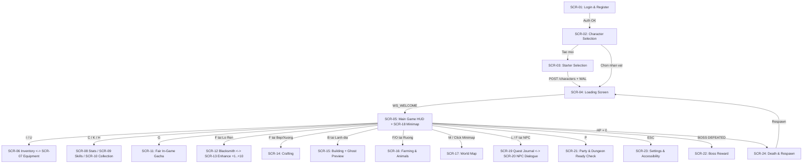
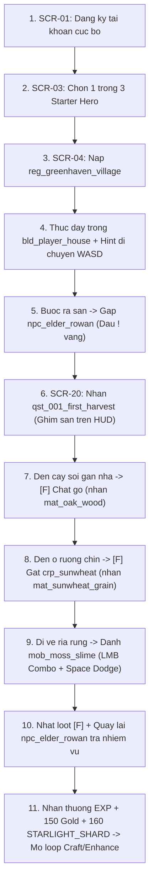
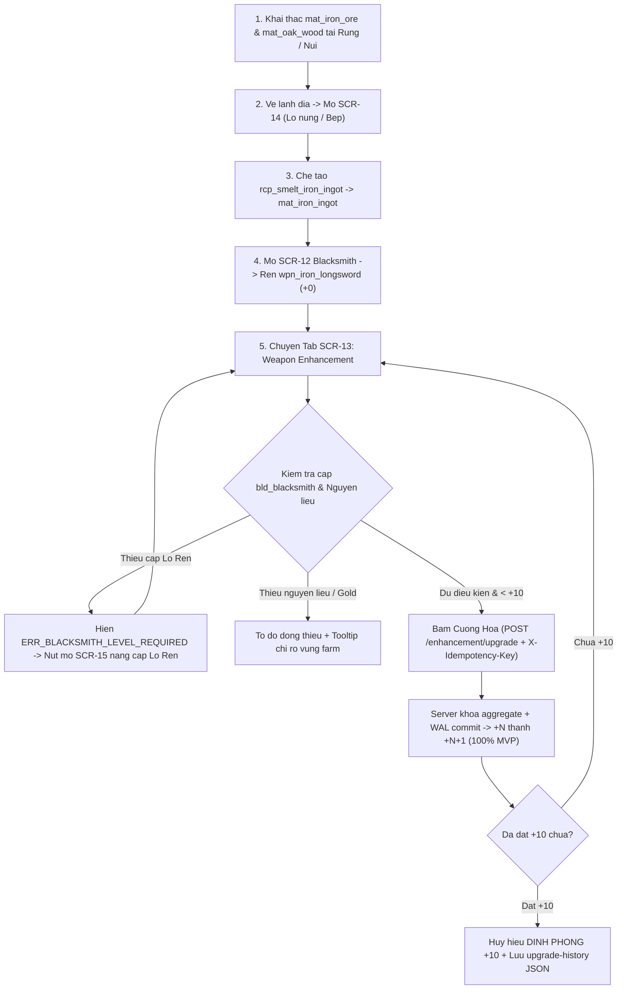
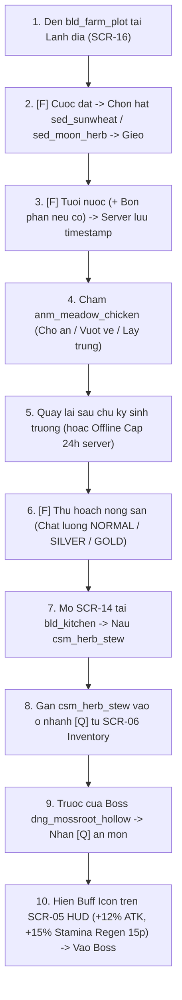
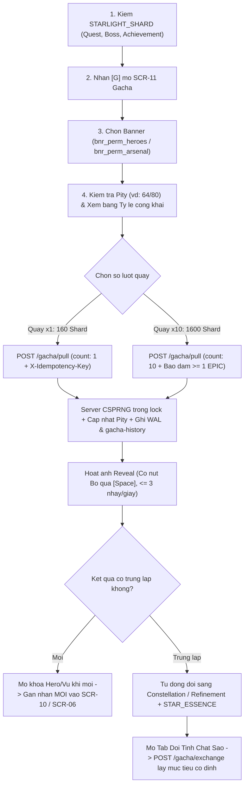
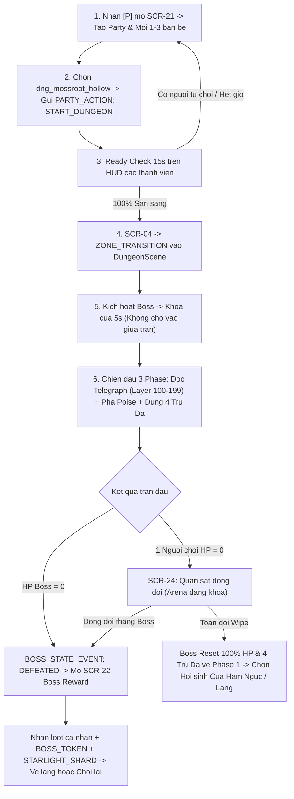

# User Flows & Core Player Journeys — Eldoria: Forgotten Wilds

**Trạng thái**: Design Baseline v1.0 (`DESIGN_AND_PLANNING_ONLY`)  
**Cập nhật lần cuối**: 2026-11-19  
**Tham chiếu**: [00-game-vision.md](../game-design/00-game-vision.md), [screen-inventory.md](./screen-inventory.md), [api-contracts.md](../architecture/api-contracts.md), [websocket-contracts.md](../architecture/websocket-contracts.md)

---

## 1. Bản đồ Điều hướng Tổng thể 24 Màn hình (Master Navigation Graph)



---

## 2. Luồng 1 — First-Time Onboarding (0–5 Phút Đầu Tiên: Học Qua Gameplay)

**Mục tiêu UX**: Người chơi hoàn thành việc tạo nhân vật, chặt gỗ, thu hoạch lúa mì và hạ gục con quái đầu tiên trong vòng **5 phút đầu** chỉ qua chỉ dẫn ngữ cảnh tại chỗ (diegetic prompts), không bị ép đọc chuỗi hộp thoại chữ dài dằng dặc.



### Hành trình Chi tiết Từng Bước (0–5 Phút)
| Mốc Thời gian | Màn hình / Khu vực | Hành động Người chơi | Phản hồi UI & Xác thực Server | Nhánh Ngoại lệ (Edge Case) |
| :---: | :--- | :--- | :--- | :--- |
| **0:00 – 0:45** | `SCR-01` → `SCR-03` | Đăng ký tài khoản cục bộ, chọn `chr_kael_vanguard` (hoặc `chr_lyra_windrunner` / `chr_seraphina_dawn`), đặt tên. | `POST /api/v1/characters` tạo atomic `characters`, `inventories`, `houses` qua JSON WAL. Hiện thanh loading mượt trên `SCR-04`. | Nếu trùng tên, tô đỏ ô nhập ngay tại `SCR-03` và giữ nguyên anh hùng đã chọn. |
| **0:45 – 1:30** | `SCR-05` (`bld_player_house`) | Thử nhấn `WASD` bước ra khỏi cửa nhà gỗ ấm áp. | Dải gợi ý mờ nhỏ dưới chân `[W][A][S][D] Di chuyển` tự tắt ngay sau khi đi được `64 px`. | Nếu người chơi đứng yên `> 10s`, phát vòng sáng dẫn hướng nhẹ phía cửa ra. |
| **1:30 – 2:15** | `SCR-20` (`npc_elder_rowan`) | Tiến tới `npc_elder_rowan` có dấu `!` vàng, bấm `[F]`. | Mở hộp thoại giấy da 2 câu ngắn; bấm `[1]` nhận `qst_001_first_harvest` (tự động ghim vào góc phải HUD). | Nếu bấm `Esc` bỏ qua, dấu `!` vẫn giữ nguyên và có thể tương tác lại bất kỳ lúc nào. |
| **2:15 – 3:15** | `SCR-05` + `SCR-16` | Tiến tới cây sồi bấm `[F]` chặt 3 gỗ; bước sang luống `crp_sunwheat` đã chín sẵn bấm `[F]` gặt. | Hoạt ảnh `WOODCUTTING` & `FARMING` đồng bộ server; Toast loot hiện `+3 mat_oak_wood`, `+3 mat_sunwheat_grain`; Quest Tracker đánh dấu `[✓]` kèm tiếng chuông nhẹ. | Nếu Stamina cạn, nhắc dùng bánh mì tặng sẵn ở phím `[Q]`. |
| **3:15 – 4:30** | `SCR-05` (Rìa `reg_whispering_forest`) | Thử chuỗi `LMB` 3 nhát + `[1]` Active Skill + `[Space]` né đòn nhảy của `mob_moss_slime`. | Vòng đỏ telegraph nhỏ dưới chân Slime hiện rõ trước khi nhảy; trúng đòn hiện số sát thương + hit-stop ngắn; Slime rớt đồ phát sáng theo Rarity. | Nếu người chơi lỡ bị hạ HP thấp `< 35%`, nháy viền dịu nhắc nhấn `[Q]` hồi máu. |
| **4:30 – 5:00** | `SCR-20` (`npc_elder_rowan`) | Quay về trả `qst_001_first_harvest`. | Cộng `EXP`, `150 Gold`, `160 STARLIGHT_SHARD` qua WAL; hiện thông báo mở khóa nhiệm vụ tiếp theo ghé `npc_smith_garrik` để rèn vũ khí. | Nếu túi đầy, nhắc giải phóng 1 ô trước khi bấm Nhận Thưởng. |

---

## 3. Luồng 2 — Gather → Smelt → Craft → Enhance `+1..+10` (Vòng Lặp Thợ Rèn Không Vỡ Đồ)

**Mục tiêu UX**: Kết nối mượt mà khai thác tài nguyên → nấu phôi kim loại → rèn vũ khí → nâng cấp `bld_blacksmith` → cường hóa chắc chắn 100% từ `+0` lên `+10` trên hệ thống giao dịch JSON nguyên tử.



### Chi tiết Kiểm soát UX & Chống Lỗi Giao dịch
1. **Nhìn thấy trước mọi thứ (Zero Surprise)**: Trước khi bấm nút, `SCR-13` luôn hiện rõ 3 yếu tố: *(a)* Chỉ số tăng cụ thể (`ATK 48 → 56`), *(b)* Dòng cam kết **"Tỷ lệ thành công MVP: 100% — Không vỡ đồ, không tụt cấp"**, *(c)* Cổng cấp Lò Rèn (`Lv1: +1..+3`, `Lv2: +4..+6`, `Lv3: +7..+8`, `Lv4: +9..+10`).
2. **Dẫn đường thông minh khi bị chặn**: Khi vũ khí ở `+3` muốn lên `+4` mà `bld_blacksmith` mới ở Cấp 1, nút không chỉ bị xám vô nghĩa — nó hiển thị banner vàng *"Cần nâng cấp Lò Rèn lên Cấp 2 để mở khóa cường hóa +4 đến +6"* kèm nút nhảy trực tiếp sang tab nâng cấp trong `SCR-15 Building`.
3. **Bảo toàn tính nguyên tử (Idempotency)**: Ngay khi người chơi bấm *"Cường Hóa"*, client sinh 1 `UUIDv4` gắn vào header `X-Idempotency-Key`, khóa nút (`loading`), phát nhịp búa đe, nhận `INVENTORY_PATCH` + bản ghi `upgrade-history` rồi mới mở khóa nút cho cấp tiếp theo. Nếu người chơi bấm đúp hoặc rớt mạng gửi lại, server nhận diện đúng key nên **không bao giờ trừ nguyên liệu 2 lần**.
4. **Đỉnh cao `+10`**: Ở mốc `+10`, `SCR-13` thay khung viền sang `ui_frame_gold_ornate_9s`, hiển thị huy hiệu tối đa và khóa hoàn toàn lệnh nâng lên `+11` (khớp mã `ERR_MAX_ENHANCEMENT_REACHED`).

---

## 4. Luồng 3 — Farming → Cooking → Boss Combat Buff (Nông Trại Phục Vụ Chiến Đấu)

**Mục tiêu UX**: Chứng minh Trụ cột Thiết kế #3 (*"Mọi hoạt động farm đều có giá trị đối với tiến trình phát triển"*): một người chơi chăm ruộng & nuôi gà sẽ nấu được món ăn tăng sát thương/phòng thủ đáng kể trước khi bước vào đấu Boss.



### Điểm Chạm UX Quan trọng
- **Thao tác 1 nút thông minh tại ruộng**: Khi đứng trên ô đất chưa cuốc → `[F] Cuốc đất`; đất đã cuốc → `[F] Gieo hạt đang chọn`; cây chưa tưới → `[F] Tưới nước`; cây chín → `[F] Thu hoạch`. Giảm tối đa thao tác lặp nhàm chán.
- **Tóm tắt Offline minh bạch**: Khi đăng nhập lại sau thời gian rời game, `GET /api/v1/characters/:charId/homestead` tính toán theo đồng hồ server (giới hạn trần 24h) và hiển thị 1 thẻ tóm tắt nhỏ không làm phiền trên `SCR-16`: *"Trong 6 giờ qua: 4 luống Sunwheat đã chín vàng, Gà Bông đẻ 3 Trứng Tươi (Động vật không chết khi đói)"*.
- **Chất lượng Nông sản hiển thị rõ**: Nông sản bậc `SILVER` và `GOLD` có sao bạc/vàng nhỏ trên `ItemSlot`, tăng giá bán hoặc kéo dài thời lượng buff khi nấu ăn.
- **Hiển thị Buff trên HUD**: Món ăn sau khi ăn bằng phím `[Q]` xuất hiện ngay dưới thanh Hunger với đồng hồ đếm ngược phút (`14:52`) để cả đội kiểm tra đã đủ buff trước khi bấm Ready Check vào Boss.

---

## 5. Luồng 4 — Fair In-Game Gacha Pull & Duplicate `STAR_ESSENCE` Exchange

**Mục đích UX**: Trải nghiệm mở thưởng phấn khích nhưng **100% công bằng, minh bạch, phi thương mại hóa trong MVP** (chỉ dùng `STARLIGHT_SHARD` kiếm từ gameplay, công khai xác suất, có Pity cứng/mềm và cửa hàng đổi `STAR_ESSENCE` chống xui xẻo).



### Bảo vệ Trải nghiệm Người chơi (Anti-Dark-Pattern Rules)
1. **Không bao giờ ẩn xác suất**: Tỷ lệ chi tiết từng độ hiếm + công thức Soft Pity (`65` Character / `55` Weapon) + Hard Pity (`80` / `70`) luôn mở được chỉ bằng 1 click ngay cạnh nút Quay.
2. **An toàn Thị giác khi Reveal**: Hoạt ảnh triệu hồi dùng luồng sao rơi mượt mà, tuyệt đối không nhấp nháy trắng toàn màn hình (`<= 3 flashes/s`); nút `[Bỏ qua (Space)]` luôn hiện sẵn ở góc trên-phải.
3. **Báo cáo Trùng lặp Rõ ràng**: Trên màn kết quả tổng kết x10, mỗi thẻ trùng lặp hiển thị trực tiếp huy hiệu quy đổi ở đáy thẻ (vd: *"Trùng lặp → +1 Constellation & +15 Tinh Chất Sao (`STAR_ESSENCE`)"*) để người chơi thấy giá trị tích lũy rõ ràng.
4. **Kiểm toán Lịch sử**: Tab *"Lịch sử Quay"* tải trực tiếp từ `history/gacha-history-<charId>.json` hiển thị ngày giờ server, tên banner, vật phẩm nhận và mốc pity tại thời điểm đó.

---

## 6. Luồng 5 — Party Formation → Dungeon Entry → Multi-Phase Boss → Loot & Respawn

**Mục đích UX**: Phối hợp mượt mà 2–4 người chơi bước vào phụ bản `dng_mossroot_hollow`, đọc rõ cơ chế 3 phase của `boss_thornback_elder` (telegraph không bị VFX che, phá giáp Stagger, tận dụng 4 trụ đá `safePillars`), nhận chiến lợi phẩm cá nhân hoặc hồi sinh an toàn nếu thất bại.



### Tín hiệu UX Quan trọng Trong Trận Boss 3 Phase
- **Đọc được Telegraph ở mọi thời điểm**: Mọi vùng cảnh báo đòn `Root Slam` (vòng tròn `900ms`), `Bramble Lash` (hình quạt 120° `850ms`) và `Heartwood Charge` vẽ ở `Depth 100–199` (dưới chân nhân vật, trên mặt đất), sử dụng viền đỏ + đường gạch chéo sáng; hiệu ứng Ultimate đồng đội tự động giảm alpha nếu phủ lên vùng telegraph.
- **Thông báo Chuyển Phase & Phá Giáp (Stagger)**: Khi nhận `BOSS_STATE_EVENT` chuyển sang Phase 2 (*Vành Đai Gai Rừng*), Phase 3 (*Vũng Nhựa Độc*) hoặc `STAGGERED`, thanh Boss Bar mép trên hiển thị dải phụ đề súc tích trong `2.5s` (không chặn tầm nhìn tâm màn hình), kèm phụ đề âm thanh nếu bật trợ năng.
- **Thanh HP Tổ đội Góc Trái**: Cho phép `chr_seraphina_dawn` (Healer) thấy tức thì đồng đội nào dưới 50% HP hoặc dính hiệu ứng `Bleed`/`Poison` để tung kỹ năng hồi máu kịp thời.

---

## 7. Luồng 6 — Disconnect & Auto-Reconnect Recovery (Khôi phục Phiên An toàn)

**Mục tiêu UX**: Khi rớt mạng tạm thời (Wi-Fi chập chờn, đổi mạng) giữa lúc farm, rèn đồ hoặc đánh Boss, **tuyệt đối không văng đột ngột ra màn hình Login** và không làm người chơi hoang mang về việc mất vật phẩm/nhân bản giao dịch.

```mermaid
flowchart TD
    D1["Dang choi binh thuong (CONNECTED)"] -->|Mat socket / Heartbeat timeout| D2["Hien ReconnectBanner (--z-disconnect) + Khoa input an toan"]
    D2 --> D3["Khoi chay Exponential Backoff: Lan 1 (1s) -> 2 (2s) -> 3 (4s) -> 4 (8s) -> 5 (8s)"]
    D3 --> D4{"Ket noi lai WebSocket thanh cong?"}
    D4 -->|Co (trong grace window 120s)| D5["Gui SESSION_RESUME (token, charId, lastProcessedSeq)"]
    D5 --> D6{"Server xac thuc phien con song?"}
    D6 -->|Hop le| D7["Nhan WORLD_SNAPSHOT (isFull: true) + INVENTORY_PATCH"]
    D7 --> D8["An Banner + Toast xanh: Da ket noi lai thanh cong!"]
    D6 -->|Token het han| D9["Tu goi POST /api/v1/auth/refresh -> Gui lai SESSION_RESUME"]
    D9 -->|Refresh OK| D7
    D9 -->|Refresh That bai| D12["Chuyen SCR-01 Login (Bao phien het han, du lieu da luu JSON)"]
    D4 -->|That bai ca 5 lan| D10["Banner do co dinh: Khong the ket noi may chu"]
    D10 --> D11{"Lua chon nguoi choi"}
    D11 -->|Bam Thu lai ngay| D3
    D11 -->|Bam Ve Man Hinh Dang Nhap| D12
```

### Quy tắc UX Bảo vệ Người chơi Khi Rớt Mạng
1. **Không che mù toàn bộ màn hình khi đang thử lại**: `ReconnectBanner` là một thanh mỏng `36px` ghim sát mép trên cùng (`--z-disconnect`), người chơi vẫn nhìn thấy vị trí nhân vật và có thể đọc thông tin trong túi/nhật ký ở chế độ chỉ đọc.
2. **Bảo toàn giao dịch đang gửi dở**: Mọi lệnh kinh tế (Cường hóa, Chế tạo, Gacha) gửi ngay trước lúc đứt mạng đều giữ nguyên `X-Idempotency-Key`. Khi kết nối lại, `INVENTORY_PATCH` đồng bộ đúng trạng thái đã ghi trong JSON WAL — nếu giao dịch đã chốt trên server, người chơi thấy món đồ mới ngay lập tức; nếu chưa tới server, tiền và nguyên liệu vẫn còn nguyên 100%.
3. **Thông điệp trấn an rõ ràng**: Nếu rớt mạng quá 120 giây (hết grace window), thông báo nêu rõ: *"Phiên chiến đấu đã tạm đóng để bảo vệ nhân vật. Toàn bộ tiến trình và vật phẩm đã được lưu an toàn trên máy chủ."*
