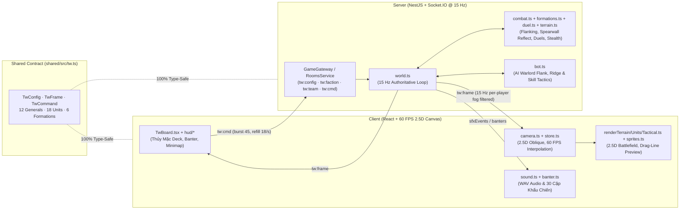

# Đặc Tả Kiến Trúc & Hệ Thống: Tam Quốc Toàn Chiến (Total War: Three Kingdoms)

- **Mã chế độ (`GameMode`)**: `'total_war'`
- **Tên hiển thị**: **Tam Quốc Toàn Chiến (Total War: Three Kingdoms)**
- **Quy mô phòng**: 1–8 Chư hầu (`TW_MAX_PLAYERS = 8`, người chơi + AI Warlords), tối đa 4 Liên Minh (`TW_MAX_TEAMS = 4`)
- **Nhịp mô phỏng máy chủ**: `15 Hz` (`TW_TICK_HZ = 15`, ~66,67 ms/nhịp) — Server Authoritative 100%
- **Hiển thị phía trình duyệt**: `60 FPS` 2.5D Oblique Tactical Canvas + Giao diện Thủy Mặc (Ink-Wash TW3K HUD)
- **Kho tài nguyên độc lập**: `/database-total-war/`

---

## 1. Tổng Quan Chế Độ Chơi (`gameMode: 'total_war'`)

**Tam Quốc Toàn Chiến (Total War: Three Kingdoms)** đưa trải nghiệm điều binh khiển tướng đại quân thời gian thực chuẩn dòng game *Total War: Three Kingdoms* lên nền tảng trình duyệt nhiều người chơi của dự án.

Thay vì mua từng đơn vị lẻ chạy tự động, mỗi người chơi nhập vai một **Chư hầu Tam Quốc** thống lĩnh **1 Đạo Đại Quân** gồm **3 Danh Tướng (Generals)**, mỗi vị tướng trực tiếp chỉ huy **4 Trung Đoàn Bộ Tùy (Retinue Regiments)** (cùng đội thân binh tướng lĩnh tạo thành 15 đơn vị tác chiến đồng bộ mỗi phe, lên tới hàng ngàn binh sĩ dàn trận trực tiếp trên chiến trường `3200 × 2200`).

### 1.1. Hai Chế Độ Chiến Dịch & Tùy Chỉnh Phòng Chờ (`TwConfig`)

| Tham số | Kiểu dữ liệu | Mặc định | Mô tả |
|---|---|---|---|
| `mode` | `'historical_2teams' \| 'ffa'` | `'historical_2teams'` | **Lịch Sử Đối Kháng (2 Liên Minh)** (chia Tây Nam vs Đông Bắc) hoặc **Quần Hùng Trục Lộc (Hỗn Chiến)** (mỗi chư hầu một phương) |
| `mapId` | `'pingyuan' \| 'guandu' \| 'changban' \| 'chibi'` | `'pingyuan'` | 4 đại chiến trường lịch sử kích thước `3200 × 2200`, mỗi bản đồ có 5 vùng địa hình chiến thuật và 3 Đài Hiệu Lệnh / Cửa Ải tranh chấp |
| `bots` | `0..8` | `1` | Số lượng AI Chư hầu tự động cân bằng Liên Minh (`assignTwTeams`) |
| `durationMin` | `10 \| 15 \| 20` | `15` | Thời lượng giới hạn của trận quyết chiến (phút) |
| `romanceMode` | `boolean` | `true` | **Chế độ Diễn Nghĩa (Romance Mode)**: tướng lĩnh một mình địch vạn quân, tung tuyệt kỹ võ học và mở **Đơn Đấu 1v1 (Single Duel)**; tắt sẽ về **Chế độ Sử Gia (Records Mode)** thiên về đội hình thực chiến |
| `armyScale` | `'normal' \| 'grand'` | `'normal'` | Quy mô quân số trung đoàn: Tiêu chuẩn (`normal`, 96–120 bộ binh / 30–36 kỵ binh / 16 pháo thủ) hoặc Đại quân (`grand`, nhân `×1.25` làm tròn bội số 4) |

### 1.2. 6 Thế Lực Chư Hầu (`TW_FACTIONS`)

| Mã (`TwFactionId`) | Quốc hiệu | Đại kỳ | Minh chủ | Tướng mặc định (`defaultGenerals`) | Nội tại Thế lực (`bonusDesc`) |
|---|---|---|---|---|---|
| `wei` | **Tào Ngụy** (*Cao Wei*) | `魏` (`#2b6cb0`) | Tào Tháo (Mạnh Đức) | `cao_cao`, `xiahou_dun`, `sima_xiangan` | `+8%` Giáp toàn quân & `+10%` Tốc độ chỉnh đốn đội hình |
| `shu` | **Thục Hán** (*Shu Han*) | `蜀` (`#2f9e44`) | Lưu Bị (Huyền Đức) | `liu_bei`, `guan_yu`, `zhuge_liang` | `+8` Sĩ khí nền cho dân binh & `+12%` Sức mạnh Đấu Tướng |
| `wu` | **Đông Ngô** (*Eastern Wu*) | `吳` (`#c92a2a`) | Tôn Kiên (Văn Đài) | `sun_jian`, `zhou_yu`, `zhao_yun` | `+10%` Sát thương tên/hỏa tiễn & `+8%` Tốc độ hành quân |
| `yuan` | **Viên Thiệu** (*House of Yuan*) | `袁` (`#e6b800`) | Viên Thiệu (Bản Sơ) | `yuan_shao`, `xiahou_dun`, `zhuge_liang` | `+6` Sĩ khí khi đứng gần trung đoàn đồng minh & `+10%` Đạn dự trữ |
| `lubu` | **Lữ Bố** (*Lu Bu Warband*) | `呂` (`#5f3dc4`) | Lữ Bố (Phụng Tiên) | `lu_bu`, `zhang_fei`, `zhou_yu` | `+18%` Sát thương Xung kích (`Charge Bonus`) & hồi sĩ khí khi hạ tướng địch |
| `jin` | **Tư Mã Tấn** (*Sima Jin*) | `晉` (`#0ca678`) | Tư Mã Tương An (Trọng Hòa) | `sima_xiangan`, `zhao_yun`, `cao_cao` | `+10%` Khối lượng húc kỵ binh & `+8` Thủ cận chiến cho trọng binh |

---

## 2. Kho Tài Nguyên Mở & Đồ Họa Thủy Mặc (`/database-total-war/`)

Toàn bộ tài nguyên hình ảnh, dữ liệu lịch sử mã nguồn mở, sprite sheet hoạt ảnh, địa hình và âm thanh được đóng gói tự chủ trong `/database-total-war/` và phục vụ tĩnh trực tiếp qua backend NestJS:

```text
database-total-war/
├── opensource/                  # Kho dữ liệu lịch sử & RTS mã nguồn mở kèm bản quyền rõ ràng (SOURCES.md)
│   ├── han_china/               # Clone chọn lọc từ 0ADMods/han_china (GPL-2.0+ / CC-BY-SA-3.0)
│   ├── twtk_map/                # Clone chọn lọc từ IMRZ/twtk-interactive-map (MIT)
│   ├── yuka_steering/           # Clone chọn lọc từ Mugen87/yuka (MIT - RTS Steering & Formation Boids)
│   ├── tw3k_historical_db.json  # Cơ sở dữ liệu hợp nhất 4 niên đại, 38 chư hầu, 201 quận huyện, 57 mẫu quân Hán
│   └── SOURCES.md               # Hồ sơ truy xuất nguồn gốc commit SHA & giấy phép mã nguồn mở
├── portraits/                   # 24 ảnh chân dung 12 Danh tướng (<id>_card.png dọc & <id>_token.png tròn đại kỳ)
├── units/                       # 18 thẻ bài bộ tùy dáng cao phong cách Thủy Mặc (ink-wash tall retinue cards)
├── sheets/                      # 23 spritesheet hoạt ảnh 6 trạng thái (18 binh chủng inf_/rng_/cav_ + 5 hệ tướng hero_*)
├── frames/                      # Khung hình lẻ trích xuất phục vụ đóng gói & kiểm thử sprite
├── terrains/                    # 6 bề mặt địa hình & mùa chiến trường (cỏ Bình Nguyên, nền rừng thông, đá đồi, sông, bùn thu, sương đông)
├── projectiles/                 # Đạn tên, hỏa tiễn, tên nỏ, đá lửa Uy Viễn, vết cháy nổ & vòng tròn Đơn Đấu (duel_ring.png)
├── structures/                  # Đài Hiệu Lệnh, chòi canh, doanh trại chư hầu, cự mã chiến trường
├── ui/                          # Huy hiệu Ngũ Hành (el_*), biểu tượng 7 nhánh binh chủng (cls_*), 6 trận hình (fmt_*), bảng Thủy Mặc
└── audio/                       # 12 tệp âm thanh WAV chiến trường (nhạc nền menu/trận đánh, tù và, trống trận, mưa tên, kỵ binh, pháo đá, chiêng đấu tướng)
```

### 2.1. Nguồn Mã Nguồn Mở Tích Hợp (`database-total-war/opensource/`)

1. **`0ADMods/han_china` (`GPL-2.0-or-later` / `CC-BY-SA-3.0`)**:
   - Cung cấp 57 mẫu đơn vị quân Hán (`simulation/templates/units/han/`: *Máo Bīng*, *Jǐ Bīng*, *Dāo Bīng*, *Nǔ Shǒu*, *Hǔ Bēn*, *Yǔ Lín*, *Tóushí Chē*, chiến thuyền Xích Bích *Huǒ Chuán* / *Lóu Chuán*), 40 công trình Hán triều, 25 công nghệ (*Binh Pháp Tôn Tử*, *Nỏ Liên Châu*, *Con Đường Tơ Lụa*), 16 hào quang tướng lĩnh, huy hiệu Hán tộc, khiên mộc/đồng chuyển đổi sang RGBA PNG và 2 bản cổ cầm hòa tấu.
2. **`IMRZ/twtk-interactive-map` (`MIT`)**:
   - Cung cấp dữ liệu địa lý lịch sử của 4 niên đại (*182 Mandate of Heaven*, *190 Rise of the Warlords*, *194 A World Betrayed*, *291 Eight Princes*), tọa độ & tài nguyên đặc sản của **201 quận huyện Tam Quốc** (Bình Nguyên, Quan Độ/Trần Lưu, Đương Dương/Trường Bản, Xích Bích, Hổ Lao Quan), tiểu sử 38 chư hầu cùng 77 chân dung PNG và 21 biểu tượng thành trì/tài nguyên.
3. **`Mugen87/yuka` (`MIT`)**:
   - Cung cấp mô hình toán học tham chiếu cho điều hướng đội hình RTS: `OffsetPursuitBehavior` (giữ vị trí hàng lối theo trung đoàn trưởng), `Separation` / `Alignment` / `Cohesion` (boids dàn hàng mượt không chồng lấn) và `CellSpacePartitioning` (lưới băm không gian $O(1)$).

### 2.2. Hệ Thống Thẻ Bài Thủy Mặc & Spritesheet Hoạt Ảnh 6 Trạng Thái

- **Thẻ bài Bộ Tùy Thủy Mặc (`database-total-war/units/<kind>.png`)**: Thiết kế tỉ lệ dọc cao đặc trưng của *Total War: Three Kingdoms* — phác họa bóng dáng binh sĩ bằng nét bút lông mực tàu kết hợp điểm xuyết sắc màu Ngũ Hành trên nền giấy tuyên chỉ cổ.
- **Spritesheet 6 trạng thái (`database-total-war/sheets/*.png`)**: Mỗi binh chủng (`inf_*`, `rng_*`, `cav_*`) và mỗi hệ tướng Ngũ Hành (`hero_vanguard`, `hero_champion`, `hero_sentinel`, `hero_commander`, `hero_strategist`) được kết xuất thành bảng hoạt ảnh 6 hàng trạng thái đồng nhất (tương ứng các pha `idle` đứng nghiêm, `march` hành quân, `charge` xung phong/dựng thương, `attack` cận chiến, `shoot` giương cung bắn/phất cờ, `dead`/`rout` ngã ngựa/vỡ trận), cho phép Canvas 2.5D vẽ hàng trăm chiến sĩ cử động độc lập ở tốc độ 60 FPS kèm nhuộm màu cờ thế lực động.

---

## 3. Ngũ Hành Tướng Lĩnh, 12 Danh Tướng, Đơn Đấu Diễn Nghĩa & Khẩu Chiến

### 3.1. Hệ Ngũ Hành Tướng Lĩnh (Wu Xing 5 General Classes — `TW_CLASSES`)

| Hệ (`TwGeneralClass`) | Danh xưng | Ngũ Hành | Màu sắc | Bán kính Hào quang | Hiệu ứng Hào quang Chỉ huy (`auraDesc`) |
|---|---|---|---|---|---|
| `vanguard` | **Tiên Phong** (*Vanguard*) | 🔥 **Hỏa** | `#e03131` | `185` | `+15%` Sát thương Xung kích (`Charge`) & `+8%` Tốc độ hành quân cho trung đoàn lân cận |
| `champion` | **Dũng Tướng** (*Champion*) | 🌿 **Mộc** | `#2f9e44` | `175` | `+12` Công cận chiến cho bộ binh trường thương & ưu thế tuyệt đối khi **Đấu Tướng (Single Duel)** |
| `sentinel` | **Hộ Vệ** (*Sentinel*) | ⚔️ **Kim** | `#7950f2` | `185` | `+15` Thủ cận chiến & `+15%` Chắn tên cho các trung đoàn giữ tuyến xung quanh |
| `commander` | **Thống Soái** (*Commander*) | ⛰️ **Thổ** | `#f08c00` | `245` | `+14` Sĩ khí (`Morale`) & giảm hao hụt thể lực cho toàn quân dưới bóng đại kỳ |
| `strategist` | **Mưu Sĩ** (*Strategist*) | 💧 **Thủy** | `#1c7ed6` | `225` | `+20%` Cơ số tên đạn, `+12%` Tốc bắn & mở khóa chỉ huy **Pháo Đá Uy Viễn / Hỏa Tiễn** |

### 3.2. 12 Danh Tướng Huyền Thoại (`TW_GENERALS`)

| Mã (`TwGeneralId`) | Danh tướng (Tên tự) | Thế lực | Hệ Ngũ Hành | HP | Công / Thủ | Giáp / Xung kích | Đấu Tướng (`duelPower`) | Tuyệt kỹ Chủ động (`skill`) |
|---|---|---|---|---|---|---|---|---|
| `cao_cao` | **Tào Tháo** (*Mạnh Đức*) | Tào Ngụy | Thống Soái (Thổ) | 2250 | 58 / 64 | 65% / 48 | `76` | **Ngụy Võ Hiệu Lệnh** (`rally_horn`, hồi +25 Sĩ khí, +18 Công/Thủ, +15% Tốc chạy 15s) |
| `xiahou_dun` | **Hạ Hầu Đôn** (*Nguyên Nhượng*) | Tào Ngụy | Dũng Tướng (Mộc) | 2600 | 76 / 62 | 68% / 62 | `90` | **Độc Nhãn Cuồng Nộ** (`duel_buff`, +45% Công cận chiến, +20 Đấu Tướng 14s) |
| `liu_bei` | **Lưu Bị** (*Huyền Đức*) | Thục Hán | Thống Soái (Thổ) | 2300 | 56 / 68 | 62% / 45 | `74` | **Nhân Nghĩa Hưng Hán** (`rally_horn`, hồi +30 Sĩ khí, ổn định quân dao động, +20 Thủ 16s) |
| `guan_yu` | **Quan Vũ** (*Vân Trường*) | Thục Hán | Dũng Tướng (Mộc) | 2750 | 86 / 70 | 72% / 70 | `97` | **Thanh Long Trảm Nguyệt** (`aoe_smash`, bổ Yển Nguyệt Đao xuyên giáp diện rộng) |
| `zhang_fei` | **Trương Phi** (*Ích Đức*) | Thục Hán | Tiên Phong (Hỏa) | 2680 | 84 / 56 | 66% / 88 | `95` | **Tiếng Thét Trường Bản** (`aoe_smash`, gầm chấn động trừ thẳng `-28` Sĩ khí địch) |
| `zhao_yun` | **Triệu Vân** (*Tử Long*) | Thục Hán | Hộ Vệ (Kim) | 2550 | 78 / 88 | 74% / 76 | `96` | **Đơn Kỵ Cứu Chúa** (`iron_evasion`, +45 Thủ cận chiến, +40% Chắn tên 14s) |
| `zhuge_liang` | **Gia Cát Lượng** (*Khổng Minh*) | Thục Hán | Mưu Sĩ (Thủy) | 1800 | 34 / 48 | 38% / 22 | `35` | **Kỳ Môn Hỏa Tiễn** (`fire_volley`, mượn gió Đông trút mưa tên lửa bán kính 200) |
| `sun_jian` | **Tôn Kiên** (*Văn Đài*) | Đông Ngô | Hộ Vệ (Kim) | 2580 | 76 / 80 | 72% / 68 | `89` | **Mãnh Hổ Giang Đông** (`iron_evasion`, +35 Thủ cận chiến, +25% Giáp 14s) |
| `zhou_yu` | **Chu Du** (*Công Cẩn*) | Đông Ngô | Mưu Sĩ (Thủy) | 1950 | 46 / 56 | 48% / 32 | `58` | **Hỏa Thiêu Xích Bích** (`fire_volley`, bão lửa bán kính 210 cháy lan & rút sĩ khí) |
| `lu_bu` | **Lữ Bố** (*Phụng Tiên*) | Lữ Bố | Tiên Phong (Hỏa) | 2800 | 95 / 68 | 78% / 98 | `100` | **Phương Thiên Vô Song** (`aoe_smash`, quét Họa Kích 360° hủy diệt giữa vòng vây) |
| `yuan_shao` | **Viên Thiệu** (*Bản Sơ*) | Viên Thiệu | Thống Soái (Thổ) | 2350 | 55 / 66 | 70% / 46 | `70` | **Tứ Thế Tam Công** (`rally_horn`, +24 Sĩ khí, +16 Giáp & hồi thể lực bộ tùy) |
| `sima_xiangan` | **Tư Mã Tương An** (*Trọng Hòa*) | Tư Mã Tấn | Tiên Phong (Hỏa) | 2520 | 74 / 66 | 78% / 84 | `85` | **Thiết Kỵ Đại Tấn** (`duel_buff`, +40% Công cận chiến, +30 Xung kích 14s) |

### 3.3. Chế Độ Diễn Nghĩa: Đơn Đấu Võ Tướng 1v1 (`challenge_duel` / `TwDuelFrame`)

Khi bật `romanceMode: true`, người chơi có thể phát lệnh thách đấu **Đơn Đấu 1v1** (`{ t: 'challenge_duel', generalRegId, targetGeneralRegId }`) giữa võ tướng phe mình và tướng địch trong tầm giao phong (trừ các Mưu Sĩ hệ Thủy vốn từ chối đấu võ tay đôi):

1. **Vòng Tròn Danh Dự (`duel_ring.png` + `duel_gong`)**: Tiếng chiêng đồng vang rền, hai danh tướng thúc ngựa lao vào tâm võ đài, quân lính đôi bên tự động dạt ra lập vòng vây quan sát mà không can thiệp bằng tên đạn hay giáo mác.
2. **Mô Phỏng Giao Phong (`clashPhase`)**: Sát thương mỗi hiệp được tính từ `duelPower`, `meleeAtk`, `meleeDef`, `armor`, khắc chế hệ **Dũng Tướng (Mộc)** và các tuyệt kỹ cường hóa (`Độc Nhãn Cuồng Nộ`, `Thiết Kỵ Đại Tấn`, `Đơn Kỵ Cứu Chúa`).
3. **Chấn Động Sĩ Khí**: Vị tướng chiến thắng nhận hào quang uy danh toàn chiến trường; ngược lại, phe có tướng tử trận hoặc bỏ chạy giữa hiệp bị **sốc sụp đổ Sĩ khí diện rộng** khiến hàng loạt trung đoàn lân cận rơi thẳng vào trạng thái `wavering` / `routing`.

### 3.4. Khẩu Chiến & Đối Thoại Khiêu Khích Chiến Trường (`TwBanterEvent` & `client/src/tw/banter.ts`)

Hệ thống tích hợp **30 cặp đối thoại khiêu khích song ngữ Việt – Anh** giữa 12 danh tướng trên 6 ngữ cảnh (`battle_start`, `charge`, `duel_start`, `ambush`, `enemy_routing`, `skill_cast`), hiển thị bằng băng rôn chân dung đối xứng trên đỉnh màn hình theo đúng phong cách *Total War: Three Kingdoms*:

- **Easter Egg kinh điển `Sima Xiangan` vs `Yuan Shao`**:
  - **Tư Mã Tương An**: *"Ngươi đánh trận chẳng khác nào gã chăn bò! (You fight like a dairy farmer!)"*
  - **Viên Thiệu**: *"Khéo lắm! Còn ngươi đánh hệt như một con bò! (How appropriate! You fight like a cow!)"*
- **Hổ Lao Quan — `Lu Bu` vs `Zhang Fei` / `Guan Yu`**:
  - **Lữ Bố**: *"Trong thiên hạ ai dám cản Họa Kích của Lữ Phụng Tiên?!"* ↔ **Trương Phi**: *"Giặc họ Lữ ba họ kia, Trương Dực Đức tới lấy đầu ngươi!"*
- **Xích Bích & Trung Nguyên — `Zhuge Liang` vs `Cao Cao` / `Zhou Yu`**: Đối đáp về Thiên mệnh Hán thất, Gió Đông Nam Bình Sơn và Hỏa Công Giang Đông.

---

## 4. 18 Binh Chủng Bộ Tùy, 6 Trận Hình, Địa Hình Chiến Thuật & Sĩ Khí

### 4.1. 18 Binh Chủng Bộ Tùy (`TW_UNITS`)

| Nhánh | Mã (`TwUnitKind`) | Tên Binh Chủng | Hệ | Quân số (`normal`) | Công / Thủ | Giáp / Chắn tên | Xung kích / Khắc Kỵ | Tầm bắn / Đạn | Trận hình hỗ trợ |
|---|---|---|---|---|---|---|---|---|---|
| **Bộ binh Trường Thương / Kích** | `ji_militia` | Dân Binh Trường Kích (*Ji Militia*) | Mộc | 120 | 22 / 26 | 15% / 0% | 8 / `+18` | — | `line`, `loose` |
| **Bộ binh Trường Thương / Kích** | `spear_guards` | Thuẫn Thương Hộ Vệ (*Spear Guards*) | Mộc | 120 | 24 / 42 | 38% / 55% | 6 / `+24` | — | `line`, `shieldwall`, `spearwall`, `circle`, `loose` |
| **Bộ binh Trường Thương / Kích** | `heavy_ji_infantry` | Trọng Giáp Trường Kích (*Heavy Ji Infantry*) | Mộc | 120 | 30 / 38 | 55% / 0% | 12 / `+28` | — | `line`, `spearwall`, `circle`, `loose` |
| **Bộ binh Trường Thương / Kích** | `azure_dragons` | Thanh Long Quân (*Azure Dragons*) | Mộc | 96 | 42 / 48 | 60% / 0% | 18 / `+32` | — | `line`, `spearwall`, `circle`, `loose` |
| **Bộ binh Đao Kiếm Khiên** | `sabre_militia` | Dân Binh Đao Thuẫn (*Sabre Militia*) | Kim | 120 | 26 / 24 | 20% / 35% | 14 / 0 | — | `line`, `loose` |
| **Bộ binh Đao Kiếm Khiên** | `sabre_infantry` | Đao Thuẫn Bộ Binh (*Sabre Infantry*) | Kim | 120 | 34 / 34 | 42% / 50% | 18 / 0 | — | `line`, `shieldwall`, `circle`, `loose` |
| **Bộ binh Đao Kiếm Khiên** | `jian_sword_guards` | Trường Kiếm Cấm Vệ (*Jian Sword Guards*) | Kim | 120 | 38 / 48 | 52% / 60% | 20 / 0 | — | `line`, `shieldwall`, `circle`, `loose` |
| **Bộ binh Đao Kiếm Khiên** | `yellow_dragons` | Hoàng Long Quân (*Yellow Dragons*) | Thổ | 96 | 46 / 44 | 58% / 55% | 26 / 0 | — | `line`, `shieldwall`, `circle`, `loose` |
| **Cung Nỏ & Công Thành** | `archer_militia` | Dân Binh Cung Thủ (*Archer Militia*) | Thủy | 120 | 12 / 14 | 10% / 0% | 4 / 0 | `350` / 24 | `line`, `loose` |
| **Cung Nỏ & Công Thành** | `yi_archers` | Di Tộc Thiện Xạ (*Yi Archers*) | Thủy | 96 | 22 / 24 | 22% / 0% | 10 / 0 | `390` / 28 | `line`, `loose` |
| **Cung Nỏ & Công Thành** | `crossbowmen` | Liên Châu Nỏ Binh (*Crossbowmen*) | Thủy | 120 | 14 / 18 | 25% / 0% | 4 / 0 | `430` / 24 (AP 18) | `line`, `loose` |
| **Cung Nỏ & Công Thành** | `onyx_dragons` | Hắc Long Thần Cung (*Onyx Dragons*) | Thủy | 96 | 24 / 28 | 38% / 0% | 8 / 0 | `460` / 32 (AP 14) | `line`, `loose` |
| **Cung Nỏ & Công Thành** | `trebuchet` | Pháo Đá Uy Viễn (*Trebuchet*) | Thủy | 16 | 8 / 10 | 15% / 0% | 0 / 0 | `680` / 18 (AP 110) | `line`, `loose` |
| **Kỵ Binh Xung Kích & Cận Chiến** | `raider_cavalry` | Đột Kích Khinh Kỵ (*Raider Cavalry*) | Hỏa | 36 | 26 / 20 | 22% / 0% | `65` / 0 | — | `line`, `wedge`, `loose` |
| **Kỵ Binh Xung Kích & Cận Chiến** | `lance_cavalry` | Trường Thương Xung Kỵ (*Lance Cavalry*) | Hỏa | 36 | 32 / 24 | 45% / 0% | `92` / 0 | — | `line`, `wedge`, `loose` |
| **Kỵ Binh Xung Kích & Cận Chiến** | `jade_dragons` | Ngọc Long Xung Kỵ (*Jade Dragons*) | Hỏa | 36 | 38 / 32 | 65% / 25% | `115` / 0 | — | `line`, `wedge`, `loose` |
| **Kỵ Binh Xung Kích & Cận Chiến** | `sabre_cavalry` | Chiến Đao Kỵ Binh (*Sabre Cavalry*) | Thổ | 36 | 36 / 42 | 48% / 55% | `48` / 0 | — | `line`, `wedge`, `loose` |
| **Kỵ Binh Xung Kích & Cận Chiến** | `imperial_cataphracts` | Thiết Giáp Trọng Kỵ (*Imperial Cataphracts*) | Thổ | 30 | 42 / 40 | 80% / 35% | `125` / 0 | — | `line`, `wedge`, `loose` |

### 4.2. 6 Trận Hình Chiến Thuật (`TW_FORMATIONS`) & Chế Độ Tác Chiến (`TwStanceKind`)

| Mã (`TwFormation`) | Trận hình | Tốc độ | Thủ cận chiến | Chắn tên | Hệ số Xung kích | Cơ chế Đặc biệt |
|---|---|---|---|---|---|---|
| `line` | **Trận Ngang** (*Line Formation*) | `1.00×` | `+0` | `+0%` | `1.00×` | Đội hình tiêu chuẩn, cân bằng bề rộng tiếp chiến và tốc độ xoay mặt trận |
| `shieldwall` | **Thuẫn Tường** (*Shield Wall*) | `0.60×` | `+14` | `+30%` | `0.50×` | Khép mộc thuẫn thành tường sắt chống mưa tên trực diện (cộng dồn tới 85–90% chắn tên) |
| `spearwall` | **Thương Lâm** (*Spear Wall*) | `0.55×` | `+18` | `+10%` | `0.40×` | **`chargeReflect: true` (Phản Xung Kích)**: Khi đứng vững đón đầu (`brace`), rừng trường thương phản ngược toàn bộ động lượng xung kích của kỵ binh địch vào chính ngựa chiến của chúng |
| `wedge` | **Phong Thỉ Chùy** (*Flying Wedge*) | `1.08×` | `-6` | `+0%` | `1.35×` | Đội hình mũi tên nhọn của thiết kỵ: tăng `+35%` lực húc xuyên thủng trung tâm hàng ngũ bộ binh |
| `circle` | **Viên Trận** (*Circle Formation*) | `0.35×` | `+16` | `+15%` | `0.25×` | **`antiFlank: true` (Tử Thủ 360°)**: Miễn nhiễm hoàn toàn phạt đánh tạt sườn và bọc hậu |
| `loose` | **Tản Trận** (*Loose Formation*) | `1.05×` | `-10` | `+0%` | `0.70×` | Giãn cự ly hàng quân `1.65×` (`spreadMul`), giảm thiểu tối đa thương vong trước tên lửa và đá nổ Pháo Đá Uy Viễn |

Đi kèm 3 nút bật/tắt tư thế tác chiến (`TwStanceKind`):
- **Giữ Tuyến (`guard`)**: Giữ vững cự ly trận hình, không tự ý rượt đuổi khi địch tháo chạy.
- **Tự Do Bắn (`fire_at_will`)**: Cung nỏ và pháo đá tự động khai hỏa vào mục tiêu giá trị nhất trong tầm bắn.
- **Du Kích Tránh Áp Sát (`skirmish`)**: Bộ cung nỏ tự động lùi giữ khoảng cách an toàn khi phát hiện bộ binh/kỵ binh địch lao vào tầm gần.

### 4.3. Chiến Thuật Địa Hình (`server/src/game/tw/terrain.ts`)

Trên 4 chiến trường lịch sử (**Bình Nguyên – Thu 196**, **Quan Độ – Thu 200**, **Trường Bản – Hạ 208**, **Xích Bích – Đông 208**), hàm `sampleTerrainAt` và `isRegimentHidden` áp dụng vật lý địa hình theo thời gian thực ở mỗi nhịp 15 Hz:

| Địa hình (`TwTerrainKind`) | Tốc độ (`speedMul`) | Chiến thuật & Hệ số Vật lý |
|---|---|---|
| 🌲 **Rừng Thông / Rừng Trúc (`forest`)** | `0.82×` | **Ẩn Quân Phục Kích (`hidden: true`)**: Toàn bộ trung đoàn biến mất khỏi màn hình và bản đồ nhỏ của địch nếu không khai hỏa, không cận chiến/đấu tướng, không phải `trebuchet`, và không có địch sống trong bán kính phát hiện `TW_FOREST_SPOT_RADIUS = 280`. Tán rừng cản thêm **`+45%` sát thương tên đạn** (`missileBlockBonus: 0.45`). |
| ⛰️ **Đồi Cao / Sườn Dốc (`ridge`)** | `1.00×` | **Chiếm Cao Điểm (`onHighGround: true`)**: Cộng **`+20%` tầm bắn** (`rangeMul: 1.20`) cho toàn bộ cung thủ, nỏ binh và Pháo Đá Uy Viễn; cộng **`+25%` sát thương xung kích đổ dốc** (`chargeElevationBonus: 0.25`) và **`+6` Thủ cận chiến**. |
| 🌊 **Bến Sông Cạn (`river`)** | `0.55×` | **Chướng Ngại Chết Chóc (`inRiver: true`)**: Lội nước làm giảm `45%` tốc độ di chuyển, giảm `20%` Thủ cận chiến và giảm `35%` lực xung kích — điểm nghẽn lý tưởng để nỏ binh và hỏa tiễn tiêu diệt quân địch đang vượt sông. |
| 🍂 **Đầm Lầy / Đất Bùn (`mud`)** | `0.70×` | **Sa Lầy (`inMud: true`)**: Giảm `30%` tốc độ bộ binh (kỵ binh bị kéo chậm thêm `0.80×`), giảm `28%` đà xung phong thiết kỵ hạng nặng. |

### 4.4. Hệ Thống Sĩ Khí (Morale), Thể Lực (Fatigue) & Vỡ Trận (Routing)

- **5 Cấp độ Sĩ Khí (`TwMoraleState`)**: `eager` (Hăng hái) → `steady` (Vững vàng) → `wavering` (Dao động — nhấp nháy cờ trắng) → `routing` (Tháo chạy — mất quyền điều khiển, quay lưng chạy về biên bản đồ) → `shattered` (Tan rã hoàn toàn — không thể tập hợp lại).
- **Nhân tố tác động Sĩ Khí**: Tỷ lệ thương vong tức thời và tích lũy, bị đánh tạt sườn (`flanked`) hoặc bọc hậu (`rear-charged`), chấn động khi trúng đá lửa `trebuchet` hoặc kỵ binh xung kích sau lưng, hào quang Thống Soái (`+14`), kèn hiệu triệu tướng lĩnh (`rally_horn`), và cú sốc tâm lý khi chủ tướng tử trận.
- **4 Cấp độ Thể Lực (`TwFatigueState`)**: `fresh` (Sức nhàn) → `active` (Đang vận sức) → `winded` (Thấm mệt) → `exhausted` (Kiệt sức — giảm tốc chạy, lực húc và thủ cận chiến).

---

## 5. Kiến Trúc Kỹ Thuật: Server 15 Hz Authoritative & Client 60 FPS 2.5D



### 5.1. Mô Phỏng Chiến Trường Máy Chủ 15 Hz (`server/src/game/tw/*`)

- **`world.ts` (`TwWorld`)**: Vòng lặp mô phỏng quyết định (`15 Hz`, `66.67 ms/tick`) quản lý toàn bộ trung đoàn, tướng lĩnh, đạn đạo, vòng Đơn Đấu và 3 Đài Hiệu Lệnh (`stepCapturePoints`). Lọc sương mù rừng thông (`hidden: true`) riêng cho từng Liên Minh trước khi phát gói `tw:frame` qua Socket.IO.
- **`formations.ts`, `combat.ts` & `duel.ts`**: Điều hướng đội hình kéo chuột phải (`move_line`), giải quyết va chạm khối lượng (`mass`), tính toán góc tiếp chiến (Trực diện / Tạt sườn / Bọc hậu), giáp thường (`armor`) vs xuyên giáp (`armorPiercingDmg`), khiên chắn tên (`shieldMissileBlock` + `Thuẫn Tường` + `Rừng Thông`), phản sát thương kỵ binh khi húc vào `Thương Lâm` (`chargeReflect`), đạn đạo parabol (`arrow`, `fire_arrow`, `bolt`, `boulder`), tuyệt kỹ tướng và máy trạng thái Đơn Đấu 1v1.
- **`terrain.ts`**: Xử lý hình học elip xoay (`twPointInTerrainZone`), lấy mẫu địa hình $O(1)$, ẩn quân rừng thông, bố trí đội hình khai chiến (`computeSpawnPositions`) và điểm chiếm đóng chiến lược.
- **`bot.ts`**: Trí tuệ nhân tạo Chư hầu điều quân theo học thuyết *Total War*: đưa cung nỏ/pháo đá lên chiếm Đồi Cao (`ridge`), dựng `Thương Lâm` ở hai cánh đón kỵ binh, cho thiết kỵ vòng qua Rừng Thông phục kích hậu phương địch, kích hoạt tuyệt kỹ đúng thời điểm giao tranh và ứng chiến Đơn Đấu khi có lợi thế `duelPower`.
- **Chống gian lận & Chống spam**: Kiểm tra quyền sở hữu `regIds` trên mọi lệnh `TwCommand`, giới hạn tốc độ bằng xô thẻ bài (`TW_CMD_BURST = 45`, `TW_CMD_REFILL = 18` lệnh/giây).

### 5.2. Kết Xuất 2.5D 60 FPS & Giao Diện Thủy Mặc (`client/src/tw/*` & `TwBoard.tsx`)

- **`client/src/components/TwBoard.tsx` & `client/src/tw/hud/*`**:
  - **Thanh Cán Cân Lực Lượng (Balance of Power)**, đồng hồ trận đấu & trạng thái 3 Đài Hiệu Lệnh; điều khiển RTS trực tiếp trên Canvas: Kéo chuột trái quét chọn nhiều trung đoàn (`Box Select`), nhấp đúp chọn cùng nhánh binh chủng, phím số `1–9` chọn nhóm / tướng, **giữ kéo chuột phải (`move_line`)** để dàn bề ngang hàng quân và xoay hướng mặt trận chính xác theo ý muốn.
  - **Băng rôn Khẩu Chiến Danh Tướng (`TwBanterBanner.tsx`)** và bảng theo dõi **Đơn Đấu 1v1** trực quan theo thời gian thực.
  - **Khay Thẻ Bài Bộ Tùy Thủy Mặc (`TwRetinueHud.tsx`)** gom nhóm rõ ràng dưới chân dung 3 vị Danh tướng, hiển thị thanh máu, thanh Sĩ khí đổi màu, đạn dự trữ, nút chuyển nhanh 6 Trận hình, 3 tư thế tác chiến và nút tung Tuyệt kỹ / Thách Đấu Tướng.
  - **Bản đồ Chiến thuật Thu nhỏ (`TwMinimap.tsx`)** hiển thị địa hình rừng/đồi/sông, hình thang trường nhìn camera 2.5D và cho phép nhấp chuột di chuyển góc nhìn tức thì hoặc phát lệnh hành quân nhanh.
- **`client/src/tw/camera.ts`, `store.ts`, `sprites.ts`, `renderTerrain.ts`, `renderUnits.ts` & `renderTactical.ts`**:
  - Phép chiếu nghiêng 2.5D (*Oblique Battlefield Projection*) nội suy mượt 60 FPS giữa hai gói tin `15 Hz` từ máy chủ.
  - Kết xuất từng hàng binh sĩ có chiều sâu (`y-sorting`), bóng đổ dưới chân, cờ hiệu chữ Hán (`魏`, `蜀`, `吳`, `袁`, `呂`, `晉`) tung bay trong gió, vệt cung tên lửa rực sáng, đá nổ rung chuyển màn hình và chấm xem trước từng vị trí lính khi giữ kéo chuột phải.
