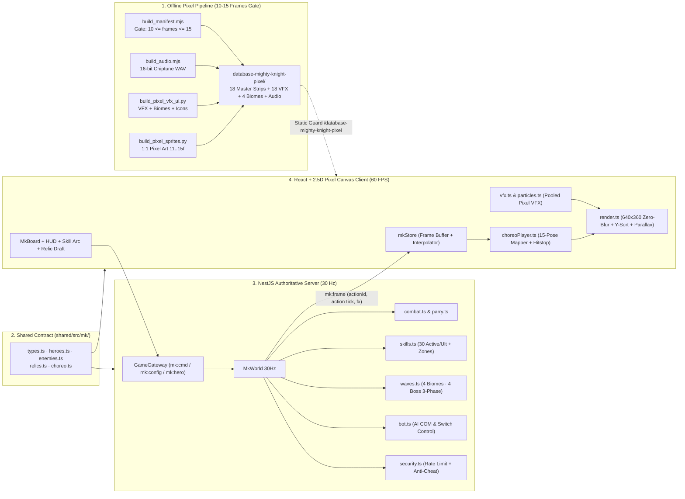

# Implementation Plan: Mighty Knight 2.5D Pixel (A–Z)

**Branch**: `main` *(chưa tạo nhánh riêng; repo chưa cài `.specify/`)* | **Date**: 2026-11-19 | **Spec**: yêu cầu trực tiếp từ người dùng (bên dưới)
**Input**: *"bây giờ làm 1 game về might knight bản 2.5D pixel nhiều skill animation hoạt ảnh tối đa 10-15 ảnh trong 1 nhân vật thiết kế cho tôi từ A-Z coi"*

---

## 1. Tóm tắt Tầm nhìn (A–Z Summary)

Xây dựng trò chơi hành động nhập vai chặt chém **2.5D Pixel Art Co-op** lấy cảm hứng từ **Mighty Knight**, tích hợp trực tiếp vào hệ thống phòng chơi thời gian thực (`1–6 người chơi + 0–3 đồng đội AI COM`) của monorepo `meo-no`.

Điểm đột phá cốt lõi giải quyết đồng thời hai yêu cầu khắt khe **"nhiều skill animation"** và **"hoạt ảnh tối đa 10–15 ảnh trong 1 nhân vật"**:

1. **Ràng buộc Cứng 10–15 Ảnh/Nhân Vật (1 Master Strip PNG/nhân vật)**:
   - Mỗi Anh Hùng có đúng **15 khung hình khóa** (`48×48` px, 1 file `720×48` px).
   - Mỗi Quái Thường có **11 khung hình**, Quái Tinh Anh có **12 khung hình**, Đại Boss có **15 khung hình** (`80×80` px, `1200×80` px).
   - Kiểm định tự động `10 <= frameCount <= 15` ở cả bước đóng gói manifest lẫn `node:test`.
2. **Hệ thống Biên đạo Kỹ năng 3 Tầng (Pixel Choreography Engine)**:
   - Ghép nối linh hoạt 15 tư thế khóa (`IDLE`, `WALK`, `WINDUP`, `STRIKE 1–3`, `CAST`, `AIR_SPIN`, `DASH`, `GUARD`, `HIT`, `DOWN`) theo kịch bản thời gian (`MkChoreoTimeline`) với **nhảy trục Z, lật ngang theo nhịp xoay 360°, dư ảnh pixel đa màu, chớp bảng màu, đóng băng va chạm (hitstop 35–85 ms)** kết hợp **18 dải Pixel VFX tách rời** (vẽ cả lớp sau lưng, mặt đất 2.5D và trước nhân vật).
   - Kết quả: **6 Anh Hùng × (Combo 3 nhịp + Dash-Attack + Guard/Perfect Parry + 4 Kỹ năng chủ động tiến hóa Lv3/Lv5 + 1 Tuyệt kỹ Ultimate) = 60 hoạt ảnh chiến đấu khác biệt rõ rệt**, trong khi mỗi nhân vật **tuyệt đối không vượt quá 15 ảnh**.
3. **Nâng cấp dứt điểm bản thử nghiệm `mighty_knight` chưa commit trong repo**:

| Khía cạnh | Bản thử nghiệm chưa commit hiện có (`database-mighty-knigt/`) | Bản thiết kế mới **Mighty Knight 2.5D Pixel** (`database-mighty-knight-pixel/`) |
|---|---|---|
| Phong cách hình ảnh | Cartoon-chibi vector 3× Lanczos (cạnh mềm) | **2.5D Pixel Art thật 1:1** (`640×360` ảo, `imageSmoothingEnabled=false`, viền 1px `#140c1c`, bảng màu 32 màu) |
| Ngân sách ảnh / Hero | 37 frame tách 8 file PNG (vượt 2.5× giới hạn) | **Đúng 15 frame trong 1 Master Strip PNG** (`720×48`) — thỏa cứng `10–15 ảnh` |
| Ngân sách ảnh / Quái & Boss | 21 frame (quái) · 29 frame (Boss) | **11–12 frame (quái) · 15 frame (Boss)** — thỏa cứng `10–15 ảnh` |
| Chiều sâu Kỹ năng | 1 đánh thường + 2 Active Skill | **Combo 3 nhịp + Dash-Atk + Perfect Parry + 4 Active Skill (tiến hóa VFX Lv3/Lv5) + 1 Ultimate + 12 Thánh Vật Relic** |
| Chế độ & Màn chơi | 1 chế độ Endless · 3 Biome | **Endless Challenge + Boss Rush** · **4 Quần xã Pixel × 5 lớp Parallax** · **4 Boss 3 giai đoạn** |

---

## 2. Technical Context

| Hạng mục | Quyết định kỹ thuật (đã chốt ở [research.md](research.md)) |
|---|---|
| **Language / Runtime** | TypeScript 5 (`shared/`, `server/`, `client/`), Node.js 20+, Python 3.10+ (Pillow) cho pipeline sinh ảnh pixel offline |
| **Primary Dependencies** | NestJS 11 + Socket.IO (server), React 18 + Vite + lucide-react (client). **Không thêm thư viện runtime ngoài** |
| **Rendering Architecture** | HTML5 Canvas 2D độ phân giải pixel ảo `640×360` (16:9), scale nguyên/sắc cạnh (`imageSmoothingEnabled = false`), chiến trường 2.5D `1280×360`, Y-sorting chuẩn + trục độ cao `Z` + bóng mặt đất tách rời |
| **Simulation & Sync** | Server-Authoritative `MkWorld` **30 Hz** (`33.33 ms/tick`) gửi compact snapshot `mk:frame` mang `(actionId, actionTick)`; Client nội suy **60 FPS** và phát `MkChoreoTimeline` cục bộ |
| **Asset Storage & Serving** | Thư mục tĩnh độc lập `database-mighty-knight-pixel/` phục vụ qua `/database-mighty-knight-pixel` kèm middleware chặn path traversal (giống `database-ban-sung`) |
| **Audio** | Bộ tổng hợp thuần Node.js tạo 4 BGM + 42 SFX phong cách **16-bit Retro Chiptune/FM** (`44.1 kHz 16-bit WAV`, chuẩn hóa `-1.0 dBFS`) + WebAudio pool phía client |
| **Testing** | `node:test` (`server/test/mk-pixel-assets.test.cjs`, `mk-mechanics.test.cjs`, `mk-e2e-socket.test.cjs`, `mk-static-security.test.cjs`) + `tsc --noEmit` + chơi thử Chrome PC/Mobile trên server test cô lập |
| **Performance Goals** | Client ổn định **60 FPS** với 6 Hero + 35 quái + 96 VFX pool + 250 hạt pixel (zero GC per-frame); Server tick `< 5 ms/tick`; băng thông `< 35 KB/s/client`; tổng gói sprite toàn bộ 18 nhân vật `< 300 KB` |
| **Constraints** | Bắt buộc `10 <= frameCount <= 15` cho mọi nhân vật; pixel nhân vật alpha nhị phân `0/255`; server quyết định 100% sát thương/CD/Fury/Vàng/Relic; không chạm `server/data/db.json` khi test |

---

## 3. Constitution Check (Cổng Kiểm Soát Nguyên Tắc)

Repo chưa có `.specify/memory/constitution.md`; kế hoạch kiểm soát dựa trên quy ước chuẩn của monorepo `meo-no` kết hợp các yêu cầu cứng từ người dùng:

| Cổng nguyên tắc | Kiểm tra Trước Thiết Kế | Kiểm tra Sau Thiết Kế (Phase 1) | Bằng chứng |
|---|---|---|---|
| **C1. Giới hạn 10–15 ảnh / nhân vật** | Yêu cầu cứng từ người dùng | ✅ PASS — Hero=15, Boss=15, Regular=11, Elite=12 | [contracts/asset-atlas.md](contracts/asset-atlas.md) |
| **C2. Nhiều Skill Animation thực chất** | Yêu cầu cứng từ người dùng | ✅ PASS — 60 hoạt ảnh (30 Active/Ult + 18 Combo + 6 Dash-Atk + 6 Parry) + VFX Evolution Lv3/Lv5 | [data-model.md](data-model.md) §2–3 |
| **C3. Chuẩn 2.5D Pixel Art sắc cạnh** | Yêu cầu cứng từ người dùng | ✅ PASS — Native `640×360`, 1:1 pixel raster, alpha nhị phân, Y-sort + trục Z + 5 lớp parallax | [research.md](research.md) R3, [contracts/asset-atlas.md](contracts/asset-atlas.md) |
| **C4. Luật chơi do Server quyết định** | Quy ước bắt buộc của `meo-no` | ✅ PASS — 30 Hz `MkWorld`, kiểm tra CD/Fury/Gold/Relic/Cancel/Rate-limit trên server | [contracts/socket.md](contracts/socket.md) |
| **C5. Tách lớp `shared/` – `server/` – `client/`** | Quy ước bắt buộc của `meo-no` | ✅ PASS — Mọi hằng số, Hero/Skill/Choreo schema nằm ở `shared/src/mk/` | Mục 6 bên dưới |
| **C6. Không thêm dependency nặng & Không đụng DB thật** | Quy ước bắt buộc của `meo-no` | ✅ PASS — Dùng thuần Canvas 2D + WebAudio + `node:test`, test chạy server cô lập | [quickstart.md](quickstart.md) |
| **C7. Bảo mật tài nguyên tĩnh & Kiểm thử tự động** | Quy ước an toàn của `meo-no` | ✅ PASS — 4 bộ test tự động bao phủ Asset Gate, Mechanics, Socket E2E và Path Traversal | [quickstart.md](quickstart.md) §3 |

**Kết quả cổng**: **PASS (Cả trước và sau thiết kế Phase 1)**.

---

## 4. Kiến trúc Tổng thể A–Z



---

## 5. Thiết kế Trọn gói Từ A đến Z (A–Z Design Breakdown)

### A. Sảnh chờ & Chuẩn bị Đội hình (`Lobby.tsx`, `Home.tsx`)
- Chọn chế độ **Mighty Knight 2.5D Pixel** (`1–6 người chơi`).
- Chủ phòng cấu hình:
  - **Kiểu chơi**: `Endless Challenge` (vô tận theo Wave) hoặc `Boss Rush` (mở sẵn 4 skill + 450 Vàng đấu liên hoàn 4 Đại Boss).
  - **Đồng đội AI COM**: `0..3` (mặc định `2` khi chơi 1 người để tạo đội hình chuẩn 3 người `P1 + COM + COM`).
  - **Độ khó**: `Thường / Khó / Ác Mộng`.
  - **Quần xã khởi đầu**: `Tự động xoay vòng` hoặc cố định 1 trong 4 Quần xã Pixel.
- Mỗi người chơi chọn 1 trong **6 Anh Hùng** kèm xem trước **chân dung pixel `32×32`**, chỉ số và mô tả **4 Kỹ năng + Ultimate**.

### B. Thế giới 2.5D Pixel Art & Chiều sâu Belt-Scroller
- Màn hình pixel logic **`640×360`** (scale nguyên sắc cạnh lên mọi độ phân giải), bản đồ chiến đấu **`1280×360`** với đường chạy độ sâu `y ∈ [156..326]`.
- **5 lớp Parallax pixel** trên **4 Quần xã**: *Đồng Cỏ Ngọc Bích*, *Rừng Cổ Mộ*, *Núi Lửa Nham Thạch*, *Thành Cổ Tinh Tú*.
- **Vật lý 2.5D thực thụ**: Y-Sort theo chân `footY`, trục nhảy/hất tung `Z`, bóng elip pixel dính sàn tự co theo độ cao `Z`, camera theo mượt người chơi kèm nhìn trước (look-ahead) và rung pixel rời rạc (`1–3` virtual px) khi nổ đòn nặng.

### C. Nghệ thuật Nén 10–15 Ảnh Thành 60+ Hoạt Ảnh Kỹ Năng
Chi tiết đầy đủ nằm tại [contracts/asset-atlas.md](contracts/asset-atlas.md). Cơ chế vận hành:
1. **15 Tư thế Khóa** bao trọn mọi đường nét hành động (Đứng 2, Đi 3, Cúi đà 1, Chém/Bắn 3, Tụ phép 1, Bay/Xoay 1, Lướt 1, Khiên/Phản 1, Trúng đòn 1, Gục ngã 1).
2. **Động cơ Biên đạo (`choreoPlayer.ts`)** chạy từng bước `MkChoreoStep`: đổi tốc độ giữ frame, dịch chuyển gốc `(dx, dz)`, lật ngang `flipX` cho đòn xoay, đẻ tối đa 4 bóng dư ảnh đổi màu, chớp màu khi siêu giáp/chí mạng, và tạo **micro-hitstop 35–85 ms** tại đúng khung va chạm.
3. **18 Bộ Pixel VFX Dùng Chung** nhuộm bảng màu theo hệ của 6 Hero tạo bản sắc riêng biệt cho từng chiêu thức, đồng thời tiến hóa thêm tầng VFX khi nâng cấp kỹ năng lên **Lv3** và **Lv5**.

### D. Chiến đấu, Phối chiêu (Combo), Perfect Parry & 30 Kỹ Năng
Chi tiết danh sách đủ 6 Hero và 30 kỹ năng nằm tại [data-model.md](data-model.md) §3:
- **Combo 3 nhịp (`J`/`Z`)** nối mượt trong cửa sổ `900 ms`, có thể **Animation Cancel** sang Dash (`Space`), Guard/Parry (`E`) hoặc bất kỳ Skill nào (`K/L/I/O`).
- **Perfect Parry (`E` đúng cửa sổ `180 ms`)**: chặn 100% sát thương, kích hoạt hitstop 70 ms + vòng sóng vàng phản công + thưởng `+20 Fury` + giảm 30% hồi chiêu mọi kỹ năng.
- **Ultimate Thức Tỉnh (`R` khi đủ `100 Fury`)**: phát **Banner Chân Dung Pixel Cut-In** gọn góc trên-trái 0.45s, siêu giáp 1s và tung đại chiêu toàn sàn (*Thánh Quang Phán Quyết*, *Phượng Hoàng Tiễn*, *Dạ Ảnh Trảm Không*, *Nham Thần Hàng Thế*, *Cửu Tinh Hủy Diệt*, *Thanh Long Xuất Hải*).
- **Đổi tướng linh hoạt (`Q`/`Tab`)**: chiếm quyền điều khiển bất kỳ đồng đội COM nào ngay giữa trận để nối combo liên nhân vật!

### E. Tiến trình Nâng cấp, Quái, 4 Đại Boss & Thánh Vật Roguelite
- **Kinh tế & Nâng cấp (`U`)**: Nhặt Vàng/EXP để nâng `ATK/HP/DEF/SPD` (Lv1→15), mở khóa & nâng `Skill 1–4` (Lv1→5) và `2 Nội tại` (Lv1→5).
- **8 Quái Vật & 4 Đại Boss 3 Giai Đoạn** (tất cả `11–15 frame`, xem [data-model.md](data-model.md) §4): quái có vai trò chiến thuật (khiên đỡ mặt trước, pháp sư hồi máu, quỷ ôm bom phản nổ bằng Parry, Hồn Ma Kho Báu rớt đồ). Boss đổi phase ở 66% và 33% HP kèm vòng telegraph đỏ cảnh báo trên mặt sàn 2.5D.
- **Relic Draft**: Hạ mỗi Đại Boss mở bảng chọn **1 trong 3 Thánh Vật** (kho 12 Relic, xem [data-model.md](data-model.md) §5) cho phép xây dựng lối chơi riêng mỗi trận (hút máu, dư ảnh gây sát thương, sét combo, spam Parry, bạo kích băng…).

### F. Điều khiển PC & Mobile + Âm thanh 16-bit
- **PC**: `WASD`/Mũi tên di chuyển · `J/Z` Combo · `K/L/I/O` (hoặc `1–4`) 4 Skill · `R` Ultimate · `Space/Shift` Dash · `E` Guard/Parry · `Q/Tab` Đổi COM · `U` Nâng cấp.
- **Mobile Landscape**: Joystick 8 hướng bên trái; cụm nút bấm cảm ứng hình vòng cung bên phải (Đánh lớn + 4 Skill có vòng cooldown + Ultimate rực lửa + Dash + Parry) và thanh đổi tướng COM chạm nhanh phía trên.
- **Âm thanh 16-bit**: 4 nhạc nền Chiptune/FM tự chuyển mượt giữa Sảnh, Chiến đấu, Boss; 42 SFX phân tầng âm lượng theo ưu tiên chiến đấu.

---

## 6. Project Structure (Cấu trúc Thư mục & File)

### 6.1 Tài liệu Đặc tả & Thiết kế (Feature Docs)

```text
specs/005-mighty-knight-25d-pixel/
├── plan.md                        # Tài liệu kế hoạch tổng thể A-Z này
├── research.md                    # Phase 0: 8 quyết định kiến trúc & giải pháp 10-15 ảnh
├── data-model.md                  # Phase 1: 6 Hero, 30 Skill, 12 Quái/Boss, 12 Relic, State Machine
├── quickstart.md                  # Phase 1: Quy trình sinh ảnh, ma trận test & chơi thử E2E
└── contracts/
    ├── asset-atlas.md             # Phase 1: Bản đồ chính xác 10-15 frame/nhân vật & 18 Pixel VFX
    └── socket.md                  # Phase 1: Giao thức Socket.IO mk:* & bất biến chống gian lận
```

### 6.2 Mã nguồn & Tài nguyên Dự kiến khi Triển khai

```text
scripts/mightyknight-pixel/
├── palette.py                     # MỚI – Bảng màu Dark-Fantasy 32 màu + công cụ vẽ 1:1 pixel & 1px outline
├── build_pixel_sprites.py         # MỚI – Sinh 18 Master Atlas (11..15f) + 6 chân dung 32×32
├── build_pixel_vfx_ui.py          # MỚI – Sinh 18 Pixel VFX + 4 Biome×5 lớp + Icon 30 Skill & 12 Relic
├── build_audio.mjs                # MỚI – Sinh 4 BGM + 42 SFX 16-bit Chiptune/FM WAV
└── build_manifest.mjs             # MỚI – Sinh manifest.json & kiểm định cứng 10 <= frames <= 15

database-mighty-knight-pixel/      # MỚI – Kho tài nguyên 2.5D Pixel độc lập (thay database-mighty-knigt/)
├── manifest.json
├── SOURCES.md & LICENSES.md
├── sprites/{heroes,enemies,bosses}/*.png   # Mỗi nhân vật ĐÚNG 1 file PNG (11..15 frame)
├── portraits/*.png                         # Chân dung pixel 32×32
├── vfx/*.png                               # 18 dải Pixel VFX dùng chung
├── terrains/{grasslands,jungle,volcano,citadel}/*.png
├── ui/*.png                                # Icon Skill, Relic, Stat, Nút bấm pixel
└── audio/{bgm,sfx}/*.wav

shared/src/
├── mightyknight.ts                # SỬA – Barrel export đủ types, heroes, enemies, relics, choreo
├── protocol.ts                    # SỬA – Cập nhật mô tả Mighty Knight 2.5D Pixel
└── mk/
    ├── types.ts                   # SỬA – Hằng số 640×360 / 1280×360, MK_MIN/MAX_CHAR_FRAMES=10..15, MkCommand, MkFrame
    ├── choreo.ts                  # MỚI – Toàn bộ 60+ kịch bản MkChoreoTimeline ánh xạ vào frame 0..14
    ├── heroes.ts                  # SỬA – 6 Hero × (Combo 3 nhịp + 4 Active Skill + 1 Ultimate + 2 Passive)
    ├── enemies.ts                 # SỬA – 8 Quái (11–12f) + 4 Đại Boss 3 giai đoạn (15f)
    └── relics.ts                  # MỚI – 12 Thánh Vật Roguelite & luật chọn 1/3

server/src/
├── app.module.ts                  # SỬA – Serve & StaticGuard cho `/database-mighty-knight-pixel`
└── game/
    ├── game.ts / rooms.service.ts / game.gateway.ts  # SỬA – Đồng bộ payload mk:config & mk:cmd mới
    └── mk/
        ├── world.ts               # SỬA – Vòng đời WAVE_INTRO / COMBAT / RELIC_DRAFT / Boss Rush, 30 Hz
        ├── combat.ts              # SỬA – Combo 3 nhịp, Animation Cancel, Guard & Perfect Parry, Shield/Relic
        ├── skills.ts              # SỬA – Thực thi 30 kỹ năng chủ động & Ultimate + vùng MkZoneSim + Lv3/Lv5 evolution
        ├── waves.ts               # SỬA – 4 Quần xã, 8 Quái, 4 Boss 3 giai đoạn, Telegraph & Netherghost
        ├── upgrades.ts            # SỬA – Nâng cấp Stat/4 Skill/2 Passive + áp dụng 12 Relic
        ├── bot.ts                 # SỬA – AI COM biết dùng cả 4 Skill, Ultimate, Dash né Telegraph Boss
        └── security.ts            # SỬA – Validate chặt 10 loại MkCommand, rate-limit, pick_relic chống giả mạo

server/test/
├── mk-pixel-assets.test.cjs       # MỚI – Test cứng 10<=frames<=15, alpha nhị phân, kiểm tra mọi choreo frame index
├── mk-mechanics.test.cjs          # SỬA – Test đủ 30 skill, Combo 3 nhịp, Perfect Parry, Boss 3 Phase, Relic Draft
├── mk-e2e-socket.test.cjs         # SỬA – Test socket nhiều người + Boss Rush + reconnect
└── mk-static-security.test.cjs    # SỬA – Test chặn path traversal trên `/database-mighty-knight-pixel`

client/src/
├── vite.config.ts                 # SỬA – Proxy `/database-mighty-knight-pixel` tới backend
├── components/
│   ├── Lobby.tsx / Home.tsx       # SỬA – Chọn Endless/Boss Rush, preview 6 Hero pixel & bộ 5 kỹ năng
│   ├── MkBoard.tsx                # SỬA – Tích hợp RelicDraftModal, UltCutInBanner, điều khiển mở rộng
│   └── mk/
│       ├── MkHudTop.tsx           # SỬA – Thanh máu Boss 3 pha, Biome, Combo, Fury
│       ├── MkPartyBar.tsx         # SỬA – Chân dung pixel 32×32, HP/Shield/Fury, đổi COM nhanh
│       ├── MkControls.tsx         # SỬA – Cụm 4 Skill + Ultimate + Dash + Parry tối ưu PC & Mobile
│       ├── MkUpgradeModal.tsx     # SỬA – Nâng cấp 4 Skill (hiển thị mốc tiến hóa Lv3/Lv5) & Stat
│       ├── MkRelicModal.tsx       # MỚI – Bảng chọn 1/3 Thánh Vật sau Boss
│       ├── MkUltCutIn.tsx         # MỚI – Banner chân dung pixel 0.45s khi tung Ultimate
│       └── MkResultModal.tsx      # SỬA – Bảng tổng kết MVP, sát thương, số lần Parry & Relic đã lấy
└── mk/
    ├── sprites.ts                 # SỬA – Nạp Master Strip 10–15f, LRU pixel palette-tint cache (zero-blur)
    ├── choreoPlayer.ts            # MỚI – Bộ giải mã MkChoreoTimeline 60 FPS, flipX, dư ảnh, hitstop
    ├── render.ts                  # SỬA – Renderer 2.5D Pixel 640×360, Y-Sort, bóng Z, 5 lớp Parallax
    ├── vfx.ts & particles.ts      # SỬA – Pool 96 VFX pixel (behind/ground/front) & 250 hạt pixel vuông
    ├── input.ts                   # SỬA – Hỗ trợ Combo buffer, 4 Skill, Ultimate, Guard/Parry, Mobile Touch
    ├── sound.ts                   # SỬA – Bộ phát nhạc & SFX 16-bit ưu tiên theo chiến đấu
    ├── store.ts                   # SỬA – Bộ đệm nội suy 60 FPS & đồng bộ Relic/Cut-in
    └── mk.css                     # SỬA – Giao diện viền pixel crisp-edges sắc nét
```

---

## 7. Lộ trình Triển khai Theo Pha (Phased Execution Roadmap)

1. **Pha 1 — Nền tảng Hợp đồng & Bộ Biên đạo (`shared/src/mk/*`)**: Khai báo `types.ts`, `choreo.ts` (60+ timeline khớp `0..14`), `heroes.ts` (30 skill), `enemies.ts`, `relics.ts`.
2. **Pha 2 — Pipeline Tài nguyên 2.5D Pixel (`scripts/mightyknight-pixel/*`)**: Xây bảng màu 32 màu, sinh 18 Master Strip (`11..15` ảnh/nhân vật), 18 Pixel VFX, 4 Quần xã × 5 lớp, 4 BGM + 42 SFX, `manifest.json` và chạy ngay `mk-pixel-assets.test.cjs` để khóa cổng **10–15 ảnh**.
3. **Pha 3 — Lõi Chiến đấu Server (`combat.ts`, `skills.ts`, `upgrades.ts`, `security.ts`)**: Hoàn thiện Combo 3 nhịp, Animation Cancel, Perfect Parry, 30 kỹ năng chủ động + Ultimate, `MkZoneSim` (Hố đen, Mưa tên, Bẫy sét, Phân thân) và 12 Relic.
4. **Pha 4 — Thế giới, Wave, 4 Đại Boss & AI COM (`world.ts`, `waves.ts`, `bot.ts`)**: Hoàn thiện Endless 4 Biome, Boss Rush, 4 Boss 3 giai đoạn có Telegraph, Relic Draft, Co-op Revive, đổi tướng COM và tích hợp `Game`/`Rooms`/`Gateway`/`StaticGuard`.
5. **Pha 5 — Động cơ 2.5D Pixel 60 FPS Client (`sprites.ts`, `choreoPlayer.ts`, `render.ts`, `vfx.ts`, `particles.ts`)**: Dựng Canvas `640×360` zero-blur, Y-sort + trục Z, 5 lớp parallax, dư ảnh pixel đa màu, micro-hitstop và bộ âm thanh 16-bit.
6. **Pha 6 — Giao diện, Điều khiển PC/Mobile & Sảnh chờ (`MkBoard.tsx`, `components/mk/*`, `Lobby.tsx`)**: Dựng HUD pixel, cụm 4 Skill + Ultimate + Parry, Relic Modal, Ultimate Cut-In Banner, bảng nâng cấp hiển thị tiến hóa Lv3/Lv5.
7. **Pha 7 — Kiểm thử Tự động Toàn diện & Dọn dẹp**: Chạy vượt qua 100% 4 bộ `node:test` + `tsc --noEmit`, dọn thư mục cũ `database-mighty-knigt/` (nếu thay thế trực tiếp), cập nhật `README.md`.
8. **Pha 8 — Chơi thử E2E PC & Mobile trên Server Cô Lập**: Kiểm chứng thị giác pixel art, cảm giác đánh combo/parry/30 skill và độ ổn định 60 FPS không lỗi console.

---

## 8. Complexity Tracking

Không có vi phạm nguyên tắc nào cần ngoại lệ. Hai điểm kỹ thuật phức tạp nhất đã được khoanh vùng giải quyết sạch trong thiết kế:

| Điểm phức tạp | Rủi ro | Giải pháp đã khóa trong thiết kế |
|---|---|---|
| **Tạo 60+ hoạt ảnh kỹ năng chỉ từ 10–15 ảnh/nhân vật** | Hoạt ảnh trông cứng hoặc lặp đơn điệu nếu chỉ phát frame thô | Kết hợp 3 tầng: 15 tư thế khóa giàu hình khối + `MkChoreoTimeline` (giữ nhịp bất đối xứng, dịch chuyển Z/X, `flipX`, dư ảnh, hitstop) + 18 lớp Pixel VFX nhuộm màu tiến hóa Lv3/Lv5 |
| **Giữ độ sắc cạnh 2.5D Pixel Art trên mọi màn hình PC/Mobile** | Mixels (pixel to nhỏ lẫn lộn) hoặc nhòe khi scale DPR lẻ / xoay nhân vật | Khóa buffer logic `640×360`, tắt hoàn toàn `imageSmoothingEnabled`, vẽ nguyên tọa độ `Math.round()`, tách riêng frame `14` cho tư thế ngã (không xoay góc sprite) |
