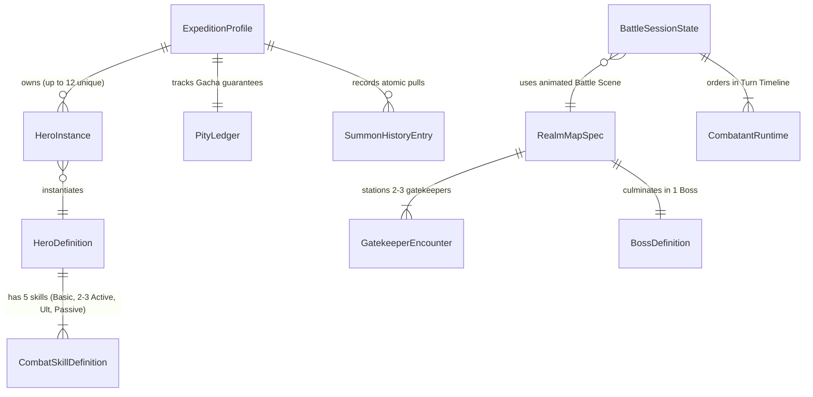

# Phase 1 Data Model: Astral Expedition Pixel (`006-astral-expedition-pixel`)

**Date**: 2026-11-21
**Source Spec**: [spec.md](./spec.md) · **Research**: [research.md](./research.md)

---

## 1. Sơ đồ Quan hệ Thực thể Tổng quan

---

## 2. Hệ Nguyên Tố & Vai Trò Chiến Thuật

- **6 Hệ Nguyên Tố (`ElementType`)** gắn trực tiếp với 7 vùng bản đồ:
  - `Verdant` (Mộc/Phong — Đồng Cỏ) · `Frost` (Băng — Tuyết) · `Solar` (Cát/Quang — Sa Mạc) · `Tide` (Thủy — Dưới Nước) · `Pyre` (Hỏa — Núi Lửa) · `Astral` (Dạ Quang/Tinh Tú — Ban Đêm & Quang Phổ Đêm).
  - Khắc chế nguyên tố gây **`1.30×` sát thương** và **`+50%` điểm Phá Thế (Break)**.
- **4 Vai Trò (`HeroRole`)**:
  - `Vanguard` (Phản Đòn / Phòng Thủ) · `Striker` (Tấn Công Chủ Lực) · `Breaker` (Phá Thế / Khống Chế) · `Luminary` (Hỗ Trợ / Hồi Phục & Tăng AP).

---

## 3. Danh Mục 12 Anh Hùng (`HeroDefinition`) — 3 Bậc `R / SR / SSR`

Mỗi Anh Hùng có bộ sprite overworld `48 frame` (`idle` 24f + `walk` 24f) và bộ sprite chiến đấu góc chéo `BACK` `192×192` **`36 frame` (`6 cột × 6 hàng`)**, kèm 5 kỹ năng trên Menu Kỹ Năng Dọc (tổng cộng **60 kỹ năng riêng biệt**):

| ID (`heroId`) | Tên Tiếng Việt | Độ Hiếm | Nguyên Tố | Vai Trò | Nguồn Mở Khóa | Vũ Khí & Bản Sắc Chiến Đấu |
|---------------|----------------|---------|-----------|---------|---------------|----------------------------|
| `gustave_blade` | **Lữ Khách Phong Kiếm — Lâm Phong** | `SR` | `Verdant` | `Striker` | **Tặng Khởi Đầu #1** | Kiếm mảnh + súng lục ma đạo; tích điện cánh hoa gió tung nhát chém Tụ Lực. |
| `celine_prism` | **Họa Sư Ánh Sáng — Minh Châu** | `SR` | `Solar` | `Luminary` | **Tặng Khởi Đầu #2** | Trượng cọ vẽ quang phổ; hồi máu, buff AP cho đồng đội và khắc ấn sáng. |
| `bastian_aegis` | **Thiết Vệ Cổ Thành — Thạch Sơn** | `R` | `Pyre` | `Vanguard` | **Tặng Khởi Đầu #3** | Khiên tháp rèn lửa; khiêu khích, tăng biên độ cửa sổ Parry và phản chấn mạnh. |
| `lyra_frostbow` | **Cung Thủ Tuyết Vũ — Băng Tâm** | `R` | `Frost` | `Breaker` | Gacha (`R`) | Cung băng tinh thể; bắn liên hoàn 3 mũi Timed Hit bào mòn nhanh thanh Phá Thế. |
| `kestrel_dune` | ** Vũ Giả Cát Vàng — Sa Vũ** | `R` | `Solar` | `Striker` | Gacha (`R`) | Song đao cong; tốc độ cao cướp lượt trên Turn Timeline và tích chảy máu. |
| `nereus_tide` | **Thủy Pháp Sư — Hải Đăng** | `R` | `Tide` | `Luminary` | Gacha (`R`) | Đàn hạc san hô; tạo giáp bọt nước và thanh tẩy hiệu ứng xấu cho cả đội. |
| `corvus_night` | **Ảnh Khách Đêm Thâu — Dạ Vũ** | `SR` | `Astral` | `Breaker` | Gacha (`SR`) | Lưỡi hái bóng đêm; đánh dấu Điểm Yếu khiến đòn Parry kế tiếp x2 điểm Phá Thế. |
| `ignis_valkyrie` | **Hỏa Thương Nữ Vương — Hồng Liên** | `SR` | `Pyre` | `Striker` | Gacha (`SR`) | Trường thương dung nham; nhảy bổ từ trên cao gây nổ diện rộng và đốt cháy. |
| `marina_abyss` | **Thánh Nữ Thủy Cung — Lam Ngọc** | `SR` | `Tide` | `Breaker` | Gacha (`SR`) | Roi nước xoáy sâu; kéo tụt lượt kẻ địch trên Turn Timeline và đóng băng nhịp đòn. |
| `aurelia_eclipse` | **Kiếm Thánh Nhật Thực — Nhật Hạ** | `SSR` | `Solar` | `Striker` | Gacha (`SSR`) | Đại kiếm ánh dương; chuyển thế Thái Dương/Nhật Thực, tung chuỗi 4 nhịp Timed Hit hủy diệt. |
| `seraph_glacier` | **Băng Đế Vĩnh Hằng — Hàn Thiên** | `SSR` | `Frost` | `Vanguard` | Gacha (`SSR`) | Kiếm băng vương miện; mỗi lần Đỡ Phản Đòn thành công triệu hồi kiếm băng phản kích toàn thể. |
| `lumina_chrono` | **Tinh Nữ Quang Phổ — Tinh Hà** | `SSR` | `Astral` | `Luminary` | Gacha (`SSR`) | Tinh cầu cực quang; bẻ cong thứ tự lượt cho đồng đội hành động ngay lập tức + hồi `+3 AP`. |

### Cấu trúc Dữ liệu `HeroDefinition` & `HeroInstance`

| Trường | Kiểu | Quy tắc Kiểm chứng |
|--------|------|--------------------|
| `heroId` | `string` | Duy nhất, `snake_case`, khớp thư mục `assets/units/<heroId>/`. |
| `nameVi` / `titleVi` | `string` | Tiếng Việt có dấu, không rỗng. |
| `rarity` | `'R' \| 'SR' \| 'SSR'` | Bắt buộc thuộc 3 bậc hiếm đã chốt (`FR-011`). |
| `element` | `ElementType` | Thuộc 6 hệ nguyên tố chuẩn. |
| `role` | `HeroRole` | Thuộc 4 vai trò chiến thuật. |
| `baseStats` / `growthPerLevel` | `StatBlock` | `{ hp, atk, def, spd, critRate, critDmg }`; `level ∈ [1..60]`, `critRate ∈ [0.05..1.0]`. |
| `awakeningRank` | `0..6` (`HeroInstance`) | Mở khóa từ mảnh trùng lặp Gacha (`+5%` chỉ số cơ bản / bậc, tối đa `A6`). |
| `skillIds` | `[string, string, string, string, string]` | Đúng 5 kỹ năng: `[basic, active1, active2, ultimate, passive]`. |
| `spriteSpec` | `BattleSpriteContract` | `cellSize: 192`, `cols: 6`, `rows: 6` (`36 frame` chiến đấu `BACK`) + `movementLoops: ['idle', 'walk']` (`48 frame` overworld). |

---

## 4. Thực thể Kỹ Năng Dọc & Bấm Nhịp (`CombatSkillDefinition`)

| Trường | Kiểu | Quy tắc Kiểm chứng |
|--------|------|--------------------|
| `skillId` | `string` | Duy nhất trên toàn bộ 60 kỹ năng Anh Hùng + kỹ năng Quái/Trùm. |
| `slotKind` | `'basic' \| 'active' \| 'ultimate' \| 'passive'` | Thứ tự hiển thị cố định từ trên xuống dưới trên **Menu Chọn Kỹ Năng Dọc**. |
| `nameVi` / `summaryVi` | `string` | Tên ≤ 24 ký tự; mô tả ngắn ≤ 2 dòng trên khung mô tả dưới menu dọc (`SC-003`). |
| `apCost` / `apGain` | `number` | `basic`: `apCost = 0`, `apGain = 2`; `active`: `apCost ∈ [2..5]`; `ultimate`: `apCost ∈ [6..8]`. |
| `targetScope` | `'single_enemy' \| 'all_enemies' \| 'single_ally' \| 'all_allies' \| 'self'` | Xác định con trỏ chọn mục tiêu sau khi bấm chọn trên menu dọc. |
| `hits` | `SkillHitBeat[]` | Mỗi nhịp gồm `{ powerMult, breakDamage, timedHitOffsetMs }`; cho phép 1–4 nhịp Timed Hit mỗi chiêu. |
| `canTriggerBreak` | `boolean` | Ít nhất 1 kỹ năng của mỗi nhân vật (và mọi đòn `Breaker` / `Parry Counter`) có `canTriggerBreak = true` (`FR-010`). |
| `vfxSpec` | `{ castId, effectId, beamStyle? }` | Trỏ tới 2 dải `8 frame` (`cast` + `effect`) trong `assets/skills/`. |

---

## 5. Thực thể 7 Bản Đồ Khám Phá (`RealmMapSpec`), Quái Gác Cổng & 7 Đại Trùm

### Bảng Thiết Kế 7 Bản Đồ & 7 Trùm (`FR-001`, `FR-002`, `FR-013`)

| # | Mã Bản Đồ (`mapId`) | Tên Vùng Đất | Môi Trường Động (8 Frame) | Số Quái Gác Cổng | Trùm Canh Giữ (`bossId` — `256×256` × 36f) | Số Phase & Cơ Chế Đặc Trưng |
|---|---------------------|--------------|---------------------------|------------------|---------------------------------------------|-----------------------------|
| 1 | `01-dawn-meadow` | **Đồng Cỏ Khởi Nguyên** | Cỏ hoa lay gió, suối chảy, cánh hoa bay | 3 chốt | **Hộ Vệ Cổ Mộc — Sylvan Warden** | 2 Phase: Triệu hồi rễ gai đa nhịp + Cú đập địa chấn dạy người chơi căn nhịp Né/Parry. |
| 2 | `02-everfrost-peaks` | **Đỉnh Tuyết Vĩnh Cửu** | Tuyết rơi dày, băng tinh lấp lánh, sương lạnh | 3 chốt | **Kỵ Sĩ Băng Giá — Boreal Chevalier** | 2 Phase: Lao thương băng 3 nhịp liên hoàn; Parry đủ 3 nhịp làm nứt giáp băng của Trùm. |
| 3 | `03-sunken-dunes` | **Sa Mạc Lãng Quên** | Bão cát lướt nhẹ, ảo ảnh nhiệt, hồ ốc đảo | 3 chốt | **Pharaoh Đồng Hồ Cát — Chronos Khepri** | 2 Phase: Đảo ngược tốc độ trên Turn Timeline + mưa thiên thạch cát vàng. |
| 4 | `04-abyssal-sanctum` | **Thủy Cung Thẳm Sâu** | Bong bóng nổi, tảo phát quang, vân nước | 3 chốt | **Chúa Tể Vực Thẳm — Leviathan Sovereign** | 3 Phase: Sóng thần cuốn AP + xúc tu thủy triều quét 4 nhịp tốc độ biến thiên. |
| 5 | `05-cinder-caldera` | **Miệng Núi Lửa Rực Cháy** | Sông dung nham sôi, tàn lửa bay, khói bazan | 3 chốt | ** Đại Tướng Lò Rèn — Vulcan Titan** | 3 Phase: Nung đỏ búa khổng lồ; chỉ khi bị Phá Thế (Break) mới dập tắt lớp giáp nham thạch. |
| 6 | `06-nocturne-veil` | **Vùng Ban Đêm Huyền Ảo** | Đom đóm tím, hoa dạ hương mở cánh, sương đêm | 3 chốt | **Nữ Hoàng Nguyệt Ảnh — Nocturne Weaver** | 3 Phase: Tách bóng trăng khuyết tung nhát chém trễ nhịp (Delayed Feint) thử thách kỹ năng đọc đòn. |
| 7 | `07-aurora-zenith` | **Quang Phổ Mây Trời Ban Đêm** | Biển mây sao + dải Cực Quang 7 màu uốn lượn 8–12f | 2 Hộ Pháp Tinh Tú | **TRÙM CUỐI: Vĩnh Dạ Quang Phổ Vương — Astral Painter Seraphina** | **3 Phase Hoành Tráng**: (P1) Kiếm Vũ Tinh Tú → (P2, `<65% HP`) Nhuộm Đấu Trường Cực Quang đổi hệ liên tục → (P3, `<30% HP`) Bản Giao Hưởng Vĩnh Dạ 5 nhịp Parry liên hoàn quyết định sinh tử. |

### Quy tắc Trạng thái Quái Gác Cổng (`GatekeeperEncounter`) & Phiên Chiến Đấu (`BattleSessionState`)

- **Chuyển trạng thái `GatekeeperEncounter`**:
  - `GUARDING` (đứng canh / đi tuần tra theo `patrolWaypoints[]`, chặn vùng cổng `gateBarrierTiles[]`)
  - → `ENGAGED` (người chơi chạm `aggroRadius`, phát cảnh báo `!` 400 ms, khởi tạo `BattleSessionState`)
  - → nếu **Thắng**: chuyển vĩnh viễn sang `CLEARED` trong `ExpeditionProfile.clearedGatekeepers[]`, mở khóa `gateBarrierTiles[]`, trao thưởng lần đầu (Ấn Tinh Tú quay Gacha + Đá Kinh Nghiệm).
  - → nếu **Thua**: quay lại `GUARDING` ở tâm chốt ban đầu; người chơi hồi sinh tại `lastRestAnchorId` với `100% HP` và khoảng đệm an toàn `>= 6 ô` (`FR-003`, `Edge Cases`).
- **Chuyển trạng thái `BattleSessionState`**:
  `INIT_SCENE` → `TURN_QUEUE_EVAL` → (`PLAYER_MENU_SELECT` → `PLAYER_TIMED_HIT_EXEC` | `ENEMY_TELEGRAPH` → `DEFENSE_DODGE_PARRY_WINDOW`) → `CHECK_BREAK_AND_PHASE` → (`VICTORY` | `DEFEAT` | lặp lại `TURN_QUEUE_EVAL`).

---

## 6. Hệ Thống Triệu Hồi Gacha (`SummonBannerConfig` & `PityLedger`)

| Tham số | Giá trị Chuẩn hóa (`FR-015` – `FR-017`) |
|---------|-----------------------------------------|
| **Đơn vị tiền tệ** | **Ấn Tinh Tú (`astralSeal`)** — `160 Ấn / 1 lượt`, `1.600 Ấn / 10 lượt` (tặng thông qua rương 7 vùng, hạ 20 chốt Quái Gác Cổng, hạ 7 Trùm và thành tựu). |
| **Tỷ lệ cơ bản công khai** | `SSR`: **`3.0%`** · `SR`: **`17.0%`** · `R`: **`80.0%`**. |
| **Bảo hiểm cụm 10 lượt** | Mỗi lần quay 10 lượt (hoặc mỗi 10 lượt liên tiếp không ra `SR+`) đảm bảo ít nhất **1 Anh Hùng bậc `SR` trở lên**. |
| **Bảo hiểm mềm & cứng `SSR`** | Từ lượt `65` tăng dần xác suất (`+5%/lượt`), tại lượt **`80` (`Hard Pity = 80`) chắc chắn `100%` nhận Anh Hùng `SSR`** và đặt lại `ssrPityCount = 0`. |
| **Quy đổi trùng lặp** | Trùng Anh Hùng chưa đạt `A6` → `+1 Mảnh Thức Tỉnh` của Anh Hùng đó + `5 Tinh Huy` (`SR`) / `25 Tinh Huy` (`SSR`); nếu đã đạt tối đa `A6` → quy đổi toàn phần sang `Tinh Huy Quang Phổ` (`starlightToken`) đổi vé triệu hồi hoặc nguyên liệu đột phá. |
